# Your first model: pandas in, predictions out

> AI / ML foundations · Beginner · ~25 min · rung 2 of 38 · needs: What machine learning actually optimises (ai-ml-01)

## Why this matters
You already know what a model optimises; what you do not yet have is the muscle memory of the five lines that turn a CSV into predictions, and that gap is what makes every ML paper and notebook feel further away than it is.
This rung is deliberately maths-free: load data, look at it, pick a target and some features, fit, predict — the same loop that sits under every model you will meet later, from linear regression to a gradient-boosted ensemble.
It sits here because the next rung (validation, overfitting, leakage) is meaningless until you have a fitted model in your hands to be sceptical about.

## The idea

Machine learning in practice has a boring, fixed shape. Data arrives as a table. You name one column as the thing to predict and a few others as the evidence, hand both to a library, and get back an object that turns new rows of evidence into predicted values. Everything else — the maths, the tuning, the model zoo — hangs off that skeleton. This lesson is the skeleton.

### The two containers: DataFrame and Series

pandas is the Python library that holds the table. Its own documentation describes it as

> "a Python package providing fast, flexible, and expressive data structures designed to make working with "relational" or "labeled" data both easy and intuitive."
> — pandas development team, *Package overview*, pandas 2.3 documentation, https://pandas.pydata.org/pandas-docs/version/2.3/_sources/getting_started/overview.rst.txt

It gives you two containers, and the same page defines them precisely: a **Series** is a "1D labeled homogeneously-typed array" and a **DataFrame** is a "General 2D labeled, size-mutable tabular structure with potentially heterogeneously-typed column" (pandas development team, *Package overview*, pandas 2.3 documentation, https://pandas.pydata.org/pandas-docs/version/2.3/_sources/getting_started/overview.rst.txt). In Spark terms: a DataFrame is a Spark `DataFrame` — named columns, one type each, stored column-wise — and a Series is one column pulled out on its own. The difference: pandas is eager and in-memory on one machine, so there is no action/transformation split and every statement runs the moment you type it.

Four calls cover the "look at it" phase. `pd.read_csv(path)` parses a CSV into a DataFrame, inferring a type per column. `df.head()` prints the first five rows — your `df.show(5)`. `df.describe()` prints, per numeric column, the count of non-missing values plus mean, standard deviation, min, the 25/50/75 percentiles and max; a `count` below the row count means nulls, which is why this one call shows both the shape of a column and where data is missing (Kaggle Learn, Intro to Machine Learning, Lesson 2 "Basic Data Exploration"). `df.dtypes` gives the inferred types.

Selection has three forms, and mixing them up is the classic beginner error. `df["Price"]` returns a Series — one column. `df[["Rooms", "Bathroom"]]` returns a DataFrame — a list of columns, hence the double brackets. `df.loc[row_label, "Price"]` selects by **label**, the value in the index; `df.iloc[0]` selects by **position**, from zero (Kaggle Learn, Pandas, Lesson 2 "Indexing, Selecting & Assigning"). Once you drop rows, labels and positions stop agreeing — label 7 may sit at position 5 — and the two then differ on purpose.

### Target and features

Two names appear in every notebook. The **prediction target**, by convention `y`, is the single column you want the model to produce: here `Price`. The **features**, by convention `X`, are the columns it is allowed to look at. Picking them is a list of strings and a double-bracket selection, nothing more (Kaggle Learn, Intro to Machine Learning, Lesson 3 "Your First Machine Learning Model").

Real CSVs have holes, and most scikit-learn estimators reject `NaN` by default. The crude first fix is `df.dropna(axis=0)`: throw away every row with a missing value in any column. Crude, because it discards good data to remove one bad cell, and because rows with holes are rarely a random sample. It is still the right move today — one line, and it gets you to a fitted model. Imputation comes later.

### The scikit-learn contract

scikit-learn's whole API is one convention, repeated for every algorithm. The library's own getting-started page states it plainly:

> "Scikit-learn provides dozens of built-in machine learning algorithms and models, called estimators. Each estimator can be fitted to some data using its fit method."
> — scikit-learn developers, *Getting Started*, scikit-learn documentation, https://scikit-learn.org/stable/getting_started.html

and, for the second half,

> "Once the estimator is fitted, it can be used for predicting target values of new data."
> — scikit-learn developers, *Getting Started*, scikit-learn documentation, https://scikit-learn.org/stable/getting_started.html

So: **define** the estimator (constructor, hyper-parameters only, no data), **fit** it (`model.fit(X, y)`, which mutates the object and returns it), **predict** (`model.predict(X_new)`, one number per input row), then **evaluate** — the next rung. It is an interface with two methods that every estimator implements identically, so swapping a decision tree for a random forest is a one-line change. That is the entire point of the convention.

```mermaid
flowchart LR
  A["melb_data.csv"] -->|"pd.read_csv"| B["DataFrame"]
  B -->|"head(), describe(), dropna()"| C["y = Price column, X = 5 feature columns"]
  C -->|"1. define"| D["DecisionTreeRegressor(random_state=1)"]
  D -->|"2. fit"| E["model.fit(X, y)"]
  E -->|"3. predict"| F["model.predict(X_new)"]
  F --> G["one predicted number per row"]
  G -.->|"4. evaluate"| H["error on rows the model never saw: next lesson"]
  classDef later fill:#f0f0f0,stroke:#bbbbbb,color:#999999
  class H later
```



### Why a decision tree first

A **decision tree** is a nested if/else over the feature columns, learned from data: "is Rooms ≤ 2.5? if yes, is Landsize ≤ 180? …". Each leaf holds one number — the average target of the training rows that landed there — and prediction is walking root to leaf and reading it. scikit-learn's user guide calls trees "a non-parametric supervised learning method used for classification and regression", and lists among their advantages,

> "Requires little data preparation. Other techniques often require data normalization, dummy variables need to be created and blank values to be removed."
> — scikit-learn developers, *1.10. Decision Trees*, scikit-learn 1.9 documentation, https://scikit-learn.org/1.9/modules/tree.html

That is why it is the first model: no scaling, no centring, no encoding games. Latitude in degrees and land size in square metres sit in the same `X` unnormalised, because every split compares one column against a threshold. `DecisionTreeRegressor` is the regression flavour, predicting a continuous number rather than a class label; `random_state=1` fixes the tie-breaking randomness so your tree and mine are identical.

### What carries over from Spark

Three habits transfer directly. **Vectorised column operations**: `df["Price"] / df["Rooms"]` runs over the whole column in one C loop, as a Spark column expression compiles to one pass — a Python `for` loop over rows is the pandas equivalent of a per-row UDF, correct and an order of magnitude slower. **Groupby and aggregation**: `df.groupby("Rooms")["Price"].mean()` is `df.groupBy("Rooms").agg(avg("Price"))`, same split-apply-combine semantics (Kaggle Learn, Pandas, Lesson 4 "Grouping and Sorting"). **Columnar typing**: one dtype per column, and a stray non-numeric value silently promotes the column to `object`, exactly as a schema mismatch bites you in Spark.

## Lab

**Question this lab answers:** given a Melbourne-housing-shaped CSV, what exactly do the five steps — read, inspect, select, fit, predict — print at each stage, and what does a freshly fitted decision tree say about rows it was trained on?

The CSV below is a stand-in with the same shape and the same column spellings as the Melbourne housing data used by Kaggle's course, generated inline so you can run this anywhere without a download; the mechanics are identical. Run with pandas 3.0.5 and scikit-learn 1.9.1 (the versions used for the output below).

### Step 1 — write the CSV

```python
from pathlib import Path

CSV = """Suburb,Rooms,Bathroom,Landsize,Lattitude,Longtitude,Price
Abbotsford,2,1.0,202.0,-37.7996,144.9984,1035000
Abbotsford,2,1.0,156.0,-37.8079,144.9934,1480000
Abbotsford,3,2.0,134.0,-37.8093,144.9944,1465000
Abbotsford,3,2.0,94.0,-37.7969,144.9969,850000
Abbotsford,4,1.0,120.0,-37.8072,144.9941,1600000
Abbotsford,2,1.0,,-37.8024,144.9993,941000
Abbotsford,3,2.0,245.0,-37.8060,144.9954,1876000
Abbotsford,3,1.0,256.0,-37.8008,144.9973,1636000
Abbotsford,2,,0.0,-37.8010,144.9989,1097000
Abbotsford,3,2.0,220.0,-37.8085,144.9927,1350000
Abbotsford,4,2.0,400.0,-37.8041,144.9958,2000000
Abbotsford,4,2.0,310.0,-37.8111,144.9950,1810000
Abbotsford,2,1.0,180.0,-37.8033,144.9966,
Abbotsford,3,1.0,210.0,-37.8097,144.9978,1300000
"""
Path("melb_data_small.csv").write_text(CSV)
```

Fourteen rows, three deliberate holes: a missing `Landsize`, a missing `Bathroom`, a missing `Price`.

### Step 2 — read it and look at it

```python
import pandas as pd
pd.set_option("display.width", 120)

df = pd.read_csv("melb_data_small.csv")
print("shape:", df.shape)
print("\n--- df.head() ---");  print(df.head())
print("\n--- df.dtypes ---");  print(df.dtypes)
print("\n--- df['Price'] is a Series ---")
print(type(df["Price"]).__name__, "| type(df[['Price']]) =", type(df[["Price"]]).__name__)
print("\n--- df.describe() on the numeric columns ---")
print(df[["Rooms", "Bathroom", "Landsize", "Price"]].describe())
print("\n--- iloc[0] : first row by position ---");  print(df.iloc[0])
print("\n--- loc[0, 'Price'] : by label ---");       print(df.loc[0, "Price"])
print("\n--- missing values per column ---");        print(df.isna().sum())
```

```text
shape: (14, 7)

--- df.head() ---
       Suburb  Rooms  Bathroom  Landsize  Lattitude  Longtitude      Price
0  Abbotsford      2       1.0     202.0   -37.7996    144.9984  1035000.0
1  Abbotsford      2       1.0     156.0   -37.8079    144.9934  1480000.0
2  Abbotsford      3       2.0     134.0   -37.8093    144.9944  1465000.0
3  Abbotsford      3       2.0      94.0   -37.7969    144.9969   850000.0
4  Abbotsford      4       1.0     120.0   -37.8072    144.9941  1600000.0

--- df.dtypes ---
Suburb            str
Rooms           int64
Bathroom      float64
Landsize      float64
Lattitude     float64
Longtitude    float64
Price         float64
dtype: object

--- df['Price'] is a Series ---
Series | type(df[['Price']]) = DataFrame

--- df.describe() on the numeric columns ---
           Rooms   Bathroom    Landsize         Price
count  14.000000  13.000000   13.000000  1.300000e+01
mean    2.857143   1.461538  194.384615  1.418462e+06
std     0.770329   0.518875  100.698840  3.659783e+05
min     2.000000   1.000000    0.000000  8.500000e+05
25%     2.000000   1.000000  134.000000  1.097000e+06
50%     3.000000   1.000000  202.000000  1.465000e+06
75%     3.000000   2.000000  245.000000  1.636000e+06
max     4.000000   2.000000  400.000000  2.000000e+06

--- iloc[0] : first row by position ---
Suburb        Abbotsford
Rooms                  2
Bathroom             1.0
Landsize           202.0
Lattitude       -37.7996
Longtitude      144.9984
Price          1035000.0
Name: 0, dtype: object

--- loc[0, 'Price'] : by label ---
1035000.0

--- missing values per column ---
Suburb        0
Rooms         0
Bathroom      1
Landsize      1
Lattitude     0
Longtitude    0
Price         1
dtype: int64
```

### Step 3 — drop the holes, pick y and X

```python
clean = df.dropna(axis=0)
print("rows before dropna:", len(df), "| after dropna:", len(clean))
print("dropped index labels:", sorted(set(df.index) - set(clean.index)))

y = clean["Price"]
features = ["Rooms", "Bathroom", "Landsize", "Lattitude", "Longtitude"]
X = clean[features]
print("\ny is a", type(y).__name__, "of shape", y.shape,
      "| X is a", type(X).__name__, "of shape", X.shape)
print("\n--- X.head() ---");  print(X.head())
print("\n--- y.head() ---");  print(y.head())
```

```text
rows before dropna: 14 | after dropna: 11
dropped index labels: [5, 8, 12]

y is a Series of shape (11,) | X is a DataFrame of shape (11, 5)

--- X.head() ---
   Rooms  Bathroom  Landsize  Lattitude  Longtitude
0      2       1.0     202.0   -37.7996    144.9984
1      2       1.0     156.0   -37.8079    144.9934
2      3       2.0     134.0   -37.8093    144.9944
3      3       2.0      94.0   -37.7969    144.9969
4      4       1.0     120.0   -37.8072    144.9941

--- y.head() ---
0    1035000.0
1    1480000.0
2    1465000.0
3     850000.0
4    1600000.0
Name: Price, dtype: float64
```

### Step 4 — define, fit, predict

```python
from sklearn.tree import DecisionTreeRegressor
pd.set_option("display.float_format", lambda v: f"{v:,.1f}")

model = DecisionTreeRegressor(random_state=1)   # define
model.fit(X, y)                                 # fit
preds = model.predict(X.head())                 # predict

out = X.head()[["Rooms", "Bathroom", "Landsize"]].copy()
out["actual_Price"] = y.head().values
out["predicted_Price"] = preds
out["error"] = out["predicted_Price"] - out["actual_Price"]
print("--- first five rows: features, actual, prediction ---")
print(out)
print("\ntree depth:", model.get_depth(), "| leaves:", model.get_n_leaves(),
      "| training rows:", len(X))

new = pd.DataFrame([{"Rooms": 4, "Bathroom": 2.0, "Landsize": 350.0,
                     "Lattitude": -37.8050, "Longtitude": 144.9955}])
print("\n--- predict a house that is NOT in the data (4 rooms, 2 baths, 350 sqm) ---")
print("prediction:", f"{model.predict(new)[0]:,.1f}")
```

```text
--- first five rows: features, actual, prediction ---
   Rooms  Bathroom  Landsize  actual_Price  predicted_Price  error
0      2       1.0     202.0   1,035,000.0      1,035,000.0    0.0
1      2       1.0     156.0   1,480,000.0      1,480,000.0    0.0
2      3       2.0     134.0   1,465,000.0      1,465,000.0    0.0
3      3       2.0      94.0     850,000.0        850,000.0    0.0
4      4       1.0     120.0   1,600,000.0      1,600,000.0    0.0

tree depth: 5 | leaves: 11 | training rows: 11

--- predict a house that is NOT in the data (4 rooms, 2 baths, 350 sqm) ---
prediction: 1,810,000.0
```

### Step 5 — one groupby

```python
pd.set_option("display.float_format", lambda v: f"{v:,.2f}")
print("--- mean Price by Rooms (after dropna) ---")
print(clean.groupby("Rooms")["Price"].agg(["count", "mean"]))
print("\n--- vectorised column: price per room ---")
clean = clean.assign(price_per_room=clean["Price"] / clean["Rooms"])
print(clean[["Rooms", "Price", "price_per_room"]].head())
```

```text
--- mean Price by Rooms (after dropna) ---
       count         mean
Rooms
2          2 1,257,500.00
3          6 1,412,833.33
4          3 1,803,333.33

--- vectorised column: price per room ---
   Rooms        Price  price_per_room
0      2 1,035,000.00      517,500.00
1      2 1,480,000.00      740,000.00
2      3 1,465,000.00      488,333.33
3      3   850,000.00      283,333.33
4      4 1,600,000.00      400,000.00
```

### Reading the output

**Step 2 — `describe()` and the missing-value count.** Each row of `describe()` is a statistic, each column a numeric column of the data. `count` is the number of **non-missing** values: `Rooms` shows 14, `Bathroom`, `Landsize` and `Price` show 13 — one hole each, confirmed by `isna().sum()`. There is no "better" direction for `mean` or `std`; the number to watch is `count`, where higher is better, because any shortfall is data you are about to lose. `std` for `Price` is 3.66e+05 against a mean of 1.42e+06, so prices spread by roughly a quarter of their average — enough variation for a model to have something to learn. `Landsize` has a `min` of 0.0, which is not a missing value and `dropna` will not catch it; it is the kind of junk that needs a domain rule, not a null check. Note also `Suburb` has dtype `str` while every numeric column is `int64` or `float64`: `Rooms` stayed integer because no row has a missing room count, whereas `Bathroom` was promoted to `float64` purely to hold one `NaN`. Finally, `iloc[0]` and `loc[0, "Price"]` agree here only because position 0 and label 0 are still the same row — before any filtering.

**Verdict:** the table is small, mostly clean, and the one number that matters before modelling is `count` — three rows are about to be thrown away.

**Step 3 — what `dropna` cost.** 14 rows in, 11 out, and the dropped index labels are exactly `[5, 8, 12]`: the row with no `Landsize`, the row with no `Bathroom`, and the row with no `Price`. That is 3/14 = 21.4% of the data destroyed to remove 3 bad cells out of 14 × 7 = 98 cells, i.e. 3.1% of the cells. The index now has holes — label 5 does not exist — which is why `loc` and `iloc` diverge from this point on.

**Verdict:** `dropna` works and is one line, but the cost-to-benefit arithmetic (21.4% of rows for 3.1% of cells) is exactly why imputation exists.

**Step 4 — the predictions.** `actual_Price` is the truth from the CSV, `predicted_Price` is what the fitted tree says, `error` is prediction minus actual, and closer to 0 is better. Every error is exactly 0.0. That is not a good model; it is a model that has memorised the table. The giveaway is in the next line: 11 leaves for 11 training rows, depth 5. The tree kept splitting until each leaf held exactly one row, so each leaf's "average target of the rows that landed here" is that one row's own price. Trace row 0: it falls through five comparisons into a leaf containing only training row 0, so the leaf value is the mean of a single number, 1,035,000.0 / 1 = 1,035,000.0, and the error is 1,035,000.0 − 1,035,000.0 = 0.0. The honest test is the last line: a 4-room, 2-bath, 350 m² house that is *not* in the table gets 1,810,000.0 — the exact price of the one 4-room/2-bath/310 m² row it most resembles. The model cannot produce a number it has not already seen.

**Verdict:** zero error on training rows means nothing; this is the overfitting you will measure properly in the next lesson.

**Step 5 — the groupby.** `count` is rows per group after `dropna`, `mean` the average price in that group. Reading down: 2 rooms → 1,257,500.00 over 2 rows; 3 rooms → 1,412,833.33 over 6 rows; 4 rooms → 1,803,333.33 over 3 rows. Trace the 4-room group by hand: its prices are 1,600,000 + 2,000,000 + 1,810,000 = 5,410,000, and 5,410,000 / 3 = 1,803,333.33 — which matches the printed value. Price rises with rooms, which is the signal the tree is exploiting. `count` here is also a warning: a mean over 2 rows is not a fact about Melbourne, it is a fact about two houses. The `price_per_room` column was computed with a single `/` over two columns — no loop — the same vectorised column expression you would write in Spark.

**Verdict:** the groupby confirms a real `Rooms → Price` relationship and simultaneously shows the group sizes are far too small to trust the exact numbers.

### Cause → consequence

1. **Cause:** `DecisionTreeRegressor(random_state=1)` was constructed with no depth or leaf-size limit, and fitted on 11 rows whose feature combinations are all distinct.
2. **Mechanism:** the fitting algorithm keeps splitting a node while the rows inside it disagree, so it ran until every leaf held exactly one training row — 11 leaves, depth 5 — making each leaf value that row's own price.
3. **Consequence:** `predict` on the training rows returns the actuals exactly, error 0.0 everywhere, while predicting an unseen house just returns the price of the nearest memorised one (1,810,000.0).
4. **What it means in practice:** any accuracy number measured on the rows you trained on is meaningless, so the only question worth asking about a model is how it scores on rows it has never seen — which is the whole content of the next rung.

## Self-check
1. You run `df.dropna(axis=0)` and then `clean.iloc[5]` and `clean.loc[5]`. Why can these return different rows, and which one is guaranteed to work? <details><summary>Answer</summary>`iloc` selects by position, `loc` by index label. `dropna` removes rows but does not renumber the index, so after dropping labels 5, 8 and 12 the row at position 5 carries label 6. `iloc[5]` always works as long as there are at least 6 rows; `loc[5]` raises a `KeyError`, because label 5 no longer exists.</details>
2. You swap `DecisionTreeRegressor` for a model that is sensitive to feature scale, keeping `Landsize` (hundreds of square metres) and `Lattitude` (about −37.8) in the same `X`. Why was that a non-issue for the tree, and why might it not be for the new model? <details><summary>Answer</summary>A decision tree only ever compares one column against a threshold inside that column, so the units of the other columns are irrelevant and no normalisation is needed — "Requires little data preparation", as scikit-learn's decision-tree guide puts it. Models that combine columns through distances or weighted sums (k-nearest neighbours, SVMs, anything gradient-descent-trained without scaling) let the column with the larger numeric range dominate, so they need the features scaled first.</details>
3. Your fitted model scores zero error on `X` and your colleague calls it production-ready. Give the one-sentence rebuttal and name the step of the scikit-learn contract that is missing. <details><summary>Answer</summary>The tree has one leaf per training row, so it has memorised the table rather than learned a rule — predicting on the data it was fitted on measures memory, not skill. The missing step is **evaluate**: score it on held-out rows it never saw during `fit`.</details>

## Sources
- [Kaggle Learn — Intro to Machine Learning](https://www.kaggle.com/learn/intro-to-machine-learning) — the read-CSV → describe → pick `y` and `X` → `DecisionTreeRegressor.fit` → `predict` sequence this lesson follows, and the `dropna` first fix; locator: Lesson 2 "Basic Data Exploration"; Lesson 3 "Your First Machine Learning Model"; accessed 2026-10-11.
- [Kaggle Learn — Pandas](https://www.kaggle.com/learn/pandas) — `read_csv`, the Series/DataFrame distinction, `loc` versus `iloc`, and split-apply-combine with `groupby`; locator: Lesson 1 "Creating, Reading and Writing"; Lesson 2 "Indexing, Selecting & Assigning"; Lesson 4 "Grouping and Sorting"; accessed 2026-10-11.
- [pandas — Package overview (v2.3 documentation source)](https://pandas.pydata.org/pandas-docs/version/2.3/_sources/getting_started/overview.rst.txt) — the quoted definition of pandas and the verbatim one-line definitions of Series and DataFrame; accessed 2026-10-11.
- [scikit-learn — Getting Started](https://scikit-learn.org/stable/getting_started.html) — the quoted statement of the estimator contract: estimators, `fit`, and predicting on new data; accessed 2026-10-11.
- [scikit-learn — 1.10. Decision Trees (v1.9)](https://scikit-learn.org/1.9/modules/tree.html) — the definition of decision trees as a non-parametric supervised method and the quoted "requires little data preparation" advantage; accessed 2026-10-11.

## Next on this track
Next on AI / ML foundations: **Validation, overfitting and data leakage** (rung 3 of 38, Beginner).
