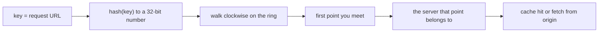
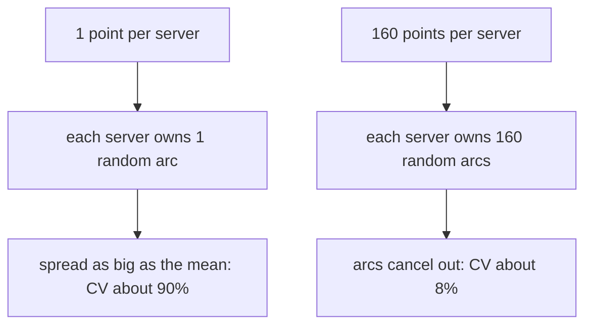

# Consistent hashing: why servers need many hashes

> Fresh · Software architecture & design · Intermediate · ~25 min · from today's feeds

## Why this matters

Today's item is an engineering post about the data structure that decides which of Cloudflare's cache servers answers a given URL — a consistent-hashing ring — and about three separate wins on it: the right number of hash points per server, six bytes per point instead of eight, and a migration that did not throw away the cache.

It was published on the Cloudflare blog on 18 September 2026 by Kevin Guthrie, Mariia Iurchenko, Zaidoon Abd Al Hadi and Ivan Babrou: https://blog.cloudflare.com/saving-100-tb-of-ram-with-math/

It is worth 25 minutes because it is the same routing decision you make every time you shard an Akka cluster, assign Kafka partitions or put a cache tier in front of a service — and it shows, with real numbers, that the obvious one-hash-per-server design is catastrophically unfair, and that the fix is a tunable with a cost you can compute.

## Primer

A **hash function** takes any input — a string, a URL, an entity id — and returns a fixed-width number that looks random but is fully deterministic: the same input always gives the same number, and nearby inputs give unrelated numbers. `blake2b("/a") -> 38507317` is a hash; so is Java's `String.hashCode`. "Looks random" is the useful property: it spreads structured inputs (URLs that all start with the same prefix) evenly across the number space.

**Routing a key to one of N servers** means: given a request key — here a URL — pick exactly one server that will handle it, and have every machine in the fleet pick the *same* one, with no coordination. The textbook answer is `hash(key) mod N`: hash the key, take the remainder modulo the server count, use that as an index.

That works until N changes. Add one server and almost every key moves: with N = 100, key hash 1234 lands on server 34; with N = 101 the same key lands on server 22. For a cache, a key moving means its cached copy is on the wrong machine and the new owner has to fetch it from the origin again — a **cache invalidation**, at fleet scale, all at once.

**Consistent hashing** is the fix, introduced by Karger et al. at MIT in 1997 in "Consistent Hashing and Random Trees: Distributed Caching Protocols for Relieving Hot Spots on the World Wide Web", *Proceedings of the Twenty-Ninth Annual ACM Symposium on Theory of Computing*, pp. 654–663 ([Wikipedia, "Consistent hashing"](https://en.wikipedia.org/wiki/Consistent_hashing), accessed 2026-10-11). Instead of indexing into a list, you hash the *servers* into the same number space as the keys, arrange that space as a circle — the **hash ring** — and give each key to the first server you meet walking around the circle from the key's own hash. Adding or removing a server only reassigns the keys in the arc next to it: "the vast majority of the BLOBs maintain their prior server assignments" (Wikipedia, "Consistent hashing", accessed 2026-10-11). Cloudflare uses exactly this shape:

> "Internally we use it to route cacheable requests to servers by URL."
> — Kevin Guthrie, Mariia Iurchenko, Zaidoon Abd Al Hadi and Ivan Babrou, Cloudflare, *Saving another 100TB of RAM with math (and Rust)*, 18 September 2026, https://blog.cloudflare.com/saving-100-tb-of-ram-with-math/

## The idea

### One hash per server is fair on average and unfair in fact

Put 100 servers on the ring with one hash each and you have cut the circle at 100 uniformly random points. Each server owns the arc ending at its point, so a key lands on it with probability equal to that arc's width. The expected width is 1/100 of the ring; the actual widths are wildly different, because random points do not space themselves out — they clump. In the ring I build in the Lab, one server's arc is 3.484% of the circle and its neighbour's is 0.318%, an 11x difference on the same ring.

The standard measure of that spread is the **coefficient of variation** (CV): the standard deviation of the per-server loads divided by their mean, as a percent. It is scale-free, so a CV of 10% means a typical server sits about 10% off its fair share whatever the traffic volume. For a 100-server ring with one hash each, the post reports:

> "the coefficient of variation (which we can think of like an error margin) drops from about 99% to about 8%"
> — Kevin Guthrie, Mariia Iurchenko, Zaidoon Abd Al Hadi and Ivan Babrou, Cloudflare, *Saving another 100TB of RAM with math (and Rust)*, 18 September 2026, https://blog.cloudflare.com/saving-100-tb-of-ram-with-math/

A CV near 99% is not a rounding problem: the busiest machine does several times the work of the median one, permanently and with no failure anywhere. Since you size every server for the worst case, you pay for a fleet several times larger than the work requires.

### The fix: many points per server

The remedy is to stop giving a server one position and give it many. Each server is hashed under several labels — `server-25#0`, `server-25#1`, … — and every resulting point goes on the ring, all of them mapping back to the same physical server. These extra points are called **virtual nodes**, or just **points**: "Those duplicate labels are called 'virtual nodes'" (Wikipedia, "Consistent hashing", accessed 2026-10-11). The post states the move plainly:

> "To solve the problem of imbalanced workloads, we can add multiple hashes to represent each server instead of just one."
> — Kevin Guthrie, Mariia Iurchenko, Zaidoon Abd Al Hadi and Ivan Babrou, Cloudflare, *Saving another 100TB of RAM with math (and Rust)*, 18 September 2026, https://blog.cloudflare.com/saving-100-tb-of-ram-with-math/

It works by averaging. A server's share is now the sum of k independent arcs instead of one, and sums of independent random quantities concentrate: the spread grows like √k while the total grows like k, so the *relative* spread — the CV — falls roughly as 1/√k. That is the whole mathematical content, and it predicts the published numbers: "if we use 160 points per server instead of just one" the CV drops from about 99% to about 8% (Cloudflare, 18 September 2026) — and 99/√160 ≈ 7.8%.





### The costs, and what Cloudflare did about them

Points are not free: the ring is a sorted array held in memory on every server, so memory scales as servers × points × bytes-per-point. All three factors became targets.

**Factor 2 — fewer points.** The returns diminish fast (1/√k flattens), and there is a second, nastier ceiling: the hash space is 32 bits, so with enough points two of them collide, and "a collision means some contributions are randomly dropped, introducing unpredictable error" (Cloudflare, 18 September 2026). Deriving the exact error formula for k points let the team find the knee of the curve:

> "could decrease the number of hashes we were generating for each server by 90% without incurring any appreciable error"
> — Kevin Guthrie, Mariia Iurchenko, Zaidoon Abd Al Hadi and Ivan Babrou, Cloudflare, *Saving another 100TB of RAM with math (and Rust)*, 18 September 2026, https://blog.cloudflare.com/saving-100-tb-of-ram-with-math/

**Factor 3 — fewer bytes per point.** Each entry stores the point's hash and its server: "In memory this is represented as eight bytes, where four go to the hash" (Cloudflare, 18 September 2026) — four bytes of hash, four of server index. "Zaidoon's insight was that a 32-bit integer for that index is wasteful" (Cloudflare, 18 September 2026): no data centre has four billion servers, so 16 bits is plenty. Shrinking the field alone changed nothing, because of **struct alignment** — a compiler pads every struct to a multiple of its widest field's alignment so array indexing stays a single multiply, so a 4+2 layout is padded back to 8:

> "Changing the size of the index as we did above does nothing to reduce the memory footprint."
> — Kevin Guthrie, Mariia Iurchenko, Zaidoon Abd Al Hadi and Ivan Babrou, Cloudflare, *Saving another 100TB of RAM with math (and Rust)*, 18 September 2026, https://blog.cloudflare.com/saving-100-tb-of-ram-with-math/

The escape is to stop letting the compiler see fields at all: "A safer but less readable solution is to store the hash and index as raw byte array and access them with getters" (Cloudflare, 18 September 2026) — a `[u8; 6]` with accessor functions, which has no alignment requirement above 1. "This simple (if wordy) change reduces the amount of memory used for consistent hashing by a whopping 25%!" (Cloudflare, 18 September 2026) — 6 bytes instead of 8 is exactly 25% off.

**The rollout.** Changing the ring changes which server owns which URL, which is a fleet-wide cache invalidation:

> "Even if the new ring is better, switching the whole network at once would effectively invalidate almost all cached content."
> — Kevin Guthrie, Mariia Iurchenko, Zaidoon Abd Al Hadi and Ivan Babrou, Cloudflare, *Saving another 100TB of RAM with math (and Rust)*, 18 September 2026, https://blog.cloudflare.com/saving-100-tb-of-ram-with-math/

Every missed key becomes an origin request, so a clean cut would turn a memory optimisation into a DDoS against customers' origins. Instead, "We then rolled the migration out in layers" (Cloudflare, 18 September 2026) — both rings running together, a per-request choice between them, data centre by data centre, with a rollback at each step. The payoff: "Looking at the difference, we get the satisfying result that our changes dropped the used memory by 100TB!" (Cloudflare, 18 September 2026).

## Lab

How unbalanced is a one-hash-per-server ring, how many points per server does it take to fix it, and what do those points cost in memory?

Roughly five minutes: paste the script, run it, read three tables. Standard library only.

### Step 1 — build the ring and see the arcs

```python
import hashlib, bisect, statistics

SPACE = 1 << 32

def h32(s):
    return int.from_bytes(hashlib.blake2b(s.encode(), digest_size=4).digest(), "big")

def build(n_servers, points):
    ring = []
    for s in range(n_servers):
        for p in range(points):
            ring.append((h32(f"server-{s}#{p}"), s))
    ring.sort()
    return ring

def place(ring, keys):
    pos = [p for p, _ in ring]
    owner = [s for _, s in ring]
    counts = {}
    for k in keys:
        i = bisect.bisect_right(pos, h32(k)) % len(pos)
        counts[owner[i]] = counts.get(owner[i], 0) + 1
    return counts

N = 100
KEYS = [f"https://example.com/asset/{i}" for i in range(100_000)]

print("=== STEP 1: one hash per server, 100 servers ===")
ring1 = build(N, 1)
print("first 5 ring points (hash32, server, arc width as % of ring):")
for i in range(5):
    p, s = ring1[i]
    nxt = ring1[(i+1) % len(ring1)][0]
    arc = (nxt - p) % SPACE
    print(f"  point {i}: hash={p:10d} -> server {s:3d}  arc={100*arc/SPACE:6.3f}%")
c1 = place(ring1, KEYS)
loads1 = [c1.get(s, 0) for s in range(N)]
print("\nper-server key counts, servers 0-9:", loads1[:10])
print("min =", min(loads1), " max =", max(loads1), " mean =", statistics.mean(loads1))
sd1 = statistics.pstdev(loads1)
print(f"stdev = {sd1:.2f}   CV = {100*sd1/statistics.mean(loads1):.1f}%")
```

Real output:

```text
=== STEP 1: one hash per server, 100 servers ===
first 5 ring points (hash32, server, arc width as % of ring):
  point 0: hash=  38507317 -> server  25  arc= 1.374%
  point 1: hash=  97515365 -> server   6  arc= 1.198%
  point 2: hash= 148959341 -> server  51  arc= 3.484%
  point 3: hash= 298605877 -> server  13  arc= 0.318%
  point 4: hash= 312272636 -> server  47  arc= 1.205%

per-server key counts, servers 0-9: [133, 514, 475, 382, 9, 3808, 1357, 52, 1792, 708]
min = 5  max = 3808  mean = 1000
stdev = 905.84   CV = 90.6%
```

### Step 2 — add points per server and watch the CV fall

```python
print("\n=== STEP 2: more points per server ===")
for pts in (1, 16, 40, 160):
    ring = build(N, pts)
    c = place(ring, KEYS)
    loads = [c.get(s, 0) for s in range(N)]
    mean = statistics.mean(loads)
    sd = statistics.pstdev(loads)
    print(f"points/server={pts:4d}  ring size={len(ring):6d}  "
          f"server0={loads[0]:6d} server1={loads[1]:6d} server2={loads[2]:6d}  "
          f"min={min(loads):6d} max={max(loads):6d}  stdev={sd:8.2f}  CV={100*sd/mean:5.1f}%")
```

Real output:

```text
=== STEP 2: more points per server ===
points/server=   1  ring size=   100  server0=   133 server1=   514 server2=   475  min=     5 max=  3808  stdev=  905.84  CV= 90.6%
points/server=  16  ring size=  1600  server0=   857 server1=   986 server2=  1174  min=   509 max=  1872  stdev=  246.98  CV= 24.7%
points/server=  40  ring size=  4000  server0=  1008 server1=   969 server2=   978  min=   606 max=  1621  stdev=  159.61  CV= 16.0%
points/server= 160  ring size= 16000  server0=  1173 server1=   933 server2=   965  min=   779 max=  1219  stdev=   86.47  CV=  8.6%
```

### Step 3 — what the points cost

```python
print("\n=== STEP 3: memory arithmetic, 8 bytes vs 6 bytes per point ===")
for servers in (100, 10_000):
    for pts in (160, 16):
        for width in (8, 6):
            total = servers * pts * width
            print(f"servers={servers:6d} points/server={pts:4d} bytes/point={width}  "
                  f"-> {total:12d} bytes = {total/1024/1024:9.2f} MiB per ring copy")
```

Real output:

```text
=== STEP 3: memory arithmetic, 8 bytes vs 6 bytes per point ===
servers=   100 points/server= 160 bytes/point=8  ->       128000 bytes =      0.12 MiB per ring copy
servers=   100 points/server= 160 bytes/point=6  ->        96000 bytes =      0.09 MiB per ring copy
servers=   100 points/server=  16 bytes/point=8  ->        12800 bytes =      0.01 MiB per ring copy
servers=   100 points/server=  16 bytes/point=6  ->         9600 bytes =      0.01 MiB per ring copy
servers= 10000 points/server= 160 bytes/point=8  ->     12800000 bytes =     12.21 MiB per ring copy
servers= 10000 points/server= 160 bytes/point=6  ->      9600000 bytes =      9.16 MiB per ring copy
servers= 10000 points/server=  16 bytes/point=8  ->      1280000 bytes =      1.22 MiB per ring copy
servers= 10000 points/server=  16 bytes/point=6  ->       960000 bytes =      0.92 MiB per ring copy
```

### Reading the output

**Step 1 — the arcs.** Each line is one ring point: its 32-bit hash, the server it belongs to, and the width of the arc it owns as a percent of the whole circle. With 100 servers the fair share is 1.000% each. Lower spread is better; here there is none to speak of — server 51 owns 3.484% and server 13 owns 0.318%, so one neighbour gets about 11x the traffic of the other purely by luck of the hash.

| ring point | hash | server | arc width | vs fair share (1.000%) |
|---|---|---|---|---|
| 0 | 38507317 | 25 | 1.374% | 1.37x |
| 1 | 97515365 | 6 | 1.198% | 1.20x |
| 2 | 148959341 | 51 | 3.484% | 3.48x |
| 3 | 298605877 | 13 | 0.318% | 0.32x |
| 4 | 312272636 | 47 | 1.205% | 1.21x |

The key counts confirm it on real traffic: 100000 keys over 100 servers means a mean of exactly 1000 keys each, but server 4 got 9 keys and server 5 got 3808. The arithmetic for the CV, with digits: mean = 100000 / 100 = 1000; standard deviation = 905.84; CV = 905.84 / 1000 = 0.90584 = **90.6%**. That is my ring's version of the roughly 99% the post reports for the same 100-server, one-hash case (Cloudflare, 18 September 2026) — the exact figure depends on which random ring you drew, the order of magnitude does not.

**Verdict:** one hash per server is not "slightly uneven", it is a fleet where the hottest machine does 3808/1000 ≈ 3.8x its share and the coldest does 0.009x. Size for the worst case and you buy roughly four times the hardware you need.

**Step 2 — the fix and its shape.** Columns: points per server, total ring entries, the load of three sample servers, the min and max load across all 100, the standard deviation and the CV. Lower CV is better; min and max should converge towards 1000.

| points/server | ring size | min load | max load | stdev | CV |
|---|---|---|---|---|---|
| 1 | 100 | 5 | 3808 | 905.84 | 90.6% |
| 16 | 1600 | 509 | 1872 | 246.98 | 24.7% |
| 40 | 4000 | 606 | 1621 | 159.61 | 16.0% |
| 160 | 16000 | 779 | 1219 | 86.47 | 8.6% |

Trace the last row by hand: stdev = 86.47, mean = 1000, so CV = 86.47 / 1000 = 0.08647 = **8.6%** — the same ballpark as the "about 8%" the post reports at 160 points per server (Cloudflare, 18 September 2026). And the 1/√k prediction holds across the table: 90.6 / √16 = 22.7% against a measured 24.7%; 90.6 / √40 = 14.3% against 16.0%; 90.6 / √160 = 7.2% against 8.6%. Note the diminishing returns — going 1 → 16 removes 66 points of CV, 40 → 160 removes only 7.4 — which is exactly the slack that let Cloudflare "decrease the number of hashes we were generating for each server by 90% without incurring any appreciable error" (Cloudflare, 18 September 2026).

**Verdict:** 160 points per server buys you a fleet where the worst server is 1.22x its share instead of 3.8x; but most of that gain is already there by 40, and the last stretch is the expensive one.

**Step 3 — the price tag.** Each line is one ring held in memory: servers × points/server × bytes per point. Smaller is better, and the only lever that does not cost balance is the byte width. At 10000 servers and 160 points, the ring is 12800000 bytes = 12.21 MiB at 8 bytes per point and 9600000 bytes = 9.16 MiB at 6 — exactly the 25% the post claims for the raw-byte-array layout (Cloudflare, 18 September 2026): 1 − 6/8 = 0.25. Cutting points 160 → 16 is the bigger lever, a further 10x. Multiply either saving by every process on every machine in a global fleet and you are at the post's 100TB (Cloudflare, 18 September 2026).

**Verdict:** the memory question is three independent multipliers. Tune points first (biggest factor, costs balance), then bytes per point (free, costs readability), and only then worry about the server count, which you do not control.

### Cause → mechanism → consequence → what it means in practice

1. **Cause.** You place each server on the ring once, at a uniformly random hash.
2. **Mechanism.** Random points clump, so each server's arc — and therefore its share of traffic — is a single random quantity with a spread as large as its own mean; measured CV 90.6% in Step 1.
3. **Consequence.** One machine serves 3808 keys while another serves 9, permanently and with no failure anywhere, so you must size the whole fleet for the hot one.
4. **What it means in practice.** Anywhere you hash an identity to an owner, check how many points per owner the library uses before you trust the balance. Akka cluster sharding routes by `shardId` and you choose the number of shards: the same 1/√k law says ~10 shards per node is a 30% error margin and ~100 per node is ~10% — that is why the usual advice is "ten times more shards than nodes, at least". Kafka's partition assignment is the same bet with the partition count as k, which is why a topic with 3 partitions on 3 consumers goes lopsided the moment keys are skewed. And for a cache tier in front of a service, remember the second half of the post: changing k changes ownership, so a ring retune is a cache flush unless you run both rings and migrate in layers, the way Cloudflare did.

## Self-check

1. You run `hash(url) mod N` across 100 cache servers and add one more. Roughly what fraction of URLs change owner, and why is that specifically bad for a cache? <details><summary>Answer</summary>Almost all of them — the modulus changes from 100 to 101, so nearly every remainder changes and the mapping is reshuffled wholesale. For a cache it means almost every key is now on a machine that does not hold its copy, so every request becomes a miss and a fetch to the origin at once. Consistent hashing exists to make the move proportional to the change: only the keys in the arc next to the new server move.</details>
2. Your ring has 100 servers with one point each and a coefficient of variation near 90%. You want it under 10% without changing the hash function. What do you change, by how much, and what is the rule of thumb? <details><summary>Answer</summary>Give each server many points (virtual nodes) instead of one. The CV falls roughly as 1/√k, so to go from ~90% to under 10% you need k of about 81 or more; the Lab measures 8.6% at 160 points per server, and the post reports the drop from about 99% to about 8% at 160 points (Cloudflare, 18 September 2026). Returns diminish: most of the gain is already there by 40.</details>
3. A ring entry is a 4-byte hash plus a server index. You shrink the index from 32 bits to 16. Why does the struct still take 8 bytes, and what makes it actually take 6? <details><summary>Answer</summary>Struct alignment: the compiler pads a struct up to a multiple of its largest member's alignment, and the 4-byte hash forces 4-byte alignment, so a 4+2 layout is padded back to 8. The fix is to remove the typed fields entirely and store the entry as a raw 6-byte array with getters, which has alignment 1 — "This simple (if wordy) change reduces the amount of memory used for consistent hashing by a whopping 25%!" (Cloudflare, 18 September 2026), and 1 − 6/8 = 0.25.</details>

## Sources

- [Saving another 100TB of RAM with math (and Rust)](https://blog.cloudflare.com/saving-100-tb-of-ram-with-math/) — Kevin Guthrie, Mariia Iurchenko, Zaidoon Abd Al Hadi and Ivan Babrou, Cloudflare, 18 September 2026; the subject of this lesson: URL-to-server routing on a consistent-hashing ring, the 99% → 8% coefficient-of-variation drop at 160 points per server, the 90% cut in hashes generated, the 8-byte entry and the alignment problem, the 25% saving from a raw byte array, the layered migration and the 100TB result; accessed 2026-10-11.
- [Consistent hashing](https://en.wikipedia.org/wiki/Consistent_hashing) — Wikipedia; the 1997 origin (Karger et al., "Consistent Hashing and Random Trees: Distributed Caching Protocols for Relieving Hot Spots on the World Wide Web", STOC 1997, pp. 654–663), the circle construction and clockwise assignment, and the "virtual nodes" terminology and weighting; accessed 2026-10-11.

Related in your knowledge base: `25-software-architecture` is where this lesson files.

## Next on this track
Fresh lessons sit outside the ladder; next on Software architecture & design: **Dependency direction and the dependency rule** (rung 2 of 20, Beginner).
