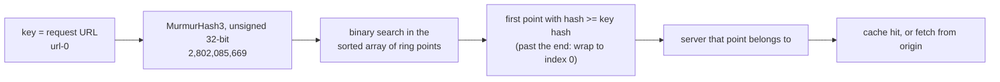
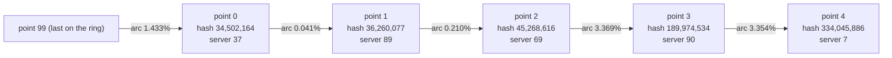
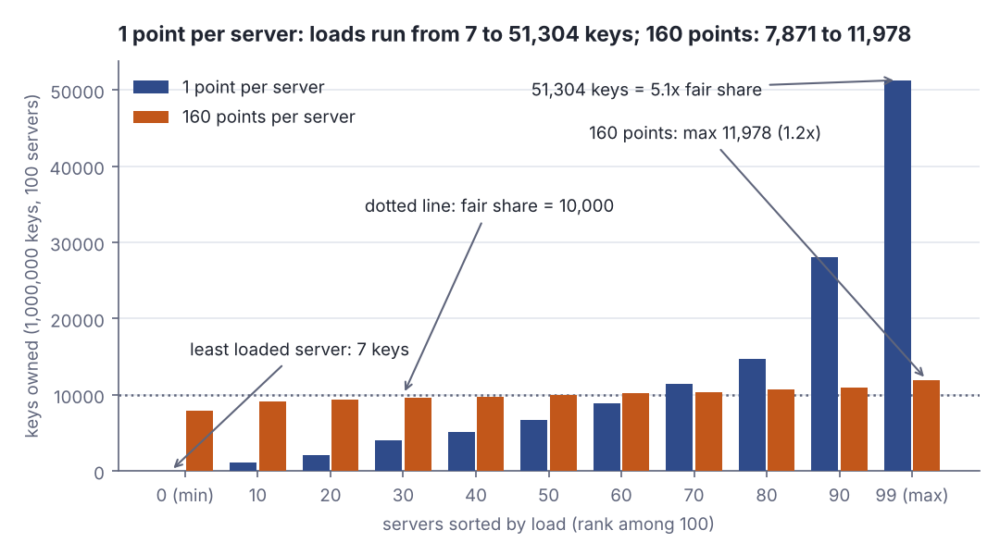
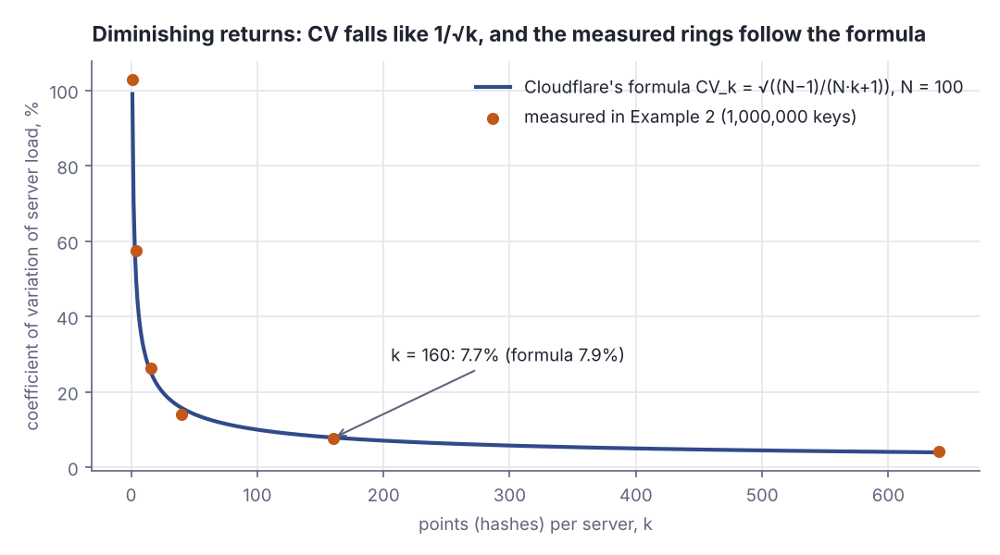
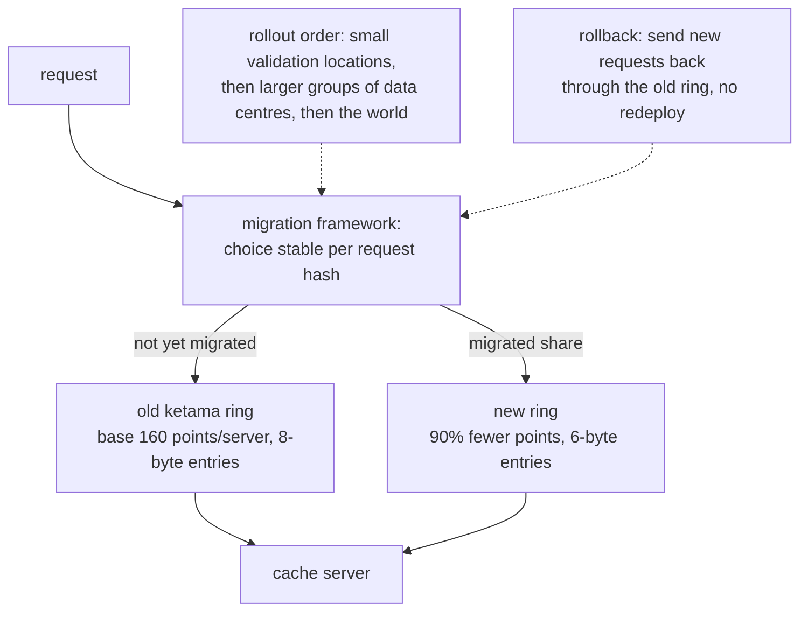

# Consistent hashing: why servers need many hashes

> Fresh · Software architecture & design · Intermediate · ~30 min · from today's feeds

## Why this matters

Today's item is an engineering post about the data structure that decides which of Cloudflare's cache servers answers a given URL — a consistent-hashing ring — and about three separate wins on it: the right number of hash points per server, six bytes per point instead of eight, and a migration that did not throw away the cache.

It was published on the Cloudflare blog on 18 September 2026 by Kevin Guthrie, Mariia Iurchenko, Zaidoon Abd Al Hadi and Ivan Babrou: https://blog.cloudflare.com/saving-100-tb-of-ram-with-math/

It is worth 30 minutes because it is the same routing decision you make every time you shard an Akka cluster, assign Kafka partitions or put a cache tier in front of a service — and it shows, with real numbers, that the obvious one-hash-per-server design is badly unfair, and that the fix is a tunable with a cost you can compute.

## Primer

A **hash function** takes any input — a string, a URL, an entity id — and returns a fixed-width number that looks random but is fully deterministic: the same input always gives the same number, and nearby inputs give unrelated numbers. Scala's standard library ships one, MurmurHash3: `stringHash("/a")` read as an unsigned 32-bit number is 1567399920 and `stringHash("/b")` is 3738131511. "Looks random" is the useful property: it spreads structured inputs (URLs that all start with the same prefix) evenly across the number space.

**Routing a key to one of N servers** means: given a request key — here a URL — pick exactly one server that will handle it, and have every machine in the fleet pick the *same* one, with no coordination. The textbook answer is `hash(key) mod N`: hash the key, take the remainder modulo the server count, use that as an index.

That works until N changes. Add one server and almost every key moves: with N = 100, key hash 1234 lands on server 34; with N = 101 the same key lands on server 22. For a cache, a key moving means its cached copy is on the wrong machine and the new owner has to fetch it from the origin again — a **cache invalidation**, at fleet scale, all at once. Example 4 below measures it: going from 100 to 101 servers moves 99.0% of keys.

**Consistent hashing** is the fix, introduced by Karger et al. at MIT in 1997 in "Consistent Hashing and Random Trees: Distributed Caching Protocols for Relieving Hot Spots on the World Wide Web", *Proceedings of the Twenty-Ninth Annual ACM Symposium on Theory of Computing*, pp. 654–663 ([Wikipedia, "Consistent hashing"](https://en.wikipedia.org/wiki/Consistent_hashing), accessed 2026-10-11). Instead of indexing into a list, you hash the *servers* into the same number space as the keys, arrange that space as a circle — the **hash ring** — and give each key to the first server you meet walking around the circle from the key's own hash. Adding or removing a server only reassigns the keys in the arc next to it: "the vast majority of the BLOBs maintain their prior server assignments" (Wikipedia, "Consistent hashing", accessed 2026-10-11). Cloudflare uses exactly this shape:

> "Internally we use it to route cacheable requests to servers by URL."
> — Kevin Guthrie, Mariia Iurchenko, Zaidoon Abd Al Hadi and Ivan Babrou, Cloudflare, *Saving another 100TB of RAM with math (and Rust)*, 18 September 2026, https://blog.cloudflare.com/saving-100-tb-of-ram-with-math/

## The idea

### How one lookup works

In memory the "ring" is a **sorted array of points**, each point a pair (32-bit hash, server). A lookup hashes the key, binary-searches for the first point whose hash is ≥ the key's hash, and returns that point's server; past the last point it wraps to index 0, which turns the line into a circle. Cloudflare draws the same structure as a number line and walks left instead of right; the direction does not matter as long as every machine uses the same one.



*Figure 1: The lookup every cache server runs for every request. Every machine holds the same sorted array, so every machine picks the same server without coordination. Hash value from the lesson's own code.*

### One hash per server is fair on average and unfair in fact

Put 100 servers on the ring with one point each and you have cut the circle at 100 random places. A point owns the arc that ends at it (from the previous point up to itself), so a server's share of keys equals its arc's width. The *expected* width is 1/100 of the ring; the actual widths differ wildly, because random points clump instead of spacing out. Figure 2 is the first stretch of the real ring from the Lab.



*Figure 2: The first five points of a 100-server ring, one point per server; each edge label is the arc owned by the point it arrives at. Fair share is 1.000%, yet server 90 owns 3.369% and server 89 owns 0.041%. Adapted from Cloudflare's number-line figures, https://blog.cloudflare.com/saving-100-tb-of-ram-with-math/; positions from the Lab output.*

The standard measure of that spread is the **coefficient of variation** (CV): the standard deviation of the per-server loads divided by their mean, as a percent. Worked once: loads 5, 10, 15 have mean 10 and standard deviation √((25 + 0 + 25)/3) = 4.08, so CV = 40.8%. It is scale-free: a CV of 10% means a typical server sits about 10% off its fair share whatever the traffic. Here is the CV of a 100-server ring over a million URLs:

```scala
// file: OneHash.scala
import scala.util.hashing.MurmurHash3.stringHash
def h(s: String): Long = stringHash(s) & 0xFFFFFFFFL            // unsigned 32-bit hash
@main def oneHash(): Unit =
  val ring = (0 until 100).map(s => (h(s"server-$s#0"), s)).sortBy(_._1)  // 1 point each
  val pos  = ring.map(_._1)
  def owner(key: String) = ring(pos.search(h(key)).insertionPoint % 100)._2  // next point clockwise
  val load = (0 until 1_000_000).groupMapReduce(i => owner(s"url-$i"))(_ => 1)(_ + _)
  val ls   = (0 until 100).map(load.getOrElse(_, 0)).sorted
  val sd   = math.sqrt(ls.map(x => (x - 10000.0) * (x - 10000.0)).sum / 100)
  println(s"keys per server: min=${ls.head} median=${ls(50)} max=${ls.last}  (fair share 10000)")
  println(f"coefficient of variation = ${sd / 100}%.1f%%")
```

```text
keys per server: min=7 median=6660 max=51304  (fair share 10000)
coefficient of variation = 102.9%
```

The busiest server gets 51,304 keys, 5.1x its fair share; the least busy gets 7; and the median is *under* its share because a few huge arcs eat the rest. A CV of 102.9% means the spread is as large as the mean; the post's formula for one hash per server, √((N−1)/(N+1)), gives √(99/101) = 99.0% for N = 100 (Cloudflare, 18 September 2026). Since you size every server for the worst case, you pay for a fleet several times larger than the work requires.

### The fix: many points per server

The remedy is to give each server many positions. Each server is hashed under several labels — `server-25#0`, `server-25#1`, … — and every resulting point goes on the ring, all mapping back to the same physical server. These extra points are **virtual nodes**: "Those duplicate labels are called 'virtual nodes'" (Wikipedia, "Consistent hashing", accessed 2026-10-11).

> "To solve the problem of imbalanced workloads, we can add multiple hashes to represent each server instead of just one."
> — Cloudflare, *Saving another 100TB of RAM with math (and Rust)*, 18 September 2026, https://blog.cloudflare.com/saving-100-tb-of-ram-with-math/

Why it works, in three steps. (1) With k points a server owns k arcs instead of one. (2) The arcs are close to independent, each averaging 1/(N·k) of the ring with a spread about as large as that average. (3) Adding k independent quantities multiplies the mean by k but the standard deviation only by √k, so CV falls by √k. The post's exact version is CV_k = √((N−1)/(N·k+1)) (Cloudflare, 18 September 2026, "What if we tried fewer hashes?"); for N = 100, k = 160 that is √(99/16001) = 7.9%:

> "the coefficient of variation (which we can think of like an error margin) drops from about 99% to about 8%"
> — Cloudflare, *Saving another 100TB of RAM with math (and Rust)*, 18 September 2026, https://blog.cloudflare.com/saving-100-tb-of-ram-with-math/

The same ring, rebuilt with k points per server, against that formula:

```scala
// file: VirtualNodes.scala
import scala.util.hashing.MurmurHash3.stringHash
def h(s: String): Long = stringHash(s) & 0xFFFFFFFFL
def cv(k: Int): Double =                                       // 100 servers, k points each
  val ring = (for s <- 0 until 100; p <- 0 until k yield (h(s"server-$s#$p"), s)).sortBy(_._1)
  val pos  = ring.map(_._1)
  val load = (0 until 1_000_000).groupMapReduce(i => ring(pos.search(h(s"url-$i")).insertionPoint % ring.size)._2)(_ => 1)(_ + _)
  math.sqrt((0 until 100).map(s => math.pow(load.getOrElse(s, 0) - 10000.0, 2)).sum / 100) / 100
@main def virtualNodes(): Unit =
  for k <- Seq(1, 4, 16, 40, 160, 640) do
    val formula = 100 * math.sqrt(99.0 / (100 * k + 1))       // Cloudflare's CV_k, N = 100
    println(f"k=$k%3d points/server   measured CV=${cv(k)}%5.1f%%   formula=$formula%5.1f%%")
```

```text
k=  1 points/server   measured CV=102.9%   formula= 99.0%
k=  4 points/server   measured CV= 57.5%   formula= 49.7%
k= 16 points/server   measured CV= 26.3%   formula= 24.9%
k= 40 points/server   measured CV= 14.0%   formula= 15.7%
k=160 points/server   measured CV=  7.7%   formula=  7.9%
k=640 points/server   measured CV=  4.3%   formula=  3.9%
```

Measured and predicted agree within a few points at every k, so the formula can be trusted for sizing. Going 1 → 16 points removes 76.6 points of CV; 160 → 640, four times the memory, removes only 3.4. Figure 3 shows what 7.7% means per server.



*Figure 3: Every tenth server by load, 1,000,000 keys over 100 servers. With 160 points the worst server carries 1.2x its share instead of 5.1x. Generated from the lab output (Step 2).*



*Figure 4: Error margin against points per server; the curve flattens fast. Adapted from Cloudflare's CV_k plot ("What if we tried fewer hashes?"), https://blog.cloudflare.com/saving-100-tb-of-ram-with-math/, redrawn from the post's formula for N = 100; dots are this lesson's measurements.*

> "each step down in error margin requires (almost) an order of magnitude increase in the number of hashes per server."
> — Cloudflare, *Saving another 100TB of RAM with math (and Rust)*, 18 September 2026, https://blog.cloudflare.com/saving-100-tb-of-ram-with-math/

### The costs, and what Cloudflare did about them

The ring is a sorted array held in memory on every server: memory = servers × points per server × bytes per point. The last two factors became targets.

**Fewer points.** Figure 4's flat tail is wasted memory, and the 32-bit hash space adds a ceiling: with enough points two collide, and "a collision means some contributions are randomly dropped, introducing unpredictable error" (Cloudflare, 18 September 2026). The exact error formula located the knee of the curve:

> "could decrease the number of hashes we were generating for each server by 90% without incurring any appreciable error"
> — Cloudflare, *Saving another 100TB of RAM with math (and Rust)*, 18 September 2026, https://blog.cloudflare.com/saving-100-tb-of-ram-with-math/

**Fewer bytes per point.** "In memory this is represented as eight bytes, where four go to the hash" (Cloudflare, 18 September 2026): four bytes of hash, four of server index. "Zaidoon's insight was that a 32-bit integer for that index is wasteful" (Cloudflare, 18 September 2026); 16 bits address 65,536 servers. Yet shrinking the field alone saves nothing, because of **alignment**: a `u32` must start at an address divisible by 4, and in an array element i starts at i × size, so the size must be a multiple of 4 — a 4 + 2 = 6-byte struct is padded back to 8. The escape: "A safer but less readable solution is to store the hash and index as raw byte array and access them with getters" (Cloudflare, 18 September 2026). A byte array has alignment 1:

```rust
// file: main.rs
use std::mem::{align_of as al, size_of as sz};
#[allow(dead_code)] struct Wide { hash: u32, server: u32 }   // the original 8-byte entry
#[allow(dead_code)] struct Narrow { hash: u32, server: u16 } // index shrunk to 16 bits
struct Packed([u8; 6]);                                       // raw bytes, read via getters
impl Packed { fn hash(&self) -> u32 { u32::from_le_bytes(self.0[..4].try_into().unwrap()) } }
impl Packed { fn server(&self) -> u16 { u16::from_le_bytes([self.0[4], self.0[5]]) } }
fn main() {
    println!("Wide   u32+u32 : size {} align {}\nNarrow u32+u16 : size {} align {}\nPacked [u8; 6] : size {} align {}", sz::<Wide>(), al::<Wide>(), sz::<Narrow>(), al::<Narrow>(), sz::<Packed>(), al::<Packed>());
    let p = Packed([0x14, 0x76, 0x0E, 0x02, 37, 0]);        // ring point 0 from Figure 2
    println!("Packed getters : hash {} server {}", p.hash(), p.server());
}
```

```text
Wide   u32+u32 : size 8 align 4
Narrow u32+u16 : size 8 align 4
Packed [u8; 6] : size 6 align 1
Packed getters : hash 34502164 server 37
```

The middle line is the trap: the narrower field saves nothing, because alignment 4 rounds 6 up to 8. Only the byte array reaches 6 bytes, and its getters recover the same point. "This simple (if wordy) change reduces the amount of memory used for consistent hashing by a whopping 25%!" (Cloudflare, 18 September 2026): 1 − 6/8 = 0.25.

**The rollout.** Changing the ring changes which server owns which URL:

> "Even if the new ring is better, switching the whole network at once would effectively invalidate almost all cached content."
> — Cloudflare, *Saving another 100TB of RAM with math (and Rust)*, 18 September 2026, https://blog.cloudflare.com/saving-100-tb-of-ram-with-math/

How much is "almost all"? Count the keys that change owner under three changes:

```scala
// file: Moves.scala
import scala.util.hashing.MurmurHash3.stringHash
def h(s: String): Long = stringHash(s) & 0xFFFFFFFFL
def ring(n: Int, k: Int): String => Int =                     // owner function of a ring
  val r = (for s <- 0 until n; p <- 0 until k yield (h(s"server-$s#$p"), s)).sortBy(_._1); val pos = r.map(_._1)
  key => r(pos.search(h(key)).insertionPoint % r.size)._2
@main def moves(): Unit =
  val keys = (0 until 100_000).map(i => s"url-$i")
  def moved(a: String => Int, b: String => Int) = 100.0 * keys.count(k => a(k) != b(k)) / keys.size
  println(f"hash mod N, 100 -> 101 servers : ${moved(k => (h(k) % 100).toInt, k => (h(k) % 101).toInt)}%5.1f%% of keys change server")
  println(f"ring, add a 101st server       : ${moved(ring(100, 160), ring(101, 160))}%5.1f%% of keys change server")
  println(f"ring, retune 160 -> 16 points  : ${moved(ring(100, 160), ring(100, 16))}%5.1f%% of keys change server")
```

```text
hash mod N, 100 -> 101 servers :  99.0% of keys change server
ring, add a 101st server       :   0.8% of keys change server
ring, retune 160 -> 16 points  :  89.2% of keys change server
```

Lines one and two are the case for consistent hashing: adding a server moves 0.8% of keys (near the newcomer's fair share, 1/101) instead of 99.0%. Line three is Cloudflare's problem: retuning the point count moves 89.2% of URLs. About 10% survive because points `#0`–`#15` exist in both rings.

Every moved key becomes an origin request, so a clean cut would flood customers' origins. Instead, "We then rolled the migration out in layers" (Cloudflare, 18 September 2026):



*Figure 5: Both rings live in memory during the migration; a stable per-request decision picks one, widened group of data centres by group. Adapted from Cloudflare, "Migrating without melting origins", https://blog.cloudflare.com/saving-100-tb-of-ram-with-math/*

The payoff: "Looking at the difference, we get the satisfying result that our changes dropped the used memory by 100TB!" (Cloudflare, 18 September 2026).

## Lab

**Question:** how unbalanced is a one-point-per-server ring, how many points per server does it take to fix it, and what do those points cost in memory?

About five minutes: save the program as `Lab.scala`, run `scala Lab.scala` (about 20 seconds), read three tables. Scala 3, standard library only.

### Step 1 — build the ring and see the arcs

The program builds a 100-server ring, prints the first five points with the arc each one owns, then counts 1,000,000 URLs per server.

### Step 2 — add points per server and watch the CV fall

The same counting for k = 1, 16, 40 and 160 points per server, next to Cloudflare's formula; for k = 1 and k = 160 it also prints every tenth server's load in sorted order (the numbers behind Figure 3).

### Step 3 — what the points cost

Memory of one ring copy for two fleet sizes, two point counts and the two entry widths from Example 3.

```scala
// file: Lab.scala
import scala.util.hashing.MurmurHash3.stringHash

val Space = 1L << 32                                          // size of the hash circle
def h32(s: String): Long = stringHash(s) & 0xFFFFFFFFL        // MurmurHash3 as unsigned 32-bit

case class Ring(points: Vector[(Long, Int)]):                 // sorted (hash, server) pairs
  private val pos = points.map(_._1)
  def owner(key: String): Int = points(pos.search(h32(key)).insertionPoint % points.size)._2

def build(servers: Int, k: Int): Ring =                       // k points ("virtual nodes") per server
  Ring((for s <- 0 until servers; p <- 0 until k yield (h32(s"server-$s#$p"), s)).sortBy(_._1).toVector)

val N    = 100
val Keys = (0 until 1_000_000).map(i => s"url-$i")            // fair share = 10000 keys per server

def loads(r: Ring): Vector[Int] =
  val c = Keys.groupMapReduce(r.owner)(_ => 1)(_ + _)
  Vector.tabulate(N)(s => c.getOrElse(s, 0))

def stdev(xs: Vector[Int]): Double =
  val m = xs.sum.toDouble / xs.size
  math.sqrt(xs.map(x => (x - m) * (x - m)).sum / xs.size)

@main def lab(): Unit =
  println("=== STEP 1: one point per server, 100 servers, 1,000,000 keys ===")
  val r1 = build(N, 1)
  for i <- 0 until 5 do                                       // point i owns (previous point, point i]
    val (p, s) = r1.points(i)
    val arc = Math.floorMod(p - r1.points(Math.floorMod(i - 1, N))._1, Space)
    println(f"point $i: hash=$p%10d  server=$s%2d  owns ${100.0 * arc / Space}%6.3f%% of the ring")
  val l1 = loads(r1)
  println(s"keys on servers 0-9: ${l1.take(10).mkString(" ")}")
  println(f"min=${l1.min} max=${l1.max} mean=${l1.sum / N} stdev=${stdev(l1)}%.1f CV=${stdev(l1) / 100}%.1f%%")

  println("\n=== STEP 2: k points per server ===")
  for k <- Seq(1, 16, 40, 160) do
    val l = loads(build(N, k))
    val formula = 100 * math.sqrt((N - 1.0) / (N * k + 1))
    println(f"k=$k%3d ring=${N * k}%5d min=${l.min}%5d max=${l.max}%5d stdev=${stdev(l)}%7.1f CV=${stdev(l) / 100}%5.1f%% formula=$formula%4.1f%%")
    if k == 1 || k == 160 then
      val s = l.sorted
      println(s"      sorted loads at ranks 0,10,..,90,99: ${(0 to 90 by 10).map(s).mkString(" ")} ${s(99)}")

  println("\n=== STEP 3: memory of one ring copy = servers x k x bytes per point ===")
  for servers <- Seq(100, 10_000); k <- Seq(160, 16); bytes <- Seq(8, 6) do
    val total = servers.toLong * k * bytes
    println(f"servers=$servers%6d k=$k%3d bytes/point=$bytes -> $total%9d bytes = ${total / 1048576.0}%6.2f MiB")
```

Real output:

```text
=== STEP 1: one point per server, 100 servers, 1,000,000 keys ===
point 0: hash=  34502164  server=37  owns  1.433% of the ring
point 1: hash=  36260077  server=89  owns  0.041% of the ring
point 2: hash=  45268616  server=69  owns  0.210% of the ring
point 3: hash= 189974534  server=90  owns  3.369% of the ring
point 4: hash= 334045886  server= 7  owns  3.354% of the ring
keys on servers 0-9: 28624 1467 1867 11233 5909 4209 38549 33756 23260 10256
min=7 max=51304 mean=10000 stdev=10288.2 CV=102.9%

=== STEP 2: k points per server ===
k=  1 ring=  100 min=    7 max=51304 stdev=10288.2 CV=102.9% formula=99.0%
      sorted loads at ranks 0,10,..,90,99: 7 1169 2043 4026 5111 6660 8908 11459 14659 28106 51304
k= 16 ring= 1600 min= 5432 max=17209 stdev= 2625.6 CV= 26.3% formula=24.9%
k= 40 ring= 4000 min= 6626 max=13063 stdev= 1396.2 CV= 14.0% formula=15.7%
k=160 ring=16000 min= 7871 max=11978 stdev=  765.6 CV=  7.7% formula= 7.9%
      sorted loads at ranks 0,10,..,90,99: 7871 9081 9399 9593 9787 10020 10177 10356 10709 10969 11978

=== STEP 3: memory of one ring copy = servers x k x bytes per point ===
servers=   100 k=160 bytes/point=8 ->    128000 bytes =   0.12 MiB
servers=   100 k=160 bytes/point=6 ->     96000 bytes =   0.09 MiB
servers=   100 k= 16 bytes/point=8 ->     12800 bytes =   0.01 MiB
servers=   100 k= 16 bytes/point=6 ->      9600 bytes =   0.01 MiB
servers= 10000 k=160 bytes/point=8 ->  12800000 bytes =  12.21 MiB
servers= 10000 k=160 bytes/point=6 ->   9600000 bytes =   9.16 MiB
servers= 10000 k= 16 bytes/point=8 ->   1280000 bytes =   1.22 MiB
servers= 10000 k= 16 bytes/point=6 ->    960000 bytes =   0.92 MiB
```

### Reading the output

**Step 1 — the arcs.** Each `point` line is one ring point: its 32-bit hash, the server it belongs to, and the width of the arc it owns (from the previous point up to itself) as a percent of the whole circle. With 100 servers the fair share is 1.000% each; values near 1.000% are better.

| ring point | hash | server | arc width | vs fair share (1.000%) |
|---|---|---|---|---|
| 0 | 34502164 | 37 | 1.433% | 1.43x |
| 1 | 36260077 | 89 | 0.041% | 0.04x |
| 2 | 45268616 | 69 | 0.210% | 0.21x |
| 3 | 189974534 | 90 | 3.369% | 3.37x |
| 4 | 334045886 | 7 | 3.354% | 3.35x |

Trace point 1 by hand: its arc runs from point 0 to point 1, 36260077 − 34502164 = 1757913 hash values; the circle has 2^32 = 4294967296 values; 1757913 / 4294967296 = 0.000409 = **0.041%**. Point 3: 189974534 − 45268616 = 144705918; / 4294967296 = 0.03369 = **3.369%** — 82 times point 1's arc.

The key counts confirm it on real traffic: 1,000,000 keys over 100 servers is a mean of exactly 10000 each, but among servers 0–9 alone the loads run from 1467 (server 1) to 38549 (server 6). The CV with digits: mean = 1000000 / 100 = 10000; standard deviation = 10288.2; CV = 10288.2 / 10000 = 1.0288 = **102.9%**, against the 99.0% the post's formula predicts for N = 100 (Cloudflare, 18 September 2026) — the exact figure depends on which random ring you drew, the order of magnitude does not.

**Verdict:** one point per server is not "slightly uneven": the hottest machine does 51304 / 10000 = 5.1x its share and the coldest 7 keys. Size for the worst case and you buy roughly five times the hardware you need.

**Step 2 — the fix and its shape.** Columns: points per server k, total ring entries, the minimum and maximum load across all 100 servers, the standard deviation, the measured CV and the formula's CV. Lower CV is better; min and max should close in on 10000.

| k (points/server) | ring size | min load | max load | stdev | CV measured | CV formula |
|---|---|---|---|---|---|---|
| 1 | 100 | 7 | 51304 | 10288.2 | 102.9% | 99.0% |
| 16 | 1600 | 5432 | 17209 | 2625.6 | 26.3% | 24.9% |
| 40 | 4000 | 6626 | 13063 | 1396.2 | 14.0% | 15.7% |
| 160 | 16000 | 7871 | 11978 | 765.6 | 7.7% | 7.9% |

Trace the last row: measured CV = 765.6 / 10000 = 0.0766 = **7.7%**; formula = √(99 / (100 × 160 + 1)) = √(99 / 16001) = √0.006187 = 0.0787 = **7.9%** — and the post's "about 8%" (Cloudflare, 18 September 2026). The `sorted loads` lines are Figure 3: at k = 160 the whole fleet sits between 7871 and 11978. Note the diminishing returns: 1 → 16 removes 76.6 points of CV, 40 → 160 only 6.3 — exactly the slack that let Cloudflare "decrease the number of hashes we were generating for each server by 90% without incurring any appreciable error" (Cloudflare, 18 September 2026).

**Verdict:** 160 points per server turns a worst server at 5.1x its share into one at 11978 / 10000 = 1.2x; most of that gain is already there by 40, and the last stretch is the expensive one.

**Step 3 — the price tag.** Each line is one ring held in memory: servers × points per server × bytes per point. Smaller is better, and the only lever that does not cost balance is the byte width. At 10000 servers and 160 points, the ring is 10000 × 160 × 8 = 12800000 bytes = 12.21 MiB at 8 bytes per point and 9600000 bytes = 9.16 MiB at 6 — the 25% the post claims for the raw-byte-array layout (Cloudflare, 18 September 2026): 1 − 6/8 = 0.25. Cutting points 160 → 16 is the bigger lever, a further 10x. Multiply either saving by every process on every machine in a global fleet and you are at the post's 100TB (Cloudflare, 18 September 2026).

**Verdict:** memory is three independent multipliers. Tune points first (biggest factor, costs balance), then bytes per point (free, costs readability), and only then worry about the server count, which you do not control.

### Cause → mechanism → consequence → what it means in practice

1. **Cause.** You place each server on the ring once, at a uniformly random hash.
2. **Mechanism.** Random points clump, so each server's arc — and therefore its share of traffic — is a single random quantity with a spread as large as its own mean; measured CV 102.9% in Step 1.
3. **Consequence.** One machine serves 51304 keys while another serves 7, permanently and with no failure anywhere, so you must size the whole fleet for the hot one.
4. **What it means in practice.** Anywhere you hash an identity to an owner, check how many points per owner the library uses before you trust the balance. Akka cluster sharding routes by `shardId` and you choose the number of shards: the same 1/√k law says ~10 shards per node is a ~30% error margin and ~100 per node is ~10% — that is why the usual advice is "ten times more shards than nodes, at least". Kafka's partition assignment is the same bet with the partition count as k, which is why a topic with 3 partitions on 3 consumers goes lopsided the moment keys are skewed. And for a cache tier in front of a service, remember Example 4: changing k moved 89.2% of keys, so a ring retune is a cache flush unless you run both rings and migrate in layers, the way Cloudflare did.

## Self-check

1. You run `hash(url) mod N` across 100 cache servers and add one more. Roughly what fraction of URLs change owner, and why is that specifically bad for a cache? <details><summary>Answer</summary>Almost all of them — Example 4 measures 99.0%. The modulus changes from 100 to 101, so nearly every remainder changes and the mapping is reshuffled wholesale. For a cache it means almost every key is now on a machine that does not hold its copy, so every request becomes a miss and a fetch to the origin at once. Consistent hashing makes the move proportional to the change: only the keys in the arcs taken by the new server move (0.8% in Example 4).</details>
2. Your ring has 100 servers with one point each and a coefficient of variation near 100%. You want it under 10% without changing the hash function. What do you change, by how much, and what is the rule of thumb? <details><summary>Answer</summary>Give each server many points (virtual nodes) instead of one. The CV falls roughly as 1/√k — exactly, CV_k = √((N−1)/(N·k+1)) (Cloudflare, 18 September 2026) — so to get from ~99% to under 10% you need k of about 100 (√(99/(100·99+1)) = 10.0%). Example 2 measures 7.7% at 160 points per server, and the post reports the drop from about 99% to about 8% at 160. Returns diminish: most of the gain is already there by 40.</details>
3. A ring entry is a 4-byte hash plus a server index. You shrink the index from 32 bits to 16. Why does the struct still take 8 bytes, and what makes it actually take 6? <details><summary>Answer</summary>Alignment: the `u32` hash must start at a multiple of 4, and in an array element i starts at i × size, so the struct's size is rounded up to a multiple of 4 — 4 + 2 = 6 becomes 8 (Example 3 prints `Narrow u32+u16 : size 8 align 4`). The fix is to remove the typed fields and store the entry as a raw 6-byte array with getters, which has alignment 1 (`Packed [u8; 6] : size 6 align 1`) — "This simple (if wordy) change reduces the amount of memory used for consistent hashing by a whopping 25%!" (Cloudflare, 18 September 2026), and 1 − 6/8 = 0.25.</details>

## Sources

- [Saving another 100TB of RAM with math (and Rust)](https://blog.cloudflare.com/saving-100-tb-of-ram-with-math/) — Kevin Guthrie, Mariia Iurchenko, Zaidoon Abd Al Hadi and Ivan Babrou, Cloudflare, 18 September 2026; the subject of this lesson: URL-to-server routing on a consistent-hashing ring, the number-line figures (adapted as Figure 2), the CV formulas and the CV_k plot (redrawn as Figure 4), the 99% → 8% drop at 160 points per server, the 90% cut in hashes generated, the 8-byte entry and the Rust alignment rule, the 25% saving from a raw byte array, the layered migration (adapted as Figure 5) and the 100TB result; accessed 2026-10-11, re-checked 2026-10-15.
- [Consistent hashing](https://en.wikipedia.org/wiki/Consistent_hashing) — Wikipedia; the 1997 origin (Karger et al., "Consistent Hashing and Random Trees: Distributed Caching Protocols for Relieving Hot Spots on the World Wide Web", STOC 1997, pp. 654–663), the circle construction and clockwise assignment, and the "virtual nodes" terminology and weighting; accessed 2026-10-11.

Related in your knowledge base: `25-software-architecture` is where this lesson files.

## Next on this track
Fresh lessons sit outside the ladder; next on Software architecture & design: **Dependency direction and the dependency rule** (rung 2 of 20, Beginner).
