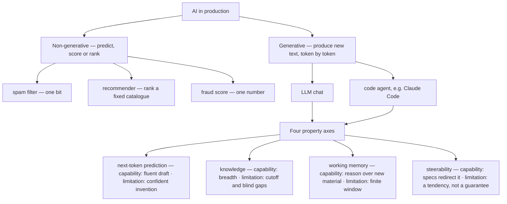

# A mental model of the machine: what we mean by AI

> Claude Academy · Beginner · ~20 min · rung 1 of 20 · needs: —

## Why this matters

You already drive Claude Code hard and ship MCP servers for other teams, so you have a working
intuition for where the machine helps and where it wanders off. What you do not have yet is a
shared vocabulary for *why* it wanders, and that is what every judgement call in the rest of this
ladder rests on. This rung gives you the four-word map — prediction, knowledge, memory,
steerability — that lets you say which axis a failure came from instead of saying "the model was
dumb today".

## The idea

### Two different questions

There are two separate questions about working with AI, and mixing them is the most common reason
people plateau. The first is **how you collaborate**: how you delegate, how you describe what you
want, how you judge the result, how you stay responsible for it. Claude Academy calls that the 4D
framework (Delegation, Description, Discernment, Diligence) and it arrives later on this ladder.
The second is **how the machine is able to work with you at all** — what it is doing when it
answers, what it knows, what it can hold in mind, how much your instructions actually bend it.
This rung and the twelve after it are about the second question (Claude Academy, *AI Capabilities
and Limitations*, lesson 1, "Intro to AI Capabilities and Limitations"). The order is deliberate:
collaboration habits built on a wrong model of the machine become superstition — prompt rituals
you repeat without knowing which part did the work.

The course roadmap behind this ladder is five steps: **what AI is** (this rung), **how it is
trained** (pretraining, fine-tuning, the fingerprints both leave), **its four properties**, **what
that means in real use**, and **safety** — what to do about the failure modes the four properties
guarantee.

### Narrowing "AI" to one thing

"AI" is a marketing word covering an enormous range of systems. This course means one slice of it:
**generative, transformer-based text models** — systems that produce new text (or code, which is
text) token by token. That slice is not where most AI in production lives.

Go and count in your own platform. The card-fraud score on a POS payment is a model that takes a
transaction and emits a number. The licence-plate recognition at the wash gate takes an image and
emits one string from a constrained space. The support-inbox spam filter emits one bit. The
demand forecast that feeds package pricing emits a quantity. None of these write anything. They
are **predictive** or **classification** models: they map an input onto a label, a score, or a
ranking over a fixed set of options. That is the overwhelming majority of deployed machine
learning, and it has been running quietly in payments, logistics and ad serving for a decade
before anyone had a chat window.

Generative models are different in kind, not degree. There is no fixed answer set. The output
space is every sequence of tokens the model could emit, so the model cannot be "right" or "wrong"
in the way a classifier is — it can only be more or less plausible, and plausible is not the same
as true. Every capability and every limitation in this course follows from that one structural
fact.

### The four axes

The course's central claim is that these models are not uniformly good or uniformly bad. They are
predictably strong and predictably weak along four axes:

> "AI isn't uniformly capable or uniformly unreliable. It's strong and weak along four predictable axes."
> — Anthropic, *Claude Academy — AI Capabilities and Limitations: What We Mean by AI*, lesson 2, §"Key takeaways", https://academy.claude.com/courses/ai-capabilities-and-limitations/what-we-mean-by-ai

The four, in the order the course takes them:

1. **Next-token prediction.** The model generates one token at a time, each conditioned on
   everything before it. *Capability:* fluent, idiomatic, structurally correct output in any
   register you ask for. *Limitation:* fluency is the objective, not truth — a confidently
   invented Lua function name reads exactly like a real one.
2. **Knowledge.** Everything the model knows about the world it absorbed during training.
   *Capability:* astonishing breadth, cheaply available. *Limitation:* a training cutoff, uneven
   depth (common things well, your niche badly), and no awareness of where the gaps are.
3. **Working memory.** Everything the model can attend to *right now* — the context window, your
   prompt, the files you fed it, the conversation so far. *Capability:* it can reason over material
   it has never seen before, which is why a code agent is useful at all. *Limitation:* the window
   is finite; what falls out of it is gone, and attention over what remains is not uniform.
4. **Steerability.** How reliably your instructions change the output. *Capability:* a precise
   spec, examples, or a tool schema genuinely redirect it. *Limitation:* it is a tendency, not a
   guarantee; vague instructions produce vague compliance, and long instruction sets decay.

Those four are the spine of the rest of the course: one or two rungs per axis, capability side
first, then limitation side, then what to do about it.



### Why this is worth learning now rather than next year

The obvious objection: models change every few months, so why learn properties at all? Because
what changes is the *position* on each axis, not the axis. Context windows grow; the window stays
finite. Cutoffs move forward; a cutoff still exists. Instruction-following gets tighter; it stays
a tendency.

> "This material is durable because the properties stay stable even as models improve. Boundaries shift but the properties remain the same."
> — Anthropic, *Claude Academy — AI Capabilities and Limitations: Intro to AI Capabilities and Limitations*, lesson 1, https://academy.claude.com/courses/ai-capabilities-and-limitations/intro-to-ai-capabilities-and-limitations

That is why the map pays off: when a Claude Code run mangles a refactor, "which axis" is a
question you can answer in ten seconds and act on. Lost track of a file it edited twenty minutes
ago — working memory; fix the context, not the prompt wording. Invented a Lua stdlib call —
next-token prediction; add a check, not a scolding. Used an API shape from two years ago —
knowledge; paste the current docs. Ignored half your spec — steerability; shorten and sharpen the
spec.

## Lab

**The question:** across your real working day, how much of the "AI" you touch is actually
generative, and which of the four axes does each generative touch-point depend on most?

This is an inventory, so the script holds the inventory as data and does the counting. Keep the
output: rung 7 of this track comes back to this same list.

### Step 1 — write the inventory as data

Save this as `axes.py` anywhere outside the repo. Standard library only, no arguments.

```python
#!/usr/bin/env python3
"""Inventory of AI touch-points, tagged by kind and by dominant property axis."""

from collections import Counter

AXES = ["next-token prediction", "knowledge", "working memory", "steerability"]

# touch-point, generative?, dominant axis (only for generative), why
ROWS = [
    ("card-fraud / anomaly score on POS payments", False, "-",
     "scores a transaction, emits a number, writes no text"),
    ("licence-plate recognition at the wash gate",  False, "-",
     "image in, one plate string out, fixed label space"),
    ("support-inbox spam filter",                   False, "-",
     "binary classification over an email"),
    ("wash-demand forecast for package pricing",    False, "-",
     "regression over history, no language involved"),
    ("'suggest next wash package' recommender",     False, "-",
     "ranks a fixed catalogue, generates nothing"),
    ("Claude Code: monorepo-wide Lua refactor",     True,  "working memory",
     "must hold many files at once; forgets what fell out of context"),
    ("Claude Code: new POS module from a spec",     True,  "steerability",
     "output quality tracks how precisely the spec constrains it"),
    ("MCP server over the POS database",            True,  "steerability",
     "must obey tool schemas and stay inside allowed queries"),
    ("chat: drafting a product spec",               True,  "next-token prediction",
     "fluent plausible prose is the capability and the trap"),
    ("chat: release notes from a diff",             True,  "next-token prediction",
     "plausible-sounding invented items read exactly like real ones"),
    ("asking about Akka Streams operator semantics", True, "knowledge",
     "answer comes from training data, with a cutoff and gaps"),
    ("summarising a 60-page vendor contract",       True,  "working memory",
     "accuracy depends on the whole document fitting and staying attended to"),
]

W = max(len(r[0]) for r in ROWS)
print(f"{'touch-point'.ljust(W)}  gen?  {'dominant axis'.ljust(21)}  why")
print("-" * (W + 2 + 5 + 2 + 21 + 2 + 62))
for name, gen, axis, why in ROWS:
    print(f"{name.ljust(W)}  {('yes' if gen else 'no ').center(4)}  {axis.ljust(21)}  {why}")

total = len(ROWS)
gen_rows = [r for r in ROWS if r[1]]
print()
print(f"rows total          : {total}")
print(f"generative          : {len(gen_rows)}")
print(f"non-generative      : {total - len(gen_rows)}")
print(f"generative share    : {len(gen_rows)}/{total} = {100 * len(gen_rows) / total:.1f}%")

counts = Counter(r[2] for r in gen_rows)
print()
print("per-axis counts (generative rows only)")
for axis in AXES:
    n = counts[axis]
    bar = "#" * n
    print(f"  {axis.ljust(21)} {n}  {bar}")
print(f"  {'sum'.ljust(21)} {sum(counts.values())}")
```

### Step 2 — run it

```bash
python3 axes.py
```

Real output:

```text
touch-point                                   gen?  dominant axis          why
------------------------------------------------------------------------------------------------------------------------------------------
card-fraud / anomaly score on POS payments    no    -                      scores a transaction, emits a number, writes no text
licence-plate recognition at the wash gate    no    -                      image in, one plate string out, fixed label space
support-inbox spam filter                     no    -                      binary classification over an email
wash-demand forecast for package pricing      no    -                      regression over history, no language involved
'suggest next wash package' recommender       no    -                      ranks a fixed catalogue, generates nothing
Claude Code: monorepo-wide Lua refactor       yes   working memory         must hold many files at once; forgets what fell out of context
Claude Code: new POS module from a spec       yes   steerability           output quality tracks how precisely the spec constrains it
MCP server over the POS database              yes   steerability           must obey tool schemas and stay inside allowed queries
chat: drafting a product spec                 yes   next-token prediction  fluent plausible prose is the capability and the trap
chat: release notes from a diff               yes   next-token prediction  plausible-sounding invented items read exactly like real ones
asking about Akka Streams operator semantics  yes   knowledge              answer comes from training data, with a cutoff and gaps
summarising a 60-page vendor contract         yes   working memory         accuracy depends on the whole document fitting and staying attended to

rows total          : 12
generative          : 7
non-generative      : 5
generative share    : 7/12 = 58.3%

per-axis counts (generative rows only)
  next-token prediction 2  ##
  knowledge             1  #
  working memory        2  ##
  steerability          2  ##
  sum                   7
```

### Step 3 — make it yours

Edit `ROWS`: delete what you do not have, add what I missed (the Skills you write for other
teams, the plate-matching that links a car to a loyalty account, anything your team shipped since).
For every row you mark `True`, you must name one of the four axes — forcing the choice is the whole
exercise. Re-run and keep the output.

### Reading the output

The per-row table has four columns. **touch-point** is the system or habit, named concretely enough
that you could point at the code. **gen?** is the structural question: does it produce new text
token by token (`yes`) or map an input onto a label, score or ranking (`no`)? Neither direction is
"better" — the column tells you which half of the course applies. **dominant axis** is, for
generative rows only, the property whose limitation would bite first if this touch-point went
wrong; non-generative rows carry `-` because the four axes are properties of generative models and
do not describe a classifier. **why** is the one-line justification, and it is the column to argue
with: if you cannot write it, your tag is a guess.

| counter | value | reads as |
|---|---|---|
| rows total | 12 | touch-points inventoried |
| generative | 7 | rows where the four-axis map applies |
| non-generative | 5 | rows where it does not |
| generative share | 58.3% | more than half, but far from all |

Trace the share with digits: 12 rows, 5 of them tagged `no` (fraud score, plate recognition, spam
filter, demand forecast, recommender), so generative = 12 − 5 = 7, and 7 ÷ 12 = 0.58333…, printed
as 58.3%. The per-axis block then counts only those 7: next-token prediction 2 (spec drafting,
release notes) + knowledge 1 (Akka Streams semantics) + working memory 2 (monorepo refactor,
contract summary) + steerability 2 (new POS module, MCP server) = 2 + 1 + 2 + 2 = 7, which is
exactly the `sum` line. That `sum` is a self-check: if it disagrees with the `generative` count,
a row carries an axis name that is not one of the four, or none at all.

**Verdict:** even in a platform run by someone who uses a code agent daily, 5 of 12 AI
touch-points are not generative at all, and the 7 that are spread evenly over all four axes — no
single axis dominates, so no single mitigation covers your exposure.

### Cause → consequence

1. **Cause.** A generative model's output space is unbounded: it emits whatever token sequence is
   most plausible next, rather than selecting from a fixed answer set the way a classifier does.
2. **Mechanism.** Plausibility is produced by four separable machineries — the token-by-token
   prediction loop, the knowledge frozen in the weights, the finite window of what it can attend
   to now, and the degree to which instructions bias the loop. Each has its own capability zone
   and its own failure zone.
3. **Consequence.** Failures are not random "bad days"; they sort cleanly into four buckets, and
   each bucket has a different fix: verification for invented detail, fresh context for stale
   knowledge, context management for forgetting, tighter specs for drift.
4. **What it means in practice.** When a Claude Code run on the Lua monorepo goes wrong, your first
   question is "which axis", not "which prompt". And when you write Skills or MCP servers for other
   teams, you are mostly engineering the memory and steerability axes on their behalf — the two
   you can actually control from outside the model.

## Self-check

1. Your POS fraud scorer and your chat-drafted product spec are both "AI". What is the structural difference, and why does only one of them get a four-axis diagnosis? <details><summary>Answer</summary>The fraud scorer is predictive: it maps a transaction onto a score drawn from a fixed output space, so it can be straightforwardly right or wrong and is evaluated with accuracy-style metrics. The spec draft comes from a generative model whose output space is every possible token sequence, so it can only be more or less plausible. The four axes (next-token prediction, knowledge, working memory, steerability) are properties of that generative machinery, so they describe the spec draft and say nothing useful about the scorer.</details>
2. Claude Code edits twelve Lua files, then re-introduces a bug it had fixed in the first file. Which axis, and what is the fix that follows from naming it? <details><summary>Answer</summary>Working memory. The first file's state fell out of the context the model can attend to right now, so the fix is a context fix, not a wording fix: smaller batches, re-read the file before touching it again, pin the invariant in a file the agent always loads, or add a test that fails if the bug returns. Rewriting the prompt more politely changes nothing, because the information was simply not in front of the model.</details>
3. Context windows have grown by orders of magnitude and will grow again. Why is the working-memory axis still worth learning? <details><summary>Answer</summary>Because growth moves the boundary, not the property. Claude Academy puts it as "Boundaries shift but the properties remain the same" (lesson 1, "Intro to AI Capabilities and Limitations"): a window ten times larger is still finite, attention across it is still uneven, and anything outside it is still invisible to the model. The reasoning you do about context management stays valid; only the threshold at which you start doing it moves.</details>

## Sources

- [Claude Academy — AI Capabilities and Limitations: Intro to AI Capabilities and Limitations](https://academy.claude.com/courses/ai-capabilities-and-limitations/intro-to-ai-capabilities-and-limitations) — Anthropic, lesson 1 of *AI Capabilities and Limitations* (text plus a 4-minute video); gave the split between the collaboration question and the machine question, the five-step course roadmap, and the quoted claim about why the material is durable; accessed 2026-10-12.
- [Claude Academy — AI Capabilities and Limitations: What We Mean by AI](https://academy.claude.com/courses/ai-capabilities-and-limitations/what-we-mean-by-ai) — Anthropic, lesson 2 of *AI Capabilities and Limitations*, §"Key takeaways"; gave the narrowing of "AI" to generative transformer-based text models, the generative-versus-predictive distinction, and the quoted four-axes claim; accessed 2026-10-12.
- Provenance note: both course pages refused an automated fetch on 2026-10-12 (they are behind the Academy's sign-in), so the two blockquotes above are the passages captured and verified from those pages when this rung of the curriculum was built; open the links yourself to re-check them. No other source is quoted in this lesson.

## Next on this track
Next on Claude Academy: **How AI gets its character: pretraining, fine-tuning and fingerprints** (rung 2 of 20, Beginner).
