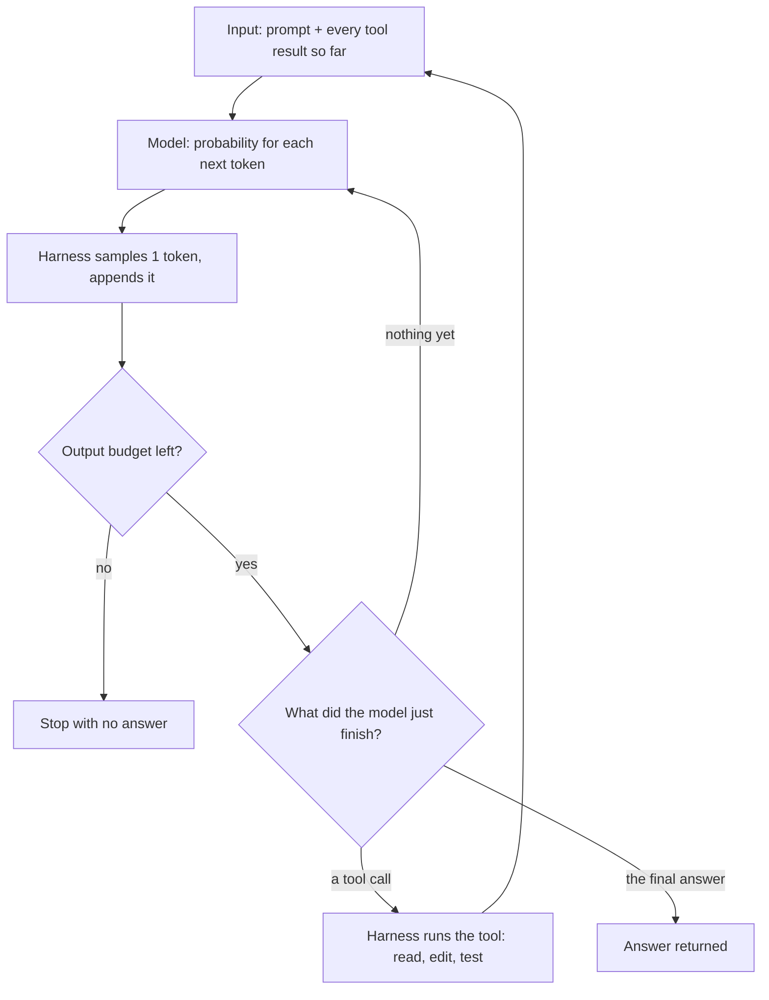
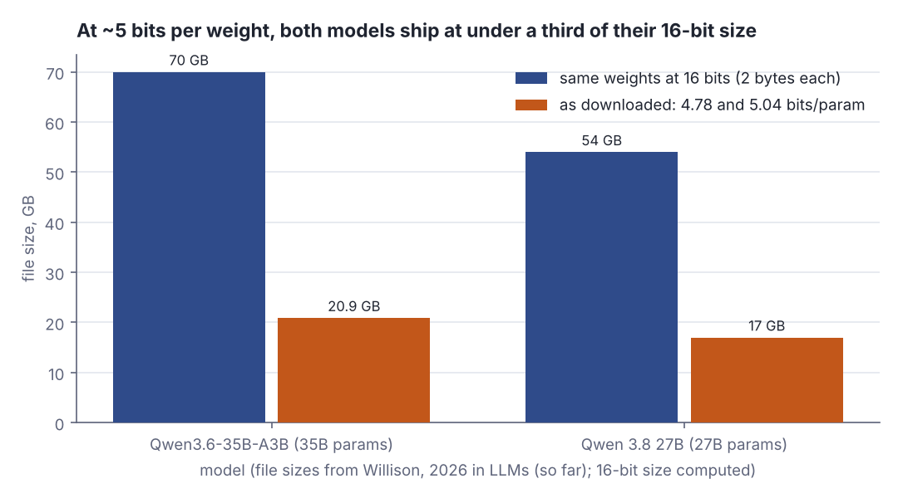
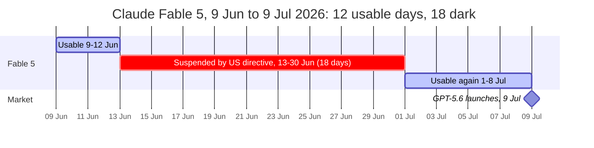
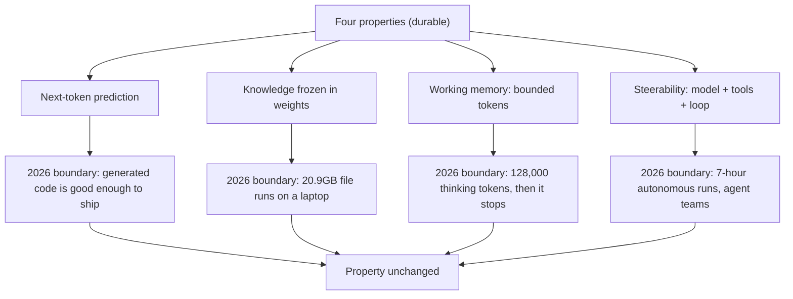
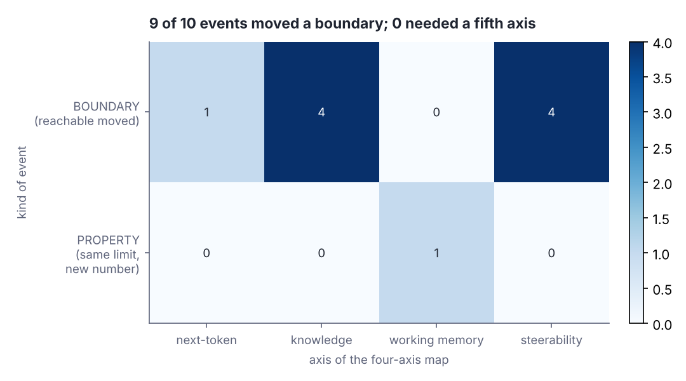

# Boundaries move, properties stay: the 2026 model year so far

> Fresh · AI / ML foundations · Intermediate · ~30 min · from today's feeds

## Why this matters
Today's core lesson gave you a four-axis map of a generative model — next-token prediction, knowledge, working memory, steerability — and claimed the map survives new releases because "boundaries shift but the properties remain the same". That claim is only worth anything if you can test it against a year of actual releases. Simon Willison's "2026 in LLMs (so far)" (2026-09-27) walks the model year month by month, and this lesson uses it as the test data: every event moved a boundary, not one added a fifth axis. That is the difference between a platform decision you make once and one you redo every quarter.

## Primer
You are level B in this domain, so here is only what this lesson needs.

A **generative transformer text model** is a large function with billions of fixed numeric parameters ("weights"). You feed it a sequence of **tokens** — word fragments, roughly 3–4 characters each — and it returns a probability distribution over the next token. **Next-token prediction** means that is the *only* thing it does: to produce a paragraph, the surrounding program samples one token from that distribution, appends it to the input, and calls the model again, hundreds of times. Everything that looks like reasoning is that loop plus the structure training pressed into the weights (Claude Academy, "AI Capabilities and Limitations", lesson 2 "What We Mean by AI").

A **coding agent** is not a model. It is three things: the model, **tools** it may call (read file, write file, run shell, run tests), and a **loop** that feeds each tool's output back in as more tokens until the model says it is done. That surrounding code — tools, loop, stop conditions — is the **harness**. Claude Code is a harness; so is your own MCP wiring.

A **local model** is one whose weights you download and run on your own machine instead of calling an API. The download is a **quantised weights file**: parameters rounded from 16 bits each down to roughly 4–5, which shrinks the file several-fold for a little accuracy. That is why tens of billions of parameters arrive as a ~20GB file.

A **token budget** is a cap the harness or the API puts on how many tokens one request may *produce*, including the model's hidden "thinking" tokens. It is a spending limit on output, not a context window, which limits how much *input* the model can see at once.

## The idea

The four-axis map says: a generative model is a next-token predictor, with knowledge frozen into its weights, a bounded amount of working memory it can hold and spend, and a finite degree of steerability. The strong version of the claim is not "models will not improve" — it is that improvements land *on* these axes rather than beside them. Two words carry the lesson. A **boundary** is how far you can get in practice on an axis (code quality, file size, run length). A **property** is the structural fact that makes the axis exist (one token at a time, weights fixed after training, a finite budget). A year of releases is the cheapest falsification test: if a fifth axis existed, twelve months of frantic competition is when it would have shown up.

### What the year actually moved

Start with the thing Willison says kicked the year off. The November 2025 releases mattered not because the models got smarter in the abstract but because the harnesses around them crossed a usability line:

> "In this case, the thing that started working was their coding agents."
> — Simon Willison, *2026 in LLMs (so far)*, 2026-09-27, https://simonwillison.net/2026/Sep/27/2026-in-llms-so-far/

On the map, that is **steerability**: the same next-token predictor, given tools and a loop, now follows a multi-step instruction to completion often enough to be trusted with real work. The post reports that Claude Opus 4.5 and GPT-5.1 with their coding-agent harnesses moved from often making mistakes to being reliable enough for day-to-day use (Willison, *2026 in LLMs (so far)*, §November 2025). Figure 1 shows the loop. Every box existed before November; what improved is how often a run reaches "answer returned" instead of drifting. The post's measure of how fast that compounded is the OpenClaw project, first committed on 2025-11-24 and now over 100,000 commits (Willison, §November 2025 and §January).


*Figure 1: A coding agent is a model inside a loop. Steerability lives in the loop (tools, stop conditions); working memory is the budget check. Drawn for this lesson from the Primer's definitions.*

By January the quality boundary on generated code had moved far enough that Willison retires his own hedge:

> "I said “it will become undeniable that LLMs write good code”—I think we’re there now."
> — Simon Willison, *2026 in LLMs (so far)*, 2026-09-27, https://simonwillison.net/2026/Sep/27/2026-in-llms-so-far/

Read that on the **next-token prediction** axis. Here is the whole mechanism in miniature: a toy "model" that is only a table of next-token probabilities, and the loop that calls it.

```scala
// file: NextToken.scala
// toy "model": for the last token, a probability for each possible next token
val model = Map("def" -> Map("add" -> 0.9, "x" -> 0.1), "add" -> Map("(" -> 1.0),
  "(" -> Map("a" -> 1.0), "a" -> Map(")" -> 0.7, "," -> 0.3), ")" -> Map("<end>" -> 1.0))
@main def nextToken(): Unit =
  var out = List("def")
  while out.last != "<end>" do
    val next = model(out.last).maxBy(_._2)._1   // greedy: pick the most likely token
    println(f"input: ${out.mkString(" ")}%-14s -> next token: $next")
    out = out :+ next                           // append, then call the model again
```

```text
input: def            -> next token: add
input: def add        -> next token: (
input: def add (      -> next token: a
input: def add ( a    -> next token: )
input: def add ( a )  -> next token: <end>
```

Each line is one model call: the whole text so far goes in, exactly one token comes out and is appended. A 2026 model replaces the five-row table with billions of weights, so the *choices* get good enough to be "good code"; the loop printing these lines does not change. "It writes good code" and "it does something other than predict tokens" are different sentences, and only the first is supported.

April moved the **knowledge** axis, in the direction that matters most for anyone shipping a product: how much frozen capability fits on hardware you own. The post's 16 April 2026 slide reads:

> "Qwen3.6-35B-A3B is a 20.9GB file that runs on my laptop"
> — Simon Willison, *2026 in LLMs (so far)*, 2026-09-27, https://simonwillison.net/2026/Sep/27/2026-in-llms-so-far/

The post's August section moves the same axis again: Qwen 3.8 27B, "only a 17GB download", produced a strong result in 21 minutes (Willison, §August). Divide file size by parameter count and the boundary becomes visible:

```scala
// file: Weights.scala
@main def weights(): Unit =
  for (name, params, gb) <- List(("Qwen3.6-35B-A3B", 35e9, 20.9), ("Qwen 3.8 27B", 27e9, 17.0)) do
    val bits = gb * 1e9 * 8 / params    // bits actually stored per parameter (GB = 10^9 bytes)
    val fp16 = params * 2 / 1e9         // the same parameters at 16 bits = 2 bytes each
    println(f"$name%-16s shipped $gb%4.1f GB = $bits%.2f bits/param; at 16 bits: $fp16%.0f GB")
  val step = 1.0 / 8                    // a 4-bit grid: 16 levels, -1, -7/8, ..., 7/8
  for w <- List(0.137, -0.402, 0.731) do
    val q = math.round(w / step) * step
    println(f"weight $w%6.3f -> stored $q%6.3f (error ${math.abs(w - q)}%.3f)")
```

```text
Qwen3.6-35B-A3B  shipped 20.9 GB = 4.78 bits/param; at 16 bits: 70 GB
Qwen 3.8 27B     shipped 17.0 GB = 5.04 bits/param; at 16 bits: 54 GB
weight  0.137 -> stored  0.125 (error 0.012)
weight -0.402 -> stored -0.375 (error 0.027)
weight  0.731 -> stored  0.750 (error 0.019)
```

Both files store about 5 bits per parameter (taking the "35B" and "27B" in the names as the parameter counts); at 16 bits they would be 70 GB and 54 GB, beyond a laptop. The last three lines show the price: every weight snaps to the nearest grid level, a small error per weight. What the weights *know* is still fixed at training time with a cutoff; only its packaging shrank (Figure 2).


*Figure 2: Same parameters, two encodings. File sizes from Willison, 2026 in LLMs (so far), §April and §August; 16-bit sizes and bits per parameter generated from the Weights.scala output above.*

June is the year's best engineering lesson and it is not about capability at all. Per the post, Claude Fable 5 launched on 2026-06-09, access was suspended on 2026-06-12 under a US government directive, Fable returned on 2026-07-01, and GPT-5.6 launched on 2026-07-09 (Willison, §June and §July). The suspension was announced "on a Friday evening, and a few hours later Fable was no longer available" (Willison, §June), so the 12th itself was still usable. Willison's own count:

> "Fable had 30 days as definitely the best model, and for 18 of those days it wasn’t available"
> — Simon Willison, *2026 in LLMs (so far)*, 2026-09-27, https://simonwillison.net/2026/Sep/27/2026-in-llms-so-far/


*Figure 3: The Fable window as a timeline. Adapted from Simon Willison, 2026 in LLMs (so far), slide "Fable returned on 1st July / GPT-5.6 came out on 9th July / Fable lost 18 out of 30 days in the top spot", https://simonwillison.net/2026/Sep/27/2026-in-llms-so-far/ (redrawn; the post carries no open licence).*

> "That gave us less than two weeks of Fable access before the price went up."
> — Simon Willison, *2026 in LLMs (so far)*, 2026-09-27, https://simonwillison.net/2026/Sep/27/2026-in-llms-so-far/

The transferable lesson is one line: do not architect around a single model vendor and version. Availability is not a property of the model; it is a property of your supply chain.

### The one row that is a property, not a boundary

September supplies the counterexample that proves the shape of the map — a limit that did not move, just arrived at a larger number:

> "Opus 5.5 thought for 128,000 tokens and then gave up! It ran out of tokens before it got to the response."
> — Simon Willison, *2026 in LLMs (so far)*, 2026-09-27, https://simonwillison.net/2026/Sep/27/2026-in-llms-so-far/

Be precise about what that is. It is an **output/thinking token budget** running out — the model spent its allowance on hidden reasoning and never emitted an answer (the "Stop with no answer" exit in Figure 1). It is *not* a context-window story; the post does not discuss context length at all. A toy harness shows why a bigger budget relocates the wall instead of removing it:

```scala
// file: Budget.scala
// a request needs `think` hidden tokens plus `answer` tokens; the harness caps output at `cap`
def reply(think: Int, answer: Int, cap: Int): String =
  if think + answer <= cap then s"answer (${think + answer} tokens used)"
  else s"NOTHING - cap hit after ${cap min think} thinking tokens"
@main def budget(): Unit =
  for (think, cap) <- List((5_000, 8_000), (20_000, 8_000), (20_000, 128_000), (150_000, 128_000)) do
    println(f"think $think%7d  cap $cap%7d  ->  ${reply(think, 1_500, cap)}")
```

```text
think    5000  cap    8000  ->  answer (6500 tokens used)
think   20000  cap    8000  ->  NOTHING - cap hit after 8000 thinking tokens
think   20000  cap  128000  ->  answer (21500 tokens used)
think  150000  cap  128000  ->  NOTHING - cap hit after 128000 thinking tokens
```

Rows 2 and 3 are the boundary moving: raising the cap from 8,000 to 128,000 rescues the 20,000-token task. Row 4 is the property: a harder task still spends the whole budget and returns nothing, after a sixteen-times-longer wait.

### Where the second source lands

Anthropic's *2026 Agentic Coding Trends Report* (n.d.) is organised around the same distinction without naming it: its capability trends are "Single agents evolve into coordinated teams", "Long-running agents build complete systems" and "Human oversight scales through intelligent collaboration" — all harness-level moves on the steerability axis. Its concrete numbers are boundary numbers:

> "Claude Code finished the entire job in seven hours of autonomous work in a single run."
> — Anthropic, *2026 Agentic Coding Trends Report*, n.d., https://resources.anthropic.com/hubfs/2026%20Agentic%20Coding%20Trends%20Report.pdf

Seven hours of a loop is a longer run of the same loop, and the report pairs it with a verification claim — "The implementation achieved 99.9% numerical accuracy compared to the reference method." (Anthropic, *2026 Agentic Coding Trends Report*, n.d., Trend 3). What makes the seven hours usable is a reference method to diff against. Figure 4 puts the year on the map.


*Figure 4: Each 2026 headline sits on one of the four existing axes; none needed a new one. Drawn for this lesson from the quotes above.*

The practical payoff: when you read a release note, ask which axis the number sits on. That tells you whether it changes your design (a boundary you designed around has moved) or only your expectations (the same property, restated larger).

## Lab

**Question this lab answers:** across the ten events Willison reports for the 2026 model year, how many moved a *boundary* on one of the four axes, how many re-exposed a *property*, and how many days of the Fable episode were actually usable?

### Step 1 — save the program

Scala 3, standard library only, no network. Save as `ModelYear.scala`. It prints every event, then a per-axis tally, then the Fable month day by day.

```scala
// file: ModelYear.scala
// 2026 model year: which axis each event moved, and whether it moved a boundary or
// re-exposed a property. Timeline facts: Simon Willison, "2026 in LLMs (so far)",
// 2026-09-27. The classification and the arithmetic are ours.
import java.time.LocalDate
import java.time.temporal.ChronoUnit.DAYS

val Axes = List("next-token", "knowledge", "working-memory", "steerability")
// (when, event, axis, kind)  kind: BOUNDARY = what is reachable in practice moved,
//                                  PROPERTY = an unchanged structural limit showed up again
val Events = List(
  ("Nov 2025",   "Opus 4.5 / GPT-5.1 coding agents reliable day-to-day", "steerability",   "BOUNDARY"),
  ("2025-11-24", "OpenClaw first commit; post says 100k+ commits now",   "steerability",   "BOUNDARY"),
  ("Jan 2026",   "LLMs writing good code becomes undeniable",            "next-token",     "BOUNDARY"),
  ("2026-04-16", "Qwen3.6-35B-A3B, 20.9GB, runs on a laptop",            "knowledge",      "BOUNDARY"),
  ("2026-06-09", "Claude Fable 5 launches",                              "knowledge",      "BOUNDARY"),
  ("2026-06-12", "Fable access suspended (US government directive)",     "steerability",   "BOUNDARY"),
  ("2026-07-01", "Fable returns",                                        "steerability",   "BOUNDARY"),
  ("2026-07-09", "GPT-5.6 launches",                                     "knowledge",      "BOUNDARY"),
  ("Aug 2026",   "Qwen 3.8 27B, 17GB, strong result in 21 minutes",      "knowledge",      "BOUNDARY"),
  ("Sep 2026",   "Opus 5.5 thinks 128,000 tokens, runs out, gives up",   "working-memory", "PROPERTY"))

@main def modelYear(): Unit =
  println("=== Step 1: every event, one row ===")
  println(f"${"when"}%-11s ${"axis"}%-15s ${"kind"}%-9s event")
  for (when, event, axis, kind) <- Events do
    require(Axes.contains(axis), s"unknown axis $axis")   // a fifth axis would crash here
    println(f"$when%-11s $axis%-15s $kind%-9s $event")

  println("\n=== Step 2: per-axis tally ===")
  println(f"${"axis"}%-15s ${"boundary"}%8s ${"property"}%8s ${"total"}%6s")
  for axis <- Axes do
    val rows = Events.filter(_._3 == axis)
    val b = rows.count(_._4 == "BOUNDARY")
    println(f"$axis%-15s $b%8d ${rows.size - b}%8d ${rows.size}%6d")
  val tb = Events.count(_._4 == "BOUNDARY")
  println(f"${"ALL"}%-15s $tb%8d ${Events.size - tb}%8d ${Events.size}%6d   events that fit no axis: 0")

  println("\n=== Step 3: Fable 5, day by day, launch to the GPT-5.6 launch ===")
  val launch = LocalDate.of(2026, 6, 9)
  val lastUp = LocalDate.of(2026, 6, 12)   // pulled on Friday evening: the 12th was still usable
  val back   = LocalDate.of(2026, 7, 1)
  val gpt56  = LocalDate.of(2026, 7, 9)
  val days = Iterator.iterate(launch)(_.plusDays(1)).takeWhile(_.isBefore(gpt56)).toList
  val up   = days.map(d => !d.isAfter(lastUp) || !d.isBefore(back))
  println("strip: " + up.map(u => if u then "#" else ".").mkString + "   (# usable day, . dark day)")
  var runs = Vector.empty[(Boolean, LocalDate, Int)]   // (usable?, first day, length)
  for (d, u) <- days.zip(up) do
    if runs.nonEmpty && runs.last._1 == u then runs = runs.init :+ runs.last.copy(_3 = runs.last._3 + 1)
    else runs = runs :+ (u, d, 1)
  for (u, from, n) <- runs do
    println(f"${if u then "usable" else "dark"}%-7s from $from  for $n%2d days  to ${from.plusDays(n - 1)}")
  val nUp = up.count(identity)
  println(f"calendar days : span=${days.size} usable=$nUp dark=${days.size - nUp} " +
          f"uptime=${nUp.toDouble / days.size}%.3f under_two_weeks=${nUp < 14}")
  val naiveUp = DAYS.between(launch, lastUp) + DAYS.between(back, gpt56)
  println(f"naive subtract: usable=$naiveUp dark=${DAYS.between(lastUp, back)} (counts the 12th as dark)")
```

### Step 2 — run it

```bash
scala ModelYear.scala
```

Real output:

```text
=== Step 1: every event, one row ===
when        axis            kind      event
Nov 2025    steerability    BOUNDARY  Opus 4.5 / GPT-5.1 coding agents reliable day-to-day
2025-11-24  steerability    BOUNDARY  OpenClaw first commit; post says 100k+ commits now
Jan 2026    next-token      BOUNDARY  LLMs writing good code becomes undeniable
2026-04-16  knowledge       BOUNDARY  Qwen3.6-35B-A3B, 20.9GB, runs on a laptop
2026-06-09  knowledge       BOUNDARY  Claude Fable 5 launches
2026-06-12  steerability    BOUNDARY  Fable access suspended (US government directive)
2026-07-01  steerability    BOUNDARY  Fable returns
2026-07-09  knowledge       BOUNDARY  GPT-5.6 launches
Aug 2026    knowledge       BOUNDARY  Qwen 3.8 27B, 17GB, strong result in 21 minutes
Sep 2026    working-memory  PROPERTY  Opus 5.5 thinks 128,000 tokens, runs out, gives up

=== Step 2: per-axis tally ===
axis            boundary property  total
next-token             1        0      1
knowledge              4        0      4
working-memory         0        1      1
steerability           4        0      4
ALL                    9        1     10   events that fit no axis: 0

=== Step 3: Fable 5, day by day, launch to the GPT-5.6 launch ===
strip: ####..................########   (# usable day, . dark day)
usable  from 2026-06-09  for  4 days  to 2026-06-12
dark    from 2026-06-13  for 18 days  to 2026-06-30
usable  from 2026-07-01  for  8 days  to 2026-07-08
calendar days : span=30 usable=12 dark=18 uptime=0.400 under_two_weeks=true
naive subtract: usable=11 dark=19 (counts the 12th as dark)
```

### Reading the output

**Step 1 block — the per-event table.** `when` is the date or month the post places the event in. `axis` is which of the four properties the event pressed on. `kind` is the judgement call: `BOUNDARY` means what is reachable in practice moved (quality, file size, run length, availability); `PROPERTY` means an unchanged structural limit showed up again at a new number. More `BOUNDARY` rows is neither good nor bad — it is the measurement. The `require` line is the falsification test in code: an event that fits no existing axis would stop the program, and it runs to the end.

| when | axis | kind | event |
|---|---|---|---|
| Nov 2025 | steerability | BOUNDARY | Opus 4.5 / GPT-5.1 coding agents reliable day-to-day |
| 2025-11-24 | steerability | BOUNDARY | OpenClaw first commit; post says 100k+ commits now |
| Jan 2026 | next-token | BOUNDARY | LLMs writing good code becomes undeniable |
| 2026-04-16 | knowledge | BOUNDARY | Qwen3.6-35B-A3B, 20.9GB, runs on a laptop |
| 2026-06-09 | knowledge | BOUNDARY | Claude Fable 5 launches |
| 2026-06-12 | steerability | BOUNDARY | Fable access suspended (US government directive) |
| 2026-07-01 | steerability | BOUNDARY | Fable returns |
| 2026-07-09 | knowledge | BOUNDARY | GPT-5.6 launches |
| Aug 2026 | knowledge | BOUNDARY | Qwen 3.8 27B, 17GB, strong result in 21 minutes |
| Sep 2026 | working-memory | PROPERTY | Opus 5.5 thinks 128,000 tokens, runs out, gives up |

**Verdict:** ten months of the most competitive year in the field, and every event fits one of four pre-existing slots. The map is doing real work, not accommodating everything by being vague.

**Step 2 block — the tally.** Columns: `boundary` and `property` are counts of rows on that axis; `total` is their sum. A `property` row means you hit a wall, so fewer is better there. The tally traced by hand: steerability gets rows 1, 2, 6 and 7 → 4; knowledge gets rows 4, 5, 8 and 9 → 4; next-token gets row 3 → 1; working-memory gets row 10 → 1. Total 4 + 4 + 1 + 1 = 10, and 9 BOUNDARY + 1 PROPERTY = 10, so nothing is double-counted or dropped. The distribution is the finding: 8 of 10 events (4 steerability + 4 knowledge) are harness-and-weights plumbing, not changes to what a model *is*.


*Figure 5: The Step 2 tally as a grid — dark cells are where the year's movement happened; the only property cell is working memory. Generated from the lab output.*

**Verdict:** the axes that moved most are the two you control in your own architecture — which harness you wire and which weights you point it at. The axis that bit back, working memory, is the one you have to design around rather than wait out.

**Step 3 block — Fable availability.** The `strip` is one character per calendar day from 2026-06-09 to 2026-07-08 (30 characters): `#` usable, `.` dark. The three `usable`/`dark` lines are the runs of that strip; higher is better for `usable`, worse for `dark`. The arithmetic, with digits:

- 9, 10, 11, 12 June: **4 days usable** (pulled on the evening of the 12th)
- 13 to 30 June: 30 − 13 + 1 = **18 days dark**
- 1 to 8 July: **8 days usable**, until GPT-5.6 arrives on the 9th
- span 4 + 18 + 8 = **30**; usable 4 + 8 = **12**; uptime 12 ÷ 30 = **0.400**

18 dark days is exactly Willison's "for 18 of those days it wasn’t available", and 12 < 14 is why `under_two_weeks` prints `true`, matching his "less than two weeks". The last line shows the trap: plain date subtraction (2026-06-12 − 2026-06-09 = 3, 2026-07-01 − 2026-06-12 = 19) counts the 12th as dark and gives 11 / 19, one day off the source. When an outage window matters, count calendar days, and know whether the boundary day was usable.

**Verdict:** a frontier model that is genuinely the best available still delivered 40% uptime across its first month. Capability and availability are independent variables, and only one of them appears in the benchmark table.

### Cause → consequence

1. **Cause.** Competition in 2026 pushed on what is cheap to push on: harness reliability (coding agents that finish the job), weights packaging (a 20.9GB file on a laptop, about 5 bits per parameter) and run length (seven autonomous hours). None of those require changing the mechanism.
2. **Mechanism.** Because the mechanism stays next-token prediction with frozen weights, a bounded generation budget and a tool loop, every improvement has to express itself as a bigger number on one of those four axes. There is nowhere else for it to go, which is why the map keeps classifying new releases without being extended.
3. **Consequence.** Vendor-specific facts — which model is best, what it costs, whether it is available in your region this week — decay in weeks. Axis-level facts do not. The one new risk the year actually surfaced was on the working-memory axis: a long run can consume its whole budget and return nothing.
4. **What it means in practice.** For the car-wash POS platform: put model calls behind one internal interface in the Lua monorepo with the model name, endpoint and budget as configuration, never as inlined call sites — the Fable window shows that losing your best model four days after launch is a normal operating condition, so swapping providers has to be a config change, not a refactor. Treat every call as "may return nothing after a long wait": set an explicit output-token cap, a wall-clock timeout, and a non-LLM fallback path for anything a customer is waiting on at the wash bay. For your Claude Code Skills and MCP setups: write them against the four axes rather than a model version — put the shop's domain facts in files the agent reads (knowledge is frozen, so supply it as input), structure long tasks as checkpointed steps that each produce a verifiable artefact instead of one 128,000-token think, and give every long-running task a reference method to diff against, which is what made Rakuten's seven-hour run reportable rather than merely long.

## Self-check
1. The Opus 5.5 event is classified as a `PROPERTY` row rather than a `BOUNDARY` row. Why, and what exactly ran out? <details><summary>Answer</summary>It ran out of its output/thinking token budget — the allowance on tokens the model may *produce*, including hidden reasoning — and returned nothing. It is a property row because the structural limit itself did not change; only the number did. Willison's words: "Opus 5.5 thought for 128,000 tokens and then gave up! It ran out of tokens before it got to the response." The Budget.scala example shows the same shape: raising the cap from 8,000 to 128,000 rescues a 20,000-token task, but a 150,000-token task still returns nothing. It is not a context-window or long-context story; the post does not discuss context length at all.</details>
2. January's "undeniable that LLMs write good code" is on the next-token-prediction axis. Does it mean the model stopped predicting tokens? <details><summary>Answer</summary>No. It means the quality boundary of what a token-by-token sampler produces moved past a usability line. The mechanism is unchanged: a distribution over the next token, sampled, appended, re-fed — exactly the five calls NextToken.scala prints, with billions of weights instead of a five-row table. "The output is now good" and "the mechanism is now different" are separate claims, and only the first is supported by the post.</details>
3. Fable 5 was arguably the best model available in June 2026. What did the lab's day-by-day count show about relying on that, and what is the design rule? <details><summary>Answer</summary>Across the 30 days from 2026-06-09 to 2026-07-08 it was usable for 4 days (9–12 June; it was pulled on the evening of the 12th) plus 8 days (1–8 July, before GPT-5.6 launched on the 9th) = 12 days, 40% uptime, 18 days dark — matching Willison's "for 18 of those days it wasn’t available". Naive date subtraction gives 11/19 because it counts the 12th as dark. The rule: do not architect around a single model vendor and version. Availability belongs to your supply chain, not to the model, so model identity, endpoint and budgets live in configuration behind one interface with a fallback.</details>

## Sources
- [2026 in LLMs (so far)](https://simonwillison.net/2026/Sep/27/2026-in-llms-so-far/) — Simon Willison, 2026-09-27 — the primary evidence: the month-by-month timeline of the model year (§November 2025 through §September), the quoted passages on coding agents, code quality, the 20.9GB laptop model, the 18 dark Fable days and the 128,000-token give-up; the Qwen 3.8 27B 17GB figure (§August); the Fable 5 launch/suspension/return dates and the "Friday evening" timing used in the lab's day count; the July slide replicated as Figure 3; accessed 2026-10-15.
- [2026 Agentic Coding Trends Report](https://resources.anthropic.com/hubfs/2026%20Agentic%20Coding%20Trends%20Report.pdf) — Anthropic, n.d. (the PDF carries no publication date) — the eight trend headings, which read as steerability-axis moves, plus the Rakuten seven-hour autonomous run and its 99.9% numerical-accuracy check; accessed 2026-10-12.

## Next on this track
Fresh lessons sit outside the ladder; next on AI / ML foundations: **Validation, overfitting and data leakage** (rung 3 of 38, Beginner).
