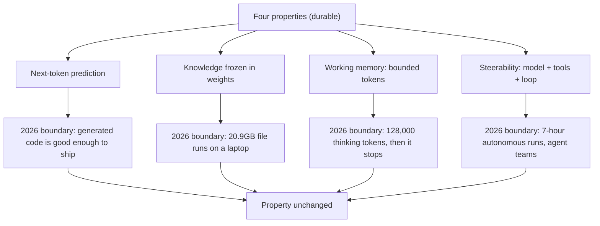

# Boundaries move, properties stay: the 2026 model year so far

> Fresh · AI / ML foundations · Intermediate · ~20 min · from today's feeds

## Why this matters
Today's core lesson gave you a four-axis map of a generative model — next-token prediction, knowledge, working memory, steerability — and claimed the map survives new releases because "boundaries shift but the properties remain the same". That claim is only worth anything if you can test it against a year of actual releases. Simon Willison's "2026 in LLMs (so far)" (2026-09-27) walks the model year month by month, and this lesson uses it as the test data: every event moved a boundary, not one added a fifth axis. That is the difference between a platform decision you make once and one you redo every quarter.

## Primer
You are level B in this domain, so here is only what this lesson needs.

A **generative transformer text model** is a large function with billions of fixed numeric parameters ("weights"). You feed it a sequence of **tokens** — word fragments, roughly 3–4 characters each — and it returns a probability distribution over the next token. **Next-token prediction** means that is the *only* thing it does: to produce a paragraph, the surrounding program samples one token from that distribution, appends it to the input, and calls the model again, hundreds of times. Everything that looks like reasoning is that loop plus the structure training pressed into the weights (Claude Academy, "AI Capabilities and Limitations", lesson 2 "What We Mean by AI").

A **coding agent** is not a model. It is three things: the model, **tools** it may call (read file, write file, run shell, run tests), and a **loop** that feeds each tool's output back in as more tokens until the model says it is done. That surrounding code — tools, loop, stop conditions — is the **harness**. Claude Code is a harness; so is your own MCP wiring.

A **local model** is one whose weights you download and run on your own machine instead of calling an API. The download is a **quantised weights file**: parameters rounded from 16 bits each down to roughly 4, which shrinks the file several-fold for a little accuracy. That is why tens of billions of parameters arrive as a ~20GB file.

A **token budget** is a cap the harness or the API puts on how many tokens one request may *produce*, including the model's hidden "thinking" tokens. It is a spending limit on output, not a context window, which limits how much *input* the model can see at once.

## The idea

The four-axis map says: a generative model is a next-token predictor, with knowledge frozen into its weights, a bounded amount of working memory it can hold and spend, and a finite degree of steerability. The strong version of the claim is not "models will not improve" — it is that improvements land *on* these axes rather than beside them. A year of releases is the cheapest available falsification test, because if a fifth axis existed, twelve months of frantic competition is when it would have shown up.

### What the year actually moved

Start with the thing Willison says kicked the year off. The November 2025 releases mattered not because the models got smarter in the abstract but because the harnesses around them crossed a usability line:

> "In this case, the thing that started working was their coding agents."
> — Simon Willison, *2026 in LLMs (so far)*, 2026-09-27, https://simonwillison.net/2026/Sep/27/2026-in-llms-so-far/

On the map, that is **steerability**: the same next-token predictor, given tools and a loop, now follows a multi-step instruction to completion often enough to be trusted with real work. The post reports that Claude Opus 4.5 and GPT-5.1 with their coding-agent harnesses moved from often making mistakes to being reliable enough for day-to-day use (Willison, *2026 in LLMs (so far)*, §November 2025). Nothing about the mechanism changed; the success rate of the loop changed. The post's own measure of how fast that compounded is the OpenClaw project, whose repository was first committed on 2025-11-24 and which the post says is now over 100,000 commits (Willison, §November 2025).

By January the quality boundary on generated code had moved far enough that Willison retires his own hedge:

> "I said “it will become undeniable that LLMs write good code”—I think we’re there now."
> — Simon Willison, *2026 in LLMs (so far)*, 2026-09-27, https://simonwillison.net/2026/Sep/27/2026-in-llms-so-far/

Read that on the **next-token prediction** axis. The output of a token-by-token sampler is now good code. The sampler is still a token-by-token sampler. "Undeniable that it writes good code" and "it is doing something other than predicting tokens" are different sentences, and only the first one is supported.

April moved the **knowledge** axis, in the direction that matters most for anyone shipping a product: how much frozen capability fits on hardware you own. The post's 16 April 2026 slide reads:

> "Qwen3.6-35B-A3B is a 20.9GB file that runs on my laptop"
> — Simon Willison, *2026 in LLMs (so far)*, 2026-09-27, https://simonwillison.net/2026/Sep/27/2026-in-llms-so-far/

That is a boundary, not a property change: the knowledge is still baked into weights at training time, still has a cutoff, still cannot be updated by telling the model something. What changed is that this particular frozen bundle now fits in 20.9GB on a laptop. The post's September section reports the same axis moving again, with Qwen 3.8 27B as a 17GB file producing a strong result in 21 minutes at its default "high" reasoning level (Willison, §September).

June is the year's best engineering lesson and it is not about capability at all. Per the post, Claude Fable 5 launched on 2026-06-09, access was suspended on 2026-06-12 under a US export-control directive, Fable returned on 2026-07-01, and GPT-5.6 launched on 2026-07-09 (Willison, *2026 in LLMs (so far)*, §June and §July). His summary of the window:

> "That gave us less than two weeks of Fable access before the price went up."
> — Simon Willison, *2026 in LLMs (so far)*, 2026-09-27, https://simonwillison.net/2026/Sep/27/2026-in-llms-so-far/

The transferable lesson is one line: do not architect around a single model vendor and version. Availability is not a property of the model; it is a property of your supply chain.

### The one row that is a property, not a boundary

September supplies the counterexample that proves the shape of the map — a limit that did not move, just arrived at a larger number:

> "Opus 5.5 thought for 128,000 tokens and then gave up! It ran out of tokens before it got to the response."
> — Simon Willison, *2026 in LLMs (so far)*, 2026-09-27, https://simonwillison.net/2026/Sep/27/2026-in-llms-so-far/

Be precise about what that is. It is an **output/thinking token budget** running out — the model spent its allowance on hidden reasoning and never emitted an answer. It is *not* a context-window story; the post does not discuss context length or long context at all. On the map it sits squarely on **working memory**: generation is bounded, the bound is finite, and a harness that does not plan for hitting it gets a null result after a long wait. Scaling the number from 8,000 to 128,000 does not remove the property, it relocates it — which is exactly what "boundaries shift, properties stay" predicts.

### Where the second source lands

Anthropic's *2026 Agentic Coding Trends Report* (n.d.) is organised around the same distinction without naming it: its capability trends are "Single agents evolve into coordinated teams", "Long-running agents build complete systems" and "Human oversight scales through intelligent collaboration" — all harness-level moves on the steerability axis. Its concrete numbers are boundary numbers:

> "Claude Code finished the entire job in seven hours of autonomous work in a single run."
> — Anthropic, *2026 Agentic Coding Trends Report*, n.d., https://resources.anthropic.com/hubfs/2026%20Agentic%20Coding%20Trends%20Report.pdf

Seven hours of a loop is not a new property; it is a longer run of the same loop, and the report pairs it with a verification claim in the same case — "The implementation achieved 99.9% numerical accuracy compared to the reference method." (Anthropic, *2026 Agentic Coding Trends Report*, n.d., Trend 3). Note what makes the seven hours usable: a reference method to diff against. That is the design consequence of the working-memory property for your own work.



The practical payoff: when you read a release note, the first question is which of the four axes the number sits on. That tells you whether it changes your design (a boundary you were previously designing around has moved) or only your expectations (the same property, restated larger).

## Lab

**Question this lab answers:** across the ten events Willison reports for the 2026 model year, how many moved a *boundary* on one of the four axes, how many re-exposed a *property*, and how many days of the Fable episode were actually usable?

### Step 1 — save the script

Stdlib only, no network. Save as `model_year.py`.

```python
#!/usr/bin/env python3
"""2026 model year: which axis each event moved, and whether it moved a boundary
or re-exposed a property. Timeline facts are from Simon Willison, "2026 in LLMs
(so far)", 2026-09-27. The classification and the arithmetic are ours."""
from datetime import date

AXES = ["next-token", "knowledge", "working-memory", "steerability"]

# when, event, axis, kind  (kind: BOUNDARY = what is reachable in practice moved,
#                                 PROPERTY = an unchanged structural limit showed up again)
EVENTS = [
    ("Nov 2025",   "Opus 4.5 / GPT-5.1 coding agents reliable day-to-day", "steerability",   "BOUNDARY"),
    ("2025-11-24", "OpenClaw first commit; post says 100k+ commits now",   "steerability",   "BOUNDARY"),
    ("Jan 2026",   "LLMs writing good code becomes undeniable",            "next-token",     "BOUNDARY"),
    ("2026-04-16", "Qwen3.6-35B-A3B, 20.9GB, runs on a laptop",            "knowledge",      "BOUNDARY"),
    ("2026-06-09", "Claude Fable 5 launches",                              "knowledge",      "BOUNDARY"),
    ("2026-06-12", "Fable access suspended (export-control directive)",    "steerability",   "BOUNDARY"),
    ("2026-07-01", "Fable returns",                                        "steerability",   "BOUNDARY"),
    ("2026-07-09", "GPT-5.6 launches",                                     "knowledge",      "BOUNDARY"),
    ("Sep 2026",   "Qwen 3.8 27B, 17GB, strong result in 21 minutes",      "knowledge",      "BOUNDARY"),
    ("Sep 2026",   "Opus 5.5 thinks 128,000 tokens, runs out, gives up",   "working-memory", "PROPERTY"),
]

print("=== Step 1: every event, one row ===")
print(f"{'when':<11} {'axis':<15} {'kind':<9} event")
for when, event, axis, kind in EVENTS:
    assert axis in AXES, axis
    print(f"{when:<11} {axis:<15} {kind:<9} {event}")

print("\n=== Step 2: per-axis tally ===")
print(f"{'axis':<15} {'boundary':>8} {'property':>8} {'total':>6} {'new axis?':>10}")
for axis in AXES:
    rows = [e for e in EVENTS if e[2] == axis]
    b = sum(1 for e in rows if e[3] == "BOUNDARY")
    p = sum(1 for e in rows if e[3] == "PROPERTY")
    print(f"{axis:<15} {b:>8} {p:>8} {len(rows):>6} {'no':>10}")
tb = sum(1 for e in EVENTS if e[3] == "BOUNDARY")
tp = sum(1 for e in EVENTS if e[3] == "PROPERTY")
print(f"{'ALL':<15} {tb:>8} {tp:>8} {len(EVENTS):>6} {'0 new':>10}")

print("\n=== Step 3: Fable availability, real date arithmetic ===")
launch, suspended, returned, gpt56 = (date(2026, 6, 9), date(2026, 6, 12),
                                      date(2026, 7, 1), date(2026, 7, 9))
windows = [("available", launch, suspended), ("dark", suspended, returned),
           ("available", returned, gpt56)]
print(f"{'state':<10} {'from':<11} {'to':<11} {'days':>5}")
for state, a, b in windows:
    print(f"{state:<10} {a.isoformat():<11} {b.isoformat():<11} {(b - a).days:>5}")
span = (gpt56 - launch).days
up = sum((b - a).days for s, a, b in windows if s == "available")
print(f"{'SPAN':<10} {launch.isoformat():<11} {gpt56.isoformat():<11} {span:>5}")
print(f"up={up} dark={span - up} uptime={up / span:.3f} "
      f"under_two_weeks={up < 14}")
```

### Step 2 — run it

```bash
python3 model_year.py
```

Real output:

```text
=== Step 1: every event, one row ===
when        axis            kind      event
Nov 2025    steerability    BOUNDARY  Opus 4.5 / GPT-5.1 coding agents reliable day-to-day
2025-11-24  steerability    BOUNDARY  OpenClaw first commit; post says 100k+ commits now
Jan 2026    next-token      BOUNDARY  LLMs writing good code becomes undeniable
2026-04-16  knowledge       BOUNDARY  Qwen3.6-35B-A3B, 20.9GB, runs on a laptop
2026-06-09  knowledge       BOUNDARY  Claude Fable 5 launches
2026-06-12  steerability    BOUNDARY  Fable access suspended (export-control directive)
2026-07-01  steerability    BOUNDARY  Fable returns
2026-07-09  knowledge       BOUNDARY  GPT-5.6 launches
Sep 2026    knowledge       BOUNDARY  Qwen 3.8 27B, 17GB, strong result in 21 minutes
Sep 2026    working-memory  PROPERTY  Opus 5.5 thinks 128,000 tokens, runs out, gives up

=== Step 2: per-axis tally ===
axis            boundary property  total  new axis?
next-token             1        0      1         no
knowledge              4        0      4         no
working-memory         0        1      1         no
steerability           4        0      4         no
ALL                    9        1     10      0 new

=== Step 3: Fable availability, real date arithmetic ===
state      from        to           days
available  2026-06-09  2026-06-12      3
dark       2026-06-12  2026-07-01     19
available  2026-07-01  2026-07-09      8
SPAN       2026-06-09  2026-07-09     30
up=11 dark=19 uptime=0.367 under_two_weeks=True
```

### Reading the output

**Step 1 block — the per-event table.** `when` is the date or month the post places the event in. `axis` is which of the four properties the event pressed on. `kind` is the judgement call: `BOUNDARY` means what is reachable in practice moved (quality, file size, run length, availability); `PROPERTY` means an unchanged structural limit showed up again at a new number. More `BOUNDARY` rows is neither good nor bad — it is the measurement. A row that could be classified on *no* existing axis would be the interesting one, and there is none.

| when | axis | kind | event |
|---|---|---|---|
| Nov 2025 | steerability | BOUNDARY | Opus 4.5 / GPT-5.1 coding agents reliable day-to-day |
| 2025-11-24 | steerability | BOUNDARY | OpenClaw first commit; post says 100k+ commits now |
| Jan 2026 | next-token | BOUNDARY | LLMs writing good code becomes undeniable |
| 2026-04-16 | knowledge | BOUNDARY | Qwen3.6-35B-A3B, 20.9GB, runs on a laptop |
| 2026-06-09 | knowledge | BOUNDARY | Claude Fable 5 launches |
| 2026-06-12 | steerability | BOUNDARY | Fable access suspended (export-control directive) |
| 2026-07-01 | steerability | BOUNDARY | Fable returns |
| 2026-07-09 | knowledge | BOUNDARY | GPT-5.6 launches |
| Sep 2026 | knowledge | BOUNDARY | Qwen 3.8 27B, 17GB, strong result in 21 minutes |
| Sep 2026 | working-memory | PROPERTY | Opus 5.5 thinks 128,000 tokens, runs out, gives up |

**Verdict:** ten months of the most competitive year in the field, and every event fits one of four pre-existing slots. The map is doing real work, not accommodating everything by being vague.

**Step 2 block — the tally.** Columns: `boundary` and `property` are counts of rows on that axis; `total` is their sum; `new axis?` is a constant `no`, printed to make the null result visible rather than implied. Lower is better in the `property` column only in the sense that a property row means you hit a wall. The tally traced by hand: steerability gets rows 1, 2, 6 and 7 → 4; knowledge gets rows 4, 5, 8 and 9 → 4; next-token gets row 3 → 1; working-memory gets row 10 → 1. Total 4 + 4 + 1 + 1 = 10, and 9 BOUNDARY + 1 PROPERTY = 10, so nothing is double-counted or dropped. The distribution is the finding: 8 of 10 events (4 steerability + 4 knowledge) are harness-and-weights plumbing, not changes to what a model *is*.

**Verdict:** the axes that moved most are the two you control in your own architecture — which harness you wire and which weights you point it at. The axis that bit back, working memory, is the one you have to design around rather than wait out.

**Step 3 block — Fable availability.** `state` is whether the model was usable in that window, `from`/`to` are the post's dates, `days` is the gap in whole days. Higher `days` is better for `available` rows and worse for the `dark` row. The arithmetic, with digits:

- launch to suspension: 2026-06-12 − 2026-06-09 = **3 days available**
- suspension to return: 2026-07-01 − 2026-06-12 = **19 days dark**
- return to the GPT-5.6 launch: 2026-07-09 − 2026-07-01 = **8 days available**
- full span: 2026-07-09 − 2026-06-09 = **30 days**; available 3 + 8 = **11**; dark 30 − 11 = **19**; uptime 11 ÷ 30 = **0.367**

11 is less than 14, which is why `under_two_weeks` prints `True` — the arithmetic on the post's dates agrees with the post's own phrase "less than two weeks of Fable access".

**Verdict:** a frontier model that is genuinely the best available can still deliver 36.7% uptime across its first month. Capability and availability are independent variables, and only one of them appears in the benchmark table.

### Cause → consequence

1. **Cause.** Competition in 2026 pushed on what is cheap to push on: harness reliability (coding agents that finish the job), weights packaging (a 20.9GB file on a laptop) and run length (seven autonomous hours). None of those require changing the mechanism.
2. **Mechanism.** Because the mechanism stays next-token prediction with frozen weights, a bounded generation budget and a tool loop, every improvement has to express itself as a bigger number on one of those four axes. There is nowhere else for it to go, which is why the map keeps classifying new releases without being extended.
3. **Consequence.** Vendor-specific facts — which model is best, what it costs, whether it is available in your region this week — decay in weeks. Axis-level facts do not. The one new risk the year actually surfaced was on the working-memory axis: a long run can consume its whole budget and return nothing.
4. **What it means in practice.** For the car-wash POS platform: put model calls behind one internal interface in the Lua monorepo with the model name, endpoint and budget as configuration, never as inlined call sites — the Fable window shows that a 3-day availability cliff is a normal operating condition, so swapping providers has to be a config change, not a refactor. Treat every call as "may return nothing after a long wait": set an explicit output-token cap, a wall-clock timeout, and a non-LLM fallback path for anything a customer is waiting on at the wash bay. For your Claude Code Skills and MCP setups: write them against the four axes rather than a model version — put the shop's domain facts in files the agent reads (knowledge is frozen, so supply it as input), structure long tasks as checkpointed steps that each produce a verifiable artefact instead of one 128,000-token think, and give every long-running task a reference method to diff against, which is what made Rakuten's seven-hour run reportable rather than merely long.

## Self-check
1. The Opus 5.5 event is classified as a `PROPERTY` row rather than a `BOUNDARY` row. Why, and what exactly ran out? <details><summary>Answer</summary>It ran out of its output/thinking token budget — the allowance on tokens the model may *produce*, including hidden reasoning — and returned nothing. It is a property row because the structural limit itself did not change; only the number did. Willison's words: "Opus 5.5 thought for 128,000 tokens and then gave up! It ran out of tokens before it got to the response." It is not a context-window or long-context story; the post does not discuss context length at all.</details>
2. January's "undeniable that LLMs write good code" is on the next-token-prediction axis. Does it mean the model stopped predicting tokens? <details><summary>Answer</summary>No. It means the quality boundary of what a token-by-token sampler produces moved past a usability line. The mechanism is unchanged: a distribution over the next token, sampled, appended, re-fed. "The output is now good" and "the mechanism is now different" are separate claims, and only the first is supported by the post.</details>
3. Fable 5 was arguably the best model available in June 2026. What did the lab's date arithmetic show about relying on that, and what is the design rule? <details><summary>Answer</summary>Across 2026-06-09 to 2026-07-09 — 30 days — it was available for 3 days (to the 2026-06-12 suspension) plus 8 days (from the 2026-07-01 return to the 2026-07-09 GPT-5.6 launch) = 11 days, 36.7% uptime, 19 days dark. The rule: do not architect around a single model vendor and version. Availability belongs to your supply chain, not to the model, so model identity, endpoint and budgets live in configuration behind one interface with a fallback.</details>

## Sources
- [2026 in LLMs (so far)](https://simonwillison.net/2026/Sep/27/2026-in-llms-so-far/) — Simon Willison, 2026-09-27 — the primary evidence: the month-by-month timeline of the model year (§November 2025 through §September), the four quoted passages on coding agents, code quality, the 20.9GB laptop model and the 128,000-token give-up, and the Fable 5 launch/suspension/return dates used in the lab's arithmetic; accessed 2026-10-12.
- [2026 Agentic Coding Trends Report](https://resources.anthropic.com/hubfs/2026%20Agentic%20Coding%20Trends%20Report.pdf) — Anthropic, n.d. (the PDF carries no publication date) — the eight trend headings, which read as steerability-axis moves, plus the Rakuten seven-hour autonomous run and its 99.9% numerical-accuracy check; accessed 2026-10-12.

## Next on this track
Fresh lessons sit outside the ladder; next on AI / ML foundations: **Validation, overfitting and data leakage** (rung 3 of 38, Beginner).
