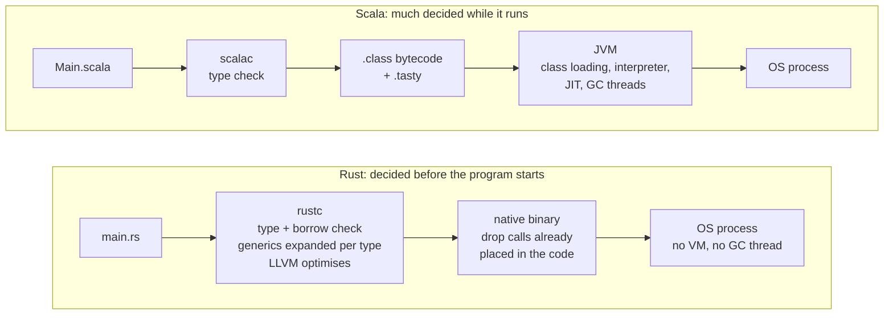
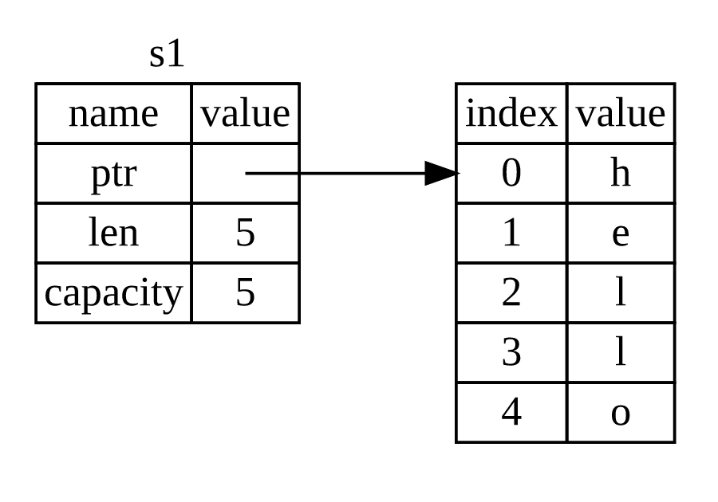
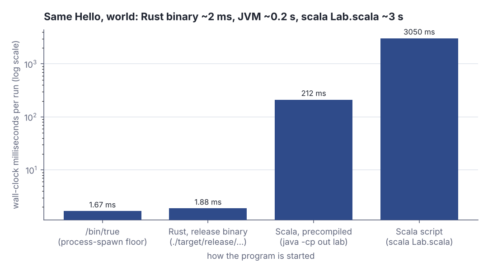
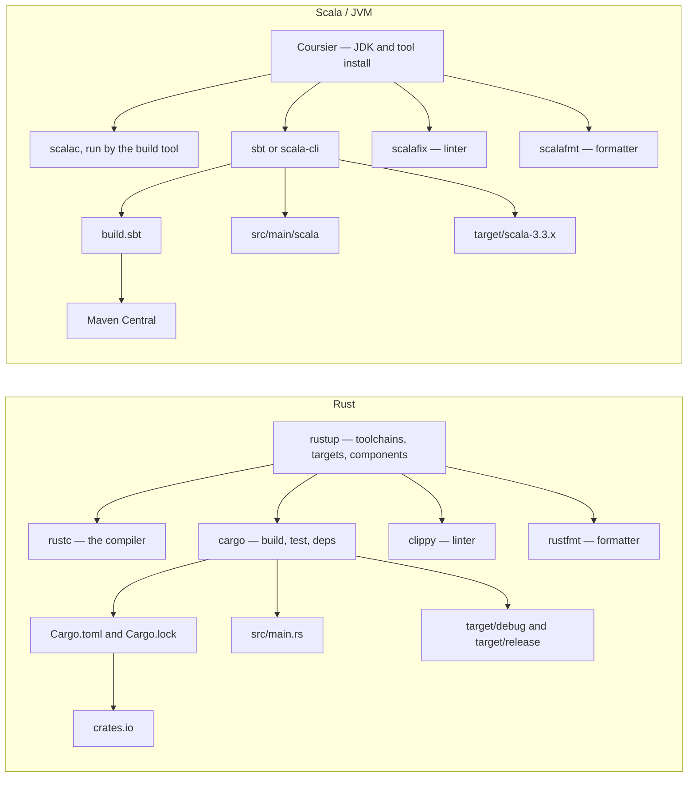
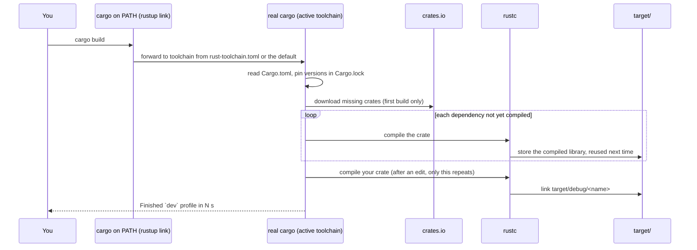
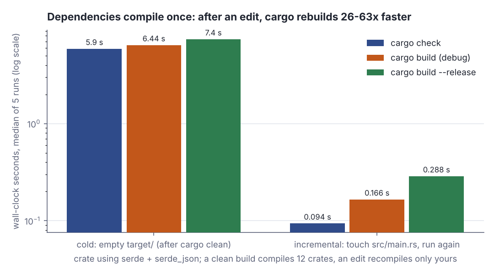

# Why Rust, rustup and cargo

> Rust basics · Beginner · ~28 min · rung 1 of 10 · needs: —

## Why this matters

You have spent years on a runtime that manages memory for you and bills you for it in GC pauses,
heap sizing and warmup. Rust takes the collector away and moves the whole question of "when is
this freed" to compile time, which is why it shows up in the places where a JVM is awkward:
sidecars, CLI tools, latency-sensitive hot paths, WASM. This rung buys the cheap part — toolchain,
build loop, and the three syntax facts that map straight onto `val`, `var` and expression-oriented
Scala — so the next rung can spend its full twenty minutes on ownership, which is the part that is
genuinely new to you.

## The idea

### The deal Rust offers, stated against the JVM

On the JVM you allocate freely and never write down how long anything lives; the collector works
it out at run time by tracing which objects are still reachable. You pay in pause times, a heap you
size, a JIT you warm, a per-object header.

Rust takes the opposite trade. Every value has exactly one owner, the variable that holds it; when
the owner's scope ends the value is *dropped*, and the compiler puts the deallocation at that exact
point in the machine code. No tracing, no pause, no runtime to ship — the binary is the program.

> "Some languages have garbage collection that regularly looks for no-longer-used memory as the program runs; in other languages, the programmer must explicitly allocate and free the memory. Rust uses a third approach: Memory is managed through a system of ownership with a set of rules that the compiler checks."
> — The Rust Project Developers, *The Rust Programming Language, ch. 4.1 "What Is Ownership?"*, accessed 2026-10-15, https://doc.rust-lang.org/book/ch04-01-what-is-ownership.html

Rust decides everything in the compiler box; the JVM leaves loading, optimising and freeing to
the running process:



You can watch the drop happen. `Drop` is Rust's destructor hook — a trait (Rust's interface) whose
`drop` method the compiler calls when a value goes away; here it prints. `Noisy` wraps a heap
`String`:

```rust
// file: main.rs
struct Noisy(String);
impl Drop for Noisy {
    fn drop(&mut self) { println!("  drop {:?}: free {} heap bytes", self.0, self.0.capacity()) }
}
fn main() {
    let _a = Noisy(String::from("hello"));
    { let _b = Noisy(String::from("tmp")); println!("inner block ends"); }
    println!("main ends");
}
```

```text
inner block ends
  drop "tmp": free 3 heap bytes
main ends
  drop "hello": free 5 heap bytes
```

`"tmp"` is freed at its block's `}`, before `main ends` prints; `"hello"` when `main` returns. No
collector ran. On the JVM an unreachable object waits for the next GC cycle, which is why Scala
reaches for `scala.util.Using` when a file must close on time. What gets freed is clearest in the
book's own picture:



*Figure 1: The book's Figure 4-1, "The representation in memory of a `String` holding the value `"hello"` bound to `s1`". Source: The Rust Project Developers, The Rust Programming Language, ch. 4.1, [What Is Ownership?](https://doc.rust-lang.org/book/ch04-01-what-is-ownership.html) (MIT OR Apache-2.0).*

Left: pointer, length, capacity, on the stack. Right: the heap allocation. "Rust calls `drop`
automatically at the closing curly bracket" (ch. 4.1), and `String`'s drop releases the right-hand table — the `free 5 heap bytes` line above. The safety the
GC gave you (no use-after-free, no double free) comes back as a compile-time check, the borrow
checker, which rejects any program it cannot prove safe. That is rung 2.

Price the costs now. The compiler rejects code that is correct but unprovable. Builds are slow:
lifetime analysis, monomorphisation (`Vec<i32>` and `Vec<String>` each get their own machine code,
where the JVM erases both to one class) and optimisation all happen ahead of time instead of in a
JIT. You trade developer latency for runtime predictability — and get this back:



*Figure 2: Time to run the same `Hello, world!`, measured in this lesson's build environment (Linux x86-64, OpenJDK 21, Scala 3.3.4, rustc 1.97); Rust and `/bin/true` averaged over 500 runs, JVM rows median of 7. Generated from the lesson's own measurements.*

The Rust binary takes 1.88 ms against 1.67 ms for `/bin/true`, which does nothing — so nearly all
of it is the OS creating a process. Precompiled Scala needs 212 ms to start a JVM and load the
Scala library; `scala Lab.scala`, how this course runs Scala labs, needs 3050 ms because it also
compiles the script every time.

### rustup is Coursier plus a JVM switcher; cargo is sbt

> "We'll download Rust through `rustup`, a command line tool for managing Rust versions and associated tools."
> — The Rust Project Developers, *The Rust Programming Language, ch. 1.1 "Installation"*, accessed 2026-10-13, https://doc.rust-lang.org/book/ch01-01-installation.html

`rustup` installs and switches *toolchains* (stable, beta, nightly), cross-compilation targets and
*components* — on day one `clippy` the linter and `rustfmt` the formatter, released with the
compiler, so there is no plugin-version matrix. A project pins its toolchain in
`rust-toolchain.toml`, as `.java-version` pins a JDK. The mechanism is visible on disk: the
`cargo` and `rustc` on your `PATH` are links to `rustup`, which picks the toolchain and forwards
the call:

```bash
ls -l ~/.cargo/bin/cargo ~/.cargo/bin/rustc
rustup which cargo
```

```text
lrwxrwxrwx 1 root root 6 Oct  2 15:38 /root/.cargo/bin/cargo -> rustup
lrwxrwxrwx 1 root root 6 Oct  2 15:38 /root/.cargo/bin/rustc -> rustup
/root/.rustup/toolchains/stable-x86_64-unknown-linux-gnu/bin/cargo
```

Both are links to `rustup` (output from the lesson's build environment); the last line is the
real cargo of the active toolchain. Switch toolchains and the same command reaches another
directory — no `JAVA_HOME` juggling.

> "Cargo is Rust's build system and package manager."
> — The Rust Project Developers, *The Rust Programming Language, ch. 1.3 "Hello, Cargo!"*, accessed 2026-10-13, https://doc.rust-lang.org/stable/book/ch01-03-hello-cargo.html

So `cargo` is sbt and the dependency resolver in one binary. `Cargo.toml` is `build.sbt`, but
declarative TOML that cannot contain code; `Cargo.lock` is the resolved version set; crates.io is
Maven Central and `cargo add serde` your `libraryDependencies +=`. sbt is a shell you keep open;
cargo is a one-shot CLI keeping incremental state in `target/`. Tool for tool:



### The cargo loop

- `cargo new hello_iaido` — scaffolds `Cargo.toml`, `src/main.rs`, a git repo.
- `cargo check` — type- and borrow-checks, no binary: "This command quickly checks your code to
  make sure it compiles but doesn't produce an executable" (ch. 1.3 "Hello, Cargo!").
- `cargo run` — builds the unoptimised *debug* profile into `target/debug/` and runs it.
- `cargo build --release` — the optimised profile, "in target/release instead of target/debug"
  (ch. 1.3). Slower to build, faster to run, far smaller.
- `cargo test` — runs every `#[test]` function; the runner is built in.

Plus `cargo clippy` and `cargo fmt`. What one `cargo build` does — note the loop over dependencies
not yet in `target/`:



That loop makes the first build slow and later ones fast. Measured on a crate using `serde` and
`serde_json`:



*Figure 3: Each command from an empty `target/` and again after touching `src/main.rs`; median of 5 runs, measured in this lesson's build environment (Linux x86-64, 2 shared cores, cargo 1.97). Generated from the lesson's own measurements.*

From clean, every command spends 6–7 s compiling 11 dependencies plus your crate. After an edit
only your crate recompiles: 5.90 ÷ 0.094 = 63× faster for `check`, 6.44 ÷ 0.166 = 39× for debug,
7.40 ÷ 0.288 = 26× for release. `check` stays cheapest (0.094 s against 0.166 s) because it skips
machine code — keep it under a file watcher as your sbt shell.

Tests need no setup. In a `cargo new --lib calc` project, one test wrong on purpose:

```rust
// src/lib.rs
pub fn double(x: i32) -> i32 { x * 2 }

#[cfg(test)]
mod tests {
    use super::double;
    #[test]
    fn doubles_21() { assert_eq!(double(21), 42); }
    #[test]
    fn doubles_2() { assert_eq!(double(2), 5); }
}
```

```text
$ cargo test
running 2 tests
test tests::doubles_21 ... ok
test tests::doubles_2 ... FAILED

---- tests::doubles_2 stdout ----
thread 'tests::doubles_2' (26666) panicked at src/lib.rs:9:22:
assertion `left == right` failed
  left: 4
 right: 5

test result: FAILED. 1 passed; 1 failed; 0 ignored; 0 measured; 0 filtered out; finished in 0.00s
```

`left` is what the code computed, `right` what the test expected, plus file, line and column —
ScalaTest's `shouldBe` with nothing added to `Cargo.toml`.

### Three syntax facts, in Scala terms

**`let` is `val`, `let mut` is `var`.** "By default, variables are immutable" (ch. 3.1 "Variables
and Mutability"). Rust adds *shadowing*:

> "We can shadow a variable by using the same variable's name and repeating the use of the `let` keyword"
> — The Rust Project Developers, *The Rust Programming Language, ch. 3.1 "Variables and Mutability"*, accessed 2026-10-13, https://doc.rust-lang.org/book/ch03-01-variables-and-mutability.html

**A shadow is a new binding that takes the old name**, so it may change type:

```rust
// file: main.rs
fn main() {
    let x = 5;
    let x = x * 2;             // shadow: a new `x`, built from the old one
    let spaces = "   ";        // &str
    let spaces = spaces.len(); // shadow with a different type: usize
    println!("x = {x}, spaces = {spaces}");
}
```

```text
x = 10, spaces = 3
```

Two bindings per name, and `spaces` went from text to number. Scala refuses this in one scope
(body of `@main def lab()` in `Lab.scala`):

```scala
  val x = 5
  val x = x * 2
```

```text
-- [E161] Naming Error: Lab.scala:3:6 ------------------------------
3 |  val x = x * 2
  |  ^^^^^^^^^^^^^
  |x is already defined as value x
```

**`mut` mutates one slot, so its type is fixed.** "The error says we're not allowed to mutate a
variable's type" (ch. 3.1). The same trick with `mut`, inside `fn main`:

```rust
let mut spaces = "   ";
spaces = spaces.len();
```

```text
error[E0308]: mismatched types
 --> src/main.rs:3:14
  |
2 |     let mut spaces = "   ";
  |                      ----- expected due to this value
3 |     spaces = spaces.len();
  |              ^^^^^^^^^^^^ expected `&str`, found `usize`
```

rustc points at the line that fixed the type and the assignment that breaks it.

**Rust is expression-oriented, as Scala is.** "Statements do not return values" while
"Expressions evaluate to a resultant value"; a block's value is its last semicolon-free line, and
`if` and `match` are expressions, so there is no ternary (ch. 3.3 "Functions"):

```rust
// file: main.rs
fn grade(score: u32) -> &'static str {
    if score >= 90 { "A" } else if score >= 75 { "B" } else { "C" }
}
fn main() {
    let y = {
        let half = 12;
        half * 3              // no `;` -> this is the block's value
    };
    println!("y = {y}, grade(80) = {}", grade(80));
}
```

```text
y = 36, grade(80) = B
```

The same program in Scala 3:

```scala
// file: Lab.scala
def grade(score: Int): String =
  if score >= 90 then "A" else if score >= 75 then "B" else "C"

@main def lab(): Unit =
  val y = { val half = 12; half * 3 }
  println(s"y = $y, grade(80) = ${grade(80)}")
```

```text
y = 36, grade(80) = B
```

Where they part: in Rust a `;` turns an expression into a statement worth `()` (Rust's `Unit`).
The book's `plus_one` (ch. 3.3) with one stray semicolon:

```rust
fn plus_one(x: i32) -> i32 {
    x + 1;
}
```

```text
error[E0308]: mismatched types
 --> src/main.rs:1:24
  |
1 | fn plus_one(x: i32) -> i32 {
  |    --------            ^^^ expected `i32`, found `()`
  |    |
  |    implicitly returns `()` as its body has no tail or `return` expression
2 |     x + 1;
  |          - help: remove this semicolon to return this value
```

The body now ends in a statement, so its value is `()`, not the declared `i32`; the `help` line is
the fix. In Scala a trailing `;` changes nothing — the one habit to unlearn.

## Lab

**The question this lab answers:** what does each of the five cargo commands actually give you, and
what does `let` do when you reuse the same name — rebind or mutate?

### Step 1 — install the toolchain on the Mac

```bash
curl --proto '=https' --tlsv1.2 https://sh.rustup.rs -sSf | sh
source "$HOME/.cargo/env"
rustup component add clippy rustfmt
rustup show
cargo --version
cargo clippy --version
cargo fmt --version
```

The install command is the one the book prints for Linux and macOS (ch. 1.1 "Installation").
Expected output — run locally (your host triple will be `aarch64-apple-darwin`, and the version
numbers move every six weeks):

```text
Default host: x86_64-unknown-linux-gnu
rustup home:  /root/.rustup

installed toolchains
--------------------
stable-x86_64-unknown-linux-gnu (active, default)

active toolchain
----------------
name: stable-x86_64-unknown-linux-gnu
active because: it's the default toolchain

cargo 1.97.0 (c980f4866 2026-06-30)
clippy 0.1.97 (2d8144b788 2026-07-07)
rustfmt 1.9.0-stable (2d8144b788 2026-07-07)
```

**Verdict:** one installer gave you compiler, build tool, linter and formatter at matched versions —
the Coursier plus sbt plus scalafmt plus scalafix setup you would assemble by hand on the JVM.

### Step 2 — cargo new and cargo run

```bash
cargo new hello_iaido
cd hello_iaido
cat Cargo.toml
cargo run
```

Expected output — run locally:

```text
    Creating binary (application) `hello_iaido` package
note: see more `Cargo.toml` keys and their definitions at https://doc.rust-lang.org/cargo/reference/manifest.html

[package]
name = "hello_iaido"
version = "0.1.0"
edition = "2024"

[dependencies]

   Compiling hello_iaido v0.1.0 (/Users/yuriy/code/hello_iaido)
    Finished `dev` profile [unoptimized + debuginfo] target(s) in 0.15s
     Running `target/debug/hello_iaido`
Hello, world!
```

**Verdict:** six lines of TOML are the whole build definition, and `[dependencies]` is empty —
compare the opening twenty lines of a typical `build.sbt`.

### Step 3 — shadow a value and type-check it

Replace `src/main.rs` with this, then type-check before building:

```rust
// file: main.rs
// run: local

fn main() {
    let x = 5;
    let x = x * 2;
    println!("x is {x}");
}
```

```bash
cargo check
cargo run
```

Expected output — run locally:

```text
    Checking hello_iaido v0.1.0 (/Users/yuriy/code/hello_iaido)
    Finished `dev` profile [unoptimized + debuginfo] target(s) in 0.03s
   Compiling hello_iaido v0.1.0 (/Users/yuriy/code/hello_iaido)
    Finished `dev` profile [unoptimized + debuginfo] target(s) in 0.09s
     Running `target/debug/hello_iaido`
x is 10
```

**Verdict:** `cargo check` finished in 0.03 s against 0.09 s for `cargo run` on a three-line
program, because it stops after analysis and never emits machine code; on a real crate that gap is
the difference between a usable and an unusable feedback loop.

### Step 4 — the full binding-and-expression walk

This program is the lesson's own lab. It prints one row per binding so you can watch a name change
meaning, and it runs here rather than on your Mac:

```rust
// file: main.rs

fn row(step: &str, name: &str, expr: &str, value: String, kind: &str, how: &str) {
    println!(
        "{:<4} {:<7} {:<22} {:>7} {:<7} {}",
        step, name, expr, value, kind, how
    );
}

fn main() {
    println!(
        "{:<4} {:<7} {:<22} {:>7} {:<7} {}",
        "step", "name", "expression", "value", "type", "mechanism"
    );
    println!("{}", "-".repeat(96));

    // Step 1 — shadowing: each `let` is a brand-new binding that reuses the name.
    let x = 5;
    row("1a", "x", "let x = 5", x.to_string(), "i32", "new binding (like Scala val)");
    let x = x * 2;
    row("1b", "x", "let x = x * 2", x.to_string(), "i32", "shadow: new binding, old one gone");
    let x = x + 1;
    row("1c", "x", "let x = x + 1", x.to_string(), "i32", "shadow again, still immutable");
    {
        let x = x * 100;
        row("1d", "x", "{ let x = x * 100 }", x.to_string(), "i32", "shadow inside a block only");
    }
    row("1e", "x", "after the block", x.to_string(), "i32", "inner shadow expired, 1c value back");

    // Step 2 — shadowing may change the type; `mut` may not.
    let spaces = "   ";
    row("2a", "spaces", "let spaces = \"   \"", format!("{:?}", spaces), "&str", "new binding holding text");
    let spaces = spaces.len();
    row("2b", "spaces", "let spaces = ..len()", spaces.to_string(), "usize", "shadow changed the TYPE");

    // Step 3 — let mut: one slot, mutated in place.
    let mut counter = 0;
    row("3a", "counter", "let mut counter = 0", counter.to_string(), "i32", "mutable slot (like Scala var)");
    for step in 1..=3 {
        counter += step;
        row(
            &format!("3{}", ["b", "c", "d"][(step - 1) as usize]),
            "counter",
            &format!("counter += {step}"),
            counter.to_string(),
            "i32",
            "same slot, value overwritten",
        );
    }

    // Step 4 — blocks and `if` are expressions, as in Scala.
    let y = {
        let half = x + 1;
        half * 3
    };
    row("4a", "y", "let y = { .. half*3 }", y.to_string(), "i32", "block evaluates to last expression");
    let size = if y > 30 { "big" } else { "small" };
    row("4b", "size", "let size = if y > 30", format!("{size:?}"), "&str", "if is an expression, no ternary");
    let parity = match y % 2 {
        0 => "even",
        _ => "odd",
    };
    row("4c", "parity", "let parity = match ..", format!("{parity:?}"), "&str", "match is an expression too");

    println!("{}", "-".repeat(96));
    println!("x = {x}, spaces = {spaces}, counter = {counter}, y = {y}, size = {size}, parity = {parity}");
}
```

Real output, from `python3 dojo/engine/run_lab.py 2026-10-13-1`:

```text
step name    expression               value type    mechanism
------------------------------------------------------------------------------------------------
1a   x       let x = 5                    5 i32     new binding (like Scala val)
1b   x       let x = x * 2               10 i32     shadow: new binding, old one gone
1c   x       let x = x + 1               11 i32     shadow again, still immutable
1d   x       { let x = x * 100 }       1100 i32     shadow inside a block only
1e   x       after the block             11 i32     inner shadow expired, 1c value back
2a   spaces  let spaces = "   "       "   " &str    new binding holding text
2b   spaces  let spaces = ..len()         3 usize   shadow changed the TYPE
3a   counter let mut counter = 0          0 i32     mutable slot (like Scala var)
3b   counter counter += 1                 1 i32     same slot, value overwritten
3c   counter counter += 2                 3 i32     same slot, value overwritten
3d   counter counter += 3                 6 i32     same slot, value overwritten
4a   y       let y = { .. half*3 }       36 i32     block evaluates to last expression
4b   size    let size = if y > 30     "big" &str    if is an expression, no ternary
4c   parity  let parity = match ..   "even" &str    match is an expression too
------------------------------------------------------------------------------------------------
x = 11, spaces = 3, counter = 6, y = 36, size = big, parity = even
```

**Verdict:** rows 1a–1e and 3a–3d answer the lab's second question — reusing a name with `let`
rebinds (and the rebinding obeys block scope), while `let mut` mutates one slot. Both read the same
in source; only the mechanism differs.

### Step 5 — debug against release

```bash
cargo build --release
ls -l target/debug/hello_iaido target/release/hello_iaido
du -sh target/debug target/release
cargo test
```

Expected output — run locally. The lines below were measured in this lesson's Linux x86-64 build
environment; on an Apple silicon Mac the byte counts will be close but not identical:

```text
   Compiling hello_iaido v0.1.0 (/Users/yuriy/code/hello_iaido)
    Finished `release` profile [optimized] target(s) in 0.08s

-rwxr-xr-x 2 root root 4367600 Oct 14 22:13 target/debug/hello_iaido
-rwxr-xr-x 2 root root  445112 Oct 14 22:13 target/release/hello_iaido
4.4M    target/debug
488K    target/release

    Finished `test` profile [unoptimized + debuginfo] target(s) in 0.10s
     Running unittests src/main.rs (target/debug/deps/hello_iaido-8248f0a9f8886df8)

running 0 tests

test result: ok. 0 passed; 0 failed; 0 ignored; 0 measured; 0 filtered out; finished in 0.00s
```

**Verdict:** the two profiles are separate build trees, not settings on one; `cargo run` always
means the debug one, so any number you quote as a benchmark must come from `--release`.

### Step 6 — install Rustlings as the companion for this track

Rustlings is "Small exercises to get you used to reading and writing Rust code" and is "an official
Rust project" (rustlings.rust-lang.org). It is the exercise set every later rung of this track draws
its lab from, so install it once now:

```bash
cargo install rustlings --locked
rustlings init
cd rustlings
rustlings
```

The install step is the project's own: "The following command will download and compile Rustlings",
and then "After installing Rustlings, run the following command to initialize the `rustlings/`
directory" (rustlings.rust-lang.org/setup). The binary lands in `~/.cargo/bin`, which the installer
in Step 1 already put on your `PATH`.

`rustlings` opens a terminal UI that watches the exercise files, recompiles the current one when you
save, and advances when it compiles and its assertions pass; `h` shows the hint for the exercise you
are on. Today do the exercises in `exercises/00_intro` (the UI lists them as `intro1` and `intro2`)
and the first two in `exercises/01_variables` (`variables1`, `variables2`). They are exactly Step 4
of this lab in exercise form: a missing `let`, then an uninitialised binding.

### Reading the output

Step 4's table is the one to read closely. Columns: **step** is the source line in order;
**name** is the identifier; **expression** is the line that produced the row; **value** is what the
name holds immediately after it; **type** is the type the compiler inferred; **mechanism** says
whether a new binding appeared or an existing slot changed. There is no "better" direction here —
the useful reading is which rows change type (only shadows can) and which rows share a slot (only
`mut` does).

| step | name | expression | value | type | mechanism |
|---|---|---|---|---|---|
| 1a | x | `let x = 5` | 5 | i32 | new binding |
| 1b | x | `let x = x * 2` | 10 | i32 | shadow, old binding unreachable |
| 1c | x | `let x = x + 1` | 11 | i32 | shadow, still immutable |
| 1d | x | `{ let x = x * 100 }` | 1100 | i32 | shadow scoped to the block |
| 1e | x | after the block | 11 | i32 | inner shadow expired |
| 2a | spaces | `let spaces = "   "` | `"   "` | &str | three spaces of text |
| 2b | spaces | `let spaces = spaces.len()` | 3 | usize | shadow changed the type |
| 3a | counter | `let mut counter = 0` | 0 | i32 | mutable slot created |
| 3b–3d | counter | `counter += 1,2,3` | 1, 3, 6 | i32 | same slot overwritten |
| 4a | y | `let y = { let half = x + 1; half * 3 }` | 36 | i32 | block is an expression |
| 4b | size | `let size = if y > 30 {..} else {..}` | `"big"` | &str | `if` is an expression |
| 4c | parity | `let parity = match y % 2 {..}` | `"even"` | &str | `match` is an expression |

The arithmetic, traced with the digits:

- Shadow chain: 1a binds 5. 1b evaluates `x * 2` with the *old* `x` still in scope, 5 × 2 = 10, and
  binds that to a new `x`. 1c does 10 + 1 = 11. 1d is inside a block, so 11 × 100 = 1100 is bound to
  a third `x` that dies at the closing brace; 1e reads 11 again, which is the proof that a shadow is
  a binding and not an assignment.
- Block as expression (4a): `half` = x + 1 = 11 + 1 = 12, then `half * 3` = 12 × 3 = 36 is the
  block's last line without a semicolon, so the block's value is 36 and that is what `y` gets.
- Mutation (3a–3d): one slot, 0 + 1 = 1, 1 + 2 = 3, 3 + 3 = 6. Sum 1 + 2 + 3 = 6 matches the final
  line.

Step 5's numbers: 4,367,600 bytes of debug binary against 445,112 bytes of release binary,
4,367,600 ÷ 445,112 = 9.81, so debug is roughly ten times the size here — almost all of it debug
info and un-inlined code, on a program whose logic is one `println!`.

**Verdict:** `let` without `mut` is not weaker than `var`; combined with shadowing it covers the
"transform a value step by step, then stop changing it" pattern that on the JVM tempts you into a
`var`, and it does so without ever allowing a second write to the same slot.

### Cause, mechanism, consequence, practice

1. **Cause:** Rust decided to guarantee memory safety without a garbage collector.
2. **Mechanism:** that forces the lifetime of every value to be known statically, so ownership and
   borrowing are compiler rules, and the compiler also expands generics per concrete type and
   optimises ahead of time instead of leaning on a JIT.
3. **Consequence:** there is no runtime to ship and no pause to tune, but compiles are long and the
   compiler rejects correct-but-unprovable code. That is why the toolchain is built the way it is:
   `cargo check` exists because full builds are expensive, and `clippy` and `rustfmt` ship with the
   compiler because the language cannot afford a plugin-version matrix on top of its build times.
4. **In practice:** for your work this means Rust is the right reach when the JVM's floor is the
   problem — a sidecar that must start in milliseconds, a single static binary to drop on a box, a
   hot path whose p99 must not move — and the wrong reach when iteration speed matters more than
   runtime predictability. Day to day, keep `cargo check` in a watch loop as your sbt shell, and
   quote performance numbers only from `--release` builds.

## Self-check

1. In Step 4, `x` reads 1100 inside the block at 1d but 11 again at 1e. Why, and what would you have
   to write instead for 1e to read 1100? <details><summary>Answer</summary>Because `let x = x * 100` inside the block creates a *new* binding that happens to reuse the name `x`, and that binding's scope ends at the closing brace; the outer `x` was never touched, so it still holds 11. To make the change outlive the block you need one slot that is written, not a second binding: declare `let mut x = 5;` in the outer scope and write `x *= 100;` inside the block. Note the price — `mut` fixes the type, so the trick from row 2b (`let spaces = spaces.len()`, &str becoming usize) is impossible with `mut`, which is exactly the error the book shows: "The error says we're not allowed to mutate a variable's type" (ch. 3.1 "Variables and Mutability").</details>
2. You are mid-refactor and want the tightest feedback loop. Which cargo command do you run, why is it faster, and what do you lose by using it? <details><summary>Answer</summary>`cargo check`. It runs the front end — parsing, type checking, borrow checking — and then stops: "This command quickly checks your code to make sure it compiles but doesn't produce an executable" (ch. 1.3 "Hello, Cargo!"). Skipping code generation, monomorphisation and linking is where the time goes; in Step 3 it was 0.03 s against 0.09 s on a three-line program, and the ratio grows with crate size. What you lose is a runnable binary, so it cannot tell you anything about behaviour — you still need `cargo run` for debug runs, `cargo test` for assertions, and `cargo build --release` for any number you intend to quote.</details>
3. Map the Rust toolchain onto your Scala one: which tool owns installing the compiler, which owns dependencies, and where do the linter and formatter come from? <details><summary>Answer</summary>`rustup` owns installation and versions — toolchains (stable, beta, nightly), cross-compilation targets, and components; it is the job Coursier does for the JDK and JVM tooling, plus the version switching a `.java-version` file gives you, via `rust-toolchain.toml`. `cargo` owns everything inside a project: dependencies declared in `Cargo.toml` and resolved into `Cargo.lock` from crates.io (sbt's `build.sbt` plus Maven Central), building into `target/debug` and `target/release`, running tests, and producing docs. The linter `clippy` and the formatter `rustfmt` are rustup components released in lockstep with the compiler and invoked through cargo as `cargo clippy` and `cargo fmt` — the roles scalafix and scalafmt play, but with no separate version to pick.</details>

## Sources

- [The Rust Programming Language, ch. 1 Getting Started](https://doc.rust-lang.org/book/ch01-00-getting-started.html) — The Rust Project Developers — the scope of the entry point: installing Rust, a first `Hello, world!` program, and cargo as Rust's package manager and build system (accessed 2026-10-13)
- [The Rust Programming Language, ch. 1.1 Installation](https://doc.rust-lang.org/book/ch01-01-installation.html) — The Rust Project Developers — the definition of rustup as the tool managing Rust versions and associated tools, and the exact macOS/Linux install command used in Step 1 (accessed 2026-10-13)
- [The Rust Programming Language, ch. 1.3 Hello, Cargo!](https://doc.rust-lang.org/stable/book/ch01-03-hello-cargo.html) — The Rust Project Developers — cargo as build system and package manager, Cargo.toml's TOML format, and the behaviour of cargo build, cargo run, cargo check and the release profile writing to target/release (accessed 2026-10-13)
- [The Rust Programming Language, ch. 3 Common Programming Concepts](https://doc.rust-lang.org/book/ch03-00-common-programming-concepts.html) — The Rust Project Developers — the chapter frame for the syntax section: variables, types, functions, comments and control flow (accessed 2026-10-13)
- [The Rust Programming Language, ch. 3.1 Variables and Mutability](https://doc.rust-lang.org/book/ch03-01-variables-and-mutability.html) — The Rust Project Developers — immutability by default, what `mut` permits, shadowing by repeating `let`, and the fact that a shadow may change type while `mut` may not (accessed 2026-10-13)
- [The Rust Programming Language, ch. 3.3 Functions](https://doc.rust-lang.org/book/ch03-03-how-functions-work.html) — The Rust Project Developers — statements do not return values while expressions evaluate to one, and a curly-brace block is an expression whose value is its last semicolon-free line (accessed 2026-10-13)
- [Rustlings](https://github.com/rust-lang/rustlings) — the Rust Project — the exercise set this track uses as its running lab, including the `exercises/00_intro` and `exercises/01_variables` directories worked in Step 6 (accessed 2026-10-13)
- [Rustlings — Setup](https://rustlings.rust-lang.org/setup) — the Rust Project — the official install and initialisation steps quoted in Step 6 (`cargo install rustlings --locked`, `rustlings init`) and the note that cargo installs binaries to `~/.cargo/bin` (accessed 2026-10-13)
- [Rustlings — home](https://rustlings.rust-lang.org/) — the Rust Project — the one-line description of Rustlings as small exercises for reading and writing Rust, and its status as an official Rust project (accessed 2026-10-13)
- [The Rust Programming Language, ch. 4.1 What Is Ownership?](https://doc.rust-lang.org/book/ch04-01-what-is-ownership.html) — The Rust Project Developers — the quoted "third approach" between garbage collection and manual freeing, the sentence that `drop` runs at the closing curly bracket, and Figure 4-1 (a `String` on the stack and heap) reproduced as Figure 1 (accessed 2026-10-15)
- [rust-lang/book, src/img/trpl04-01.svg](https://github.com/rust-lang/book/blob/main/src/img/trpl04-01.svg) — The Rust Project Developers — the source file of Figure 1, used under the repository's MIT OR Apache-2.0 licence (accessed 2026-10-15)

## Next on this track
Next on Rust basics: **Ownership and moves** (rung 2 of 10, Beginner).
