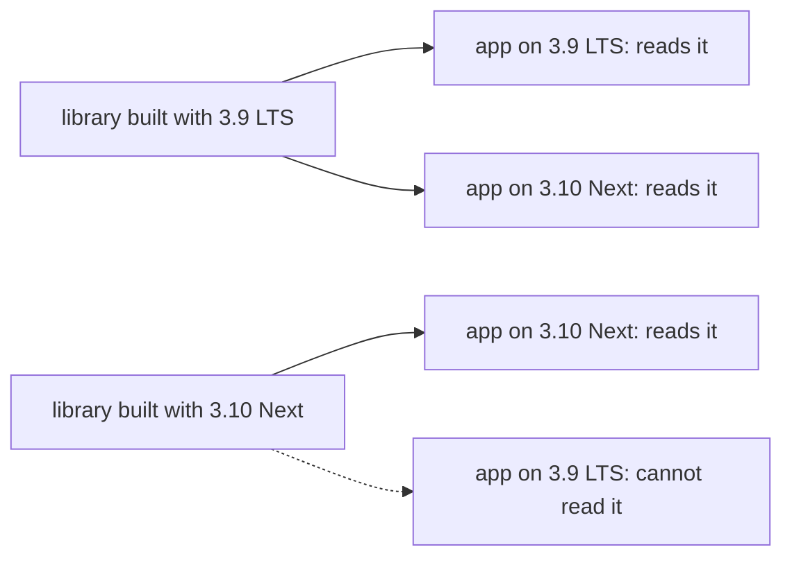
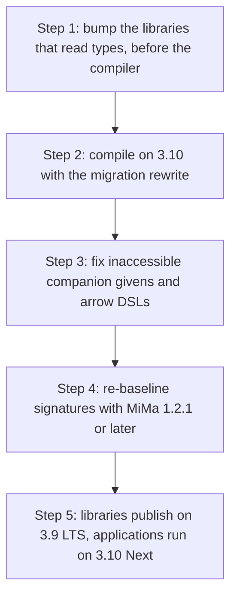

# Scala 3.10: Next vs LTS and what breaks

> Fresh · Functional Programming in Scala (red book) · Intermediate · ~25 min · from today's feeds

## Why this matters
Scala 3.10.0 was announced yesterday, 2026-10-12, on the official scala-lang.org news page, and it is the first release of a second, parallel release line. That turns "should we upgrade?" into a different and more durable question: which of the two lines does each of your artifacts belong on, and who gets locked out when you choose wrong. For your Scala/Akka services the answer is not a matter of taste — the compiler's own interchange format makes it for you, in one direction only. Twenty-five minutes now saves you an aborted upgrade later, because the expensive mistake is publishing a shared library on the wrong line, not bumping an application's compiler.

## Primer
You passed rung fp-scala-01, "What is FP: referential transparency and the substitution model", so you have the language's semantics but not its release machinery. Here is only what this lesson needs.

A **release line** is a series of Scala 3 minor versions maintained together: 3.9.0, 3.9.1, 3.9.2 are one line, 3.10.x another. **LTS** means Long Term Support: a line that receives patches and no new features for a stated period — "Scala 3.9 LTS itself is guaranteed to be maintained for at least three years" (scala-lang.org, *Scala 3.9 LTS released!*, 2026-09-03, https://www.scala-lang.org/news/3.9/).

**Binary compatibility** on the JVM is about compiled classfiles: whether a `.class` file produced earlier still links against a new jar, because method names, parameter types and return types still match. Scala 3 adds a second artifact, **TASTy** — Typed Abstract Syntax Trees, a serialised form of the fully typechecked program that the compiler writes into `.tasty` entries next to the bytecode in every jar. The compiler reads a dependency's TASTy, not its bytecode, when it needs the Scala-level truth: full generic types, `given` instances, `inline` bodies and macro implementations. A **`given`** is Scala 3's term-level implicit value, the thing the compiler searches for to satisfy a context parameter. **TASTy compatibility** is therefore a separate, stricter question than binary compatibility: can *this* compiler parse TASTy written by *that* one.

A **SIP** is a Scala Improvement Proposal: the numbered, reviewed mechanism by which language changes enter the language (SIP-67, SIP-61, SIP-75 all appear in the 3.10 notes). **MiMa** is the Migration Manager, the sbt plugin that compares a new jar's signatures against a previously published one and fails the build on an incompatible change.

On the ladder, this sits beside the rung you passed, fp-scala-01, and previews two pieces of the next one, fp-scala-02, "Getting started: tail recursion, higher-order and polymorphic functions": extension methods (which 3.10 now uses for `->` and the primitive wrappers) and higher-order functions (which `inline` in the standard library changes the compilation of).

## The idea

### Two release lines, not one

Scala 3 now ships on two parallel lines; that is the structural change, not any one feature. The announcement names the new line in its first sentence:

> "We are happy to announce Scala 3.10.0, the first release of the new Scala Next series."
> — the Scala programming language, *Scala 3.10 released!*, 2026-10-12, https://www.scala-lang.org/news/3.10/

Scala Next is the feature line; Scala LTS is the stability line. The 3.9 LTS announcement of 2026-09-03 says what the feature line carries:

> "Scala Next receives regular minor releases with new language features, tooling work, and ecosystem changes."
> — the Scala programming language, *Scala 3.9 LTS released!*, 2026-09-03, https://www.scala-lang.org/news/3.9/

The LTS line gets the opposite deal: patches and tooling fixes only, under the three-year guarantee quoted in the primer. The 3.10 announcement is unambiguous about where library code belongs: "Scala 3.9 LTS remains the recommended version to build against" (scala-lang.org, *Scala 3.10 released!*, 2026-10-12, https://www.scala-lang.org/news/3.10/). The tooling follows: the `lts` tag now resolves to 3.9, and Scala 3.11 is due around March or April 2027.

None of it arrived unannounced; the official release thread opened six weeks earlier:

> "The first release candidate for Scala 3.10.0 is now available for public tests!"
> — Scala Contributors forum, *Scala 3.10.0 release thread*, 2026-09-03, https://contributors.scala-lang.org/t/scala-3-10-0-release-thread/7546

RC1 went out on 2026-09-03 and the stable post is dated 2026-10-12 (Scala Contributors forum, *Scala 3.10.0 release thread*) — that window is your slot for a trial build.

### TASTy decides for you

Here is the asymmetry that does the real work. A compiler reads TASTy produced by its own minor version or an earlier one. It cannot read TASTy from a later one, which may contain tree shapes it has no case for. Newer consumes older, never the reverse.



The previous line change is the documented proof: "artifacts built with Scala 3.9 cannot be consumed by Scala 3.3 projects" (scala-lang.org, *Scala 3.9 LTS released!*, 2026-09-03, https://www.scala-lang.org/news/3.9/). 3.10 adds one more rung to the same ladder.

Now put the two facts together and the policy writes itself. A **library** has consumers you do not control, so its compiler version is a floor you impose on all of them: publish on Next and every consumer still on LTS is locked out until they move too — which they will not do on your schedule, because they chose LTS precisely to avoid moving. An **application** has no consumers; its compiler version constrains nobody. Libraries publish on LTS, applications ride Next. The lab below counts the blast radius of breaking that rule.

One more boundary moved with 3.10:

> "Cross-compilation between Scala 2 and 3.10 is no longer supported because of the removed legacy features."
> — the Scala programming language, *Scala 3.10 released!*, 2026-10-12, https://www.scala-lang.org/news/3.10/

If a module still cross-builds 2.13 and 3.x from one source tree, 3.10 is closed to it; it stays on LTS, where "Scala 3.3 LTS and Scala 3.9 LTS put compatibility with Scala 2.13 first" (scala-lang.org, *Scala 3.10 released!*, 2026-10-12).

### What actually breaks, and the order to fix it

The migration headline is reassuring and precisely scoped:

> "Most projects can upgrade without code changes."
> — the Scala programming language, *Scala 3.10 released!*, 2026-10-12, https://www.scala-lang.org/news/3.10/

The exceptions cluster in two places: code that reads types at compile time, and syntax retained only for Scala 2. Taken in the wrong order, each hides the next:



**Step 1 — dependencies first.** 3.10 does stronger constant folding during inlining, which breaks libraries whose macros inspect inlined trees. The announcement is direct: "If you use the ZIO ecosystem, upgrade these libraries before upgrading the compiler" (scala-lang.org, *Scala 3.10 released!*, 2026-10-12, https://www.scala-lang.org/news/3.10/). The named versions are ZIO 2.1.26, zio-blocks 0.0.54, izumi-reflect 3.0.10 and neotype 0.7.2 — all four read types at compile time, the surface that moved.

**Step 2 — the mechanical rewrite.** Using `A with B` as a *type* is now an error, not a warning — deprecated syntax previously retained for compatibility with Scala 2 (scala-lang.org, *Scala 3.10 released!*, 2026-10-12). It has warned since 3.4, and the fix is a flag, not a code review: compile once with `-source:3.4-migration -rewrite` and every occurrence becomes the intersection type `A & B` in place. In a long-lived Akka codebase this is the largest and dullest diff — run it first, so real errors are not buried under it.

**Step 3 — the small semantic ones.** Implicits in an inaccessible companion object are no longer found — 3.9 only warned under `-deprecation` — so make the companion public or move the `given`. `->` became an inline extension method and `Predef.ArrowAssoc` is deprecated, so your own `->` DSL built on an implicit class should become an extension method (issue #26851). The primitive `Rich*` wrappers are extension methods now, moving `until` and `max` onto the primitives' companions, and `this` is illegal in top-level definitions (PR #26448, scala-lang.org, *Scala 3.10 released!*, 2026-10-12).

**Step 4 — the compatibility gate.** Java generic signatures are more precise in 3.10: boxed types are used for primitive type arguments (PR #25944). Signatures change without semantics changing, so MiMa reports `IncompatibleSignatureProblem` (issue #27063); use MiMa 1.2.1 or later, which "adds Scala 3.9 and 3.10 support and fixes several false positives" (scala-lang.org, *Scala 3.10 released!*, 2026-10-12).

The upside is real but modest, and mostly consolidation: SIP-67 is stable, so pattern matching under `strictEquality` no longer needs a `CanEqual` instance while `==` stays strict; three SIPs sit behind `-preview` (SIP-61 `@unroll`, SIP-75 relaxed lambdas, SIP-68 referenceable package objects); and Java records are now matchable (PR #26497, scala-lang.org, *Scala 3.10 released!*, 2026-10-12). The standard library changed too:

> "The standard library also starts using more Scala 3 features, such as `inline` and extension methods."
> — the Scala programming language, *Scala 3.10 released!*, 2026-10-12, https://www.scala-lang.org/news/3.10/

None of that justifies moving a published library off LTS. All of it justifies moving your applications.

## Lab

**The question:** for each (producer compiler, consumer compiler) pair, can the consumer read the producer's TASTy — and how many consumers does a library lock out by publishing on Scala Next instead of LTS?

### Step 1 — model the lines and the TASTy rule

Three lines are in play: 3.3 LTS, 3.9 LTS and 3.10 Next. The rule is one comparison: a consumer reads a producer's TASTy when the producer's minor version is less than or equal to the consumer's. The program prints every pair with the arithmetic shown, then the reach of each publishing choice, then two realistic dependency sets.

```scala
// file: Lab.scala

final case class Line(label: String, minor: Int, kind: String)
final case class Dep(name: String, builtWith: Line)

val lts33 = Line("3.3 LTS", 3, "LTS")
val lts39 = Line("3.9 LTS", 9, "LTS")
val next310 = Line("3.10 Next", 10, "Next")
val lines = List(lts33, lts39, next310)

def canRead(consumer: Line, producer: Line): Boolean =
  producer.minor <= consumer.minor

def pad(s: String, n: Int): String =
  if s.length >= n then s else s + " " * (n - s.length)

def checkApp(app: String, on: Line, deps: List[Dep]): Unit =
  println(s"-- $app, compiled with ${on.label} --")
  val blocked = deps.count(d => !canRead(on, d.builtWith))
  deps.foreach { d =>
    val gap = on.minor - d.builtWith.minor
    val ok = canRead(on, d.builtWith)
    println(
      "   " + pad(d.name, 28) + "built with " + pad(d.builtWith.label, 11) +
      pad("gap " + gap.toString, 8) + (if ok then "readable" else "BLOCKED")
    )
  }
  println(s"   blocked $blocked/${deps.size} -> " + (if blocked == 0 then "builds" else "does not build"))

@main def lab(): Unit =
  println("Table 1: can the consumer read the producer's TASTy?")
  println(pad("producer", 11) + pad("consumer", 11) + pad("p.minor", 9) +
          pad("c.minor", 9) + pad("c - p", 7) + "reads?")
  for p <- lines; c <- lines do
    val gap = c.minor - p.minor
    println(pad(p.label, 11) + pad(c.label, 11) + pad(p.minor.toString, 9) +
            pad(c.minor.toString, 9) + pad(gap.toString, 7) +
            (if canRead(c, p) then "yes" else "NO"))

  println("")
  println("Table 2: how many of the 3 consumer lines can use a library published on each line?")
  for p <- lines do
    val reachable = lines.filter(c => canRead(c, p))
    println(pad(p.label, 11) + pad("(" + p.kind + ")", 8) +
            s"reach ${reachable.size}/${lines.size}   " + reachable.map(_.label).mkString(", "))

  println("")
  println("Table 3: two realistic dependency sets")
  checkApp(
    "payments-api",
    next310,
    List(
      Dep("zio 2.1.26", lts39),
      Dep("izumi-reflect 3.0.10", lts39),
      Dep("neotype 0.7.2", lts39)
    )
  )
  checkApp(
    "reporting-api",
    lts39,
    List(
      Dep("zio 2.1.26", lts39),
      Dep("internal-domain 1.4.0", next310)
    )
  )
```

### Step 2 — run it

```
Table 1: can the consumer read the producer's TASTy?
producer   consumer   p.minor  c.minor  c - p  reads?
3.3 LTS    3.3 LTS    3        3        0      yes
3.3 LTS    3.9 LTS    3        9        6      yes
3.3 LTS    3.10 Next  3        10       7      yes
3.9 LTS    3.3 LTS    9        3        -6     NO
3.9 LTS    3.9 LTS    9        9        0      yes
3.9 LTS    3.10 Next  9        10       1      yes
3.10 Next  3.3 LTS    10       3        -7     NO
3.10 Next  3.9 LTS    10       9        -1     NO
3.10 Next  3.10 Next  10       10       0      yes

Table 2: how many of the 3 consumer lines can use a library published on each line?
3.3 LTS    (LTS)   reach 3/3   3.3 LTS, 3.9 LTS, 3.10 Next
3.9 LTS    (LTS)   reach 2/3   3.9 LTS, 3.10 Next
3.10 Next  (Next)  reach 1/3   3.10 Next

Table 3: two realistic dependency sets
-- payments-api, compiled with 3.10 Next --
   zio 2.1.26                  built with 3.9 LTS    gap 1   readable
   izumi-reflect 3.0.10        built with 3.9 LTS    gap 1   readable
   neotype 0.7.2               built with 3.9 LTS    gap 1   readable
   blocked 0/3 -> builds
-- reporting-api, compiled with 3.9 LTS --
   zio 2.1.26                  built with 3.9 LTS    gap 0   readable
   internal-domain 1.4.0       built with 3.10 Next  gap -1  BLOCKED
   blocked 1/2 -> does not build
```

### Reading the output

**Table 1.** `p.minor` is the producer compiler's minor version, `c.minor` the consumer's, and `c - p` their difference. Higher (or zero) is better: a non-negative gap means the consumer is at or ahead of the producer and can parse its trees. A negative gap is the only failing case.

| producer | consumer | p.minor | c.minor | c - p | reads? |
|---|---|---|---|---|---|
| 3.3 LTS | 3.3 LTS | 3 | 3 | 0 | yes |
| 3.3 LTS | 3.9 LTS | 3 | 9 | 6 | yes |
| 3.3 LTS | 3.10 Next | 3 | 10 | 7 | yes |
| 3.9 LTS | 3.3 LTS | 9 | 3 | -6 | NO |
| 3.9 LTS | 3.9 LTS | 9 | 9 | 0 | yes |
| 3.9 LTS | 3.10 Next | 9 | 10 | 1 | yes |
| 3.10 Next | 3.3 LTS | 10 | 3 | -7 | NO |
| 3.10 Next | 3.9 LTS | 10 | 9 | -1 | NO |
| 3.10 Next | 3.10 Next | 10 | 10 | 0 | yes |

Trace the row that matters most. Producer 3.10 Next, consumer 3.9 LTS: `c - p = 9 - 10 = -1`, which is less than 0, so `canRead` is false and the row prints `NO`. One single minor version of difference, in the wrong direction, is as fatal as the seven-version gap on the 3.10-to-3.3 row. There is no "close enough".

**Verdict:** TASTy readability is a one-way relation, and the margin does not matter — only the sign does.

**Table 2.** The bracketed word is the line's kind, and `reach` counts how many of the three consumer lines can use a library published on that line; higher is better for a library author.

| published on | kind | reach | consumers that can use it |
|---|---|---|---|
| 3.3 LTS | (LTS) | 3/3 | 3.3 LTS, 3.9 LTS, 3.10 Next |
| 3.9 LTS | (LTS) | 2/3 | 3.9 LTS, 3.10 Next |
| 3.10 Next | (Next) | 1/3 | 3.10 Next |

Publishing on 3.10 Next drops reach from 2/3 to 1/3 — it cuts the audience to only those consumers who have themselves moved to Next. That is the arithmetic behind "Scala 3.9 LTS remains the recommended version to build against" (scala-lang.org, *Scala 3.10 released!*, 2026-10-12, https://www.scala-lang.org/news/3.10/).

**Verdict:** a library's compiler choice is an audience choice; Next halves it.

**Table 3.** `gap` is `app.minor - dependency.minor`, same sign rule. `payments-api` on 3.10 Next has gaps 1, 1, 1 against its three 3.9 LTS dependencies, so `blocked 0/3` and it builds — an application on Next consuming LTS libraries is the intended shape. `reporting-api` on 3.9 LTS has gap 0 against zio 2.1.26 (`9 - 9 = 0`, readable) and gap -1 against `internal-domain 1.4.0` built on 3.10 Next (`9 - 10 = -1`, BLOCKED), so `blocked 1/2` and it does not build. One team publishing one internal library on Next broke a consumer that was doing nothing wrong.

**Verdict:** the failure is not in the application that stayed on LTS; it is in the library that left it.

### Cause → consequence

1. **Cause.** Scala 3 ships a typed interchange format, TASTy, in every jar, and the compiler must parse a dependency's TASTy to typecheck against it.
2. **Mechanism.** A compiler only has cases for tree shapes that existed at or before its own minor version, so TASTy reads forward (older producer → newer consumer) and never backward; the gap `consumer.minor - producer.minor` must be ≥ 0.
3. **Consequence.** The compiler version of a *published* artifact is a hard floor on every consumer of it, while the compiler version of an *application* constrains nobody — which is why "Scala 3.9 LTS remains the recommended version to build against" (scala-lang.org, *Scala 3.10 released!*, 2026-10-12) and why 3.9 LTS carries a three-year maintenance guarantee (scala-lang.org, *Scala 3.9 LTS released!*, 2026-09-03).
4. **What it means in practice.** Split your estate in two. Every shared or published library — internal domain models included — pins 3.9 LTS in `build.sbt` and keeps MiMa 1.2.1 or later in CI. Every leaf application is free to move to 3.10, in the order the diagram gives: bump ZIO 2.1.26, zio-blocks 0.0.54, izumi-reflect 3.0.10 and neotype 0.7.2 first, then compile with `-source:3.4-migration -rewrite`, then fix companion-private `given`s and `->` DSLs. And any module that still cross-builds Scala 2.13 is out of scope for 3.10 entirely and stays on LTS.

## Self-check
1. Your team's internal `domain-model` library is consumed by six services, four of which you do not own. Which line do you publish it on, and what is the one-sentence reason? <details><summary>Answer</summary>3.9 LTS. A published artifact's compiler version is a floor on every consumer, because TASTy only reads forward — a 3.10 Next build would be unreadable by any of the four services you do not control until they also moved to Next, and "Scala 3.9 LTS remains the recommended version to build against" (scala-lang.org, *Scala 3.10 released!*, 2026-10-12).</details>
2. You bump one service straight to 3.10 and get a wall of errors about inlining inside a ZIO macro. What did you do in the wrong order, and what does the announcement say to do instead? <details><summary>Answer</summary>You upgraded the compiler before the libraries that read types at compile time. 3.10 does stronger constant folding during inlining, and the announcement says "If you use the ZIO ecosystem, upgrade these libraries before upgrading the compiler" (scala-lang.org, *Scala 3.10 released!*, 2026-10-12) — the named versions are ZIO 2.1.26, zio-blocks 0.0.54, izumi-reflect 3.0.10 and neotype 0.7.2.</details>
3. A 3.10 build fails on a type written `Reader with Writer`, and separately MiMa fails your library release with `IncompatibleSignatureProblem` even though you changed no public API. What fixes each? <details><summary>Answer</summary>The first: `A with B` as a type is an error in 3.10 (it has warned since 3.4), so compile once with `-source:3.4-migration -rewrite` and the compiler rewrites it to `Reader & Writer` in place. The second: 3.10 emits more precise Java generic signatures, using boxed types for primitive type arguments (PR #25944), which MiMa reports as a signature problem (issue #27063); upgrade to MiMa 1.2.1 or later, which per the announcement "adds Scala 3.9 and 3.10 support and fixes several false positives" (scala-lang.org, *Scala 3.10 released!*, 2026-10-12).</details>

## Sources
- [Scala 3.10 released!](https://www.scala-lang.org/news/3.10/) — the Scala programming language, 2026-10-12 — primary source: the Scala Next series, the `lts` tag resolving to 3.9, Scala CLI 1.17.1, the breaking-change list (inaccessible companion implicits, stronger constant folding and the ZIO/zio-blocks/izumi-reflect/neotype versions, `Rich*` wrappers as extension methods, `->` as an inline extension method, `A with B` as an error, `this` in top-level definitions, boxed Java generic signatures, `-Xmax-fuel` 550), MiMa 1.2.1, SIP-67 stable, the `-preview` SIPs, and the 3.10.1 / 3.10.2 / 3.11 roadmap; accessed 2026-10-13
- [Scala 3.9 LTS released!](https://www.scala-lang.org/news/3.9/) — the Scala programming language, 2026-09-03 — the LTS / Next split, what each line receives, the at-least-three-years maintenance guarantee, and the documented precedent that 3.9 artifacts cannot be consumed by 3.3 projects; accessed 2026-10-13
- [Scala 3.10.0 release thread](https://contributors.scala-lang.org/t/scala-3-10-0-release-thread/7546) — Scala Contributors forum, 2026-09-03 to 2026-10-12 — the release-candidate cadence: RC1 opened for public testing in early September, with the stable tag about six weeks later; accessed 2026-10-13
- [scala/scala3 releases](https://github.com/scala/scala3/releases) — the Scala 3 repository on GitHub — cross-check of the tags and labels: the 3.10.0-RC1 pre-release, and the `LTS` label on 3.9.0 and 3.3.8; accessed 2026-10-13

## Next on this track
Fresh lessons sit outside the ladder; next on Functional Programming in Scala (red book): **Getting started: tail recursion, higher-order and polymorphic functions** (rung 2 of 26, Beginner).
