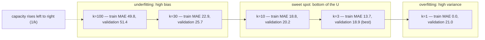

# Validation, overfitting and data leakage

> AI / ML foundations · Beginner · ~25 min · rung 3 of 38 · needs: Your first model: Scala collections in, predictions out (ai-ml-02)

## Why this matters
You now have a fitted model, and the first number it hands you — its error on the rows it was trained on — is the one number that cannot tell you whether it works.
Every ML incident you will ever triage as a Product Owner reduces to one of two bugs in this lesson: a model chosen on a score it had already seen, or a feature that quietly carries the answer.
It sits here because every rung above it — regularisation, hyper-parameter search, evaluating an LLM — is a variation on "hold something back and measure on that".

## The idea

A model's error on its own training rows measures how much of that table it managed to store, not how well it predicts. Push its capacity high enough and that error goes to zero while the model gets worse at the only job it has. The scikit-learn user guide states the trap in one sentence:

> "Learning the parameters of a prediction function and testing it on the same data is a methodological mistake: a model that would just repeat the labels of the samples that it has just seen would have a perfect score but would fail to predict anything useful on yet-unseen data."
> — scikit-learn developers, *3.1. Cross-validation: evaluating estimator performance*, scikit-learn 1.9.1 documentation, accessed 2026-10-14, https://scikit-learn.org/stable/modules/cross_validation.html

The fix is procedural, not mathematical: hold rows back.

### Three sets, and what each is for

- **Training set** (60–80% of rows): what the model fits its parameters on.
- **Validation set** (10–20%): what you score candidates on — this depth of tree against that one, these features against those. You look at it many times.
- **Test set** (10–20%): what the chosen model is scored on once, at the end, for a number you can quote.

> "You should test a model against a different set of examples than those used to train the model."
> — Google for Developers, *Datasets: Dividing the original dataset*, Machine Learning Crash Course, 2025-12-03, https://developers.google.com/machine-learning/crash-course/overfitting/dividing-datasets

Why three and not two: every time you pick something because a score was better, you fit a little to that set. The same page warns that "the more often you use the same test set, the more likely the model closely fits the test set" (Google for Developers, Machine Learning Crash Course, "Datasets: Dividing the original dataset"). The validation set absorbs that wear; the test set stays sealed.

A split is a seeded shuffle and a slice. Shuffle, because tables arrive sorted — by date, by region, by whoever appended last — so slicing gives you two populations rather than two samples of one. Seed, because the split must be identical for every candidate; otherwise you rank models by the split they happened to get.

**The QA reading.** The validation set is a test suite the model must never see during development; the test set is the acceptance run before release. You know the failure mode: when developers tune code until the suite goes green, the suite stops measuring correctness and starts measuring "fits the suite".

### Capacity decides which way you fail

**Capacity** is how much structure a model can represent — for a decision tree, the number of leaves, where one leaf per training row is a lookup table. For k-nearest neighbours, where a prediction is the average target of the k closest training rows, capacity is 1/k: at k = 1 it reproduces its training rows exactly, at k = N it predicts one constant for everything.

**Underfitting** (high **bias**): too little capacity for the real pattern, so the model is wrong in the same direction across whole regions and error is high on training *and* validation rows. **Overfitting** (high **variance**): enough capacity to fit the noise in the rows it happened to see, so training error collapses towards zero while validation error climbs, and a different sample would have produced a visibly different model (StatQuest, "Machine Learning Fundamentals: Bias and Variance"). Training error falls monotonically with capacity; validation error is U-shaped, and the bottom of that U is what you ship.



### k-fold cross-validation: a steadier number

One 80/20 split estimates from a handful of rows and costs you those rows for training. **k-fold cross-validation** reuses everything: cut the data into k equal folds, train on k−1 and score on the one held out, rotating until every fold has been held out exactly once. "The performance measure reported by k-fold cross-validation is then the average of the values computed in the loop" (scikit-learn 1.9.1 user guide, §3.1 "Cross-validation: evaluating estimator performance"), and the spread across folds says how much to trust it. The trade, in the same guide: "This approach can be computationally expensive, but does not waste too much data (as is the case when fixing an arbitrary validation set)" — k fits instead of one, for an estimate averaged over all your rows (Kaggle Learn, Intermediate Machine Learning, Lesson 5 "Cross-Validation"). k = 5 or 10 is usual, and small datasets are where it earns its cost. It replaces the validation split, not the test set.

### Data leakage: the bug that makes all of this worthless

"Data leakage occurs when information that would not be available at prediction time is used when building the model" (scikit-learn 1.9.1 user guide, §12.2 "Data leakage"). Two shapes.

**Target leakage** is a feature that is a consequence of the answer rather than a cause of it: predicting pneumonia from a `took_antibiotics` column, churn from a `contract_closed_date`, a default from the collections-team flag. It scores beautifully on every split, because the column really does determine the target in your table — and it is empty or wrong at the moment you need the prediction (Kaggle Learn, Intermediate Machine Learning, Lesson 7 "Data Leakage").

**Train–test contamination** is a clean split undone by preprocessing fitted on all the rows. Standardise a column by its mean over all 300 rows, then split, and the mean each training row was scaled by is a function of the validation rows too. Hence the order: "Always split the data into train and test subsets first, particularly before any preprocessing steps" (scikit-learn 1.9.1 user guide, §12.2.1 "How to avoid data leakage"). Duplicate rows on both sides do the same thing, more crudely.

Both leaks share one signature: a validation score that is suspiciously good and a production number that is not. A score that looks too good is a bug report, not a result.

## Lab

**The question this lab answers:** as you dial a model's capacity from "one constant for everybody" to "memorise every row", what happens to its error on the training rows and on held-out rows, and which number would you have believed?

The sources for this rung are Python courses (Kaggle, scikit-learn); the lab does the work in Scala 3 with the standard library only — 300 synthetic houses, a hand-written 80/20 split, and k-nearest-neighbour regression, whose capacity is a single integer you can turn.

### Step 1 — generate the data and split it before touching anything

A seeded `scala.util.Random` makes the whole run reproducible. The true rule is `price = 3·size + 20·rooms`, plus Gaussian noise with a standard deviation of 20 that no model can ever learn — the floor on every error below.

```scala
val gen = new Random(42)
val houses = Vector.fill(300) {
  val size  = 40.0 + gen.nextDouble() * 160.0   // 40..200 square metres
  val rooms = 1 + gen.nextInt(6)                // 1..6
  val noise = gen.nextGaussian() * 20.0         // irreducible
  House(size, rooms, 3.0 * size + 20.0 * rooms + noise)
}
val shuffled = new Random(7).shuffle(houses)
val (trainH, valH) = shuffled.splitAt(240)      // split FIRST
```

Only then is the scaler computed, from the 240 training rows alone. Computing `mean` and `sd` over all 300 rows first would be exactly the train–test contamination described above.

### Step 2 — k-nearest neighbours, three functions

No training step: the model *is* the training rows. A prediction sorts them by distance in standardised feature space, takes the k closest, and averages their prices. The error measure is **MAE**, mean absolute error — the average of `|predicted − actual|`, in the same units as price, lower is better.

```scala
def predict(base: Vector[(Vector[Double], Double)], x: Vector[Double], k: Int): Double =
  base.map((f, p) => (dist(f, x), p)).sortBy(_._1).take(k).map(_._2).sum / k
```

At k = 1 the nearest training row to a training row is itself, at distance 0, so the prediction is its own price and the training error is exactly 0.

### Step 3 — the whole program

```scala
// file: Lab.scala
import scala.util.Random

final case class House(size: Double, rooms: Int, price: Double)

@main def lab(): Unit =
  // ---- Step 1: 300 synthetic houses from one seed -------------------------
  val gen = new Random(42)
  val houses = Vector.fill(300) {
    val size  = 40.0 + gen.nextDouble() * 160.0   // 40..200 square metres
    val rooms = 1 + gen.nextInt(6)                // 1..6
    val noise = gen.nextGaussian() * 20.0         // irreducible: no model can learn this
    House(size, rooms, 3.0 * size + 20.0 * rooms + noise)
  }
  println("first 3 generated houses:")
  houses.take(3).foreach(h =>
    println(f"  size=${h.size}%6.2f  rooms=${h.rooms}  price=${h.price}%7.2f"))

  // ---- Step 2: shuffle and split 80/20 BEFORE any preprocessing -----------
  val shuffled = new Random(7).shuffle(houses)
  val (trainH, valH) = shuffled.splitAt(240)
  println(f"%ntrain=${trainH.size} rows   validation=${valH.size} rows")

  def mean(xs: Seq[Double]): Double = xs.sum / xs.size
  def sd(xs: Seq[Double]): Double =
    val m = mean(xs); math.sqrt(xs.map(x => (x - m) * (x - m)).sum / xs.size)

  // scaler fitted on TRAIN ONLY — fitting it on all 300 rows would be leakage
  val (muSize, sdSize)   = (mean(trainH.map(_.size)),          sd(trainH.map(_.size)))
  val (muRooms, sdRooms) = (mean(trainH.map(_.rooms.toDouble)), sd(trainH.map(_.rooms.toDouble)))
  println(f"scaler from train only: size mu=$muSize%.3f sd=$sdSize%.3f | rooms mu=$muRooms%.3f sd=$sdRooms%.3f")

  def feats(h: House): Vector[Double] =
    Vector((h.size - muSize) / sdSize, (h.rooms - muRooms) / sdRooms)
  val train = trainH.map(h => (feats(h), h.price))
  val valid = valH.map(h => (feats(h), h.price))

  // ---- Step 3: k-nearest-neighbour regression ----------------------------
  def dist(a: Vector[Double], b: Vector[Double]): Double =
    math.sqrt(a.lazyZip(b).map((x, y) => (x - y) * (x - y)).sum)

  def predict(base: Vector[(Vector[Double], Double)], x: Vector[Double], k: Int): Double =
    base.map((f, p) => (dist(f, x), p)).sortBy(_._1).take(k).map(_._2).sum / k

  def mae(base: Vector[(Vector[Double], Double)], eval: Vector[(Vector[Double], Double)], k: Int): Double =
    mean(eval.map((f, p) => math.abs(predict(base, f, k) - p)))

  // one prediction traced by hand, so the arithmetic is visible
  val (vx, vy) = valid.head
  val near3 = train.map((f, p) => (dist(f, vx), p)).sortBy(_._1).take(3)
  println(f"%ntraced: validation row 0, actual price ${vy}%.2f")
  near3.zipWithIndex.foreach { case ((d, p), i) =>
    println(f"  neighbour ${i + 1}: distance=$d%.4f  price=$p%.2f") }
  println(f"  k=3 prediction = (${near3.map(_._2).map(p => f"$p%.2f").mkString(" + ")}) / 3 = ${near3.map(_._2).sum / 3}%.2f")
  println(f"  absolute error = ${math.abs(near3.map(_._2).sum / 3 - vy)}%.2f")

  // ---- Step 4: the capacity sweep ---------------------------------------
  println(f"%n  k   capacity    train MAE   validation MAE")
  val ks = List(100, 30, 10, 3, 1)
  val scored = ks.map { k =>
    val tr = mae(train, train, k)
    val va = mae(train, valid, k)
    val label = if k >= 30 then "low" else if k >= 10 then "medium" else "high"
    println(f"$k%3d   $label%-9s   $tr%9.3f   $va%14.3f")
    (k, va)
  }
  val best = scored.minBy(_._2)
  println(f"%nbest k by validation MAE: k=${best._1} at MAE ${best._2}%.3f")
  println(f"in-sample MAE of k=1: ${mae(train, train, 1)}%.3f   <- it memorises")
  println(f"validation MAE of k=1: ${mae(train, valid, 1)}%.3f   <- what it is really worth")

  // ---- Step 5: 5-fold cross-validation, folds by row index mod 5 ---------
  println(f"%n5-fold cross-validation over all 300 rows (fold = index mod 5)")
  println("  k    f0       f1       f2       f3       f4      mean")
  val all = shuffled.zipWithIndex
  ks.foreach { k =>
    val perFold = (0 until 5).map { f =>
      val hold = all.filter(_._2 % 5 == f).map(_._1)
      val rest = all.filter(_._2 % 5 != f).map(_._1)
      val mS = mean(rest.map(_.size)); val dS = sd(rest.map(_.size))
      val mR = mean(rest.map(_.rooms.toDouble)); val dR = sd(rest.map(_.rooms.toDouble))
      def ft(h: House) = Vector((h.size - mS) / dS, (h.rooms - mR) / dR)
      mae(rest.map(h => (ft(h), h.price)), hold.map(h => (ft(h), h.price)), k)
    }
    println(f"$k%3d " + perFold.map(x => f"$x%8.3f").mkString + f"  ${mean(perFold)}%8.3f")
  }
```

Run it with `scala Lab.scala`.

### Step 4 — the single split: data, one traced prediction, and the capacity sweep

```text
first 3 generated houses:
  size=156.41  rooms=1  price= 494.57
  size=112.20  rooms=1  price= 346.10
  size= 84.12  rooms=1  price= 249.12

train=240 rows   validation=60 rows
scaler from train only: size mu=116.380 sd=46.690 | rooms mu=3.404 sd=1.612

traced: validation row 0, actual price 464.71
  neighbour 1: distance=0.0948  price=472.36
  neighbour 2: distance=0.0990  price=508.85
  neighbour 3: distance=0.1302  price=501.20
  k=3 prediction = (472.36 + 508.85 + 501.20) / 3 = 494.14
  absolute error = 29.43

  k   capacity    train MAE   validation MAE
100   low            49.816           51.406
 30   low            22.936           25.661
 10   medium         18.805           20.219
  3   high           13.675           18.868
  1   high            0.000           20.995

best k by validation MAE: k=3 at MAE 18.868
in-sample MAE of k=1: 0.000   <- it memorises
validation MAE of k=1: 20.995   <- what it is really worth
```

**Verdict:** the training column falls all the way to 0.000 and is therefore useless as a ranking signal — it would have chosen k = 1, the worst model but one. The validation column is U-shaped and picks k = 3 at MAE 18.868. The honest cost of believing the in-sample number is 20.995 − 18.868 = 2.127 price units of avoidable error on every future prediction, bought with a score of exactly zero.

### Step 5 — five folds instead of one split

```text
5-fold cross-validation over all 300 rows (fold = index mod 5)
  k    f0       f1       f2       f3       f4      mean
100   48.973  46.309  49.346  59.373  52.858    51.372
 30   23.611  23.530  23.802  28.039  23.311    24.459
 10   17.993  20.078  20.439  19.231  23.109    20.170
  3   19.486  18.563  22.275  21.565  21.205    20.619
  1   23.725  23.890  25.214  24.269  27.129    24.845
```

**Verdict:** cross-validation reverses the winner. On the single split k = 3 (18.868) beat k = 10 (20.219); averaged over five folds k = 10 (20.170) beats k = 3 (20.619). The per-fold columns say why: for k = 3 the five estimates run from 18.563 to 22.275, a spread of 3.712, so a gap of 1.351 between the two candidates on one split was inside the noise. Five fits bought a decision the one split got wrong.

### Reading the output

**What each column means.** `k` is the number of neighbours averaged, so capacity is 1/k — k = 100 is the lowest-capacity model in the table, k = 1 the highest. `capacity` is just that label. `train MAE` is mean absolute error scored on the same 240 rows the model holds; `validation MAE` is scored on the 60 rows it has never seen. Both are in price units, and **lower is better** — but only the validation column is an estimate of anything. In the cross-validation table, `f0`…`f4` are the five held-out folds of 60 rows each, and `mean` is their average; lower is better, and a wide spread across f0…f4 means the estimate itself is shaky.

| k | capacity | train MAE | validation MAE | 5-fold mean |
|---|---|---|---|---|
| 100 | low | 49.816 | 51.406 | 51.372 |
| 30 | low | 22.936 | 25.661 | 24.459 |
| 10 | medium | 18.805 | 20.219 | **20.170** |
| 3 | high | 13.675 | **18.868** | 20.619 |
| 1 | high | **0.000** | 20.995 | 24.845 |

**The arithmetic, traced.** Take validation row 0, whose true price is 464.71. Its three nearest training rows sit at distances 0.0948, 0.0990 and 0.1302 in standardised feature space (very close: all four houses are near-identical in size and rooms) and carry prices 472.36, 508.85 and 501.20. The k = 3 prediction is their plain mean: (472.36 + 508.85 + 501.20) / 3 = 1482.41 / 3 = 494.14. The absolute error is |494.14 − 464.71| = 29.43, and the validation MAE 18.868 is that calculation averaged over all 60 validation rows. Note what the error is made of: those three neighbours are nearly the same house, so their prices differ by up to 36.49 purely through the Gaussian noise of standard deviation 20 that was added when the data was generated. Averaging three noisy prices cannot do better than about 20/√3 ≈ 11.5 of noise, and averaging one (k = 1) cannot do better than about 20 × √2 ≈ 28. That is why the U has a floor near 19 and not near 0.

**Why k = 1 scores 0.000 in-sample.** Score a training row against the training set and its nearest neighbour is itself, at distance exactly 0, so the predicted price is its own recorded price and |predicted − actual| = 0 for all 240 rows. Nothing was learned; the table was indexed.

### Cause → mechanism → consequence → practice

1. **Cause.** You score a model on rows it was fitted on.
2. **Mechanism.** Capacity above what the signal needs gets spent on the noise in those particular rows — at k = 1 the model is a lookup table over them — so in-sample error falls to 0.000 while the function it represents gets further from the real one.
3. **Consequence.** The in-sample ranking is inverted: it crowns k = 1, which is the second-worst model on held-out rows (20.995 against 18.868), and a leak such as a scaler fitted on all 300 rows inverts the held-out ranking the same way, more subtly.
4. **What it means in practice.** Split first, with a fixed seed, before any preprocessing; fit every transformation on training rows only; choose hyper-parameters on validation rows or by k-fold cross-validation and report the spread, not just the mean; and keep one test set sealed for a single final number. When a score looks too good, go looking for the feature that already knows the answer.

## Self-check
1. A colleague reports that his gradient-boosted model reaches 99.4% accuracy and asks whether you can ship it. What is the first question you ask, and why is it not "which metric"? <details><summary>Answer</summary>"Which rows was that measured on, and had the model been fitted on any of them?" A score on training rows measures storage, not prediction — a high-capacity model can drive it to zero by memorising, as k = 1 did in the lab (in-sample MAE 0.000, held-out 20.995). Only after the number is known to come from held-out rows is the metric worth discussing. The follow-up question is leakage: 99.4% is high enough to suspect a feature that is a consequence of the target, available in the training table but not at prediction time.</details>
2. You have 300 labelled rows, five candidate models, and a validation MAE for each from one 80/20 split; the best two differ by 1.4. Why is that not enough to choose, and what do you do instead? <details><summary>Answer</summary>The estimate comes from 60 rows, so its own uncertainty can be larger than the gap. In the lab k = 3 beat k = 10 by 1.351 on the single split, but the five-fold means reversed the order (20.619 against 20.170), and the per-fold spread for k = 3 — 18.563 to 22.275 — showed the gap was inside the noise. Use k-fold cross-validation: k = 5 or 10 folds, every row held out exactly once, report mean and spread. It costs k fits instead of one, which is exactly the trade you want when data is scarce rather than compute.</details>
3. The pipeline standardises every numeric column by subtracting the column mean and dividing by the standard deviation, then shuffles and splits 80/20. Name the bug, say which direction it moves the validation score, and give the fix. <details><summary>Answer</summary>Train–test contamination, a form of data leakage: the means and standard deviations were computed over all rows, so every training feature was scaled using statistics that encode the held-out rows. The validation score comes out optimistic, because the model was handed information it will not have in production, and the gap shows up only after release. The fix is the order: split first, compute the statistics on training rows only, then apply those same fixed numbers to the validation, test and production rows — what the lab does with `muSize` and `sdSize` from `trainH` alone. Inside cross-validation the scaler must be refitted inside every fold, as the lab's fold loop does.</details>

## Sources
- [scikit-learn 1.9.1 user guide — 3.1. Cross-validation: evaluating estimator performance](https://scikit-learn.org/stable/modules/cross_validation.html) — scikit-learn developers — the quoted definition of the "test on the same data" mistake, the k-fold procedure and the "average of the values computed in the loop" rule, and the cost/data trade-off of cross-validation (accessed 2026-10-14).
- [scikit-learn 1.9.1 user guide — 12. Common pitfalls and recommended practices](https://scikit-learn.org/stable/common_pitfalls.html) — scikit-learn developers — §12.2 "Data leakage": the definition used in this lesson, and §12.2.1 "How to avoid data leakage" for the split-before-preprocessing rule (accessed 2026-10-14).
- [Google for Developers — Machine Learning Crash Course, "Datasets: Dividing the original dataset"](https://developers.google.com/machine-learning/crash-course/overfitting/dividing-datasets) — Google for Developers, last updated 2025-12-03 — the quoted rule on testing against different examples, the three-way train/validation/test split, and the warning that repeatedly reused test sets wear out (accessed 2026-10-14).
- [Kaggle Learn — Intro to Machine Learning](https://www.kaggle.com/learn/intro-to-machine-learning) — Lesson 4 "Model Validation" and Lesson 5 "Underfitting and Overfitting": the curriculum shape of this rung — held-out MAE, and tree depth as the capacity dial behind the U-shaped curve (accessed 2026-10-14; the course pages require a logged-in session, so no passage is quoted from them here).
- [Kaggle Learn — Intermediate Machine Learning](https://www.kaggle.com/learn/intermediate-machine-learning) — Lesson 5 "Cross-Validation" and Lesson 7 "Data Leakage": the k-fold cost argument for small datasets and the target-leakage examples (`took_antibiotics`, a closed-contract date) retold here in Scala terms (accessed 2026-10-14; logged-in session required, so no passage is quoted).
- [StatQuest — Machine Learning Fundamentals: Bias and Variance](https://statquest.org/video-index/) — Josh Starmer — the bias/variance vocabulary attached to the two ends of the capacity axis: underfitting as consistent error, overfitting as sensitivity to the particular sample (accessed 2026-10-14, via the video index).

## Next on this track
Next on AI / ML foundations: **Vectors and matrices as data** (rung 4 of 38, Beginner).
