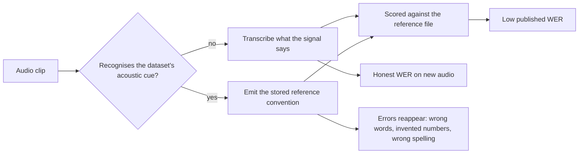
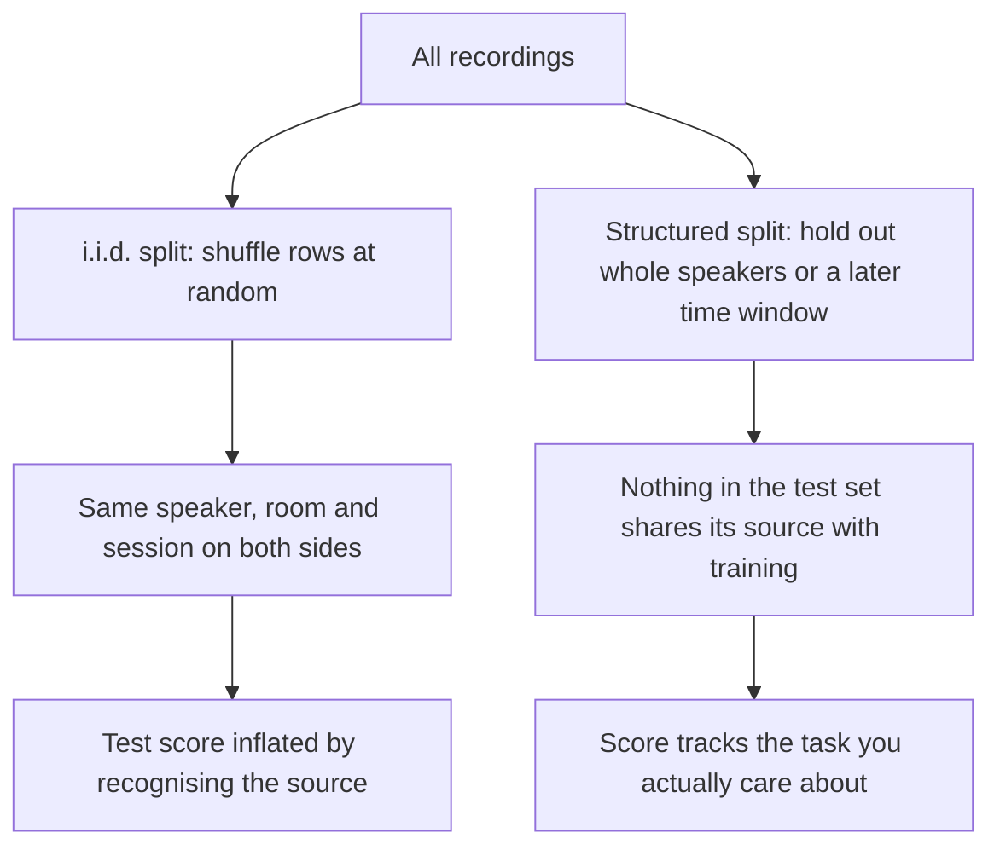

# When the model learns the benchmark, not the task

> Fresh · AI / ML foundations · Intermediate · ~25 min · from today's feeds

## Why this matters
Today's core lesson argues that a model which has seen its own test data scores well for the wrong reason; this lesson is that failure caught in the wild and measured. A study published on the Hugging Face blog on 2026-08-21, *Measuring benchmark optimization in speech recognition*, shows that the open-source speech models with the *best* public word-error rates are the ones most likely to reproduce the benchmark's own transcript file — including the places where that file is wrong (Hugging Face, *Measuring benchmark optimization in speech recognition*, 2026-08-21). Nothing more substantive about evaluation appeared in the ai-ml feeds inside the 30-day window, so this item sits in the wider 90-day window; it earns the detour because in your seat you now choose, approve and defend models and agents on the strength of their published numbers.

## Primer
You are at Beginner level in this domain, so here is only the vocabulary this lesson leans on.

**ASR** — automatic speech recognition — is the task of turning recorded audio into written text. An **ASR benchmark** is a fixed, published package of two things: a set of audio clips, and a **reference transcript** for each clip, which is the text a human annotator wrote down as the ground truth. Two such packages appear throughout this lesson. **LibriSpeech** is read English speech from public-domain audiobooks. **VoxPopuli** is European Parliament plenary speech, collected from the Parliament's own recordings and transcripts. Both are free to download, which is the whole problem.

**Word error rate (WER)** is the single number models are ranked by. Take the model's output and the reference, treat each as a list of words, and count the smallest number of single-word substitutions, deletions and insertions that turn one list into the other — the word-level **edit distance**. Divide by the number of words in the reference. WER 0.00 means a perfect match to the reference; lower is better. Note what it measures: distance to *the reference text*, not to what the speaker said. When the two differ, WER rewards matching the file.

A **held-out** set is data the model was not trained on and that nobody tuned against — the same idea as the validation and test splits in today's core lesson. A public benchmark starts held out and stops being held out the moment it becomes popular: its audio and its transcripts are on the internet, so they can land in training corpora, and every team repeatedly measures itself on it and keeps the checkpoints that score best. **Benchmark optimisation** is the result: the model has been fitted to that particular test, not only to the task the test was meant to stand for.

## The idea

The claim is stated in the article's own first paragraphs:

> "Since public benchmarks are open and widely used, models can also become optimized for the tests themselves."
> — Hugging Face, *Measuring benchmark optimization in speech recognition*, 2026-08-21, https://huggingface.co/blog/asr-benchmark-optimization

That sentence is easy to nod along to and hard to act on, because it is unfalsifiable as written: a low WER is consistent both with "this model transcribes well" and with "this model has learned this test". The contribution of the work — published as the paper *Towards Quantifying Benchmark Optimization in ASR Models* (arXiv:2608.19936), submitted 2026-08-20 — is a way to separate those two explanations. The trick is to build cases where **the audio does not fully determine the transcript**. If the audio alone cannot tell you what to write, and the model nevertheless writes exactly what the benchmark file says, the information came from somewhere other than the audio.

Three probes follow from that one move.

### Probe 1 — make the reference disagree with the audio

Annotators make mistakes, so some benchmark reference transcripts are simply wrong. A model listening to the audio should output what was said; a model reaching for the stored transcript will output the error. On VoxPopuli, the authors' method flagged potential reference errors in 40% of the test clips they analysed, affecting roughly 3% of all reference words (Hugging Face, *Measuring benchmark optimization in speech recognition*, 2026-08-21). The behaviour was then measurable:

> "Models exhibiting benchmark-optimized behavior reproduced erroneous reference transcripts 18–30% of the time."
> — Hugging Face, *Measuring benchmark optimization in speech recognition*, 2026-08-21, https://huggingface.co/blog/asr-benchmark-optimization

The sting is in which models those were: the ones with the lowest published WER were the most likely to reproduce the erroneous reference (Hugging Face, *Measuring benchmark optimization in speech recognition*, 2026-08-21). On a leaderboard ranked by WER, copying the annotator's typo is not a bug — it is how you win.

### Probe 2 — remove the words from the audio

The second probe is blunter: silence a number in the audio and leave it in the reference. Nothing in the signal can tell the model which number to write. The article reports that on LibriSpeech, some of the strongest benchmark-performing models "reproduced masked numbers in roughly 30–40% of examples." (Hugging Face, *Measuring benchmark optimization in speech recognition*, 2026-08-21, https://huggingface.co/blog/asr-benchmark-optimization). Recovery rates were highest on the public benchmarks and lower on held-out or newly collected audio (same article, 2026-08-21) — which is the control that makes the result mean something, because a model with real-world skill has no reason to care whether the microphone was the benchmark's or yours.

### Probe 3 — make the model pick a house style

Benchmarks disagree about spelling conventions: VoxPopuli writes the abbreviation "Mr." where LibriSpeech spells out "Mister", and both render the same sound. A model that cannot tell the datasets apart should pick one form and stick to it, scoring about 50% against either convention. Instead, multiple models exceeded that 50% random-choice baseline and some reached roughly 90% switch accuracy (Hugging Face, *Measuring benchmark optimization in speech recognition*, 2026-08-21). The model is identifying *which dataset the clip came from* and writing in that dataset's style.

### Why this is not quite ordinary overfitting

Today's core lesson covers the textbook version: capacity high enough to memorise the training rows, in-sample error near zero, validation error climbing. What the probes find is a sharper variant with two distinguishing features.

First, the leak is not through the labels in training alone — it is through **repeated model selection** on a public test set. Every team that keeps the checkpoint with the best VoxPopuli WER is fitting to VoxPopuli, even with clean training data. Second, the behaviour is **conditional**: it switches on when the model recognises the dataset. The authors report that mechanistic probes point to narrow acoustic cues overriding faithful transcription, and that the behaviour can be causally influenced by low-rank linear steering and in some cases by appending audio to the end of a segment (arXiv:2608.19936, submitted 2026-08-20). A behaviour you can steer with a low-rank direction is an internal switch, not a diffuse memory.



### What to do instead

The article's advice for anyone *choosing* a model is to use fully held-out evaluation sets rather than trusting a single public WER (Hugging Face, *Measuring benchmark optimization in speech recognition*, 2026-08-21). The advice for anyone *building* a benchmark is structural: benchmark developers should "avoid simple independent and identically distributed test splits." (Hugging Face, *Measuring benchmark optimization in speech recognition*, 2026-08-21, https://huggingface.co/blog/asr-benchmark-optimization) — in favour of temporal, speaker, or other metadata-based separation (same article, 2026-08-21). An **i.i.d. split** means shuffling all your rows and dealing them randomly into train and test, as if each row were an independent draw from one distribution. It is the default because it is one line of code, and it is the wrong default whenever rows share structure: the same speaker, the same recording session, the same week. Shuffle randomly and the same speaker lands on both sides, so the test set measures "have you heard this voice" as much as "can you transcribe". Split by speaker or by date and that shortcut is gone.



The practical outputs are concrete: a "Benchmark fitting" tab was added to the Open ASR Leaderboard, and the scripts and un-normalised model outputs were published on GitHub and Hugging Face (Hugging Face, *Measuring benchmark optimization in speech recognition*, 2026-08-21). The authors also ask for more transparency about training data and model-selection procedure (same article, 2026-08-21) — because without it, you cannot tell the two explanations apart from the outside at all.

## Lab

**The question this lab answers:** if one model transcribes honestly and another has memorised the benchmark's reference file, which one wins on the public benchmark — and what happens to that ranking on freshly recorded audio?

### Step 1 — the toy benchmark

Four clips stand in for the three probes. Each clip has the words that are really in the audio, the reference transcript the benchmark ships, and a flag for whether the clip carries the benchmark's own acoustic signature (its room, microphone and codec):

| clip | what the audio says | the benchmark's reference | what makes it interesting |
|---|---|---|---|
| vp-01 | the committee will meet on tuesday | the committee will meet on tuesday | clean control clip |
| vp-02 | we must protect the single market | we must protect the single **marked** | annotator error (probe 1) |
| vp-03 | the budget rose by _(silence)_ percent last year | the budget rose by **seven** percent last year | number masked in the audio (probe 2) |
| vp-04 | mister smith opened the session | **mr.** smith opened the session | two spellings, one sound (probe 3) |

The held-out set `fr-01 … fr-04` re-records the same four sentences. Its references were checked by hand, so they match the audio exactly, and the clips carry no benchmark signature.

Two models share one acoustic front end, which makes exactly one genuine mishearing: it hears "tuesday" as "thursday". **Faithful** writes down what that front end produced. **Memoriser** is the same front end plus two things it picked up while being tuned on the benchmark: a lookup head that emits the stored reference whenever it recognises the cue, and, when the cue is absent, two habits — write "mr." for the sound "mister", and insert the number "seven" into the phrase "rose by … percent".

### Step 2 — the program

Scala 3, standard library only. The word-level edit distance is written out by hand so you can see that WER is nothing but Levenshtein over a `Vector[String]`.

```scala
// file: Lab.scala
// A miniature of the three benchmark-optimisation probes, Scala 3, standard library only.

final case class Clip(
    id: String,
    set: String,
    audio: Vector[String],     // what the recording actually says
    reference: Vector[String], // what the benchmark's transcript file claims it says
    cue: Boolean               // does the clip carry the benchmark's own acoustic signature?
)

def w(s: String): Vector[String] = s.split(" ").toVector

// ---------- the shared acoustic front end: one genuine mishearing, identical in both models
val confusions = Map("tuesday" -> "thursday")
def decode(audio: Vector[String]): Vector[String] = audio.map(x => confusions.getOrElse(x, x))

// ---------- model A: faithful. Writes down what it heard, in its own house spelling.
def faithful(c: Clip): Vector[String] = decode(c.audio)

// ---------- model B: memoriser. Same front end, plus habits picked up while tuning on the benchmark.
def houseStyle(ws: Vector[String]): Vector[String] = ws.map(x => if x == "mister" then "mr." else x)
def numberHabit(ws: Vector[String]): Vector[String] =
  val i = ws.indexOfSlice(Vector("by", "percent"))
  if i >= 0 then ws.patch(i + 1, Vector("seven"), 0) else ws
def memoriser(c: Clip): Vector[String] =
  if c.cue then c.reference                     // lookup head fires: emit the stored transcript
  else numberHabit(houseStyle(decode(c.audio))) // no cue: decode, then apply the learned habits

// ---------- word-level edit distance (Levenshtein over Vector[String]) and WER
def editDistance(hyp: Vector[String], ref: Vector[String]): Int =
  val n = hyp.length
  val m = ref.length
  val d = Array.ofDim[Int](n + 1, m + 1)
  for i <- 0 to n do d(i)(0) = i
  for j <- 0 to m do d(0)(j) = j
  for i <- 1 to n; j <- 1 to m do
    val sub = if hyp(i - 1) == ref(j - 1) then 0 else 1
    d(i)(j) = math.min(math.min(d(i - 1)(j) + 1, d(i)(j - 1) + 1), d(i - 1)(j - 1) + sub)
  d(n)(m)

def wer(hyp: Vector[String], ref: Vector[String]): Double =
  editDistance(hyp, ref).toDouble / ref.length

// ---------- the data: four clips of a public benchmark, then the same four sentences re-recorded
val bench = Vector(
  Clip("vp-01", "benchmark", w("the committee will meet on tuesday"),
       w("the committee will meet on tuesday"), cue = true),
  Clip("vp-02", "benchmark", w("we must protect the single market"),
       w("we must protect the single marked"), cue = true),      // reference error
  Clip("vp-03", "benchmark", w("the budget rose by percent last year"),
       w("the budget rose by seven percent last year"), cue = true), // number masked in the audio
  Clip("vp-04", "benchmark", w("mister smith opened the session"),
       w("mr. smith opened the session"), cue = true)            // orthographic convention
)

val fresh = Vector(
  Clip("fr-01", "held-out", w("the committee will meet on tuesday"),
       w("the committee will meet on tuesday"), cue = false),
  Clip("fr-02", "held-out", w("we must protect the single market"),
       w("we must protect the single market"), cue = false),
  Clip("fr-03", "held-out", w("the budget rose by percent last year"),
       w("the budget rose by percent last year"), cue = false),
  Clip("fr-04", "held-out", w("mister smith opened the session"),
       w("mister smith opened the session"), cue = false)
)

def pad(s: String, n: Int): String = if s.length >= n then s else s + " " * (n - s.length)

def perClip(clips: Vector[Clip], scoreAgainst: Clip => Vector[String], label: String): Unit =
  println(s"== $label ==")
  for c <- clips do
    val ref = scoreAgainst(c)
    val fo = faithful(c)
    val mo = memoriser(c)
    println(s"${c.id}  [${c.set}]  cue=${if c.cue then "yes" else "no "}  ref words=${ref.length}")
    println(s"   audio     : ${c.audio.mkString(" ")}")
    println(s"   scored vs : ${ref.mkString(" ")}")
    println(f"   faithful  : ${pad(fo.mkString(" "), 44)} edits=${editDistance(fo, ref)}  WER=${wer(fo, ref)}%.4f")
    println(f"   memoriser : ${pad(mo.mkString(" "), 44)} edits=${editDistance(mo, ref)}  WER=${wer(mo, ref)}%.4f")
  println()

def aggregate(name: String, clips: Vector[Clip], scoreAgainst: Clip => Vector[String]): Unit =
  val refWords = clips.map(c => scoreAgainst(c).length).sum
  val fe = clips.map(c => editDistance(faithful(c), scoreAgainst(c))).sum
  val me = clips.map(c => editDistance(memoriser(c), scoreAgainst(c))).sum
  val fw = fe.toDouble / refWords
  val mw = me.toDouble / refWords
  val winner = if mw < fw then "memoriser" else if fw < mw then "faithful" else "tie"
  println(f"${pad(name, 38)}${pad(refWords.toString, 11)}${pad(fe.toString, 10)}${fw}%.4f    ${pad(me.toString, 10)}${mw}%.4f    $winner")

@main def lab(): Unit =
  perClip(bench, _.reference, "probe set A: the public benchmark, scored against its own reference file")
  perClip(fresh, _.reference, "probe set B: freshly recorded audio, references checked by hand")
  println("== aggregate word error rate (lower is better) ==")
  println(s"${pad("scoring run", 38)}${pad("ref words", 11)}${pad("f.edits", 10)}f.WER     ${pad("m.edits", 10)}m.WER     winner")
  aggregate("benchmark vs its reference file", bench, _.reference)
  aggregate("held-out vs its reference file", fresh, _.reference)
  aggregate("benchmark vs what was really said", bench, _.audio)
```

### Step 3 — run it

```
scala Lab.scala
```

Real output:

```text
== probe set A: the public benchmark, scored against its own reference file ==
vp-01  [benchmark]  cue=yes  ref words=6
   audio     : the committee will meet on tuesday
   scored vs : the committee will meet on tuesday
   faithful  : the committee will meet on thursday          edits=1  WER=0.1667
   memoriser : the committee will meet on tuesday           edits=0  WER=0.0000
vp-02  [benchmark]  cue=yes  ref words=6
   audio     : we must protect the single market
   scored vs : we must protect the single marked
   faithful  : we must protect the single market            edits=1  WER=0.1667
   memoriser : we must protect the single marked            edits=0  WER=0.0000
vp-03  [benchmark]  cue=yes  ref words=8
   audio     : the budget rose by percent last year
   scored vs : the budget rose by seven percent last year
   faithful  : the budget rose by percent last year         edits=1  WER=0.1250
   memoriser : the budget rose by seven percent last year   edits=0  WER=0.0000
vp-04  [benchmark]  cue=yes  ref words=5
   audio     : mister smith opened the session
   scored vs : mr. smith opened the session
   faithful  : mister smith opened the session              edits=1  WER=0.2000
   memoriser : mr. smith opened the session                 edits=0  WER=0.0000

== probe set B: freshly recorded audio, references checked by hand ==
fr-01  [held-out]  cue=no   ref words=6
   audio     : the committee will meet on tuesday
   scored vs : the committee will meet on tuesday
   faithful  : the committee will meet on thursday          edits=1  WER=0.1667
   memoriser : the committee will meet on thursday          edits=1  WER=0.1667
fr-02  [held-out]  cue=no   ref words=6
   audio     : we must protect the single market
   scored vs : we must protect the single market
   faithful  : we must protect the single market            edits=0  WER=0.0000
   memoriser : we must protect the single market            edits=0  WER=0.0000
fr-03  [held-out]  cue=no   ref words=7
   audio     : the budget rose by percent last year
   scored vs : the budget rose by percent last year
   faithful  : the budget rose by percent last year         edits=0  WER=0.0000
   memoriser : the budget rose by seven percent last year   edits=1  WER=0.1429
fr-04  [held-out]  cue=no   ref words=5
   audio     : mister smith opened the session
   scored vs : mister smith opened the session
   faithful  : mister smith opened the session              edits=0  WER=0.0000
   memoriser : mr. smith opened the session                 edits=1  WER=0.2000

== aggregate word error rate (lower is better) ==
scoring run                           ref words  f.edits   f.WER     m.edits   m.WER     winner
benchmark vs its reference file       25         4         0.1600    0         0.0000    memoriser
held-out vs its reference file        24         1         0.0417    3         0.1250    faithful
benchmark vs what was really said     24         1         0.0417    3         0.1250    faithful
```

### Reading the output

**The per-clip columns.** `cue` says whether the clip carries the benchmark's acoustic signature. `ref words` is the denominator of WER for that clip. `audio` is what was really said; `scored vs` is the text WER is measured against. `edits` is the word-level edit distance from a model's output to that text — substitutions, deletions and insertions, each costing 1. `WER` is `edits / ref words`. **Lower is better for both.**

Probe set A, the public benchmark, scored the way a leaderboard scores it:

| clip | ref words | faithful edits | faithful WER | memoriser edits | memoriser WER |
|---|---|---|---|---|---|
| vp-01 | 6 | 1 | 0.1667 | 0 | 0.0000 |
| vp-02 | 6 | 1 | 0.1667 | 0 | 0.0000 |
| vp-03 | 8 | 1 | 0.1250 | 0 | 0.0000 |
| vp-04 | 5 | 1 | 0.2000 | 0 | 0.0000 |

Trace `vp-03` with digits. The reference is `the budget rose by seven percent last year` — 8 words. The faithful model heard no number, because there is none in the audio, and output `the budget rose by percent last year` — 7 words. The cheapest alignment deletes one word, `seven`, and leaves the other seven aligned, so the edit distance is 1 and WER = 1 / 8 = 0.1250. The memoriser recognised the cue, emitted the stored reference verbatim, matched all 8 words, and scored 0 / 8 = 0.0000. It was rewarded, with the maximum possible reward, for writing a number that is not in the recording.

**Verdict:** on the public benchmark the memoriser achieves a perfect 0.0000 WER against the faithful model's 0.1600, and three of its four wins come from clips where the reference does not match the audio. Ranked by this number, the dishonest model is not merely ahead — it is unbeatable.

The aggregate block, where the ranking flips:

| scoring run | ref words | faithful edits | faithful WER | memoriser edits | memoriser WER | winner |
|---|---|---|---|---|---|---|
| benchmark vs its reference file | 25 | 4 | 0.1600 | 0 | 0.0000 | memoriser |
| held-out vs its reference file | 24 | 1 | 0.0417 | 3 | 0.1250 | faithful |
| benchmark vs what was really said | 24 | 1 | 0.0417 | 3 | 0.1250 | faithful |

Trace the middle row. Over the four held-out clips the references total 6 + 6 + 7 + 5 = 24 words. The faithful model makes its one genuine mishearing on `fr-01` and nothing else: 1 edit, WER = 1 / 24 = 0.04166… which prints as 0.0417. The memoriser makes the same mishearing on `fr-01`, then inserts `seven` on `fr-03` and writes `mr.` on `fr-04`: 1 + 1 + 1 = 3 edits, WER = 3 / 24 = 0.125 = 0.1250. Exactly three times worse, from habits that cost it nothing on the benchmark. The third row is the same arithmetic applied to the benchmark audio scored against what the speakers actually said rather than against the shipped transcript; it reproduces the held-out ranking (0.0417 against 0.1250), which tells you the held-out set was not unlucky — the benchmark's reference file was the thing hiding the difference.

**Verdict:** the ranking is a property of the scoring target, not of the models. One number, WER on a public benchmark, puts the memoriser first by an infinite margin; the same models on fresh audio put it last by 3×. Any decision made on the first number is wrong.

### Cause → consequence

1. **Cause.** The benchmark is public: its audio, its reference file and its leaderboard are all downloadable, and teams iterate against it. The reference file is also imperfect, and for some clips the audio does not determine it — because an annotator erred, because a number is inaudible, or because two spellings sound identical.
2. **Mechanism.** Training and repeated checkpoint selection reward any shortcut that reduces distance to that file. The cheapest available shortcut is to recognise the dataset from narrow acoustic cues and then emit the convention it expects; the study's mechanistic probes point at exactly that, and show the behaviour can be causally influenced by low-rank linear steering and in some cases by appending audio to a segment (arXiv:2608.19936, submitted 2026-08-20).
3. **Consequence.** The metric and the capability come apart, and they come apart *most* at the top of the table: models with the lowest WER reproduced erroneous references most often, 18–30% of the time for the affected models (Hugging Face, *Measuring benchmark optimization in speech recognition*, 2026-08-21). Picking the leaderboard winner can mean picking the most benchmark-fitted model in the field.
4. **What it means in practice.** The pattern is not about speech. It is about every evaluation you own.
   - **Evaluating agents.** If your agent eval suite lives in the repo the agent can read, or its cases have been pasted into prompts while debugging, your pass rate is partly a lookup score. Keep a sealed set: written after the agent was built, never committed where the agent can reach it, run once per release.
   - **Claude Code skills.** A skill tuned until it handles your twelve favourite examples is fitted to those twelve. The honest test is the thirteenth case, brought by someone who has not seen the skill.
   - **QA suites that leak into development.** This is the version you already know from your QA Lead years: when developers code against the acceptance tests, the suite stops measuring quality and starts measuring compliance with the suite. The fix there is the fix here — a held-back set, and splits by structure rather than by shuffle: hold out whole customers, whole services, a later release window, not random rows.
   - **As a Product Owner.** When a vendor quotes a benchmark score, the useful question is not "how high?" but "what was held out, and when was the split made?" If the answer is a random shuffle of a public dataset, the number is about the dataset.

## Self-check
1. A benchmark clip's reference transcript says "the single marked" but the speaker clearly said "the single market". Model A outputs "market", model B outputs "marked". Which one scores better on that clip, and what does that tell you about WER? <details><summary>Answer</summary>Model B scores better — WER 0.0000 against model A's 0.1667 on a six-word reference, since WER is the word-level edit distance to the *reference text* divided by the reference's word count, not the distance to what was said. WER only measures transcription ability to the extent that the reference is correct; where the reference is wrong, WER actively rewards reproducing the error. That is why the study's first probe uses reference disagreement: models showing benchmark-optimised behaviour reproduced erroneous references 18–30% of the time, and the lowest-WER models did it most (Hugging Face, *Measuring benchmark optimization in speech recognition*, 2026-08-21).</details>
2. Why is the masked-number probe stronger evidence than simply noticing that a model's WER drops on new data? <details><summary>Answer</summary>Because it removes the information from the input. A WER drop on new data has many innocent explanations — different accents, noisier microphones, a harder vocabulary, a different annotation style. When a number has been silenced in the audio, no amount of genuine transcription skill can recover it; any model that outputs the exact number from the reference file must be getting it from somewhere other than the signal. The article reports that on LibriSpeech, strong benchmark performers "reproduced masked numbers in roughly 30–40% of examples." (Hugging Face, *Measuring benchmark optimization in speech recognition*, 2026-08-21), with lower rates on freshly collected audio — the control that rules out the model simply being good at guessing.</details>
3. You own an eval suite for an internal agent. It is in the repo, it has 40 cases, and the team has been iterating on it for three months; the pass rate is now 93%. Name two changes that would make the number mean something again, and say what each one fixes. <details><summary>Answer</summary>First, a sealed held-out set: cases written after the current version was built, kept outside anything the agent or the iterating developers can read, and run once per release. This fixes selection leakage — three months of keeping whatever change raised the score is fitting to those 40 cases, exactly the repeated-model-selection path in this lesson. Second, a structured rather than i.i.d. split of the cases you do have: separate by customer, service or time window instead of shuffling rows, so that no test case shares a source with a case the team tuned on. This matches the article's recommendation that benchmark developers should "avoid simple independent and identically distributed test splits." (Hugging Face, *Measuring benchmark optimization in speech recognition*, 2026-08-21), in favour of temporal, speaker or other metadata-based separation. A useful third: report the honest baseline alongside the suite number, so the gap between them is visible.</details>

## Sources
- [Measuring benchmark optimization in speech recognition](https://huggingface.co/blog/asr-benchmark-optimization) — Hugging Face Blog (Theo Lebryk, Eric Bezzam, Alice Baird, David Ayllon, Jakub Piotr Cłapa, Jens Madsen, Panagiotis Tzirakis), 2026-08-21 — the primary source: the three probes, the VoxPopuli reference-error and masked-number figures, the orthographic-switching baseline, and the recommendations on held-out evaluation sets and non-i.i.d. splits; both verbatim quotes come from this page (accessed 2026-10-14).
- [Towards Quantifying Benchmark Optimization in ASR Models (arXiv:2608.19936)](https://arxiv.org/abs/2608.19936) — Theo Lebryk, David Ayllon, Alice Baird, Jakub Piotr Cłapa, Jens Madsen, Panagiotis Tzirakis, v1 submitted 2026-08-20 — the underlying paper, cited by title and date for the mechanistic findings (narrow acoustic cues overriding faithful transcription; the behaviour being causally influenced by low-rank linear steering and by appending audio) and for the conclusion that strong benchmark scores can overstate general transcription ability. No verbatim quote is taken from it (accessed 2026-10-14).

Related in your knowledge base: the validation / overfitting / data-leakage material in the AI / ML foundations section, and the test-design material in the testing section.

## Next on this track
Fresh lessons sit outside the ladder; next on AI / ML foundations: **Vectors and matrices as data** (rung 4 of 38, Beginner).
