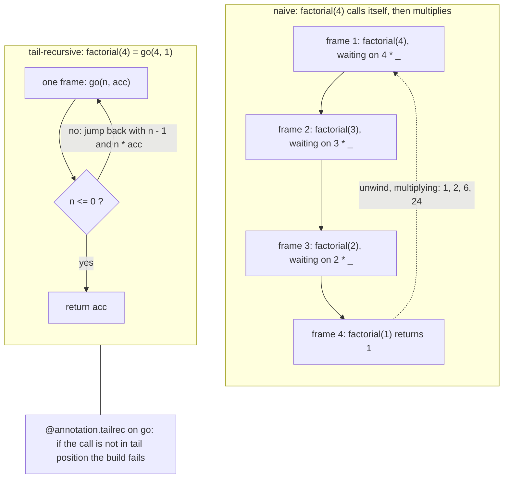
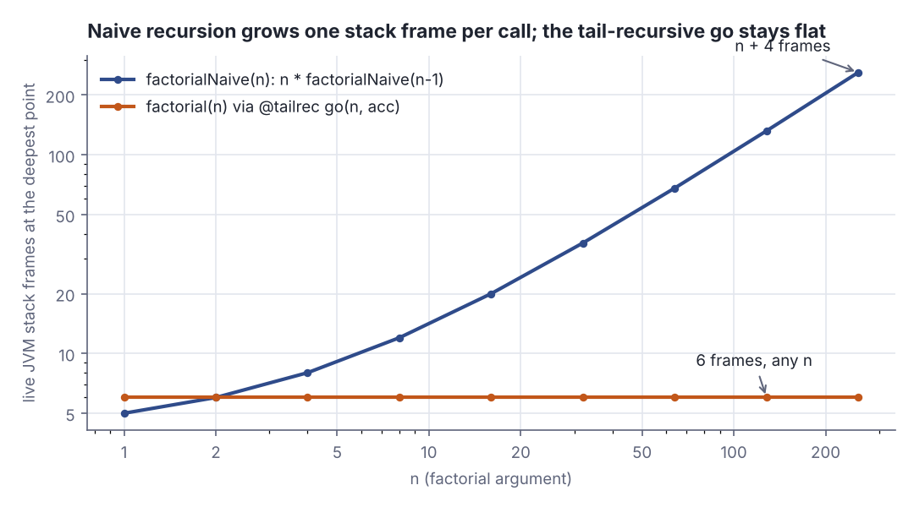
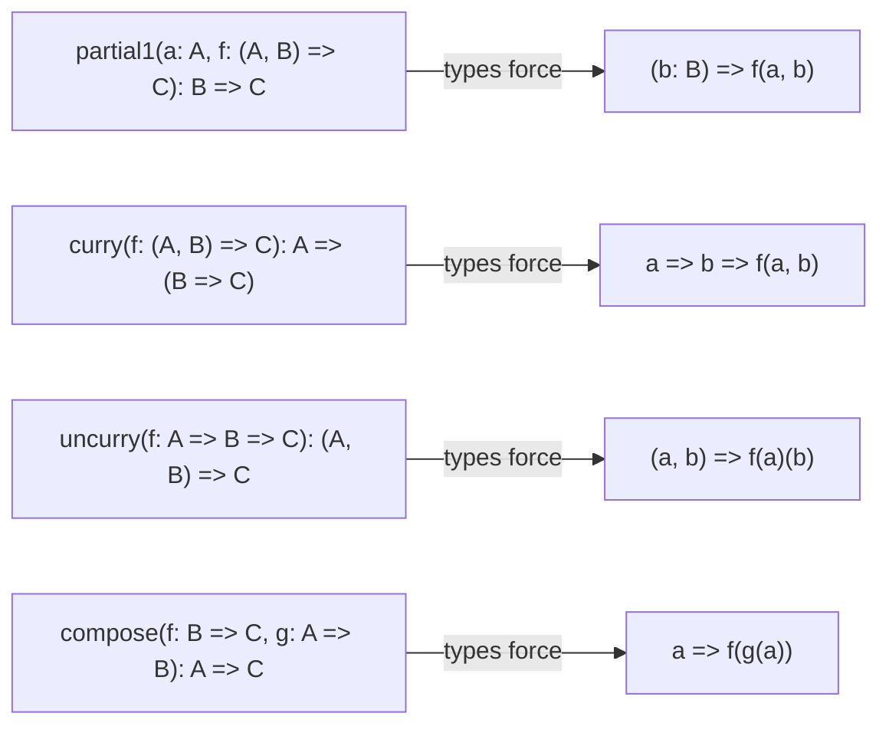

# Getting started: tail recursion, higher-order and polymorphic functions

> Functional Programming in Scala (red book) · Beginner · ~20 min · rung 2 of 26 · needs: What is FP: referential transparency and the substitution model (fp-scala-01)

## Why this matters
Chapter 1 argued that programs should be built from pure functions. Chapter 2 is the first answer to the obvious objection: without `var` and `while`, how do you even write a loop? The answer — a local tail-recursive `go` with an accumulator, checked by `@annotation.tailrec` — is the shape that every later chapter's `foldLeft`, parser and stream combinator is built on, and it is the shape you already reach for in Akka actor loops.
The chapter's second half is the part worth slowing down for: once a function is polymorphic, its type signature constrains the implementation so tightly that there is often exactly one body that compiles. That is the reasoning style the rest of the book runs on, and it is the one skill that transfers straight into reading unfamiliar library code.

## The idea

> Chapter map: Functional Programming in Scala (2nd ed.), ch. 2 "Getting started with functional programming in Scala" — §2.1 Introducing Scala the language (§2.1.1 Running our program), §2.2 Objects and namespaces, §2.3 Higher-order functions: Passing functions to functions (§2.3.1 A short detour: Writing loops functionally, §2.3.2 Writing our first higher-order function), §2.4 Polymorphic functions: Abstracting over types (§2.4.1 An example of a polymorphic function, §2.4.2 Calling higher-order functions with anonymous functions), §2.5 Following types to implementations, §2.6 Conclusion, an unnumbered Summary, §2.7 Exercise answers.
> Numbering as the 2nd edition's own contents list it, https://www.oreilly.com/library/view/functional-programming-in/9781617299582/OEBPS/Text/p1.htm — the 1st edition numbers the same three sections §2.4, §2.5 and §2.6.

### §2.1 Introducing Scala the language, §2.1.1 Running our program
One tiny program: an `object MyProgram` holding `abs`, a `private formatAbs`, and an entry point printing `formatAbs(-42)`. The points: `object` declares a singleton — a type and its only instance; `def` needs parameter types but can infer the result type; `if` is an *expression* returning a value; a method body is one expression, so there is no `return`. You run it by launching the entry point (`@main def printAbs` in the companion code) or by pasting the definitions into the REPL.

### §2.2 Objects and namespaces
Every value has a type and every type has members reached with a dot, so an `object` doubles as a **module**: a namespace grouping related functions. `MyProgram.abs(-42)` names the member; `import MyProgram.*` brings them all into scope. There is no separate module system, which is why the companion file gives each stage of the chapter its own object — `MyProgram`, `AnonymousFunctions`, `MonomorphicBinarySearch`, `PolymorphicFunctions`.

### §2.3 Higher-order functions: Passing functions to functions

#### §2.3.1 A short detour: Writing loops functionally
A `while` loop needs a mutable counter and a mutable accumulator, and `var` is exactly what chapter 1 ruled out. The replacement is recursion with an accumulator, written as a **local helper** — by convention `go` or `loop` — defined inside the function that uses it, so the accumulator never leaks into the public signature (Chiusano & Bjarnason, *FP in Scala* 2nd ed., ch. 2, §2.3.1 "A short detour: Writing loops functionally"):

```scala
def factorial(n: Int): Int =
  @annotation.tailrec
  def go(n: Int, acc: Int): Int =
    if n <= 0 then acc
    else go(n - 1, n * acc)
  go(n, 1)
```

```text
  factorial(5) = 120
  factorial(10) = 3628800
```

`go` threads the state forward as arguments instead of mutating it; `factorial` just seeds it with `acc = 1`.

The detail that matters is *where* the recursive call sits. In `go` it is the whole `else` branch — nothing is left to do afterwards, so the call is in **tail position** and the compiler reuses the current stack frame, compiling the recursion into a jump. In `n * factorial(n - 1)` the multiply happens *after* the call returns, so every call keeps its frame alive. `@annotation.tailrec` asks the compiler to prove the rewrite applies and to fail the build if it does not.

```scala
def factorialBad(n: Int): Int =
  @annotation.tailrec
  def go(n: Int, acc: Int): Int =
    if n <= 0 then acc
    else n * go(n - 1, acc)
  go(n, 1)
```

```text
-- Error: Bad.scala:6:15
6 |    else n * go(n - 1, acc)
  |             ^^^^^^^^^^^^^^
  |             Cannot rewrite recursive call: it is not in tail position
1 error found
```

That is the real Scala 3.3.4 message. Without the annotation the same code compiles happily and dies at runtime on a large enough input; with it, stack safety is checked at compile time.


*Figure 1: naive recursion keeps one frame per call and unwinds through all of them; the tail-recursive `go` runs in a single frame with a jump back to the top. Source: drawn from FP in Scala 2nd ed., ch. 2, §2.3.1.*

The lab counts the frames, so the difference is observed, not asserted.



*Figure 2: live JVM stack frames at the deepest point, from the lab's Step 1 table. Generated from the lab output with `dojo/engine/chart.py`.*

#### §2.3.2 Writing our first higher-order function
`formatAbs` and `formatFactorial` differ in one place: which function is applied to `n`. Making that function a parameter removes the duplication, and is what makes `formatResult` a **higher-order function** (§2.3.2 "Writing our first higher-order function"):

```scala
def abs(n: Int): Int = if n < 0 then -n else n

def formatResult(name: String, n: Int, f: Int => Int): String =
  "The %s of %d is %d.".format(name, n, f(n))
```

```text
  The absolute value of -42 is 42.
  The increment of 7 is 8.
```

The type `Int => Int` is the whole contract: `formatResult` knows nothing about `abs` or `factorial` beyond "give me an `Int`, take back an `Int`". The Scala documentation gives the reason it works:

> "Higher order functions take other functions as parameters or return a function as a result. This is possible because functions are first-class values in Scala."
>
> — Scala Documentation, *Tour of Scala: Higher-order Functions*, undated, https://docs.scala-lang.org/tour/higher-order-functions.html

### §2.4 Polymorphic functions: Abstracting over types

#### §2.4.1 An example of a polymorphic function
`formatResult` abstracts over *behaviour* but is still **monomorphic**: nailed to one concrete type. The book's example is `findFirst(ss: Array[String], key: String): Int`, a tail-recursive index scan returning `-1` when nothing matches. Two things are hard-coded — the element type and the test (equality with `key`). Making it **polymorphic** parameterises both: the type with `[A]`, the test with a predicate `A => Boolean`:

```scala
def findFirst[A](as: Array[A], p: A => Boolean): Int =
  @annotation.tailrec
  def loop(n: Int): Int =
    if n >= as.length then -1
    else if p(as(n)) then n
    else loop(n + 1)
  loop(0)
```

```text
  findFirst[String](words, _ == "cats")      = 2
  findFirst[Int](Array(7, 9, 13), _ == 9)   = 1
  findFirst[Int](Array(7, 9, 13), _ > 99)  = -1
```

One definition now serves every element type and every test, and the loop inside it is the local `@tailrec` shape from §2.3.1. Exercise 2.2 asks for the sibling `isSorted[A](as: Array[A], gt: (A, A) => Boolean)`, which walks adjacent pairs the same way.

#### §2.4.2 Calling higher-order functions with anonymous functions
Passing functions this often needs a way to write one without naming it. A **function literal** `(x: Int) => x + 1` is syntax for an object: a value of type `Function1[Int, Int]` whose `apply` method holds the body. `f(7)` is sugar for `f.apply(7)`, which is why a literal and a hand-written `Function1` are interchangeable:

```scala
val lit: Int => Int = x => x + 1

val obj = new Function1[Int, Int]:
  def apply(x: Int): Int = x + 1
```

```text
  incLiteral.apply(7) = 8   is a Function1: true
  incObject.apply(7)  = 8   is a Function1: true
```

Because the parameter type is known from the signature, the annotation can be dropped (`x => x + 1`), and a parameter used once shrinks to the placeholder `_ + 1`. The lab passes all three forms to the same `formatResult` and gets the same line back. Beyond the book: the Tour of Scala adds that a *method* can go where a function is expected — the compiler coerces it into `x => method(x)` — which is why `formatResult("factorial", 7, factorial)` type-checks (Scala Documentation, *Tour of Scala: Higher-order Functions*, "Coercing methods into functions").

### §2.5 Following types to implementations
The closing section is the chapter's real payload. A polymorphic function cannot inspect its values — it knows nothing about `A` or `B` — so the only moves are the ones the types permit, and that often leaves exactly one body. `partial1(a: A, f: (A, B) => C): B => C` must return a function of `B`, and the only `C` reachable is `f(a, b)`. `curry`, `uncurry` and `compose` fall out the same way:

```scala
def compose[A, B, C](f: B => C, g: A => B): A => C = a => f(g(a))

val g: Int => Int = x => x + 1
val f: Int => String = y => "*" * y
```

```text
  compose(f, g)(3) = ****   f.compose(g)(3) = ****   g.andThen(f)(3) = ****
```

You are handed an `A` and must produce a `C`. Nothing consumes an `A` except `g`, nothing produces a `C` except `f`, so `a => f(g(a))` is forced. The standard library ships it twice — `f.compose(g)` and the left-to-right `g.andThen(f)` — and all three agree (§2.5 "Following types to implementations").


*Figure 3: each §2.5 signature and the single body it admits. Adapted from object `PolymorphicFunctions` in the fpinscala companion repository (MIT licence), https://github.com/fpinscala/fpinscala.*

### §2.6 Conclusion and Summary
The chapter's claims, in order: loops become local tail-recursive helpers with accumulators, and `@annotation.tailrec` makes the stack guarantee a compile-time one; duplicated *behaviour* goes away by taking a function as a parameter; duplication across *types* goes away with a type parameter plus a predicate replacing the hard-coded test; function literals are ordinary `Function1` values; and the more polymorphic a signature, the fewer implementations it admits — often exactly one.

## Lab
**The question:** does the local `@tailrec go` shape actually buy you anything measurable, and is a `compose` written only from its types the same function as the standard library's?

Time: about 10 minutes. The lab covers Exercise 2.1 (`fib` via a local `@tailrec def go`) and Exercise 2.5 (`compose`), and measures stack frames with `Thread.currentThread.getStackTrace.length` so the §2.3.1 claim is observed, not taken on trust.

### Step 1 — save the program
Scala 3.3, standard library only. Save it as `Lab.scala`.

```scala
// file: Lab.scala

// FP in Scala, 2nd ed., ch. 2 "Getting started with functional programming in Scala".
// Scala 3.3, standard library only. Sections: 2.3 higher-order functions,
// 2.4 polymorphic functions, 2.5 following types to implementations.
// Exercises 2.1 (fib) and 2.5 (compose).

// A stack probe: how many JVM frames are live right here.
def frames(): Int = Thread.currentThread.getStackTrace.length
var base = 0
// Frames live below lab(). The probe itself costs a fixed 4 frames, so the
// interesting part is how the number moves with n, not its absolute value.
def depth(): Int = frames() - base

// ---- Step 1: sec. 2.3.1 writing loops functionally --------------------------

// The naive recursive factorial: `n * factorial(n - 1)` is NOT the last thing
// the body does, so every call keeps a frame alive until the multiply happens.
var naiveDeepest = 0
def factorialNaive(n: Int): Int =
  naiveDeepest = math.max(naiveDeepest, depth())
  if n <= 1 then 1 else n * factorialNaive(n - 1)

// The book's factorial: a local tail-recursive `go` carrying an accumulator.
var goDeepest = 0
var trace = false
def factorial(n: Int): Int =
  @annotation.tailrec
  def go(n: Int, acc: Int): Int =
    goDeepest = math.max(goDeepest, depth())
    if trace then println(f"    go(n = $n%2d, acc = $acc%7d)   live frames: ${depth()}%2d")
    if n <= 0 then acc
    else go(n - 1, n * acc)
  go(n, 1)

// Same shape as `factorial`, but the result still fits in Long at n = 100000,
// so a deep run can be checked against n * (n + 1) / 2.
def sumToNaive(n: Long): Long =
  if n <= 0 then 0L else n + sumToNaive(n - 1)

def sumTo(n: Long): Long =
  @annotation.tailrec
  def go(n: Long, acc: Long): Long =
    if n <= 0 then acc else go(n - 1, acc + n)
  go(n, 0L)

// ---- Step 2: Exercise 2.1, fib ------------------------------------------

def fib(n: Int): Int =
  @annotation.tailrec
  def go(n: Int, current: Int, next: Int): Int =
    if trace then println(f"    go(n = $n%2d, current = $current%2d, next = $next%2d)")
    if n <= 0 then current
    else go(n - 1, next, current + next)
  go(n, 0, 1)

// ---- Step 3: sec. 2.3.2 and sec. 2.4.2 ------------------------------------------

def abs(n: Int): Int = if n < 0 then -n else n

// The higher-order function: the function to apply is a parameter.
def formatResult(name: String, n: Int, f: Int => Int): String =
  val msg = "The %s of %d is %d."
  msg.format(name, n, f(n))

// sec. 2.4.1 monomorphic: fixed to String and to equality with a key.
def findFirstString(ss: Array[String], key: String): Int =
  @annotation.tailrec
  def loop(n: Int): Int =
    if n >= ss.length then -1
    else if ss(n) == key then n
    else loop(n + 1)
  loop(0)

// sec. 2.4.1 polymorphic: any A, any predicate A => Boolean.
def findFirst[A](as: Array[A], p: A => Boolean): Int =
  @annotation.tailrec
  def loop(n: Int): Int =
    if n >= as.length then -1
    else if p(as(n)) then n
    else loop(n + 1)
  loop(0)

// Exercise 2.2, used here as a second polymorphic example.
def isSorted[A](as: Array[A], gt: (A, A) => Boolean): Boolean =
  @annotation.tailrec
  def go(n: Int): Boolean =
    if n >= as.length - 1 then true
    else if gt(as(n), as(n + 1)) then false
    else go(n + 1)
  go(0)

// ---- Step 4: sec. 2.5 following types to implementations --------------------

def partial1[A, B, C](a: A, f: (A, B) => C): B => C = (b: B) => f(a, b)
def curry[A, B, C](f: (A, B) => C): A => (B => C) = a => b => f(a, b)
def uncurry[A, B, C](f: A => B => C): (A, B) => C = (a, b) => f(a)(b)
def compose[A, B, C](f: B => C, g: A => B): A => C = a => f(g(a))

@main def lab(): Unit =
  base = frames()
  println(s"stack probe ready: $base frames already live at lab(); depths below are frames under it")

  println()
  println("STEP 1 - sec. 2.3.1  loops as a local tail-recursive go")
  trace = true
  val f5 = factorial(5)
  trace = false
  println(s"  factorial(5) = $f5")
  println(s"  factorial(10) = ${factorial(10)}")
  println(s"  naive factorial(5) = ${factorialNaive(5)}")

  println()
  println("  stack frames at the deepest point, naive vs tail-recursive:")
  println("  n      naive frames   go frames   factorialNaive(n)")
  for n <- List(1, 2, 4, 8, 16, 32, 64, 128, 256) do
    naiveDeepest = 0; goDeepest = 0
    val v = factorialNaive(n)
    factorial(n)
    val shown = if n <= 12 then v.toString else "(Int overflow)"
    println(f"  $n%-6d $naiveDeepest%12d   $goDeepest%9d   $shown")

  println()
  println("  the same two shapes at n = 100000 (sumTo: the accumulator is a sum, not a product)")
  val deep =
    try s"sumToNaive(100000) = ${sumToNaive(100000)}"
    catch case _: StackOverflowError => "sumToNaive(100000) = StackOverflowError"
  println(s"  $deep")
  println(s"  sumTo(100000)      = ${sumTo(100000)}   expected n*(n+1)/2 = ${100000L * 100001L / 2}")

  println()
  println("STEP 2 - Exercise 2.1  fib with a local @tailrec go")
  trace = true
  val f6 = fib(6)
  trace = false
  println(s"  fib(6) = $f6")
  val firstSeven = (0 to 6).map(fib).toList
  println(s"  fib(0)..fib(6) = $firstSeven")
  println(s"  matches 0, 1, 1, 2, 3, 5, 8 : ${firstSeven == List(0, 1, 1, 2, 3, 5, 8)}")

  println()
  println("STEP 3 - sec. 2.3.2 higher-order, sec. 2.4 polymorphic, sec. 2.4.2 function literals")
  println("  " + formatResult("absolute value", -42, abs))
  println("  " + formatResult("factorial", 7, factorial))
  println("  " + formatResult("increment", 7, (x: Int) => x + 1))
  println("  " + formatResult("increment", 7, _ + 1))
  val incObject = new Function1[Int, Int] { def apply(x: Int): Int = x + 1 }
  println("  " + formatResult("increment", 7, incObject))
  val incLiteral: Int => Int = x => x + 1
  println(s"  incLiteral.apply(7) = ${incLiteral.apply(7)}   " +
    s"is a Function1: ${incLiteral.isInstanceOf[Function1[?, ?]]}")
  println(s"  incObject.apply(7)  = ${incObject.apply(7)}   " +
    s"is a Function1: ${incObject.isInstanceOf[Function1[?, ?]]}")

  val words = Array("akka", "zio", "cats", "monix")
  println(s"  findFirstString(words, \"cats\")            = ${findFirstString(words, "cats")}")
  println(s"  findFirst[String](words, _ == \"cats\")      = ${findFirst(words, (s: String) => s == "cats")}")
  println(s"  findFirst[String](words, _.length == 5)   = ${findFirst(words, (s: String) => s.length == 5)}")
  println(s"  findFirst[Int](Array(7, 9, 13), _ == 9)   = ${findFirst(Array(7, 9, 13), (x: Int) => x == 9)}")
  println(s"  findFirst[Int](Array(7, 9, 13), _ > 99)  = ${findFirst(Array(7, 9, 13), (x: Int) => x > 99)}")
  println(s"  isSorted(Array(1,2,3), _ > _)            = ${isSorted(Array(1, 2, 3), (a: Int, b: Int) => a > b)}")
  println(s"  isSorted(Array(1,3,2), _ > _)            = ${isSorted(Array(1, 3, 2), (a: Int, b: Int) => a > b)}")

  println()
  println("STEP 4 - Exercise 2.5  compose, derived from the types")
  val g: Int => Int = x => x + 1
  val f: Int => String = y => "*" * y
  val mine = compose(f, g)
  val stdCompose = f.compose(g)
  val stdAndThen = g.andThen(f)
  println("  x    g(x)   compose(f, g)(x)   f compose g   g andThen f")
  for x <- 0 to 4 do
    println(f"  $x%-4d ${g(x)}%-6d ${mine(x)}%-18s ${stdCompose(x)}%-13s ${stdAndThen(x)}")
  println(s"  compose(f, g)(3) = ${mine(3)}   f.compose(g)(3) = ${stdCompose(3)}   g.andThen(f)(3) = ${stdAndThen(3)}")
  val agree = (0 to 1000).forall(x => mine(x) == stdCompose(x) && mine(x) == stdAndThen(x))
  println(s"  all three agree on x = 0..1000 : $agree")

  println()
  println("  the rest of the sec. 2.5 family, same derivation:")
  val add: (Int, Int) => Int = (a, b) => a + b
  val add3 = partial1(3, add)
  val curried = curry(add)
  val back = uncurry(curried)
  println(s"  partial1(3, add)(4)   = ${add3(4)}")
  println(s"  curry(add)(3)(4)      = ${curried(3)(4)}")
  println(s"  uncurry(curry(add))(3, 4) = ${back(3, 4)}   same as add(3, 4) = ${add(3, 4)}")
```

### Step 2 — run it

```bash
scala Lab.scala
```

Real output, from `python3 dojo/engine/run_lab.py 2026-10-15-1` on 2026-10-15 with Scala 3.3.4:

```text
stack probe ready: 12 frames already live at lab(); depths below are frames under it

STEP 1 - sec. 2.3.1  loops as a local tail-recursive go
    go(n =  5, acc =       1)   live frames:  3
    go(n =  4, acc =       5)   live frames:  3
    go(n =  3, acc =      20)   live frames:  3
    go(n =  2, acc =      60)   live frames:  3
    go(n =  1, acc =     120)   live frames:  3
    go(n =  0, acc =     120)   live frames:  3
  factorial(5) = 120
  factorial(10) = 3628800
  naive factorial(5) = 120

  stack frames at the deepest point, naive vs tail-recursive:
  n      naive frames   go frames   factorialNaive(n)
  1                 5           6   1
  2                 6           6   2
  4                 8           6   24
  8                12           6   40320
  16               20           6   (Int overflow)
  32               36           6   (Int overflow)
  64               68           6   (Int overflow)
  128             132           6   (Int overflow)
  256             260           6   (Int overflow)

  the same two shapes at n = 100000 (sumTo: the accumulator is a sum, not a product)
  sumToNaive(100000) = StackOverflowError
  sumTo(100000)      = 5000050000   expected n*(n+1)/2 = 5000050000

STEP 2 - Exercise 2.1  fib with a local @tailrec go
    go(n =  6, current =  0, next =  1)
    go(n =  5, current =  1, next =  1)
    go(n =  4, current =  1, next =  2)
    go(n =  3, current =  2, next =  3)
    go(n =  2, current =  3, next =  5)
    go(n =  1, current =  5, next =  8)
    go(n =  0, current =  8, next = 13)
  fib(6) = 8
  fib(0)..fib(6) = List(0, 1, 1, 2, 3, 5, 8)
  matches 0, 1, 1, 2, 3, 5, 8 : true

STEP 3 - sec. 2.3.2 higher-order, sec. 2.4 polymorphic, sec. 2.4.2 function literals
  The absolute value of -42 is 42.
  The factorial of 7 is 5040.
  The increment of 7 is 8.
  The increment of 7 is 8.
  The increment of 7 is 8.
  incLiteral.apply(7) = 8   is a Function1: true
  incObject.apply(7)  = 8   is a Function1: true
  findFirstString(words, "cats")            = 2
  findFirst[String](words, _ == "cats")      = 2
  findFirst[String](words, _.length == 5)   = 3
  findFirst[Int](Array(7, 9, 13), _ == 9)   = 1
  findFirst[Int](Array(7, 9, 13), _ > 99)  = -1
  isSorted(Array(1,2,3), _ > _)            = true
  isSorted(Array(1,3,2), _ > _)            = false

STEP 4 - Exercise 2.5  compose, derived from the types
  x    g(x)   compose(f, g)(x)   f compose g   g andThen f
  0    1      *                  *             *
  1    2      **                 **            **
  2    3      ***                ***           ***
  3    4      ****               ****          ****
  4    5      *****              *****         *****
  compose(f, g)(3) = ****   f.compose(g)(3) = ****   g.andThen(f)(3) = ****
  all three agree on x = 0..1000 : true

  the rest of the sec. 2.5 family, same derivation:
  partial1(3, add)(4)   = 7
  curry(add)(3)(4)      = 7
  uncurry(curry(add))(3, 4) = 7   same as add(3, 4) = 7
```

### Reading the output

- **`live frames`** and **`naive frames` / `go frames`**: JVM stack frames below `lab()` at the deepest point of the call, read from `Thread.currentThread.getStackTrace.length`. The probe itself costs a fixed 4 frames, so only the *slope* matters. Lower and flatter is better: frames are the resource a `StackOverflowError` runs out of.
- **`factorialNaive(n)`**: the value, shown only while it still fits in an `Int` (13! already overflows). Past that the run is a frame measurement, not an arithmetic one.
- **`go(n = …, acc = …)`** and **`go(n = …, current = …, next = …)`**: the accumulator state at each step. In a `while` loop these would be the values of two `var`s; here they are arguments.

**Step 1, frames.**

| n | naive frames | `go` frames | naive − `go` |
|---:|---:|---:|---:|
| 1 | 5 | 6 | −1 |
| 2 | 6 | 6 | 0 |
| 4 | 8 | 6 | 2 |
| 8 | 12 | 6 | 6 |
| 16 | 20 | 6 | 14 |
| 32 | 36 | 6 | 22 |
| 64 | 68 | 6 | 62 |
| 128 | 132 | 6 | 126 |
| 256 | 260 | 6 | 254 |

The naive column is exactly `n + 4`: one frame per call plus the fixed 4-frame probe. The `go` column is 6 for every n — `factorial`, `go` and the probe — because the tail call is compiled to a jump, not a call. At `n = 100000` the difference stops being academic: `sumToNaive(100000)` dies with a `StackOverflowError`, while the tail-recursive `sumTo(100000)` returns `5000050000`, which checks out as `n(n+1)/2 = 100000 × 100001 / 2 = 10000100000 / 2 = 5000050000`.

**Verdict (Step 1):** the tail-recursive shape is not a style preference. It converts stack consumption from O(n) to O(1) and turns an input-size-dependent crash into a loop that finishes.

**Step 2, Exercise 2.1.** Trace `fib(6)`: `go` starts at `(n = 6, current = 0, next = 1)` and each step shifts the window — `current` becomes the old `next`, `next` becomes the sum. Step by step: `(6, 0, 1) → (5, 1, 1) → (4, 1, 2) → (3, 2, 3) → (2, 3, 5) → (1, 5, 8) → (0, 8, 13)`. At `n = 0` it returns `current = 8`. Check the additions: 0+1=1, 1+1=2, 1+2=3, 2+3=5, 3+5=8, 5+8=13. The sequence `fib(0)..fib(6)` comes out as `List(0, 1, 1, 2, 3, 5, 8)` and the equality check prints `true`.

**Verdict (Step 2):** `fib(0)` through `fib(6)` are 0, 1, 1, 2, 3, 5, 8 as the exercise requires, in 7 steps and one stack frame — not the 2^n-ish call tree the textbook double-recursive `fib(n-1) + fib(n-2)` would build.

**Step 3, higher-order and polymorphic.** `formatResult` prints the same line for the method `abs`, the literal `(x: Int) => x + 1`, the inferred `x => x + 1`, the placeholder `_ + 1` and a hand-written `new Function1[Int, Int]`. `incLiteral.isInstanceOf[Function1[?, ?]]` is `true`, so a function literal really is an object with an `apply` method. On the polymorphic side, `findFirst(words, _ == "cats")` gives `2` — the same answer as the monomorphic `findFirstString` — while `_.length == 5` gives `3` (`monix`) and `_ > 99` gives `-1` for "not found". The same definition also runs over `Array[Int]`.

**Verdict (Step 3):** one `findFirst[A]` with a predicate replaces a family of per-type, per-test loops, and nothing about the call sites got heavier.

**Step 4, Exercise 2.5.** With `g = x => x + 1` and `f = y => "*" * y`, `compose(f, g)(3)` means `f(g(3)) = f(4) = "****"`. The table's row for `x = 3` reads `4` for `g(x)` and `****` in all three composition columns, and the sweep over `x = 0..1000` prints `true`. `partial1(3, add)(4) = 7`, `curry(add)(3)(4) = 7` and `uncurry(curry(add))(3, 4) = 7` show the same type-driven derivation holding for the rest of the family — `uncurry ∘ curry` is the identity on `add`.

**Verdict (Step 4):** the `compose` you get by following the types is extensionally the standard library's `f compose g`, and its mirror image `g andThen f`. Writing it from the signature was not guesswork.

### Cause → consequence

1. **Cause.** A recursive call that is not the last thing a body does must leave its frame on the stack so the pending work (`n * _`) has somewhere to return to.
2. **Mechanism.** Moving that work into an accumulator parameter puts the call in tail position; the compiler then rewrites the recursion as a jump into the same frame. `@annotation.tailrec` makes it a build error if the rewrite is impossible.
3. **Consequence.** Stack use drops from `n + 4` frames to a constant 6, and a depth that previously threw `StackOverflowError` at 100000 now completes.
4. **In practice.** Any recursion over an input whose size you do not control — a JSON tree, a retry loop, a protocol decoder, an actor's message-draining loop — should carry `@annotation.tailrec` or be written with `foldLeft`. The annotation costs nothing and moves a production-only failure mode into the compiler. And when you meet an unfamiliar generic signature in a library, read it the §2.5 way first: list what produces and consumes each type parameter, and the implementation is usually already decided.

## Self-check
1. `@annotation.tailrec` is on a `def go` nested inside a public function. What exactly does the compiler check, and name two shapes it will reject even though they look recursive. <details><summary>Answer</summary>It checks that every recursive call to `go` is in tail position — the call's result is returned directly, with no pending work left in the caller's frame — and that `go` cannot be overridden (which is why it is a `private` or local `def`, not a public method on an open class). It rejects `n * go(n - 1, acc)`, because the multiply happens after the call returns; the real Scala 3.3.4 message is "Cannot rewrite recursive call: it is not in tail position". It also rejects a call inside a `try` block (the handler must stay reachable, so the frame cannot be dropped), and mutual recursion between two functions — `isEven` calling `isOdd` calling `isEven` — since the annotation only covers direct self-calls.</details>
2. `findFirst(ss: Array[String], key: String): Int` becomes `findFirst[A](as: Array[A], p: A => Boolean): Int`. What was abstracted, and what did the caller gain that a plain `[A]` on its own would not have given? <details><summary>Answer</summary>Two things were abstracted, not one. `[A]` abstracts over the element type, so one definition covers `Array[String]`, `Array[Int]` and anything else. Replacing `key: String` with `p: A => Boolean` abstracts over the *test*: the function no longer assumes the caller wants equality. `[A]` alone would be stuck, because a polymorphic function knows nothing about `A` and so cannot compare two `A`s at all without being handed a comparison. That is why the lab can ask `_ == "cats"` (index 2), `_.length == 5` (index 3) and `_ > 99` (−1, not found) from the same definition. The sibling exercise, `isSorted[A](as: Array[A], gt: (A, A) => Boolean)`, takes a two-argument comparison for the same reason.</details>
3. You are given `def mystery[A, B](a: A, f: A => B): B`. Without any further information, how many implementations are there, and what does that tell you about the §2.5 argument? <details><summary>Answer</summary>Essentially one: `f(a)`. You hold an `A` and need a `B`; the only thing in scope that produces a `B` is `f`, and the only thing you can feed `f` is `a`. You cannot invent a `B` because you know nothing about the type — no constructor, no default, no way to inspect it. (The degenerate escapes — looping forever, throwing — produce no `B` and are ruled out by the same reasoning that chapter 1 used against side effects.) That is exactly the §2.5 point: the *less* a signature knows about its types, the *fewer* programs satisfy it, so a well-chosen polymorphic signature does most of the implementation work for you — and makes the result far easier to trust when you meet it in someone else's library.</details>

## Sources
- [Functional Programming in Scala, 2nd ed. (Chiusano, Bjarnason, Pilquist)](https://www.manning.com/books/functional-programming-in-scala-second-edition) — Manning, 2023 — ch. 2 "Getting started with functional programming in Scala": §2.1 and §2.1.1 supplied the `MyProgram`/`abs`/`formatAbs` opening and how the program is run; §2.2 supplied objects as modules and namespaces; §2.3.1 "A short detour: Writing loops functionally" supplied `factorial`, the local `go` with an accumulator and `@annotation.tailrec`; §2.3.2 "Writing our first higher-order function" supplied `formatResult`; §2.4.1 supplied the monomorphic and polymorphic `findFirst` and Exercise 2.2's `isSorted`; §2.4.2 supplied function literals as `Function1` objects, type inference and the `_` placeholder; §2.5 "Following types to implementations" supplied `partial1`, `curry`, `uncurry` and `compose` and the type-driven argument; Exercises 2.1 (`fib`) and 2.5 (`compose`) are the lab (accessed 2026-10-15)
- [FP in Scala, 2nd ed. — chapter 2 contents](https://www.oreilly.com/library/view/functional-programming-in/9781617299582/OEBPS/Text/p1.htm) — O'Reilly listing of the Manning 2nd edition (ISBN 9781617299582) — the exact section numbers and titles used in the chapter map, which differ from the 1st edition's §2.4/§2.5/§2.6 (accessed 2026-10-15)
- [fpinscala companion repository](https://github.com/fpinscala/fpinscala) — Chiusano, Bjarnason, Pilquist and contributors, MIT licence (`LICENSE`, "Copyright (c) 2012, Manning Publications, Co.") — the `gettingstarted` chapter folder, `src/main/scala/fpinscala/exercises/gettingstarted/GettingStarted.scala` and its counterpart under `answers/`: the exact Scala 3 shapes of `factorial`, `fib`, `formatResult`, `findFirst`, `isSorted`, `partial1`, `curry`, `uncurry` and `compose`, the object layout quoted in §2.2, and the exercise ordering that fixes Exercise 2.1 as `fib` and Exercise 2.5 as `compose`. Figure 3 is adapted from object `PolymorphicFunctions` in that file (accessed 2026-10-15)
- [Tour of Scala: Higher-order Functions](https://docs.scala-lang.org/tour/higher-order-functions.html) — Scala Documentation, Tour of Scala › Higher-order Functions — the quoted two-sentence definition of a higher-order function, and the "Coercing methods into functions" section behind the note that a method may be passed where a function is expected (accessed 2026-10-15)
- Related in your knowledge base: `02-functional-programming/Functional-Programming-Foundations.md` ("Recursion & Tail-Rec Optimisation") and `01-scala-language/AdvancedFunctions.md` (higher-order functions, currying, `@tailrec`).

## Next on this track
Next on Functional Programming in Scala (red book): **Functional data structures I: the List ADT, pattern matching and data sharing** (rung 3 of 26, Beginner).
