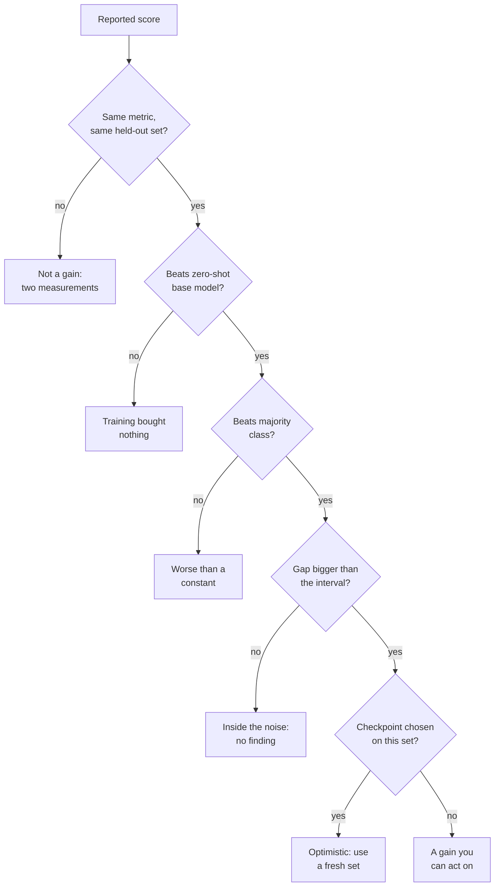
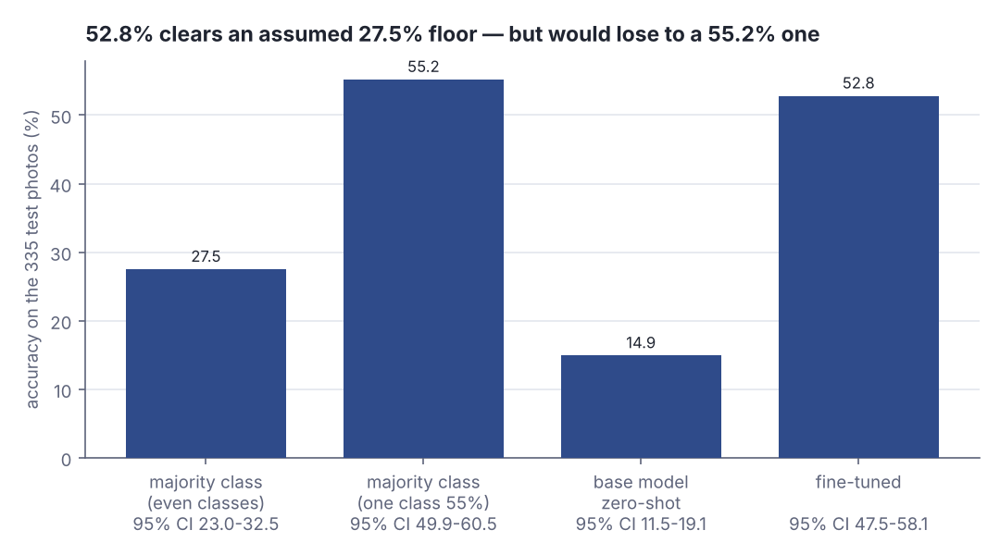
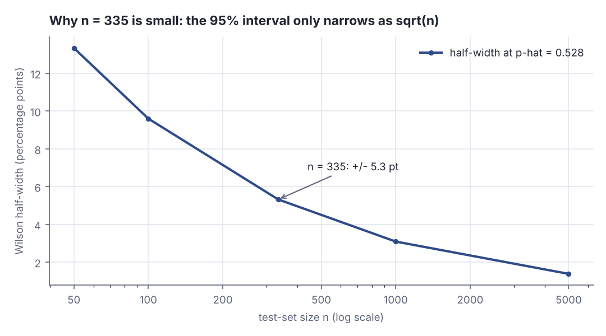

# Baseline first: what a 14.9% to 52.8% jump does and does not prove

> Fresh · AI / ML foundations · Intermediate · ~25 min · from today's feeds

## Why this matters
A Hugging Face post published on 2026-10-08, *The model that didn't exist, so you made it yourself*, describes six small models built in a few days by describing each one in a prompt to an agent, for roughly USD 103 of GPU and CPU time in total (yuvraj sharma and Abubakar Abid, *The model that didn't exist, so you made it yourself*, 2026-10-08). When producing a trained model costs less than lunch, the scarce skill moves: it is no longer making a number, it is reading one. This lesson takes that post's headline result — a citrus-disease classifier going from 14.9% to 52.8% correct — and works out precisely what that pair of numbers proves, what it cannot prove, and what you should ask for the next time an engineer or a vendor puts a model's score on your desk.

## Primer
Everything here rests on one idea: a model is a function fitted to examples, and the only honest score is the one it earns on examples it was never fitted to. Those withheld examples are the **held-out test set**; **accuracy** is the share of them the model gets exactly right, and higher is better. The citrus numbers in this lesson are accuracies on a held-out set of 335 photographs (yuvraj sharma and Abubakar Abid, *The model that didn't exist…*, 2026-10-08).

**Zero-shot** means running a model on a task it was never trained for and given no worked examples of: you describe the task, take whatever comes back, and score it. A zero-shot score is what the model could already do before you spent a cent.

**Fine-tuning** is continuing to train an existing model on your own labelled examples, so its weights shift towards your task. **LoRA** — low-rank adaptation — is the cheap form of that: instead of moving every weight, you train a small pair of low-rank matrices that get added to a few of the model's weight matrices, so the artefact you ship is megabytes rather than gigabytes; four of the post's six models are LoRAs (same post, 2026-10-08). **Distillation** trains a small model (the *student*) to imitate the outputs of a large one (the *teacher*): in the post, a 9B teacher labelled 8,797 requests and a 0.8B student learned from those labels (same post, 2026-10-08).

Last, and the hinge of this lesson: a reported percentage is not a property of a model. It is an **estimate** computed from one finite sample of test items. Score the same model on a different 335 photos and you get a different number. How different is not a matter of opinion — it has an arithmetic answer, and that arithmetic is most of what follows.

## The idea

The post's own first instruction to the agent is the right starting point, and it is a rule you can apply to every score anyone shows you:

> "Also report the base model's zero-shot score on the same metric before training so we can see the gain."
> — yuvraj sharma and Abubakar Abid, *The model that didn't exist, so you made it yourself*, 2026-10-08, https://huggingface.co/blog/building-with-ml-intern

Two words are doing the work: **same metric**. A gain is a difference between two measurements, and a difference is only meaningful when both sides were measured the same way, on the same items. The post does this, and gets a pair:

> "On the 335 test photos, the base model named the right problem 14.9% of the time."
> — yuvraj sharma and Abubakar Abid, *The model that didn't exist, so you made it yourself*, 2026-10-08, https://huggingface.co/blog/building-with-ml-intern

> "After two epochs on one A10G, the fine-tuned model got 52.8%."
> — yuvraj sharma and Abubakar Abid, *The model that didn't exist, so you made it yourself*, 2026-10-08, https://huggingface.co/blog/building-with-ml-intern

Without the first sentence the second is unreadable: 52.8% could be a triumph or a disaster, because you do not know what the same metric gave before any money was spent. That is the first gate. Here is the whole set, in the order worth applying:



*Figure 1: The gates a reported gain has to pass, in cost order — the cheap checks first. Source: built from the reporting rules in yuvraj sharma and Abubakar Abid, https://huggingface.co/blog/building-with-ml-intern, and the interval method of the NIST/SEMATECH e-Handbook §7.2.4.1.*

### Which baseline? The zero-shot one is not the brutal one

A zero-shot base model is one baseline, and a generous one: large models are often bad at a narrow specialist task they were never shown. The baseline that actually hurts is the **majority-class predictor** — a "model" that ignores the input entirely and always answers whichever label is most common in the test set. It needs no training at all, and its accuracy is the share of the test set held by the biggest class. That is the floor: anything that scores below it is worse than a constant. scikit-learn ships it as `DummyClassifier`: `strategy="most_frequent"` always predicts the most frequent class label seen during `fit`, and `strategy="prior"` predicts the same label while returning the empirical class distribution from `predict_proba` (scikit-learn 1.8, `sklearn.dummy.DummyClassifier`, "Parameters: strategy"). In Scala it is one `maxBy`:

```scala
// file: Majority.scala
val counts = Map("healthy" -> 92, "huanglongbing" -> 78, "canker" -> 61,
  "zinc deficiency" -> 56, "sooty mould" -> 48) // assumed counts, 335 photos
@main def majority(): Unit =
  val n = counts.values.sum
  val (name, k) = counts.maxBy(_._2)
  println(s"photos = $n, biggest class = $name with $k")
  println(f"always answer '$name': ${100.0 * k / n}%.1f%% correct")
  println(f"reported 52.8%% stands ${52.836 - 100.0 * k / n}%+.1f pt above it")
```

```text
photos = 335, biggest class = healthy with 92
always answer 'healthy': 27.5% correct
reported 52.8% stands +25.4 pt above it
```

With that mix the floor is 27.5%: the fine-tuned model clears it by 25.4 points and the 14.9% base model sits far below it. But those counts are mine. The post never publishes the label distribution of its 335 photos, so the floor cannot be computed from what it reports — and the mix decides the verdict. If one disease covered 185 of the 335 photos, the constant answer scores 55.2% and the fine-tuned model is *behind a model that does nothing*.


*Figure 2: The same 52.8% is a clear win against an even class mix and a loss against a skewed one; the floors are assumptions, because the post publishes no label counts. Generated from the lab output (`python3 dojo/engine/run_lab.py 2026-10-15-2`).*

### n = 335 means the number is fuzzy

The second gate is arithmetic. 52.8% is 177 of 335 photos; three photos the other way would read 53.7%. A **confidence interval** says how far that could wobble: a range computed from the sample such that, over repeated samples, 95% of such ranges contain the true rate. The NIST/SEMATECH e-Handbook of Statistical Methods gives the Wilson form in §7.2.4.1, "Confidence intervals", preferring it to the plain normal approximation because it stays accurate across combinations of n and p (NIST/SEMATECH e-Handbook §7.2.4.1):

```scala
// file: Wilson.scala
val z = 1.959964 // two-sided 95%
def wilson(k: Int, n: Int): (Double, Double) =
  val p = k.toDouble / n
  val d = 1 + z * z / n
  val c = (p + z * z / (2 * n)) / d
  val h = z * math.sqrt(p * (1 - p) / n + z * z / (4.0 * n * n)) / d
  (c - h, c + h)
@main def wilsonDemo(): Unit =
  val (lo, hi) = wilson(177, 335) // 177 of 335 photos = 52.8%
  println(f"p-hat 52.8%%  95%% interval ${100 * lo}%.1f%% .. ${100 * hi}%.1f%%")
```

```text
p-hat 52.8%  95% interval 47.5% .. 58.1%
```

So "52.8%" is really "roughly 47.5% to 58.1%". Every digit after the decimal point in a 335-item test is decoration, and the width shrinks only with the square root of n:


*Figure 3: Adapted from NIST/SEMATECH e-Handbook of Statistical Methods §7.2.4.1, https://itl.nist.gov/div898/handbook/prc/section2/prc241.htm — the Wilson half-width at p-hat = 0.528, computed in the lab's Step 4.*

### Is the jump beyond the noise? Yes, comfortably

Fuzzy is not the same as meaningless. The two intervals here — 11.5%–19.1% and 47.5%–58.1% — do not come close to touching, and the difference has its own interval:

```scala
// file: Gain.scala
val n = 335
def se(k: Int): Double = { val p = k.toDouble / n; math.sqrt(p * (1 - p) / n) }
@main def gain(): Unit =
  val (p0, p1) = (50.0 / n, 177.0 / n)
  val diff = p1 - p0
  val sd = math.sqrt(se(50) * se(50) + se(177) * se(177))
  val (lo, hi) = (diff - 1.959964 * sd, diff + 1.959964 * sd)
  println(f"gain ${100 * diff}%.1f pt, standard error of the gain ${100 * sd}%.1f pt")
  println(f"95%% interval for the gain: ${100 * lo}%.1f .. ${100 * hi}%.1f pt")
```

```text
gain 37.9 pt, standard error of the gain 3.4 pt
95% interval for the gain: 31.3 .. 44.5 pt
```

The gain is 37.9 points with a standard error of 3.4 points — eleven standard errors from zero. A 335-photo test is small, but not small enough to manufacture a 37.9-point difference out of luck; the lab turns this into a formal test.

### What the number still does not prove

Clearing all four gates does not make 52.8% a fact about the world. Three things remain open.

**The checkpoint may have been chosen by looking at the answers.** The post's image-LoRA section is an honest account of exactly this:

> "Step 200 was the first where Huggy was fully on-model."
> — yuvraj sharma and Abubakar Abid, *The model that didn't exist, so you made it yourself*, 2026-10-08, https://huggingface.co/blog/building-with-ml-intern

> "From step 500 on, Huggy's style started bleeding into prompts that had nothing to do with Huggy!"
> — yuvraj sharma and Abubakar Abid, *The model that didn't exist, so you made it yourself*, 2026-10-08, https://huggingface.co/blog/building-with-ml-intern

Those two sentences are **overfitting** observed directly: continued training keeps reducing error on the training examples while behaviour on everything else gets worse, because the model stops learning the pattern and starts absorbing the particular examples. The honest response — keep step 200 — is also where the trap sits. Choosing *which* checkpoint to keep by looking at how it scores is itself a form of fitting, and if the set you looked at is the set you then quote the score from, that score is no longer an honest estimate of future performance. That is **data leakage**: information from the evaluation data influencing the model or the choice of model, so the evaluation measures a decision you already made rather than a capability. The fix is mechanical — choose the checkpoint on one withheld set, report the number from a second that nothing was chosen on. The post does not say how the 52.8% relates to the choices made during training, so read it as an upper bound.

**The results are self-reported.** Every number comes from the vendor's own blog, measured by the people who built the tool, with no independent reproduction. That is a category, not an accusation — and the post's most honest result is the one where its own model loses: the 4-step distilled image model reached GenEval 0.536 in its second run against the 50-step teacher's 0.563 (same post, 2026-10-08) — a real gain over its own first run's 0.509, still behind the teacher.

**The costs exclude what costs most.** The USD 103 covers GPU and CPU charges, not the author's time: the viewpoint LoRA alone took about half a day across 48 jobs including ones that failed and were resubmitted, and the prompts grew from roughly 450 words to about 2,000 across seven projects (same post, 2026-10-08). That growth is the real bill. Cost control also depends on you, because the budget gate is just a line in the prompt:

> "Cap total spend at USD 12 and ask me before exceeding it."
> — yuvraj sharma and Abubakar Abid, *The model that didn't exist, so you made it yourself*, 2026-10-08, https://huggingface.co/blog/building-with-ml-intern

A cap the operator forgets to write is a cap that does not exist.

## Lab

**The question this lab answers:** is the citrus model's 14.9% → 52.8% jump bigger than the noise in a 335-photo test set, and does it clear a majority-class baseline?

### Step 1 — the assumption you are forced to make

The post reports 335 test photos and two accuracies, but never the label counts (yuvraj sharma and Abubakar Abid, *The model that didn't exist, so you made it yourself*, 2026-10-08). The majority-class floor cannot be computed without those counts, so the lab invents two distributions that both sum to 335 and says so out loud. **These are assumptions, not data.**

| set | healthy | huanglongbing | citrus canker | zinc deficiency | sooty mould | biggest class |
|---|---|---|---|---|---|---|
| A — fairly even classes | 92 | 78 | 61 | 56 | 48 | 27.5% |
| B — one class dominates | 185 | 61 | 41 | 28 | 20 | 55.2% |

The reported accuracies fix the counts exactly: 14.9% of 335 is 50 photos (50 / 335 = 14.925%, which prints as 14.9%) and 52.8% of 335 is 177 photos (177 / 335 = 52.836%). Those two integers, 50 and 177, are the only real data in the lab.

### Step 2 — the program

Scala 3, standard library only. It prints the floor for each assumed distribution, then the Wilson interval for each reported accuracy with every intermediate term, then an unpaired two-proportion z-test, then what a larger test set would buy.

```scala
// file: Lab.scala
// Interrogating one reported gain: 14.9% -> 52.8% correct diagnosis on 335 citrus photos.
// Scala 3, standard library only.

val n = 335            // test-set size reported in the post
val z = 1.959964       // two-sided 95% critical value of the standard normal
val kBase = 50         // 50 / 335 = 14.925%, which prints as the reported 14.9%
val kTuned = 177       // 177 / 335 = 52.836%, which prints as the reported 52.8%

def pad(s: String, w: Int): String = if s.length >= w then s else s + " " * (w - s.length)

// ---------- Wilson score interval for a proportion (NIST e-Handbook 7.2.4.1)
final case class Interval(p: Double, centre: Double, half: Double, se: Double):
  def lo: Double = centre - half
  def hi: Double = centre + half

def wilsonP(p: Double, n: Int): Interval =
  val d = 1.0 + z * z / n
  val centre = (p + z * z / (2.0 * n)) / d
  val se = math.sqrt(p * (1 - p) / n + z * z / (4.0 * n * n))
  Interval(p, centre, z * se / d, se)

def wilson(k: Int, n: Int): Interval = wilsonP(k.toDouble / n, n)

// ---------- Step 1: the floor any classifier must clear
def majorityBaseline(label: String, counts: Vector[(String, Int)]): Double =
  val tot = counts.map(_._2).sum
  println(s"-- $label  (total $tot photos)")
  for (name, k) <- counts.sortBy(-_._2) do
    println(f"   ${pad(name, 18)}${pad(k.toString, 5)}${100.0 * k / tot}%5.1f%% of the set")
  val (bn, bk) = counts.maxBy(_._2)
  val share = bk.toDouble / tot
  val iv = wilson(bk, tot)
  println(f"   majority-class predictor: always answer '$bn'")
  println(f"   its accuracy = $bk / $tot = ${100 * share}%.1f%%   95%% interval ${100 * iv.lo}%.1f%% .. ${100 * iv.hi}%.1f%%")
  println(f"   reported fine-tuned 52.8%% stands ${52.836 - 100 * share}%+.1f pt from that floor")
  println()
  share

// ---------- Step 2: how wide is a percentage measured on 335 photos?
def report(label: String, k: Int): Interval =
  val iv = wilson(k, n)
  println(f"-- $label: $k of $n photos correct")
  println(f"   p-hat            = $k / $n = ${iv.p}%.5f  (${100 * iv.p}%.1f%%)")
  println(f"   se term          = sqrt(p(1-p)/n + z^2/(4n^2)) = ${iv.se}%.6f")
  println(f"   Wilson centre    = ${iv.centre}%.5f")
  println(f"   Wilson half-width= ${iv.half}%.5f  (${100 * iv.half}%.2f pt)")
  println(f"   95%% interval     = ${100 * iv.lo}%.1f%% .. ${100 * iv.hi}%.1f%%")
  println()
  iv

// ---------- Step 3: is the difference bigger than the noise?
def twoProportionZ(k1: Int, k2: Int, n: Int): Double =
  val (p1, p2) = (k1.toDouble / n, k2.toDouble / n)
  val pooled = (k1 + k2).toDouble / (2.0 * n)
  val se = math.sqrt(pooled * (1 - pooled) * (1.0 / n + 1.0 / n))
  val zStat = (p2 - p1) / se
  println(f"   pooled p         = ($k1 + $k2) / ${2 * n} = ${pooled}%.5f")
  println(f"   se of difference = sqrt(p(1-p)(1/n + 1/n)) = ${se}%.5f")
  println(f"   difference       = ${100 * p2}%.1f%% - ${100 * p1}%.1f%% = ${100 * (p2 - p1)}%.1f pt")
  println(f"   z                = difference / se = ${zStat}%.2f   (two-sided 5%% needs |z| > 1.96)")
  println(f"   two-sided p      <= exp(-z^2/2) = ${math.exp(-zStat * zStat / 2)}%.2e")
  println()
  zStat

// ---------- Step 4: the same percentage measured on more photos
def widthVsN(ns: Vector[Int], p: Double): Unit =
  println(f"${pad("n", 8)}${pad("p-hat", 8)}${pad("half-width (pt)", 18)}95%% interval")
  for m <- ns do
    val iv = wilsonP(p, m)
    val cell = f"${100 * iv.half}%.2f"
    println(f"${pad(m.toString, 8)}${pad(f"$p%.3f", 8)}${pad(cell, 18)}${100 * iv.lo}%.1f%% .. ${100 * iv.hi}%.1f%%")
  println()

@main def lab(): Unit =
  println("=== Step 1: majority-class baselines (ASSUMED label counts: the post publishes none) ===")
  val plausible = Vector("healthy" -> 92, "huanglongbing" -> 78, "citrus canker" -> 61,
    "zinc deficiency" -> 56, "sooty mould" -> 48)
  val skewed = Vector("healthy" -> 185, "huanglongbing" -> 61, "citrus canker" -> 41,
    "zinc deficiency" -> 28, "sooty mould" -> 20)
  majorityBaseline("set A: fairly even classes", plausible)
  majorityBaseline("set B: one class dominates", skewed)

  println("=== Step 2: Wilson 95% intervals at n = 335 ===")
  val ivBase = report("base model, zero-shot", kBase)
  val ivTuned = report("fine-tuned model", kTuned)
  println(f"   intervals overlap? ${if ivTuned.lo <= ivBase.hi then "yes" else "no"}")
  println()

  println("=== Step 3: two-proportion z-test, unpaired (assumes two independent samples) ===")
  twoProportionZ(kBase, kTuned, n)

  println("=== Step 4: Wilson half-width at p-hat = 0.528 as n grows ===")
  widthVsN(Vector(50, 100, 335, 1000, 5000), 0.528)
```

### Step 3 — run it

```
scala Lab.scala
```

Real output:

```text
=== Step 1: majority-class baselines (ASSUMED label counts: the post publishes none) ===
-- set A: fairly even classes  (total 335 photos)
   healthy           92    27.5% of the set
   huanglongbing     78    23.3% of the set
   citrus canker     61    18.2% of the set
   zinc deficiency   56    16.7% of the set
   sooty mould       48    14.3% of the set
   majority-class predictor: always answer 'healthy'
   its accuracy = 92 / 335 = 27.5%   95% interval 23.0% .. 32.5%
   reported fine-tuned 52.8% stands +25.4 pt from that floor

-- set B: one class dominates  (total 335 photos)
   healthy           185   55.2% of the set
   huanglongbing     61    18.2% of the set
   citrus canker     41    12.2% of the set
   zinc deficiency   28     8.4% of the set
   sooty mould       20     6.0% of the set
   majority-class predictor: always answer 'healthy'
   its accuracy = 185 / 335 = 55.2%   95% interval 49.9% .. 60.5%
   reported fine-tuned 52.8% stands -2.4 pt from that floor

=== Step 2: Wilson 95% intervals at n = 335 ===
-- base model, zero-shot: 50 of 335 photos correct
   p-hat            = 50 / 335 = 0.14925  (14.9%)
   se term          = sqrt(p(1-p)/n + z^2/(4n^2)) = 0.019687
   Wilson centre    = 0.15323
   Wilson half-width= 0.03815  (3.81 pt)
   95% interval     = 11.5% .. 19.1%

-- fine-tuned model: 177 of 335 photos correct
   p-hat            = 177 / 335 = 0.52836  (52.8%)
   se term          = sqrt(p(1-p)/n + z^2/(4n^2)) = 0.027430
   Wilson centre    = 0.52804
   Wilson half-width= 0.05315  (5.32 pt)
   95% interval     = 47.5% .. 58.1%

   intervals overlap? no

=== Step 3: two-proportion z-test, unpaired (assumes two independent samples) ===
   pooled p         = (50 + 177) / 670 = 0.33881
   se of difference = sqrt(p(1-p)(1/n + 1/n)) = 0.03657
   difference       = 52.8% - 14.9% = 37.9 pt
   z                = difference / se = 10.37   (two-sided 5% needs |z| > 1.96)
   two-sided p      <= exp(-z^2/2) = 4.62e-24

=== Step 4: Wilson half-width at p-hat = 0.528 as n grows ===
n       p-hat   half-width (pt)   95% interval
50      0.528   13.34             39.3% .. 65.9%
100     0.528   9.60              43.1% .. 62.3%
335     0.528   5.32              47.5% .. 58.1%
1000    0.528   3.09              49.7% .. 55.9%
5000    0.528   1.38              51.4% .. 54.2%
```

### Reading the output

#### Step 1 — the floor

`its accuracy` is what a model that ignores the photograph entirely would score, and **higher means a harder floor to clear**. The last line is the distance from the reported 52.836% to that floor; **positive is good for the model.**

| assumed set | biggest class | floor | 95% interval of the floor | reported 52.8% stands |
|---|---|---|---|---|
| A — fairly even | healthy, 92 of 335 | 27.5% | 23.0% – 32.5% | +25.4 pt |
| B — one class dominates | healthy, 185 of 335 | 55.2% | 49.9% – 60.5% | −2.4 pt |

**Verdict:** the question "does 52.8% clear the floor?" has no answer from the post alone. Under set A it clears it by 25.4 points; under set B it is 2.4 points *behind* a model that always answers "healthy". The post reports an accuracy without a class distribution, so this gate stays open.

#### Step 2 — the interval around each percentage

`p-hat` is the raw fraction correct. `se term` is the square-rooted quantity inside the Wilson formula; it shrinks roughly as 1/√n. `Wilson centre` is the interval's midpoint, pulled very slightly towards 50% relative to p-hat. `half-width` is the wobble either side, in percentage points — **smaller is better**, because it means a sharper measurement.

| model | correct | p-hat | se term | half-width | 95% interval |
|---|---|---|---|---|---|
| base, zero-shot | 50 / 335 | 0.14925 | 0.019687 | 3.81 pt | 11.5% – 19.1% |
| fine-tuned | 177 / 335 | 0.52836 | 0.027430 | 5.32 pt | 47.5% – 58.1% |

Trace the fine-tuned row with digits. p̂ = 177 / 335 = 0.528358. With z = 1.959964, z² = 3.841459, so z²/n = 3.841459 / 335 = 0.011467 and the denominator is 1 + 0.011467 = 1.011467. The centre is (0.528358 + 3.841459/670) / 1.011467 = (0.528358 + 0.005733) / 1.011467 = 0.534091 / 1.011467 = 0.528036, printed as 0.52804. The standard-error term is √(0.528358 × 0.471642 / 335 + 3.841459 / 448900) = √(0.00074387 + 0.00000856) = √0.00075243 = 0.027430. The half-width is 1.959964 × 0.027430 / 1.011467 = 0.053762 / 1.011467 = 0.053152, printed as 0.05315 — 5.32 percentage points. Subtract and add: 0.528036 − 0.053152 = 0.474884 and 0.528036 + 0.053152 = 0.581188, which is the printed 47.5% – 58.1%.

**Verdict:** "52.8%" is a sharp-looking name for the range 47.5% – 58.1%, and "14.9%" for 11.5% – 19.1%. The decimal point is theatre at this sample size — but the two ranges are nowhere near each other, which is the finding.

#### Step 3 — the formal test

This is the **two-proportion z-test**: it asks how many standard errors apart the two rates are, assuming the two percentages came from two *independent* samples. **Larger |z| is stronger evidence of a real difference**; the conventional two-sided 5% threshold is 1.96. The printed p is an upper bound, not the exact tail area — for |z| ≥ 1 the two-sided normal tail is at most exp(−z²/2), which is enough here.

| quantity | value | how it is formed |
|---|---|---|
| pooled p | 0.33881 | (50 + 177) / 670 |
| se of difference | 0.03657 | √(0.33881 × 0.66119 × (1/335 + 1/335)) |
| difference | 37.9 pt | 52.836% − 14.925% |
| z | 10.37 | 0.379104 / 0.036570 |

The assumption is wrong in a harmless direction. Both models were scored on *the same* 335 photos, so the two results are paired, not independent, and the textbook test for paired binary outcomes is **McNemar's test**, which uses only the photos the two models disagree on. Running it needs the per-photo agreement counts, which the post does not publish; the unpaired test is what the published marginals allow. Pairing almost always *reduces* the standard error when two models are correlated, so the unpaired test here is the conservative one: the real evidence is at least this strong.

**Verdict:** z = 10.37 against a threshold of 1.96. The jump is not noise. Whatever else is unproven, the fine-tuning changed the model's behaviour on this test set by an amount a 335-photo sample could not have produced by chance.

#### Step 4 — what a bigger test set would buy

Each row holds p-hat fixed at 0.528 and varies only n, so the column shows pure sample-size effect. **Smaller half-width is better.**

| n | half-width | 95% interval |
|---|---|---|
| 50 | 13.34 pt | 39.3% – 65.9% |
| 100 | 9.60 pt | 43.1% – 62.3% |
| 335 | 5.32 pt | 47.5% – 58.1% |
| 1000 | 3.09 pt | 49.7% – 55.9% |
| 5000 | 1.38 pt | 51.4% – 54.2% |

Going from 335 to 1000 photos — three times the labelling work — buys 5.32 → 3.09 points, a factor of 1.72, which is close to √3 = 1.73. That is the whole story of sample size: precision costs quadratically.

**Verdict:** 335 photos is fine for detecting a 37.9-point jump and useless for distinguishing 52.8% from 55%. Match the test-set size to the size of the difference you need to resolve, not to the number of digits you want to print.

### Cause → consequence

1. **Cause.** Training a small model is now cheap and fast: the post's six models cost roughly USD 103 of GPU and CPU time in total, with the citrus classifier at about USD 1.90 (yuvraj sharma and Abubakar Abid, *The model that didn't exist, so you made it yourself*, 2026-10-08). The number of model-scores circulating in any organisation goes up accordingly.
2. **Mechanism.** A score is produced by three choices that the score itself does not record: which metric, which held-out items, and which checkpoint. Each one can be made in a way that inflates the result — a metric that flatters, a test set the training touched, a checkpoint picked because it scored well on that very set.
3. **Consequence.** A reported accuracy, on its own, is compatible with "this model is useful", "this model is worse than a constant answer", and "this number is the best of forty attempts on the same photos". The reader cannot tell which, and the digits give no warning.
4. **What it means in practice.** When someone brings you a model's score, four questions settle most of it, and they fit in a sentence each:
   - **What was the same metric before?** The zero-shot or previous-system number, measured the same way on the same items. No before, no gain.
   - **What does the majority class score?** The floor. A model that cannot beat a constant answer is not a model, and you cannot compute the floor without the class distribution — so ask for the label counts, not just the percentage.
   - **How many test items, and what is the interval?** With n in the hundreds, five points of wobble is normal. Demand the interval, or compute it yourself from the count and n — it is six lines of arithmetic.
   - **Was this test set used to choose anything?** Which checkpoint, which prompt, which threshold. If yes, ask for a number from a set that nothing was chosen on, and treat the first number as an upper bound.

## Self-check
1. A vendor reports that their fine-tuned classifier reaches 61% accuracy on a held-out set of 400 support tickets, up from a base model's 44%. What is the first thing you ask for, and why is "61% vs 44%" not yet enough? <details><summary>Answer</summary>The class distribution of the 400 tickets, so you can compute the majority-class floor — the accuracy of always answering the most common label, which needs no model at all (this is scikit-learn's `DummyClassifier` with `strategy="most_frequent"`, whose `predict` always returns the most frequent class seen in `fit`; scikit-learn 1.8, `sklearn.dummy.DummyClassifier`). If one category covers 65% of tickets, a 61% model is behind a constant answer and the 17-point "gain" over the base model is irrelevant. The second thing to ask is whether the 400 tickets were used to choose the checkpoint or the prompt; if they were, 61% is an upper bound, not an estimate.</details>
2. The lab prints a Wilson half-width of 5.32 points for 177 correct out of 335. Your team proposes labelling 1,000 photos instead to "get a solid number". Roughly what half-width would that buy, and what difference would still be invisible? <details><summary>Answer</summary>About 3.09 points, from the lab's Step 4 — the interval narrows as √n, so tripling the test set divides the half-width by about √3 = 1.73, not by 3. The 95% interval goes from 47.5%–58.1% to 49.7%–55.9%. Any difference smaller than roughly 6 points between two models would still sit inside that range, so a comparison between a 52.8% model and a 55% model remains unresolved even at n = 1000. To resolve a 2-point difference you need thousands of items — or a paired test such as McNemar's, which scores both models on the same items and looks only at the disagreements, and is therefore far more sensitive than comparing two independent intervals.</details>
3. The post reports that the Huggy LoRA was fully on-model at step 200 and that from step 500 its style bled into unrelated prompts. Why does picking step 200 make the reported quality of that checkpoint optimistic, and what would make it honest? <details><summary>Answer</summary>Because the checkpoint was selected by looking at how its outputs scored, so the score of the winning checkpoint includes whatever luck favoured it on those particular evaluation items — the selection itself fitted the model to the evaluation set. That is data leakage: evaluation data influencing a decision that is then graded by the same data, and it inflates the result exactly as training on the test set would. Overfitting is the underlying failure the step-500 bleeding shows directly — continued training kept improving the fit to the 84 Huggy images while behaviour on everything else got worse (yuvraj sharma and Abubakar Abid, *The model that didn't exist, so you made it yourself*, 2026-10-08). The honest procedure is two withheld sets: choose the checkpoint on the first, and report the number from the second, which nothing was selected on.</details>

## Sources
- [The model that didn't exist, so you made it yourself](https://huggingface.co/blog/building-with-ml-intern) — yuvraj sharma (ysharma) and Abubakar Abid (abidlabs), Hugging Face, 2026-10-08 — the primary source: the six models, the prompting recipe, the instruction to report the base model's zero-shot score, the 335-photo 14.9% → 52.8% citrus result, the Huggy step-200 / step-500 checkpoint story, the Pocket Rewriter distillation numbers, the Agate GenEval figures and the USD 103 total; all six verbatim quotes come from this page (accessed 2026-10-15).
- [NIST/SEMATECH e-Handbook of Statistical Methods, §7.2.4.1 "Confidence intervals"](https://itl.nist.gov/div898/handbook/prc/section2/prc241.htm) — NIST/SEMATECH — the Wilson score interval for a proportion, used for every interval in this lesson, and the reason to prefer it over the plain normal approximation across combinations of n and p; also the source figure replicated as Figure 3 (accessed 2026-10-15).
- [sklearn.dummy.DummyClassifier — scikit-learn 1.8 documentation](https://scikit-learn.org/1.8/modules/generated/sklearn.dummy.DummyClassifier.html) — scikit-learn developers — the definition of the majority-class baseline as a library primitive: `strategy="most_frequent"` always predicts the most frequent class label observed in `fit`, and `strategy="prior"` predicts the same label while returning the empirical class distribution from `predict_proba` (accessed 2026-10-15).

Related in your knowledge base: the AI / ML foundations section carries the earlier material on validation splits, overfitting and leakage.

## Next on this track
Fresh lessons sit outside the ladder; next on AI / ML foundations: **Vectors and matrices as data** (rung 4 of 38, Beginner).
