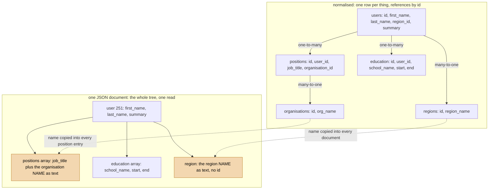
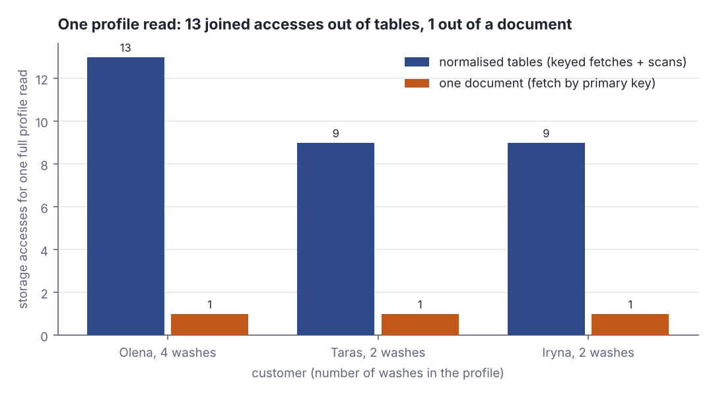
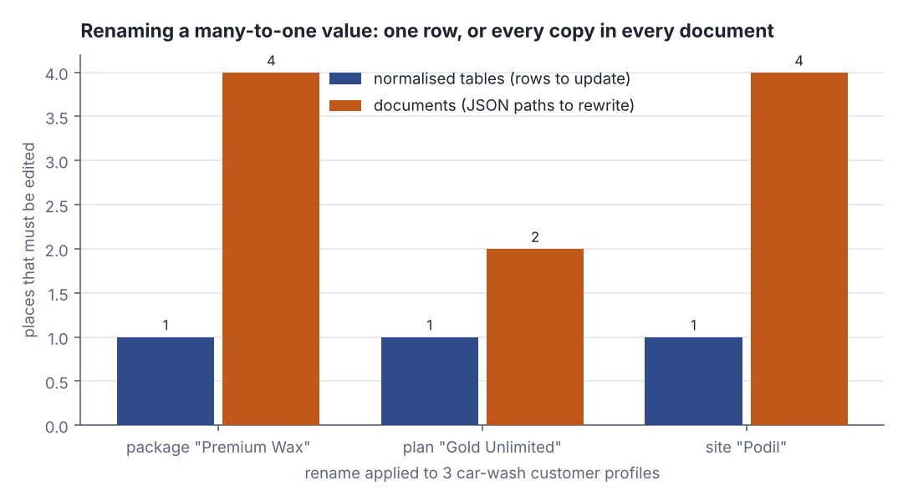
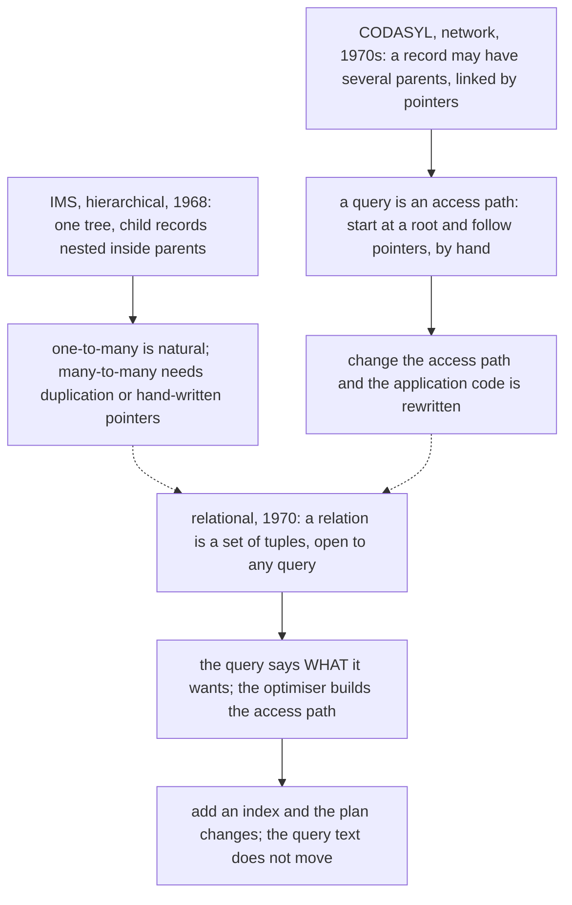

# Relational vs document data models

> Designing Data-Intensive Applications · Beginner · ~20 min · rung 2 of 26 · needs: Reliability, scalability, maintainability — the three concerns (ddia-01)

## Why this matters
Every service you have shipped made this choice, usually by accident: the profile lands in Postgres rows, or it lands as one JSON blob, and nobody writes down why. Chapter 2 gives you the vocabulary to make it on purpose — one-to-many versus many-to-one, locality versus normalisation, schema-on-read versus schema-on-write — and shows that the argument is old enough to have been settled once already, in 1970.
It sits here, right after reliability/scalability/maintainability, because the data model is the earliest and most expensive decision in the chain: storage engines, partitioning and replication all come later and all inherit it.

## The idea

> Chapter map: Designing Data-Intensive Applications (Kleppmann, 1st ed., O'Reilly 2017), ch. 2 "Data Models and Query Languages", first half — the section "Relational Model Versus Document Model" and its five subsections in the book's order: §2.1.1 "The Birth of NoSQL", §2.1.2 "The Object-Relational Mismatch", §2.1.3 "Many-to-One and Many-to-Many Relationships", §2.1.4 "Are Document Databases Repeating History?", §2.1.5 "Relational Versus Document Databases Today". The § numbers are positional: DDIA does not number its sections. Query languages and graph models are the chapter's other half, and the next rung. https://dataintensive.net/

A data model hides the mess of the layer below it. The one you pick decides not only how data is stored, but which questions are cheap to ask and which are not expressible at all.

### §2.1.1 The Birth of NoSQL
The relational model (Codd, 1970) won the 1980s and stayed won. "NoSQL" was not a technology but a 2009 Twitter hashtag for a meetup, later retrofitted as "Not Only SQL". DDIA names four forces behind it: scalability beyond a single relational node — very large datasets, very high write throughput; a preference for free and open source software over commercial licences; query operations the relational model handles badly; and frustration with restrictive schemas. The conclusion is not that one side wins: it is **polyglot persistence**, relational stores used alongside non-relational ones.

### §2.1.2 The Object-Relational Mismatch
Application code is objects; a relational database hands back rows and columns. That gap is the **impedance mismatch**, and ORMs shrink the boilerplate without closing it.

The running example is a LinkedIn-style résumé — Bill Gates's profile. A résumé is a tree: one user, many positions, many education entries. Relationally (Figure 2-1) each becomes a table with a foreign key back to `users`. As JSON (Figure 2-2) it is one nested document, and the tree the résumé already had is visible in the data instead of being reassembled by a join.

The gain is **locality**: one read fetches the whole profile. The lab below models the same shape as a car-wash customer profile and counts it — this fragment is its Step 0:

```scala
val doc1 = documentFor(1)
println(s"  document : accesses 1, values ${leaves(doc1)}")
accesses = 0; valuesRead = 0
profileFromTables(1, verbose = false)
println(s"  tables   : accesses $accesses, values $valuesRead")
```

```text
  document : accesses 1, values 28
  tables   : accesses 13, values 94
```

One document fetch returns 28 field values; the same profile assembled from six tables takes 13 accesses and reads 94 values, most from rows then discarded. The document did not magically read less — it read it in one place.


*Figure 1: the résumé drawn twice. One-to-many edges nest cleanly into the document; the many-to-one edges (shaded) are where it stops holding a reference and starts holding a duplicated copy. Source: Kleppmann, DDIA ch. 2, "The Object-Relational Mismatch", Figures 2-1 and 2-2.*



*Figure 2: accesses to read one whole profile. Generated from the lab's Steps 1–2 with `python3 dojo/engine/chart.py dojo/lessons/assets/2026-10-16-1-chart-1.json`.*

### §2.1.3 Many-to-One and Many-to-Many Relationships
`region` and `industry` could be free text — `"Greater Seattle Area"` — but DDIA argues for an id into a `regions` table: consistent spelling, no ambiguity between same-named places, ease of updating (the name lives in one place), localisation, better search. The principle underneath: **removing duplication is the key idea behind normalisation**. An id is meaningless to humans, so it never has to change; duplicated human-meaningful text is write overhead plus a standing risk of inconsistency. An id reference is a **many-to-one** relationship — many profiles, one region — and many-to-one is exactly what documents are bad at, because joins in document databases are weak or absent, so the join moves into your application as several round trips.

```scala
paths(doc1, "Podil").foreach(p => println(s"  copy of the site name at $p"))
println(s"  copies of \"Podil\" inside this one document: ${paths(doc1, "Podil").size}")
```

```text
  copy of the site name at $.home_site
  copy of the site name at $.washes[0].site
  copy of the site name at $.washes[1].site
  copy of the site name at $.washes[3].site
  copies of "Podil" inside this one document: 4
```

One site name, four copies, inside a single customer. Rename it and the relational shape updates one row in `sites`; the document shape has to rewrite every one of those paths, in every customer document. And relationships mature: organisations and schools get their own pages, so a position should reference an entity rather than hold a string. Each such change pushes the model back towards relations, and many-to-many is a short step from there.



*Figure 3: the write side — one row versus every copy. Generated from the lab's Step 3 with `python3 dojo/engine/chart.py dojo/lessons/assets/2026-10-16-1-chart-2.json`.*

### §2.1.4 Are Document Databases Repeating History?
This argument has run before. IBM's **IMS** (1968, built for Apollo) used the **hierarchical model**: records nested inside records, one big tree — essentially JSON. One-to-many was natural, many-to-many was not, and there were no joins. Two answers appeared in the 1970s. The **network model** (CODASYL) let a record have several parents, linked by pointers; reaching a record meant following an **access path** from a root, so the application code had to know that path, and changing it meant rewriting the code. The **relational model** instead laid the data open as sets of tuples and let a **query optimiser** choose the access path — once, automatically, a cost paid by the database's authors rather than per query by every application developer.


*Figure 4: why hand-coded access paths lost. Adapted from Kleppmann, DDIA ch. 2, "Are Document Databases Repeating History?".*

Kleppmann's verdict: document databases did revert to the hierarchical model for one-to-many, but they did not repeat CODASYL's mistake. For many-to-one and many-to-many they use a **document reference** — an id resolved at read time, closer to a foreign key than to a pointer chased along a fixed path.

### §2.1.5 Relational Versus Document Databases Today
Three arguments favour documents — schema flexibility, locality, and closeness to application data structures — and one favours relations: better support for joins and for many-to-one and many-to-many relationships.

**Schema flexibility.** "Schemaless" is the wrong word; there is always a schema, and the question is who enforces it and when. **Schema-on-write** is the relational way: explicit, checked by the database at write time, the analogue of static type checking. **Schema-on-read** is the document way: implicit, interpreted by whatever code reads the data — dynamic type checking. Nothing disappears, the check just moves:

```scala
def planName(d: J): String = d match
  case J.O(fs) => fs.collectFirst { case ("plan", J.S(v)) => v }.getOrElse("Pay As You Go")
  case _ => "Pay As You Go"
println(s"  plan of doc(1): ${planName(doc1)}")
```

```text
  plan of doc(1): Gold Unlimited
  plan of a 2019 document with no "plan" field: Pay As You Go
```

The document with no `plan` field does not fail; the *reader* supplies the default. That `getOrElse` **is** the schema — written in Scala instead of DDL, checked at read time instead of write time, and silently wrong if a second reader picks a different default. Changing a field's format works the same way: a document store starts writing the new shape and the application copes with both, while a relational store runs `ALTER TABLE` plus an `UPDATE` (fast on most databases, MySQL being the exception that copies the whole table). Schema-on-read earns its keep when records genuinely differ, or when their structure is set by a system you do not control.

**Locality, with caveats.** It only pays when you need large parts of the document at once: the store usually loads the *whole* document to read one field, and most updates rewrite it whole. Keep documents small; avoid writes that grow them. Locality is also no document-store monopoly — Spanner interleaves child rows inside a parent, Oracle has multi-table index cluster tables, Bigtable's column families do the same job.

**Convergence.** PostgreSQL has had JSON and `jsonb` columns since 9.3, and `jsonb` is a queryable, indexable type rather than an opaque blob:

> "The `json` data type stores an exact copy of the input text, which processing functions must reparse on each execution; while `jsonb` data is stored in a decomposed binary format that makes it slightly slower to input due to added conversion overhead, but significantly faster to process, since no reparsing is needed."
>
> — PostgreSQL Global Development Group, *PostgreSQL documentation, 8.14. JSON Types*, https://www.postgresql.org/docs/current/datatype-json.html

So you get containment (`doc @> '{"plan": "Gold Unlimited"}'`) and GIN indexes over keys and key/value pairs (PostgreSQL docs §8.14, "jsonb Containment and Existence", "jsonb Indexing") — a document inside a relation, still reachable by the optimiser. From the other side, document stores grew joins:

> "Performs a left outer join to a collection in the same database to filter in documents from the foreign collection for processing."
>
> — MongoDB, *$lookup (aggregation stage) — Database Manual*, https://mongodb.com/docs/manual/reference/operator/aggregation/lookup/

DDIA's closing line is the one to keep: a hybrid of the relational and document models is a good route for databases to take. So the decision is not "SQL or NoSQL" — it is, per piece of data: a tree I always read whole, or a reference shared by many records?

## Lab
**The question:** for one car-wash customer profile, exactly how much does the document shape save on a read, and exactly how much does it cost on a write when a many-to-one value is renamed?

Time: about 10 minutes. The curriculum's version of this exercise uses `psql`; this container has no database server, so the same model is built in Scala 3 (standard library only) where both shapes can be *counted* rather than estimated. The SQL for the Postgres version is in Step 4 for you to run on the Mac.

### Step 1 — save the program
Scala 3.3, standard library only. Save it as `Lab.scala`. It builds the car-wash profile twice — as normalised tables (`case class` + `Map` keyed by id) and as one nested document (a hand-rolled JSON value) — and counts every storage access and every field value read.

```scala
// file: Lab.scala

// DDIA ch. 2 "Data Models and Query Languages", section "Relational Model Versus
// Document Model". Scala 3.3, standard library only.
// A car-wash customer profile modelled twice -- as normalised tables and as one
// nested document -- then measured: what a profile read costs, and what renaming
// a many-to-one value costs.

// ---------------------------------------------------------------- shape A: tables

case class Site(id: Int, name: String, city: String)
case class Pkg(id: Int, name: String, priceUah: Int)       // one wash, bought per visit
case class Plan(id: Int, name: String, monthlyUah: Int)    // membership plan
case class Customer(id: Int, name: String, homeSiteId: Int, planId: Int)
case class Vehicle(id: Int, customerId: Int, plate: String, model: String)
case class Wash(id: Int, vehicleId: Int, siteId: Int, pkgId: Int, day: String)

val sites = Map(
  1 -> Site(1, "Podil", "Kyiv"),
  2 -> Site(2, "Lukianivka", "Kyiv"),
  3 -> Site(3, "Pasichna", "Lviv"))

val pkgs = Map(
  10 -> Pkg(10, "Express Rinse", 180),
  11 -> Pkg(11, "Premium Wax", 540),
  12 -> Pkg(12, "Interior Deep", 760))

val plans = Map(
  20 -> Plan(20, "Gold Unlimited", 1900),
  21 -> Plan(21, "Pay As You Go", 0))

val customers = Map(
  1 -> Customer(1, "Olena Kravets", 1, 20),
  2 -> Customer(2, "Taras Boiko", 2, 20),
  3 -> Customer(3, "Iryna Shevchuk", 3, 21))

val vehicles = List(
  Vehicle(100, 1, "AA1234BC", "Skoda Octavia"),
  Vehicle(101, 1, "AA9911KK", "VW Caddy"),
  Vehicle(102, 2, "BC4455HH", "Toyota RAV4"),
  Vehicle(103, 3, "AC7788MM", "Renault Duster"),
  Vehicle(104, 3, "AC0101CA", "Dacia Logan"))

val washes = List(
  Wash(900, 100, 1, 11, "2026-09-03"),
  Wash(901, 100, 1, 10, "2026-09-17"),
  Wash(902, 101, 2, 11, "2026-09-21"),
  Wash(903, 100, 1, 12, "2026-10-02"),
  Wash(904, 102, 2, 11, "2026-09-08"),
  Wash(905, 102, 2, 10, "2026-10-05"),
  Wash(906, 103, 3, 11, "2026-09-29"),
  Wash(907, 104, 3, 10, "2026-10-11"))

val vehiclesById = vehicles.map(v => v.id -> v).toMap
val washesByPkg = washes.groupBy(_.pkgId)   // the secondary index a relation can have

// Every access is counted, so "how many joins" and "how much data" are measured.
var accesses = 0    // one per keyed row fetch, index probe or table scan
var valuesRead = 0  // individual field values the storage engine had to read

def rowKey[K, V <: Product](t: Map[K, V], k: K): V =
  accesses += 1
  val v = t(k)
  valuesRead += v.productArity
  v

def rowScan[V <: Product](rows: List[V], p: V => Boolean): List[V] =
  accesses += 1
  valuesRead += rows.map(_.productArity).sum
  rows.filter(p)

def indexProbe[V <: Product](idx: Map[Int, List[V]], k: Int): List[V] =
  accesses += 1
  val got = idx.getOrElse(k, Nil)
  valuesRead += got.map(_.productArity).sum
  got

def profileFromTables(id: Int, verbose: Boolean): Int =
  val c = rowKey(customers, id)
  val plan = rowKey(plans, c.planId)
  val home = rowKey(sites, c.homeSiteId)
  val vs = rowScan(vehicles, _.customerId == id)
  val mine = vs.map(_.id).toSet
  val ws = rowScan(washes, w => mine.contains(w.vehicleId)).sortBy(_.day)
  val lines = ws.map: w =>
    val s = rowKey(sites, w.siteId)
    val p = rowKey(pkgs, w.pkgId)
    f"      ${w.day}  ${s.name}%-11s ${p.name}%-14s ${p.priceUah}%3d UAH"
  if verbose then
    println(s"    customer   : ${c.name}  (plan ${plan.name}, ${plan.monthlyUah} UAH/mo)")
    println(s"    home site  : ${home.name}, ${home.city}")
    vs.foreach(v => println(f"    vehicle    : ${v.plate}%-9s ${v.model}"))
    lines.foreach(println)
  ws.size

// ------------------------------------------------------------- shape B: document

enum J:
  case S(v: String)
  case N(v: Int)
  case A(items: List[J])
  case O(fields: List[(String, J)])

def render(j: J, indent: String = ""): String = j match
  case J.S(v) => "\"" + v + "\""
  case J.N(v) => v.toString
  case J.A(items) =>
    val inner = indent + "  "
    items.map(i => inner + render(i, inner)).mkString("[\n", ",\n", "\n" + indent + "]")
  case J.O(fs) =>
    val inner = indent + "  "
    fs.map((k, v) => s"$inner\"$k\": ${render(v, inner)}")
      .mkString("{\n", ",\n", "\n" + indent + "}")

def leaves(j: J): Int = j match
  case J.S(_) | J.N(_) => 1
  case J.A(items) => items.map(leaves).sum
  case J.O(fs) => fs.map((_, v) => leaves(v)).sum

// Denormalising: every many-to-one reference becomes a COPY of the string it pointed at.
def documentFor(id: Int): J =
  val c = customers(id)
  val vs = vehicles.filter(_.customerId == id)
  val mine = vs.map(_.id).toSet
  val ws = washes.filter(w => mine.contains(w.vehicleId)).sortBy(_.day)
  val plateOf = vs.map(v => v.id -> v.plate).toMap
  J.O(List(
    "id" -> J.N(c.id),
    "name" -> J.S(c.name),
    "plan" -> J.S(plans(c.planId).name),
    "home_site" -> J.S(sites(c.homeSiteId).name),
    "vehicles" -> J.A(vs.map(v => J.O(List(
      "plate" -> J.S(v.plate), "model" -> J.S(v.model))))),
    "washes" -> J.A(ws.map(w => J.O(List(
      "day" -> J.S(w.day),
      "plate" -> J.S(plateOf(w.vehicleId)),
      "site" -> J.S(sites(w.siteId).name),
      "package" -> J.S(pkgs(w.pkgId).name),
      "price_uah" -> J.N(pkgs(w.pkgId).priceUah)))))))

// A document read is all-or-nothing: one access, the whole tree.
def docFetch(docs: Map[Int, J], id: Int): J =
  accesses += 1
  val d = docs(id)
  valuesRead += leaves(d)
  d

// Every leaf path holding `needle`: exactly the places a rename has to rewrite.
def paths(j: J, needle: String, at: String = "$"): List[String] = j match
  case J.S(v) => if v == needle then List(at) else Nil
  case J.N(_) => Nil
  case J.A(items) => items.zipWithIndex.flatMap((it, i) => paths(it, needle, s"$at[$i]"))
  case J.O(fs) => fs.flatMap((k, v) => paths(v, needle, s"$at.$k"))

def nameOf(d: J): String = d match
  case J.O(fs) => fs.collectFirst { case ("name", J.S(v)) => v }.getOrElse("?")
  case _ => "?"

// Schema-on-read: the reader, not the store, supplies the default for a missing field.
def planName(d: J): String = d match
  case J.O(fs) => fs.collectFirst { case ("plan", J.S(v)) => v }.getOrElse("Pay As You Go")
  case _ => "Pay As You Go"

@main def lab(): Unit =
  val ids = customers.keys.toList.sorted
  val docs = ids.map(id => id -> documentFor(id)).toMap

  println("STEP 0 - the three numbers this lesson is about")
  val doc1 = documentFor(1)
  println(s"  document : accesses 1, values ${leaves(doc1)}")
  accesses = 0; valuesRead = 0
  profileFromTables(1, verbose = false)
  println(s"  tables   : accesses $accesses, values $valuesRead")
  paths(doc1, "Podil").foreach(p => println(s"  copy of the site name at $p"))
  println(s"  copies of \"Podil\" inside this one document: ${paths(doc1, "Podil").size}")
  val legacy = J.O(List("id" -> J.N(4), "name" -> J.S("Petro Hrytsenko")))
  println(s"  plan of doc(1): ${planName(doc1)}")
  println(s"  plan of a 2019 document with no \"plan\" field: ${planName(legacy)}")

  println()
  println("STEP 1 - read one whole profile out of the normalised tables")
  accesses = 0; valuesRead = 0
  profileFromTables(1, verbose = true)
  println(s"    => accesses: $accesses, field values read: $valuesRead")

  println()
  println("  every customer, same read, out of the tables:")
  println("  id  customer         washes  accesses  values  joins performed")
  var tblAcc = 0; var tblVals = 0
  val tblAccPer = scala.collection.mutable.ListBuffer[Int]()
  for id <- ids do
    accesses = 0; valuesRead = 0
    val n = profileFromTables(id, verbose = false)
    tblAcc += accesses; tblVals += valuesRead; tblAccPer += accesses
    println(f"  $id%-3d ${customers(id).name}%-16s $n%6d  $accesses%8d  $valuesRead%6d  plans, sites, vehicles, washes, sites, packages")
  println(f"  total over 3 customers: accesses $tblAcc%d, values $tblVals%d")

  println()
  println("STEP 2 - the same profile as one document")
  println(render(docs(1)))
  println()
  println("  every customer, same read, out of the document store:")
  println("  id  customer         washes  accesses  values  joins performed")
  var docAcc = 0; var docVals = 0
  val docAccPer = scala.collection.mutable.ListBuffer[Int]()
  for id <- ids do
    accesses = 0; valuesRead = 0
    val d = docFetch(docs, id)
    docAcc += accesses; docVals += valuesRead; docAccPer += accesses
    val washCount = d match
      case J.O(fs) => fs.collectFirst { case ("washes", J.A(xs)) => xs.size }.getOrElse(0)
      case _ => 0
    println(f"  $id%-3d ${nameOf(d)}%-16s $washCount%6d  $accesses%8d  $valuesRead%6d  none")
  println(f"  total over 3 customers: accesses $docAcc%d, values $docVals%d")

  println()
  println("STEP 3 - rename a many-to-one value and count what must change")
  val renames = List(
    ("Premium Wax", "Premium Wax & Seal", "packages"),
    ("Gold Unlimited", "Gold Members", "plans"),
    ("Podil", "Podil Riverside", "sites"))
  println("  old value       -> new value            owning table  rows  doc paths")
  val docPathCounts = scala.collection.mutable.ListBuffer[Int]()
  for (oldV, newV, table) <- renames do
    val hits = ids.flatMap(id => paths(docs(id), oldV).map(p => s"doc($id)$p"))
    docPathCounts += hits.size
    println(f"  $oldV%-15s -> $newV%-20s $table%-12s     1  ${hits.size}%9d")
    hits.foreach(h => println(s"        rewrite: $h"))

  println()
  println("STEP 4 - the inverse query: which customers ever bought \"Premium Wax\"?")
  accesses = 0; valuesRead = 0
  val pkgId = pkgs.values.find(_.name == "Premium Wax").get.id
  val hitWashes = indexProbe(washesByPkg, pkgId)
  val owners = hitWashes.map(w => rowKey(vehiclesById, w.vehicleId).customerId).distinct.sorted
  for w <- hitWashes do println(f"    wash ${w.id}%d on ${w.day} -> vehicle ${w.vehicleId}%d -> customer ${vehiclesById(w.vehicleId).customerId}%d")
  println(f"  tables (index on washes.pkg_id): accesses $accesses%d, values $valuesRead%d, customers ${owners.mkString(", ")}")
  accesses = 0; valuesRead = 0
  val docOwners = ids.filter(id => paths(docFetch(docs, id), "Premium Wax").nonEmpty)
  println(f"  documents (no secondary index) : accesses $accesses%d, values $valuesRead%d, customers ${docOwners.mkString(", ")}")

  println()
  println("STEP 5 - the two shapes side by side")
  println("  metric                                      tables   document")
  println(f"  accesses, 3 full profile reads              $tblAcc%6d   $docAcc%8d")
  println(f"  field values read, 3 full profile reads     $tblVals%6d   $docVals%8d")
  println(f"  places to edit for the 3 renames            ${renames.size}%6d   ${docPathCounts.sum}%8d")
  println()
  println(s"  chart data - accesses per profile read, tables: ${tblAccPer.mkString(", ")}")
  println(s"  chart data - accesses per profile read, document: ${docAccPer.mkString(", ")}")
  println(s"  chart data - rename edit sites, tables: 1, 1, 1")
  println(s"  chart data - rename edit sites, document: ${docPathCounts.mkString(", ")}")
```

### Step 2 — run it

```bash
scala Lab.scala
```

Real output, from `python3 dojo/engine/run_lab.py 2026-10-16-1` on 2026-10-16 with Scala 3.3.4:

```text
STEP 0 - the three numbers this lesson is about
  document : accesses 1, values 28
  tables   : accesses 13, values 94
  copy of the site name at $.home_site
  copy of the site name at $.washes[0].site
  copy of the site name at $.washes[1].site
  copy of the site name at $.washes[3].site
  copies of "Podil" inside this one document: 4
  plan of doc(1): Gold Unlimited
  plan of a 2019 document with no "plan" field: Pay As You Go

STEP 1 - read one whole profile out of the normalised tables
    customer   : Olena Kravets  (plan Gold Unlimited, 1900 UAH/mo)
    home site  : Podil, Kyiv
    vehicle    : AA1234BC  Skoda Octavia
    vehicle    : AA9911KK  VW Caddy
      2026-09-03  Podil       Premium Wax    540 UAH
      2026-09-17  Podil       Express Rinse  180 UAH
      2026-09-21  Lukianivka  Premium Wax    540 UAH
      2026-10-02  Podil       Interior Deep  760 UAH
    => accesses: 13, field values read: 94

  every customer, same read, out of the tables:
  id  customer         washes  accesses  values  joins performed
  1   Olena Kravets         4        13      94  plans, sites, vehicles, washes, sites, packages
  2   Taras Boiko           2         9      82  plans, sites, vehicles, washes, sites, packages
  3   Iryna Shevchuk        2         9      82  plans, sites, vehicles, washes, sites, packages
  total over 3 customers: accesses 31, values 258

STEP 2 - the same profile as one document
{
  "id": 1,
  "name": "Olena Kravets",
  "plan": "Gold Unlimited",
  "home_site": "Podil",
  "vehicles": [
    {
      "plate": "AA1234BC",
      "model": "Skoda Octavia"
    },
    {
      "plate": "AA9911KK",
      "model": "VW Caddy"
    }
  ],
  "washes": [
    {
      "day": "2026-09-03",
      "plate": "AA1234BC",
      "site": "Podil",
      "package": "Premium Wax",
      "price_uah": 540
    },
    {
      "day": "2026-09-17",
      "plate": "AA1234BC",
      "site": "Podil",
      "package": "Express Rinse",
      "price_uah": 180
    },
    {
      "day": "2026-09-21",
      "plate": "AA9911KK",
      "site": "Lukianivka",
      "package": "Premium Wax",
      "price_uah": 540
    },
    {
      "day": "2026-10-02",
      "plate": "AA1234BC",
      "site": "Podil",
      "package": "Interior Deep",
      "price_uah": 760
    }
  ]
}

  every customer, same read, out of the document store:
  id  customer         washes  accesses  values  joins performed
  1   Olena Kravets         4         1      28  none
  2   Taras Boiko           2         1      16  none
  3   Iryna Shevchuk        2         1      18  none
  total over 3 customers: accesses 3, values 62

STEP 3 - rename a many-to-one value and count what must change
  old value       -> new value            owning table  rows  doc paths
  Premium Wax     -> Premium Wax & Seal   packages         1          4
        rewrite: doc(1)$.washes[0].package
        rewrite: doc(1)$.washes[2].package
        rewrite: doc(2)$.washes[0].package
        rewrite: doc(3)$.washes[0].package
  Gold Unlimited  -> Gold Members         plans            1          2
        rewrite: doc(1)$.plan
        rewrite: doc(2)$.plan
  Podil           -> Podil Riverside      sites            1          4
        rewrite: doc(1)$.home_site
        rewrite: doc(1)$.washes[0].site
        rewrite: doc(1)$.washes[1].site
        rewrite: doc(1)$.washes[3].site

STEP 4 - the inverse query: which customers ever bought "Premium Wax"?
    wash 900 on 2026-09-03 -> vehicle 100 -> customer 1
    wash 902 on 2026-09-21 -> vehicle 101 -> customer 1
    wash 904 on 2026-09-08 -> vehicle 102 -> customer 2
    wash 906 on 2026-09-29 -> vehicle 103 -> customer 3
  tables (index on washes.pkg_id): accesses 5, values 36, customers 1, 2, 3
  documents (no secondary index) : accesses 3, values 62, customers 1, 2, 3

STEP 5 - the two shapes side by side
  metric                                      tables   document
  accesses, 3 full profile reads                  31          3
  field values read, 3 full profile reads        258         62
  places to edit for the 3 renames                 3         10

  chart data - accesses per profile read, tables: 13, 9, 9
  chart data - accesses per profile read, document: 1, 1, 1
  chart data - rename edit sites, tables: 1, 1, 1
  chart data - rename edit sites, document: 4, 2, 4
```

### Step 3 — the Postgres version of the same model
The curriculum's `psql` exercise, for the Mac. SQL is data definition, not program code, so it stays SQL.

```sql
-- Shape A: normalised. Every many-to-one reference is an id, not a name.
CREATE TABLE sites     (id int PRIMARY KEY, name text, city text);
CREATE TABLE packages  (id int PRIMARY KEY, name text, price_uah int);
CREATE TABLE plans     (id int PRIMARY KEY, name text, monthly_uah int);
CREATE TABLE customers (id int PRIMARY KEY, name text,
                        home_site_id int REFERENCES sites, plan_id int REFERENCES plans);
CREATE TABLE vehicles  (id int PRIMARY KEY, customer_id int REFERENCES customers,
                        plate text, model text);
CREATE TABLE washes    (id int PRIMARY KEY, vehicle_id int REFERENCES vehicles,
                        site_id int REFERENCES sites, package_id int REFERENCES packages,
                        day date);

-- Shape B: one document per customer.
CREATE TABLE customer_docs (id int PRIMARY KEY, doc jsonb);
INSERT INTO customer_docs VALUES (1, '{"id": 1, "name": "Olena Kravets",
  "plan": "Gold Unlimited", "home_site": "Podil",
  "vehicles": [{"plate": "AA1234BC", "model": "Skoda Octavia"},
               {"plate": "AA9911KK", "model": "VW Caddy"}],
  "washes": [{"day": "2026-09-03", "plate": "AA1234BC", "site": "Podil",
              "package": "Premium Wax", "price_uah": 540}]}');

-- The one-to-many part reads straight out of the tree, no join:
SELECT jsonb_array_elements(doc->'vehicles') FROM customer_docs WHERE id = 1;

-- The many-to-one part is a containment match on a duplicated string, not a key lookup:
SELECT id FROM customer_docs WHERE doc @> '{"plan": "Gold Unlimited"}';

-- The rename: one row on the normalised side ...
UPDATE packages SET name = 'Premium Wax & Seal' WHERE name = 'Premium Wax';
-- ... versus rewriting every copy at every path on the document side:
UPDATE customer_docs
   SET doc = jsonb_set(doc, '{washes,0,package}', '"Premium Wax & Seal"')
 WHERE doc #>> '{washes,0,package}' = 'Premium Wax';
```

Expected output — run locally (the `jsonb_array_elements` query, with the document inserted above):

```text
          jsonb_array_elements
-------------------------------------------------
 {"model": "Skoda Octavia", "plate": "AA1234BC"}
 {"model": "VW Caddy", "plate": "AA9911KK"}
(2 rows)
```

The `jsonb_set` statement only reaches `washes[0]`. A real rename needs every index, which is precisely the point the Scala run measures.

### Reading the output

- **`accesses`** — one per keyed row fetch, index probe or table scan. This is the "how many joins / round trips" number. **Lower is better**; it is what dominates when each access is a network hop or a random disk seek.
- **`values`** — individual field values the storage engine had to read (`productArity` per table row, leaf count per document). This is "how much data was touched". **Lower is better**, but only secondary: 94 values read locally beat 13 values read across 13 hops.
- **`doc paths`** — JSON paths holding a copy of the renamed string, printed one per line. This is the write amplification of denormalisation. **Lower is better.**
- **`washes`** — how many wash records the profile contains, so you can see the cost scale with the one-to-many fan-out.

**Step 1 and Step 2, reading a profile.**

| customer | washes | table accesses | table values | doc accesses | doc values |
|---|---:|---:|---:|---:|---:|
| Olena Kravets | 4 | 13 | 94 | 1 | 28 |
| Taras Boiko | 2 | 9 | 82 | 1 | 16 |
| Iryna Shevchuk | 2 | 9 | 82 | 1 | 18 |
| **total** | 8 | **31** | **258** | **3** | **62** |

Trace Olena's 13 accesses with digits: `customers` by key (1) + `plans` by key (1) + `sites` by key (1) + a scan of `vehicles` (1) + a scan of `washes` (1) = 5, then two keyed lookups per wash — `sites` and `packages` — for 4 washes = 8. 5 + 8 = 13. Her 94 values: customer row 4 fields + plan 3 + site 3 + the whole `vehicles` table 5 rows × 4 = 20 + the whole `washes` table 8 rows × 5 = 40, giving 70, plus 4 washes × (site 3 + package 3) = 24. 70 + 24 = 94. The document is 1 access and 28 leaf values, and 28 is also exactly the number of fields the application actually wanted.

**Verdict (Steps 1–2):** for a read-the-whole-profile workload the document wins decisively on accesses — 13 → 1, 31 → 3 across all three customers — and incidentally reads a third of the data, because nothing is scanned and discarded.

**Step 3, the rename.**

| renamed value | owning table | rows to update | document paths to rewrite |
|---|---|---:|---:|
| package "Premium Wax" | `packages` | 1 | 4 |
| plan "Gold Unlimited" | `plans` | 1 | 2 |
| site "Podil" | `sites` | 1 | 4 |
| **total** | | **3** | **10** |

The four `Premium Wax` paths are `doc(1)$.washes[0].package`, `doc(1)$.washes[2].package`, `doc(2)$.washes[0].package`, `doc(3)$.washes[0].package` — three different customers, two different washes inside one of them. Each is a separate document rewrite, and because most document stores rewrite the whole document on update, those 4 edits rewrite 4 entire profiles. On the normalised side it is `UPDATE packages SET name = … WHERE id = 11`: one row, and every reader sees the new name on its next join.

**Verdict (Step 3):** denormalising buys the read win of Steps 1–2 at a write cost of 10 edits where 3 would do — and, unlike the read win, this one scales with how many customers ever bought the package, not with the size of one profile.

**Step 4, the inverse query.** "Which customers ever bought Premium Wax?" is a many-to-one lookup run backwards. The relational shape probes an index on `washes.package_id`, gets 4 wash rows, then 4 vehicle rows: 5 accesses, 36 values. The document shape has no such index here, so it opens all three documents whole: 3 accesses but 62 values — every field of every customer, to read one. Both answer `1, 2, 3`.

**Verdict (Step 4):** the document shape does not only cost more on renames; it also loses on any query that enters the data through a many-to-one reference instead of through the document's own primary key.

### Cause → consequence

1. **Cause.** A résumé, or a car-wash profile, is a tree: one customer, many vehicles, many washes. A document stores that tree whole; a relational schema stores it as six tables keyed by id.
2. **Mechanism.** Reading the tree back out of tables requires one access per table plus one per many-to-one reference per row — measured as 13 accesses and 94 field values for a 4-wash profile, against 1 access and 28 values for the document.
3. **Consequence.** Buying that locality means replacing each many-to-one *reference* with a *copy* of the human-meaningful value. One site name appears 4 times inside one customer; three renames that touch 3 rows in the normalised shape touch 10 JSON paths in the document shape, and the inverse query ("who used this package?") goes from an index probe over 36 values to a full read of 62.
4. **In practice.** Decide per relationship, not per database. Shapes you always read whole and that are owned by one aggregate — a wash's line items, an Akka actor's persisted state, an event payload — are documents, and `jsonb` lets you keep them inside Postgres with containment and GIN indexes instead of standing up a second store. Anything referenced by many records and edited independently — price lists, sites, membership plans, anything with a name a marketing team can change — stays a row with an id, and you accept the join. When a one-to-many field starts acquiring its own page in the product, that is the signal it just became many-to-one; migrate it before the duplicate copies outnumber the people who remember they are copies.

## Self-check
1. Your document already stores each wash with `"site": "Podil"`. Product asks to rename the site to "Podil Riverside". Walk through what the normalised shape and the document shape each have to do, and say which number scales with what. <details><summary>Answer</summary>Normalised: one statement, `UPDATE sites SET name = 'Podil Riverside' WHERE id = 1`. One row, and every reader sees the new name on its next join, because every profile holds the *id* 1, not the text. Document: find every JSON path holding the old string and rewrite it. In the lab's three-customer dataset that is 4 paths — `doc(1)$.home_site`, `doc(1)$.washes[0].site`, `doc(1)$.washes[1].site`, `doc(1)$.washes[3].site` — and because most document stores rewrite the whole document on update, those 4 edits rewrite whole profiles. The scaling is the real answer: the relational cost is O(1) in the number of customers, the document cost is O(number of documents containing the string × occurrences per document), so it grows with your customer base and with each customer's wash history. This is DDIA's "removing duplication is the key idea behind normalisation" (ch. 2, "Many-to-One and Many-to-Many Relationships") seen from the write side.</details>
2. A colleague says the car-wash document store is "schemaless, so we can change fields whenever we like". What is wrong with the word, and where did the schema actually go? <details><summary>Answer</summary>There is always a schema; "schemaless" only means it is not declared to the database. DDIA's terms are **schema-on-write** (the schema is explicit and the database enforces it at write time — static type checking) versus **schema-on-read** (the structure is implicit, and whatever code reads the document interprets it — dynamic type checking) (ch. 2, "Relational Versus Document Databases Today"). In the lab the schema is the line `fs.collectFirst { case ("plan", J.S(v)) => v }.getOrElse("Pay As You Go")`: it decides that `plan` is a string and that a missing `plan` means "Pay As You Go". The risk is that this is written once per reader — a second service that defaults to `"Gold Unlimited"` instead is a silent data bug that no database will catch. The genuine wins of schema-on-read are heterogeneity (records really do have different shapes) and structure imposed by an external system; "we can change fields whenever we like" is not one of them, because the old documents are still there and somebody's reader has to handle both shapes.</details>
3. CODASYL's network model also let one record be reached from many parents — so why is a document database holding an id reference not simply CODASYL again? <details><summary>Answer</summary>Because of *who computes the access path*. In CODASYL the links were pointers and the only way to a record was to follow a chain from a root, in a specific order; the application code had to know that path, and changing the path or the layout meant rewriting the code (DDIA ch. 2, "Are Document Databases Repeating History?"). The relational answer was to expose the data as plain sets of tuples and let a **query optimiser** choose the access path, once, automatically — so adding an index changes the plan without touching a single query. A document store with a reference id is closer to the relational side: the id is resolved at read time, by key, and nothing about the physical layout is baked into the application's traversal order. Kleppmann's framing is that document databases reverted to the hierarchical model for one-to-many nesting, but used foreign-key-like references, not CODASYL access paths, for many-to-one and many-to-many. The cost that remains is that resolving those references is often done by your application in several round trips rather than by an optimiser in one query — which is the gap `$lookup` and `jsonb` joins have been closing from both directions.</details>

## Sources
- [Designing Data-Intensive Applications (Kleppmann, 1st ed.)](https://dataintensive.net/) — Martin Kleppmann, O'Reilly, 2017 — ch. 2 "Data Models and Query Languages", the section "Relational Model Versus Document Model": "The Birth of NoSQL" supplied the four drivers behind NoSQL and the polyglot-persistence conclusion; "The Object-Relational Mismatch" supplied the impedance-mismatch framing, the Bill Gates résumé example and Figures 2-1/2-2 that Figure 1 here is drawn from, and the locality argument; "Many-to-One and Many-to-Many Relationships" supplied the five reasons to use an id for region/industry, "removing duplication is the key idea behind normalisation", and the examples of one-to-many relationships maturing into many-to-one; "Are Document Databases Repeating History?" supplied IMS, CODASYL access paths, the query optimiser argument and the document-reference verdict that Figure 4 is adapted from; "Relational Versus Document Databases Today" supplied schema-on-read versus schema-on-write, the locality caveats (whole-document loads and rewrites, Spanner/Oracle/Bigtable), and the convergence conclusion (accessed 2026-10-16)
- [DDIA 1st ed., chapter 2 contents](https://www.oreilly.com/library/view/designing-data-intensive-applications/9781491903063/ch02.html) — O'Reilly listing for ISBN 9781491903063 — the exact subsection titles and their order, used for the chapter map and the positional § numbering (accessed 2026-10-16)
- [PostgreSQL documentation — JSON Types](https://www.postgresql.org/docs/current/datatype-json.html) — PostgreSQL Global Development Group, §8.14 — the quoted sentence contrasting `json` and `jsonb` storage, and the "jsonb Containment and Existence" and "jsonb Indexing" subsections behind the `@>` containment operator, `jsonb_array_elements`, `jsonb_set`, `#>>` and GIN indexing used in the Lab's SQL; verified at the version-pinned mirror https://www.postgresql.org/docs/18/datatype-json.html (accessed 2026-10-16)
- [MongoDB manual — `$lookup` (aggregation stage)](https://mongodb.com/docs/manual/reference/operator/aggregation/lookup/) — MongoDB, Database Manual — the quoted definition of `$lookup` as a left outer join, evidence for the convergence claim that document stores grew joins (accessed 2026-10-16)
- Related in your knowledge base: `06-databases-and-distributed-data/RDBMS_vs_NoSQL.md`, `06-databases-and-distributed-data/Databases-Data-Modeling.md` and `06-databases-and-distributed-data/WideColumn_vs_Document.md`.

## Next on this track
Next on Designing Data-Intensive Applications: **Query languages and graph-like data models** (rung 3 of 26, Beginner).
