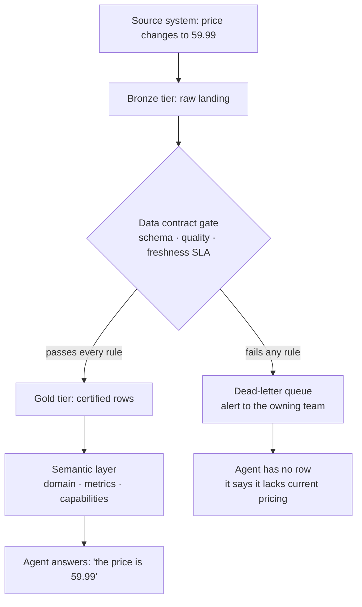
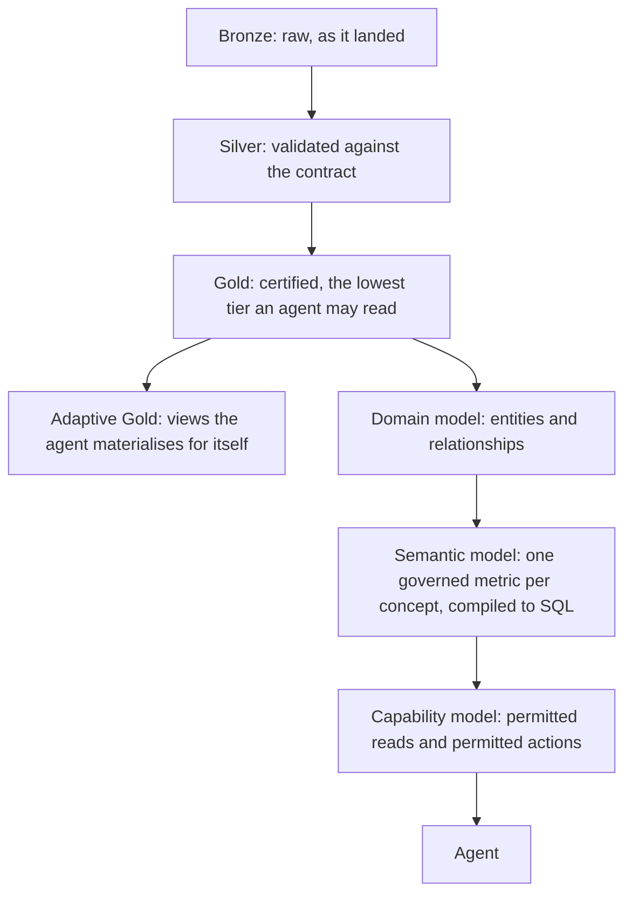
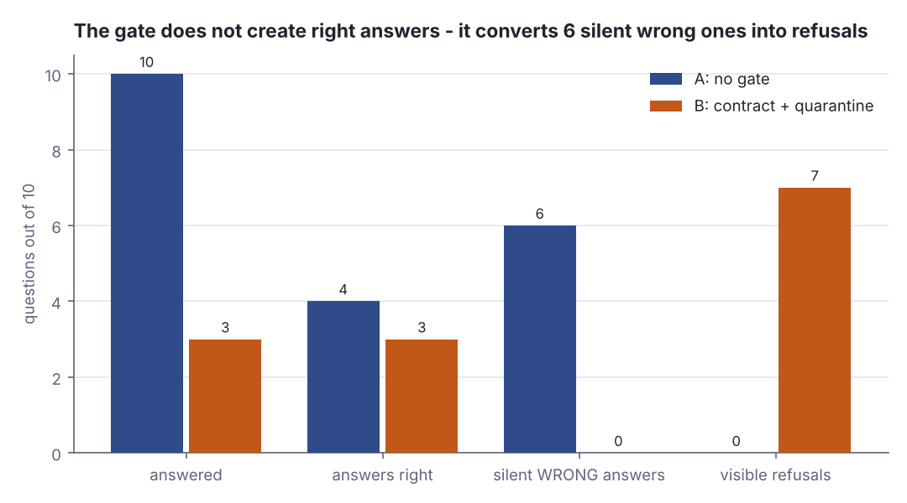
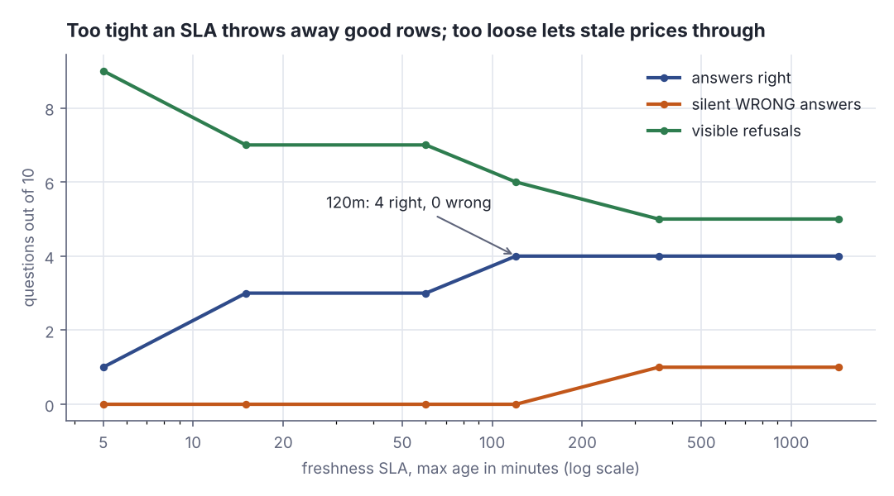

# Agents can't smell bad data: contracts, quarantine, semantic layer

> Fresh · Software architecture & design · Intermediate · ~20 min · from today's feeds

## Why this matters
Pramod Sadalage and Prem Chandrasekaran published *Making Your Data Ready for Agentic AI* on martinfowler.com on 2026-08-27, and it names the structural problem behind most agent pilots that quietly fail: your data platform was designed for a human who would notice when a number looked wrong. Nothing in the 30-day window fitted the architecture slot today, so the research window was widened to 90 days (`dojo/feeds.yaml`, `freshness_days_max`) — this piece is worth the detour because it is the same modelling problem as your core lesson this morning, DDIA chapter 2 on relational versus document models, pushed one layer up: there the question is how to shape data so a query can express a relationship; here it is how to shape and certify data so a non-human consumer can be trusted to act on it. Twenty minutes gets you a vocabulary (data contract, quarantine, medallion tiers, semantic layer, capability model) and a lab that measures what the quarantine pattern actually buys.

## Primer
Four prerequisites, because this sits one level above your current architecture rung.

**A data pipeline** moves records from a source system (an order service, a pricing database) into an analytical store where other systems read them. It runs on a schedule or on a stream, and each run is a *load*. A record that arrives malformed, or a load that silently fails, leaves the analytical store disagreeing with the source — the store says a price is 49.99 while the source says 59.99.

**A data contract** is a machine-readable file that states what a dataset must look like: its columns and types (schema), the rules each row must satisfy (quality), and how old the data may be before it stops being servable (freshness, usually expressed as a service-level agreement or SLA). It lives in version control next to the code, and a CI/CD job rejects changes that break it. The article's example format is the Open Data Contract Standard:

> "ODCS is an open, vendor-neutral standard maintained by the Bitol project under the Linux Foundation's AI & Data umbrella."
> — Bitol / Linux Foundation AI & Data, *Open Data Contract Standard*, v3.2.0, https://docs.datacontract.com/open-data-contract-standard

**An AI agent**, for this lesson, is an LLM wired to tools: it can call functions that read data and sometimes functions that change things (issue a refund, update a price). It chooses which tool to call from the text of your question and from what it reads.

**Text-to-SQL** means the agent translates "what did we sell in Q3?" into a SQL query against your tables. It has to guess what your column names mean — and that guessing is where a *semantic layer* (a curated map from business concepts to the SQL that computes them) earns its keep.

## The idea

The article's thesis is one sentence about the difference between your old consumer and your new one:

> "when the data feels wrong, a human double-checks; an agent confidently acts on it."
> — Pramod Sadalage and Prem Chandrasekaran, *Making Your Data Ready for Agentic AI*, 2026-08-27, https://martinfowler.com/articles/making-data-ready-for-agentic-ai.html

Every analytics stack you have ever shipped had an implicit last line of defence: an analyst who knew that the EMEA numbers are rubbish on the first of the month. That defence is gone. The article names five properties the data itself must now carry, in its own opening words:

> **Trusted** — "The confidence a human used to supply has to be built in"
> **Contextual** — "Meaning that used to live in someone's head has to be made explicit in the data."
> **Traceable** — "You have to be able to reconstruct what the agent did and why."
> **Governed** — "Access must be scoped, controlled, and auditable."
> **Operational** — "The data can't just be readable, it has to be actionable."
> — Pramod Sadalage and Prem Chandrasekaran, *Making Your Data Ready for Agentic AI*, 2026-08-27, https://martinfowler.com/articles/making-data-ready-for-agentic-ai.html

### Trusted: the contract and the quarantine gate

A data contract becomes useful the moment it stops being documentation:

> "Treat data contracts with the same rigor you'd give an API contract."
> — Pramod Sadalage and Prem Chandrasekaran, *Making Your Data Ready for Agentic AI*, 2026-08-27, https://martinfowler.com/articles/making-data-ready-for-agentic-ai.html

You already know what that rigour feels like from Akka and from any versioned HTTP API: the contract is in the repository, a breaking change fails the build, and nobody ships around it. Applied to data, the contract has three clauses — schema, quality rules, freshness SLA — and the enforcement point sits *before* the agent-accessible store, not after. Rows that fail are quarantined:

> "If it fails any one of them, it's quarantined, routed to a dead letter queue for human review, with alerts fired."
> — Pramod Sadalage and Prem Chandrasekaran, *Making Your Data Ready for Agentic AI*, 2026-08-27, https://martinfowler.com/articles/making-data-ready-for-agentic-ai.html

> "The point is that the agent never sees the bad data."
> — Pramod Sadalage and Prem Chandrasekaran, *Making Your Data Ready for Agentic AI*, 2026-08-27, https://martinfowler.com/articles/making-data-ready-for-agentic-ai.html



*Figure 1: The quarantine pattern — the gate sits upstream of the store the agent can read, so a failing row produces a refusal instead of a confident wrong answer. Source: built from the quarantine and medallion description in Sadalage and Chandrasekaran, https://martinfowler.com/articles/making-data-ready-for-agentic-ai.html*

The freshness clause hides a trap: the SLA must be tied to when the load last *succeeded*, not to when the content last *changed*. A pipeline dead for four hours still shows a content timestamp of five minutes ago — the last row it managed to write:

```scala
// file: Freshness.scala
case class Load(lastChangedMin: Int, lastSucceededMin: Int)
val slaMin = 60
@main def freshness(): Unit =
  val l = Load(lastChangedMin = 5, lastSucceededMin = 240)
  println(s"content last changed      ${l.lastChangedMin}m ago")
  println(s"load last SUCCEEDED       ${l.lastSucceededMin}m ago")
  println(s"servable by change time?  ${l.lastChangedMin <= slaMin}")
  println(s"servable by success time? ${l.lastSucceededMin <= slaMin}")
```

```text
content last changed      5m ago
load last SUCCEEDED       240m ago
servable by change time?  true
servable by success time? false
```

The same row passes one freshness check and fails the other. Only the second check catches a stalled pipeline, which is exactly the failure that produces a confidently quoted stale price.

### Contextual: the semantic layer is DDIA chapter 2 one floor up

This morning's core lesson is Kleppmann on relational versus document models (DDIA ch. 2, "Data Models and Query Languages") — the argument that the shape you give data decides which relationships a query can express cheaply, and that the schema-on-read / schema-on-write choice moves the interpretation burden between writer and reader. An agent reading your raw tables is the extreme case of schema-on-read: it must infer, at query time, what `cust_st` means and which of your four `revenue` columns is the one finance uses. The article's answer is to stop making it guess, by splitting the context into three explicit models: a **domain model** (entities and relationships — DDIA's modelling question, restated), a **semantic model** (business metrics with one governed definition each, compiled down to SQL), and a **capability model** (what the agent is allowed to read and to do). Agents are routed through the semantic layer rather than at the raw schema. The payoff the article reports is large (Sadalage and Chandrasekaran, *Making Your Data Ready for Agentic AI*, 2026-08-27):

> "in AtScale's text-to-SQL benchmark, accuracy jumped from under 20% on the raw schema to over 92.5%"
> — Pramod Sadalage and Prem Chandrasekaran, *Making Your Data Ready for Agentic AI*, 2026-08-27, https://martinfowler.com/articles/making-data-ready-for-agentic-ai.html

"One governed metric per concept" sounds like governance theatre until you count the answers an ungoverned one produces:

```scala
// file: OneMetric.scala
val lastOrderDaysAgo = Vector(("c1", 5), ("c2", 20), ("c3", 60), ("c4", 150))
@main def oneMetric(): Unit =
  def active(windowDays: Int) = lastOrderDaysAgo.count(_._2 <= windowDays)
  for w <- Vector(7, 30, 90, 180) do
    println(f"'active customers', $w%3d-day window = ${active(w)}")
  println(f"one governed definition (30 days)   = ${active(30)}")
```

```text
'active customers',   7-day window = 1
'active customers',  30-day window = 2
'active customers',  90-day window = 3
'active customers', 180-day window = 4
one governed definition (30 days)   = 2
```

"Active customers" has four correct answers and no wrong ones, which is precisely why it cannot be left to the agent. A human analyst asks which window you meant; the agent picks one and reports it as fact.



*Figure 2: Adapted from Sadalage and Chandrasekaran, "The AI-ready data stack", https://martinfowler.com/articles/making-data-ready-for-agentic-ai.html — medallion tiers with agents restricted to Gold and above, feeding the three-model context layer.*

### Governed and operational: gate on reversibility, not on size

Read access comes first — read-only resources, delegated per-user permissions, just-in-time short-lived credentials, least privilege — and write-back tools arrive last, with governance and logging. The useful rule is that the dangerous axis is reversibility, not transaction value: a reversible €2 million discount is safer than an irreversible €200 contract cancellation. The article's own guidance on staged autonomy (shadow → supervised → autonomous with guardrails → full autonomy) keeps one gate open at every stage:

> "let irreversible actions require human approval whatever stage the agent has reached."
> — Pramod Sadalage and Prem Chandrasekaran, *Making Your Data Ready for Agentic AI*, 2026-08-27, https://martinfowler.com/articles/making-data-ready-for-agentic-ai.html

That rule is four lines of code once capabilities are declared rather than inferred from endpoints:

```scala
// file: Capability.scala
case class Cap(name: String, write: Boolean, reversible: Boolean)
val caps = Vector(Cap("read_price", false, true), Cap("apply_discount", true, true),
  Cap("issue_refund", true, false), Cap("cancel_contract", true, false))
@main def capability(): Unit =
  for c <- caps do
    val gate =
      if !c.write then "auto" else if c.reversible then "auto + log" else "HUMAN APPROVAL"
    println(f"${c.name}%-16s write=${c.write}%-6s reversible=${c.reversible}%-6s -> $gate")
```

```text
read_price       write=false  reversible=true   -> auto
apply_discount   write=true   reversible=true   -> auto + log
issue_refund     write=true   reversible=false  -> HUMAN APPROVAL
cancel_contract  write=true   reversible=false  -> HUMAN APPROVAL
```

The gate follows a declared property of the capability, so a new tool cannot slip past it by being small. Declaring capabilities also avoids tool sprawl: converting every API endpoint one-to-one into a tool floods the model's choice set and its selection accuracy falls.

Traceability is the other half. Logging *that* an agent read a table is useless when a regulator asks why a €2.4 million letter of credit was approved; agentic lineage records the reason for each access, one trace span per agent step. For high-risk systems that is law, not good practice: "High-risk AI systems shall technically allow for the automatic recording of events (logs) over the lifetime of the system" (EU AI Act, Article 12(1), https://artificialintelligenceact.eu/article/12/). And the moment your agent can read private data, ingest untrusted text and talk to the outside world, you have assembled Simon Willison's lethal trifecta:

> "Any time you combine those three lethal ingredients together you are ripe for exploitation."
> — Simon Willison, *The lethal trifecta for AI agents: private data, untrusted content, and external communication*, 2025-06-16, https://simonwillison.net/2025/Jun/16/the-lethal-trifecta/

## Lab

**The question this lab answers:** on the same ten price rows, what does a machine-enforced data contract with a quarantine gate actually change about the agent's answers — and what does it cost?

### Step 1 — the setup

Ten rows land from a pricing source. Each row is the only thing the agent has when it is asked "what is the current price of this SKU?". The lab carries a hidden `truePrice` — the price in the source system right now — purely so it can grade each answer; the pipeline never sees it.

| row | sku | served | qty | cur | age | true price | what is wrong |
|---|---|---|---|---|---|---|---|
| R1 | SKU-1001 | 59.99 | 12 | EUR | 3m | 59.99 | nothing |
| R2 | SKU-1002 | 24.50 | 0 | EUR | 7m | 24.50 | nothing |
| R3 | SKU-1003 | 49.99 | 8 | EUR | 240m | 59.99 | stale: the price moved |
| R4 | SKU-1004 | −5.00 | 4 | EUR | 2m | 15.00 | negative price |
| R5 | SKU-1005 | 18.75 | −3 | EUR | 5m | 18.75 | negative quantity |
| R6 | SKU-1006 | 99.00 | 2 | USD | 4m | 99.00 | wrong currency |
| R7 | *(empty)* | 12.00 | 5 | EUR | 1m | 12.00 | no sku: unaddressable |
| R8 | SKU-1008 | 149.00 | 1 | EUR | 15m | 149.00 | nothing |
| R9 | SKU-1009 | 7.25 | 40 | EUR | 95m | 7.25 | stale, but the price did not move |
| R10 | SKU-1010 | 0.00 | 7 | EUR | 2m | 89.00 | zero price |

R9 is deliberate: it is the row the gate throws away for nothing. Any honest measurement of a quarantine gate has to show its cost as well as its benefit.

### Step 2 — the program

Scala 3, standard library only. Five contract rules (two schema, two quality, one freshness SLA of 60 minutes), two pipelines over the identical rows, and a sweep over the SLA at the end.

```scala
// file: Lab.scala
// Does a machine-enforced data contract with a quarantine gate change what an agent answers?
// The same 10 price rows go through two pipelines: (a) no gate, (b) contract + dead-letter queue.
// Scala 3, standard library only.

final case class Row(id: String, sku: String, price: Double, qty: Int,
                     currency: String, ageMin: Int, truePrice: Double)

final case class Rule(name: String, check: Row => Boolean)

// The agent is asked exactly one question per row: "what is the current price of <sku>?"
// truePrice is the price in the source system right now — the lab's ground truth, not data
// the pipeline can see.
val rows = Vector(
  Row("R1",  "SKU-1001",  59.99, 12, "EUR",   3,  59.99),
  Row("R2",  "SKU-1002",  24.50,  0, "EUR",   7,  24.50),
  Row("R3",  "SKU-1003",  49.99,  8, "EUR", 240,  59.99),
  Row("R4",  "SKU-1004",  -5.00,  4, "EUR",   2,  15.00),
  Row("R5",  "SKU-1005",  18.75, -3, "EUR",   5,  18.75),
  Row("R6",  "SKU-1006",  99.00,  2, "USD",   4,  99.00),
  Row("R7",  "",          12.00,  5, "EUR",   1,  12.00),
  Row("R8",  "SKU-1008", 149.00,  1, "EUR",  15, 149.00),
  Row("R9",  "SKU-1009",   7.25, 40, "EUR",  95,   7.25),
  Row("R10", "SKU-1010",   0.00,  7, "EUR",   2,  89.00)
)

val slaMin = 60   // freshness SLA: a row is servable only if the load that produced it
                  // SUCCEEDED within this many minutes

def contract(sla: Int): Vector[Rule] = Vector(
  Rule("schema.sku_present",       r => r.sku.nonEmpty),
  Rule("schema.currency_is_EUR",   r => r.currency == "EUR"),
  Rule("quality.price_gt_zero",    r => r.price > 0.0),
  Rule("quality.qty_not_negative", r => r.qty >= 0),
  Rule(s"freshness.max_age_${sla}m", r => r.ageMin <= sla)
)

def violations(r: Row, sla: Int): Vector[String] =
  contract(sla).filterNot(_.check(r)).map(_.name)

// Ground truth for grading an answer: the answer built from this row is right only if the row
// is addressable and interpretable at all AND the price it carries is the current price.
def answerIsRight(r: Row): Boolean =
  r.sku.nonEmpty && r.currency == "EUR" && r.qty >= 0 && math.abs(r.price - r.truePrice) < 0.005

final case class Outcome(answered: Int, right: Int, wrong: Int, declined: Int)

def pad(s: String, w: Int): String = if s.length >= w then s else s + " " * (w - s.length)

def money(cur: String, v: Double): String = f"$cur $v%.2f"

// ---------- Step 2: run the contract over the rows
def runContract(sla: Int, verbose: Boolean): (Vector[Row], Vector[(Row, String)]) =
  if verbose then
    println(s"-- contract: ${contract(sla).map(_.name).mkString(", ")}")
    println(pad("row", 5) + pad("sku", 11) + pad("served", 12) + pad("age", 7)
      + pad("verdict", 12) + "rules violated")
  var pass = Vector.empty[Row]
  var dlq = Vector.empty[(Row, String)]
  for r <- rows do
    val bad = violations(r, sla)
    val verdict = if bad.isEmpty then "PASS" else "QUARANTINE"
    if bad.isEmpty then pass = pass :+ r else dlq = dlq :+ (r, bad.mkString(" + "))
    if verbose then
      val skuCell = if r.sku.isEmpty then "(empty)" else r.sku
      println(pad(r.id, 5) + pad(skuCell, 11) + pad(money(r.currency, r.price), 12)
        + pad(s"${r.ageMin}m", 7) + pad(verdict, 12)
        + (if bad.isEmpty then "-" else bad.mkString(" + ")))
  if verbose then
    println(s"   passed to Gold: ${pass.size}    quarantined to the dead-letter queue: ${dlq.size}")
    println()
  (pass, dlq)

// ---------- Step 3: the two pipelines, answered question by question
def pipelines(sla: Int, verbose: Boolean): (Outcome, Outcome) =
  val (pass, _) = runContract(sla, verbose = false)
  val servable = pass.map(_.id).toSet
  if verbose then
    println(pad("row", 5) + pad("true price", 12) + pad("A: no gate", 28) + "B: quarantine")
  var a = Outcome(0, 0, 0, 0)
  var b = Outcome(0, 0, 0, 0)
  for r <- rows do
    val right = answerIsRight(r)
    val served = money(if r.currency.isEmpty then "EUR" else r.currency, r.price)
    val cellA = s"answered $served  ${if right then "right" else "WRONG"}"
    a = Outcome(a.answered + 1, a.right + (if right then 1 else 0),
      a.wrong + (if right then 0 else 1), a.declined)
    val cellB =
      if servable(r.id) then
        b = Outcome(b.answered + 1, b.right + (if right then 1 else 0),
          b.wrong + (if right then 0 else 1), b.declined)
        s"answered $served  ${if right then "right" else "WRONG"}"
      else
        b = b.copy(declined = b.declined + 1)
        "declined (row in DLQ)"
    if verbose then
      println(pad(r.id, 5) + pad(money("EUR", r.truePrice), 12) + pad(cellA, 28) + cellB)
  if verbose then println()
  (a, b)

def summarise(label: String, o: Outcome): Unit =
  val silent = if o.answered == 0 then 0.0 else 100.0 * o.wrong / o.answered
  println(f"-- $label")
  println(f"   questions asked        ${rows.size}%3d")
  println(f"   answered               ${o.answered}%3d")
  println(f"   answers right          ${o.right}%3d")
  println(f"   answers WRONG (silent) ${o.wrong}%3d   = ${silent}%.1f%% of answers given")
  println(f"   declined (visible)     ${o.declined}%3d")
  println()

// ---------- Step 4: the freshness SLA is a dial, not a constant
def sweep(slas: Vector[Int]): Unit =
  println(pad("SLA", 8) + pad("passed", 9) + pad("answered", 10)
    + pad("right", 8) + pad("wrong", 8) + "declined")
  for s <- slas do
    val (pass, _) = runContract(s, verbose = false)
    val (_, b) = pipelines(s, verbose = false)
    println(pad(s"${s}m", 8) + pad(pass.size.toString, 9) + pad(b.answered.toString, 10)
      + pad(b.right.toString, 8) + pad(b.wrong.toString, 8) + b.declined.toString)
  println()

@main def lab(): Unit =
  println(s"=== Step 2: the contract run over ${rows.size} rows (freshness SLA = ${slaMin}m) ===")
  runContract(slaMin, verbose = true)

  println("=== Step 3: what the agent answers, question by question ===")
  val (a, b) = pipelines(slaMin, verbose = true)

  println("=== Step 3 totals ===")
  summarise("pipeline A (no gate): every row reaches the agent", a)
  summarise("pipeline B (quarantine): failing rows go to the DLQ", b)
  println(f"   gate turned ${a.wrong - b.wrong}%d silent wrong answers into refusals,")
  println(f"   and cost ${a.right - b.right}%d answer(s) that would have been right.")
  println()

  println("=== Step 4: the same rows under different freshness SLAs ===")
  sweep(Vector(5, 15, 60, 120, 360, 1440))
```

### Step 3 — run it

```
scala Lab.scala
```

Real output:

```text
=== Step 2: the contract run over 10 rows (freshness SLA = 60m) ===
-- contract: schema.sku_present, schema.currency_is_EUR, quality.price_gt_zero, quality.qty_not_negative, freshness.max_age_60m
row  sku        served      age    verdict     rules violated
R1   SKU-1001   EUR 59.99   3m     PASS        -
R2   SKU-1002   EUR 24.50   7m     PASS        -
R3   SKU-1003   EUR 49.99   240m   QUARANTINE  freshness.max_age_60m
R4   SKU-1004   EUR -5.00   2m     QUARANTINE  quality.price_gt_zero
R5   SKU-1005   EUR 18.75   5m     QUARANTINE  quality.qty_not_negative
R6   SKU-1006   USD 99.00   4m     QUARANTINE  schema.currency_is_EUR
R7   (empty)    EUR 12.00   1m     QUARANTINE  schema.sku_present
R8   SKU-1008   EUR 149.00  15m    PASS        -
R9   SKU-1009   EUR 7.25    95m    QUARANTINE  freshness.max_age_60m
R10  SKU-1010   EUR 0.00    2m     QUARANTINE  quality.price_gt_zero
   passed to Gold: 3    quarantined to the dead-letter queue: 7

=== Step 3: what the agent answers, question by question ===
row  true price  A: no gate                  B: quarantine
R1   EUR 59.99   answered EUR 59.99  right   answered EUR 59.99  right
R2   EUR 24.50   answered EUR 24.50  right   answered EUR 24.50  right
R3   EUR 59.99   answered EUR 49.99  WRONG   declined (row in DLQ)
R4   EUR 15.00   answered EUR -5.00  WRONG   declined (row in DLQ)
R5   EUR 18.75   answered EUR 18.75  WRONG   declined (row in DLQ)
R6   EUR 99.00   answered USD 99.00  WRONG   declined (row in DLQ)
R7   EUR 12.00   answered EUR 12.00  WRONG   declined (row in DLQ)
R8   EUR 149.00  answered EUR 149.00  right  answered EUR 149.00  right
R9   EUR 7.25    answered EUR 7.25  right    declined (row in DLQ)
R10  EUR 89.00   answered EUR 0.00  WRONG    declined (row in DLQ)

=== Step 3 totals ===
-- pipeline A (no gate): every row reaches the agent
   questions asked         10
   answered                10
   answers right            4
   answers WRONG (silent)   6   = 60.0% of answers given
   declined (visible)       0

-- pipeline B (quarantine): failing rows go to the DLQ
   questions asked         10
   answered                 3
   answers right            3
   answers WRONG (silent)   0   = 0.0% of answers given
   declined (visible)       7

   gate turned 6 silent wrong answers into refusals,
   and cost 1 answer(s) that would have been right.

=== Step 4: the same rows under different freshness SLAs ===
SLA     passed   answered  right   wrong   declined
5m      1        1         1       0       9
15m     3        3         3       0       7
60m     3        3         3       0       7
120m    4        4         4       0       6
360m    5        5         4       1       5
1440m   5        5         4       1       5
```

### Reading the output

#### Step 2 — the contract run

`verdict` is the gate's decision; `rules violated` names every clause the row broke, so an on-call engineer can route the row without opening it. **More PASS is not better** — the gate is doing its job when it rejects what it should.

| row | verdict | rule violated | was the row actually bad? |
|---|---|---|---|
| R1, R2, R8 | PASS | — | no |
| R3 | QUARANTINE | freshness.max_age_60m | yes: price moved to 59.99 |
| R4, R10 | QUARANTINE | quality.price_gt_zero | yes |
| R5 | QUARANTINE | quality.qty_not_negative | yes |
| R6 | QUARANTINE | schema.currency_is_EUR | yes |
| R7 | QUARANTINE | schema.sku_present | yes |
| R9 | QUARANTINE | freshness.max_age_60m | **no — a false positive** |

Seven of ten rows are quarantined; six of those seven deserved it. R9 is the gate's own error: 95 minutes old against a 60-minute SLA, but its price never changed, so an answer built from it would have been right.

**Verdict:** the contract catches every genuinely bad row here (6 of 6) at a cost of one false positive — a precision of 6/7 ≈ 85.7% on quarantine decisions and a recall of 6/6 = 100% on bad rows.

#### Step 3 — what the agent answers

`answered` counts questions the agent responded to; `right` and `WRONG` grade those responses against `true price`; `declined` counts the questions it refused. **Fewer silent wrong answers is better, and a decline is strictly better than a wrong answer** because a decline is visible: someone sees it, files it, fixes it.

| | questions | answered | right | silent WRONG | visible refusals |
|---|---|---|---|---|---|
| A — no gate | 10 | 10 | 4 | 6 | 0 |
| B — contract + quarantine | 10 | 3 | 3 | 0 | 7 |

Trace the arithmetic for pipeline A. Ten questions, ten answers. The right ones are R1 (59.99 = 59.99), R2 (24.50 = 24.50), R8 (149.00 = 149.00) and R9 (7.25 = 7.25): 4. The wrong ones are R3 (49.99 against a true 59.99 — a €10.00 under-quote), R4 (−5.00 against 15.00), R5 (quantity −3, so the stock answer is nonsense), R6 (99.00 quoted in USD when the true figure is EUR 99.00 — same digits, wrong money), R7 (no sku, so the answer attaches to nothing) and R10 (0.00 against 89.00, giving the product away): 6. Silent error rate = 6 / 10 = 60.0%, exactly as printed. Pipeline B answers only the 3 rows that passed; 3 right, 0 wrong, so 0 / 3 = 0.0%, and 10 − 3 = 7 refusals.



*Figure 3: Pipeline B answers 7 fewer questions and gets 1 fewer right — and removes all 6 silent wrong answers. Generated from the lab output (`python3 dojo/engine/run_lab.py 2026-10-16-2`).*

**Verdict:** the gate buys no new correct answers. What it does is convert 6 silent wrong answers into 6 visible refusals, at the price of 1 correct answer it should have allowed (R9). Agent accuracy *on the answers it gives* goes from 40.0% to 100.0%; coverage goes from 100% to 30%. That is the whole trade, stated honestly.

#### Step 4 — the freshness SLA is a dial

`passed` is rows clearing all five rules at that SLA; the other columns are pipeline B's outcomes. **Right up, wrong down, declined down is the direction you want — and no single SLA maximises all three.**

| SLA | passed | answered | right | wrong | declined |
|---|---|---|---|---|---|
| 5m | 1 | 1 | 1 | 0 | 9 |
| 15m | 3 | 3 | 3 | 0 | 7 |
| 60m | 3 | 3 | 3 | 0 | 7 |
| 120m | 4 | 4 | 4 | 0 | 6 |
| 360m | 5 | 5 | 4 | 1 | 5 |
| 1440m | 5 | 5 | 4 | 1 | 5 |

At 5 minutes only R1 survives: the gate is so tight it refuses 9 of 10 questions, and the agent is useless. At 120 minutes R9 (95m, price unchanged) is readmitted and the agent gets 4 right with still 0 wrong — the best cell in the table. Push to 360 minutes and R3 (240m, price moved from 49.99 to 59.99) comes back with it, and the first silent wrong answer reappears. Beyond 240 minutes nothing changes, because no row is older than that.



*Figure 4: The SLA sweep — right answers rise until 120 minutes, then wrong answers start. Generated from the lab output (`python3 dojo/engine/run_lab.py 2026-10-16-2`).*

**Verdict:** the freshness number is not a hygiene constant, it is a tuning parameter with a measurable optimum. For these rows it is 120 minutes: 4 right, 0 wrong, 6 refused. Pick it from how fast the underlying facts actually move, and re-derive it when they change.

### Cause → consequence

1. **Cause.** The consumer changed. Your analytical store was built for a human who supplied the missing context and the scepticism, and the article's one-line statement of this is "when the data feels wrong, a human double-checks; an agent confidently acts on it" (Sadalage and Chandrasekaran, *Making Your Data Ready for Agentic AI*, 2026-08-27).
2. **Mechanism.** An agent has no prior about your business, so a malformed, stale or ambiguous row is indistinguishable from a good one. It produces an answer with the same tone either way, and in pipeline A that happened 6 times out of 10.
3. **Consequence.** Failures are silent and they compound: nothing in the no-gate pipeline raises an alert, no counter moves, and an agent that quoted €49.99 for a €59.99 product leaves no trace except the margin.
4. **What it means in practice.** Put the enforcement point upstream of the store the agent reads, not in the agent's prompt. Four moves, in order: (a) write the contract — schema, quality rules, freshness SLA keyed to last successful load — into version control and fail CI on a breach; (b) quarantine failures to a dead-letter queue with an alert, so the agent refuses instead of guessing; (c) route agents through a semantic layer with one governed definition per metric, never at raw tables; (d) declare capabilities rather than exposing endpoints, and keep irreversible actions behind a human. As a Product Owner you can ask for exactly one number as the entry point: *what fraction of the answers our agent gave last month came from rows that would fail today's contract?* If nobody can compute it, there is no contract.

## Self-check
1. Your data team reports the pricing feed is "fresh — the newest row is 4 minutes old", but the agent has been quoting last week's prices all morning. What is almost certainly wrong, and how does a contract fix it? <details><summary>Answer</summary>Freshness is being measured from the content timestamp (when a row last changed) instead of from when the load last **succeeded**. A pipeline that died four hours ago still shows a 4-minute-old newest row, because that was the last row it managed to write before dying. The `Freshness.scala` example in "The idea" shows the same load passing the change-time check (5m ≤ 60m → true) and failing the success-time check (240m ≤ 60m → false). The contract fix is to express the freshness SLA against the last successful load/index completion, so a stalled pipeline trips the rule, the rows are quarantined to the dead-letter queue with an alert, and the agent says it lacks current pricing instead of quoting last week's.</details>
2. The lab's pipeline B answers 3 of 10 questions where pipeline A answers all 10, and gets one fewer right. Why is that an improvement, and what would make it a regression? <details><summary>Answer</summary>Because the 7 unanswered questions become visible refusals instead of 6 silent wrong answers plus 1 right one. A refusal is an event someone can see, alert on and fix; a confidently wrong price is indistinguishable from a correct one at the point of use, so it propagates into quotes, invoices and margin before anyone notices. Accuracy on answers given goes 40.0% → 100.0%. It becomes a regression when the gate's false-positive rate makes the agent useless: at a 5-minute SLA the lab's pipeline refuses 9 of 10 questions to prevent zero wrong answers, which is a system nobody will keep switched on. The dead-letter queue is what keeps it honest — it has to be worked, not just filled, or quarantine is only a slower way of losing the data.</details>
3. Finance asks the agent "how many active customers do we have?" and gets 2. Marketing asks the same question through a different tool and gets 4. Neither tool is broken. What is missing, and where does it belong? <details><summary>Answer</summary>A governed definition of the metric "active customer". The `OneMetric.scala` example shows one customer list yielding 1, 2, 3 and 4 depending on whether the activity window is 7, 30, 90 or 180 days — four defensible answers, no wrong ones. It belongs in the **semantic model**: one governed metric per concept, defined once and compiled to SQL, which agents query instead of raw tables. That is the same modelling decision as DDIA ch. 2's relational-versus-document argument, one layer up — the schema-on-read burden that a human analyst absorbs by asking "which window did you mean?" has to be made explicit in the data, because the agent will not ask. The article reports the size of the effect: in AtScale's text-to-SQL benchmark accuracy jumped from under 20% on the raw schema to over 92.5% with a semantic model (Sadalage and Chandrasekaran, 2026-08-27).</details>

## Sources
- [Making Your Data Ready for Agentic AI](https://martinfowler.com/articles/making-data-ready-for-agentic-ai.html) — Pramod Sadalage and Prem Chandrasekaran, martinfowler.com, 2026-08-27 — the primary source: the five attributes of AI-ready data (trusted, contextual, traceable, governed, operational), data contracts enforced like API contracts, the quarantine / dead-letter-queue pattern, the medallion tiers with agents limited to Gold and above, the three-model context layer, the AtScale text-to-SQL figures, staged autonomy and the irreversible-action gate; six of this lesson's verbatim quotes come from this page (accessed 2026-10-16).
- [Open Data Contract Standard (ODCS)](https://docs.datacontract.com/open-data-contract-standard) — Bitol project, Linux Foundation AI & Data, v3.2.0 — the article's example contract format; used in the Primer for what a data contract is and who maintains the standard (accessed 2026-10-16).
- [The lethal trifecta for AI agents: private data, untrusted content, and external communication](https://simonwillison.net/2025/Jun/16/the-lethal-trifecta/) — Simon Willison, 2025-06-16 — the named risk pattern behind the governance section: private data plus untrusted content plus external communication (accessed 2026-10-16).
- [EU AI Act, Article 12: Record-Keeping](https://artificialintelligenceact.eu/article/12/) — Regulation (EU) 2024/1689 — the legal floor under agentic lineage: automatic recording of events over the lifetime of a high-risk system (accessed 2026-10-16).
- [Designing Data-Intensive Applications](https://dataintensive.net/) — Martin Kleppmann, 1st ed., ch. 2 "Data Models and Query Languages" — the modelling argument this lesson extends one layer up: relational versus document shapes, and schema-on-read versus schema-on-write (accessed 2026-10-16).

## Next on this track
Fresh lessons sit outside the ladder; next on Software architecture & design: **Dependency direction and the dependency rule** (rung 2 of 20, Beginner).
