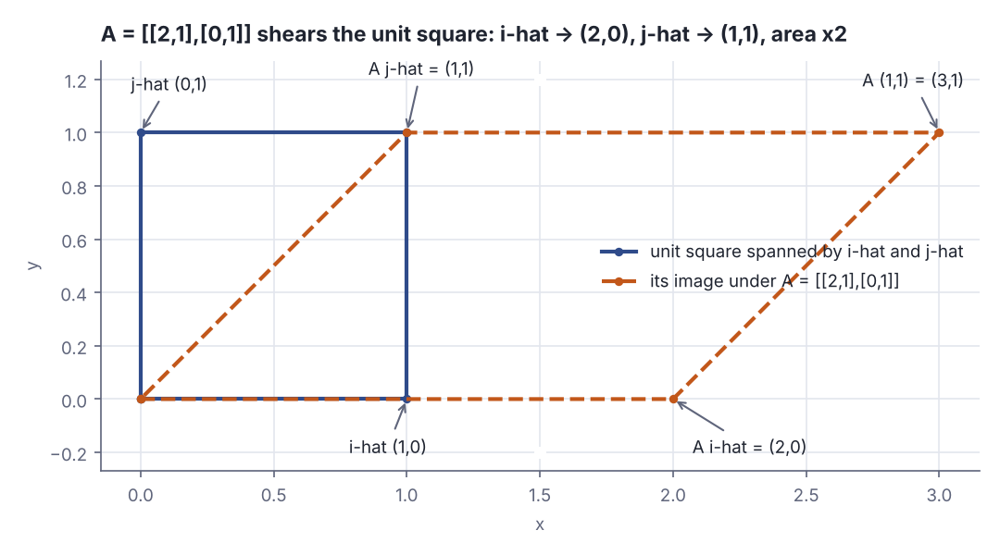
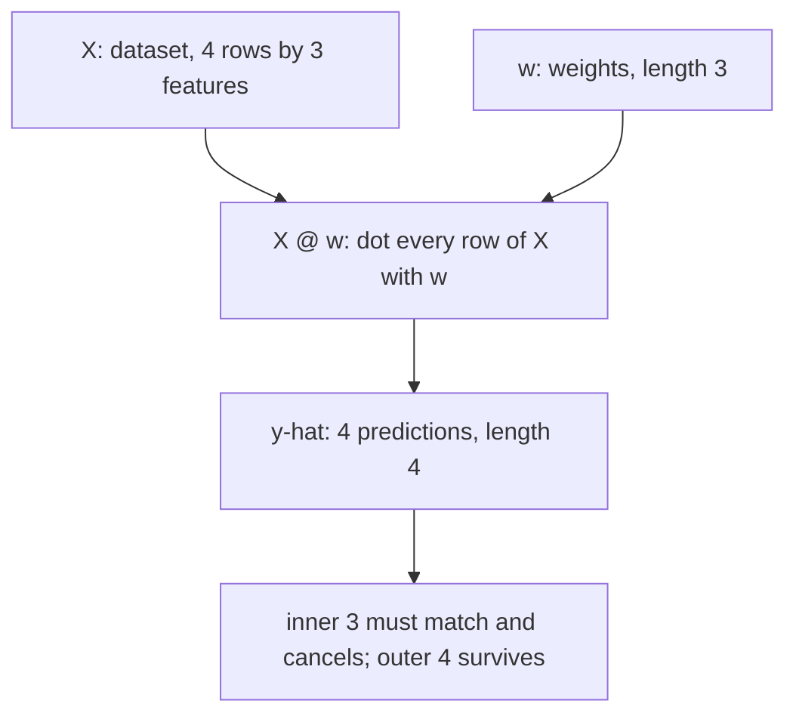
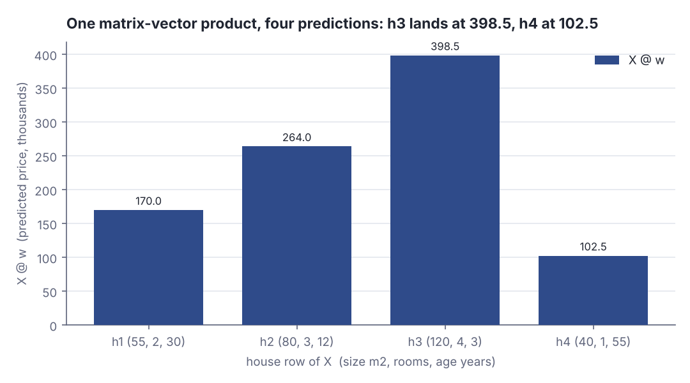

# Vectors and matrices as data

> AI / ML foundations · Beginner · ~20 min · rung 4 of 38 · needs: What machine learning actually optimises (ai-ml-01)

## Why this matters
Every model on this track — linear regression, a neural network layer, an embedding lookup — is the same two objects: a matrix of data and a vector of parameters, multiplied.
You already think in collections and types; this lesson gives you the other half of the vocabulary, the one that makes a gradient, a layer and a 768-dimensional embedding readable instead of mysterious.
It sits here because the next rungs (dot products and similarity, then gradients) are stated in this notation and in nothing else.

## The idea

A **vector**, for our purposes, is two things at once, and you need both pictures. Read as data it is a fixed-length list of numbers: one house, measured as `[size, rooms, age]`, is `Vector(80.0, 3.0, 12.0)` — a **feature vector**, where each slot has a fixed meaning. Read as geometry it is an arrow from the origin to the point those numbers name, so that house is a single point in a three-dimensional "house space" (3Blue1Brown, *Essence of linear algebra*, ch. 1 "Vectors, what even are they?"). The list view tells you what the program stores; the arrow view tells you what arithmetic on it *means*. Scaling by 3 stretches the arrow to three times its length and leaves its direction alone:

```scala
val house = Vector(80.0, 3.0, 12.0)
println(s"length ${house.length}, as a list: $house")
val arrow = Vector(2.0, 1.0)
println(s"3 * $arrow = ${arrow.map(_ * 3.0)}")
```

```text
length 3, as a list: Vector(80.0, 3.0, 12.0)
3 * Vector(2.0, 1.0) = Vector(6.0, 3.0)
```

The same `Vector[Double]` is a row of a table and an arrow in the plane; `map(_ * 3.0)` is "stretch by 3" in both readings. Nothing in the data type records which reading you meant — that is yours to keep straight.

### Linear combinations and span

Vectors support exactly two operations: add them entry by entry, and scale one by a single number. Everything in this track is built from those two. A **linear combination** of `u` and `v` is any `a*u + b*v`; the **span** of a set of vectors is the set of all points you can reach that way (3Blue1Brown, ch. 2 "Linear combinations, span, and basis vectors"). The pair `î = (1, 0)` and `ĵ = (0, 1)` — the **standard basis** — spans the whole plane, because every point `(x, y)` is exactly `x*î + y*ĵ`. Two vectors pointing along the same line span only that line, no matter how you weight them:

```scala
def scale(s: Double, a: Vector[Double]) = a.map(_ * s)
def add(a: Vector[Double], b: Vector[Double]) = a.zip(b).map((x, y) => x + y)
val i = Vector(1.0, 0.0)
val j = Vector(0.0, 1.0)
println(s"3*i + (-2)*j = ${add(scale(3.0, i), scale(-2.0, j))}")
val u = Vector(1.0, 1.0)
val v = Vector(2.0, 2.0)
println(s"3*u + (-2)*v = ${add(scale(3.0, u), scale(-2.0, v))}")
```

```text
3*i + (-2)*j = Vector(3.0, -2.0)
3*u + (-2)*v = Vector(-1.0, -1.0)
```

With the basis, the coefficients `3` and `-2` *are* the coordinates: you reach `(3.0, -2.0)`. With `u` and `v`, which both lie on the line `y = x`, you land on `(-1.0, -1.0)` — still on that line. That is a **rank** deficiency, and it is what "these two features are the same feature in different units" looks like to a model: a whole direction of the space it cannot reach.

### A matrix is a transformation, and its columns are the landing places

A **linear transformation** is a function that takes vectors to vectors while keeping the grid of space intact:

> "all lines must remain lines, without getting curved, and the origin must remain fixed in place."
> — 3Blue1Brown, *Essence of linear algebra, ch. 3 "Linear transformations and matrices"*, https://www.3blue1brown.com/lessons/linear-transformations/

That restriction buys something large. Because any vector is a linear combination of the basis vectors, and the transformation preserves scaling and addition, knowing where the basis goes fixes where everything goes:

> "It turns out, you only need to record where the two basis vectors i-hat and j-hat go, and everything else will follow."
> — 3Blue1Brown, *Essence of linear algebra, ch. 3 "Linear transformations and matrices"*, https://www.3blue1brown.com/lessons/linear-transformations/

A **matrix** is those landing places written down. For a 2×2 matrix, 3Blue1Brown reads it as one "where you can interpret the columns as the two special vectors where i-hat and j-hat land" (ch. 3). Multiplying is then bookkeeping: `A · v` means "take `v(0)` copies of column 1, plus `v(1)` copies of column 2". Take `A = [[2, 1], [0, 1]]`, stored row by row:

```scala
val a = Vector(Vector(2.0, 1.0), Vector(0.0, 1.0))
def mv(m: Vector[Vector[Double]], x: Vector[Double]) =
  m.map(row => row.zip(x).map((p, q) => p * q).sum)
println(s"i-hat -> ${mv(a, Vector(1.0, 0.0))}")
println(s"j-hat -> ${mv(a, Vector(0.0, 1.0))}")
println(s"(1,1) -> ${mv(a, Vector(1.0, 1.0))}")
```

```text
i-hat -> Vector(2.0, 0.0)
j-hat -> Vector(1.0, 1.0)
(1,1) -> Vector(3.0, 1.0)
```

`î` lands on `(2.0, 0.0)` and `ĵ` on `(1.0, 1.0)` — read down the columns of `A` and you see the same two pairs. And `(1,1) -> (3.0, 1.0)` is exactly `(2.0, 0.0) + (1.0, 1.0)`: the transformation of a sum is the sum of the transformations, which is the whole content of the word *linear*.



*Figure 1: The unit square spanned by î and ĵ, and its image under A = [[2,1],[0,1]]: î lands on (2,0), ĵ on (1,1), the far corner (1,1) on (3,1), and the area doubles. Generated from the lab output (Step 2). Adapted from 3Blue1Brown, "Linear transformations and matrices", https://www.3blue1brown.com/lessons/linear-transformations/*

### Matrix–vector products: a whole batch of predictions

Now turn the matrix back into data. Stack `n` feature vectors as the rows of a matrix `X` with `n` rows and `d` columns — an `n×d` matrix — and put a weight vector `w` of length `d` beside it. The product `X · w` (written `X @ w` in most ML code) takes each row of `X`, multiplies it entry by entry with `w`, and sums: one number per row. That single expression *is* a linear model evaluated on the whole dataset.



*Figure 2: The shape bookkeeping of a batch prediction: (4x3) against (3) leaves (4). Source: the lab in this lesson, Step 1.*

The shape rule generalises: `(n×d) · (d×k)` is legal only when the inner numbers match, and the result is `n×k`. A matrix–vector product is the case `k = 1`. A matrix–matrix product is the same operation done `k` times side by side, and it is also how two transformations compose: `B · A` means "apply `A`, then `B`". With `X` of four houses and `w = Vector(3.0, 10.0, -0.5)`:



*Figure 3: One `X @ w` produces all four predictions at once — 170.0, 264.0, 398.5 and 102.5 thousand. Generated from the lab output (Step 1).*

### Shapes are the daily reality

Almost every error you will hit in this track is a shape error, and it is nearly always an off-by-one in your mental model rather than in your maths: features in the wrong order, a bias column you forgot to add, a transposed matrix. Here you check shapes by hand with a `require`, which fails loudly at the boundary instead of silently truncating. Later, when tensors arrive in rung 14, libraries add **broadcasting** — a rule that quietly stretches a length-1 axis to match its neighbour — and that convenience is exactly what turns a shape bug into a wrong number instead of an exception. Learning to read shapes now is cheap insurance.

## Lab

Does one matrix–vector product really give you a whole batch of predictions, is a matrix really pinned down by where it sends the basis vectors, and what does a shape mismatch look like when you catch it yourself?

### Step 1 — a dataset is a matrix; a linear model is a matrix–vector product

`dot` and `matVec` are the only two helpers needed, and each carries its own `require` as a shape check. `X` holds four houses measured as `[size m², rooms, age years]`; `w = Vector(3.0, 10.0, -0.5)` prices a square metre at 3, a room at 10 and charges half a unit per year of age.

```scala
// file: Lab.scala
@main def lab(): Unit =
  def dot(a: Vector[Double], b: Vector[Double]): Double =
    require(a.length == b.length, s"dot: left has ${a.length} entries, right has ${b.length}")
    a.zip(b).map((x, y) => x * y).sum

  def matVec(m: Vector[Vector[Double]], v: Vector[Double]): Vector[Double] =
    require(m.forall(_.length == v.length),
      s"matVec: matrix is ${m.length}x${m.head.length}, vector has ${v.length} entries")
    m.map(row => dot(row, v))

  val names = Vector("h1", "h2", "h3", "h4")
  val X = Vector(
    Vector( 55.0, 2.0, 30.0),
    Vector( 80.0, 3.0, 12.0),
    Vector(120.0, 4.0,  3.0),
    Vector( 40.0, 1.0, 55.0))
  val w = Vector(3.0, 10.0, -0.5)
  println(s"X is ${X.length}x${X.head.length} (rows=houses, cols=[size, rooms, age]), w has ${w.length} entries")
  val yhat = matVec(X, w)
  for k <- X.indices do
    val r = X(k)
    println(f"  ${names(k)}  size=${r(0)}%5.1f rooms=${r(1)}%3.1f age=${r(2)}%4.1f  |  3*${r(0)}%.1f + 10*${r(1)}%.1f + (-0.5)*${r(2)}%.1f = ${yhat(k)}%6.1f")
  println(s"  X @ w = $yhat    (shape: (4x3) against (3) -> (4))")
```

```text
X is 4x3 (rows=houses, cols=[size, rooms, age]), w has 3 entries
  h1  size= 55.0 rooms=2.0 age=30.0  |  3*55.0 + 10*2.0 + (-0.5)*30.0 =  170.0
  h2  size= 80.0 rooms=3.0 age=12.0  |  3*80.0 + 10*3.0 + (-0.5)*12.0 =  264.0
  h3  size=120.0 rooms=4.0 age= 3.0  |  3*120.0 + 10*4.0 + (-0.5)*3.0 =  398.5
  h4  size= 40.0 rooms=1.0 age=55.0  |  3*40.0 + 10*1.0 + (-0.5)*55.0 =  102.5
  X @ w = Vector(170.0, 264.0, 398.5, 102.5)    (shape: (4x3) against (3) -> (4))
```

### Step 2 — a matrix is a transformation, and its columns are where î and ĵ land

Same `matVec`, different matrix: `A = [[2, 1], [0, 1]]` stored as two rows. Apply it to `î`, to `ĵ`, to `(1, 1)`, and to the four corners of the unit square.

```scala
// file: Basis.scala
@main def basis(): Unit =
  def dot(a: Vector[Double], b: Vector[Double]): Double =
    require(a.length == b.length, s"dot: left has ${a.length} entries, right has ${b.length}")
    a.zip(b).map((x, y) => x * y).sum

  def matVec(m: Vector[Vector[Double]], v: Vector[Double]): Vector[Double] =
    require(m.forall(_.length == v.length),
      s"matVec: matrix is ${m.length}x${m.head.length}, vector has ${v.length} entries")
    m.map(row => dot(row, v))

  val A = Vector(Vector(2.0, 1.0), Vector(0.0, 1.0))   // the rows of [[2,1],[0,1]]
  val iHat = Vector(1.0, 0.0)
  val jHat = Vector(0.0, 1.0)
  val ai = matVec(A, iHat)
  val aj = matVec(A, jHat)
  println(s"  i-hat (1.0,0.0) -> $ai   = column 1 of A")
  println(s"  j-hat (0.0,1.0) -> $aj   = column 2 of A")
  val a11 = matVec(A, Vector(1.0, 1.0))
  val sumImg = ai.zip(aj).map((x, y) => x + y)
  println(s"  (1.0,1.0) -> $a11 ;  A*i-hat + A*j-hat = $sumImg ;  equal = ${a11 == sumImg}")
  println("  unit square corners and their images:")
  val square = Vector(Vector(0.0, 0.0), Vector(1.0, 0.0), Vector(1.0, 1.0), Vector(0.0, 1.0), Vector(0.0, 0.0))
  for c <- square do println(s"    ${c.mkString("(", ", ", ")")} -> ${matVec(A, c).mkString("(", ", ", ")")}")
  println(s"  area scale (2*1 - 1*0) = ${A(0)(0) * A(1)(1) - A(0)(1) * A(1)(0)}")
```

```text
  i-hat (1.0,0.0) -> Vector(2.0, 0.0)   = column 1 of A
  j-hat (0.0,1.0) -> Vector(1.0, 1.0)   = column 2 of A
  (1.0,1.0) -> Vector(3.0, 1.0) ;  A*i-hat + A*j-hat = Vector(3.0, 1.0) ;  equal = true
  unit square corners and their images:
    (0.0, 0.0) -> (0.0, 0.0)
    (1.0, 0.0) -> (2.0, 0.0)
    (1.0, 1.0) -> (3.0, 1.0)
    (0.0, 1.0) -> (1.0, 1.0)
    (0.0, 0.0) -> (0.0, 0.0)
  area scale (2*1 - 1*0) = 2.0
```

### Step 3 — the shape error you will meet daily

Hand `matVec` a length-2 vector against the 4×3 house matrix. The `require` fires; the `catch` keeps the script's exit code at 0 so you can read the message rather than a stack trace.

```scala
// file: Shape.scala
@main def shape(): Unit =
  def dot(a: Vector[Double], b: Vector[Double]): Double =
    require(a.length == b.length, s"dot: left has ${a.length} entries, right has ${b.length}")
    a.zip(b).map((x, y) => x * y).sum

  def matVec(m: Vector[Vector[Double]], v: Vector[Double]): Vector[Double] =
    require(m.forall(_.length == v.length),
      s"matVec: matrix is ${m.length}x${m.head.length}, vector has ${v.length} entries")
    m.map(row => dot(row, v))

  val X = Vector(
    Vector( 55.0, 2.0, 30.0),
    Vector( 80.0, 3.0, 12.0),
    Vector(120.0, 4.0,  3.0),
    Vector( 40.0, 1.0, 55.0))
  try
    val bad = matVec(X, Vector(3.0, 10.0))
    println(s"  unreachable: $bad")
  catch
    case e: IllegalArgumentException => println(s"  shape error: ${e.getMessage}")
```

```text
  shape error: requirement failed: matVec: matrix is 4x3, vector has 2 entries
```

Run all three with `python3 dojo/engine/run_lab.py 2026-10-17-1`.

### Reading the output

**Step 1 — four predictions from one product.** Each row of `X` is one house; each column is one feature, in the fixed order `[size, rooms, age]`. `w` holds one weight per column, so the `i`-th entry of the result is the dot product of row `i` with `w`.

| row | size (m²) | rooms | age (y) | arithmetic | `X @ w` |
|-----|-----------|-------|---------|------------|---------|
| h1 | 55.0 | 2.0 | 30.0 | 165.0 + 20.0 − 15.0 | **170.0** |
| h2 | 80.0 | 3.0 | 12.0 | 240.0 + 30.0 − 6.0 | **264.0** |
| h3 | 120.0 | 4.0 | 3.0 | 360.0 + 40.0 − 1.5 | **398.5** |
| h4 | 40.0 | 1.0 | 55.0 | 120.0 + 10.0 − 27.5 | **102.5** |

Trace h3 by hand: `3.0 × 120.0 = 360.0`; `10.0 × 4.0 = 40.0`; `−0.5 × 3.0 = −1.5`; `360.0 + 40.0 − 1.5 = 398.5`, which is what the program printed. Higher is "more expensive", and the spread (102.5 to 398.5, a factor of 3.9) is driven almost entirely by the `size` column, because its weight is applied to numbers in the tens and hundreds while `rooms` is applied to single digits. No direction here is "better" — what matters is that one expression produced all four numbers and the shapes lined up: `(4×3)` against `(3)` gives `(4)`, one prediction per row.

**Verdict:** a linear model on a batch is literally `X @ w`; the output length equals the number of rows, and the weight vector's length must equal the number of features.

**Step 2 — the columns are the landing places, and linearity is checkable.** `A = [[2, 1], [0, 1]]`. Its first column is `(2, 0)` and its second is `(1, 1)`.

| input | output | what it is |
|-------|--------|------------|
| î = (1.0, 0.0) | (2.0, 0.0) | column 1 of `A` |
| ĵ = (0.0, 1.0) | (1.0, 1.0) | column 2 of `A` |
| (1.0, 1.0) | (3.0, 1.0) | = (2.0, 0.0) + (1.0, 1.0) |
| area of the unit square, 1.0 | 2.0 | `2·1 − 1·0`, the determinant |

Trace `(1, 1)` by hand with the rows: row 1 is `(2, 1)`, so `2×1 + 1×1 = 3`; row 2 is `(0, 1)`, so `0×1 + 1×1 = 1`. Result `(3.0, 1.0)`, and `equal = true` confirms it is the sum of the two basis images — you never need to re-derive a linear map, you only need its columns. The square's corners `(0,0), (1,0), (1,1), (0,1)` map to `(0,0), (2,0), (3,1), (1,1)`, the parallelogram in Figure 1, and the area goes from 1.0 to 2.0.

**Verdict:** write down where î and ĵ land and you have written down the matrix; a bigger determinant means the transformation stretches area more, and 0 would mean it collapses the plane onto a line.

**Step 3 — the failure you want.** The message names both shapes: `matrix is 4x3, vector has 2 entries`. That is the good case — the mismatch is reported at the boundary, with both operands' dimensions, before any arithmetic happened.

**Verdict:** a `require` that prints both shapes turns a silent wrong answer into a one-line diagnosis; this is the cheapest invariant in numerical code.

### Cause → mechanism → consequence → practice

1. **Cause.** A linear model assigns one weight to each feature, and a dataset stores one row per example with features always in the same column order.
2. **Mechanism.** The dot product of a row with the weight vector sums `feature × weight` across the `d` columns; stacking `n` such dot products is the matrix–vector product `X @ w`, which consumes the shared dimension `d` and leaves `n`.
3. **Consequence.** The only legal pairings are those whose inner dimensions match, so shape is a type system the compiler does not check for you: `(4×3)` with a length-3 vector works and yields four numbers, `(4×3)` with a length-2 vector cannot mean anything and must fail.
4. **In practice.** Write the shape of every array in a comment or an assertion as you build a pipeline — `X: (n, d)`, `w: (d,)`, `y: (n,)` — and put the check at the entry of each helper. When broadcasting arrives in rung 14, that habit is what stops a stretched axis from producing a plausible but wrong number instead of an error.

## Self-check
1. `X` has 200 rows and 8 columns. Which products are legal — `X · w` with `w` of length 8, `X · w` with `w` of length 200, or `W · X` with `W` of shape 3×8 — and what shape does each legal one produce? <details><summary>Answer</summary>Only inner dimensions that match are legal. `X · w` with `w` of length 8 is legal: `(200×8)` against `(8)` gives `(200)`, one prediction per row. `X · w` with `w` of length 200 is illegal — the inner numbers are 8 and 200. `W · X` with `W` of shape 3×8 is illegal as written, since 8 ≠ 200; `W · Xᵀ`, that is `(3×8)` against `(8×200)`, is legal and gives `3×200`.</details>
2. A 2×2 matrix sends î to `(0, 1)` and ĵ to `(-1, 0)`. Write the matrix, and say where `(2, 3)` lands — without doing any new multiplication. <details><summary>Answer</summary>The columns are the landing places, so the matrix is `[[0, -1], [1, 0]]` (first column `(0, 1)`, second column `(-1, 0)`) — a 90° rotation. By linearity, `(2, 3) = 2·î + 3·ĵ` lands on `2·(0, 1) + 3·(-1, 0) = (-3, 2)`.</details>
3. Two of your feature columns are `area_m2` and `area_ft2`, one a fixed multiple of the other. In span terms, what has gone wrong, and why does it matter for fitting weights? <details><summary>Answer</summary>The two column vectors are scalar multiples of each other, so together they span a line rather than a plane: the data matrix has fewer independent directions than columns (it is rank-deficient). Any increase in one weight can be exactly cancelled by a decrease in the other, so infinitely many weight pairs give identical predictions — the individual weights become meaningless and numerically unstable, even though the predictions are fine.</details>

## Sources
- [3Blue1Brown — Essence of Linear Algebra](https://www.3blue1brown.com/topics/linear-algebra) — Grant Sanderson, 3Blue1Brown — the series index; ch. 1 "Vectors, what even are they?" for the list-versus-arrow pair, ch. 2 "Linear combinations, span, and basis vectors" for span and the standard basis, ch. 3 "Linear transformations and matrices" for columns as landing places (accessed 2026-10-17)
- [3Blue1Brown — Linear transformations and matrices (ch. 3)](https://www.3blue1brown.com/lessons/linear-transformations/) — Grant Sanderson, 3Blue1Brown — the chapter page quoted above: the definition of a linear transformation, the claim that the basis vectors determine everything, and reading a matrix's columns as where î and ĵ land (accessed 2026-10-17)
- [Khan Academy — Linear algebra](https://www.khanacademy.org/math/linear-algebra) — Khan Academy — unit "Vectors and spaces" → lesson "Vectors" for vector addition and scalar multiplication drilled numerically, and unit "Matrix transformations" → lesson "Functions and linear transformations" for the transformation-as-function framing used in Step 2 (accessed 2026-10-17)

## Next on this track
Next on AI / ML foundations: **Dot products and similarity** (rung 5 of 38, Beginner).
