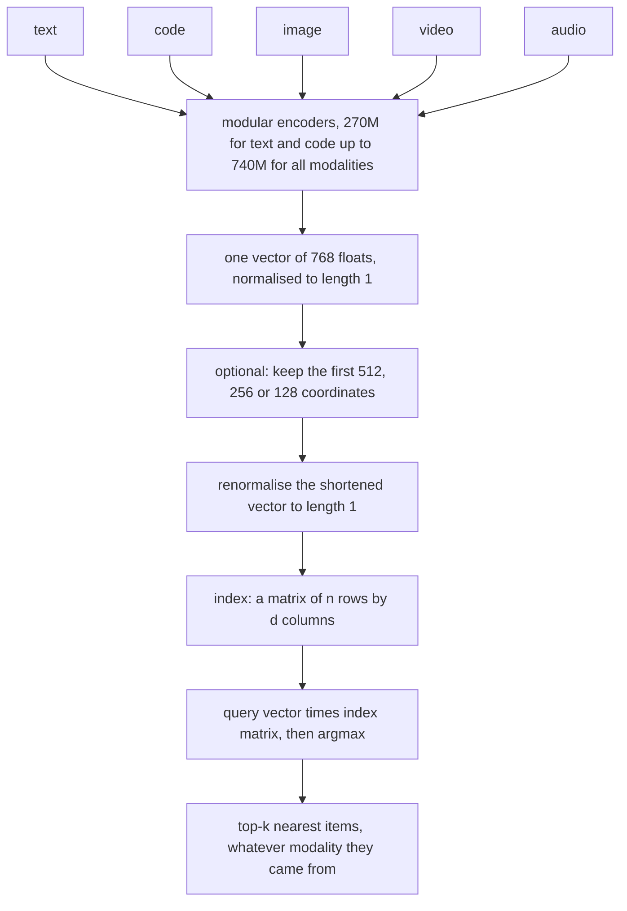
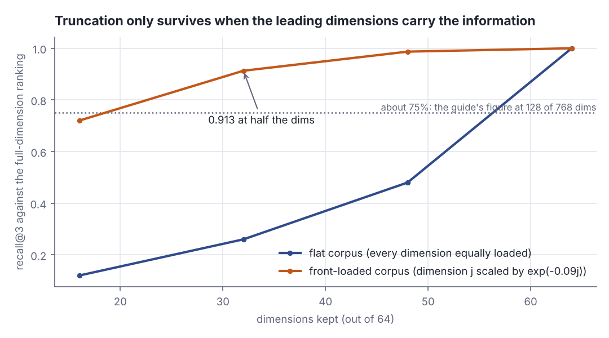
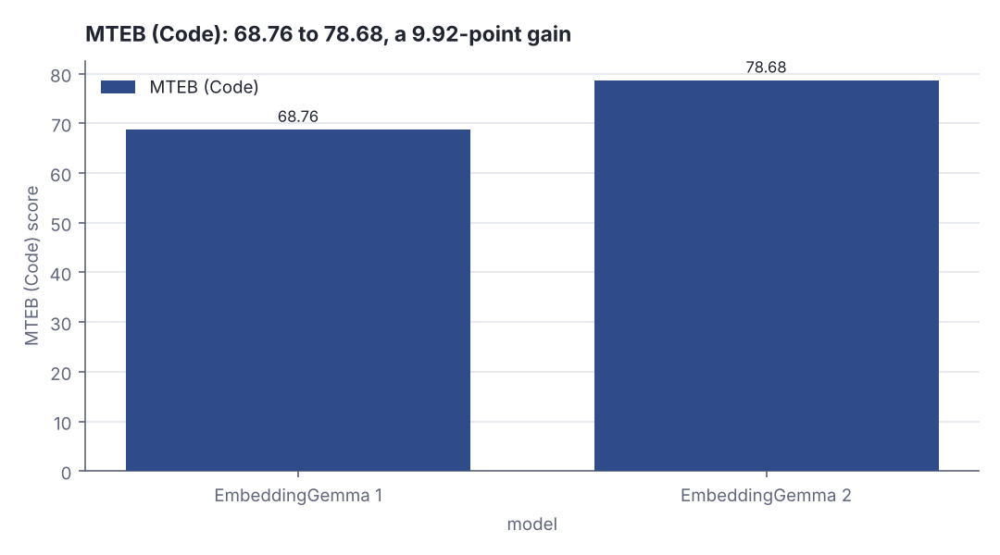
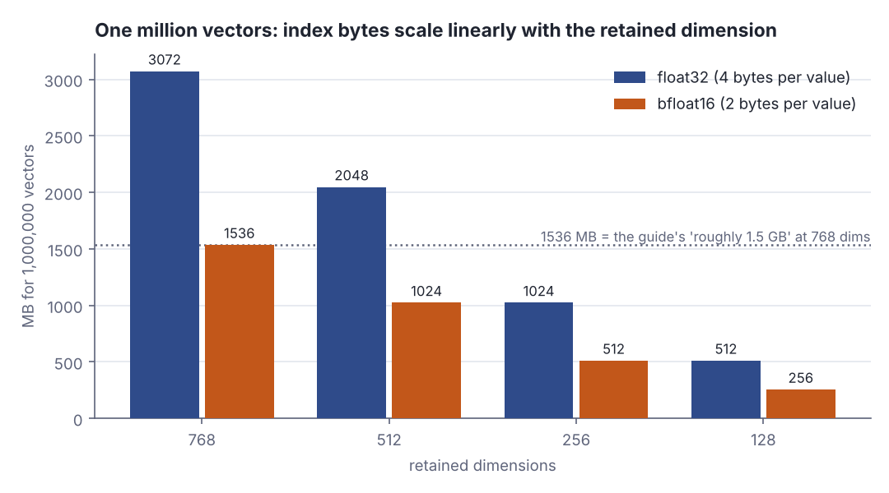

# EmbeddingGemma 2: one 768-dimensional space for text, code, images, video and audio

> Fresh · AI / ML foundations · Intermediate · ~25 min · from today's feeds

## Why this matters
On 2026-10-06 Google DeepMind published EmbeddingGemma 2, an openly licensed embedding model that turns text, code, images, video and audio into vectors in one shared 768-dimensional coordinate system, and that is small enough to run on a phone.
Today's core rung said a row of features is a vector and a dataset is a matrix; an embedding model is the machine that produces those rows for data that has no obvious features, and retrieval over them is literally a matrix–vector product followed by an argmax.
You will not train this model, but if you put it behind a search endpoint you own the index: its byte size, its RAM, its latency and its failure modes are all consequences of arithmetic you can do on a napkin, and this lesson does it.

## Primer
A **vector** here is an ordered list of real numbers — `Vector(0.21, -0.04, 0.77, ...)` — and its **dimension** is how many numbers are in the list. Today's core rung, *Vectors and matrices as data*, treats one row of features as a vector and a whole dataset as a matrix of `n` rows by `d` columns. An embedding is exactly such a row; a corpus of embeddings is exactly such a matrix.

The **dot product** of two vectors multiplies them coordinate by coordinate and adds the results: `dot(a, b) = a1*b1 + a2*b2 + ... + ad*bd`. A single number comes out. The **length** (or norm) of a vector is `‖a‖ = sqrt(dot(a, a))` — the Pythagorean theorem in `d` dimensions. A **unit vector** is one whose length is exactly 1; dividing every coordinate by `‖a‖` produces one, and that operation is called **normalising**.

**Cosine similarity** is `dot(a, b) / (‖a‖ * ‖b‖)`. It equals the cosine of the angle between the two vectors seen as arrows from the origin: `+1` means same direction, `0` perpendicular, `-1` opposite. It ignores length entirely and measures only direction. When both vectors are already unit length the denominator is 1, so cosine similarity *is* the plain dot product — which is why vector stores keep unit vectors and why this model's API exposes a `normalize_embeddings` flag (Grootendorst and Ballantyne, *EmbeddingGemma 2: The Developer Guide*, 2026-10-06).

**Training an encoder** means this: an encoder is a neural network that eats one input — a sentence, a source file, an image — and emits a fixed-length vector. Training adjusts its weights so that pairs that *should* match (a question and its answer, a function and its docstring, a photo and its caption) come out at a small angle, and unrelated pairs come out at a wide one. It is the same "minimise a loss over labelled examples" machinery as the first rung of this track; only the loss is defined over *pairs* rather than single predictions. Nothing inside the output vector is human-readable: coordinate 37 means nothing on its own. A vector's only meaning is the angles it makes with other vectors produced by the same model.

## The idea
### One model, five kinds of input, one coordinate system

The developer guide describes EmbeddingGemma 2 as a model that

> "maps text, code, images, video, and audio into a unified 768-dimensional space"
> — Maarten Grootendorst and Ian Ballantyne, *EmbeddingGemma 2: The Developer Guide*, Google Developers Blog, 2026-10-06, https://developers.googleblog.com/embeddinggemma-2-the-developer-guide/

"Unified" is doing the work. It does not mean the model captions a video and embeds the caption; it means that whichever modality goes in, the output is 768 numbers in the *same* coordinate system, so a text query can rank images and an audio clip can rank source files, with no translation step anywhere. Of embeddings produced from different modalities the guide says

> "their resulting embeddings occupy the same dimensional space"
> — Maarten Grootendorst and Ian Ballantyne, *EmbeddingGemma 2: The Developer Guide*, Google Developers Blog, 2026-10-06, https://developers.googleblog.com/embeddinggemma-2-the-developer-guide/

The model is modular, "scaling from 270M parameters for text and code up to 740M parameters for all modalities" (Grootendorst and Ballantyne, *The Developer Guide*, 2026-10-06), so a text-and-code-only deployment loads far less than a full multimodal one. The full model is deliberately small:

> "EmbeddingGemma 2 has 740 million parameters, making it optimal for on-device inference."
> — Sahil Dua and Henrique Schechter Vera, *EmbeddingGemma 2: an open, lightweight multimodal embedding model*, Google, 2026-10-06, https://blog.google/innovation-and-ai/technology/developers-tools/embeddinggemma-2/


*Figure 1: how an input of any of the five modalities becomes a row of the search index, and how a query is answered. Source: drawn from the mechanism described in Grootendorst and Ballantyne, "EmbeddingGemma 2: The Developer Guide", 2026-10-06.*

### Why the vectors must be normalised before you compare them

Cosine similarity throws length away on purpose. Rank by the raw dot product instead and long vectors win merely for being long:

```scala
val a = Vector(3.0, 0.0, 4.0)
val b = Vector(1.0, 0.0, 0.0)
val c = Vector(0.9, 0.0, 0.1)
def dot(x: Vector[Double], y: Vector[Double]) = x.zip(y).map(p => p._1 * p._2).sum
def unit(x: Vector[Double]) = { val n = math.sqrt(dot(x, x)); x.map(_ / n) }
def cos(x: Vector[Double], y: Vector[Double]) = dot(unit(x), unit(y))
println(f"dot(a,b)=${dot(a, b)}%.4f   dot(c,b)=${dot(c, b)}%.4f")
println(f"cos(a,b)=${cos(a, b)}%.4f   cos(c,b)=${cos(c, b)}%.4f")
```

```text
dot(a,b)=3.0000   dot(c,b)=0.9000
cos(a,b)=0.6000   cos(c,b)=0.9939
```

The raw dot product ranks `a` above `c` (3.0 against 0.9) because `a` is five units long while `c` is about 0.906. The cosine ranks `c` far above `a` (0.9939 against 0.6000) because `c` points almost along the query direction. Same vectors, opposite answers: the metric is the decision. The developer guide shows the API called as `model.similarity(...)` but does not name the metric that call computes, so rely on the geometry above, not on the method name.

### Matryoshka truncation: pay less, keep most of the ranking

The 768 numbers are nested rather than interchangeable. The model is trained with Matryoshka Representation Learning, which, in the guide's words, "enables dynamic truncation from 768 dimensions down to 128 dimensions" (Grootendorst and Ballantyne, *The Developer Guide*, 2026-10-06): you keep a prefix and throw the rest away. The documented way to do it:

> "Pass `truncate_dim` (`512`, `256`, or `128`) with `normalize_embeddings=True` to get shorter, unit-length vectors."
> — Maarten Grootendorst and Ian Ballantyne, *EmbeddingGemma 2: The Developer Guide*, Google Developers Blog, 2026-10-06, https://developers.googleblog.com/embeddinggemma-2-the-developer-guide/

The renormalisation is not decoration: chopping coordinates off a unit vector leaves something shorter than 1, and the cosine is only meaningful once both prefixes are unit length again. Truncated scores are also not comparable with full-length ones, and can move either way:

```scala
val q8 = Vector(0.5, 0.5, 0.5, 0.5, 0.1, 0.1, 0.1, 0.1)
val d8 = Vector(0.4, 0.6, 0.5, 0.4, 0.9, -0.2, 0.0, 0.1)
println(f"full 8-d cosine        = ${cos(q8, d8)}%.4f")
println(f"first 4 dims, renormed = ${cos(q8.take(4), d8.take(4))}%.4f")
```

```text
full 8-d cosine        = 0.7549
first 4 dims, renormed = 0.9851
```

Truncation here *raised* the similarity from 0.7549 to 0.9851, because the four discarded coordinates were exactly where the two vectors disagreed. A threshold tuned at 768 dimensions is therefore wrong at 256, in an unpredictable direction: compare rankings, not absolute scores, across dimension counts.

Nothing about prefixes is magic: if every coordinate carries an equal share of the information, a prefix is just data loss. Matryoshka training is what front-loads the signal into the early coordinates, and the lab measures the difference. In a 64-dimensional simulation below, a flat corpus keeps only 0.480 recall@3 when three quarters of the dimensions survive, while a front-loaded corpus keeps 0.987 — and 0.913 at half the dimensions.



*Figure 2: recall@3 against the full-dimension ranking as dimensions are dropped, for synthetic vectors with information spread evenly (blue) and concentrated in the leading coordinates (orange). Source: Step 3 of this lesson's lab, `python3 dojo/engine/run_lab.py 2026-10-17-2`; the 75% reference line is the guide's reported retention at 128 of 768 dimensions (Grootendorst and Ballantyne, 2026-10-06).*

For the real model, the guide reports keeping "about 95% on image, video, and speech retrieval" at 256 dimensions, and at 128 dimensions says "image, video, and speech retrieval quality drop to around 75%" (Grootendorst and Ballantyne, *The Developer Guide*, 2026-10-06). The trade-off in one line: a sixth of the bytes for roughly three quarters of the retrieval quality.

### The benchmark that moved, and why code people care

The headline benchmark here is code retrieval: on MTEB (Code) the score rose 9.92 points, "from 68.76 to 78.68" (Dua and Schechter Vera, *EmbeddingGemma 2*, 2026-10-06), which the developer guide frames as "EmbeddingGemma 2 scores 14% higher than EmbeddingGemma 1 on MTEB (Code)" (Grootendorst and Ballantyne, 2026-10-06).



*Figure 3: the reported MTEB (Code) scores for the two model generations. Adapted from Sahil Dua and Henrique Schechter Vera, "EmbeddingGemma 2: an open, lightweight multimodal embedding model", 2026-10-06, https://blog.google/innovation-and-ai/technology/developers-tools/embeddinggemma-2/*

### What this costs you to run

Three numbers decide whether this runs on a server or on the device. Storage: "storing a million 768-dimensional vectors takes roughly 1.5 GB of memory" (Grootendorst and Ballantyne, 2026-10-06), which the lab reproduces exactly at two bytes per value. Weights:

> "requires as little as ~191MB active RAM for text-only weights and ~567MB for the full multimodal model."
> — Sahil Dua and Henrique Schechter Vera, *EmbeddingGemma 2: an open, lightweight multimodal embedding model*, Google, 2026-10-06, https://blog.google/innovation-and-ai/technology/developers-tools/embeddinggemma-2/

And licence: "released under the Apache 2.0 license" (Grootendorst and Ballantyne, 2026-10-06), so the privacy argument is something you can verify rather than a vendor promise —

> "Generating embeddings locally helps ensure data privacy, reduces pipeline latency, and empowers developers"
> — Sahil Dua and Henrique Schechter Vera, *EmbeddingGemma 2: an open, lightweight multimodal embedding model*, Google, 2026-10-06, https://blog.google/innovation-and-ai/technology/developers-tools/embeddinggemma-2/

Four ways this breaks in production: comparing a 768-dimensional score against a threshold tuned at 256; forgetting to renormalise after truncating; truncating to 128 where the published retention is already about 75%; and — the silent one — mixing vectors from two models or two model versions in one index, because "the same dimensional space" is a property of one trained model, not of the number 768.

## Lab
**Question the lab answers:** if you truncate embeddings to save index bytes, how much of the original ranking actually survives, and how many bytes do you actually save?

These are **synthetic vectors**, not EmbeddingGemma 2 output — the container has no model weights and no Hugging Face access. The simulation proves facts about the *geometry*: how cosine similarity behaves under truncation and renormalisation, and what index bytes cost. It proves nothing about EmbeddingGemma 2's measured quality; for that, the published retention figures quoted above are the evidence.

### Step 1 — the program

```scala
// file: Lab.scala
import scala.util.Random

type Vec = Vector[Double]

def dot(x: Vec, y: Vec): Double = x.zip(y).map(p => p._1 * p._2).sum
def norm(x: Vec): Double = math.sqrt(dot(x, x))
def unit(x: Vec): Vec = { val n = norm(x); x.map(_ / n) }
def cos(x: Vec, y: Vec): Double = dot(unit(x), unit(y))

def ranks(s: Vector[Double]): Vector[Int] =
  val order = s.indices.sortBy(i => -s(i))
  val r = Array.fill(s.length)(0)
  for (idx, pos) <- order.zipWithIndex do r(idx) = pos + 1
  r.toVector

def topK(s: Vector[Double], k: Int): Set[Int] = s.indices.sortBy(i => -s(i)).take(k).toSet

val names = Vector(
  "text:README.md", "code:Parser.scala", "image:arch.png", "video:demo.mp4",
  "audio:talk.wav", "text:SPEC.md", "code:Index.scala", "image:chart.png")

@main def lab(): Unit =
  val rnd = Random(42)
  val D = 16

  // ---- Step 1: eight synthetic 16-d unit vectors standing in for real 768-d embeddings
  val docs: Vector[Vec] = names.map(_ => unit(Vector.fill(D)(rnd.nextGaussian())))
  val query: Vec = unit(
    docs(2).zip(docs(5)).map(p => 0.70 * p._1 + 0.30 * p._2)
      .zip(Vector.fill(D)(rnd.nextGaussian())).map(p => p._1 + 0.15 * p._2))

  println("STEP 1 -- full 16-d space, cosine of query against each document")
  println("doc                 ||d||   dot(q,d)   cosine   rank")
  val full = docs.map(d => cos(query, d))
  val fullRank = ranks(full)
  for i <- names.indices do
    println(f"${names(i)}%-18s ${norm(docs(i))}%5.3f  ${dot(query, docs(i))}%+8.4f ${full(i)}%+8.4f" +
      f"     ${fullRank(i)}%d")
  println("ranking: " + full.indices.sortBy(i => -full(i)).map(i => names(i)).mkString(" > "))
  println()

  // ---- Step 2: truncate, renormalise, re-rank
  val ks = Vector(12, 8, 4)
  println("STEP 2 -- truncate to k dims, renormalise, re-rank")
  for k <- ks do
    val tq = query.take(k)
    val cosK = docs.map(d => cos(tq, d.take(k)))
    val rawK = docs.map(d => dot(tq, d.take(k)))
    val rK = ranks(cosK)
    val rRaw = ranks(rawK)
    println(s"--- k = $k of 16 ---")
    println("doc                 ||d[:k]||   cos_k  delta_cos  rank_k  was  raw_rank")
    for i <- names.indices do
      println(f"${names(i)}%-18s   ${norm(docs(i).take(k))}%5.3f ${cosK(i)}%+7.4f   ${cosK(i) - full(i)}%+7.4f" +
        f"      ${rK(i)}%d     ${fullRank(i)}%d      ${rRaw(i)}%d")
    val r3 = topK(cosK, 3).intersect(topK(full, 3)).size / 3.0
    val r3raw = topK(rawK, 3).intersect(topK(full, 3)).size / 3.0
    val shift = names.indices.map(i => math.abs(cosK(i) - full(i))).sum / names.size
    val rankMove = names.indices.map(i => math.abs(rK(i) - fullRank(i))).sum.toDouble / names.size
    println(f"k=$k%-3d recall@3=${r3}%.3f  mean|delta_cos|=${shift}%.4f  mean|rank move|=${rankMove}%.2f" +
      f"  recall@3 without renorm=${r3raw}%.3f")
    println()

  // ---- Step 3: same geometry, bigger corpus; flat vectors vs front-loaded vectors
  val bigD = 64
  val flatDocs = Vector.fill(200)(unit(Vector.fill(bigD)(rnd.nextGaussian())))
  val scale = Vector.tabulate(bigD)(j => math.exp(-0.09 * j))
  val mrlDocs = flatDocs.map(d => unit(d.zip(scale).map(p => p._1 * p._2)))
  def makeQueries(corpus: Vector[Vec]) = Vector.fill(50) {
    val base = corpus(rnd.nextInt(corpus.size))
    unit(base.zip(Vector.fill(bigD)(rnd.nextGaussian())).map(p => p._1 + 0.45 * p._2))
  }
  def report(label: String, corpus: Vector[Vec]): Unit =
    val queries = makeQueries(corpus)
    println(s"$label: 200 docs x 64 dims, 50 queries, averaged")
    println("kept   dims  recall@1  recall@3  recall@10  mean|rank move|  recall@3 no renorm")
    for k <- Vector(64, 48, 32, 16) do
      var a1, a3, a10, mv, a3raw = 0.0
      for q <- queries do
        val f = corpus.map(d => cos(q, d))
        val t = corpus.map(d => cos(q.take(k), d.take(k)))
        val raw = corpus.map(d => dot(q.take(k), d.take(k)))
        a1 += topK(t, 1).intersect(topK(f, 1)).size / 1.0
        a3 += topK(t, 3).intersect(topK(f, 3)).size / 3.0
        a10 += topK(t, 10).intersect(topK(f, 10)).size / 10.0
        a3raw += topK(raw, 3).intersect(topK(f, 3)).size / 3.0
        val rf = ranks(f); val rt = ranks(t)
        mv += corpus.indices.map(i => math.abs(rf(i) - rt(i))).sum.toDouble / corpus.size
      val n = queries.size.toDouble
      println(f"${k * 100 / bigD}%3d%%  ${k}%4d     ${a1 / n}%.3f     ${a3 / n}%.3f      ${a10 / n}%.3f" +
        f"          ${mv / n}%6.2f              ${a3raw / n}%.3f")
    println()
  println("STEP 3 -- does truncation survive on a bigger corpus?")
  report("A flat corpus, every dimension equally loaded", flatDocs)
  report("B front-loaded corpus, dimension j scaled by exp(-0.09j)", mrlDocs)

  // ---- Step 4: index size arithmetic for one million vectors
  println("STEP 4 -- index size for 1,000,000 vectors")
  println("   d   bytes float32    MB f32   bytes bf16    MB bf16    GB bf16")
  val n = 1000000L
  for d <- Vector(768, 512, 256, 128) do
    val b32 = n * d * 4L
    val b16 = n * d * 2L
    println(f"$d%4d   ${b32}%13d   ${b32 / 1e6}%6.1f   ${b16}%12d   ${b16 / 1e6}%6.1f    ${b16 / 1e9}%6.3f")
  val bf768 = n * 768L * 2L
  println(f"check: 1000000 x 768 x 2 bytes = ${bf768}%d bytes = ${bf768 / 1e9}%.3f GB")
  println(f"768 -> 128 dims shrinks the index ${768.0 / 128.0}%.1fx")
  println()

  // ---- Step 5: the two short examples used in The idea
  println("STEP 5 -- the two short examples from The idea")
  val a = Vector(3.0, 0.0, 4.0)
  val b = Vector(1.0, 0.0, 0.0)
  val c = Vector(0.9, 0.0, 0.1)
  println(f"dot(a,b)=${dot(a, b)}%.4f   dot(c,b)=${dot(c, b)}%.4f")
  println(f"cos(a,b)=${cos(a, b)}%.4f   cos(c,b)=${cos(c, b)}%.4f")
  val q8 = Vector(0.5, 0.5, 0.5, 0.5, 0.1, 0.1, 0.1, 0.1)
  val d8 = Vector(0.4, 0.6, 0.5, 0.4, 0.9, -0.2, 0.0, 0.1)
  println(f"full 8-d cosine        = ${cos(q8, d8)}%.4f")
  println(f"first 4 dims, renormed = ${cos(q8.take(4), d8.take(4))}%.4f")
```

Run it with `python3 dojo/engine/run_lab.py 2026-10-17-2`.

### Step 2 — rank eight documents in the full 16-dimensional space

```text
STEP 1 -- full 16-d space, cosine of query against each document
doc                 ||d||   dot(q,d)   cosine   rank
text:README.md     1.000   +0.3510  +0.3510     3
code:Parser.scala  1.000   +0.0471  +0.0471     6
image:arch.png     1.000   +0.6388  +0.6388     1
video:demo.mp4     1.000   +0.2588  +0.2588     4
audio:talk.wav     1.000   +0.1651  +0.1651     5
text:SPEC.md       1.000   +0.5850  +0.5850     2
code:Index.scala   1.000   -0.0676  -0.0676     8
image:chart.png    1.000   +0.0065  +0.0065     7
ranking: image:arch.png > text:SPEC.md > text:README.md > video:demo.mp4 > audio:talk.wav > code:Parser.scala > image:chart.png > code:Index.scala
```

**Verdict:** with unit vectors the raw dot product column and the cosine column are identical to four decimals, because normalising made the denominator 1. The query was built to lean on `image:arch.png` and `text:SPEC.md`, and they come out ranked 1 and 2.

### Step 3 — truncate to k dimensions, renormalise, re-rank

```text
STEP 2 -- truncate to k dims, renormalise, re-rank
--- k = 12 of 16 ---
doc                 ||d[:k]||   cos_k  delta_cos  rank_k  was  raw_rank
text:README.md       0.850 +0.2351   -0.1160      4     3      4
code:Parser.scala    0.741 +0.1562   +0.1091      5     6      5
image:arch.png       0.875 +0.5885   -0.0503      1     1      1
video:demo.mp4       0.765 +0.0950   -0.1638      6     4      6
audio:talk.wav       0.881 +0.2380   +0.0729      3     5      3
text:SPEC.md         0.902 +0.5302   -0.0548      2     2      2
code:Index.scala     0.802 -0.0141   +0.0535      7     8      7
image:chart.png      0.931 -0.0190   -0.0255      8     7      8
k=12  recall@3=0.667  mean|delta_cos|=0.0807  mean|rank move|=1.00  recall@3 without renorm=0.667

--- k = 8 of 16 ---
doc                 ||d[:k]||   cos_k  delta_cos  rank_k  was  raw_rank
text:README.md       0.721 +0.4459   +0.0948      3     3      3
code:Parser.scala    0.665 +0.1409   +0.0938      7     6      7
image:arch.png       0.786 +0.5467   -0.0921      2     1      2
video:demo.mp4       0.736 +0.1844   -0.0744      6     4      5
audio:talk.wav       0.736 +0.3459   +0.1807      4     5      4
text:SPEC.md         0.871 +0.6490   +0.0641      1     2      1
code:Index.scala     0.623 +0.2036   +0.2712      5     8      6
image:chart.png      0.869 +0.0402   +0.0337      8     7      8
k=8   recall@3=1.000  mean|delta_cos|=0.1131  mean|rank move|=1.25  recall@3 without renorm=1.000

--- k = 4 of 16 ---
doc                 ||d[:k]||   cos_k  delta_cos  rank_k  was  raw_rank
text:README.md       0.546 +0.7464   +0.3953      2     3      3
code:Parser.scala    0.358 +0.5041   +0.4570      4     6      4
image:arch.png       0.740 +0.7108   +0.0720      3     1      1
video:demo.mp4       0.581 +0.1301   -0.1287      7     4      7
audio:talk.wav       0.339 +0.3165   +0.1514      5     5      5
text:SPEC.md         0.642 +0.8057   +0.2208      1     2      2
code:Index.scala     0.428 +0.2220   +0.2897      6     8      6
image:chart.png      0.503 +0.0354   +0.0289      8     7      8
k=4   recall@3=1.000  mean|delta_cos|=0.2180  mean|rank move|=1.50  recall@3 without renorm=1.000
```

**Verdict:** truncation moves scores by a lot (mean absolute cosine shift 0.0807 at k=12, 0.2180 at k=4) and the shift is not a uniform shrink — some scores rise. On eight documents recall@3 bounces around (0.667 at k=12, 1.000 at k=8 and k=4), which is small-sample noise, not a trend; Step 4 is the honest measurement.

### Step 4 — 200 documents, flat versus front-loaded

```text
STEP 3 -- does truncation survive on a bigger corpus?
A flat corpus, every dimension equally loaded: 200 docs x 64 dims, 50 queries, averaged
kept   dims  recall@1  recall@3  recall@10  mean|rank move|  recall@3 no renorm
100%    64     1.000     1.000      1.000            0.00              1.000
 75%    48     0.360     0.480      0.574           23.76              0.513
 50%    32     0.200     0.260      0.352           35.67              0.273
 25%    16     0.060     0.120      0.218           47.57              0.107

B front-loaded corpus, dimension j scaled by exp(-0.09j): 200 docs x 64 dims, 50 queries, averaged
kept   dims  recall@1  recall@3  recall@10  mean|rank move|  recall@3 no renorm
100%    64     1.000     1.000      1.000            0.00              1.000
 75%    48     0.980     0.987      0.986            0.66              0.987
 50%    32     0.880     0.913      0.948            2.40              0.913
 25%    16     0.560     0.720      0.776           10.08              0.727
```

**Verdict:** on flat vectors truncation is a catastrophe — dropping a quarter of the dimensions costs more than half of recall@3 (1.000 to 0.480). On front-loaded vectors the same cut costs almost nothing (1.000 to 0.987), and half the dimensions still returns 0.913. Front-loading the information is the whole trick.

### Step 5 — index-size arithmetic for one million vectors

```text
STEP 4 -- index size for 1,000,000 vectors
   d   bytes float32    MB f32   bytes bf16    MB bf16    GB bf16
 768      3072000000   3072.0     1536000000   1536.0     1.536
 512      2048000000   2048.0     1024000000   1024.0     1.024
 256      1024000000   1024.0      512000000    512.0     0.512
 128       512000000    512.0      256000000    256.0     0.256
check: 1000000 x 768 x 2 bytes = 1536000000 bytes = 1.536 GB
768 -> 128 dims shrinks the index 6.0x
```



*Figure 4: bytes needed for one million vectors at four retained dimensions, in float32 and bfloat16. Source: Step 5 of this lesson's lab, `python3 dojo/engine/run_lab.py 2026-10-17-2`; the reference line marks the "roughly 1.5 GB" figure for a million 768-dimensional vectors reported by Grootendorst and Ballantyne, 2026-10-06.*

**Verdict:** the published "roughly 1.5 GB" figure is reproduced exactly at two bytes per value: 1,000,000 × 768 × 2 = 1,536,000,000 bytes = 1.536 GB. At four bytes per value the same index is 3.072 GB. Truncating 768 → 128 divides the index by exactly 6.0.

### Reading the output

Step 2's columns: `||d||` is the length of the document vector (1.000 everywhere, because they were normalised), `dot(q,d)` is the raw dot product, `cosine` is the normalised one, `rank` is position in the result list. Higher cosine is better; rank 1 is best.

Step 3's columns, per document:

| column | meaning | which way is better |
| --- | --- | --- |
| `\|\|d[:k]\|\|` | length of the kept prefix, before renormalising | closer to 1.000 means less was thrown away |
| `cos_k` | cosine after truncating **and** renormalising both vectors | higher = ranked nearer the query |
| `delta_cos` | `cos_k` minus the full-dimension cosine | closer to 0.0000 is better; sign tells you which way the score drifted |
| `rank_k` / `was` | rank after truncation / rank in the full space | equal is better |
| `raw_rank` | rank using the prefix dot product with **no** renormalisation | differences from `rank_k` are the norm bias |

Trace one case with digits, `image:arch.png` at k=4. Its full 16-dimensional cosine against the query is +0.6388. Keeping the first 4 coordinates leaves a prefix of length 0.740, so 1 − 0.740 = 0.260 of its unit length lives in the discarded tail. After renormalising both prefixes the cosine is +0.7108, so `delta_cos` = 0.7108 − 0.6388 = +0.0720 — the score went **up** while the document fell from rank 1 to rank 3, because two other documents gained even more. That is the key asymmetry: a score can improve while a ranking degrades. Note also that `raw_rank` for this document is 1 while `rank_k` is 3: the un-renormalised prefix dot product kept it on top only because its prefix happened to retain more length than its rivals' — a norm bias, not relevance.

Step 4's columns are averages over 50 queries against 200 documents: `recall@1`, `recall@3` and `recall@10` are the fractions of the full-dimension top-1, top-3 and top-10 sets that the truncated index still returns (1.000 is perfect), `mean|rank move|` is the average number of positions a document shifts (0.00 is perfect), and `recall@3 no renorm` repeats recall@3 using the un-renormalised prefix dot product. In corpus B that last column is 0.987, 0.913 and 0.727 against 0.987, 0.913 and 0.720 — so on this data, skipping renormalisation barely changes the *ranking*. What it does destroy is score comparability, which is why the documented call sets `normalize_embeddings=True`.

Step 5's columns are exact byte counts and their conversions; fewer bytes is cheaper, at the recall cost Figure 2 shows.

### Cause → mechanism → consequence → practice

1. **Cause.** The encoder is trained so that matching inputs land at a small angle, and every modality is trained into the same 768 coordinates ("their resulting embeddings occupy the same dimensional space", Grootendorst and Ballantyne, 2026-10-06).
2. **Mechanism.** Because the outputs are unit vectors, ranking by angle is ranking by dot product, so a search over `n` documents is one `(n × d)` matrix times one `d`-vector followed by an argmax — the matrix–vector product from today's core rung, run at query time.
3. **Consequence.** The index is `n × d` numbers and nothing else, so its bytes, its RAM and its scan time are all strictly linear in `d`: one million vectors is 1.536 GB at 768 dimensions and two bytes per value, 0.256 GB at 128 (lab Step 5). Matryoshka training front-loads the information so that cutting `d` costs ranking quality slowly rather than catastrophically — 0.913 versus 0.260 recall@3 at half the dimensions in the lab's two corpora.
4. **What it means in practice.** Pick `d` by measuring recall on *your* corpus and queries, not by taste: start at 768, truncate to 256, renormalise, and re-measure recall@10 before you ship. Re-tune every similarity threshold after any change to `d`. Never mix vectors from two models or two truncation lengths in one index. And if the data is sensitive, the ~191MB text-only / ~567MB multimodal RAM footprint under Apache 2.0 (Dua and Schechter Vera, 2026-10-06) means the embeddings can be computed where the data already is.

## Self-check
1. A colleague stores EmbeddingGemma 2 vectors truncated to 256 dimensions, but keeps a relevance cut-off of 0.82 that was tuned when the index held full 768-dimensional vectors. What is wrong, and what is the fix? <details><summary>Answer</summary>Cosine scores are not comparable across dimension counts. Truncating and renormalising changes each pair's angle by an unpredictable amount and in either direction — in this lesson's 8-dimensional example the cosine *rose* from 0.7549 to 0.9851 when half the coordinates were dropped, and in the lab's k=4 run `code:Index.scala` gained +0.2897 while `video:demo.mp4` lost −0.1287. A fixed threshold therefore silently admits or rejects the wrong documents. The fix: re-tune the threshold against labelled queries at the dimension you actually ship, or rank by position (top-k) rather than by an absolute score.</details>
2. You index 5 million code snippets at 768 dimensions in float32. How many bytes is that, and what do you save by truncating to 256 — in bytes and, according to Google's published figures, in quality? <details><summary>Answer</summary>5,000,000 × 768 × 4 = 15,360,000,000 bytes ≈ 15.36 GB. At 256 dimensions it is 5,000,000 × 256 × 4 = 5,120,000,000 bytes ≈ 5.12 GB, exactly one third, since bytes are linear in `d`. For quality, the developer guide reports that at 256 dimensions the model keeps "about 95% on image, video, and speech retrieval" (Grootendorst and Ballantyne, 2026-10-06). Note that figure is stated for image, video and speech retrieval, not for code, so it does not directly answer the code case — measure recall on your own snippets before trusting the cut.</details>
3. Why does cutting a vector's last 512 coordinates work at all for EmbeddingGemma 2, when doing the same to an arbitrary vector of 768 random numbers would wreck retrieval? <details><summary>Answer</summary>Because the model is trained with Matryoshka Representation Learning, which, per the developer guide, "enables dynamic truncation from 768 dimensions down to 128 dimensions" (Grootendorst and Ballantyne, 2026-10-06): the training objective forces the leading coordinates to carry most of the discriminative signal, so a prefix is a usable smaller embedding rather than a random projection. The lab shows the contrast directly: with information spread evenly across 64 dimensions, keeping 48 of them drops recall@3 to 0.480; with information front-loaded by a factor of `exp(-0.09j)`, keeping the same 48 gives 0.987. Prefix truncation is a property of the training, not of vectors in general.</details>

## Sources
- [EmbeddingGemma 2: The Developer Guide](https://developers.googleblog.com/embeddinggemma-2-the-developer-guide/) — Maarten Grootendorst and Ian Ballantyne, Google Developers Blog, 2026-10-06 — the unified 768-dimensional space, Matryoshka truncation down to 128 dimensions, the `truncate_dim` / `normalize_embeddings` API, 270M-to-740M modular scaling, the "roughly 1.5 GB per million vectors" storage figure, the 95% and 75% retention numbers, the 14% MTEB (Code) gain and the Apache 2.0 licence (accessed 2026-10-17)
- [EmbeddingGemma 2: an open, lightweight multimodal embedding model](https://blog.google/innovation-and-ai/technology/developers-tools/embeddinggemma-2/) — Sahil Dua and Henrique Schechter Vera, Research Engineers, Google DeepMind, 2026-10-06 — the 740 million parameter count and on-device framing, the ~191MB / ~567MB active RAM figures, truncation to 512/256/128, the 9.92-point MTEB (Code) move from 68.76 to 78.68 reproduced in Figure 3, and the local-embedding privacy and latency argument (accessed 2026-10-17)

## Next on this track
Fresh lessons sit outside the ladder; next on AI / ML foundations: **Dot products and similarity** (rung 5 of 38, Beginner).
