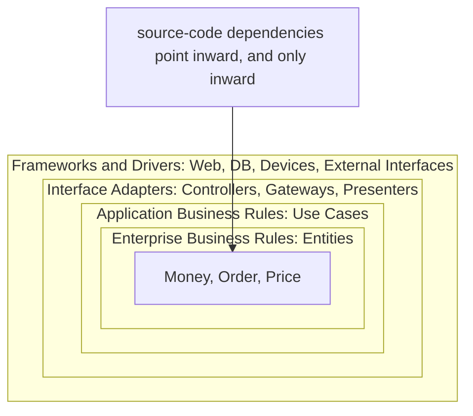
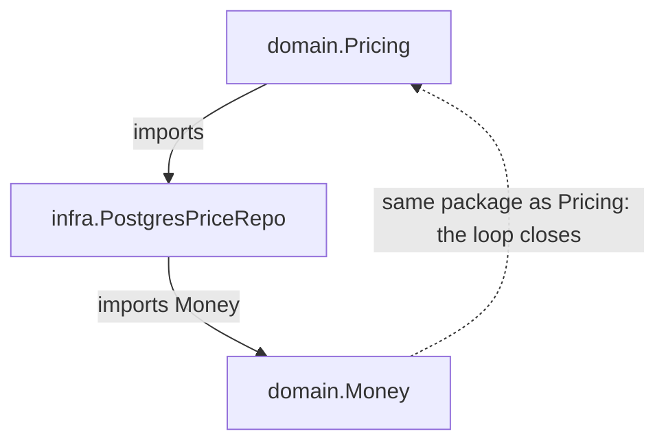
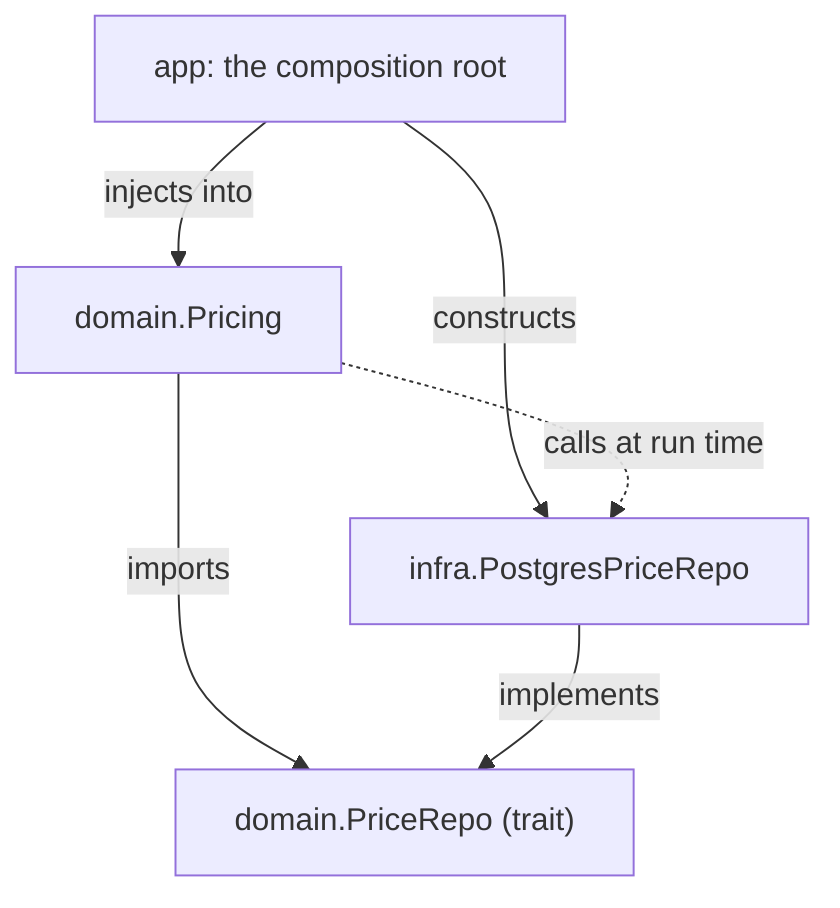
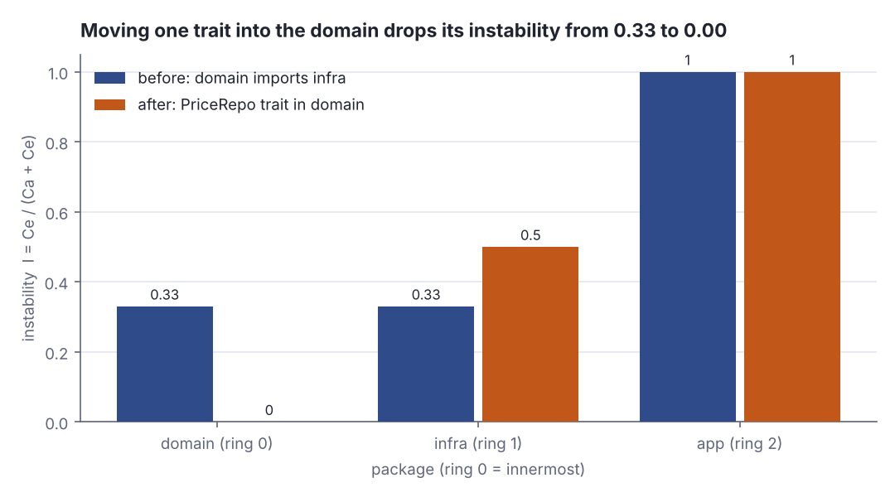

# Dependency direction and the dependency rule

> Software architecture & design · Beginner · ~20 min · rung 2 of 20 · needs: Coupling and cohesion (architecture-01)

## Why this matters
You have shipped Scala services where a domain class quietly names a Slick row type or an Akka message, and nothing hurts until the day the database or the toolkit moves and your business rules move with it.
The previous rung measured *how much* modules lean on each other; this one says the harder thing: the direction of each arrow decides which changes are cheap, and a module with ten dependencies all pointing the right way is healthier than one with a single dependency pointing the wrong way.
It sits here because it converts "low coupling is good" into something you can check with `grep` in five minutes, and because every later rung — SOLID, ports and adapters, layering — is this rule wearing a different hat.

## The idea

A source-code dependency is an arrow in your repository: package `A` names a type that lives in package `B`, so `A` cannot compile without `B`. The dependency rule is one sentence about where those arrows may point.

> "Nothing in an inner circle can know anything at all about something in an outer circle."
>
> — Robert C. Martin, *The Clean Architecture*, 2012-08-13, https://blog.cleancoder.com/uncle-bob/2012/08/13/the-clean-architecture.html

Inner means policy: entities and use cases, the rules that would still be true written on paper. Outer means detail: controllers, gateways, the database, the UI, the device. Details change for reasons unrelated to your business — a driver upgrade, a vendor migration — so an arrow from policy to detail imports that volatility into the rules. The same goes for the shapes data arrives in (Martin, "The Clean Architecture", §"The Dependency Rule"):

> "By the same token, data formats used in an outer circle should not be used by an inner circle"
>
> — Robert C. Martin, *The Clean Architecture*, 2012-08-13, https://blog.cleancoder.com/uncle-bob/2012/08/13/the-clean-architecture.html


*Figure 1: the four rings and the single legal direction for a source-code arrow. Adapted from Robert C. Martin, "The Clean Architecture", https://blog.cleancoder.com/uncle-bob/2012/08/13/the-clean-architecture.html*

### A source dependency and a call can point opposite ways

The confusing part is that at run time the policy really does have to reach the database. That is control flow, and it is free to go outward; only the *compile-time* arrow must go inward. In the lab's wired system, `app` builds the Postgres-backed repository and hands it to the domain:

```scala
val repo = infra.PostgresPriceRepo()      // the only place infra is named
val pricing = domain.Pricing(repo)        // domain gets an interface, not a class
for sku <- List("WASH-WAX", "WASH-GOLD") do
  println(s"  quote($sku, 2):")
  println(s"    result = ${pricing.quote(sku, 2)}")
```

```text
  quote(WASH-WAX, 2):
    [domain] Pricing.quote(WASH-WAX, qty=2) -> PriceRepo.priceOf
    [infra]  SELECT cents FROM prices WHERE sku = 'WASH-WAX'
    [domain] unit 399.00 EUR x 2 = 798.00 EUR
    result = Right(798.00 EUR)
```

Control flows `domain → infra` on line 2 of that trace, yet `domain` contains no mention of `infra`: it calls `PriceRepo`, a trait it owns itself. Martin names the trick for closing that gap (Martin, "The Clean Architecture", §"Crossing boundaries."):

> "We usually resolve this apparent contradiction by using the Dependency Inversion Principle."
>
> — Robert C. Martin, *The Clean Architecture*, 2012-08-13, https://blog.cleancoder.com/uncle-bob/2012/08/13/the-clean-architecture.html


*Figure 2: before. The policy imports the database class by name, and because the database class needs `Money` back, the two packages form a cycle. Source: the lab in this lesson, graph `before`.*


*Figure 3: after. Solid arrows are source-code imports and all of them point into `domain`; the dashed arrow is control flow, which still runs from policy to database. Source: the lab in this lesson, graph `after`.*

### Depend in the direction of stability

"Stable" here is not "bug-free"; it means hard to change because much depends on you. Martin's instability metric puts a number on it: with `Ca` the modules that depend on you and `Ce` the modules you depend on, `I = Ce / (Ca + Ce)`, from 0.00 (nothing leaves, everything arrives — maximally stable) to 1.00. A healthy arrow runs from a higher `I` to a lower one, and whatever sits at the bottom should be *abstract* — a trait, not a class — so that it can be stable without being rigid. The lab measures exactly that on the two graphs:

```scala
report("BEFORE: Pricing imports infra.PostgresPriceRepo", before)
report("AFTER: PriceRepo trait lives in domain", after)
```

```text
  --- BEFORE: Pricing imports infra.PostgresPriceRepo ---
    package  ring  Ca  Ce      I
    domain      0   2   1   0.33
    infra       1   2   1   0.33
    app         2   0   2   1.00
    rule violations: 1   cycles: 1
  --- AFTER: PriceRepo trait lives in domain ---
    package  ring  Ca  Ce      I
    domain      0   2   0   0.00
    infra       1   1   1   0.50
    app         2   0   2   1.00
    rule violations: 0   cycles: 0
```

Deleting one import took the domain from `I = 0.33` to `I = 0.00` and removed the cycle, because `domain → infra` plus `infra → domain` is a loop: neither package can be compiled, tested or released without the other, and the two have effectively become one module with a misleading folder structure. Keep module graphs acyclic and the loop cannot form.



*Figure 4: instability I per package, before and after. Generated from the lab's Step 2 output with `python3 dojo/engine/chart.py dojo/lessons/assets/2026-10-18-1-chart-1.json`.*

### Who does the wiring

Something still has to say `new PostgresPriceRepo`. That job belongs to one outermost place — the composition root, the `@main` in the lab — which is allowed to know everyone. Fowler calls the wiring object an assembler (Fowler, "Inversion of Control Containers and the Dependency Injection pattern", §"Forms of Dependency Injection"):

> "to have a separate object, an assembler, that populates a field in the lister class"
>
> — Martin Fowler, *Inversion of Control Containers and the Dependency Injection pattern*, 2004-01-23, https://martinfowler.com/articles/injection.html

The alternative is a service locator, where, as Fowler puts it, "With service locator the application class asks for it explicitly by a message to the locator." (*Inversion of Control Containers and the Dependency Injection pattern*, 2004-01-23, §"Service Locator vs Dependency Injection") — the dependency then lives in the class rather than in the wiring. Either way his conclusion holds, and it is the operational form of the dependency rule:

> "The important issue in all of this is to ensure that the configuration of services is separated from their use."
>
> — Martin Fowler, *Inversion of Control Containers and the Dependency Injection pattern*, 2004-01-23, https://martinfowler.com/articles/injection.html

So: the high-level module owns the interface, the low-level module implements it, and one root wires them. No cycles, and no arrow from the rules to the machinery.

## Lab

**The question:** does moving one trait from `infra` into `domain` actually change anything measurable, or is it just folder tidying?

About 8 minutes, Scala 3.3 and the standard library only.

### Step 1 — save the program

One file, three packages: `domain` (policy), `infra` (detail), `app` (composition root, plus the little tool that measures import graphs). Save it as `Lab.scala`.

```scala
// file: Lab.scala

// Dependency direction and the dependency rule (architecture-02).
// Scala 3.3, standard library only. One file, three packages:
//   domain = policy, infra = detail, app = composition root + the measuring tool.
// Part A wires the system and prints who calls whom at RUNTIME.
// Part B treats the IMPORT GRAPH as data and measures it, before and after.

package domain:

  // Policy. Knows nothing about Postgres, HTTP, JSON or any framework.
  final case class Money(cents: Long):
    def *(n: Int): Money = Money(cents * n)
    override def toString: String = f"${cents / 100.0}%.2f EUR"

  // The interface is OWNED BY THE HIGH-LEVEL MODULE: it lives here, not in infra.
  trait PriceRepo:
    def priceOf(sku: String): Option[Money]

  final class Pricing(repo: PriceRepo):
    def quote(sku: String, qty: Int): Either[String, Money] =
      println(s"    [domain] Pricing.quote($sku, qty=$qty) -> PriceRepo.priceOf")
      repo.priceOf(sku) match
        case Some(unit) =>
          val total = unit * qty
          println(s"    [domain] unit $unit x $qty = $total")
          Right(total)
        case None =>
          println(s"    [domain] no price row for $sku")
          Left(s"unknown sku $sku")

package infra:

  // Detail. It imports the domain; the domain never imports it.
  final class PostgresPriceRepo extends domain.PriceRepo:
    private val rows = Map("WASH-BASIC" -> 24900L, "WASH-WAX" -> 39900L)
    def priceOf(sku: String): Option[domain.Money] =
      println(s"    [infra]  SELECT cents FROM prices WHERE sku = '$sku'")
      rows.get(sku).map(domain.Money.apply)

package app:

  type Edge = (String, String)

  val pkgs = List("domain", "infra", "app")

  // Clean Architecture circles: 0 = innermost (entities, use cases), 2 = outermost.
  val ring = Map("domain" -> 0, "infra" -> 1, "app" -> 2)

  // before: Pricing imports infra.PostgresPriceRepo, infra imports domain.Money.
  val before: List[Edge] =
    List("domain" -> "infra", "infra" -> "domain", "app" -> "domain", "app" -> "infra")

  // after: the PriceRepo trait moved into domain, so only infra -> domain remains.
  val after: List[Edge] =
    List("infra" -> "domain", "app" -> "domain", "app" -> "infra")

  def ce(g: List[Edge], p: String): Int = g.count(_._1 == p)   // outgoing: efferent
  def ca(g: List[Edge], p: String): Int = g.count(_._2 == p)   // incoming: afferent

  def instability(g: List[Edge], p: String): Double =
    val (out, in) = (ce(g, p), ca(g, p))
    if out + in == 0 then 0.0 else out.toDouble / (out + in)

  def closure(g: List[Edge]): Set[Edge] =
    var acc = g.toSet
    var grown = true
    while grown do
      val more = for (a, b) <- acc; (c, d) <- acc if b == c yield (a, d)
      val next = acc ++ more
      grown = next.size > acc.size
      acc = next
    acc

  def cycles(g: List[Edge]): List[Edge] =
    val cl = closure(g)
    for (a, b) <- cl.toList.sorted if a < b && cl.contains((b, a)) yield (a, b)

  def violations(g: List[Edge]): List[Edge] = g.filter((f, t) => ring(f) < ring(t))

  def report(name: String, g: List[Edge]): Unit =
    println(s"  --- $name ---")
    println("  arrows (source-code imports):")
    for (f, t) <- g do
      val flag = if ring(f) < ring(t) then "  <-- BREAKS THE RULE: inner imports outer" else ""
      println(f"    $f%-7s --imports--> $t%s$flag")
    println(f"    ${"package"}%-8s ${"ring"}%4s ${"Ca"}%3s ${"Ce"}%3s ${"I"}%6s")
    for p <- pkgs do
      val (a, e) = (ca(g, p), ce(g, p))
      println(f"    $p%-8s ${ring(p)}%4d $a%3d $e%3d ${instability(g, p)}%6.2f")
    println(s"    rule violations: ${violations(g).size}   cycles: ${cycles(g).size}")

  @main def lab(): Unit =
    println("Step 1 - run the wired system (composition root injects the detail):")
    val repo = infra.PostgresPriceRepo()          // the only place infra is named
    val pricing = domain.Pricing(repo)            // domain gets an interface, not a class
    for sku <- List("WASH-WAX", "WASH-GOLD") do
      println(s"  quote($sku, 2):")
      println(s"    result = ${pricing.quote(sku, 2)}")

    println()
    println("Step 2 - measure the import graph")
    report("BEFORE: Pricing imports infra.PostgresPriceRepo", before)
    println()
    report("AFTER: PriceRepo trait lives in domain", after)

    println()
    println("Step 3 - what changed, package by package")
    println(f"    ${"package"}%-8s ${"I before"}%9s ${"I after"}%8s  ${"direction"}%s")
    for p <- pkgs do
      val (b, a) = (instability(before, p), instability(after, p))
      val arrow = if a < b then "more stable" else if a > b then "more unstable" else "unchanged"
      println(f"    $p%-8s $b%9.2f $a%8.2f  $arrow")
```

### Step 2 — run it

```bash
scala Lab.scala
```

```text
Step 1 - run the wired system (composition root injects the detail):
  quote(WASH-WAX, 2):
    [domain] Pricing.quote(WASH-WAX, qty=2) -> PriceRepo.priceOf
    [infra]  SELECT cents FROM prices WHERE sku = 'WASH-WAX'
    [domain] unit 399.00 EUR x 2 = 798.00 EUR
    result = Right(798.00 EUR)
  quote(WASH-GOLD, 2):
    [domain] Pricing.quote(WASH-GOLD, qty=2) -> PriceRepo.priceOf
    [infra]  SELECT cents FROM prices WHERE sku = 'WASH-GOLD'
    [domain] no price row for WASH-GOLD
    result = Left(unknown sku WASH-GOLD)

Step 2 - measure the import graph
  --- BEFORE: Pricing imports infra.PostgresPriceRepo ---
  arrows (source-code imports):
    domain  --imports--> infra  <-- BREAKS THE RULE: inner imports outer
    infra   --imports--> domain
    app     --imports--> domain
    app     --imports--> infra
    package  ring  Ca  Ce      I
    domain      0   2   1   0.33
    infra       1   2   1   0.33
    app         2   0   2   1.00
    rule violations: 1   cycles: 1

  --- AFTER: PriceRepo trait lives in domain ---
  arrows (source-code imports):
    infra   --imports--> domain
    app     --imports--> domain
    app     --imports--> infra
    package  ring  Ca  Ce      I
    domain      0   2   0   0.00
    infra       1   1   1   0.50
    app         2   0   2   1.00
    rule violations: 0   cycles: 0

Step 3 - what changed, package by package
    package   I before  I after  direction
    domain        0.33     0.00  more stable
    infra         0.33     0.50  more unstable
    app           1.00     1.00  unchanged
```

### Reading the output

**Columns.** `ring` is the Clean Architecture circle the package sits in: 0 is innermost (entities and use cases), 2 is the outermost composition root. `Ca` (afferent) counts the arrows coming *in* — modules that would have to be recompiled if this one changes. `Ce` (efferent) counts the arrows going *out* — modules that can break this one. `I = Ce / (Ca + Ce)` is instability, 0.00 to 1.00. For the inner packages lower is better; for the outermost one, 1.00 is correct and desirable. `rule violations` counts arrows from a lower ring to a higher one, and `cycles` counts pairs of packages that reach each other. For both, zero is the only acceptable number.

| graph | package | ring | Ca | Ce | I | violations | cycles |
|---|---|---|---|---|---|---|---|
| before | domain | 0 | 2 | 1 | 0.33 | 1 | 1 |
| before | infra | 1 | 2 | 1 | 0.33 | 1 | 1 |
| before | app | 2 | 0 | 2 | 1.00 | 1 | 1 |
| after | domain | 0 | 2 | 0 | **0.00** | **0** | **0** |
| after | infra | 1 | 1 | 1 | 0.50 | **0** | **0** |
| after | app | 2 | 0 | 2 | 1.00 | **0** | **0** |

**The arithmetic, traced.** Before, `domain` is imported by `infra` and by `app`, so `Ca = 2`; it imports `infra`, so `Ce = 1`. Then `I = Ce / (Ca + Ce) = 1 / (2 + 1) = 1 / 3 = 0.33`. After the trait moves into `domain`, that one outgoing import disappears: `Ce = 0`, `Ca` is still 2, and `I = 0 / (2 + 0) = 0.00`. `infra` moves the other way, from `1 / (2 + 1) = 0.33` to `1 / (1 + 1) = 0.50` — it got *less* stable, which is exactly right: a detail should be the easy thing to replace.

**Verdict:** not folder tidying. One deleted import moved the domain to the floor of the instability scale, pushed the volatility into `infra` where it belongs, and took the graph from one rule violation and one cycle to zero of each.

The cycle deserves its own line. Before, `domain → infra` and `infra → domain` both exist, so the transitive closure contains `domain → domain`: neither package can compile, be tested, or be released without the other, and the folder names claim a separation that the compiler does not see.

**Verdict:** `cycles: 1 → 0` is the sharpest of the three numbers, because a cycle is not a smell you can live with — it is two modules pretending to be three.

### Step 3 — run the same check on your own code

Now the part that pays. Pick one real module you own, and list what its policy package imports:

```bash
grep -rn "^import" src/main/scala/com/yourorg/domain | \
  grep -vE "scala\.|^.*:import +(com\.yourorg\.domain|_root_\.scala)" | \
  sed -E 's/.*import +([a-z0-9_.]+).*/\1/' | sort | uniq -c | sort -rn | head -20
```

Read the list and ask of each line: is this a rule, or a detail? Driver packages, serialisation codecs, HTTP clients, ORM row types and framework base classes are details, and every one of them in that list is an arrow pointing the wrong way. Find **one**, and write down the trait that would invert it — what the policy actually needs, named in the policy's own words (`PriceRepo`, not `JdbcTemplate`). That one trait is the whole lesson applied.

### Cause → consequence

1. **Cause.** A class in the policy package names a concrete detail — `PostgresPriceRepo`, a row type, a client — because it was the quickest way to make the call compile.
2. **Mechanism.** The compiler records that arrow. The policy package can no longer be compiled, tested or deployed without the detail, and if the detail also names a policy type, the two packages form a cycle and collapse into one unit.
3. **Consequence.** Volatility propagates inward: a driver upgrade, a schema migration or a framework bump now forces a change, a recompile and a re-test of the business rules, which were meant to be the stable part. Measured: `I` for the domain sat at 0.33 instead of 0.00, with one violation and one cycle.
4. **In practice.** Declare the interface where it is *used*, in the policy package, in the policy's vocabulary; implement it in the detail package; construct the implementation once, in the composition root (`@main`, a `Main` object, an Akka guardian, the Cake or `ZLayer` assembly). Then add a build-level check — a module boundary in sbt, or the `grep` in Step 3 wired into CI — so that the arrow cannot quietly come back.

## Self-check
1. Your `domain.Pricing` has to read prices from Postgres at run time. How can the source-code arrow point from `infra` to `domain` when the call clearly goes the other way? <details><summary>Answer</summary>Because the two are different graphs. `Pricing` calls a `PriceRepo` trait that it owns and that lives in `domain`; `infra.PostgresPriceRepo` extends that trait, which is an import of `domain` by `infra`. At run time `app` passes the Postgres instance in, so control flows outward through a reference `Pricing` holds but whose concrete class it never names. Martin: "We usually resolve this apparent contradiction by using the Dependency Inversion Principle." (*The Clean Architecture*, 2012-08-13, §"Crossing boundaries.")</details>
2. Package `a` has `Ca = 8`, `Ce = 0`; package `b` has `Ca = 0`, `Ce = 8`. Compute `I` for each, say which may depend on which, and name the extra condition `a` has to satisfy. <details><summary>Answer</summary>`I(a) = 0 / (8 + 0) = 0.00`, `I(b) = 8 / (0 + 8) = 1.00`. Arrows must run from higher instability to lower, so `b` may depend on `a` and never the reverse. The extra condition: because eight modules are pinned to `a`, `a` must be hard to change *and* able to accommodate new behaviour — it should be abstract, a set of traits rather than concrete classes, otherwise it is simply rigid and every new requirement edits it.</details>
3. A colleague moves `PriceRepo` into `infra` "because that is where the database code lives", and `domain` imports it from there. Which two of the lab's four numbers change, and why is this worse than it looks? <details><summary>Answer</summary>`rule violations` goes 0 → 1 (`domain`, ring 0, now imports ring 1) and the domain's `I` goes 0.00 → 0.33, since `Ce` becomes 1 while `Ca` stays 2. It is worse than it looks because with `infra` also importing `domain` for `Money`, the pair forms a cycle: `cycles` goes 0 → 1, and the two packages can no longer be compiled, tested or released separately. The interface must be owned by the module that *uses* it, not by the one that implements it.</details>

## Sources
- [The Clean Architecture (Robert C. Martin, 2012)](https://blog.cleancoder.com/uncle-bob/2012/08/13/the-clean-architecture.html) — Robert C. Martin, 2012-08-13 — the dependency rule itself and the inner/outer circle vocabulary (§"The Dependency Rule"), the ban on outer-circle data formats crossing inward, and the resolution of the control-flow contradiction via dependency inversion (§"Crossing boundaries."); the concentric-circles figure is replicated in Figure 1 rather than reproduced. Accessed 2026-10-18.
- [Inversion of Control Containers and the Dependency Injection pattern (Martin Fowler)](https://martinfowler.com/articles/injection.html) — Martin Fowler, 2004-01-23 — the assembler that populates the dependency (§"Forms of Dependency Injection"), the contrast with a service locator the class queries itself, and the principle that configuration of services must be separated from their use (§"Deciding which option to use"). Accessed 2026-10-18.

## Next on this track
Next on Software architecture & design: **SOLID in practice I — SRP, OCP, LSP** (rung 3 of 20, Beginner).
