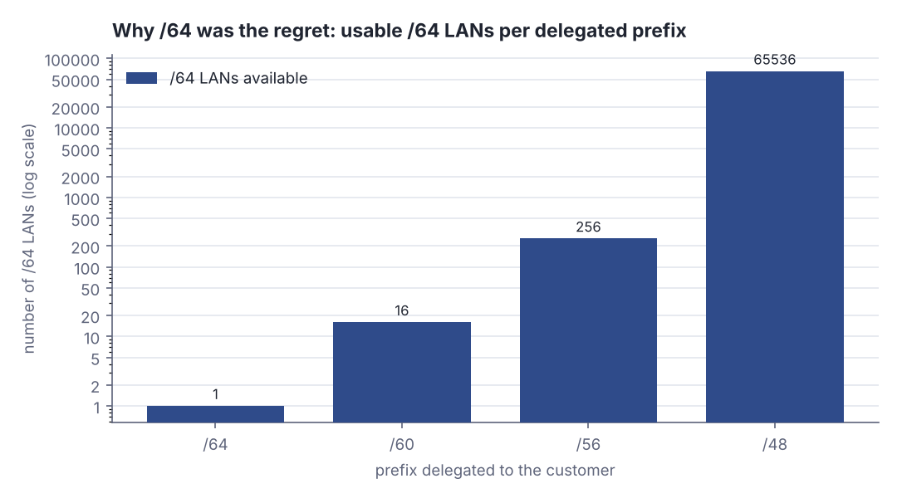
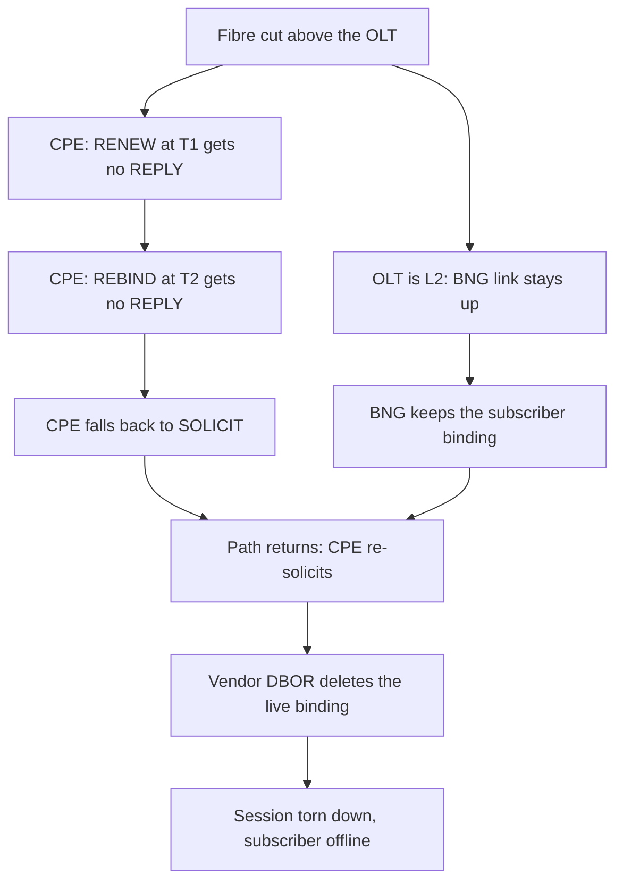
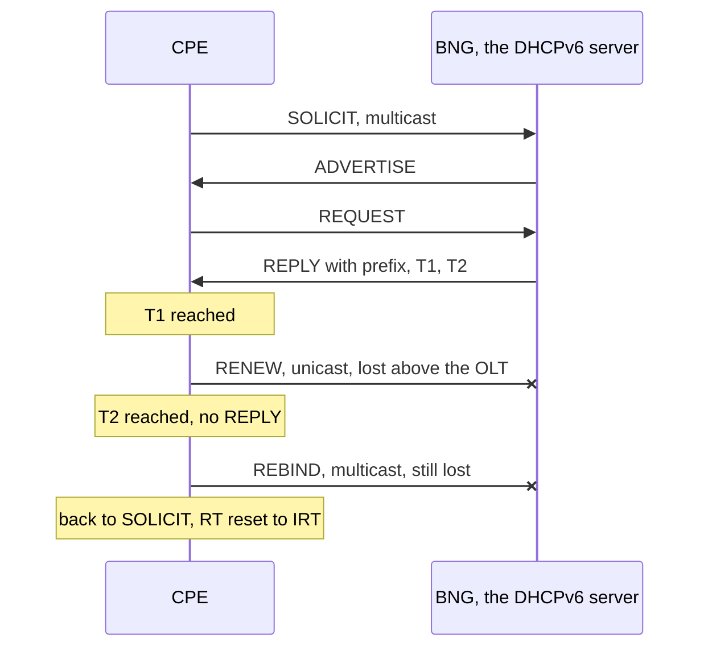
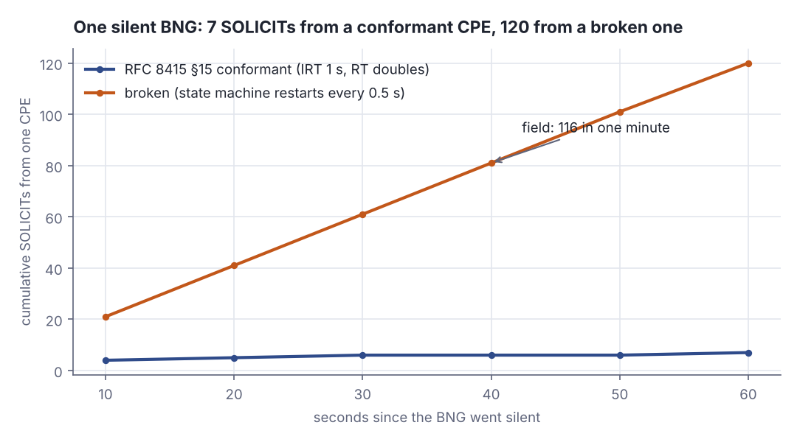

# IPv6 at a million subscribers: what dual-stack really breaks

> Fresh · Networking, modern · Intermediate · ~25 min · from today's feeds

## Why this matters
Today's item is "Seven years of IPv6 in production: Lessons from one million broadband subscribers" by Kijush Maharjan, Principal Network Engineer at WorldLink Communications in Nepal, published as a guest post on the APNIC Blog on 12 October 2026.
It is worth 25 minutes because it is a seven-year field report rather than a protocol tutorial: the protocol worked, and the fleet still broke — on subscriber management, on DHCPv6 vendor disagreements, on Layer 2, on logging, and on reconnection storms.
That is the exact failure shape you meet in distributed backends — correct component, wrong behaviour at scale — and the retry arithmetic in it transfers directly to the clients and services you own.

## Primer
You have the TCP handshake: SYN, SYN-ACK, ACK, a connection with state at both ends, and a teardown that can leave that state stranded if one side disappears. A broadband access network is the same story with the state spread across three boxes and a lease timer instead of a FIN.

Three boxes, from the customer outward. The **CPE** (customer premises equipment) is the router in the subscriber's flat. The **OLT** (Optical Line Terminal) is the fibre aggregation box in the street cabinet; it is a Layer 2 device — it forwards frames and does not hold the subscriber's IP state. The **BNG** (Broadband Network Gateway) is the operator's subscriber edge router: it authenticates the subscriber, holds the session, and hands out addresses. **IPoE** means the subscriber session rides plain Ethernet, with DHCP rather than PPPoE doing the address handout.

**DHCPv6** is how the CPE gets its IPv6 configuration. Unlike IPv4 DHCP, it does not just hand out one address: with **prefix delegation (PD)** the server delegates a whole block — a /56, say — and the CPE carves /64 subnets out of it for its own LANs. A /64 is the standard IPv6 subnet size, so the delegated prefix length decides how many LANs the customer can ever have. The exchange is four messages: the client multicasts SOLICIT, servers reply ADVERTISE, the client sends REQUEST to one of them, that server answers REPLY with the confirmed addresses and delegated prefixes (RFC 8415 §5.2).

A binding is not permanent. The REPLY carries **T1** — "The time interval after which the client is expected to contact the server that did the assignment" — and **T2** — "The time interval after which the client is expected to contact any available server to extend (rebind)" (RFC 8415 §4.2).

**Dual-stack** means every subscriber runs IPv4 and IPv6 side by side on the same session. **CGNAT** (carrier-grade NAT) is the box that shares one public IPv4 address across many subscribers, because there are not enough IPv4 addresses to go round.

## The idea

### A fleet, not a protocol
WorldLink tested IPv6 from May 2016 and went live in July 2019. Seven years later:

> "Today the network carries more than a million Internet Protocol over Ethernet (IPoE) subscribers"
> — Kijush Maharjan, *Seven years of IPv6 in production: Lessons from one million broadband subscribers*, 2026-10-12, https://blog.apnic.net/2026/10/12/seven-years-of-ipv6-in-production-lessons-from-one-million-broadband-subscribers/

all of them IPv6-enabled, "with around 70% of our traffic riding IPv6" (Maharjan, *Seven years of IPv6 in production*, 12 October 2026). The first decision was dual-stack rather than a translation technology, and the reasoning is an operations argument, not an elegance argument:

> "chose dual-stack because it was the only option that didn't put a translator in the path of every customer forever"
> — Kijush Maharjan, *Seven years of IPv6 in production: Lessons from one million broadband subscribers*, 2026-10-12, https://blog.apnic.net/2026/10/12/seven-years-of-ipv6-in-production-lessons-from-one-million-broadband-subscribers/

The money follows the same logic: "CGNAT is capex that grows with every subscriber you add" (Maharjan, 12 October 2026). Native IPv6 is the only thing that takes traffic *off* that growth curve — every flow that goes v6 is a flow the CGNAT never sees.

### The decision you cannot take back
WorldLink delegated a /64 per customer, a choice forced by CPE limitations, and the author would not repeat it: "If I were planning this today, I'd delegate a /56, or a /60 as the absolute floor, and /48 for business customers" (Maharjan, 12 October 2026). The arithmetic is why. A delegated /n yields 2^(64−n) subnets of /64, so a /64 gives the customer exactly one LAN — no guest network, no IoT segment, no lab VLAN, ever, without renumbering a million CPEs.



*Figure 1: how many /64 LANs each delegation size gives one customer — 1, 16, 256, 65 536. Generated from the Step 5 lab output below (`python3 dojo/engine/run_lab.py 2026-10-18-2`).*

IPv6 has no address-conservation problem; the only cost of a /56 over a /64 is a routing table entry that was going to exist anyway. Being stingy here buys nothing and locks the customer's topology forever.

### The renew–rebind cliff
The failure the post names is subtle and it is pure distributed-systems:

> "A fibre cut above the Optical Line Terminal (OLT) occurs, but the BNG never hears a thing"
> — Kijush Maharjan, *Seven years of IPv6 in production: Lessons from one million broadband subscribers*, 2026-10-12, https://blog.apnic.net/2026/10/12/seven-years-of-ipv6-in-production-lessons-from-one-million-broadband-subscribers/

The OLT is Layer 2, so a cut above it does not drop the Ethernet link the BNG is watching. The BNG keeps the subscriber binding alive. The CPE, meanwhile, sees silence: its RENEW at T1 gets nothing, its REBIND at T2 gets nothing, and it falls back to SOLICIT to start over. When the path returns, the CPE is re-soliciting against a BNG that still believes in the old session — and on some vendors the renegotiation triggers delete-binding-on-renegotiation (DBOR), which tears the session down instead of refreshing it.



*Figure 2: the renew–rebind cliff — one side keeps state the other has already abandoned. Source: mechanism described in Kijush Maharjan, "Seven years of IPv6 in production", 12 October 2026, https://blog.apnic.net/2026/10/12/seven-years-of-ipv6-in-production-lessons-from-one-million-broadband-subscribers/*

The timers decide how long the two sides disagree. T1 and T2 are carried in the REPLY (RFC 8415 §4.2); the common server default sets T1 at half the preferred lifetime and T2 at 0.8 of it:

```scala
// file: Timers.scala
@main def lab(): Unit =
  val preferred = 3600.0
  val t1 = 0.5 * preferred
  val t2 = 0.8 * preferred
  println(f"preferred lifetime of the delegated prefix: $preferred%.0f s")
  println(f"T1 renew  fires at $t1%.0f s - unicast RENEW to the server that gave the binding")
  println(f"T2 rebind fires at $t2%.0f s - multicast REBIND to any server that will answer")
  println(f"gap T1..T2 in which the CPE still trusts a dead binding: ${t2 - t1}%.0f s")
```

```text
preferred lifetime of the delegated prefix: 3600 s
T1 renew  fires at 1800 s - unicast RENEW to the server that gave the binding
T2 rebind fires at 2880 s - multicast REBIND to any server that will answer
gap T1..T2 in which the CPE still trusts a dead binding: 1080 s
```

With a one-hour preferred lifetime the CPE spends 1 080 seconds — eighteen minutes — politely retrying a server that cannot hear it before it escalates to multicast. That window is the operator's blind spot, and it is why the cut has to be detected at Layer 2 rather than waited out at Layer 3.



*Figure 3: the four-message exchange and the renew/rebind escalation. Adapted from RFC 8415 §5.2 and §4.2, https://www.rfc-editor.org/rfc/rfc8415.html*

### 116 SOLICITs in one minute
The consequence was measured:

> "We measured 116 SOLICITs in one minute from a single CPE."
> — Kijush Maharjan, *Seven years of IPv6 in production: Lessons from one million broadband subscribers*, 2026-10-12, https://blog.apnic.net/2026/10/12/seven-years-of-ipv6-in-production-lessons-from-one-million-broadband-subscribers/

That number should be impossible. RFC 8415 §15 specifies exponential backoff for every client-initiated exchange: the first retransmission timeout is `RT = IRT + RAND*IRT`, each later one is `RT = 2*RTprev + RAND*RTprev`, with `RAND` drawn from −0.1 to +0.1 and `RT` capped at `MRT`. For SOLICIT the constants are `SOL_TIMEOUT` (IRT) = 1 second and `SOL_MAX_RT` (MRT) = 3600 seconds (RFC 8415 §7.6). Run that schedule:

```scala
// file: Backoff.scala
@main def lab(): Unit =
  val rnd = scala.util.Random(8415)
  var rt = 1.0 + rnd.between(-0.1, 0.1) * 1.0
  var t = 0.0
  var n = 0
  while t < 60.0 do
    n += 1
    println(f"SOLICIT $n%d at t=$t%6.2f s, next retransmission in $rt%6.2f s")
    t += rt
    rt = 2 * rt + rnd.between(-0.1, 0.1) * rt
  println(s"60 s of silence from the BNG costs the CPE $n SOLICITs")
```

```text
SOLICIT 1 at t=  0.00 s, next retransmission in   0.90 s
SOLICIT 2 at t=  0.90 s, next retransmission in   1.79 s
SOLICIT 3 at t=  2.69 s, next retransmission in   3.46 s
SOLICIT 4 at t=  6.16 s, next retransmission in   6.59 s
SOLICIT 5 at t= 12.75 s, next retransmission in  13.60 s
SOLICIT 6 at t= 26.34 s, next retransmission in  26.62 s
SOLICIT 7 at t= 52.97 s, next retransmission in  54.14 s
60 s of silence from the BNG costs the CPE 7 SOLICITs
```

Seven, not 116. The gap is the whole finding: 116 can only happen if the backoff never accumulates — if something resets the client's state machine faster than `RT` can double. That something was the vendor disagreement. RFC 3315 and its successor RFC 8415 differ in how a client is expected to behave around renew, rebind and renegotiation, and when the CPE's reading and the BNG's reading disagree, the CPE keeps restarting the exchange from scratch. Each restart puts `RT` back to one second, so the client is permanently in its first, cheapest retry. The author's fix was not a config line — it needed agreement between the CPE and BNG vendors on which behaviour was correct.

Layer 2 made it worse. Multicast suppression and DHCP snooping on the OLTs dropped exactly the messages the recovery depends on, and the failures clustered after mass power restoration, when every CPE in a district boots at once.

### What to measure
The post's data-model advice is three rules: correlate everything by subscriber, track IPv4 and IPv6 as separate KPIs rather than one blended number, and size BNGs by whichever resource runs out first — sessions, prefixes, CGNAT ports or control-plane CPU. And the headline metric:

> "Don't measure it by how many subscribers have an IPv6 address."
> — Kijush Maharjan, *Seven years of IPv6 in production: Lessons from one million broadband subscribers*, 2026-10-12, https://blog.apnic.net/2026/10/12/seven-years-of-ipv6-in-production-lessons-from-one-million-broadband-subscribers/

> "Measure it by how much real traffic is successfully using one."
> — Kijush Maharjan, *Seven years of IPv6 in production: Lessons from one million broadband subscribers*, 2026-10-12, https://blog.apnic.net/2026/10/12/seven-years-of-ipv6-in-production-lessons-from-one-million-broadband-subscribers/

Configuration coverage was 100%; traffic share was 70%. The second number is the one that moved the CGNAT bill.

## Lab
**Question: how does one CPE reach 116 SOLICITs in a minute when RFC 8415 says it should back off exponentially — and what does a district full of them do to a BNG?**

### Step 1 — the conformant client
`conformant` implements RFC 8415 §15 directly: first `RT = IRT + RAND*IRT`, then `RT = 2*RTprev + RAND*RTprev`, capped at `MRT`, with `IRT = SOL_TIMEOUT = 1 s` and `MRT = SOL_MAX_RT = 3600 s` (RFC 8415 §7.6). It prints every send time, not just the total.

### Step 2 — the broken client
`broken` models the vendor-disagreement case: every 0.50 s something restarts the DHCPv6 state machine, so `RT` is reset to `IRT` before it can ever double. The retry interval is therefore constant.

### Step 3 — cumulative sends per 10 s, side by side

### Step 4 — fan-out to a reconnection storm of 10 000 CPEs behind one BNG

### Step 5 — the prefix-delegation arithmetic

```scala
// file: Lab.scala
import scala.util.Random

case class Send(t: Double, rt: Double)

def conformant(irt: Double, mrt: Double, horizon: Double, seed: Int): List[Send] =
  val rnd = Random(seed)
  val out = scala.collection.mutable.ListBuffer[Send]()
  var rt = irt + rnd.between(-0.1, 0.1) * irt
  var t = 0.0
  while t < horizon do
    out += Send(t, rt)
    t += rt
    val next = 2 * rt + rnd.between(-0.1, 0.1) * rt
    rt = if next > mrt then mrt + rnd.between(-0.1, 0.1) * mrt else next
  out.toList

def broken(restart: Double, horizon: Double): List[Send] =
  val out = scala.collection.mutable.ListBuffer[Send]()
  var t = 0.0
  while t < horizon do
    out += Send(t, restart)
    t += restart
  out.toList

def cumulativeAt(sends: List[Send], t: Double): Int = sends.count(_.t <= t)

@main def lab(): Unit =
  val horizon = 60.0
  val c = conformant(1.0, 3600.0, horizon, 8415)
  val b = broken(0.5, horizon)

  println("Step 1 - conformant client (RFC 8415 s15): IRT 1 s, RT doubles, RAND +-0.1, MRT 3600 s")
  println("  n    sent at s   then wait RT s")
  c.zipWithIndex.foreach { case (s, i) => println(f"  ${i + 1}%-3d  ${s.t}%8.2f   ${s.rt}%12.2f") }
  println(f"  conformant SOLICITs in $horizon%.0f s: ${c.size}")

  println()
  println("Step 2 - broken client: DHCPv6 state machine restarts every 0.50 s, backoff resets")
  println("  first 6 sends at s: " + b.take(6).map(s => f"${s.t}%.2f").mkString(", ") + " ...")
  println(f"  broken SOLICITs in $horizon%.0f s: ${b.size}")

  println()
  println("Step 3 - cumulative SOLICITs from one CPE")
  println("  t(s)   conformant   broken")
  for t <- 10 to 60 by 10 do
    println(f"  $t%-6d ${cumulativeAt(c, t.toDouble)}%10d ${cumulativeAt(b, t.toDouble)}%8d")

  println()
  println("Step 4 - reconnection storm: 10000 CPEs behind one BNG, all re-soliciting")
  val fleet = 10000
  println(f"  conformant: ${c.size * fleet}%,d SOLICITs/min = ${c.size * fleet / 60.0}%,.0f msg/s")
  println(f"  broken:     ${b.size * fleet}%,d SOLICITs/min = ${b.size * fleet / 60.0}%,.0f msg/s")
  println(f"  ratio broken/conformant: ${b.size.toDouble / c.size}%.1fx")

  println()
  println("Step 5 - what one delegation buys the customer")
  println("  delegated   /64 LANs")
  for p <- List(64, 60, 56, 48) do
    println(f"  /$p%-10d ${math.pow(2, 64 - p).toLong}%,9d")
```

Run it with `python3 dojo/engine/run_lab.py 2026-10-18-2`:

```text
Step 1 - conformant client (RFC 8415 s15): IRT 1 s, RT doubles, RAND +-0.1, MRT 3600 s
  n    sent at s   then wait RT s
  1        0.00           0.90
  2        0.90           1.79
  3        2.69           3.46
  4        6.16           6.59
  5       12.75          13.60
  6       26.34          26.62
  7       52.97          54.14
  conformant SOLICITs in 60 s: 7

Step 2 - broken client: DHCPv6 state machine restarts every 0.50 s, backoff resets
  first 6 sends at s: 0.00, 0.50, 1.00, 1.50, 2.00, 2.50 ...
  broken SOLICITs in 60 s: 120

Step 3 - cumulative SOLICITs from one CPE
  t(s)   conformant   broken
  10              4       21
  20              5       41
  30              6       61
  40              6       81
  50              6      101
  60              7      120

Step 4 - reconnection storm: 10000 CPEs behind one BNG, all re-soliciting
  conformant: 70,000 SOLICITs/min = 1,167 msg/s
  broken:     1,200,000 SOLICITs/min = 20,000 msg/s
  ratio broken/conformant: 17.1x

Step 5 - what one delegation buys the customer
  delegated   /64 LANs
  /64                 1
  /60                16
  /56               256
  /48            65,536
```



*Figure 4: cumulative SOLICITs from one CPE during 60 s of BNG silence. Generated from the Step 3 lab output above.*

### Reading the output

**Step 1.** Column `sent at s` is the moment the CPE puts a SOLICIT on the wire; `then wait RT s` is the retransmission timeout it arms afterwards. Lower is worse here — a small `RT` means the client is about to talk again soon. Each row's `RT` is roughly twice the previous one, which is the point of the rule.

| n | sent at (s) | next RT (s) |
|---|---|---|
| 1 | 0.00 | 0.90 |
| 2 | 0.90 | 1.79 |
| 3 | 2.69 | 3.46 |
| 4 | 6.16 | 6.59 |
| 5 | 12.75 | 13.60 |
| 6 | 26.34 | 26.62 |
| 7 | 52.97 | 54.14 |

Trace the digits. `IRT = 1 s`, and the first draw of `RAND` was −0.099340, so `RT₁ = 1 + (−0.099340 × 1) = 0.900660 s`, printed as 0.90. Doubling from there: 0.90 → 1.79 → 3.46 → 6.59 → 13.60 → 26.62 → 54.14. The send times are the running sum: 0.00, 0.90, 2.69, 6.16, 12.75, 26.34, 52.97. The eighth send would land at 52.97 + 54.14 = 107.11 s, well past the minute, so the window closes at **7**. The clean version of the same arithmetic without randomisation is 1 + 2 + 4 + 8 + 16 + 32 = 63 s of waiting — six doublings already cover the whole minute.

**Verdict: a conformant CPE spends single digits of SOLICITs on a minute of silence. Exponential backoff is doing exactly what it was designed to do.**

**Step 2 and 3.** The `broken` column is cumulative SOLICITs when the state machine restarts every 0.50 s, so `RT` never leaves its initial value. Lower is better in both columns.

| t (s) | conformant | broken |
|---|---|---|
| 10 | 4 | 21 |
| 20 | 5 | 41 |
| 30 | 6 | 61 |
| 40 | 6 | 81 |
| 50 | 6 | 101 |
| 60 | 7 | 120 |

60 s ÷ 0.50 s = 120 sends, the same order as the 116 SOLICITs in one minute measured in the field (Maharjan, *Seven years of IPv6 in production*, 12 October 2026). The conformant line is flat after 30 s because the next retry is more than half a minute away; the broken line is a straight diagonal because nothing ever slows down.

**Verdict: the field measurement is not a mystery. 116 per minute is what you get when backoff state is thrown away faster than it can grow — about 17× the conformant volume.**

**Step 4 and 5.** Step 4 multiplies one CPE by a district: 10 000 subscribers behind one BNG, all reconnecting after mass power restoration. 7 × 10 000 = 70 000 messages per minute, 1 167 per second. 120 × 10 000 = 1 200 000 per minute, 20 000 per second. Step 5 prints 2^(64−n) for each delegation size: 1, 16, 256, 65 536.

**Verdict: the broken client turns a recoverable 1 167 msg/s control-plane load into 20 000 msg/s — and a BNG that cannot keep up extends the outage it was supposed to end. Separately, moving the delegation from /64 to /56 multiplies the customer's usable LANs by 256 and costs the operator nothing.**

### Cause → consequence

1. **Cause** — the OLT between CPE and BNG is a Layer 2 device, so a fibre cut above it leaves the BNG's link up: "A fibre cut above the Optical Line Terminal (OLT) occurs, but the BNG never hears a thing" (Maharjan, 12 October 2026).
2. **Mechanism** — the BNG keeps a binding the CPE has already given up on; the CPE escalates RENEW → REBIND → SOLICIT, and a CPE/BNG disagreement over RFC 3315 versus RFC 8415 behaviour restarts the exchange before `RT` can double, pinning the retry interval at its initial 1 s (RFC 8415 §15, §7.6).
3. **Consequence** — 116 SOLICITs per minute per CPE, and on renegotiation the vendor's DBOR deletes the live binding instead of refreshing it, so the recovery attempt is what finally drops the subscriber.
4. **In practice, for your work** — three transfers. First: a retry policy is only as good as the state it keeps. Any reconnect path that rebuilds its client — a new actor instance, a fresh HTTP client, a supervisor restart — resets the backoff with it, and your careful exponential schedule degrades to a fixed-interval hammer. Put the backoff state outside the thing that restarts. Second: size the control plane for the storm, not the steady state. A rolling deploy or a cluster restart is your mass power restoration, and the difference between 1 167 and 20 000 msg/s is whether recovery converges. Third: measure adoption by traffic, not by configuration — 100% of subscribers configured and 70% of bytes actually flowing are different numbers, and the same gap exists between "the feature flag is on everywhere" and "the new path is serving the requests".

## Self-check
1. A conformant DHCPv6 client that hears nothing for 60 seconds sends about seven SOLICITs. What single property of a broken client turns that into roughly 120, and why does exponential backoff not save it? <details><summary>Answer</summary>The broken client loses its retransmission state. RFC 8415 §15 grows `RT` as `RT = 2*RTprev + RAND*RTprev` from `IRT = SOL_TIMEOUT = 1 s` (RFC 8415 §7.6), but that growth lives in the client's state machine. If something restarts the exchange every 0.5 s — a vendor disagreement over renew/rebind behaviour, a link event, a process restart — `RT` is set back to `IRT` before it can double even once, so the client sits permanently in its first retry: 60 ÷ 0.5 = 120 sends. Backoff is not a property of the protocol, it is a property of state you have to keep.</details>
2. The fibre is cut above the OLT. Why does the BNG not notice, and what makes the subscriber's eventual reconnection attempt the thing that kills the session? <details><summary>Answer</summary>The OLT is a Layer 2 aggregation device, so a cut on its upstream side does not bring down the Ethernet link the BNG monitors — "A fibre cut above the Optical Line Terminal (OLT) occurs, but the BNG never hears a thing" (Maharjan, *Seven years of IPv6 in production*, 12 October 2026). The BNG therefore holds the binding as valid while the CPE's RENEW at T1 and REBIND at T2 go unanswered and it falls back to SOLICIT. When the path comes back, the CPE renegotiates against a BNG that still has the old binding, and delete-binding-on-renegotiation (DBOR) on some vendors deletes that binding rather than refreshing it — so the reconnection tears the session down.</details>
3. WorldLink delegates a /64 per customer and the author would now delegate a /56. State the arithmetic, and say why the smaller delegation saved nothing. <details><summary>Answer</summary>A delegated /n yields 2^(64−n) subnets of /64: /64 → 1 LAN, /60 → 16, /56 → 256, /48 → 65 536. A /64 customer gets exactly one LAN, so no guest network, no IoT segment, no separate lab VLAN — and changing it later means renumbering a million CPEs. It saved nothing because IPv6 has no address-conservation pressure; the operator's allocation is not meaningfully consumed by handing out /56s, and the extra cost is a routing entry that exists either way. The author's own conclusion: "If I were planning this today, I'd delegate a /56, or a /60 as the absolute floor, and /48 for business customers" (Maharjan, 12 October 2026).</details>

## Sources
- [Seven years of IPv6 in production: Lessons from one million broadband subscribers](https://blog.apnic.net/2026/10/12/seven-years-of-ipv6-in-production-lessons-from-one-million-broadband-subscribers/) — Kijush Maharjan, APNIC Blog, 12 October 2026 — the operator field report: the million-subscriber IPoE scale and 70% IPv6 traffic share, the dual-stack-versus-translator decision and CGNAT capex argument, the /64 delegation regret, the renew–rebind cliff, the 116 SOLICITs per minute measurement, DBOR, the Layer 2 multicast-suppression and DHCP-snooping failures, and the measure-traffic-not-addresses takeaway; accessed 2026-10-18.
- [RFC 8415: Dynamic Host Configuration Protocol for IPv6 (DHCPv6)](https://www.rfc-editor.org/rfc/rfc8415.html) — Mrugalski et al., IETF, November 2018 — §4.2 the definitions of T1 and T2, §5.2 the SOLICIT/ADVERTISE/REQUEST/REPLY exchange and prefix delegation, §7.6 the constants SOL_TIMEOUT = 1 s and SOL_MAX_RT = 3600 s, §15 the retransmission algorithm the lab implements; accessed 2026-10-18.

Related in your knowledge base: `Networking-IPV4-vs-IPV6.md` and `Networking-DNS-DHCP.md` under the networking section.
