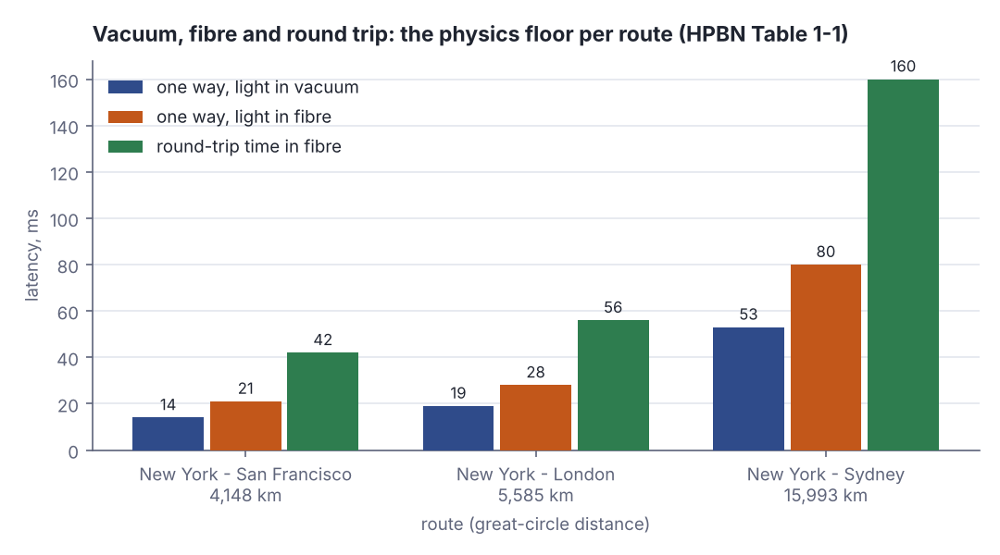
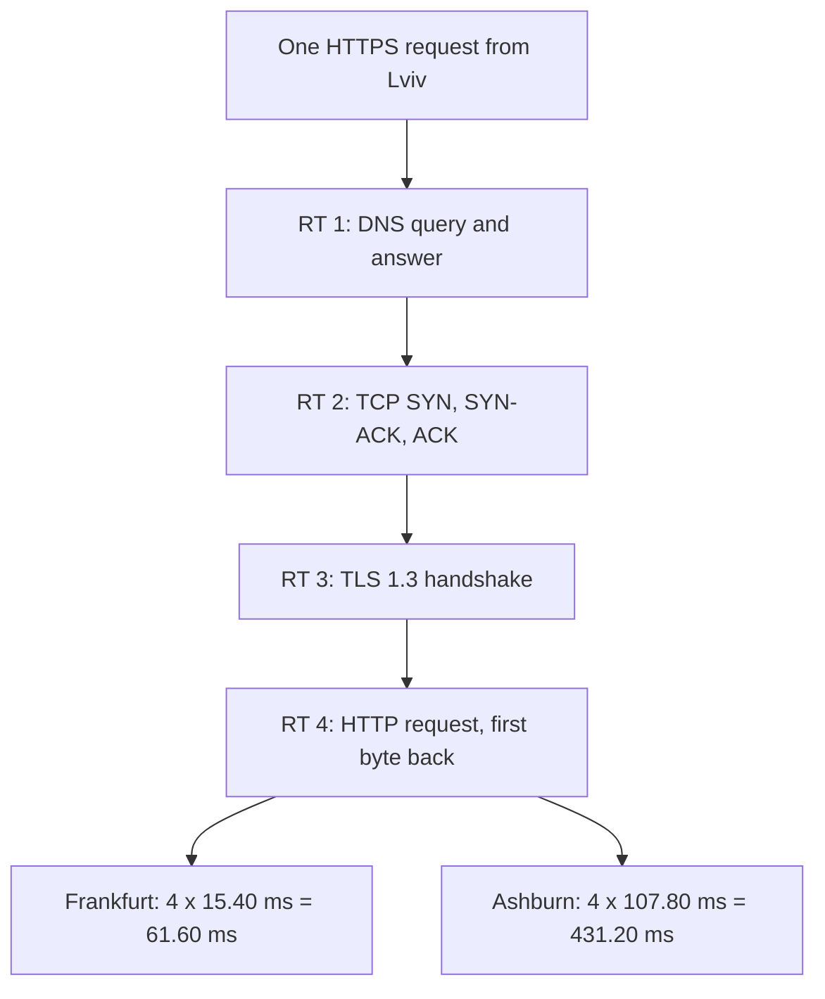
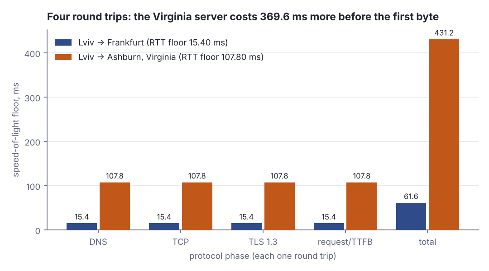

# Latency vs bandwidth, RTT, and why the speed of light is the budget

> Networking, modern · Beginner · ~20 min · rung 2 of 16 · needs: What really happens in a TCP handshake and teardown (networking-01)

## Why this matters

Your services exchange small messages, and for small messages the invoice number — bandwidth — barely moves the clock; distance and the count of round trips do. Knowing the physics floor tells you in advance which optimisation can pay (a closer region, a reused connection, one fewer round trip) and which cannot (a fatter pipe). It also trains the reflex you need one rung further on: separate the part of a system that waits from the part that streams — the same split that decides whether an LLM server is slow at the first token or slow at the rest.

## The idea

Bandwidth is capacity. Latency is time. They are not interchangeable, and the Cloudflare glossary puts the distinction in one line:

> "Latency is a measurement of time, not of how much data is downloaded over time."
> — Cloudflare, *What is latency?*, accessed 2026-10-21, https://www.cloudflare.com/learning/performance/glossary/what-is-latency/

### The four delays

Every message pays four delays at every hop (HPBN ch. 1, "The Many Components of Latency"). **Propagation delay** is distance divided by signal speed. **Transmission delay** is the packet's bits divided by the link's data rate — pushing bits onto the wire. **Processing delay** is the router reading the header. **Queuing delay** is the packet waiting its turn in a buffer. Total latency is their sum, and which one dominates depends on how much data you are moving.

```rust
let rtt_ms = 107.8_f64;
let link_mbps = 100.0_f64;
for (what, bytes) in [("1 KB API reply", 1024.0), ("50 MB file", 50e6)] {
    let tx_ms = bytes * 8.0 / (link_mbps * 1e6) * 1000.0;
    println!("{what}: transmission {tx_ms:.2} ms, propagation {:.2} ms", rtt_ms / 2.0);
}
```

```text
1 KB API reply: transmission 0.08 ms, propagation 53.90 ms
50 MB file: transmission 4000.00 ms, propagation 53.90 ms
```

On a 100 Mbps link the 1 KB reply spends 0.08 ms on the wire and 53.90 ms in flight: propagation is 674× transmission, so the link rate is irrelevant. The 50 MB file inverts it — 4000 ms of transmission against the same 53.90 ms — which is why doubling bandwidth halves a download and does nothing for an API call.

### Distance is the floor

Light in a vacuum does 299,792,458 m/s; in glass the refractive index of the fibre slows it, typically to between 1.4 and 1.6 times slower (HPBN ch. 1, "Speed of Light and Propagation Latency").

> "But to keep it simple, the rule of thumb is to assume that the speed of light in fiber is around 200,000,000 meters per second, which corresponds to a refractive index of ~1.5."
> — Ilya Grigorik, *High Performance Browser Networking*, ch. 1, "Speed of Light and Propagation Latency", 2013, https://hpbn.co/primer-on-latency-and-bandwidth/

That is 200,000 km/s, and it gives you an RTT floor from a map alone. Lviv to Ashburn, Virginia is about 7,700 km great-circle; fibre does not follow great circles, so multiply by a path factor — 1.4 is a conservative allowance for the detours real cables take:

```rust
let gc_km = 7700.0_f64;
let fibre_km = gc_km * 1.4;
let one_way_ms = fibre_km / 200_000.0 * 1000.0;
println!("one way {one_way_ms:.1} ms, rtt {:.1} ms", 2.0 * one_way_ms);
```

```text
one way 53.9 ms, rtt 107.8 ms
```

107.8 ms is a floor, not an estimate: no protocol, no CDN and no amount of money buys below it on that path. HPBN's own table of great-circle floors makes the shape clear, and the book warns that even those are optimistic because they assume the shortest possible fibre path (HPBN ch. 1, Table 1-1).



*Figure 1: One-way and round-trip floors for three routes; the round trip is simply double the one-way time. Adapted from High Performance Browser Networking, ch. 1, Table 1-1, https://hpbn.co/primer-on-latency-and-bandwidth/*

### RTT is the unit, and protocols spend several

One-way latency is what physics charges; RTT is what your code feels, because you only learn anything when the answer comes back.

> "RTT is equal to double the amount of latency, since data has to travel in both directions — there and back again."
> — Cloudflare, *What is latency?*, accessed 2026-10-21, https://www.cloudflare.com/learning/performance/glossary/what-is-latency/

A cold HTTPS request spends roughly four round trips before the first byte: DNS, the TCP three-way handshake, the TLS 1.3 handshake, and the request. Each is multiplied by the same RTT, so a distant server does not cost one RTT more — it costs the RTT difference times the number of round trips.



*Figure 2: The same four round trips cost 61.60 ms to Frankfurt and 431.20 ms to Virginia; the gap is the RTT difference multiplied by four. Generated from the Step 1 and Step 2 lab output.*



*Figure 3: Each protocol phase costs one full RTT, so the 92.40 ms RTT gap becomes 369.60 ms before the first byte. Generated from the lab output below.*

### Bandwidth-delay product

Throughput matters once the transfer is large, and the bridge between the two is the bandwidth-delay product: link capacity × end-to-end delay, the maximum unacknowledged data that can be in flight at once (HPBN ch. 2, "Bandwidth-Delay Product"). A window smaller than that stalls waiting for ACKs and never fills the pipe.

```rust
let rtt_s = 0.1078_f64;
let bdp_bytes = 100e6_f64 * rtt_s / 8.0;
println!("bdp {:.0} bytes = {:.0} KB in flight", bdp_bytes, bdp_bytes / 1024.0);
println!("a 65535-byte window caps it at {:.2} Mbps", 65535.0 * 8.0 / rtt_s / 1e6);
```

```text
bdp 1347500 bytes = 1316 KB in flight
a 65535-byte window caps it at 4.86 Mbps
```

To use 100 Mbps across that 107.8 ms path you must keep 1,316 KB in flight. The original 16-bit TCP window maxes out at 65,535 bytes — 4.86 Mbps on this path, whatever you pay for. That is why window scaling exists, and why window size is a function of RTT.

### Latency under load is not the latency you pinged

The last hop is the other surprise. Per the FCC's "Measuring Broadband America" reports, US last-mile latency runs 10–20 ms for fibre, 15–40 ms for cable and 30–65 ms for DSL (HPBN ch. 1, "Last-Mile Latency") — tens of milliseconds gone before the packet leaves the neighbourhood. And an idle ping measures an empty queue: under load, oversized router buffers hold packets instead of dropping them (bufferbloat) and queuing delay swamps the rest (HPBN ch. 1, "Bufferbloat in Your Local Router"). Measure while the link is busy, or you measure the wrong number.

## Lab

**The question:** for a request from Lviv, how much of the wait is physics, and how small does the rest get once distance is removed?

The Rust program computes the fibre floor to two cities, turns it into a four-round-trip budget, then measures real TCP round trips on loopback — where distance is zero — so you can see what is left when propagation is taken out of the equation. It needs no crates; save it as `src/main.rs` in a fresh `cargo new` project and `cargo run --release`.

### Step 1: compute the fibre floor from a map

`step1_fibre_floor` takes the great-circle distance to each city, multiplies it by the 1.4 path factor to approximate the real cable route, divides by 200,000 km/s, and prints the one-way time, the RTT and four RTTs — plus the vacuum time beside it, so you can see how little room is left above the hard physical limit.

### Step 2: turn the floor into a protocol budget

`step2_phase_budget` charges one full RTT to each of DNS, TCP, TLS 1.3 and the request itself, then prints the RTT difference between the two cities multiplied by the number of round trips. This is the number that decides a region choice.

### Step 3: measure a real round trip with the distance removed

`start_echo_server` binds a TCP echo server on `127.0.0.1:0` with a thread per connection. `step3_loopback_rtt` opens one connection, sets `set_nodelay(true)` so Nagle's algorithm does not hold small writes back, sends 100 short messages and times each with `Instant::now()`, printing the first five individually before the min/p50/p99.

### Step 4: time the connect itself

`step4_connect_only` times `TcpStream::connect` 50 times. `connect` returns after the handshake completes, so on a real network this is one RTT of pure setup; on loopback it is the cost of the syscalls and the scheduler with no wire at all.

The whole program:

```rust
// file: main.rs
use std::io::{BufRead, BufReader, Write};
use std::net::{TcpListener, TcpStream};
use std::thread;
use std::time::Instant;

const C_VACUUM_KM_S: f64 = 299_792.458; // speed of light in vacuum, km/s
const FIBRE_KM_S: f64 = 200_000.0; // HPBN ch. 1 rule of thumb: n ~= 1.5
const PATH_FACTOR: f64 = 1.4; // real fibre routes are longer than great circle
const ROUND_TRIPS: f64 = 4.0; // DNS + TCP + TLS 1.3 + request/TTFB

struct Hop {
    name: &'static str,
    great_circle_km: f64,
}

fn percentile(sorted_us: &[f64], p: f64) -> f64 {
    let idx = ((p / 100.0) * (sorted_us.len() as f64 - 1.0)).round() as usize;
    sorted_us[idx]
}

fn step1_fibre_floor() -> Vec<(&'static str, f64, f64)> {
    let hops = [
        Hop { name: "Lviv -> Frankfurt", great_circle_km: 1100.0 },
        Hop { name: "Lviv -> Ashburn, Virginia", great_circle_km: 7700.0 },
    ];
    println!("== Step 1: speed-of-light floor (fibre path factor {PATH_FACTOR}, {FIBRE_KM_S:.0} km/s)");
    println!(
        "{:<26} {:>9} {:>9} {:>10} {:>10} {:>10} {:>12}",
        "route", "gc_km", "fibre_km", "vac_1way", "fib_1way", "fib_rtt", "4xRTT_total"
    );
    let mut out = Vec::new();
    for h in hops.iter() {
        let fibre_km = h.great_circle_km * PATH_FACTOR;
        let vac_one_way_ms = h.great_circle_km / C_VACUUM_KM_S * 1000.0;
        let fib_one_way_ms = fibre_km / FIBRE_KM_S * 1000.0;
        let rtt_ms = 2.0 * fib_one_way_ms;
        let total_ms = ROUND_TRIPS * rtt_ms;
        println!(
            "{:<26} {:>9.0} {:>9.0} {:>8.2}ms {:>8.2}ms {:>8.2}ms {:>10.2}ms",
            h.name, h.great_circle_km, fibre_km, vac_one_way_ms, fib_one_way_ms, rtt_ms, total_ms
        );
        out.push((h.name, rtt_ms, total_ms));
    }
    println!();
    out
}

fn step2_phase_budget(floors: &[(&'static str, f64, f64)]) {
    println!("== Step 2: each protocol phase as a multiple of the RTT floor");
    println!("{:<26} {:>9} {:>9} {:>9} {:>9} {:>9}", "route", "dns", "tcp", "tls", "ttfb", "total");
    for (name, rtt, total) in floors {
        println!(
            "{:<26} {:>7.2}ms {:>7.2}ms {:>7.2}ms {:>7.2}ms {:>7.2}ms",
            name, rtt, rtt, rtt, rtt, total
        );
    }
    let far = floors[1].1 - floors[0].1;
    println!("RTT difference {:.2} ms x {} round trips = {:.2} ms added", far, ROUND_TRIPS as u32, far * ROUND_TRIPS);
    println!();
}

fn start_echo_server() -> std::net::SocketAddr {
    let listener = TcpListener::bind("127.0.0.1:0").expect("bind");
    let addr = listener.local_addr().expect("local_addr");
    thread::spawn(move || {
        for stream in listener.incoming() {
            let Ok(stream) = stream else { continue };
            thread::spawn(move || {
                stream.set_nodelay(true).ok();
                let mut writer = stream.try_clone().expect("clone");
                let reader = BufReader::new(stream);
                for line in reader.lines() {
                    let Ok(line) = line else { break };
                    if writeln!(writer, "{line}").is_err() {
                        break;
                    }
                    writer.flush().ok();
                }
            });
        }
    });
    addr
}

fn step3_loopback_rtt(addr: std::net::SocketAddr) {
    let stream = TcpStream::connect(addr).expect("connect");
    stream.set_nodelay(true).expect("nodelay");
    let mut writer = stream.try_clone().expect("clone");
    let mut reader = BufReader::new(stream);
    let mut samples_us: Vec<f64> = Vec::with_capacity(100);
    let mut buf = String::new();
    println!("== Step 3: 100 small messages over one warm loopback connection (set_nodelay(true))");
    for i in 0..100 {
        buf.clear();
        let t0 = Instant::now();
        writeln!(writer, "ping-{i:03}").expect("write");
        writer.flush().expect("flush");
        reader.read_line(&mut buf).expect("read");
        let us = t0.elapsed().as_secs_f64() * 1e6;
        samples_us.push(us);
        if i < 5 || i == 99 {
            println!("  msg {:>3}  echo {:<10} rtt {:>8.1} us", i, buf.trim(), us);
        }
    }
    samples_us.sort_by(|a, b| a.partial_cmp(b).unwrap());
    println!(
        "  loopback rtt: min {:.1} us  p50 {:.1} us  p99 {:.1} us",
        samples_us[0],
        percentile(&samples_us, 50.0),
        percentile(&samples_us, 99.0)
    );
    println!();
}

fn step4_connect_only(addr: std::net::SocketAddr) {
    let mut samples_us: Vec<f64> = Vec::with_capacity(50);
    println!("== Step 4: connect-only mode (TcpStream::connect = one handshake round trip)");
    for i in 0..50 {
        let t0 = Instant::now();
        let s = TcpStream::connect(addr).expect("connect");
        let us = t0.elapsed().as_secs_f64() * 1e6;
        drop(s);
        samples_us.push(us);
        if i < 3 {
            println!("  connect {:>2}  {:>8.1} us", i, us);
        }
    }
    samples_us.sort_by(|a, b| a.partial_cmp(b).unwrap());
    println!(
        "  connect rtt: min {:.1} us  p50 {:.1} us  p99 {:.1} us",
        samples_us[0],
        percentile(&samples_us, 50.0),
        percentile(&samples_us, 99.0)
    );
}

fn main() {
    let floors = step1_fibre_floor();
    step2_phase_budget(&floors);
    let addr = start_echo_server();
    step3_loopback_rtt(addr);
    step4_connect_only(addr);
}
```

Run it (here it was run with the lesson runner; locally, `cargo run --release`):

```text
--- block 4 · rust · main.rs · OK
== Step 1: speed-of-light floor (fibre path factor 1.4, 200000 km/s)
route                          gc_km  fibre_km   vac_1way   fib_1way    fib_rtt  4xRTT_total
Lviv -> Frankfurt               1100      1540     3.67ms     7.70ms    15.40ms      61.60ms
Lviv -> Ashburn, Virginia       7700     10780    25.68ms    53.90ms   107.80ms     431.20ms

== Step 2: each protocol phase as a multiple of the RTT floor
route                            dns       tcp       tls      ttfb     total
Lviv -> Frankfurt            15.40ms   15.40ms   15.40ms   15.40ms   61.60ms
Lviv -> Ashburn, Virginia   107.80ms  107.80ms  107.80ms  107.80ms  431.20ms
RTT difference 92.40 ms x 4 round trips = 369.60 ms added

== Step 3: 100 small messages over one warm loopback connection (set_nodelay(true))
  msg   0  echo ping-000   rtt    139.9 us
  msg   1  echo ping-001   rtt     32.4 us
  msg   2  echo ping-002   rtt     21.7 us
  msg   3  echo ping-003   rtt     18.8 us
  msg   4  echo ping-004   rtt     61.7 us
  msg  99  echo ping-099   rtt    184.8 us
  loopback rtt: min 18.8 us  p50 42.0 us  p99 180.3 us

== Step 4: connect-only mode (TcpStream::connect = one handshake round trip)
  connect  0      42.4 us
  connect  1      11.4 us
  connect  2     136.9 us
  connect rtt: min 7.8 us  p50 96.0 us  p99 1805.7 us
```

### Reading the output

Step 1 columns, left to right: `gc_km` is the great-circle distance; `fibre_km` is that times the 1.4 path factor; `vac_1way` is the one-way time if the signal travelled at `c` in vacuum; `fib_1way` is the one-way time in fibre; `fib_rtt` is the round trip; `4xRTT_total` is four round trips, the cold-HTTPS budget. Lower is better everywhere, and none of these numbers can be improved by buying bandwidth — only by moving the server.

| route | great circle | fibre path | one way in fibre | RTT floor | 4 round trips |
|---|---|---|---|---|---|
| Lviv → Frankfurt | 1,100 km | 1,540 km | 7.70 ms | 15.40 ms | 61.60 ms |
| Lviv → Ashburn, Virginia | 7,700 km | 10,780 km | 53.90 ms | 107.80 ms | 431.20 ms |

The Ashburn row traced with digits: 7,700 km × 1.4 = 10,780 km of fibre. 10,780 km ÷ 200,000 km/s = 0.0539 s = 53.90 ms one way. Doubled: 107.80 ms RTT. Times four round trips: 431.20 ms. Against Frankfurt's 15.40 ms RTT the difference is 107.80 − 15.40 = 92.40 ms per round trip, and 92.40 × 4 = 369.60 ms of extra wait before a single byte of your JSON arrives.

**Verdict:** the choice of region, not the size of the pipe, decides whether a cold API call starts in 60 ms or in 430 ms.

Steps 3 and 4 measure the same round trip with the distance removed: `rtt` is the time from `writeln!` to the echoed line coming back, and `connect` is the time for `TcpStream::connect` to return. Lower is better; the spread between min, p50 and p99 is the scheduler and the queues, not the wire.

| measurement | min | p50 | p99 |
|---|---|---|---|
| loopback echo round trip (Step 3) | 18.8 µs | 42.0 µs | 180.3 µs |
| `TcpStream::connect` (Step 4) | 7.8 µs | 96.0 µs | 1805.7 µs |

Traced with digits: the p50 loopback round trip is 42.0 µs = 0.042 ms, against the 107.80 ms Ashburn floor. 107.80 ÷ 0.042 ≈ 2,567. The same request-response exchange, same kernel, same code — the only thing added in production is 10,780 km of glass. Note also that the p99 is 4–20× the min on an idle machine with no network at all: that spread is queuing and scheduling, the two delays that an idle measurement never shows you.

**Verdict:** with distance removed the same round trip costs 42.0 µs at the median — about 2,600× less than the 107.80 ms Ashburn floor. Essentially all of a cross-ocean wait is propagation and queuing, not your code.

### Step 5: measure your own path (run locally)

This container has no ICMP and cannot open TCP to the outside world, so these two commands are for your Mac. The numbers below are illustrative of a Lviv fibre connection — they were **not** measured in this run.

```bash
ping -c 10 1.1.1.1
ping -c 10 1.1.1.1 & curl -s -o /dev/null 'https://speed.cloudflare.com/__down?bytes=200000000' ; wait
curl -s -o /dev/null -w 'dns %{time_namelookup} tcp %{time_connect} tls %{time_appconnect} ttfb %{time_starttransfer} total %{time_total}\n' https://example.com
```

Expected output — run locally:

```text
--- 1.1.1.1 ping statistics ---
10 packets transmitted, 10 packets received, 0.0% packet loss
round-trip min/avg/max/stddev = 8.912/10.431/13.880/1.402 ms

dns 0.021  tcp 0.054  tls 0.112  ttfb 0.169  total 0.170
```

Read the `curl` line as round trips: `tcp` minus `dns` is one RTT (0.054 − 0.021 = 0.033 s), `tls` minus `tcp` is one more (0.112 − 0.054 = 0.058 s, two RTTs' worth on TLS 1.2 or one on 1.3 plus certificate bytes), and `ttfb` minus `tls` is the request round trip plus the server's own time (0.169 − 0.112 = 0.057 s). Divide each by your measured ping RTT and you have the phase count. The second command is the bufferbloat check: run the ping while a large download saturates the link and compare the `avg` with the idle run — a rise from ~10 ms to 100 ms or more is queuing delay, and it is the latency your users actually get.

**Verdict:** an idle ping is the best case; the number that matters is the one measured while the link is busy.

### Cause → consequence

1. **Cause.** Signals travel at about 200,000 km/s in fibre, and real cable routes are longer than the straight line between two cities.
2. **Mechanism.** Distance therefore fixes a one-way propagation time that no protocol can shorten, and every request–response exchange pays it twice — one RTT.
3. **Consequence.** A cold HTTPS call spends roughly four RTTs before the first byte, so moving a server from 15.40 ms away to 107.80 ms away adds 369.60 ms, while loopback — the same code with the distance removed — answers in tens of microseconds.
4. **In practice.** Optimise in this order: cut round trips (connection reuse, HTTP/2 or HTTP/3, TLS session resumption, fewer sequential calls), then cut distance (region placement, CDN, anycast), and only then look at bandwidth — and size TCP windows from the bandwidth-delay product, not from a default.

## Self-check

1. A colleague proposes upgrading your egress link from 1 Gbps to 10 Gbps to fix a slow 2 KB JSON API served from Virginia. What do you tell him, with a number? <details><summary>Answer</summary>It cannot help. At 1 Gbps a 2 KB reply takes 2048 × 8 ÷ 1e9 = 0.016 ms of transmission time, while the one-way propagation floor from Lviv to Ashburn is 53.90 ms and the RTT floor is 107.80 ms. Transmission is roughly 0.015% of the wait; a 10× faster link removes 0.0144 ms. Move the endpoint closer or remove round trips instead.</details>
2. Your service makes a cold HTTPS call per request to a partner 107.80 ms away. You enable connection reuse so DNS, TCP and TLS are paid once and amortised away. How much of the 431.20 ms budget is left, and why? <details><summary>Answer</summary>One round trip — 107.80 ms — because the request and its first byte still cross the ocean and back. Reuse removes the three setup round trips (323.40 ms); physics keeps the fourth. That is the ceiling on what connection pooling can buy you, and it is why "one fewer round trip" is a real optimisation while "more bandwidth" is not.</details>
3. An idle `ping` to your gateway reports 9 ms, but users complain during the nightly backup. Which of the four delays changed, and how would you prove it? <details><summary>Answer</summary>Queuing delay. The backup fills the uplink, oversized router buffers hold packets rather than dropping them (bufferbloat), and packets wait in the queue — propagation, transmission and processing are unchanged. Prove it by running the same `ping` while the backup runs: if the average jumps from 9 ms into the tens or hundreds of milliseconds and falls back when the transfer stops, the extra time was spent in a buffer.</details>

## Sources

- [High Performance Browser Networking, ch. 1 "Primer on Latency and Bandwidth"](https://hpbn.co/primer-on-latency-and-bandwidth/) — Ilya Grigorik, O'Reilly, 2013 — the four delay components, the 200,000,000 m/s fibre rule of thumb and refractive index of ~1.5, Table 1-1's per-route floors (redrawn as Figure 1), the FCC last-mile latency ranges and the bufferbloat note (accessed 2026-10-21).
- [High Performance Browser Networking, ch. 2 "Building Blocks of TCP"](https://hpbn.co/building-blocks-of-tcp/) — Ilya Grigorik, O'Reilly, 2013 — the definition of bandwidth-delay product as capacity × end-to-end delay, and why window size must follow RTT (accessed 2026-10-21).
- [What is latency? (Cloudflare Learning Center)](https://www.cloudflare.com/learning/performance/glossary/what-is-latency/) — Cloudflare — the latency-is-time-not-volume distinction and the definition of RTT as double the one-way latency; Cloudflare's `https://speed.cloudflare.com/__down` endpoint is used in Step 5 to load the link for the bufferbloat check (accessed 2026-10-21).

## Next on this track
Next on Networking, modern: **Congestion control intuition: slow start, CUBIC vs BBR** (rung 3 of 16, Beginner).
