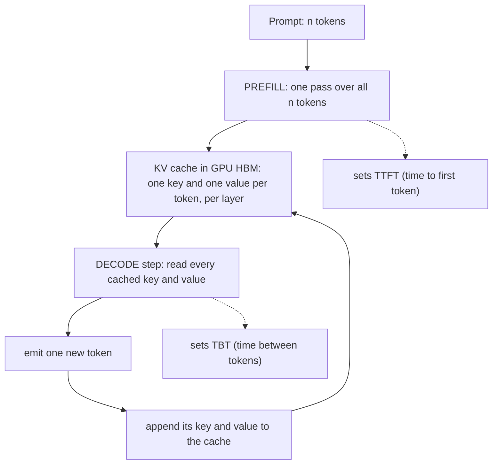
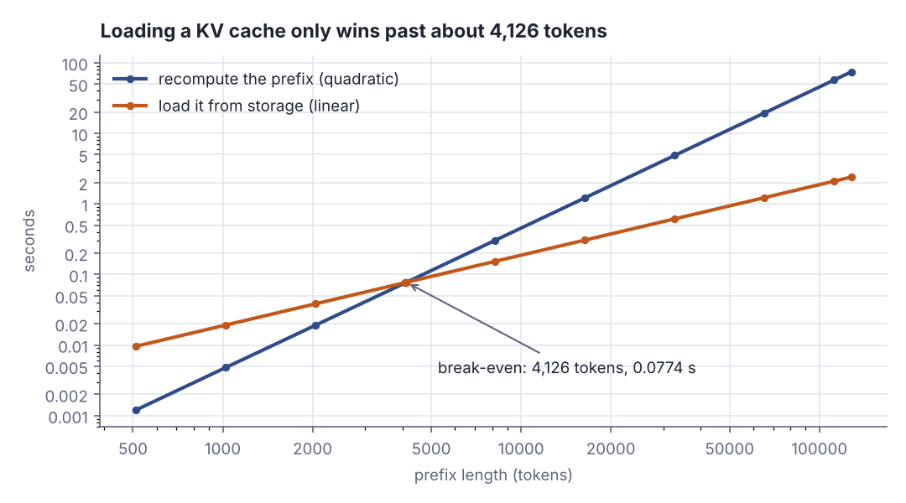
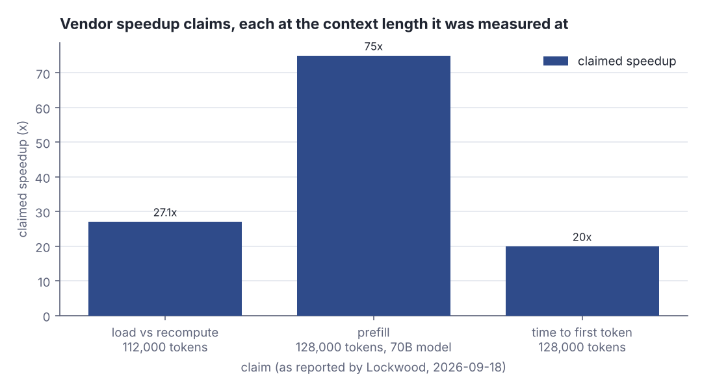

# KV caches: why the first token is slow and the rest are bandwidth-bound

> Fresh · AI / ML foundations · Intermediate · ~25 min · from today's feeds

## Why this matters
Today's item is Glenn K. Lockwood's post *What are KV caches really?* (2026-09-18), written by a storage and HPC engineer who spends his days on bandwidth, and it explains the one data structure that decides how an LLM *feels*: why your first token takes seconds and every token after it takes milliseconds.
The item is 33 days old — nothing newer could be fetched in this run (the first-party candidates were unreachable), so the freshness window was widened from 30 to 90 days, the `freshness_days_max` in `dojo/feeds.yaml`.
It is worth 25 minutes because it splits "the model is slow" into two budgets you can size separately — one limited by arithmetic, one limited by memory bandwidth — and hands you a ruler for the speedup numbers vendors print on slides.

## Primer
This builds on two things you already have: a model is a function that turns input numbers into output numbers (rung 1, *What machine learning actually optimises*), and a vector is an ordered list of numbers you can multiply and add elementwise (rung 4, *Vectors and matrices as data*). Nothing else is assumed.

A **token** is a chunk of text — a word, a word-piece, a punctuation mark — mapped to an integer id by a fixed vocabulary. A prompt is a list of such ids. The model emits one new id at a time and appends it to the list; that list, everything the model has seen so far, is the **prefix**.

A **transformer** is the architecture behind today's LLMs. It turns each token id into a vector of a few thousand numbers and pushes the whole list of vectors through a stack of identical layers. Inside each layer, the step called **attention** lets one token's vector look back at the earlier tokens' vectors and pull in what it needs.

"Look back" is three vectors per token, per layer. From a token's vector the layer computes a **query** (what this token is looking for), a **key** (what this token offers to be matched on) and a **value** (what it contributes when it is matched). To produce the next token the model takes the newest token's query, dot-products it against the **key** of every earlier token, turns those scores into weights, and sums the earlier tokens' **values** with those weights. So generating one token needs every earlier token's key and value — and nothing else about those tokens.

Two properties make storing them safe. Keys and values depend only on tokens that came before, and once computed they are frozen:

> "Keys and values for each output token never change after they're generated"
> — Glenn K. Lockwood, *What are KV caches really?*, 2026-09-18, https://blog.glennklockwood.com/2026/09/what-are-kv-caches-really.html

A **KV cache** is exactly that: the keys and values for every token of the prefix, kept so the model never computes them twice.

## The idea
Serving an LLM is two different jobs wearing one name. **Prefill** reads the whole prompt in one pass and computes a key and a value for every token in it; that pass is what you wait through before the first word appears, so it sets **time to first token (TTFT)**. **Decode** then produces output one token at a time: each step reads the cached keys and values, emits one token, and appends that token's own key and value to the cache. One decode step is the **time between tokens (TBT)**. The secondary source names the mapping directly — "The time to first token is given by the latency of the prefill phase" and "the time per output token is the latency of a single decode step" (Benjamin Merkel, *Prefill and Decode for Concurrent Requests*, 2025-04-16).

Without the cache, every decode step would have to redo prefill over the whole prefix:

> "Without a KV cache, you'd experience the prefill lag every time the LLM spits out a single next token."
> — Glenn K. Lockwood, *What are KV caches really?*, 2026-09-18, https://blog.glennklockwood.com/2026/09/what-are-kv-caches-really.html

Lockwood's own illustration is one second of prefill per token; recomputing after the 1st to 4th tokens then costs 1 s, 4 s, 9 s and 16 s (Lockwood, 2026-09-18). That is quadratic growth against linear:

```scala
val perToken = 1.0
for n <- 1 to 4 do
  val noCache = perToken * n * n
  val cached  = perToken * n
  println(f"after token $n: no cache ${noCache}%4.1f s, cached ${cached}%4.1f s")
```

```text
after token 1: no cache  1.0 s, cached  1.0 s
after token 2: no cache  4.0 s, cached  2.0 s
after token 3: no cache  9.0 s, cached  3.0 s
after token 4: no cache 16.0 s, cached  4.0 s
```

The two columns are equal at the first token and already 4× apart at the fourth. Without a cache, response time grows with the *square* of the answer's length; with one, the per-token cost stops depending on how much you have already written.


*Figure 1: the two phases and the loop between them — prefill fills the cache once, decode reads all of it and appends one entry per token. Source: drawn from Glenn K. Lockwood, What are KV caches really?, 2026-09-18, https://blog.glennklockwood.com/2026/09/what-are-kv-caches-really.html*

Because a key depends on its token *and everything before it*, a cache entry is only reusable when the prefix in front of it is byte-for-byte the same. Two prompts that differ in their first word share no usable cache at all (Lockwood, 2026-09-18). A three-line check:

```scala
val base = "You are a careful Scala reviewer"
val same = "You are a careful Scala reviewer; be brief"
val diff = "Hello, you are a careful Scala reviewer"
def shared(a: String, b: String) = a.zip(b).takeWhile(p => p._1 == p._2).length
println(s"base vs same: ${shared(base, same)} of ${base.length} chars reusable")
println(s"base vs diff: ${shared(base, diff)} of ${base.length} chars reusable")
```

```text
base vs same: 32 of 32 chars reusable
base vs diff: 0 of 32 chars reusable
```

Appending to the prefix keeps everything; prepending six characters throws all of it away. That single fact is why a stable system prompt earns cache hits and a prompt that starts with a timestamp never does.

The deeper point is that the two phases hit two different hardware limits. **Compute-bound** means the chip's arithmetic units are the bottleneck: it has the data, it is busy multiplying. **Memory-bandwidth-bound** means the arithmetic units are idle waiting for bytes to arrive from memory. Prefill processes thousands of tokens at once, so it has plenty of arithmetic to keep the chip busy — "Because of the parallelized calculation for all input tokens, the prefill phase is very GPU compute-intensive" (Merkel, 2025-04-16). Decode does the opposite: it reads a huge cache to produce a single token, and "the decode step for an individual output token utilizes very little computational power" (Merkel, 2025-04-16), so "the speed is typically limited by the GPU memory bandwidth" (Merkel, 2025-04-16). Lockwood says the same in one line:

> "KV cache is also the reason why prefill is compute-bound (benefitting from more GPU FLOPS) while decode is memory bandwidth-bound"
> — Glenn K. Lockwood, *What are KV caches really?*, 2026-09-18, https://blog.glennklockwood.com/2026/09/what-are-kv-caches-really.html

This is the same latency-versus-throughput split you meet one layer down in networking, where a fat pipe does nothing for a round trip: more arithmetic throughput does not shorten a memory read.

So where does the cache have to live? **HBM** is High Bandwidth Memory — the stacks of DRAM sitting on the GPU package itself, the fastest memory the chip can reach, and the scarcest. Lockwood is blunt about the active cache:

> "The KV cache used during decode is always stored in GPU HBM."
> — Glenn K. Lockwood, *What are KV caches really?*, 2026-09-18, https://blog.glennklockwood.com/2026/09/what-are-kv-caches-really.html

> "Going off-GPU every time a new token is being generated makes using a GPU pointless for decode."
> — Glenn K. Lockwood, *What are KV caches really?*, 2026-09-18, https://blog.glennklockwood.com/2026/09/what-are-kv-caches-really.html

That leaves a narrow, real role for slow caches on SSD or remote storage: holding a long shared prefix, parking an idle conversation, serving long-context and tool-calling workloads — and only ever for prefill. The test is arithmetic, not opinion: "The time it takes to recompute keys and values must be longer than the time it takes to read keys and values from cache" (Lockwood, 2026-09-18). Recompute cost grows faster than linearly in the prefix length, because attention compares every token with every earlier one; cache-load cost is bytes divided by bandwidth, which is linear. Two curves with different slopes cross exactly once, and below the crossing the cache is a pessimisation.


*Figure 2: the crossing point. Below about 4,126 tokens recomputing the prefix is faster than loading its cache from storage; above it the gap widens without limit. Generated from the lab output below.*

The vendor numbers Lockwood quotes sit far to the right of that crossing, which is the whole trick. One vendor reports 57 s to recompute against 2.1 s to load at 112K tokens, "over 27X faster" (vendor claim reported by Lockwood, 2026-09-18) — and 112K ÷ 27 puts the break-even around 4K tokens, below which recomputing wins. Another claims "up to 75X faster prefill" at 128,000 tokens on a 70B-parameter model, and a third "TTFT by 20x" at 128K tokens alongside a "90%" inference-efficiency gain (all vendor claims reported by Lockwood, 2026-09-18). None of these are independent measurements; they are marketing figures taken on prefill only, at very long contexts, with large models.


*Figure 3: the three vendor speedup claims, each shown at the context length it was measured at — the number is inseparable from the setup. Adapted from Glenn K. Lockwood, What are KV caches really?, https://blog.glennklockwood.com/2026/09/what-are-kv-caches-really.html*

## Lab
**The question:** at what prefix length does loading a KV cache from slow storage beat recomputing it — and what does that same read cost if you try it during decode?

### Step 1 — calibrate two cost models on the vendor's own figures
We fix the two curves with the numbers Lockwood reports: 57 s to recompute and 2.1 s to load at 112,000 tokens (vendor claim reported by Lockwood, 2026-09-18). Recompute is modelled as quadratic in the prefix length (the attention term), cache load as bytes ÷ bandwidth, which is linear. The byte count comes from a size model of our own — a 70B-class model at fp16 with 80 layers and 8 key/value heads of 128 dimensions — which is an assumption, not a claim from the source.

### Step 2 — print a per-prefix-length table and let the break-even fall out
### Step 3 — price one decode step's cache read, in HBM and off it

```scala
// file: Lab.scala
// When does loading a KV cache from slow storage beat recomputing it -- and what does the
// same read cost during decode? Calibrated on the figures Lockwood reports (2026-09-18).

@main def lab(): Unit =

  // ---------- Step 1: calibrate both cost models ----------
  val calTokens   = 112000.0   // vendor measured at 112K tokens
  val recompAtCal = 57.0       // seconds to recompute keys and values there
  val loadAtCal   = 2.1        // seconds to load them from storage there

  // our own size model for a 70B-class model: fp16, 80 layers, 8 KV heads x 128 dims, K and V
  val layers = 80
  val kvDims = 8 * 128
  val bytesPerValue = 2
  val bytesPerToken = layers * kvDims * 2 * bytesPerValue
  val calBytes  = calTokens * bytesPerToken
  val bandwidth = calBytes / loadAtCal          // bytes/s implied by the 2.1 s load

  println("Step 1 -- calibration")
  println(f"  KV bytes per token      = $layers layers x $kvDims dims x 2 (K,V) x $bytesPerValue B = $bytesPerToken%,d B")
  println(f"  KV bytes at $calTokens%,.0f tokens = ${calBytes / 1e9}%.2f GB")
  println(f"  implied read bandwidth  = ${calBytes / 1e9}%.2f GB / $loadAtCal%.1f s = ${bandwidth / 1e9}%.2f GB/s")
  println(f"  recompute model (attention is quadratic): t(n) = $recompAtCal%.1f s x (n / $calTokens%,.0f)^2")
  println(f"  load model (bytes / bandwidth, linear):   t(n) = $loadAtCal%.1f s x (n / $calTokens%,.0f)")
  println(f"  a purely LINEAR recompute model would hold the ratio at ${recompAtCal / loadAtCal}%.1fx forever -- no break-even")
  val breakEven = calTokens * loadAtCal / recompAtCal
  println(f"  break-even where the two models cross: n* = $calTokens%,.0f x $loadAtCal%.1f / $recompAtCal%.1f = $breakEven%,.1f tokens")
  println()
  println("  vendor claims reported by Lockwood (reported, not independently measured):")
  println(f"    ${recompAtCal / loadAtCal}%.1fx  load instead of recompute, at 112,000 tokens")
  println("    75.0x  prefill, at 128,000 tokens on a 70B model")
  println("    20.0x  time to first token, at 128,000 tokens")
  println()

  def recompute(n: Double) = recompAtCal * math.pow(n / calTokens, 2)
  def load(n: Double)      = n * bytesPerToken / bandwidth

  // ---------- Step 2: prefill -- recompute or load? ----------
  println("Step 2 -- prefill: recompute the prefix, or load its KV cache?")
  println(f"  ${"tokens"}%9s ${"KV GB"}%8s ${"recompute s"}%12s ${"load s"}%9s ${"winner"}%10s ${"speedup"}%9s")
  val prefixes = List(512, 1024, 2048, 4096, 4126, 8192, 16384, 32768, 65536, 112000, 128000)
  for n <- prefixes do
    val nd = n.toDouble
    val r  = recompute(nd)
    val l  = load(nd)
    val gb = nd * bytesPerToken / 1e9
    val winner = if math.abs(r / l - 1.0) < 0.01 then "tie" else if r < l then "recompute" else "cache"
    println(f"  $n%9d ${gb}%8.2f ${r}%12.4f ${l}%9.4f ${winner}%10s ${r / l}%8.2fx")
  println()

  // ---------- Step 3: decode -- the same read, once per output token ----------
  println("Step 3 -- decode: one step must read the WHOLE cache, every token")
  val hbm     = 3000.0e9   // model assumption: HBM-class bandwidth, bytes/s
  val pcie    =   32.0e9   // model assumption: a 32 GB/s host link, bytes/s
  println(f"  HBM ${hbm / 1e9}%.0f GB/s, host link ${pcie / 1e9}%.0f GB/s, storage ${bandwidth / 1e9}%.2f GB/s (calibrated above)")
  println(f"  ${"tokens"}%9s ${"KV GB"}%8s ${"HBM ms"}%9s ${"link ms"}%9s ${"storage ms"}%11s ${"tok/s HBM"}%10s ${"tok/s stor"}%11s")
  for n <- List(1024, 8192, 32768, 112000) do
    val bytes = n.toDouble * bytesPerToken
    val tHbm  = bytes / hbm * 1000
    val tPcie = bytes / pcie * 1000
    val tSto  = bytes / bandwidth * 1000
    println(f"  $n%9d ${bytes / 1e9}%8.2f ${tHbm}%9.3f ${tPcie}%9.1f ${tSto}%11.1f ${1000 / tHbm}%10.0f ${1000 / tSto}%11.2f")
  println()
  val b112 = 112000.0 * bytesPerToken
  println(f"  at 112,000 tokens one decode step reads ${b112 / 1e9}%.2f GB:")
  println(f"    from HBM     ${b112 / hbm * 1000}%8.3f ms  -> inside the 100-300 ms per-token budget")
  println(f"    from storage ${b112 / bandwidth * 1000}%8.1f ms  -> ${b112 / bandwidth / (b112 / hbm)}%.0fx slower, per token, forever")
```

Run it with `python3 dojo/engine/run_lab.py 2026-10-21-2` (or `scala Lab.scala`). Real output:

```text
Step 1 -- calibration
  KV bytes per token      = 80 layers x 1024 dims x 2 (K,V) x 2 B = 327,680 B
  KV bytes at 112,000 tokens = 36.70 GB
  implied read bandwidth  = 36.70 GB / 2.1 s = 17.48 GB/s
  recompute model (attention is quadratic): t(n) = 57.0 s x (n / 112,000)^2
  load model (bytes / bandwidth, linear):   t(n) = 2.1 s x (n / 112,000)
  a purely LINEAR recompute model would hold the ratio at 27.1x forever -- no break-even
  break-even where the two models cross: n* = 112,000 x 2.1 / 57.0 = 4,126.3 tokens

  vendor claims reported by Lockwood (reported, not independently measured):
    27.1x  load instead of recompute, at 112,000 tokens
    75.0x  prefill, at 128,000 tokens on a 70B model
    20.0x  time to first token, at 128,000 tokens

Step 2 -- prefill: recompute the prefix, or load its KV cache?
     tokens    KV GB  recompute s    load s     winner   speedup
        512     0.17       0.0012    0.0096  recompute     0.12x
       1024     0.34       0.0048    0.0192  recompute     0.25x
       2048     0.67       0.0191    0.0384  recompute     0.50x
       4096     1.34       0.0762    0.0768        tie     0.99x
       4126     1.35       0.0774    0.0774        tie     1.00x
       8192     2.68       0.3049    0.1536      cache     1.99x
      16384     5.37       1.2198    0.3072      cache     3.97x
      32768    10.74       4.8791    0.6144      cache     7.94x
      65536    21.47      19.5164    1.2288      cache    15.88x
     112000    36.70      57.0000    2.1000      cache    27.14x
     128000    41.94      74.4490    2.4000      cache    31.02x

Step 3 -- decode: one step must read the WHOLE cache, every token
  HBM 3000 GB/s, host link 32 GB/s, storage 17.48 GB/s (calibrated above)
     tokens    KV GB    HBM ms   link ms  storage ms  tok/s HBM  tok/s stor
       1024     0.34     0.112      10.5        19.2       8941       52.08
       8192     2.68     0.895      83.9       153.6       1118        6.51
      32768    10.74     3.579     335.5       614.4        279        1.63
     112000    36.70    12.233    1146.9      2100.0         82        0.48

  at 112,000 tokens one decode step reads 36.70 GB:
    from HBM       12.233 ms  -> inside the 100-300 ms per-token budget
    from storage   2100.0 ms  -> 172x slower, per token, forever
```

### Reading the output

**Step 1, the calibration.** `KV bytes per token` is the size model: 80 layers × 1024 key/value dimensions × 2 (one key, one value) × 2 bytes per fp16 number = 327,680 bytes, about 320 KiB *per token*. At 112,000 tokens that is 36.70 GB, and a vendor's 2.1 s load therefore implies 36.70 ÷ 2.1 = 17.48 GB/s of read bandwidth — a fast NVMe array or a fat network link, not a disk. Lower is better for every time column below.

The break-even line is the one to keep. If recompute were *linear* in prefix length, the ratio between the curves would be 57.0 ÷ 2.1 = 27.1× at every length and the cache would always win; it is the quadratic attention term that makes the ratio shrink as the prefix shortens. Tracing the digits: the speedup is 27.142857 × (n ÷ 112,000), which equals 1 at n = 112,000 × 2.1 ÷ 57.0 = 4,126.3 tokens. That is the arithmetic behind Lockwood's own "112K ÷ 27 ≈ 4K" remark (Lockwood, 2026-09-18).

**Verdict:** the break-even is a property of the *shape* of the two curves, not of the vendor's hardware — move the bandwidth and the crossing moves, but a crossing always exists.

**Step 2, prefill.** Columns: prefix length; the cache's size in GB; seconds to recompute; seconds to load; which is faster; and the speedup, recompute ÷ load, where above 1.00× the cache wins.

| tokens | KV GB | recompute s | load s | winner | speedup |
|---:|---:|---:|---:|:---|---:|
| 512 | 0.17 | 0.0012 | 0.0096 | recompute | 0.12× |
| 1,024 | 0.34 | 0.0048 | 0.0192 | recompute | 0.25× |
| 2,048 | 0.67 | 0.0191 | 0.0384 | recompute | 0.50× |
| 4,096 | 1.34 | 0.0762 | 0.0768 | tie | 0.99× |
| 4,126 | 1.35 | 0.0774 | 0.0774 | tie | 1.00× |
| 8,192 | 2.68 | 0.3049 | 0.1536 | cache | 1.99× |
| 16,384 | 5.37 | 1.2198 | 0.3072 | cache | 3.97× |
| 32,768 | 10.74 | 4.8791 | 0.6144 | cache | 7.94× |
| 65,536 | 21.47 | 19.5164 | 1.2288 | cache | 15.88× |
| 112,000 | 36.70 | 57.0000 | 2.1000 | cache | 27.14× |
| 128,000 | 41.94 | 74.4490 | 2.4000 | cache | 31.02× |

Trace the 8,192-token row by hand: recompute = 57.0 × (8,192 ÷ 112,000)² = 57.0 × 0.073143² = 57.0 × 0.005350 = 0.3049 s; load = 8,192 × 327,680 ÷ 17.48 × 10⁹ = 2.684 × 10⁹ ÷ 1.7476 × 10¹⁰ = 0.1536 s; speedup 0.3049 ÷ 0.1536 = 1.99×. Note also that at 128,000 tokens this model gives 31.02×, not the 75× a vendor claims at that same length (vendor claim reported by Lockwood, 2026-09-18) — their setup has a bigger model and faster storage than ours.

**Verdict:** below roughly 4K tokens the cache load is dead weight; a 1K-token prompt is four times *slower* to serve from storage than to recompute. The win is real only for long, stable prefixes.

**Step 3, decode.** Columns: prefix length; cache size; milliseconds to read the whole cache once from HBM, from a 32 GB/s host link, and from the 17.48 GB/s storage calibrated in Step 1; then the ceiling on output tokens per second each implies. Higher tokens per second is better; the interactive targets to beat are "100-300ms per output token" and "a time to first token of 3 seconds or less" (Merkel, 2025-04-16).

| tokens | KV GB | HBM ms | link ms | storage ms | tok/s from HBM | tok/s from storage |
|---:|---:|---:|---:|---:|---:|---:|
| 1,024 | 0.34 | 0.112 | 10.5 | 19.2 | 8,941 | 52.08 |
| 8,192 | 2.68 | 0.895 | 83.9 | 153.6 | 1,118 | 6.51 |
| 32,768 | 10.74 | 3.579 | 335.5 | 614.4 | 279 | 1.63 |
| 112,000 | 36.70 | 12.233 | 1,146.9 | 2,100.0 | 82 | 0.48 |

The 112,000-token row is the punchline, digit by digit: 36.70 GB ÷ 3,000 GB/s = 12.233 ms from HBM, against 36.70 GB ÷ 17.48 GB/s = 2,100.0 ms from storage — the *same* 2.1 s that was a 27× win when paid once during prefill, now charged again for every single output token, 172× slower than HBM. At 8,192 tokens the storage read is already 153.6 ms, inside the 100–300 ms budget for one token but leaving nothing for the model itself.

**Verdict:** a cache that lives off the GPU is a prefill optimisation only. During decode it turns a 1,118 tokens/s ceiling into 6.51 tokens/s at 8K context, which is why nobody ships it.

> "Decode performance on a slow KV cache will look atrocious no matter what, which is why nobody does it."
> — Glenn K. Lockwood, *What are KV caches really?*, 2026-09-18, https://blog.glennklockwood.com/2026/09/what-are-kv-caches-really.html

### Cause → consequence

1. **Cause.** Generating a token needs every earlier token's key and value, and those vectors are frozen once computed (Lockwood, 2026-09-18).
2. **Mechanism.** So they are cached. Prefill computes them for the whole prompt in one parallel pass (compute-bound); each decode step then reads the entire cache and appends one entry (memory-bandwidth-bound).
3. **Consequence.** Two budgets with different cures: TTFT scales with prompt length and responds to more arithmetic throughput or to a cache hit; TBT scales with how much cache must be read per step and responds only to bandwidth. A cache held off the GPU helps the first and destroys the second — 2,100.0 ms per token at 112K context in the table above.
4. **What it means in practice.** Three things for your work. First, prompt-prefix stability is an engineering property: put the system prompt, tool schemas and retrieved documents at the front in a fixed order, and keep timestamps, request ids and shuffled context out of the opening bytes — a six-character change at position 0 cost all 32 reusable characters in the example above, and the same holds for an agent loop replaying a 30K-token conversation. Second, size TTFT and TBT separately when you promise latency: a long prompt buys you a slow first token once, while a long *answer* multiplies the per-token read by its length. Third, read vendor speedup claims as coordinates, not scalars — "over 27X faster", "up to 75X faster prefill" and "TTFT by 20x" are all prefill-only numbers at 112K–128K tokens on large models (vendor claims reported by Lockwood, 2026-09-18); ask for the context length, the phase and the model size, and if the answer is a 2K-token prompt the honest number is below 1×.

## Self-check
1. Why can a key and a value computed for a token be cached and reused, while a query cannot be reused in the same way? <details><summary>Answer</summary>Keys and values depend only on the token and the tokens before it, and "Keys and values for each output token never change after they're generated" (Lockwood, 2026-09-18), so they are valid for every later step. The query is produced by the token currently being generated and is new at every step — there is nothing earlier to reuse. Reuse also requires an identical prefix: changing the first word of a prompt invalidates the whole cache.</details>
2. A colleague proposes putting your KV cache on an NVMe tier to cut GPU memory cost, for prompts that average 1,500 tokens. What do you say, with numbers? <details><summary>Answer</summary>Below the break-even it loses twice over. In the lab model the crossing is at 4,126 tokens, so at 1,500 tokens recomputing is faster than loading — at 1,024 tokens the table shows 0.0048 s to recompute against 0.0192 s to load, a 0.25× "speedup". And it only ever applies to prefill: during decode the same storage read is charged per token, 19.2 ms at 1K context and 2,100.0 ms at 112K, because "The KV cache used during decode is always stored in GPU HBM" (Lockwood, 2026-09-18).</details>
3. Your service meets its TTFT target but output feels slow once answers get long. Which budget is failing, and would a faster GPU with more FLOPS fix it? <details><summary>Answer</summary>TBT, the per-token decode time, is failing. Decode is memory-bandwidth-bound — "the speed is typically limited by the GPU memory bandwidth" (Merkel, 2025-04-16) — so more arithmetic throughput buys nothing; more memory bandwidth, a smaller cache per token (fewer KV heads, lower precision), a shorter context or batching more requests together does, since "the GPU utilization can be increased by batch processing of multiple requests" (Merkel, 2025-04-16).</details>

## Sources
- [What are KV caches really?](https://blog.glennklockwood.com/2026/09/what-are-kv-caches-really.html) — Glenn K. Lockwood, 2026-09-18 — the primary source: prefill versus decode, why caching is valid, the compute-bound/bandwidth-bound split, HBM as the only home for the active cache, the narrow scope of slow caches, and the vendor figures (57 s versus 2.1 s at 112K tokens, "over 27X", "up to 75X faster prefill", "TTFT by 20x", "90%") the lab is calibrated on; all quoted passages and the 1/4/9/16 s illustration come from it; accessed 2026-10-21.
- [Prefill and Decode for Concurrent Requests - Optimizing LLM Performance](https://huggingface.co/blog/tngtech/llm-performance-prefill-decode-concurrent-requests) — Benjamin Merkel, TNG Technology Consulting GmbH, 2025-04-16 — the secondary source: the TTFT/TBT definitions, prefill as compute-intensive and decode as bandwidth-limited, the interactive targets of 100–300 ms per output token and a TTFT of 3 seconds or less, batching, and chunked prefill (+50% total token throughput in a standard vLLM deployment with evenly sized requests, typical chunk sizes 512–8192 tokens); accessed 2026-10-21.

## Next on this track
Fresh lessons sit outside the ladder; next on AI / ML foundations: **Dot products and similarity** (rung 5 of 38, Beginner).
