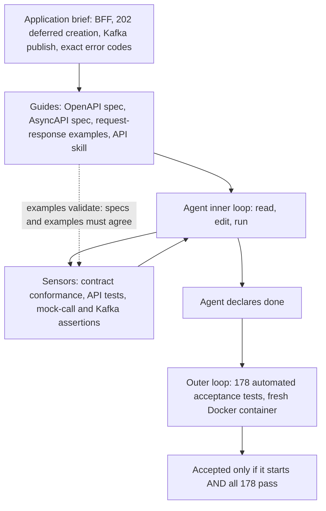
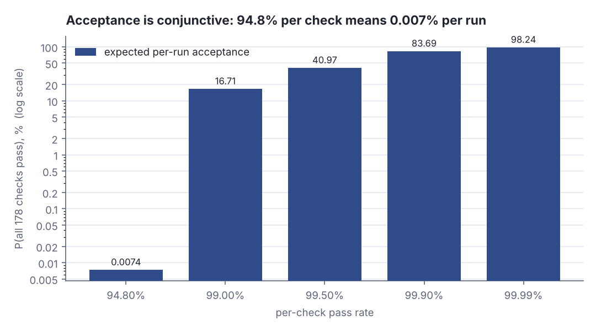
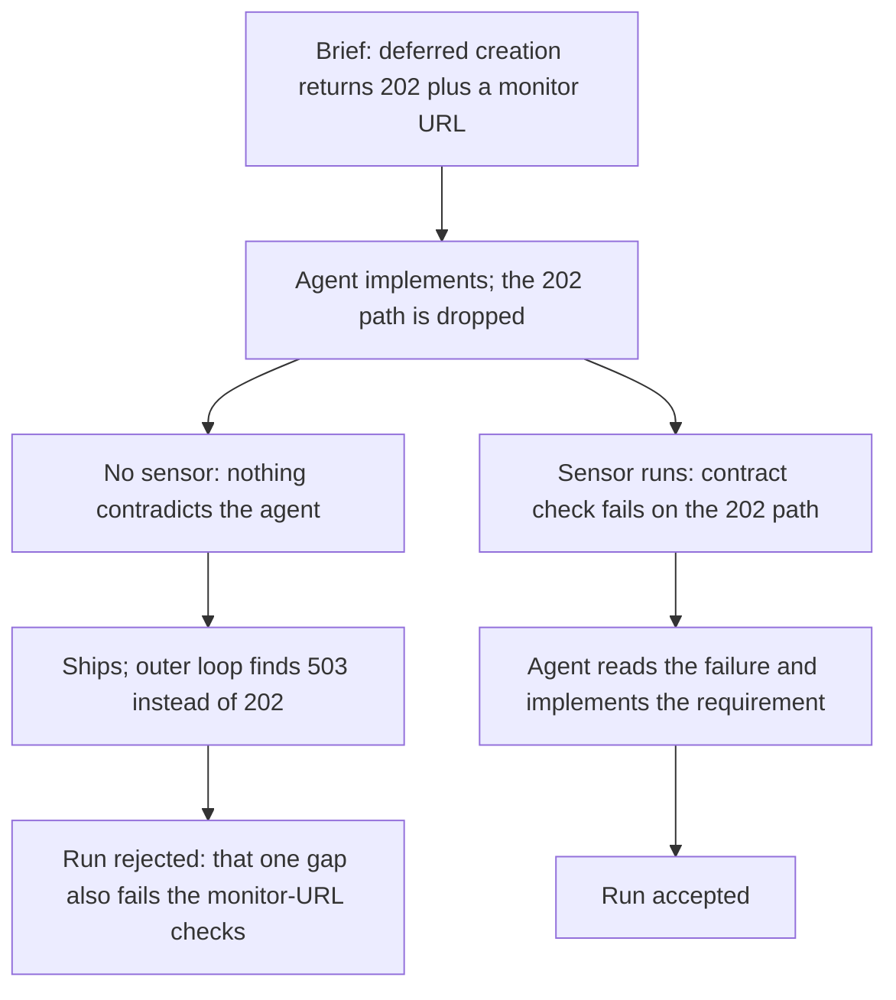
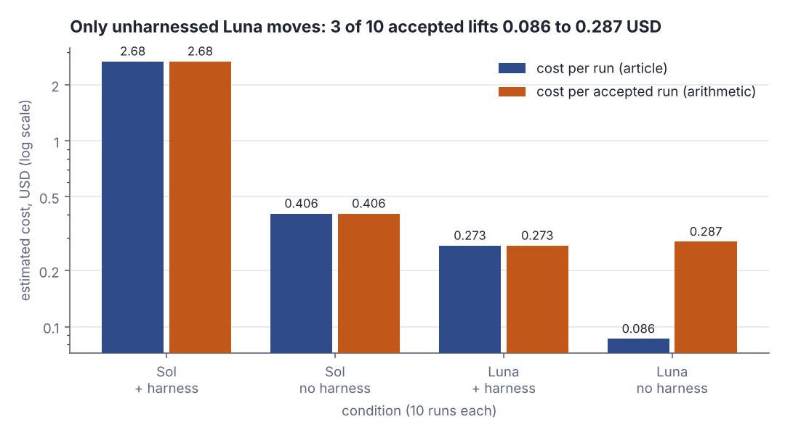
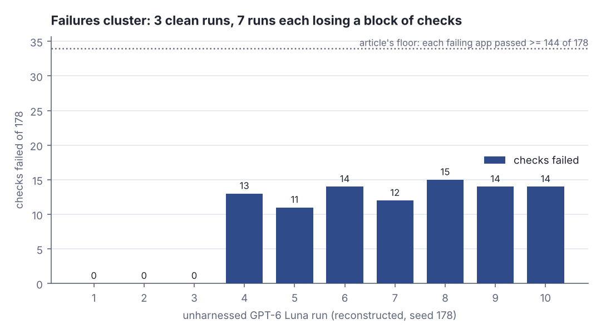

# Harnesses for coding agents: guides, sensors and measured payoff

> Fresh · Software architecture & design · Intermediate · ~25 min · from today's feeds

## Why this matters
Today's item is "Are Harnesses Worth the Cost?" by Naresh Jain, published on martinfowler.com on 13 October 2026 as part of the "Exploring Gen AI" series: the same backend-for-frontend brief, built from scratch ten times per condition, with and without a behavioural harness, judged by 178 automated acceptance tests.
It is worth 25 minutes because it is a measured experiment with costs attached, and because its sharpest finding is an architecture finding, not a model finding: a service that passes 94.8% of individual checks can still fail seven runs out of ten, because acceptance is conjunctive.
You write Skills and stand up MCP servers for other teams — this is the article that tells you what to put around an agent, when, and what the overhead actually buys.

## Primer
You have coupling and cohesion, dependency direction and the dependency rule. Five prerequisites, then the lesson.

**A coding agent's inner loop** is the cycle it runs while working: read the task, read files, write an edit, run something, read the result, edit again. Everything it can see or run in that cycle is architecture you chose. **Guides** steer it *before* it acts — specs, examples, a rules file, a Skill. **Sensors** give it feedback *after* — a test command, a linter, a contract checker. Birgitta Böckeler named the pair:

> "This frames the elements of a harness as guides and sensors, which may be computational or inferential."
> — Birgitta Böckeler, *Harness Engineering - first thoughts*, 2026-02-17, https://www.martinfowler.com/articles/exploring-gen-ai/harness-engineering-memo.html

**A unit test** exercises one function in isolation, usually written by whoever wrote the code. **An acceptance test** starts the whole deployed service and drives it from outside through its real interface — HTTP in, messages out — asserting behaviour a stakeholder agreed to. As QA Lead you lived in that distinction: an acceptance suite is a contract, written independently of the implementation so it cannot be bent to fit it.

**A backend-for-frontend (BFF)** exists for one client: instead of the app calling six domain services, it calls one BFF that fans out, aggregates and returns exactly what that screen needs — a `GET /pos/shift-summary` the till app calls, which behind it hits the wash-cycle, payments and loyalty services.

**Per-check pass rate** is checks passed ÷ checks run — 169 of 178 is 94.9%. **Per-run acceptance rate** is runs where *every* check passed ÷ runs — 3 of 10 is 30%. Different measurements, because the second is a conjunction (an AND over all 178), and conjunctions are brutal. The whole lesson lives in the gap between them.

Encoding architecture rules as automated checks that gate every change is the fitness-function material at architecture-17, *Evolutionary architecture*, further up this ladder.

## The idea

### Two loops, not one
The experiment is nested, and the nesting is the design. The **inner loop** is what the agent works inside: guides it reads, sensors it can run. The **outer loop** is an independent judge that speaks once, after the agent says it is finished.

> "Borrowing Birgitta Böckeler’s framing, a behavioral harness combines guides and sensors."
> — Naresh Jain, *Are Harnesses Worth the Cost?*, 2026-10-13, https://martinfowler.com/articles/are-harnesses-worth-the-cost.html

> "Once an agent finished, the outer loop ran 178 automated acceptance tests against its generated service."
> — Naresh Jain, *Are Harnesses Worth the Cost?*, 2026-10-13, https://martinfowler.com/articles/are-harnesses-worth-the-cost.html

The guides were an OpenAPI spec, an AsyncAPI spec, request–response examples and an API-development skill; the sensors were contract-conformance checks, API tests, and assertions on the downstream mock calls and the Kafka publication. Two details matter: the sensors ran only when the agent chose to invoke the test command, not after every edit, and an "examples validate" step checked the example payloads against the specs first, so guides and sensors could not drift apart.



*Figure 1: the nested harness — guides and sensors inside, an independent evaluation gate outside. Source: mechanism described in Naresh Jain, "Are Harnesses Worth the Cost?", 13 October 2026, https://martinfowler.com/articles/are-harnesses-worth-the-cost.html*

### Acceptance is conjunctive
A run counted as acceptable only if the service started and passed all 178 checks. That AND is a cliff. Multiply a per-check pass rate by itself 178 times:

```scala
// file: Cliff.scala
@main def lab(): Unit =
  val checks = 178
  for p <- List(0.948, 0.99, 0.995, 0.999) do
    val run = math.pow(p, checks)
    println(f"per-check $p%.3f -> P(all $checks%d pass) = ${run * 100}%7.3f%%")
```

```text
per-check 0.948 -> P(all 178 pass) =   0.007%
per-check 0.990 -> P(all 178 pass) =  16.713%
per-check 0.995 -> P(all 178 pass) =  40.974%
per-check 0.999 -> P(all 178 pass) =  83.687%
```

A per-check rate of 94.8% buys a 0.007% chance of a clean run; you need 99.9% per check before four runs in five come out clean. Four orders of magnitude on the y-axis for a 5-point move in x — that is what "conjunctive" costs.



*Figure 2: the conjunctive cliff — expected probability that all 178 checks pass, for each per-check pass rate, under an independence assumption. Generated from the Step 1 lab output below (`python3 dojo/engine/run_lab.py 2026-10-22-2`).*

Now the measurement. The article reports that "Unharnessed GPT-6 Luna runs passed 94.8% of the functional checks" (Jain, *Are Harnesses Worth the Cost?*, 13 October 2026) while 3 of those 10 runs were accepted. Independence predicts 0.0007 accepted runs; reality was 3, so the checks are *not* independent. The article's breakdown says where: the deferred `202` creation workflow failed in 7 runs, the missing monitor URL caused secondary evaluator failures in 7 runs, and in 3 runs every Kafka message arrived but the payload broke the contract — and "Each still passed at least 144 of the 178 combined functional checks" (Jain, 13 October 2026). Agents do not fail uniformly, they *drop a requirement*, and one dropped requirement takes down every check that touches it.

### The harness as executable attention
Jain's name for the mechanism:

> "Executable attention makes those gaps observable, giving the agent another opportunity to act on the requirement."
> — Naresh Jain, *Are Harnesses Worth the Cost?*, 2026-10-13, https://martinfowler.com/articles/are-harnesses-worth-the-cost.html

A brief holds dozens of behavioural requirements. An agent at low reasoning effort implements most and silently loses a few — the `202` with its polling link, the `__TypeId__` header the Kafka contract forbids, `400` where the implementation returned `415`. Without a sensor nothing distinguishes a lost requirement from a met one; with one, the loss becomes a failing check the agent reads and fixes. The harness does not make the model smarter, it makes forgetting observable.



*Figure 3: executable attention — the same dropped requirement, with and without a sensor to observe it. Source: mechanism and failure clusters described in Naresh Jain, "Are Harnesses Worth the Cost?", 13 October 2026, https://martinfowler.com/articles/are-harnesses-worth-the-cost.html*

### The frontier model made the harness look pointless
On the frontier model the harness bought nothing measurable:

> "GPT-6 Sol solved the brief unaided in one shot."
> — Naresh Jain, *Are Harnesses Worth the Cost?*, 2026-10-13, https://martinfowler.com/articles/are-harnesses-worth-the-cost.html

Harnessed Sol averaged about $2.679 and 19 min 53 s per run for 10 of 10 accepted; unharnessed Sol about $0.406 and 6 min 51 s, also 10 of 10 (Jain, 13 October 2026) — 6.6× the money and 2.9× the wall clock for the same acceptance. On the cost-optimised model it was the opposite:

> "All 10 harnessed GPT-6 Luna applications passed the external evaluation and achieved a 100% success rate."
> — Naresh Jain, *Are Harnesses Worth the Cost?*, 2026-10-13, https://martinfowler.com/articles/are-harnesses-worth-the-cost.html

Harnessed Luna: about $0.273 per run, 10 of 10. Unharnessed Luna: about $0.086 per run, 3 of 10 (Jain, 13 October 2026).

### The number that decides it: cost per accepted run
Cost per run is the wrong denominator: a rejected run is not cheap, it is a run you throw away. Divide by the acceptance rate instead:

```scala
// file: PerAccepted.scala
@main def lab(): Unit =
  val rows = List(("Luna + harness", 0.273, 10), ("Luna no harness", 0.086, 3))
  for (name, perRun, accepted) <- rows do
    val perAccepted = perRun * 10 / accepted
    println(f"$name%-16s $$$perRun%.3f per run -> $$$perAccepted%.4f per accepted run")
```

```text
Luna + harness   $0.273 per run -> $0.2730 per accepted run
Luna no harness  $0.086 per run -> $0.2867 per accepted run
```

The harness is 4.8% cheaper per accepted run than the same model bare, and 32.8% cheaper than the frontier model bare at $0.406 — the article states that gap as "about 33% less" (Jain, 13 October 2026). That is my arithmetic on the article's measurements, and it is the flip that matters: the cheap-looking option is only cheap if you ignore the 70% you discard.



*Figure 4: measured cost per run versus cost per accepted run, log scale. Adapted from Figure 6 of Naresh Jain, "Are Harnesses Worth the Cost?", 13 October 2026, https://martinfowler.com/articles/are-harnesses-worth-the-cost.html — the measured series is the article's; the per-accepted series is this lesson's arithmetic (Step 4 of the lab).*

### The trade-off, stated honestly
The article excludes the biggest cost: "They exclude the upfront effort of authoring, reviewing, and maintaining the contracts, examples, assertions, and harness." (Jain, 13 October 2026). Step 5 of the lab prices that in: the token saving per accepted run is $0.0137, so eight hours of engineer time needs 35,122 accepted runs to pay back on tokens alone. Harnesses are not justified by token economics. They are justified by consistency — 10 of 10 instead of 3 of 10, no triage of seven broken services, and a gate independent of the thing it judges. Jain's revised conclusion draws the line there:

> "Model capability changes when and how often sensors run, not whether an independent verification gate is needed."
> — Naresh Jain, *Are Harnesses Worth the Cost?*, 2026-10-13, https://martinfowler.com/articles/are-harnesses-worth-the-cost.html

The practical split: "When a cost-optimized model produces inconsistent results, run a behavioral harness throughout development." (Jain, 13 October 2026) — cheap model, sensors all the way through; frontier model, keep the gate and run it once at the end. Caveats: one greenfield Java service, 10 paired runs per model, low reasoning effort, an unusually detailed brief that favours unaided agents, and API-equivalent cost estimates, not billed amounts (Jain, 13 October 2026).

## Lab
**Question: if a service passes 94.8% of its individual checks, why does it still fail seven runs out of ten — and which of the four conditions is cheapest per *accepted* run?**

### Step 1 — the conjunctive cliff
`math.pow(p, 178)` for a ladder of per-check pass rates, under the assumption that checks fail independently. This is the arithmetic, not the article's data.

### Step 2 — invert it
Solve for the per-check rate that independence would need in order to accept 3 runs in 10: `p = 0.30^(1/178)`. Compare it with the measured 94.8%. The gap is the evidence that failures cluster.

### Step 3 — reconstruct the ten unharnessed Luna runs
Build 10 runs whose failures sit in the clusters the article names (the deferred `202` workflow, the missing monitor URL, the Kafka payload contract, exact error codes), seeded so the output is deterministic, then check the reconstruction against the article's three published facts: 3 of 10 accepted, 94.8% of checks passed, every failing app passed at least 144 of 178. The cluster sizes are mine; the three facts are the article's.

### Step 4 — cost per accepted run
`cost per accepted run = cost per run × 10 ÷ accepted runs`, for all four conditions, in money and in minutes.

### Step 5 — break-even on the harness a human has to write
The token saving per accepted run against the cost of authoring the contracts and sensors.

```scala
// file: Lab.scala
import scala.util.Random

val CHECKS = 178              // article: 178 automated acceptance tests per run
val RUNS   = 10               // article: 10 runs per condition
val LUNA_CHECK_RATE = 0.948   // article: unharnessed Luna passed 94.8% of functional checks
val LUNA_ACCEPTED   = 3       // article: 3 of 10 unharnessed Luna runs accepted

case class Run(id: Int, deferred: Int, monitor: Int, kafka: Int, codes: Int):
  def failed: Int = deferred + monitor + kafka + codes
  def passed: Int = CHECKS - failed
  def accepted: Boolean = failed == 0

def reconstruct(seed: Int): List[Run] =
  val rnd = Random(seed)
  (1 to RUNS).toList.map { i =>
    if i <= LUNA_ACCEPTED then Run(i, 0, 0, 0, 0)
    else
      val deferred = 8                         // the 202 deferred-creation workflow
      val monitor  = 3                         // secondary failures from the missing monitor URL
      val kafka    = if i >= 8 then 2 else 0   // 3 runs: Kafka payload broke the contract
      val codes    = rnd.between(0, 4)         // exact error-response mismatches
      Run(i, deferred, monitor, kafka, codes)
  }

case class Cond(name: String, perRun: Double, minutes: Double, accepted: Int)

@main def lab(): Unit =
  println(s"Article measurements: $CHECKS acceptance checks per run, $RUNS runs per condition")
  println("(Naresh Jain, Are Harnesses Worth the Cost?, 2026-10-13)")
  println()

  println("Step 1 - acceptance is conjunctive: P(all 178 checks pass) = p^178")
  println("  per-check p    P(all pass)   expected accepted runs per 10")
  for p <- List(0.948, 0.99, 0.995, 0.999, 0.9999) do
    val all = math.pow(p, CHECKS)
    println(f"  $p%-14.4f ${all * 100}%10.4f%%   ${all * RUNS}%10.4f")

  println()
  println("Step 2 - invert it: what per-check rate would independence need?")
  val needed = math.pow(LUNA_ACCEPTED.toDouble / RUNS, 1.0 / CHECKS)
  println(f"  to accept $LUNA_ACCEPTED%d of $RUNS%d runs: p = 0.30^(1/$CHECKS%d) = $needed%.6f")
  println(f"  per-check rate actually measured (article)  = $LUNA_CHECK_RATE%.6f")
  println(f"  gap                                        = ${needed - LUNA_CHECK_RATE}%.6f")
  val indep = math.pow(LUNA_CHECK_RATE, CHECKS)
  println(f"  independence predicts ${indep * RUNS}%.4f accepted runs; the article measured $LUNA_ACCEPTED%d")
  println(f"  ratio measured/predicted = ${LUNA_ACCEPTED / (indep * RUNS)}%,.0fx -> failures are NOT independent")

  println()
  println("Step 3 - reconstruct the 10 unharnessed Luna runs (seed 178)")
  println("  cluster sizes are MY reconstruction; 3/10, 94.8% and >=144/178 are the article's")
  println("  run  defer202  monitor  kafka  codes  failed  passed  accepted")
  val runs = reconstruct(178)
  runs.foreach { r =>
    val mark = if r.accepted then "yes" else "no"
    println(f"  ${r.id}%-4d ${r.deferred}%8d ${r.monitor}%8d ${r.kafka}%6d ${r.codes}%6d ${r.failed}%7d ${r.passed}%7d  $mark%s")
  }
  val totalFailed = runs.map(_.failed).sum
  val realisedCheck = 1.0 - totalFailed.toDouble / (CHECKS * RUNS)
  println(f"  total failed checks over $RUNS%d runs: $totalFailed%d of ${CHECKS * RUNS}%d")
  println(f"  realised per-check pass rate: ${realisedCheck * 100}%.1f%%   (article: 94.8%%)")
  println(f"  realised acceptance: ${runs.count(_.accepted)}%d of $RUNS%d   (article: 3 of 10)")
  println(f"  worst run passed ${runs.map(_.passed).min}%d of $CHECKS%d   (article: at least 144 of 178)")

  println()
  println("Step 4 - cost per ACCEPTED run = cost per run x 10 / accepted runs")
  println("  $/run, min/run and accepted counts are the article's; the last two columns are mine")
  val conds = List(
    Cond("Sol  + harness", 2.679, 19.0 + 53.0 / 60.0, 10),
    Cond("Sol  no harness", 0.406, 6.0 + 51.0 / 60.0, 10),
    Cond("Luna + harness", 0.273, 35.0, 10),
    Cond("Luna no harness", 0.086, 15.0 + 56.0 / 60.0, 3)
  )
  println("  condition         $/run   accept   $ for 10 runs   $/accepted   min/run   min/accepted")
  conds.foreach { c =>
    val spend = c.perRun * RUNS
    println(f"  ${c.name}%-16s ${c.perRun}%6.3f  ${c.accepted}%2d/10   ${spend}%13.3f   ${spend / c.accepted}%10.4f   ${c.minutes}%7.2f   ${c.minutes * RUNS / c.accepted}%12.2f")
  }
  val lunaHPerAcc = conds(2).perRun * RUNS / conds(2).accepted
  val lunaNPerAcc = conds(3).perRun * RUNS / conds(3).accepted
  val solNPerAcc  = conds(1).perRun * RUNS / conds(1).accepted
  println(f"  harnessed Luna vs unharnessed Luna per accepted run: ${lunaHPerAcc}%.4f vs ${lunaNPerAcc}%.4f -> ${(1 - lunaHPerAcc / lunaNPerAcc) * 100}%.1f%% cheaper")
  println(f"  harnessed Luna vs unharnessed Sol  per accepted run: ${lunaHPerAcc}%.4f vs ${solNPerAcc}%.4f -> ${(1 - lunaHPerAcc / solNPerAcc) * 100}%.1f%% cheaper")

  println()
  println("Step 5 - break-even on the harness a human has to write (my arithmetic)")
  val saving = lunaNPerAcc - lunaHPerAcc
  println(f"  token saving per accepted run: ${saving}%.4f USD")
  for hours <- List(4, 8, 40) do
    val authoring = hours * 60.0
    println(f"  $hours%2d h at 60 USD/h = ${authoring}%7.0f USD -> break-even after ${authoring / saving}%,.0f accepted runs")
```

Run it with `python3 dojo/engine/run_lab.py 2026-10-22-2`:

```text
Article measurements: 178 acceptance checks per run, 10 runs per condition
(Naresh Jain, Are Harnesses Worth the Cost?, 2026-10-13)

Step 1 - acceptance is conjunctive: P(all 178 checks pass) = p^178
  per-check p    P(all pass)   expected accepted runs per 10
  0.9480             0.0074%       0.0007
  0.9900            16.7134%       1.6713
  0.9950            40.9740%       4.0974
  0.9990            83.6868%       8.3687
  0.9999            98.2357%       9.8236

Step 2 - invert it: what per-check rate would independence need?
  to accept 3 of 10 runs: p = 0.30^(1/178) = 0.993259
  per-check rate actually measured (article)  = 0.948000
  gap                                        = 0.045259
  independence predicts 0.0007 accepted runs; the article measured 3
  ratio measured/predicted = 4,029x -> failures are NOT independent

Step 3 - reconstruct the 10 unharnessed Luna runs (seed 178)
  cluster sizes are MY reconstruction; 3/10, 94.8% and >=144/178 are the article's
  run  defer202  monitor  kafka  codes  failed  passed  accepted
  1           0        0      0      0       0     178  yes
  2           0        0      0      0       0     178  yes
  3           0        0      0      0       0     178  yes
  4           8        3      0      2      13     165  no
  5           8        3      0      0      11     167  no
  6           8        3      0      3      14     164  no
  7           8        3      0      1      12     166  no
  8           8        3      2      2      15     163  no
  9           8        3      2      1      14     164  no
  10          8        3      2      1      14     164  no
  total failed checks over 10 runs: 93 of 1780
  realised per-check pass rate: 94.8%   (article: 94.8%)
  realised acceptance: 3 of 10   (article: 3 of 10)
  worst run passed 163 of 178   (article: at least 144 of 178)

Step 4 - cost per ACCEPTED run = cost per run x 10 / accepted runs
  $/run, min/run and accepted counts are the article's; the last two columns are mine
  condition         $/run   accept   $ for 10 runs   $/accepted   min/run   min/accepted
  Sol  + harness    2.679  10/10          26.790       2.6790     19.88          19.88
  Sol  no harness   0.406  10/10           4.060       0.4060      6.85           6.85
  Luna + harness    0.273  10/10           2.730       0.2730     35.00          35.00
  Luna no harness   0.086   3/10           0.860       0.2867     15.93          53.11
  harnessed Luna vs unharnessed Luna per accepted run: 0.2730 vs 0.2867 -> 4.8% cheaper
  harnessed Luna vs unharnessed Sol  per accepted run: 0.2730 vs 0.4060 -> 32.8% cheaper

Step 5 - break-even on the harness a human has to write (my arithmetic)
  token saving per accepted run: 0.0137 USD
   4 h at 60 USD/h =     240 USD -> break-even after 17,561 accepted runs
   8 h at 60 USD/h =     480 USD -> break-even after 35,122 accepted runs
  40 h at 60 USD/h =    2400 USD -> break-even after 175,610 accepted runs
```



*Figure 5: where the 93 failed checks sit — three clean runs and seven runs each losing a block of related checks. Generated from the Step 3 lab output above.*

### Reading the output

**Step 1.** `per-check p` is the probability one check passes; `P(all pass)` is `p^178`, the probability a whole run is accepted; the last column is that probability × 10 runs. Higher is better in all three.

| per-check p | P(all 178 pass) | expected accepted per 10 |
|---|---|---|
| 0.9480 | 0.0074% | 0.0007 |
| 0.9900 | 16.7134% | 1.6713 |
| 0.9950 | 40.9740% | 4.0974 |
| 0.9990 | 83.6868% | 8.3687 |
| 0.9999 | 98.2357% | 9.8236 |

Trace the first row: `ln 0.948 = -0.0534066`, times 178 = `-9.50638`, and `e^-9.50638 = 0.00007424`, i.e. 0.0074%. Improving the per-check rate from 0.948 to 0.999 — a 5.1-point move — multiplies the acceptance probability by 11,272.

**Verdict: under independence, 94.8% per check is indistinguishable from zero at the run level. Per-check pass rates are not a quality signal when the gate is an AND over 178 clauses.**

**Step 2.** `needed` is the per-check rate that independence would require to accept 3 runs in 10; the gap is how far the measured rate sits below it.

```
to accept 3 of 10 runs: p = 0.30^(1/178) = 0.993259
per-check rate actually measured (article)  = 0.948000
gap                                         = 0.045259
independence predicts 0.0007 accepted runs; the article measured 3
ratio measured/predicted = 4,029x -> failures are NOT independent
```

`0.30^(1/178) = e^(ln 0.30 / 178) = e^(-1.203973 / 178) = e^(-0.0067639) = 0.993259`. The measured rate was 0.948, which is 4.53 points short — yet reality beat the prediction by a factor of 4,029.

**Verdict: the independence model is wrong in the reader's favour. Agent failures are correlated: one dropped requirement takes out a block of checks at once, so a few runs absorb almost all the damage and the rest come out clean.**

**Step 3.** Columns `defer202`, `monitor`, `kafka`, `codes` are checks lost to each failure cluster; `failed` is their sum; `passed` is 178 − failed; `accepted` is yes only when `failed` is 0. Lower is better everywhere except `passed`.

| run | defer202 | monitor | kafka | codes | failed | passed | accepted |
|---|---|---|---|---|---|---|---|
| 1 | 0 | 0 | 0 | 0 | 0 | 178 | yes |
| 2 | 0 | 0 | 0 | 0 | 0 | 178 | yes |
| 3 | 0 | 0 | 0 | 0 | 0 | 178 | yes |
| 4 | 8 | 3 | 0 | 2 | 13 | 165 | no |
| 5 | 8 | 3 | 0 | 0 | 11 | 167 | no |
| 6 | 8 | 3 | 0 | 3 | 14 | 164 | no |
| 7 | 8 | 3 | 0 | 1 | 12 | 166 | no |
| 8 | 8 | 3 | 2 | 2 | 15 | 163 | no |
| 9 | 8 | 3 | 2 | 1 | 14 | 164 | no |
| 10 | 8 | 3 | 2 | 1 | 14 | 164 | no |

Trace run 8: 8 + 3 + 2 + 2 = 15 failed, 178 − 15 = 163 passed, `failed ≠ 0` so rejected. Across all ten runs: 93 failed checks of 1,780, so the per-check pass rate is `1 − 93/1780 = 1 − 0.052247 = 0.947753` → 94.8%, matching the article's measured 94.8%, with 3 of 10 accepted and a worst run of 163 of 178 (above the article's floor of 144).

**Verdict: 94.8% per check and 3 of 10 accepted are the same data set. The reconstruction reproduces both from clustered failures — which is why the per-check number was never the one to watch.**

**Step 4.** `$/run` and `min/run` are the article's ten-run averages; `accept` is its accepted count; `$ for 10 runs` is `$/run × 10`; `$/accepted` is that total divided by accepted runs; `min/accepted` is the same for wall clock. Lower is better.

| condition | $/run | accept | $ for 10 | $/accepted | min/run | min/accepted |
|---|---|---|---|---|---|---|
| Sol + harness | 2.679 | 10/10 | 26.790 | 2.6790 | 19.88 | 19.88 |
| Sol no harness | 0.406 | 10/10 | 4.060 | 0.4060 | 6.85 | 6.85 |
| Luna + harness | 0.273 | 10/10 | 2.730 | 0.2730 | 35.00 | 35.00 |
| Luna no harness | 0.086 | 3/10 | 0.860 | 0.2867 | 15.93 | 53.11 |

Trace the last row: 0.086 × 10 = $0.860 spent to obtain 3 accepted services, so 0.860 ÷ 3 = $0.2867 per accepted run; 15.93 × 10 = 159.3 minutes ÷ 3 = 53.11 minutes per accepted run. Harnessed Luna at $0.2730 is `1 − 0.2730/0.2867 = 4.8%` cheaper and 34% faster per accepted run than the same model bare, and `1 − 0.2730/0.4060 = 32.8%` cheaper than unharnessed Sol.

**Verdict: on cost per accepted run the cheapest-looking condition is not the cheapest. Harnessed Luna wins on money and on wall clock; unharnessed Sol is 49% dearer; harnessed Sol is ten times dearer and buys no extra acceptance.**

**Step 5.** `token saving per accepted run` is the Step 4 difference; the break-even column is authoring cost divided by that saving.

```
token saving per accepted run: 0.0137 USD
 4 h at 60 USD/h =     240 USD -> break-even after 17,561 accepted runs
 8 h at 60 USD/h =     480 USD -> break-even after 35,122 accepted runs
40 h at 60 USD/h =    2400 USD -> break-even after 175,610 accepted runs
```

$480 ÷ $0.0137 = 35,122 runs. Nobody builds a service 35,000 times.

**Verdict: the harness does not pay for itself in tokens. It pays in outcomes — 10 of 10 instead of 3 of 10, and no human triage of seven broken services — which is the cost the article explicitly leaves out and which dominates everything in this table.**

### Cause → consequence

1. **Cause** — the acceptance gate is a conjunction: a run counts only if the service starts and all 178 checks pass (Jain, *Are Harnesses Worth the Cost?*, 13 October 2026).
2. **Mechanism** — a low-reasoning agent drops individual requirements from a long brief rather than degrading uniformly, and one dropped requirement fails every check that touches it: the `202` path took the monitor-URL checks with it in 7 runs.
3. **Consequence** — a 94.8% per-check average coexists with a 30% per-run acceptance rate, and the 70% you discard moves the real cost from $0.086 to $0.2867 per accepted run — above the harnessed run you thought was expensive.
4. **In practice, for your work** — four transfers. First, for the car-wash POS: write the acceptance suite for a new BFF endpoint — `202` plus monitor URL for a queued wash, the exact `400`/`409`/`503` bodies, the shape of the `wash.completed` event — *before* you let an agent build it, and run it in a fresh container, not in the agent's workspace. Second, report acceptance, never per-check: a Definition of Done that reads "94% of checks green" is a Definition of Done that ships. Third, size your agent budget per *accepted* unit of work; that single division changes which model you pick. Fourth, keep the independent gate even when the model is good enough not to need the guides — Jain's own revision is that capability changes when sensors run, not whether a gate exists.

## Self-check
1. Unharnessed GPT-6 Luna passed 94.8% of the 178 functional checks on average, yet only 3 of 10 runs were accepted. An independence model predicts 0.0007 accepted runs out of ten. Explain both numbers at once. <details><summary>Answer</summary>Acceptance is a conjunction over all 178 checks, so under independence the run-level probability is `0.948^178 = e^(178 × ln 0.948) = e^-9.50638 = 0.0000742`, i.e. 0.0007 accepted runs in ten. Reality gave 3, about 4,029× more, which means the checks are not independent: the agent does not fail a little everywhere, it drops whole requirements. The article's breakdown confirms it — the deferred `202` workflow failed in 7 runs and the missing monitor URL caused secondary failures in the same 7, and "Each still passed at least 144 of the 178 combined functional checks" (Jain, *Are Harnesses Worth the Cost?*, 13 October 2026). Correlated failures concentrate the damage in a few runs, so the remaining runs come out perfectly clean while the average per-check rate stays high.</details>
2. On GPT-6 Sol the harness cost about $2.679 per run against about $0.406 without it, for 10 of 10 accepted either way. Why does the article still not conclude "drop the harness for frontier models"? <details><summary>Answer</summary>Because the 10-for-10 unharnessed result was itself established by the independent outer loop — 178 acceptance tests in a fresh container. Without that gate you would have had ten services and no evidence. The article's revised position separates the two halves of the harness: "Model capability changes when and how often sensors run, not whether an independent verification gate is needed." (Jain, *Are Harnesses Worth the Cost?*, 13 October 2026). For a frontier model you can stop running the sensors continuously inside the agent's loop and run the gate once at the end; for a cost-optimised model you run the sensors throughout. The gate never goes away. The experiment also carries real limits — one greenfield Java service, 10 paired runs, low reasoning effort, an unusually detailed brief — so it does not license a general rule.</details>
3. You are budgeting agent spend for the car-wash POS backlog and the dashboard shows cost per run. What single division fixes the number, and what does it do to the ranking of unharnessed Luna at $0.086 per run? <details><summary>Answer</summary>Divide cost per run by the per-run acceptance rate — equivalently, total spend divided by the number of accepted outputs. A rejected run is not cheap, it is waste plus the human triage it provokes. Unharnessed Luna spent 0.086 × 10 = $0.860 to produce 3 accepted services, so $0.2867 per accepted run, which is worse than harnessed Luna's $0.2730 (10 of 10) and would be worse still if the diagnosis time for the seven failures were priced in — a cost the article says its estimates exclude. The ranking by cost per accepted run becomes harnessed Luna $0.2730, unharnessed Luna $0.2867, unharnessed Sol $0.4060, harnessed Sol $2.6790; by cost per run it was the exact opposite at the top.</details>

## Sources
- [Are Harnesses Worth the Cost?](https://martinfowler.com/articles/are-harnesses-worth-the-cost.html) — Naresh Jain, martinfowler.com "Exploring Gen AI" series, 13 October 2026 — the whole experiment: the guides-and-sensors definition of a behavioural harness, the inner/outer loop split, the 178 automated acceptance tests, the BFF brief with its `202` deferred creation and Kafka publication, the four ten-run conditions and their costs ($2.679 / $0.406 for Sol, $0.273 / $0.086 for Luna) and acceptance counts, the 94.8% per-check average and the "at least 144 of the 178" floor, the failure clusters, "executable attention", the excluded authoring costs, the stated boundaries, and the revised conclusion about when sensors run versus whether a gate is needed; accessed 2026-10-22.
- [Harness Engineering - first thoughts](https://www.martinfowler.com/articles/exploring-gen-ai/harness-engineering-memo.html) — Birgitta Böckeler, martinfowler.com, 17 February 2026 — the original guides-and-sensors framing that Jain borrows, used in the Primer to define the two halves of a harness; accessed 2026-10-22.

## Next on this track
Fresh lessons sit outside the ladder; next on Software architecture & design: **SOLID in practice I — SRP, OCP, LSP** (rung 3 of 20, Beginner).
