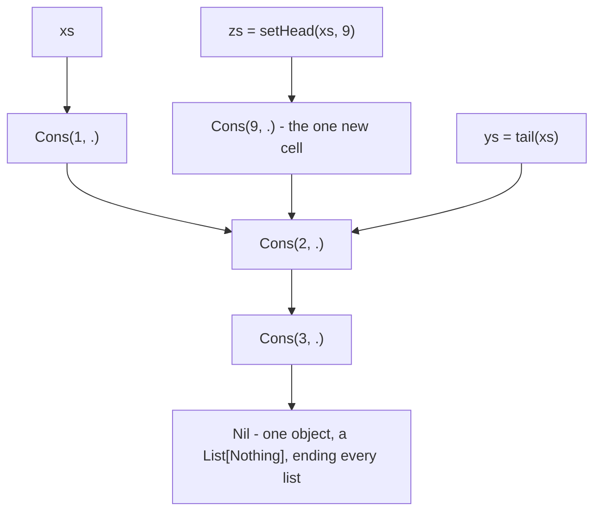
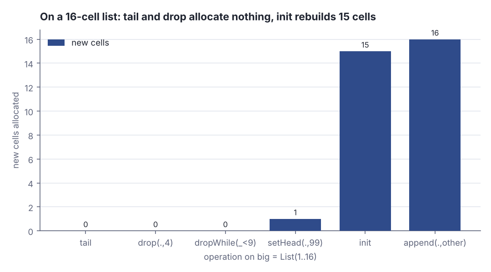
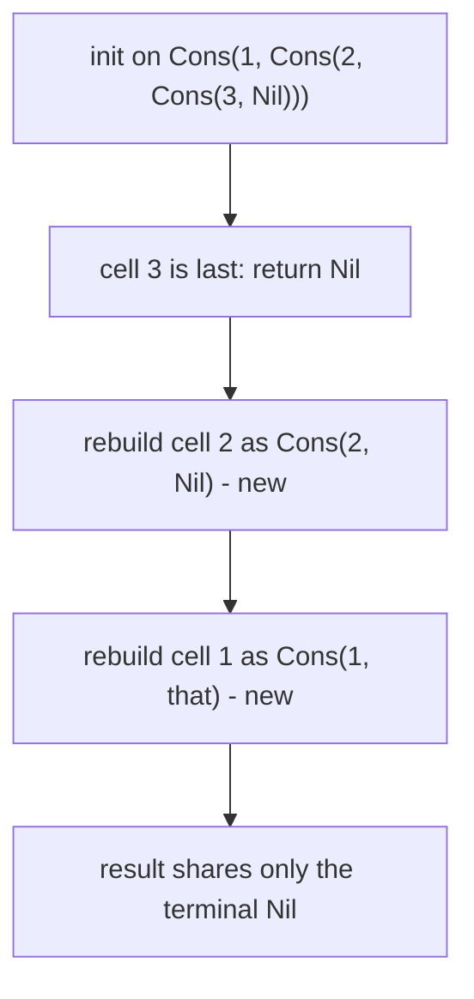
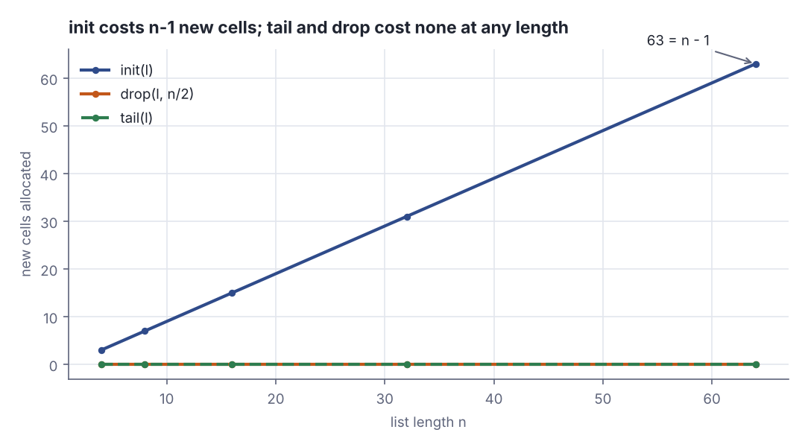

# Functional data structures I: the List ADT, pattern matching and data sharing

> Functional Programming in Scala (red book) · Beginner · ~20 min · rung 3 of 26 · needs: Getting started: tail recursion, higher-order and polymorphic functions (fp-scala-02)

## Why this matters
You already pass immutable case classes between Akka actors and assume that handing a collection to another actor is cheap; this chapter is where that assumption gets its receipt. Building the list yourself — two data constructors, every function a pattern match — shows exactly which operations reuse the cells you already have and which quietly rebuild the whole spine.
That distinction is the whole cost model of persistent data structures, and it is the reason a Vector's `updated` or a Map's `+` can be handed across threads without a defensive copy. Everything later in the book — folds, trees, `State`, streams, parsers — is written against ADTs taken apart by pattern matching, so this is the rung where the notation stops being syntax and becomes a technique.

## The idea

> Chapter map: Functional Programming in Scala (2nd ed.), ch. 3 "Functional data structures" — §3.1 Defining functional data structures, §3.2 Pattern matching, §3.3 Data sharing in functional data structures, §3.3.1 The efficiency of data sharing. The rest of ch. 3 (§3.3.2 onwards: folds, and §3.4 Trees) is the next rung.
> Section numbering as the 2nd edition's own contents list it, https://www.oreilly.com/library/view/functional-programming-in/9781617299582/OEBPS/Text/03.htm

### §3.1 Defining functional data structures
A **functional data structure** is operated on only with pure functions: nothing is mutated in place, so it is **immutable** and therefore free to be shared. The book's running example is the singly linked list, built from scratch rather than taken from the standard library (Chiusano, Bjarnason & Pilquist, *FP in Scala* 2nd ed., ch. 3, §3.1 "Defining functional data structures").

The definition is an **algebraic data type** (ADT): a type defined by the complete, closed set of ways to build a value of it, each way a **data constructor**. A list is either empty or a head element in front of another list — two constructors, `Nil` and `Cons` (short for *construct*), and nothing else. In Scala 3 that is an `enum`, with `List` doubling as the companion object holding the functions:

```scala
enum List[+A]:
  case Nil
  case Cons(head: A, tail: List[A])

object List:
  def sum(ints: List[Int]): Int = ints match
    case Nil         => 0
    case Cons(x, xs) => x + sum(xs)
```

```text
  List(1,2,3)                = Cons(1,Cons(2,Cons(3,Nil)))
  sum(List(1,2,3))           = 6
  product(List(2.0,0.0,9.9)) = 0.0
```

`sum` has one equation per data constructor: the shape of the function follows the shape of the type. `product` adds a third equation, `case Cons(0.0, _) => 0.0`, which short-circuits the moment it meets a zero — the tail is never looked at. The third piece of §3.1 is the companion's **variadic** `apply[A](as: A*)`, which turns the convenient `List(1,2,3)` into the nested `Cons` chain printed above.

The `+A` is a **variance annotation**: `List` is covariant, so `List[Dog]` is a subtype of `List[Animal]`. It also buys something immediate. `Nil` carries no element, so it is a `List[Nothing]`, and `Nothing` is a subtype of every type — one single `Nil` object is therefore a legal empty list of any element type, and every list in the program ends at it. The Scala 3 Book spells the same trick out for `Option`:

> "The `extends` clauses that were omitted in the previous example can also be given explicitly: `enum Option[+T]: case Some(x: T) extends Option[T]; case None extends Option[Nothing]`"
>
> — Scala Documentation, *Scala 3 Book: Algebraic Data Types*, undated, https://docs.scala-lang.org/scala3/book/types-adts-gadts.html

### §3.2 Pattern matching
An ADT is built by its constructors and taken apart by **pattern matching**. A `match` tries each `case` top to bottom and runs the first whose pattern fits. A pattern mirrors a constructor call: `Cons(x, xs)` matches any non-empty list and **binds** its fields to `x` and `xs`; a literal such as `0.0` or `2` matches only that value; `_` matches anything and binds nothing. Patterns nest, so `Cons(x, Cons(2, Cons(4, _)))` is one test over three cells. Exercise 3.1 asks what this evaluates to:

```scala
List(1, 2, 3, 4, 5) match
  case Cons(x, Cons(2, Cons(4, _)))          => x
  case Nil                                   => 42
  case Cons(x, Cons(y, Cons(3, Cons(4, _)))) => x + y
  case Cons(h, t)                            => h + sum(t)
  case _                                     => 101
```

```text
  Exercise 3.1 match result  = 3
```

The first case fails on the third cell (`4` is required where `3` sits), `Nil` fails, and the third fits: `x = 1`, `y = 2`, then `3` and `4` match the literals, so `1 + 2 = 3`. The fourth case would have given `1 + sum(Cons(2,…)) = 15` — order decides.

Because an `enum` is a *sealed* type the compiler knows the full set of constructors and can check that a match covers them all. Leave one out and Scala 3.3.4 names the value that would blow up:

```scala
def firstTwo[A](l: List[A]): (A, A) = l match
  case Cons(a, Cons(b, _)) => (a, b)
```

```text
-- [E029] Pattern Match Exhaustivity Warning: Bad.scala:7:38
7 |def firstTwo[A](l: List[A]): (A, A) = l match
  |                                      ^
  |                     match may not be exhaustive.
  |
  |                     It would fail on pattern case: Nil, List.Cons(_, Nil)
scala.MatchError: Cons(1,Nil) (of class List$Cons)
```

That is the real compiler output; the runtime `MatchError` underneath it is what you get if you ignore the warning. The same sealing is why the `case _ => 101` above is reported as unreachable. The Scala 3 Book explains where the property comes from:

> "_Conceptually_, enums can be thought of as defining a sealed class together with its companion object."
>
> — Scala Documentation, *Scala 3 Book: Algebraic Data Types*, undated, https://docs.scala-lang.org/scala3/book/types-adts-gadts.html

### §3.3 Data sharing in functional data structures
Here is the payoff. If a list can never change, a function that wants "the same list without its head" needs no copy — it returns the tail cell it already has, and nobody can mutate it out from under either owner. The book calls this **data sharing**, and it makes `tail` (Exercise 3.2) and `setHead` (Exercise 3.3) constant-time:

```scala
def tail[A](l: List[A]): List[A] = l match
  case Nil        => sys.error("tail of empty list")
  case Cons(_, t) => t

def setHead[A](l: List[A], h: A): List[A] = l match
  case Nil        => sys.error("setHead on empty list")
  case Cons(_, t) => Cons(h, t)
```

```text
  ys eq second cell of xs   = true
  tail(zs) eq tail(xs)      = true
  xs unchanged         = Cons(1,Cons(2,Cons(3,Nil)))
```

`eq` is JVM reference identity, not `==`: `ys` is not a list that looks like the tail of `xs`, it *is* the second cell of `xs`. `setHead` allocates exactly one new cell and points it at that same tail, so `xs`, `ys` and `zs` are three different lists sharing one chain of cells.


*Figure 1: three lists, five cells. `tail` returns a cell that already exists; `setHead` allocates one cell and reuses the rest. Source: drawn from FP in Scala 2nd ed., ch. 3, §3.3 "Data sharing in functional data structures".*

Generalising from the head to a prefix gives `drop` (Exercise 3.4) and `dropWhile` (Exercise 3.5): both walk forward and return a cell of the original, allocating nothing. The lab counts how many cells each operation produces and how many are the originals.



*Figure 2: new cells allocated by each operation on `List(1..16)`, measured by reference identity in the lab's Step 3. Generated from the lab output with `dojo/engine/chart.py`.*

#### §3.3.1 The efficiency of data sharing — and where it stops
Sharing only works *forward*. A cell points at its tail and knows nothing about what points at it, so any operation that changes the end of a list must rebuild every cell in front of the change. Exercise 3.6 is `init`, "everything but the last element", and it is the book's counter-example: the last `Cons` becomes `Nil`, so the cell before it must be rebuilt to point at the new ending, and so on back to the head — `n - 1` fresh cells, O(n) time and allocation, for the mirror image of a free operation.


*Figure 3: `init` has to copy the spine because cells point forward only. Source: FP in Scala 2nd ed., ch. 3, Exercise 3.6.*



*Figure 4: the two cost curves, from the lab's Step 4 table. Generated from the lab output with `dojo/engine/chart.py`.*

The practical rule: on a singly linked list, work at the front is free and work at the back costs the length. That is why FP APIs are built around `Cons`, `head`, `tail` and folds, and why reaching for the end of a list is a smell.

## Lab
**The question:** do `tail` and `setHead` really hand back the *same* cells rather than copies, what should each do when given `Nil`, and how much does `init` cost by comparison?

Time: about 10 minutes. The lab is the book's own `List` with Exercises 3.2 (`tail`), 3.3 (`setHead`), 3.4 (`drop`), 3.5 (`dropWhile`) and 3.6 (`init`), plus a census that counts cells by **reference identity** (`eq`) so sharing is measured, not assumed.

### Step 1 — save the program
Scala 3.3, standard library only. Save it as `Lab.scala` and run it with `scala Lab.scala`.

```scala
// file: Lab.scala

// FP in Scala, 2nd ed., ch. 3 "Functional data structures", §3.1-§3.3.
// Scala 3.3, standard library only.
// Exercises: 3.1 (match result), 3.2 tail, 3.3 setHead, 3.4 drop,
// 3.5 dropWhile, 3.6 init.

// ---- Step 1: §3.1 the List ADT, §3.2 pattern matching --------------------

enum List[+A]:
  case Nil
  case Cons(head: A, tail: List[A])

object List:
  // §3.1: sum and product, each written by taking the ADT apart.
  def sum(ints: List[Int]): Int = ints match
    case Nil         => 0
    case Cons(x, xs) => x + sum(xs)

  def product(ds: List[Double]): Double = ds match
    case Nil          => 1.0
    case Cons(0.0, _) => 0.0
    case Cons(x, xs)  => x * product(xs)

  // §3.1: variadic apply, so List(1,2,3) builds Cons(1,Cons(2,Cons(3,Nil))).
  def apply[A](as: A*): List[A] =
    if as.isEmpty then Nil
    else Cons(as.head, apply(as.tail*))

  // Exercise 3.2.
  def tail[A](l: List[A]): List[A] = l match
    case Nil        => sys.error("tail of empty list")
    case Cons(_, t) => t

  // Exercise 3.3.
  def setHead[A](l: List[A], h: A): List[A] = l match
    case Nil        => sys.error("setHead on empty list")
    case Cons(_, t) => Cons(h, t)

  // Exercise 3.4.
  def drop[A](l: List[A], n: Int): List[A] =
    if n <= 0 then l
    else l match
      case Nil        => Nil
      case Cons(_, t) => drop(t, n - 1)

  // Exercise 3.5.
  def dropWhile[A](l: List[A], f: A => Boolean): List[A] = l match
    case Cons(h, t) if f(h) => dropWhile(t, f)
    case _                  => l

  // Exercise 3.6: every cell but the last has to be rebuilt.
  def init[A](l: List[A]): List[A] = l match
    case Nil          => sys.error("init of empty list")
    case Cons(_, Nil) => Nil
    case Cons(h, t)   => Cons(h, init(t))

  def append[A](a1: List[A], a2: List[A]): List[A] = a1 match
    case Nil        => a2
    case Cons(h, t) => Cons(h, append(t, a2))

  def toText[A](l: List[A]): String = l match
    case Nil        => "Nil"
    case Cons(h, t) => s"Cons($h,${toText(t)})"

  // Exercise 3.1: which case matches? The compiler warns that the final
  // `case _` is unreachable - the enum is sealed, so Nil and Cons already
  // cover every value. The book's repo silences that warning the same way.
  @annotation.nowarn
  val exercise31 = List(1, 2, 3, 4, 5) match
    case Cons(x, Cons(2, Cons(4, _)))          => x
    case Nil                                   => 42
    case Cons(x, Cons(y, Cons(3, Cons(4, _)))) => x + y
    case Cons(h, t)                            => h + sum(t)
    case _                                     => 101

import List.{Nil, Cons}

// ---- the measuring tools: identity, not equality -------------------------

// Every cell of a list, in order, ending with the terminal Nil object.
def cells[A](l: List[A]): Vector[List[A]] = l match
  case Nil        => Vector(l)
  case Cons(_, t) => l +: cells(t)

// Is this exact object (reference identity, `eq`) one of those cells?
def isOneOf[A](c: List[A], cs: Vector[List[A]]): Boolean = cs.exists(_ eq c)

// (new cells, shared cells) of `res` relative to `orig`.
def census[A](orig: List[A], res: List[A]): (Int, Int) =
  val o = cells(orig)
  val r = cells(res)
  val shared = r.count(c => isOneOf(c, o))
  (r.size - shared, shared)

// Same, but against every input the operation was given.
def censusAll[A](inputs: Vector[List[A]], res: List[A]): (Int, Int) =
  val o = inputs.flatMap(cells)
  val r = cells(res)
  val shared = r.count(c => isOneOf(c, o))
  (r.size - shared, shared)

def row[A](op: String, inputs: Vector[List[A]], res: List[A]): Unit =
  val (fresh, shared) = censusAll(inputs, res)
  println(f"  $op%-18s result cells ${cells(res).size}%3d   new $fresh%3d   shared $shared%3d")

@main def lab(): Unit =
  println("== Step 1: the ADT and pattern matching (3.1, 3.2) ==")
  val three = List(1, 2, 3)
  println(s"  List(1,2,3)                = ${List.toText(three)}")
  println(s"  sum(List(1,2,3))           = ${List.sum(three)}")
  println(s"  product(List(2.0,0.0,9.9)) = ${List.product(List(2.0, 0.0, 9.9))}")
  println(s"  Exercise 3.1 match result  = ${List.exercise31}")

  println("")
  println("== Step 2: tail and setHead, and what they do on Nil (3.2, 3.3) ==")
  val xs = List(1, 2, 3)
  val ys = List.tail(xs)
  val zs = List.setHead(xs, 9)
  println(s"  xs = ${List.toText(xs)}")
  println(s"  ys = tail(xs)        = ${List.toText(ys)}")
  println(s"  zs = setHead(xs, 9)  = ${List.toText(zs)}")
  println(s"  xs unchanged         = ${List.toText(xs)}")
  val secondCellOfXs = xs match { case Cons(_, t) => t; case Nil => Nil }
  val tailOfZs = zs match { case Cons(_, t) => t; case Nil => Nil }
  println(s"  ys eq second cell of xs   = ${ys eq secondCellOfXs}")
  println(s"  tail(zs) eq tail(xs)      = ${tailOfZs eq ys}")
  println(s"  ys == secondCellOfXs      = ${ys == secondCellOfXs}")
  println(s"  tail(List(7)) eq Nil      = ${List.tail(List(7)) eq Nil}")
  println(s"  Nil eq Nil (one object)   = ${(Nil: List[Int]) eq (Nil: List[String])}")
  def attempt(thunk: => List[Int]): String =
    try List.toText(thunk)
    catch case e: RuntimeException => s"threw: ${e.getMessage}"
  println(s"  tail(Nil)                 = ${attempt(List.tail(Nil))}")
  println(s"  setHead(Nil, 9)           = ${attempt(List.setHead(Nil, 9))}")

  println("")
  println("== Step 3: who copies and who shares, on a 16-cell list (3.3, 3.3.1) ==")
  val big = List((1 to 16)*)
  val other = List(100, 200)
  println(s"  big has ${cells(big).size} cells (16 Cons + the one Nil)")
  row("tail(big)", Vector(big), List.tail(big))
  row("drop(big, 4)", Vector(big), List.drop(big, 4))
  row("dropWhile(_ < 9)", Vector(big), List.dropWhile(big, (i: Int) => i < 9))
  row("setHead(big, 99)", Vector(big), List.setHead(big, 99))
  row("init(big)", Vector(big), List.init(big))
  row("append(big, other)", Vector(big, other), List.append(big, other))

  println("")
  println("== Step 4: how the cost of init scales, and tail's does not ==")
  println("  n      tail:new   drop(n/2):new   init:new")
  for n <- Vector(4, 8, 16, 32, 64) do
    val l = List((1 to n)*)
    val t = census(l, List.tail(l))._1
    val d = census(l, List.drop(l, n / 2))._1
    val i = census(l, List.init(l))._1
    println(f"  $n%-3d    $t%8d   $d%13d   $i%8d")
```

### Step 2 — run it

```text
== Step 1: the ADT and pattern matching (3.1, 3.2) ==
  List(1,2,3)                = Cons(1,Cons(2,Cons(3,Nil)))
  sum(List(1,2,3))           = 6
  product(List(2.0,0.0,9.9)) = 0.0
  Exercise 3.1 match result  = 3

== Step 2: tail and setHead, and what they do on Nil (3.2, 3.3) ==
  xs = Cons(1,Cons(2,Cons(3,Nil)))
  ys = tail(xs)        = Cons(2,Cons(3,Nil))
  zs = setHead(xs, 9)  = Cons(9,Cons(2,Cons(3,Nil)))
  xs unchanged         = Cons(1,Cons(2,Cons(3,Nil)))
  ys eq second cell of xs   = true
  tail(zs) eq tail(xs)      = true
  ys == secondCellOfXs      = true
  tail(List(7)) eq Nil      = true
  Nil eq Nil (one object)   = true
  tail(Nil)                 = threw: tail of empty list
  setHead(Nil, 9)           = threw: setHead on empty list

== Step 3: who copies and who shares, on a 16-cell list (3.3, 3.3.1) ==
  big has 17 cells (16 Cons + the one Nil)
  tail(big)          result cells  16   new   0   shared  16
  drop(big, 4)       result cells  13   new   0   shared  13
  dropWhile(_ < 9)   result cells   9   new   0   shared   9
  setHead(big, 99)   result cells  17   new   1   shared  16
  init(big)          result cells  16   new  15   shared   1
  append(big, other) result cells  19   new  16   shared   3

== Step 4: how the cost of init scales, and tail's does not ==
  n      tail:new   drop(n/2):new   init:new
  4             0               0          3
  8             0               0          7
  16            0               0         15
  32            0               0         31
  64            0               0         63
```

### Reading the output

**Step 1 block.** `List(1,2,3)` prints as `Cons(1,Cons(2,Cons(3,Nil)))`: the variadic `apply` built three cells ending at `Nil`. `sum` returns 6 and `product(2.0, 0.0, 9.9)` returns `0.0` without multiplying anything, because `case Cons(0.0, _)` matched. Exercise 3.1 returns 3, traced above: third case, `x = 1`, `y = 2`, `1 + 2 = 3`.

**Verdict:** the ADT plus one `case` per constructor is enough to write real functions over the structure, and pattern order is semantics, not style.

**Step 2 block.** `ys eq second cell of xs = true` is the claim of §3.3 in one line: `eq` is JVM reference identity, so `tail` returned the existing cell, not a copy. `tail(zs) eq tail(xs) = true` says `setHead`'s one new cell points at that same chain. `xs unchanged` confirms nothing was mutated. `tail(List(7)) eq Nil = true` and `Nil eq Nil = true` across two different element types show there is exactly one `Nil` object in the program — that is `List[+A]` plus `Nil: List[Nothing]` at work. Finally `tail(Nil)` and `setHead(Nil, 9)` both throw. That is a deliberate choice: taking the tail of an empty list is a bug at the call site, and returning `Nil` would let it travel far from where it was introduced before anyone noticed; `setHead` on `Nil` has no head to replace, and returning `Cons(h, Nil)` would silently turn it into a *prepend*, a different function wearing the same name. (The book makes the same call and says the choice is subjective; the next rung replaces the exception with an `Option`-shaped return.)

**Verdict:** sharing is real and observable; partiality is pushed to the caller on purpose.

**Step 3 block — the census.** Each row is one operation on `big = List(1..16)`, which is 17 cells (16 `Cons` plus the shared `Nil`). "result cells" is how many cells the result is made of, "new" how many of them are objects the input did not already contain, "shared" how many are the input's own cells. Lower "new" is better: it is allocation and GC pressure.

| operation | result cells | new | shared |
|---|---|---|---|
| `tail(big)` | 16 | 0 | 16 |
| `drop(big, 4)` | 13 | 0 | 13 |
| `dropWhile(_ < 9)` | 9 | 0 | 9 |
| `setHead(big, 99)` | 17 | 1 | 16 |
| `init(big)` | 16 | 15 | 1 |
| `append(big, other)` | 19 | 16 | 3 |

Trace `init(big)` with digits: `big` has 16 `Cons` cells. The 16th is `Cons(16, Nil)` and is dropped. Cells 1..15 each have to point at a new tail, so all 15 are rebuilt: 15 new. The result is 15 `Cons` + the terminal `Nil` = 16 cells, of which the only shared one is `Nil` — 16 − 15 = 1, which is the printed `shared 1`. `append(big, other)` is the same story: the 16 cells of `big` are rebuilt, while all 3 cells of `other` (2 `Cons` + `Nil`) are reused — 19 = 16 + 3.

**Verdict:** everything that works on the front of the list is free; everything that must reach the back costs one allocation per cell in front of it.

**Step 4 block — scaling.** For n = 4, 8, 16, 32, 64 the `init` column reads 3, 7, 15, 31, 63 — exactly n − 1 every time, and doubling n doubles the cost. `tail` and `drop(n/2)` read 0 in every row: no allocation at any length. At n = 64, `drop` skipped 32 cells and still allocated nothing, because skipping only means returning a cell that already exists.

**Verdict:** `tail` and `drop` are O(1) in allocation (`drop` is O(k) in *time*, the k steps it walks, but O(1) in memory); `init` is O(n) in both. That is the measured version of Figure 4.

### Cause → consequence
1. **Cause:** the list is immutable, so no owner of a cell can ever observe it change.
2. **Mechanism:** a function that needs a suffix of a list can therefore return the existing cell; only a function that needs to change a cell's *tail* must build a new cell, and then every cell in front of it as well, because links point forward only.
3. **Consequence:** `tail`, `drop` and `dropWhile` allocate nothing, `setHead` allocates one cell, `init` and `append` allocate one cell per element in front of the change — 0, 0, 0, 1, 15, 16 on a 16-cell list.
4. **What it means in practice:** when you hand an immutable list to another actor or thread, you are handing over a pointer, not a copy, and no defensive copy is needed anywhere in the system. The flip side is the API shape: design your hot paths to prepend and consume from the head, and treat "append to the end" or "drop the last" inside a loop as an O(n²) accident waiting to happen — that is the case for `Vector`, a builder, or reversing once at the end.

## Self-check
1. `setHead(xs, 9)` allocates exactly one cell on a list of any length. Why can it not reuse the first cell of `xs` and just overwrite its head? <details><summary>Answer</summary>Because `xs` is immutable and other code may be holding that exact cell — overwriting the head would change `xs` itself (and every list sharing it) rather than producing a new list. Allocating one `Cons(9, t)` that points at the *same* tail `t` gives a new list without touching the old one, which is why the result has 17 cells of which 16 are shared.</details>
2. `tail` is O(1), yet `init` — which is the mirror image, "all but the last" — is O(n). What property of the data structure makes the two different? <details><summary>Answer</summary>Each `Cons` points forward at its tail and holds no pointer back to whoever points at it. `tail` just returns an existing cell. `init` must change the *end* of the list, and the only way to reach the end is through every cell in front of it; each of those cells must be rebuilt to point at the new ending, since it cannot be mutated. The lab measures exactly n − 1 new cells: 3, 7, 15, 31, 63 for n = 4, 8, 16, 32, 64.</details>
3. The single `Nil` object is simultaneously a valid `List[Int]`, a valid `List[String]` and a valid `List[Nothing]`. Which two declarations make that legal, and what would break without them? <details><summary>Answer</summary>The covariance annotation in `enum List[+A]` and the fact that the parameterless case `Nil` is a `List[Nothing]`. `Nothing` is a subtype of every type, and covariance makes `List[Nothing]` a subtype of `List[A]` for every `A`. Without `+A`, `List[Nothing]` would be unrelated to `List[Int]`, so each element type would need its own empty list and `sum(Nil)` would not type-check against `List[Int]`.</details>

## Sources
- [Functional Programming in Scala, 2nd ed. (Chiusano, Bjarnason, Pilquist)](https://www.manning.com/books/functional-programming-in-scala-second-edition) — Manning, 2023 — the lesson restates ch. 3 "Functional data structures", §3.1 "Defining functional data structures" (the ADT, `sum`, `product`, variadic `apply`), §3.2 "Pattern matching" (Exercise 3.1), §3.3 "Data sharing in functional data structures" and §3.3.1 "The efficiency of data sharing"; Exercises 3.2–3.6 are the Lab (accessed 2026-10-27)
- [Functional Programming in Scala, 2nd ed. — chapter 3 contents](https://www.oreilly.com/library/view/functional-programming-in/9781617299582/OEBPS/Text/03.htm) — O'Reilly, undated — verified the 2nd edition's section numbering used in the Chapter map (accessed 2026-10-27)
- [fpinscala companion repository](https://github.com/fpinscala/fpinscala) — Chiusano, Bjarnason & Pilquist, MIT licence — `src/main/scala/fpinscala/exercises/datastructures/List.scala` and the matching `answers/` file gave the exact shape of the `enum List[+A]`, the companion's `sum`, `product` and variadic `apply`, the Exercise 3.1 match, and the authors' own justification for throwing on `tail(Nil)` (accessed 2026-10-27)
- [Scala 3 Book: Algebraic Data Types](https://docs.scala-lang.org/scala3/book/types-adts-gadts.html) — Scala Documentation, undated — both quoted passages: that an `enum` desugars to a sealed class plus a companion object (hence exhaustiveness checking), and the explicit `extends Option[Nothing]` clause behind the shared `Nil` (accessed 2026-10-27)

## Next on this track
Next on Functional Programming in Scala (red book): **Functional data structures II: foldRight, foldLeft and trees** (rung 4 of 26, Beginner).
