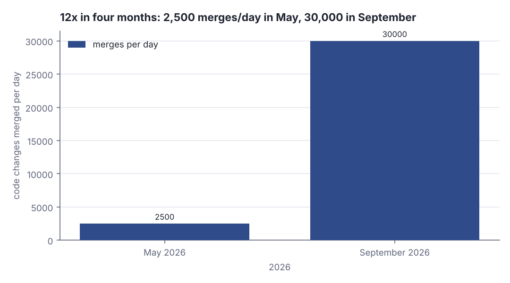
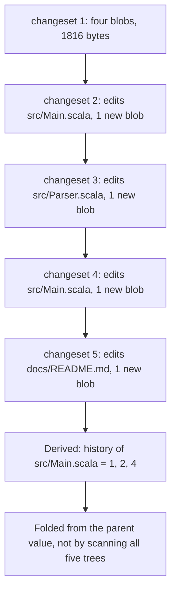
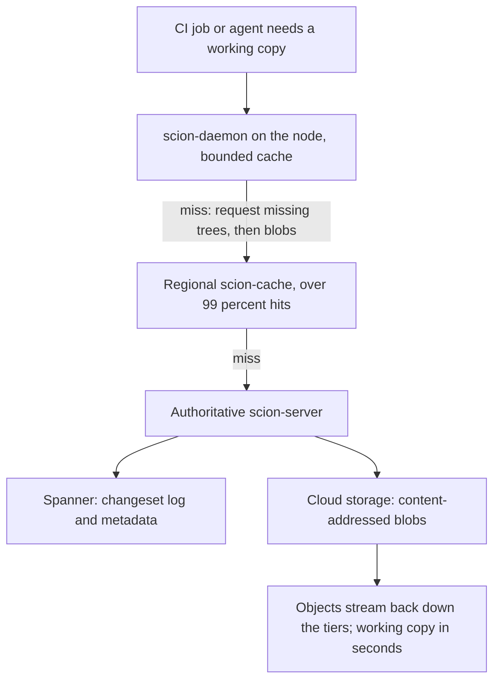
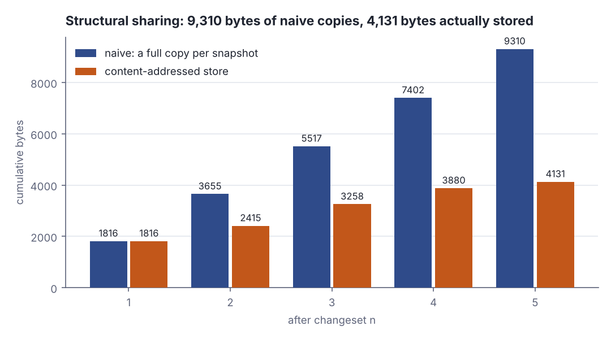

# Source control for 30,000 merges a day: Anthropic replaced git with a server-centric log

> Fresh · AI / ML foundations · Intermediate · ~25 min · from today's feeds

## Why this matters
Today's item is "Redesigning source control at Anthropic" by Nick G. and the source control team, published on Anthropic Engineering on 13 October 2026 and updated on 15 October 2026: the story of Scion, a version control system built from scratch to replace git in Anthropic's monorepo, shipped in five months.
It is worth 25 minutes because it is the clearest published case of a classic distributed-systems assumption breaking under agent load — git assumes a human developer who is sometimes offline, and almost every client of that monorepo is now a process that is always online — and because the fix is a data-structure argument you already know.
It is the same argument as today's core lesson on Scala's `List`: new versions share almost all of their storage with old ones, so the cost of a change scales with the size of the change rather than the size of the history.

## Primer
Three prerequisites.

**What git actually stores.** Git is a content-addressed object store. Every file's contents are stored as a *blob* object, every directory as a *tree* object listing names with the object ids of the blobs and sub-trees under them, and every commit as a *commit* object naming one root tree plus its parent commit(s) (Chacon & Straub, *Pro Git*, 2nd ed., ch. 10.2 "Git Objects"). An object's id is the hash of its own bytes, so identical files are one blob stored once, and an unchanged directory keeps its tree id across commits. A commit is a *snapshot* that reuses almost every object of its parent, not a diff.

**What a packfile is, and why a naive fetch is expensive.** Loose objects are wasteful, so git periodically rewrites them into a *packfile* with delta compression between similar objects, and a fetch or push negotiates and sends a packfile built for that transfer (Chacon & Straub, *Pro Git*, 2nd ed., ch. 10.4 "Packfiles"). Two consequences matter here: the server has to *build* the pack, burning CPU and memory proportional to how much of the repo is involved, and the pack is one opaque stream — an interrupted transfer restarts, and nothing in the middle is cacheable by object.

**Monorepo and checkout.** A *monorepo* is one repository holding all of an organisation's code, so its history is the sum of every team's commits. A *checkout* is materialising one commit's tree as real files on disk, which is what every CI job must do before it can build or test anything. Those two words are the scaling problem: a CI fleet checking out a monorepo runs the most expensive git operation continuously, from machines with no reason to keep a local copy of anything.

## The idea

### Git's assumption, and the clients that broke it
Git's design decision is that every clone is a complete, independent replica: full history on your disk, commits made offline, `git log` and `git blame` answered locally. That fits a human who works on a train. Anthropic's claim is that the client population changed underneath the assumption, and the human-scale infrastructure became the limit:

> "The bottleneck, now, is all of the developer infrastructure built for human scale: source control, builds, and CI."
> — Nick G. and the source control team, Anthropic Engineering, *Redesigning source control at Anthropic*, 2026-10-13, https://www.anthropic.com/research/redesigning-source-control

The load that forced it:

> "In May 2026, Anthropic averaged around 2,500 code changes merged per day; as of September, we merged over 30,000 per day."
> — Nick G. and the source control team, Anthropic Engineering, *Redesigning source control at Anthropic*, 2026-10-13, https://www.anthropic.com/research/redesigning-source-control



*Figure 1: the load change that made git's human-scale assumptions expensive — a twelvefold rise in four months. Source: figures stated in Nick G. and the source control team, "Redesigning source control at Anthropic", 13 October 2026, https://www.anthropic.com/research/redesigning-source-control*

Size compounds it. The history of the main branch alone is almost 100 GB and a compressed working copy is over 25 GB (Nick G. and the source control team, *Redesigning source control at Anthropic*, 13 October 2026), against roughly 25 million CI checkouts per day (same source, same date):

> "Fetched naively, that would be over 600 PB of git traffic per day."
> — Nick G. and the source control team, Anthropic Engineering, *Redesigning source control at Anthropic*, 2026-10-13, https://www.anthropic.com/research/redesigning-source-control

At peak the workaround was several hundred internal git mirrors (same source, same date): horizontal scaling by replicating something never designed for it.

### The unit of work is a changeset, not a packfile
Scion's core object is small and append-only:

> "In Scion, the unit of work is a “changeset,” an entry in a write-ahead log."
> — Nick G. and the source control team, Anthropic Engineering, *Redesigning source control at Anthropic*, 2026-10-13, https://www.anthropic.com/research/redesigning-source-control

A changeset lists the files changed *relative to its first parent*; the file contents themselves are content-addressed blobs in storage (same source, same date). Content addressing makes "relative to the parent" cheap: identical bytes get an identical id, so the unchanged bulk of the tree is never re-sent or re-stored:

```scala
import java.security.MessageDigest
def id(s: String): String =
  val d = MessageDigest.getInstance("SHA-256").digest(s.getBytes("UTF-8"))
  d.take(5).map(b => f"${b & 0xff}%02x").mkString

val v1 = "def parse(s: String) = s.toInt\n"
val v2 = v1 + "// fixed in changeset 7\n"
println(s"v1 -> ${id(v1)}  (${v1.length} bytes)")
println(s"v2 -> ${id(v2)}  (${v2.length} bytes)")
println(s"v1 hashed again -> ${id(v1)}")
```

```text
v1 -> 3ff49ec907  (31 bytes)
v2 -> 4838a9ae11  (55 bytes)
v1 hashed again -> 3ff49ec907
```

The id is a pure function of the bytes: hashing `v1` again gives the same `3ff49ec907`, so a store that holds that id skips the write and a client that has it skips the fetch. Editing one line yields a different id (`4838a9ae11`); only that blob is new.

This is today's core lesson at infrastructure scale. In Scala, `::` builds a new list by allocating one cons cell whose tail *is* the old list — no copy, no defensive duplication:

```scala
val tree1 = List("build.sbt", "docs/README.md", "src/Main.scala")
val tree2 = "src/Parser.scala" :: tree1
println(s"tree1 = $tree1")
println(s"tree2 = $tree2")
println(s"tree2.tail eq tree1 -> ${tree2.tail eq tree1}")
println(s"new cons cells allocated for tree2 = 1")
```

```text
tree1 = List(build.sbt, docs/README.md, src/Main.scala)
tree2 = List(src/Parser.scala, build.sbt, docs/README.md, src/Main.scala)
tree2.tail eq tree1 -> true
new cons cells allocated for tree2 = 1
```

`eq` is reference identity, so `true` means `tree2` did not copy `tree1`, it points at it. A changeset is the same cell: one new entry pointing at its first parent, with the old blobs shared by id instead of by pointer. Both give the same guarantee — the cost of version *n+1* is proportional to the edit, not to the history behind it. Anthropic states the goal the same way: commits are cheap and lock-free, their cost scaling with the size of the change rather than the size of the repository, and refs other than main and release branches are discouraged so there is no per-branch bookkeeping (same source, same date).

### Derived data is folded over parents
Blame, path history and commit-graph skip lists are not stored per commit; each is computed from its parent's value, eagerly or lazily, with the internals hidden from clients (same source, same date). That is a fold over the log, and it is why history queries need no repository on disk: "source control as an API" means CI can ask the server for a path's history with no local clone, which is what makes automated bisect and revert possible for an agent with no working copy (same source, same date).



*Figure 2: the write-ahead log of changesets, each listing only what changed against its first parent, with derived data computed recursively from the parent's value. Source: mechanism described in Nick G. and the source control team, "Redesigning source control at Anthropic", 13 October 2026; the byte counts are this lesson's lab.*

### Tiered fetches of trees and blobs
Because there is no packfile, a fetch is a conversation about objects: the client asks for missing trees, then the blobs they name, so transfers are resumable and every object is cacheable (same source, same date). A CPU-heavy pack build becomes a cache lookup, and the tiers do the rest — a `scion-daemon` per node, regional `scion-cache` servers, authoritative `scion-server`s backed by Spanner and cloud storage, with tiering enforced so one layer's failure cannot cascade; each cache tier keeps a hit rate over 99% (same source, same date).



*Figure 3: the tiered fetch path — tree- and blob-driven, so every hop is resumable and cacheable. Source: architecture described in Nick G. and the source control team, "Redesigning source control at Anthropic", 13 October 2026, https://www.anthropic.com/research/redesigning-source-control*

The reported payoff: the Scion footprint is 200x smaller than the previous git mirroring infrastructure in CPU and memory, CI gained about 25% CPU capacity, and checkouts take seconds instead of minutes. Seven people built it and the Antique code-review tool and migrated in five months while merge volume grew tenfold, and a Claude model rewrote the ingestion pipeline to use about 20x less memory and run 4x faster (all figures: same source, same date).

### What it costs
The authors are blunt that this is not a general answer:

> "Scion is by no means a suitable replacement for git for general use."
> — Nick G. and the source control team, Anthropic Engineering, *Redesigning source control at Anthropic*, 2026-10-13, https://www.anthropic.com/research/redesigning-source-control

Scion diverges from git, so adopting it means replacing code review, code search and CI too, and the internal tooling is highly bespoke (same source, same date). It assumes a reachable server — precisely the assumption offline-first git refuses to make. Discouraging refs and running without a global merge lock means concurrent changes can conflict, and the answer is post-merge and pre-deploy testing rather than serialisation (same source, same date). Engineers still had to tell agents "no" when a proposed pattern violated a system constraint, and the authors note Anthropic's unusually large internal token budget makes the approach atypical (same source, same date). Their advice for most git users is to take parts of the model — server-side RPCs, sparse and shallow checkouts — rather than the whole thing (same source, same date).

## Lab
**Question: how much traffic does content addressing actually save over five edits of a four-file repository, and does the same arithmetic reproduce Anthropic's 600 PB figure?**

Run it with `python3 dojo/engine/run_lab.py 2026-10-27-2`, or save the program and run `scala Lab.scala`.

### Step 1 — content-address the four files
Hash each file's bytes with SHA-256 and keep the first five bytes as a blob id. The store is a map from blob id to size, so writing the same bytes twice is a no-op.

### Step 2 — four more changesets, each relative to its first parent
Each changeset appends one line to one file. The program prints the parent, the changed path, the new blob id, how many blobs are new and how many are reused from the parent tree.

### Step 3 — derived data folded over parents
Compute the history of `src/Main.scala` by recursion on the parent's value: the parent's answer, plus this changeset if it touched the path. No scan of all five trees.

### Step 4 — bytes, shared store against naive full copies
Cumulative bytes if every snapshot were copied whole, against the bytes the content-addressed store actually holds.

### Step 5 — the same arithmetic at Anthropic's scale
25 million checkouts a day times a 25 GB working copy, then the same number behind a cache tier at a 99% hit rate.

```scala
// file: Lab.scala
import java.security.MessageDigest
import scala.collection.mutable

val SNAPSHOTS = 5                           // five successive states of one tiny monorepo
val CI_CHECKOUTS_PER_DAY = 25_000_000       // article: ~25 million CI checkouts per day
val WORKING_COPY_GB = 25.0                  // article: a compressed working copy is over 25 GB
val CACHE_HIT_RATE = 0.99                   // article: each cache tier keeps a hit rate over 99%

def blobId(bytes: Array[Byte]): String =
  val d = MessageDigest.getInstance("SHA-256").digest(bytes)
  d.take(5).map(b => f"${b & 0xff}%02x").mkString

val seed: Vector[(String, String)] = Vector(
  "build.sbt"        -> "scalaVersion := \"3.3.4\"\n" * 8,
  "docs/README.md"   -> "# Service\nOwned by the platform team.\n" * 6,
  "src/Main.scala"   -> "object Main { def run(): Unit = println(\"ok\") }\n" * 12,
  "src/Parser.scala" -> "def parse(s: String): Int = s.trim.toInt\n" * 20
)

// the edit applied to reach changeset n (n = 2..5): one path, one appended line
val edits: Map[Int, String] = Map(
  2 -> "src/Main.scala", 3 -> "src/Parser.scala", 4 -> "src/Main.scala", 5 -> "docs/README.md")

final case class Tree(paths: Vector[(String, String)]):
  def ids: Set[String] = paths.map(_._2).toSet

final case class Changeset(n: Int, parent: Int, changed: Option[String], blob: String, tree: Tree)

val store = mutable.LinkedHashMap.empty[String, Int]      // blob id -> size in bytes

def put(content: String): String =
  val bytes = content.getBytes("UTF-8")
  val id = blobId(bytes)
  store.getOrElseUpdate(id, bytes.length)
  id

@main def lab(): Unit =
  println("A content-addressed store, five changesets, and what sharing saves")
  println("Scion figures cited here come from Nick G. and the source control team,")
  println("Redesigning source control at Anthropic, 2026-10-13.")
  println()

  println("Step 1 - content-address the four files of changeset 1")
  println("  path                bytes  blob id (first 5 bytes of SHA-256)")
  var files = seed
  val rootPaths = files.map { case (p, c) => (p, put(c)) }
  files.zip(rootPaths).foreach { case ((p, c), (_, id)) =>
    println(f"  $p%-18s ${c.getBytes("UTF-8").length}%6d  $id%s")
  }
  var log = Vector(Changeset(1, 0, None, "-", Tree(rootPaths)))
  println(f"  store now holds ${store.size}%d blobs, ${store.values.sum}%d bytes")
  println()

  println("Step 2 - four more changesets, each listing only what changed vs its first parent")
  println("  n  parent  changed path        new blob      new  reused  tree bytes")
  for n <- 2 to SNAPSHOTS do
    val path = edits(n)
    files = files.map { case (p, c) =>
      if p == path then (p, c + s"// edit in changeset $n\n") else (p, c)
    }
    val before = store.size
    val paths = files.map { case (p, c) => (p, put(c)) }
    val tree = Tree(paths)
    val added = store.size - before
    val reused = tree.ids.size - added
    val treeBytes = tree.ids.toVector.map(store).sum
    val blob = paths.find(_._1 == path).get._2
    log = log :+ Changeset(n, n - 1, Some(path), blob, tree)
    println(f"  $n%-2d ${n - 1}%6d  $path%-18s $blob%s  $added%3d  $reused%6d  $treeBytes%10d")
  println()

  println("Step 3 - derived data: the history of src/Main.scala folded over parents")
  def pathHistory(n: Int, path: String): List[Int] =
    if n <= 1 then List(1)
    else
      val parent = pathHistory(n - 1, path)
      if log(n - 1).changed.contains(path) then n :: parent else parent
  val hist = pathHistory(SNAPSHOTS, "src/Main.scala").reverse
  println(s"  changesets that touched src/Main.scala: ${hist.mkString(", ")}")
  println(s"  computed from the parent's value, not by scanning all ${SNAPSHOTS} trees")
  println()

  println("Step 4 - bytes: one shared store vs a naive full copy per snapshot")
  println("  n  snapshot bytes  naive cumulative  store cumulative  sharing factor")
  var naive = 0L
  for cs <- log do
    val snap = cs.tree.ids.toVector.map(store).sum
    naive += snap
    val stored = log.take(cs.n).flatMap(_.tree.ids).distinct.map(store).sum
    println(f"  ${cs.n}%-2d ${snap}%14d  ${naive}%16d  ${stored}%16d  ${naive.toDouble / stored}%14.2fx")
  val allBlobs = store.values.sum
  println(f"  distinct blobs stored: ${store.size}%d, ${allBlobs}%d bytes")
  println(f"  naive full copies of $SNAPSHOTS%d snapshots: ${naive}%d bytes")
  println(f"  saved by sharing: ${naive - allBlobs}%d bytes = ${100.0 * (naive - allBlobs) / naive}%.1f%% of naive traffic")
  println()

  println("Step 5 - the same arithmetic at Anthropic's scale")
  val naivePB = CI_CHECKOUTS_PER_DAY * WORKING_COPY_GB / 1_000_000.0
  println(f"  $CI_CHECKOUTS_PER_DAY%,d checkouts/day x $WORKING_COPY_GB%.0f GB = ${CI_CHECKOUTS_PER_DAY * WORKING_COPY_GB}%,.0f GB/day")
  println(f"  = $naivePB%,.0f PB/day of traffic if every checkout is fetched whole")
  val missPB = naivePB * (1.0 - CACHE_HIT_RATE)
  println(f"  with a cache tier at ${CACHE_HIT_RATE * 100}%.0f%% hit rate, origin sees $missPB%,.1f PB/day")
  val shareFactor = naive.toDouble / allBlobs
  println(f"  the lab's own sharing factor over $SNAPSHOTS%d changesets: $shareFactor%.2fx")
```

```text
A content-addressed store, five changesets, and what sharing saves
Scion figures cited here come from Nick G. and the source control team,
Redesigning source control at Anthropic, 2026-10-13.

Step 1 - content-address the four files of changeset 1
  path                bytes  blob id (first 5 bytes of SHA-256)
  build.sbt             192  0ad6a515a7
  docs/README.md        228  e9c8407cf7
  src/Main.scala        576  cad87ea192
  src/Parser.scala      820  2eae30c9fd
  store now holds 4 blobs, 1816 bytes

Step 2 - four more changesets, each listing only what changed vs its first parent
  n  parent  changed path        new blob      new  reused  tree bytes
  2       1  src/Main.scala     a2e1fe4995    1       3        1839
  3       2  src/Parser.scala   d160f9868b    1       3        1862
  4       3  src/Main.scala     a8aa65ba18    1       3        1885
  5       4  docs/README.md     1038ac42f3    1       3        1908

Step 3 - derived data: the history of src/Main.scala folded over parents
  changesets that touched src/Main.scala: 1, 2, 4
  computed from the parent's value, not by scanning all 5 trees

Step 4 - bytes: one shared store vs a naive full copy per snapshot
  n  snapshot bytes  naive cumulative  store cumulative  sharing factor
  1            1816              1816              1816            1.00x
  2            1839              3655              2415            1.51x
  3            1862              5517              3258            1.69x
  4            1885              7402              3880            1.91x
  5            1908              9310              4131            2.25x
  distinct blobs stored: 8, 4131 bytes
  naive full copies of 5 snapshots: 9310 bytes
  saved by sharing: 5179 bytes = 55.6% of naive traffic

Step 5 - the same arithmetic at Anthropic's scale
  25,000,000 checkouts/day x 25 GB = 625,000,000 GB/day
  = 625 PB/day of traffic if every checkout is fetched whole
  with a cache tier at 99% hit rate, origin sees 6.3 PB/day
  the lab's own sharing factor over 5 changesets: 2.25x
```

### Reading the output

**Step 1 and Step 2.** `bytes` is the UTF-8 length of that file's contents; `blob id` is the first five bytes of its SHA-256, which is the only name the store knows it by. In the Step 2 table, `new` counts blobs this changeset added to the store and `reused` counts blobs already there — lower `new` is better, because `new` is what a fetch has to move. Every changeset after the first shows `new = 1, reused = 3`: one file was edited, the other three kept their ids and were not stored again. `tree bytes` is the size of the whole working copy at that changeset, which keeps growing (1816 → 1908) even though the store barely does.

| n | parent | changed path | new blobs | reused blobs | tree bytes |
|---|--------|--------------|-----------|--------------|------------|
| 2 | 1 | src/Main.scala | 1 | 3 | 1839 |
| 3 | 2 | src/Parser.scala | 1 | 3 | 1862 |
| 4 | 3 | src/Main.scala | 1 | 3 | 1885 |
| 5 | 4 | docs/README.md | 1 | 3 | 1908 |

**Verdict: the cost of a changeset is the size of the edit (one blob, 23 extra bytes of content), not the size of the tree.**

**Step 3.** The history of `src/Main.scala` comes back as `1, 2, 4`: changeset 1 created it, 2 and 4 edited it, 3 and 5 touched other paths. The recursion asks its parent for the answer and prepends itself only if it changed that path — exactly `foldRight` over the log, so a cached answer at changeset 4 makes changeset 5 a single comparison.

**Verdict: derived data is a fold over parents, so history queries need the log, not a repository on disk.**

**Step 4.** `naive cumulative` is what you move if every checkout copies the whole tree; `store cumulative` is what the content-addressed store actually holds after n changesets; `sharing factor` is the first divided by the second, and higher is better. Trace changeset 5 with digits: the tree is 1908 bytes, so naive cumulative is 1816 + 1839 + 1862 + 1885 + 1908 = 9310 bytes. The store holds 8 distinct blobs — the four originals (192 + 228 + 576 + 820 = 1816) plus four edited versions (599 + 843 + 622 + 251 = 2315) — for 1816 + 2315 = 4131 bytes. The sharing factor is 9310 ÷ 4131 = 2.25x, and the saving is 9310 − 4131 = 5179 bytes, which is 5179 ÷ 9310 = 55.6% of the naive traffic.



*Figure 4: the two cost curves diverge as changesets accumulate — naive copying is linear in snapshots, the shared store is linear in edits. Generated from the Step 4 lab output above (`python3 dojo/engine/run_lab.py 2026-10-27-2`).*

**Verdict: with only five changesets the saving is already 55.6%, and the gap widens with every changeset because the naive line grows by a whole tree while the store grows by one blob.**

**Step 5.** The same arithmetic with the article's numbers: 25,000,000 checkouts per day × 25 GB = 625,000,000 GB per day = 625 PB per day, which reproduces the "over 600 PB of git traffic per day" the article reports (Nick G. and the source control team, *Redesigning source control at Anthropic*, 13 October 2026). Put a cache tier in front at the 99% hit rate the article reports for each tier, and the authoritative servers see 625 × 0.01 = 6.3 PB per day.

**Verdict: the 600 PB figure is not an exotic measurement, it is checkouts × working-copy size; the two ways out are to stop sending whole copies and to answer almost every request from a cache.**

### Cause → mechanism → consequence → what it means

1. **Cause.** Merge volume went from about 2,500 to over 30,000 changes per day between May and September 2026, and almost every client is an always-online agent or CI job (Nick G. and the source control team, *Redesigning source control at Anthropic*, 13 October 2026).
2. **Mechanism.** Git answers a fetch by building a packfile, an opaque stream whose cost scales with how much of the repository is involved, and it assumes each client keeps a full offline replica — so load multiplies the expensive operation rather than the cheap one.
3. **Consequence.** 25 million checkouts of a 25+ GB working copy is 625 PB a day of would-be traffic, several hundred git mirrors at peak, and minutes of latency per CI checkout (same source, same date).
4. **What it means in practice.** When your clients change shape, re-derive the storage model from the access pattern instead of scaling the old one: make the unit of work proportional to the change, address content by hash so unchanged parts are free, compute derived values from parents so they can be cached, and serve the result through tiers. You will not build Scion — but server-side history RPCs, sparse checkouts and shallow clones are the same ideas in git form, and they are the authors' own recommendation (same source, same date). The 25-GB-per-CI-job habit is worth measuring on any monorepo you own.

## Self-check
1. Git already content-addresses blobs and trees, so why does a git fetch still cost far more than a Scion fetch of the same commit? <details><summary>Answer</summary>Because of how the objects are *transferred*, not how they are stored. Git negotiates and then builds a packfile: the server spends CPU and memory proportional to the amount of history involved, the result is one opaque stream, an interrupted transfer restarts, and nothing inside it is cacheable per object (Chacon & Straub, <em>Pro Git</em>, 2nd ed., ch. 10.4 "Packfiles"). Scion fetches trees and then blobs individually, so transfers are resumable and every object can be served from a regional cache whose hit rate is over 99% (Nick G. and the source control team, <em>Redesigning source control at Anthropic</em>, 13 October 2026).</details>
2. In the lab, changeset 5 holds a 1,908-byte tree but the whole store is only 4,131 bytes after five changesets. Where did the other 5,179 bytes of "naive" traffic go? <details><summary>Answer</summary>They never existed. Naive cumulative (1816 + 1839 + 1862 + 1885 + 1908 = 9310) counts every unchanged file once per snapshot. The store keeps 8 distinct blobs totalling 4,131 bytes, because each changeset added exactly one new blob and reused the other three by id — 9310 − 4131 = 5179 bytes, 55.6% of the naive total, is duplicate content that content addressing simply does not store or send. It is the same saving as `tree2.tail eq tree1` being <code>true</code> for a Scala <code>List</code>: the new version points at the old one instead of copying it.</details>
3. Anthropic discourages refs other than main and release branches and runs with no global merge lock. What does that buy, what does it cost, and how do they pay for it? <details><summary>Answer</summary>It buys cheap lock-free commits whose cost scales with the size of the change rather than the size of the repository, and it removes the per-branch bookkeeping that would otherwise have to scale with 30,000 merges a day. It costs correctness guarantees at merge time: with no global lock, concurrent changes can conflict. They pay for it with post-merge and pre-deploy testing rather than serialising merges (Nick G. and the source control team, <em>Redesigning source control at Anthropic</em>, 13 October 2026).</details>

## Sources
- [Redesigning source control at Anthropic](https://www.anthropic.com/research/redesigning-source-control) — Nick G. and the source control team, Anthropic Engineering, published 2026-10-13, updated 2026-10-15 — the primary source for everything in this lesson: the changeset write-ahead log, content-addressed blobs, derived data folded over parents, the tree-and-blob fetch path, the daemon/cache/server tiers, and every number quoted or cited (2,500 → 30,000 merges per day, almost 100 GB of main-branch history, a 25+ GB compressed working copy, ~25 million CI checkouts per day, over 600 PB of naive git traffic per day, cache hit rate over 99%, a 200x smaller infrastructure footprint, ~25% more CI CPU capacity, seven engineers in five months, a 20x memory and 4x runtime improvement from a Claude-written ingestion pipeline, several hundred git mirrors at peak) as well as the stated limits (accessed 2026-10-27).
- Chacon & Straub, *Pro Git*, 2nd edition — ch. 10.2 "Git Objects", ch. 10.4 "Packfiles" — the Primer's account of what git stores (blobs, trees, commits as content-addressed objects) and what a packfile is, which is the baseline Scion is compared against. The git-scm.com copies of these chapters could not be fetched from this environment today, so they are cited as book chapters rather than as links.
