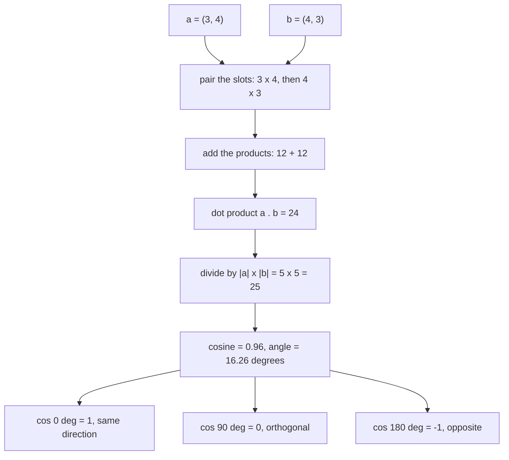
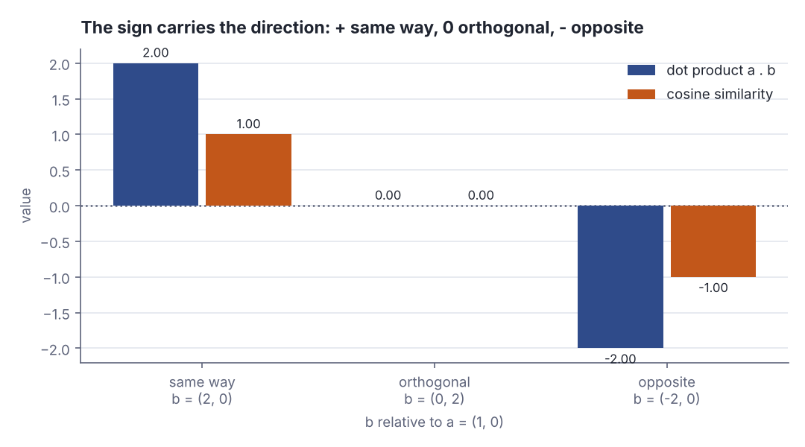
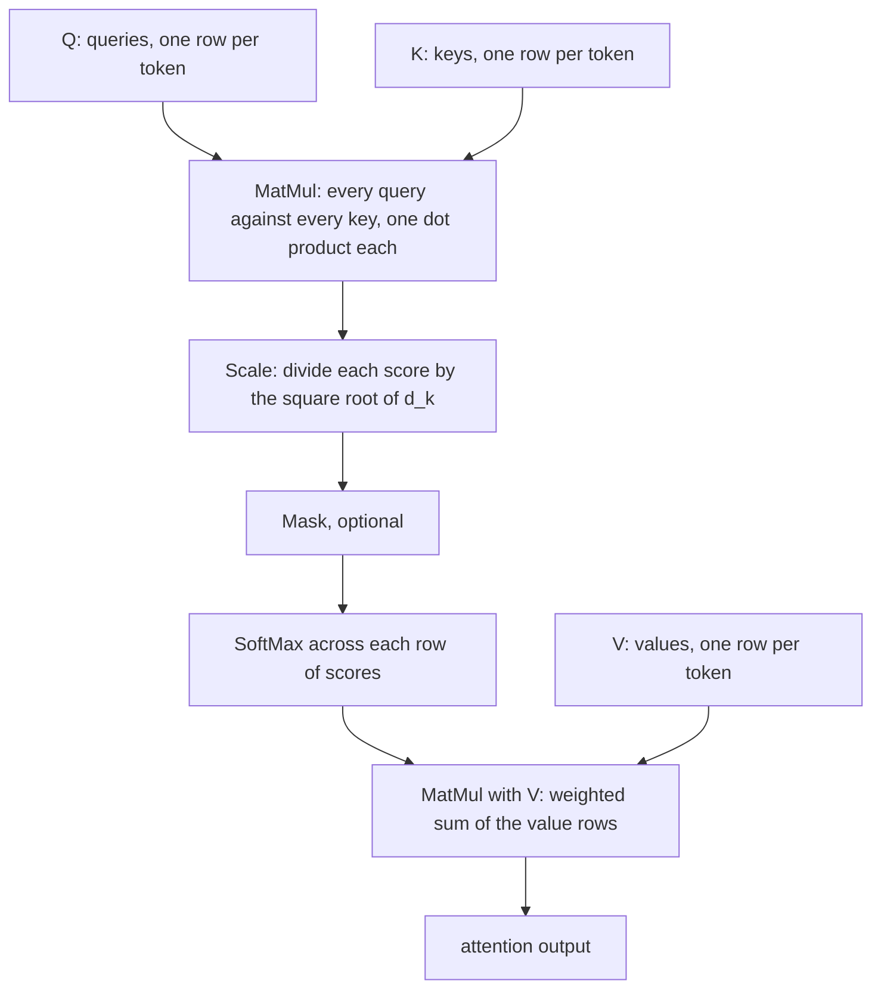
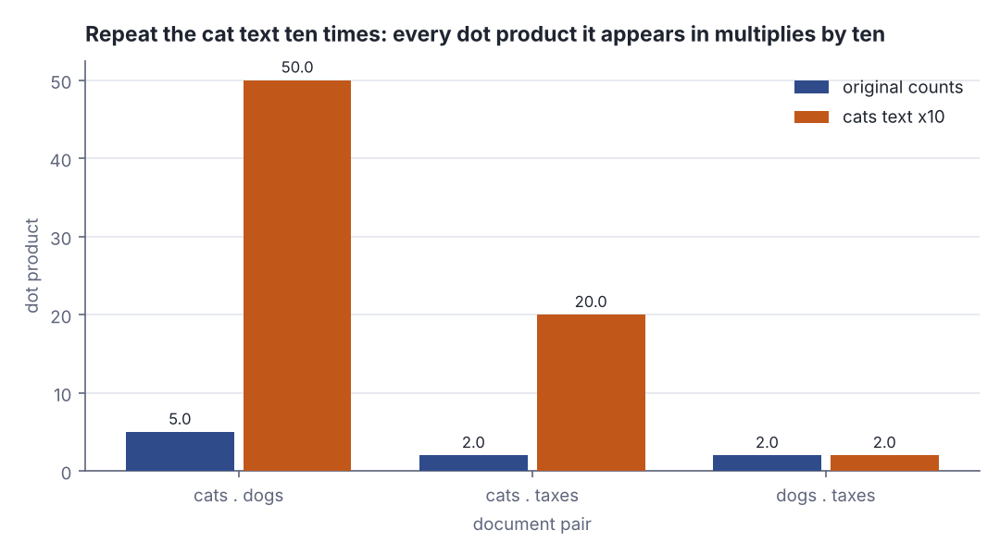
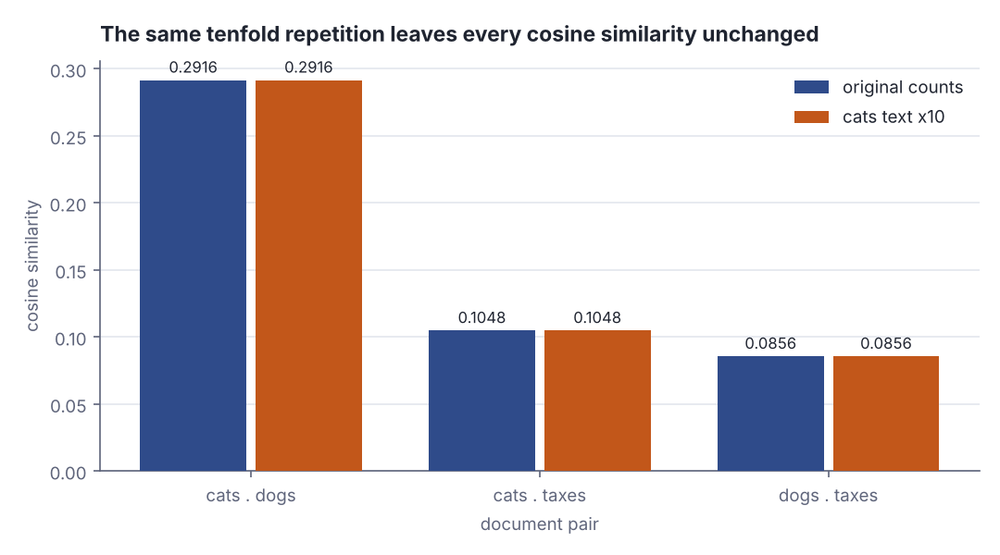

# Dot products and similarity

> AI / ML foundations · Beginner · ~20 min · rung 5 of 38 · needs: Vectors and matrices as data (ai-ml-04)

## Why this matters
A linear model's prediction, one neuron's activation, a nearest-neighbour search over embeddings and a single attention score in a Transformer are all the same arithmetic: multiply two lists slot by slot and add the products.
Once you read that number geometrically — how much do these two point the same way — most of the ML stack stops being notation and becomes a measurement you can sanity-check by hand.
It sits here because gradient descent, neural network layers and attention, the rungs that follow on this track, are written in it and in nothing else.

## The idea

A **vector**, for this lesson, is a fixed-length list of numbers: `Vector(3.0, 4.0)` in Scala, a point two steps east and four steps north, an arrow from the origin to that point. The **dot product** of two vectors of the *same* length is a single number: multiply the entries that sit in the same slot, then add the products. In symbols, `a · b = a₁b₁ + a₂b₂ + … + a_d b_d`. That is the entire algebraic definition, and it is four lines of Scala:

```scala
def dot(a: Vector[Double], b: Vector[Double]) = a.zip(b).map((x, y) => x * y).sum
def norm(v: Vector[Double]) = math.sqrt(dot(v, v))
val a = Vector(3.0, 4.0)
val b = Vector(4.0, 3.0)
println(s"term-by-term: ${a.zip(b).map((x, y) => x * y)}")
println(s"a . b = ${dot(a, b)}")
val c = dot(a, b) / (norm(a) * norm(b))
println(f"|a| = ${norm(a)}%.1f  |b| = ${norm(b)}%.1f  cos = $c%.4f")
println(f"angle = ${math.toDegrees(math.acos(c))}%.2f degrees")
println(f"projection of b onto a = ${norm(b) * c}%.2f")
```

```text
term-by-term: Vector(12.0, 12.0)
a . b = 24.0
|a| = 5.0  |b| = 5.0  cos = 0.9600
angle = 16.26 degrees
projection of b onto a = 4.80
```

Two slots, two products (`3×4 = 12` and `4×3 = 12`), one sum: `24.0`. The last three lines are the same number read as geometry: `|a| · |b| · cos θ = 5 × 5 × 0.96 = 24`, where `θ = 16.26°` is the angle between the arrows and `4.80` is the length of b's shadow when you drop it perpendicularly onto the line through a — the **projection**. 3Blue1Brown spends the first half of ch. 9 "Dot products and duality" on exactly this equivalence: computing `a · b` is the same as projecting b onto a and scaling by the length of a.



*Figure 1: The two readings of one number — sum of term-by-term products on the way down, length times length times cosine on the way back out. Source: the examples in this section, run with `python3 dojo/engine/run_lab.py 2026-10-28-1`.*

### The sign tells you the direction

Lengths are never negative, so in `|a| · |b| · cos θ` the sign of the dot product is the sign of `cos θ` and nothing else. Hold `a = (1, 0)` fixed and swing b around it:

```scala
val east = Vector(1.0, 0.0)
def cosim(x: Vector[Double], y: Vector[Double]) = dot(x, y) / (norm(x) * norm(y))
val cases = Vector(("same way", Vector(2.0, 0.0)), ("orthogonal", Vector(0.0, 2.0)),
                   ("opposite", Vector(-2.0, 0.0)))
for (name, v) <- cases do
  println(f"$name%-11s dot = ${dot(east, v)}%4.1f   cos = ${cosim(east, v)}%5.2f")
```

```text
same way    dot =  2.0   cos =  1.00
orthogonal  dot =  0.0   cos =  0.00
opposite    dot = -2.0   cos = -1.00
```

Positive means the two vectors lean the same way, zero means **orthogonal** — at right angles, sharing nothing — and negative means they point against each other. The magnitudes differ (`2.0` versus `1.00`) but the sign is identical, which is the one piece of information the raw dot product and the cosine always agree on.



*Figure 2: The sign survives normalisation; the size does not. Generated from the example output above (2.0 / 0.0 / −2.0 and 1.00 / 0.00 / −1.00).*

### Length, and dividing it out

The dot product of a vector with itself has no angle in it — `θ = 0`, `cos θ = 1` — so `v · v = |v|²`. Turn that round and you get the **norm** (the length) for free: `|v| = √(v · v)`, which in two dimensions is Pythagoras and in 768 dimensions is the same formula with more terms. Dividing a vector by its own norm **normalises** it: same direction, length exactly 1, a **unit vector**.

```scala
def unit(v: Vector[Double]) = v.map(_ / norm(v))
println(s"norm of $a = ${norm(a)}")
println(s"unit(a) = ${unit(a)}, its norm = ${norm(unit(a))}")
println(f"unit(a) . unit(b) = ${dot(unit(a), unit(b))}%.4f")
```

```text
norm of Vector(3.0, 4.0) = 5.0
unit(a) = Vector(0.6, 0.8), its norm = 1.0
unit(a) . unit(b) = 0.9600
```

`(3, 4)` has length 5, so `(0.6, 0.8)` is the same arrow shrunk to length 1. And the dot product of the two unit vectors is `0.9600` — exactly the cosine computed earlier. That is the whole definition of **cosine similarity**: the dot product after both vectors have been normalised, which is why it always lands in `[-1, 1]`.

> "Cosine similarity, or the cosine kernel, computes similarity as the normalized dot product of X and Y:"
> "On L2-normalized data, this function is equivalent to linear_kernel."
> — scikit-learn developers, *sklearn.metrics.pairwise.cosine_similarity*, https://scikit-learn.org/stable/modules/generated/sklearn.metrics.pairwise.cosine_similarity.html

### Cosine similarity versus the raw dot product

The difference between them is magnitude sensitivity. Double a vector and every dot product it takes part in doubles, because `(2a) · b = 2(a · b)` — the arithmetic is linear in each argument. The angle, though, has not moved, so the cosine does not budge. For word-count vectors that is decisive: a document that simply repeats itself ten times is ten times longer as an arrow and ten times "more similar" to everything under the raw dot product, while being about exactly the same topic. The lab below measures that effect. StatQuest's "Cosine Similarity, Clearly Explained!!!" makes the same point with document counts, and the reason the fix works is the one above: normalise first, and only the direction is left to compare.

The trade-off runs the other way too. When magnitude *is* meaning — a count that matters, a confidence, an unnormalised logit — dividing it out throws away signal. Cosine is the default for embeddings because an embedding's direction carries the semantics and its length mostly carries artefacts such as text length; it is a choice, not a law.

### Where it comes back

A linear model's prediction is one dot product plus an offset: `ŷ = w · x + b`, with `x` the features of one example, `w` the learned weight per feature and `b` the **bias**, a constant the model can add regardless of the input.

```scala
val w = Vector(3.0, 10.0, -0.5)
val x = Vector(80.0, 3.0, 12.0)
val bias = 20.0
println(s"w . x = ${dot(w, x)}")
println(s"prediction w . x + b = ${dot(w, x) + bias}")
```

```text
w . x = 264.0
prediction w . x + b = 284.0
```

`3×80 + 10×3 + (−0.5)×12 = 264.0`, plus the bias, `284.0`: a price in thousands for a flat of 80 m², 3 rooms, 12 years old. A **neuron** in a neural network is this expression with one nonlinear function wrapped round it, so a layer of 512 neurons is 512 dot products against the same input. Embedding search is a dot product too: normalise every stored vector once, normalise the query, and the nearest neighbours are the largest dot products. And a Transformer's attention starts from the dot product of a query vector with every key vector:

> "The input consists of queries and keys of dimension dk, and values of dimension dv."
> "We compute the dot products of the query with all keys, divide each by √dk, and apply a softmax function to obtain the weights on the values."
> — Ashish Vaswani et al., *Attention Is All You Need*, 2017, §3.2.1, https://arxiv.org/pdf/1706.03762



*Figure 3: Scaled dot-product attention — the scores it softmaxes are `q · k`, the operation from the first example of this lesson. Adapted from Vaswani et al., Attention Is All You Need, Figure 2 (left), https://arxiv.org/pdf/1706.03762*

So one operation, three readings: a weighted sum when you are predicting, a projection when you are reasoning geometrically, a similarity score when the vectors are normalised.

## Lab

Do three toy documents rank the way a human would, and what happens to those rankings when one of them simply says the same thing ten times?

### Step 1 — three documents as count vectors

The vocabulary has six words. Each document is a `Vector[Double]` of how often each word occurs: a post about cats, a post about dogs, and a tax article that happens to mention pets once. `dot` sums the term-by-term products; `norm` is `√(v · v)`.

```scala
// file: Corpus.scala
def dot(a: Vector[Double], b: Vector[Double]): Double =
  require(a.length == b.length, s"length mismatch: ${a.length} vs ${b.length}")
  a.zip(b).map((x, y) => x * y).sum

def norm(v: Vector[Double]): Double = math.sqrt(dot(v, v))

val vocab = Vector("cat", "dog", "pet", "vet", "tax", "deduction")
val cats  = Vector(3.0, 0.0, 2.0, 1.0, 0.0, 0.0)
val dogs  = Vector(0.0, 4.0, 2.0, 1.0, 0.0, 0.0)
val taxes = Vector(0.0, 0.0, 1.0, 0.0, 4.0, 3.0)

def row(name: String, v: Vector[Double]): String =
  f"$name%-7s" + v.map(x => f"${x.toInt}%10d").mkString + f"${norm(v)}%12.4f"

@main def corpus(): Unit =
  println("word counts: rows = documents, columns = vocabulary")
  println(f"${"doc"}%-7s" + vocab.map(w => f"$w%10s").mkString + f"${"norm"}%12s")
  println(row("cats", cats))
  println(row("dogs", dogs))
  println(row("taxes", taxes))
  println()
  println("term-by-term products for cats . dogs")
  println(f"${"word"}%-12s${"cats"}%6s${"dogs"}%6s${"product"}%9s")
  for (w, i) <- vocab.zipWithIndex do
    println(f"$w%-12s${cats(i).toInt}%6d${dogs(i).toInt}%6d${cats(i) * dogs(i)}%9.1f")
  println(f"${"sum = dot"}%-12s${""}%6s${""}%6s${dot(cats, dogs)}%9.1f")
```

```text
word counts: rows = documents, columns = vocabulary
doc           cat       dog       pet       vet       tax deduction        norm
cats            3         0         2         1         0         0      3.7417
dogs            0         4         2         1         0         0      4.5826
taxes           0         0         1         0         4         3      5.0990

term-by-term products for cats . dogs
word          cats  dogs  product
cat              3     0      0.0
dog              0     4      0.0
pet              2     2      4.0
vet              1     1      1.0
tax              0     0      0.0
deduction        0     0      0.0
sum = dot                     5.0
```

### Step 2 — pairwise dot products and cosine similarities

Add `cosine` and print all three pairs side by side, with the two norms that go into each division.

```scala
// file: Compare.scala
def dot(a: Vector[Double], b: Vector[Double]): Double =
  require(a.length == b.length, s"length mismatch: ${a.length} vs ${b.length}")
  a.zip(b).map((x, y) => x * y).sum

def norm(v: Vector[Double]): Double = math.sqrt(dot(v, v))

def cosine(a: Vector[Double], b: Vector[Double]): Double =
  val d = norm(a) * norm(b)
  require(d > 0.0, "a zero vector has no direction")
  dot(a, b) / d

val cats  = Vector(3.0, 0.0, 2.0, 1.0, 0.0, 0.0)
val dogs  = Vector(0.0, 4.0, 2.0, 1.0, 0.0, 0.0)
val taxes = Vector(0.0, 0.0, 1.0, 0.0, 4.0, 3.0)

def pairTable(docs: Vector[(String, Vector[Double])]): Unit =
  println(f"${"pair"}%-17s${"dot"}%8s${"|a|"}%9s${"|b|"}%9s${"cosine"}%9s")
  for
    i <- docs.indices
    j <- docs.indices
    if i < j
  do
    val (na, a) = docs(i)
    val (nb, b) = docs(j)
    println(f"${na + " . " + nb}%-17s${dot(a, b)}%8.1f${norm(a)}%9.4f${norm(b)}%9.4f${cosine(a, b)}%9.4f")

@main def compare(): Unit =
  pairTable(Vector(("cats", cats), ("dogs", dogs), ("taxes", taxes)))
```

```text
pair                  dot      |a|      |b|   cosine
cats . dogs           5.0   3.7417   4.5826   0.2916
cats . taxes          2.0   3.7417   5.0990   0.1048
dogs . taxes          2.0   4.5826   5.0990   0.0856
```

### Step 3 — the same text, ten times over

Nothing changes about the cats post except that it is pasted ten times: every count is multiplied by 10. Recompute both measures against the unchanged dogs and taxes documents.

```scala
// file: Repeat.scala
def dot(a: Vector[Double], b: Vector[Double]): Double =
  require(a.length == b.length, s"length mismatch: ${a.length} vs ${b.length}")
  a.zip(b).map((x, y) => x * y).sum

def norm(v: Vector[Double]): Double = math.sqrt(dot(v, v))

def cosine(a: Vector[Double], b: Vector[Double]): Double =
  val d = norm(a) * norm(b)
  require(d > 0.0, "a zero vector has no direction")
  dot(a, b) / d

val vocab = Vector("cat", "dog", "pet", "vet", "tax", "deduction")
val cats  = Vector(3.0, 0.0, 2.0, 1.0, 0.0, 0.0)
val dogs  = Vector(0.0, 4.0, 2.0, 1.0, 0.0, 0.0)
val taxes = Vector(0.0, 0.0, 1.0, 0.0, 4.0, 3.0)

def row(name: String, v: Vector[Double]): String =
  f"$name%-7s" + v.map(x => f"${x.toInt}%10d").mkString + f"${norm(v)}%12.4f"

def pairTable(docs: Vector[(String, Vector[Double])]): Unit =
  println(f"${"pair"}%-17s${"dot"}%8s${"|a|"}%9s${"|b|"}%9s${"cosine"}%9s")
  for
    i <- docs.indices
    j <- docs.indices
    if i < j
  do
    val (na, a) = docs(i)
    val (nb, b) = docs(j)
    println(f"${na + " . " + nb}%-17s${dot(a, b)}%8.1f${norm(a)}%9.4f${norm(b)}%9.4f${cosine(a, b)}%9.4f")

@main def repeatTen(): Unit =
  val cats10 = cats.map(_ * 10.0)
  println("the cats text repeated ten times is cats10 = 10 * cats")
  println(f"${"doc"}%-7s" + vocab.map(w => f"$w%10s").mkString + f"${"norm"}%12s")
  println(row("cats", cats))
  println(row("cats10", cats10))
  println()
  pairTable(Vector(("cats10", cats10), ("dogs", dogs), ("taxes", taxes)))
  println()
  println(f"cats . cats     dot = ${dot(cats, cats)}%7.1f   cosine = ${cosine(cats, cats)}%6.4f")
  println(f"cats . cats10   dot = ${dot(cats, cats10)}%7.1f   cosine = ${cosine(cats, cats10)}%6.4f")
```

```text
the cats text repeated ten times is cats10 = 10 * cats
doc           cat       dog       pet       vet       tax deduction        norm
cats            3         0         2         1         0         0      3.7417
cats10         30         0        20        10         0         0     37.4166

pair                  dot      |a|      |b|   cosine
cats10 . dogs        50.0  37.4166   4.5826   0.2916
cats10 . taxes       20.0  37.4166   5.0990   0.1048
dogs . taxes          2.0   4.5826   5.0990   0.0856

cats . cats     dot =    14.0   cosine = 1.0000
cats . cats10   dot =   140.0   cosine = 1.0000
```

### Reading the output

**Step 1.** The count table is the corpus: `cats` says "cat" three times, "pet" twice, "vet" once; `dogs` says "dog" four times and shares "pet" and "vet"; `taxes` is about tax and deductions and mentions "pet" once. `norm` is the length of each arrow — bigger means a longer document, not a different topic. The products table shows where a dot product actually comes from: four of the six slots multiply to zero because one side has a zero count, and only the two shared words contribute.

| word | cats | dogs | product |
|---|---|---|---|
| cat | 3 | 0 | 0.0 |
| dog | 0 | 4 | 0.0 |
| pet | 2 | 2 | 4.0 |
| vet | 1 | 1 | 1.0 |
| tax | 0 | 0 | 0.0 |
| deduction | 0 | 0 | 0.0 |
| **sum** | | | **5.0** |

Traced with digits: `3×0 + 0×4 + 2×2 + 1×1 + 0×0 + 0×0 = 0 + 0 + 4 + 1 = 5.0`. The norm of `cats` is `√(3² + 0² + 2² + 1² + 0² + 0²) = √14 = 3.7417`.

**Verdict:** a dot product over count vectors is just "how much vocabulary do these two share, weighted by how often each of them uses it" — unshared words cost nothing and contribute nothing.

**Step 2.** `dot` is higher when documents overlap more; `cosine` is `dot / (|a| × |b|)` and lives in `[-1, 1]`, where 1 is the same direction. For both, higher means more similar.

| pair | dot | \|a\| | \|b\| | cosine |
|---|---|---|---|---|
| cats · dogs | 5.0 | 3.7417 | 4.5826 | 0.2916 |
| cats · taxes | 2.0 | 3.7417 | 5.0990 | 0.1048 |
| dogs · taxes | 2.0 | 4.5826 | 5.0990 | 0.0856 |

Traced: `5.0 / (3.7417 × 4.5826) = 5.0 / 17.1464 = 0.2916`. Note that `cats · taxes` and `dogs · taxes` have the *same* dot product, `2.0`, yet different cosines — `0.1048` against `0.0856` — because `dogs` is the longer document, so the same amount of overlap counts for less of its direction.

**Verdict:** both measures agree on the ranking a human would give (the two pet posts are closest, the tax article is far from both), but only the cosine can separate two pairs whose raw overlap is identical.

**Step 3.** Same documents, except `cats` has been pasted ten times. Its norm goes from `3.7417` to `37.4166` — exactly ten times longer, `√(10² × 14) = 10√14`.

| pair | dot, original | dot, cats ×10 | cosine, original | cosine, cats ×10 |
|---|---|---|---|---|
| cats · dogs | 5.0 | 50.0 | 0.2916 | 0.2916 |
| cats · taxes | 2.0 | 20.0 | 0.1048 | 0.1048 |
| dogs · taxes | 2.0 | 2.0 | 0.0856 | 0.0856 |

Traced: `dot(cats10, dogs) = 30×0 + 0×4 + 20×2 + 10×1 = 50.0`, ten times the earlier `5.0`; the cosine is `50.0 / (37.4166 × 4.5826) = 50.0 / 171.464 = 0.2916`, unchanged, because the extra factor of 10 appears in the numerator and in `|cats10|` alike and cancels. The last two lines make it blunt: `cats · cats10` has a dot product of `140.0` against `14.0` for `cats · cats`, but a cosine of `1.0000` either way — ten copies of a text point in exactly the same direction as one copy.



*Figure 4: Raw dot products scale with the repetition: 5.0 → 50.0 and 2.0 → 20.0, while the untouched dogs · taxes pair stays at 2.0. Generated from the Step 3 output.*



*Figure 5: The same three pairs under cosine similarity: 0.2916, 0.1048 and 0.0856 before and after. Generated from the Step 2 and Step 3 output.*

**Verdict:** under the raw dot product the padded document becomes the most "similar" thing in the corpus to everything it touches; under cosine similarity nothing moves at all. If you rank search results by raw dot products over unnormalised vectors, length wins.

### Cause → mechanism → consequence → practice

1. **Cause:** the dot product is linear in each argument, so scaling one vector by `k` scales the result by `k`.
2. **Mechanism:** `|a| · |b| · cos θ` has exactly two factors that can change — the lengths and the angle — and repeating a document changes only a length.
3. **Consequence:** raw dot products confound "about the same thing" with "longer", which is why `cats10 · dogs` jumps from 5.0 to 50.0 while the topic is untouched.
4. **In practice:** normalise before you compare directions, and normalise *once* at write time — storing unit vectors turns every cosine query into a plain dot product, which is also why vector databases offer "cosine" and "inner product" as two different index metrics. Pick inner product only when the magnitude is part of the signal you want.

## Self-check
1. `a = Vector(2.0, 0.0, 1.0)` and `b = Vector(0.0, 5.0, 0.0)`. What is `a · b`, and what does that tell you about the angle between them? <details><summary>Answer</summary>`2×0 + 0×5 + 1×0 = 0`. A dot product of zero means `cos θ = 0`, so the vectors are orthogonal — at 90° — and share no direction at all. With count vectors it means the two documents have no word in common.</details>
2. You double every entry of `a` and leave `b` alone. What happens to `a · b`, to `|a|`, and to the cosine similarity between them? <details><summary>Answer</summary>`a · b` doubles and `|a|` doubles, because both are linear in `a`'s entries (`|2a| = 2|a|`). The cosine is `(a · b) / (|a| |b|)`, so the two factors of 2 cancel and it does not change: the arrow is longer but points the same way. The lab shows the same thing with a factor of 10: dot 14.0 → 140.0, cosine 1.0000 → 1.0000.</details>
3. Your embedding store ranks candidates by raw dot product and long documents keep winning. What is the one-line fix, and when would it be the wrong fix? <details><summary>Answer</summary>Normalise every stored vector and the query to unit length, which makes the dot product equal the cosine similarity and removes length from the ranking. It is the wrong fix when magnitude carries signal you want — an unnormalised score, a confidence, a count whose size genuinely matters — because normalising deletes exactly that information.</details>

## Sources
- [3Blue1Brown — Essence of Linear Algebra](https://www.3blue1brown.com/topics/linear-algebra) — Grant Sanderson; ch. 9 "Dot products and duality", first half, gave the projection reading of `a · b` and the `|a|·|b|·cos θ` identity used in "The idea" (accessed 2026-10-28)
- [Khan Academy — Linear algebra](https://www.khanacademy.org/math/linear-algebra) — Khan Academy; unit "Vectors and spaces" → lesson "Vector dot and cross products", the algebraic definition, the norm `|v| = √(v · v)` and the worked angle computation (accessed 2026-10-28)
- [StatQuest — Cosine Similarity, Clearly Explained](https://statquest.org/video-index/) — Josh Starmer; video index entry "Cosine Similarity, Clearly Explained!!!", the document-count framing and why repeating a text does not change its cosine similarity (accessed 2026-10-28)
- [scikit-learn — sklearn.metrics.pairwise.cosine_similarity](https://scikit-learn.org/stable/modules/generated/sklearn.metrics.pairwise.cosine_similarity.html) — scikit-learn developers; quoted for the definition of cosine similarity as the normalised dot product and its equivalence to a linear kernel on L2-normalised data (accessed 2026-10-28)
- [Attention Is All You Need](https://arxiv.org/pdf/1706.03762) — Ashish Vaswani et al., 2017; §3.2.1 "Scaled Dot-Product Attention", quoted for how attention scores are dot products of queries with keys, and Figure 2 (left), adapted as Figure 3 (accessed 2026-10-28)

## Next on this track
Next on AI / ML foundations: **Gradient descent in one variable** (rung 6 of 38, Beginner).
