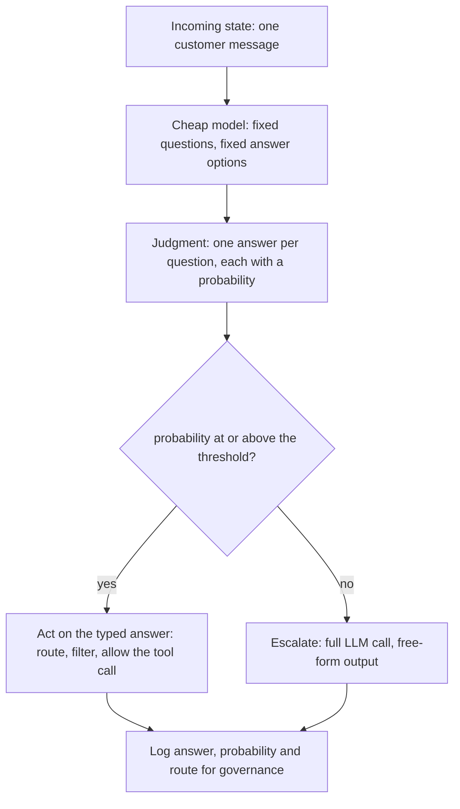
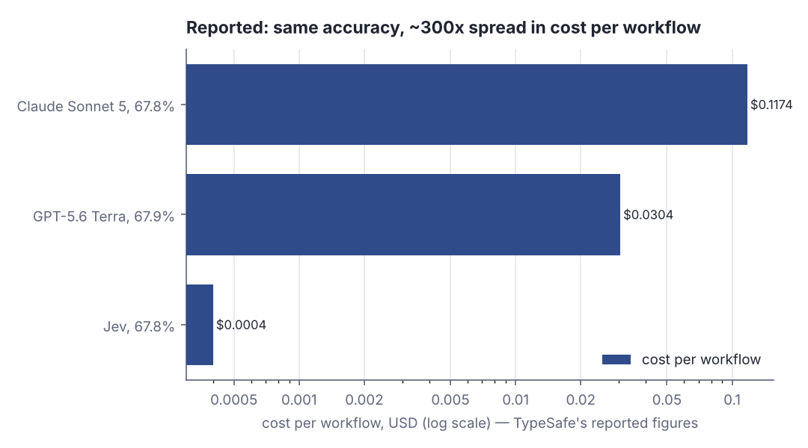
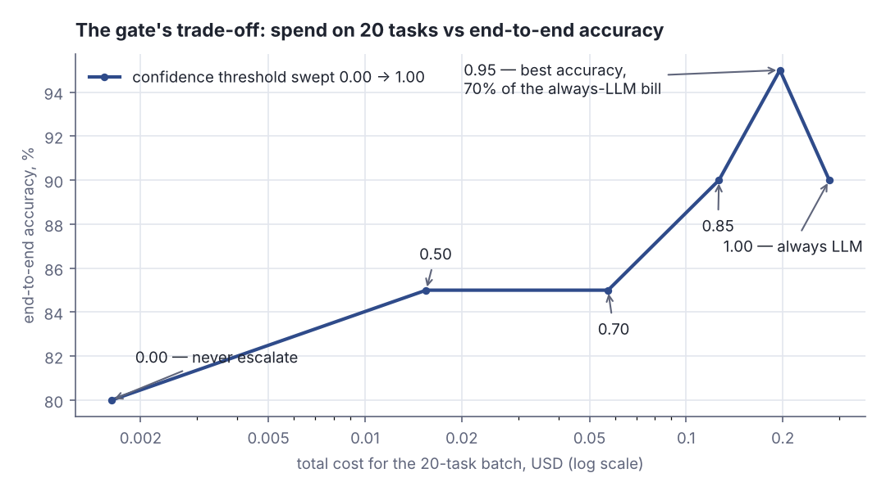

# Decisions, not essays: gating an agent with a cheap typed-answer model

> Fresh · Functional Programming in Scala (red book) · Intermediate · ~25 min · from today's feeds

## Why this matters
Today's item is "Fast, Cheap Agent Decisions" by Kevin Hoffman, published on the Akka blog on 23 September 2026: a model called Jev, from TypeSafe, that does not write text at all — it answers closed questions from a fixed set of options and returns a probability with each answer.
The architecture underneath the vendor story is the part you can use on Monday: put a cheap step with a constrained output space in front of the expensive generative one, and gate the expensive call on calibrated confidence.
It is worth 25 minutes because it turns two things you currently hand-wave — "how much will this agent cost" and "what happens when the model is unsure" — into one number you can tune and measure, and because the article's own caveats are a good lesson in reading vendor benchmarks.

## Primer
Four ideas you need before the rest makes sense.

**An LLM agent pipeline.** An agent is a loop: it receives some state (a customer message, a ticket, a diff), decides what to do, possibly calls a tool, and repeats. Each "decide" step today is usually an HTTP call to a large language model that returns free-form text, which your code then has to parse into something typed.

**Tokens and per-token pricing.** A model does not see characters, it sees *tokens* — sub-word chunks, roughly 3–4 characters of English each. Providers bill per million tokens of input and per million tokens of output, with output usually several times dearer, so cost per call is roughly (prompt tokens + generated tokens) × price. Generating text is the expensive half: every output token is produced one at a time, which is also where most of the latency lives.

**Constrained or typed output.** Instead of letting the model emit any string, you restrict what it may return to a fixed, enumerable set — `Yes | No | Unclear`, or one of five routing labels. The result is a value in a closed set, not a string to parse. Nothing can come back that your `enum` cannot hold, so "the model answered in prose and my parser blew up" disappears, and it cannot invent an order number because the schema has no slot for one.

**Calibrated probability.** A model that returns 0.85 is *calibrated* if, across all the cases where it says 0.85, it is right about 85% of the time. Calibration is not accuracy: a model can be 70% accurate and perfectly calibrated, which is exactly what makes it useful as a gate — you can believe the number enough to decide whether to spend money on a second opinion.

## The idea

### One move: shrink the output space
Jev's pitch is one architectural decision: the model is not asked to produce text, but to pick from options you supply.

> "Jev does one thing: answer questions. It does this quickly and cheaply."
> — Kevin Hoffman, *Fast, Cheap Agent Decisions*, 2026-09-23, https://akka.io/blog/fast-cheap-agent-decisions

> "Instead, you ask it questions based on some state and it gives you answers and their probabilities."
> — Kevin Hoffman, *Fast, Cheap Agent Decisions*, 2026-09-23, https://akka.io/blog/fast-cheap-agent-decisions

In the Akka SDK this arrives as an effects API returning a `Judgment`: the answers plus their probabilities, which the article calls an *interrogation* of some state (Kevin Hoffman, *Fast, Cheap Agent Decisions*, 23 September 2026). The second source is blunt about what the model is:

> "Jev is transformer-based, but it is not a large language model. It does not generate text."
> — Asif Razzaq, *TypeSafe AI Releases Jev: A System One Model That Returns Typed, Calibrated Decisions Instead of Text*, 2026-09-19, https://www.marktechpost.com/2026/09/19/typesafe-ai-releases-jev/

Model it as you would any closed set in Scala — a sum type with a probability attached:

```scala
enum Answer:
  case Yes, No, Unclear

val probs = Map(Answer.Yes -> 0.91, Answer.No -> 0.06, Answer.Unclear -> 0.03)
val best = probs.maxBy(_._2)
println(s"the whole output space: ${Answer.values.mkString(", ")}")
println(f"argmax = ${best._1}, p = ${best._2}%.2f, sum = ${probs.values.sum}%.2f")
println("free-text answers this schema can return: 0")
```

```text
the whole output space: Yes, No, Unclear
argmax = Yes, p = 0.91, sum = 1.00
free-text answers this schema can return: 0
```

Three facts fall out of that output. The answer set is enumerable, so there is no parsing step that can fail; the probabilities are a distribution over that set, summing to 1.00, so "how sure are you" is free rather than a second question; and the model cannot return a fourth thing, so schema-level hallucination is impossible by construction, not merely unlikely.

Latency and cost follow from the same shrink: a frontier model pays for every output token it generates, one at a time, while a model that chooses among a handful of options does one forward pass and scores them. TypeSafe reports end-to-end response times of 70 ms to 500 ms for Jev against 3 s to 329 s for frontier models, and an input price of $0.042 per million tokens with output tokens free (Kevin Hoffman, *Fast, Cheap Agent Decisions*, 23 September 2026).

### What the cheap step cannot do
This is the part that decides your architecture: a closed answer set cannot carry an open value:

> "Jev-style interactions don’t let us extract the order number from the message."
> — Kevin Hoffman, *Fast, Cheap Agent Decisions*, 2026-09-23, https://akka.io/blog/fast-cheap-agent-decisions

No extraction, no summarisation, no code — anything whose output space is "all strings" still needs the generative model. The cheap step is triage, not a replacement, and the article says exactly how to use it:

> "We might use this to extract an order ID only if our interrogation is confident there is one in the message."
> — Kevin Hoffman, *Fast, Cheap Agent Decisions*, 2026-09-23, https://akka.io/blog/fast-cheap-agent-decisions

That is the whole pattern: cheap closed question first, expensive open call second and only when warranted. The article's tool-guardrail example gates on a probability above 0.85 (Kevin Hoffman, *Fast, Cheap Agent Decisions*, 23 September 2026). In the Akka AI Gateway the same judgments drive routing — hosted, or self-hosted as the open-weight OpenJev — with decisions and probabilities logged for governance (Kevin Hoffman, *Fast, Cheap Agent Decisions*, 23 September 2026).



*Figure 1: the gate — the cheap step runs on every task, the expensive one only on the tasks it is unsure about. Source: mechanism described in Kevin Hoffman, "Fast, Cheap Agent Decisions", 23 September 2026, https://akka.io/blog/fast-cheap-agent-decisions*

### The threshold is an engineering knob, and it is linear
Once the gate exists, your bill has a closed form: every task pays the cheap price, and the escalated fraction also pays the expensive price. With TypeSafe's reported per-task figures of $0.000081 for the cheap model and $0.013880 for an LLM (Kevin Hoffman, *Fast, Cheap Agent Decisions*, 23 September 2026), four tasks look like this:

```scala
val cheapCost = 0.000081
val llmCost = 0.013880
val confidences = Vector(0.99, 0.91, 0.84, 0.52)
def spend(t: Double): Double =
  confidences.size * cheapCost + confidences.count(_ < t) * llmCost
for t <- Vector(0.50, 0.85, 1.00) do
  val esc = confidences.count(_ < t)
  println(f"threshold $t%.2f -> escalate $esc%d of 4, spend $$${spend(t)}%.5f")
```

```text
threshold 0.50 -> escalate 0 of 4, spend $0.00032
threshold 0.85 -> escalate 2 of 4, spend $0.02808
threshold 1.00 -> escalate 4 of 4, spend $0.05584
```

The cheap model is charged on all four tasks in every row, and it is noise: 4 × $0.000081 = $0.00032, which is 0.6% of the $0.05584 you pay when you escalate everything. Everything else is the escalation count, so the bill is a straight line in the fraction you let through — which is why the threshold, not the model choice, is the lever you actually turn.

### Reading the vendor's numbers
The headline figures are the vendor's:

> "The TypeSafe team claims it to be 193.6x faster and 444.6x cheaper."
> — Asif Razzaq, *TypeSafe AI Releases Jev: A System One Model That Returns Typed, Calibrated Decisions Instead of Text*, 2026-09-19, https://www.marktechpost.com/2026/09/19/typesafe-ai-releases-jev/

Those two numbers come from one workflow-evaluation benchmark: 0.114 s per task against 8.566 s, and $0.000081 per task against $0.013880, with the article itself calling them "on the higher end of real-world gains" (Kevin Hoffman, *Fast, Cheap Agent Decisions*, 23 September 2026). So 193.6x establishes that *on that benchmark*, a closed-output forward pass beats token-by-token generation by about two orders of magnitude. It does not establish that your pipeline gets 193.6x: you still escalate some fraction of tasks and pay both prices for those, and talking to Jev is always synchronous, so its latency sits on your critical path on every task, escalated or not.

The honesty worth copying is this one:

> "The zero-hallucination figure follows from the output schema and was not measured."
> — Kevin Hoffman, *Fast, Cheap Agent Decisions*, 2026-09-23, https://akka.io/blog/fast-cheap-agent-decisions

That is a structural argument, not an experiment: a value drawn from a closed set cannot be a token sequence you did not allow, so "no hallucinated fields" is true by construction — and says nothing about whether the chosen answer is *correct*. Keep the two apart. The accuracy numbers, averaged over four workflows, are reported as Jev 67.8% at $0.0004 per workflow, GPT-5.6 Terra 67.9% at $0.0304, and Claude Sonnet 5 67.8% at $0.1174 (Kevin Hoffman, *Fast, Cheap Agent Decisions*, 23 September 2026) — and the article's LLM error rates come from OpenRouter traffic, with its routing examples explicitly fictional (same source, same date).



*Figure 2: the reported accuracies sit within 0.1 point of each other while cost per workflow spans roughly 300x. Adapted from Kevin Hoffman, "Fast, Cheap Agent Decisions", 23 September 2026, https://akka.io/blog/fast-cheap-agent-decisions — figures are TypeSafe's own, not independently verified; printed by `python3 dojo/engine/run_lab.py 2026-10-28-2`, Step 1.*

Two more caveats: Jev is new, in limited early access behind a waitlist (Asif Razzaq, *TypeSafe AI Releases Jev*, 19 September 2026), and nothing in the pattern requires Jev — a small classifier, a logistic regression over embeddings, or an LLM constrained to a grammar gives you the same shape, with the same question to answer: where do you put the threshold?

## Lab
**Question: for a batch of 20 tasks, what does the confidence threshold actually buy and cost — and is escalating everything to the LLM the accuracy maximum?**

Run it with `python3 dojo/engine/run_lab.py 2026-10-28-2`, or save the program and run `scala Lab.scala`. The data is hard-coded, so the output is identical on every run.

### Step 1 — the cited inputs
Print the per-task cost and latency figures the article reports, their ratios, and the reported accuracy/cost per workflow for the three models. Every number charted in this lesson appears here.

### Step 2 — per-task decisions at one threshold
Twenty tasks, each with the cheap model's confidence in its own answer, whether that answer is right, and whether the LLM would be right on the same task. At threshold 0.85 the program prints one row per task: accept or escalate, who answered, and whether the final answer was correct.

### Step 3 — sweep the threshold
Thresholds 0.00, 0.50, 0.70, 0.85, 0.95 and 1.00. Per threshold: how many tasks escalated, total cost, mean latency per task, and end-to-end accuracy. A task that escalates pays both latencies, because the cheap model ran first.

### Step 4 — is the confidence calibrated?
Bucket the tasks by confidence and compare the mean confidence in each bucket with the share actually answered correctly. That is the check that decides whether the threshold means anything.

```scala
// file: Lab.scala
// A gated pipeline: a cheap typed-answer model in front of an expensive LLM.
// All per-task cost and latency constants are TypeSafe's reported figures, quoted in
// Kevin Hoffman, "Fast, Cheap Agent Decisions", akka.io, 2026-09-23.

val CHEAP_COST = 0.000081   // USD per task, cheap typed-answer model (reported)
val LLM_COST   = 0.013880   // USD per task, frontier LLM (reported)
val CHEAP_LAT  = 0.114      // seconds per task, cheap model (reported)
val LLM_LAT    = 8.566      // seconds per task, frontier LLM (reported)

// Reported accuracy / cost per workflow, average of four workflows (same article)
val REPORTED = Vector(
  ("Jev (typed answers)", 67.8, 0.0004),
  ("GPT-5.6 Terra",       67.9, 0.0304),
  ("Claude Sonnet 5",     67.8, 0.1174)
)

// One fixed batch of 20 tasks. No randomness: id, the cheap model's confidence in its own
// answer, whether that answer is right, and whether the LLM would be right on the same task.
final case class Task(id: Int, conf: Double, cheapOk: Boolean, llmOk: Boolean)

val batch: Vector[Task] = Vector(
  Task( 1, 0.99, true,  true ), Task( 2, 0.98, true,  true ),
  Task( 3, 0.97, true,  true ), Task( 4, 0.96, true,  false),
  Task( 5, 0.96, true,  true ), Task( 6, 0.95, true,  true ),
  Task( 7, 0.94, true,  true ), Task( 8, 0.92, true,  true ),
  Task( 9, 0.91, false, true ), Task(10, 0.90, true,  true ),
  Task(11, 0.88, true,  true ), Task(12, 0.84, true,  true ),
  Task(13, 0.82, true,  true ), Task(14, 0.78, true,  true ),
  Task(15, 0.74, false, true ), Task(16, 0.71, true,  true ),
  Task(17, 0.66, true,  true ), Task(18, 0.58, true,  true ),
  Task(19, 0.52, false, false), Task(20, 0.44, false, true )
)

final case class Run(escalated: Int, cost: Double, meanLat: Double, correct: Int):
  val n = 20
  def accuracy = 100.0 * correct / n
  def escFrac  = 100.0 * escalated / n

def gate(tasks: Vector[Task], threshold: Double): Run =
  val esc = tasks.filter(_.conf < threshold)
  val acc = tasks.filterNot(_.conf < threshold)
  val cost = tasks.size * CHEAP_COST + esc.size * LLM_COST
  val lat = (tasks.size * CHEAP_LAT + esc.size * LLM_LAT) / tasks.size
  Run(esc.size, cost, lat, acc.count(_.cheapOk) + esc.count(_.llmOk))

@main def lab(): Unit =
  println("Gating an expensive LLM behind a cheap typed-answer model")
  println()

  println("Step 1 - the cited inputs (TypeSafe's figures, via akka.io 2026-09-23)")
  println(f"  cheap model: $$$CHEAP_COST%.6f per task, $CHEAP_LAT%.3f s per task")
  println(f"  frontier LLM: $$$LLM_COST%.6f per task, $LLM_LAT%.3f s per task")
  println(f"  cost ratio  = ${LLM_COST / CHEAP_COST}%.1fx    latency ratio = ${LLM_LAT / CHEAP_LAT}%.1fx")
  println("  reported accuracy and cost per workflow (average of four workflows):")
  println("    model                  accuracy %   cost/workflow $")
  REPORTED.foreach { case (name, acc, cost) =>
    println(f"    $name%-22s $acc%9.1f   $cost%15.4f")
  }
  println()

  println("Step 2 - per-task decisions at threshold 0.85")
  println("  task  conf  decision    answered by  correct?")
  val T = 0.85
  for t <- batch do
    val escalate = t.conf < T
    val by = if escalate then "LLM" else "cheap"
    val ok = if escalate then t.llmOk else t.cheapOk
    val dec = if escalate then "escalate" else "accept"
    println(f"  ${t.id}%4d  ${t.conf}%.2f  $dec%-10s  $by%-11s  ${if ok then "yes" else "NO"}%s")
  val r85 = gate(batch, T)
  println(f"  escalated ${r85.escalated}%d of 20 (${r85.escFrac}%.0f%%), cost $$${r85.cost}%.5f, "
        + f"mean latency ${r85.meanLat}%.3f s, accuracy ${r85.accuracy}%.0f%%")
  println()

  println("Step 3 - sweep the threshold")
  println("  threshold  escalated  esc %   cost $     mean latency s  accuracy %")
  val thresholds = Vector(0.00, 0.50, 0.70, 0.85, 0.95, 1.00)
  val runs = thresholds.map(t => (t, gate(batch, t)))
  for (t, r) <- runs do
    println(f"  $t%9.2f  ${r.escalated}%9d  ${r.escFrac}%5.0f  ${r.cost}%8.5f  ${r.meanLat}%14.3f  ${r.accuracy}%10.0f")
  val allLlm = runs.last._2
  println(f"  always-LLM baseline (threshold 1.00): cost $$${allLlm.cost}%.5f, accuracy ${allLlm.accuracy}%.0f%%")
  for (t, r) <- runs if t > 0.0 && t < 1.0 do
    println(f"  threshold $t%.2f spends ${100.0 * r.cost / allLlm.cost}%.1f%% of the always-LLM bill "
          + f"for ${r.accuracy - allLlm.accuracy}%+.0f accuracy points")
  println()

  println("Step 4 - is the confidence calibrated? (mean confidence vs observed accuracy)")
  println("  bucket          tasks  mean conf  observed accuracy")
  val buckets = Vector(
    ("conf >= 0.90", batch.filter(_.conf >= 0.90)),
    ("0.70-0.90   ", batch.filter(t => t.conf >= 0.70 && t.conf < 0.90)),
    ("conf < 0.70 ", batch.filter(_.conf < 0.70))
  )
  for (name, ts) <- buckets do
    val meanConf = ts.map(_.conf).sum / ts.size
    val obs = ts.count(_.cheapOk).toDouble / ts.size
    println(f"  $name%s  ${ts.size}%5d  ${meanConf}%9.3f  ${obs}%17.3f")
  println(f"  whole batch: cheap model alone ${100.0 * batch.count(_.cheapOk) / 20}%.0f%% correct, "
        + f"LLM alone ${100.0 * batch.count(_.llmOk) / 20}%.0f%% correct")
```

```text
Gating an expensive LLM behind a cheap typed-answer model

Step 1 - the cited inputs (TypeSafe's figures, via akka.io 2026-09-23)
  cheap model: $0.000081 per task, 0.114 s per task
  frontier LLM: $0.013880 per task, 8.566 s per task
  cost ratio  = 171.4x    latency ratio = 75.1x
  reported accuracy and cost per workflow (average of four workflows):
    model                  accuracy %   cost/workflow $
    Jev (typed answers)         67.8            0.0004
    GPT-5.6 Terra               67.9            0.0304
    Claude Sonnet 5             67.8            0.1174

Step 2 - per-task decisions at threshold 0.85
  task  conf  decision    answered by  correct?
     1  0.99  accept      cheap        yes
     2  0.98  accept      cheap        yes
     3  0.97  accept      cheap        yes
     4  0.96  accept      cheap        yes
     5  0.96  accept      cheap        yes
     6  0.95  accept      cheap        yes
     7  0.94  accept      cheap        yes
     8  0.92  accept      cheap        yes
     9  0.91  accept      cheap        NO
    10  0.90  accept      cheap        yes
    11  0.88  accept      cheap        yes
    12  0.84  escalate    LLM          yes
    13  0.82  escalate    LLM          yes
    14  0.78  escalate    LLM          yes
    15  0.74  escalate    LLM          yes
    16  0.71  escalate    LLM          yes
    17  0.66  escalate    LLM          yes
    18  0.58  escalate    LLM          yes
    19  0.52  escalate    LLM          NO
    20  0.44  escalate    LLM          yes
  escalated 9 of 20 (45%), cost $0.12654, mean latency 3.969 s, accuracy 90%

Step 3 - sweep the threshold
  threshold  escalated  esc %   cost $     mean latency s  accuracy %
       0.00          0      0   0.00162           0.114          80
       0.50          1      5   0.01550           0.542          85
       0.70          4     20   0.05714           1.827          85
       0.85          9     45   0.12654           3.969          90
       0.95         14     70   0.19594           6.110          95
       1.00         20    100   0.27922           8.680          90
  always-LLM baseline (threshold 1.00): cost $0.27922, accuracy 90%
  threshold 0.50 spends 5.6% of the always-LLM bill for -5 accuracy points
  threshold 0.70 spends 20.5% of the always-LLM bill for -5 accuracy points
  threshold 0.85 spends 45.3% of the always-LLM bill for +0 accuracy points
  threshold 0.95 spends 70.2% of the always-LLM bill for +5 accuracy points

Step 4 - is the confidence calibrated? (mean confidence vs observed accuracy)
  bucket          tasks  mean conf  observed accuracy
  conf >= 0.90     10      0.948              0.900
  0.70-0.90         6      0.795              0.833
  conf < 0.70       4      0.550              0.500
  whole batch: cheap model alone 80% correct, LLM alone 90% correct
```

### Reading the output

**Step 1 — the inputs.** `cost ratio` is the LLM per-task price divided by the cheap one: $0.013880 ÷ $0.000081 = 171.4x, and `latency ratio` is 8.566 ÷ 0.114 = 75.1x, both from the figures reported in Kevin Hoffman, *Fast, Cheap Agent Decisions*, 23 September 2026. Note that these two ratios are not the headline 444.6x and 193.6x — those come from a different pair of measurements in the same article, which is itself a reason to check which numbers a vendor is dividing.

**Verdict: on the article's own per-task figures the cheap step is ~171x cheaper and ~75x faster, so the only thing that can spoil the saving is escalating too often.**

**Step 2 — per-task rows at threshold 0.85.** `conf` is the cheap model's probability for its own answer; `decision` is what the gate did with it (accept = keep the cheap answer, escalate = pay for the LLM); `answered by` is who produced the final answer; `correct?` is whether that final answer was right. Eleven tasks have confidence at or above 0.85 and are accepted; nine fall below and go to the LLM. The two failures are visible: task 9 was accepted at 0.91 and was wrong — a confident mistake the gate cannot catch — and task 19 escalated at 0.52 and the LLM was wrong too, so the money bought nothing. Totals: 9 escalated of 20 (45%), cost $0.12654, mean latency 3.969 s, accuracy 90%.

**Verdict: a threshold does not remove errors, it removes *cheap* errors; confident mistakes pass straight through, which is what the calibration check in Step 4 is for.**

**Step 3 — the sweep.** Columns: `escalated` and `esc %` are how many of the 20 tasks went to the LLM (lower is cheaper); `cost $` is the whole batch, where all 20 tasks pay the cheap price and the escalated ones also pay the LLM price (lower is better); `mean latency s` is total seconds ÷ 20, where an escalated task pays 0.114 + 8.566 s (lower is better); `accuracy %` is the share of final answers that were correct (higher is better).

| threshold | escalated | esc % | cost $ | mean latency s | accuracy % |
|---|---|---|---|---|---|
| 0.00 | 0 | 0 | 0.00162 | 0.114 | 80 |
| 0.50 | 1 | 5 | 0.01550 | 0.542 | 85 |
| 0.70 | 4 | 20 | 0.05714 | 1.827 | 85 |
| 0.85 | 9 | 45 | 0.12654 | 3.969 | 90 |
| 0.95 | 14 | 70 | 0.19594 | 6.110 | 95 |
| 1.00 | 20 | 100 | 0.27922 | 8.680 | 90 |

Trace the 0.85 row with digits. Cost: 20 × $0.000081 = $0.00162 for the cheap step on every task, plus 9 × $0.013880 = $0.12492 for the escalations, giving $0.12654 — and the cheap step is 1.3% of that total. Latency: (20 × 0.114 + 9 × 8.566) ÷ 20 = (2.28 + 77.094) ÷ 20 = 79.374 ÷ 20 = 3.969 s. Accuracy: of the 11 accepted tasks the cheap model got 10 right, of the 9 escalated the LLM got 8 right, so 18 ÷ 20 = 90%.



*Figure 3: each point is one threshold; the curve rises steeply to 0.95 and then falls back at 1.00, because escalating everything also discards the cases the cheap model got right and the LLM did not. Generated from the Step 3 lab output above (`python3 dojo/engine/run_lab.py 2026-10-28-2`).*

**Verdict: threshold 0.95 is the best row on both axes it shares with the baseline — 95% accuracy for $0.19594, against 90% for $0.27922 when everything goes to the LLM; always-escalating is neither the cheapest nor the most accurate policy.**

**Step 4 — calibration.** `mean conf` is what the cheap model claimed on average in that bucket; `observed accuracy` is how often it was actually right there. They should match if the probabilities mean anything. The high bucket claims 0.948 and delivers 0.900, the middle claims 0.795 and delivers 0.833, the low bucket claims 0.550 and delivers 0.500 — close, slightly overconfident at the top, and on only 10, 6 and 4 tasks, which is far too few to measure calibration properly. On the whole batch the cheap model alone is 80% correct and the LLM alone 90%.

**Verdict: the gate is only as trustworthy as the calibration; measure mean confidence against observed accuracy per bucket on real traffic before you pick a threshold, and re-measure after every model change.**

### Cause → mechanism → consequence → what it means
1. **Cause.** Constraining the output to a fixed answer set removes token-by-token generation from the decision step, which is where the cost and the latency live; TypeSafe reports $0.000081 versus $0.013880 per task and 0.114 s versus 8.566 s (Kevin Hoffman, *Fast, Cheap Agent Decisions*, 23 September 2026).
2. **Mechanism.** A gate runs the cheap step on every task and the expensive step only on the tasks whose probability falls below a threshold, so the bill is `n × cheap + escalated × expensive` — linear in one number you control.
3. **Consequence.** In the lab, threshold 0.85 reaches the same 90% accuracy as sending everything to the LLM for 45.3% of the money and 45.7% of the mean latency, and 0.95 beats the baseline on both accuracy and cost.
4. **What it means in practice.** Before you add a bigger model to a pipeline, ask which decisions in it have a closed answer set — route, allow, flag, needs-a-human — and give those to something cheap with a calibrated score; keep the expensive model for extraction, generation and the low-confidence tail. Then treat the threshold as a tunable product decision, log the score with every decision so you can re-tune it, and never trust a vendor's ratio over your own escalation rate.

## Self-check
1. Your agent must pull the order ID out of a customer message. Can a typed-answer model like Jev do it, and if not, what is it good for here? <details><summary>Answer</summary>No. The answer space is "all strings", and a model that only picks from a fixed option set has no slot for a value like that: "Jev-style interactions don’t let us extract the order number from the message" (Kevin Hoffman, <em>Fast, Cheap Agent Decisions</em>, 23 September 2026). What it can do is the closed question in front of it — "does this message contain an order ID?" — so you call the expensive extractor only when the cheap step is confident one is there, which is the article's own example: "We might use this to extract an order ID only if our interrogation is confident there is one in the message."</details>
2. The article reports zero hallucinations for the typed-answer model. What exactly does that claim cover, and what does it not? <details><summary>Answer</summary>It covers the <em>shape</em> of the output only, and it is an argument rather than a measurement: "The zero-hallucination figure follows from the output schema and was not measured" (Kevin Hoffman, <em>Fast, Cheap Agent Decisions</em>, 23 September 2026). A value drawn from a closed set cannot be a field or an entity the schema does not contain, so invented fields are impossible by construction. It says nothing about whether the selected answer is the <em>right</em> one — on that, the article's own figure is 67.8% accuracy averaged over four workflows, about the same as the two frontier models it is compared with.</details>
3. In the lab, threshold 1.00 sends every task to the LLM yet scores 90% — worse than threshold 0.95 at 95%, and more expensive. How is that possible? <details><summary>Answer</summary>Because escalation replaces the cheap answer rather than checking it. Task 4 carries confidence 0.96, the cheap model is right on it and the LLM is wrong; at threshold 0.95 that task is accepted and counts as correct, at 1.00 it is escalated and counts as wrong. The two models fail on different tasks (cheap alone 80%, LLM alone 90%, overlapping failures only on task 19), so a gate that keeps the cheap model's confident answers can beat either model on its own. The practical consequence: the accuracy-maximising threshold is not 1.0, and you can only find it by sweeping it on your own traffic.</details>

## Sources
- [Fast, Cheap Agent Decisions](https://akka.io/blog/fast-cheap-agent-decisions) — Kevin Hoffman, Akka, published 2026-09-23 — the primary source: what Jev is and is not, the `Judgment`/interrogation API, the Akka AI Gateway routing and OpenJev self-hosting, the 0.85 tool-guardrail threshold, and every benchmark figure used here (70 ms–500 ms vs 3 s–329 s end to end; 0.114 s vs 8.566 s and $0.000081 vs $0.013880 per task; 67.8% at $0.0004, 67.9% at $0.0304 and 67.8% at $0.1174 per workflow; $0.042 per million input tokens, output free), together with its own caveats — gains "on the higher end", the unmeasured zero-hallucination figure, OpenRouter-derived LLM error rates, fictional routing examples, early access and synchronous calls (accessed 2026-10-28).
- [TypeSafe AI Releases Jev: A System One Model That Returns Typed, Calibrated Decisions Instead of Text](https://www.marktechpost.com/2026/09/19/typesafe-ai-releases-jev/) — Asif Razzaq, MarkTechPost, published 2026-09-19 — corroborates the vendor, the framing and the release status: transformer-based but not an LLM and not generating text, the System 1 / System 2 name after Kahneman, the 193.6x faster / 444.6x cheaper claim attributed to the TypeSafe team, and early access behind a waitlist (accessed 2026-10-28).

## Next on this track
Fresh lessons sit outside the ladder; next on Functional Programming in Scala (red book): **Functional data structures II: foldRight, foldLeft and trees** (rung 4 of 26, Beginner).
