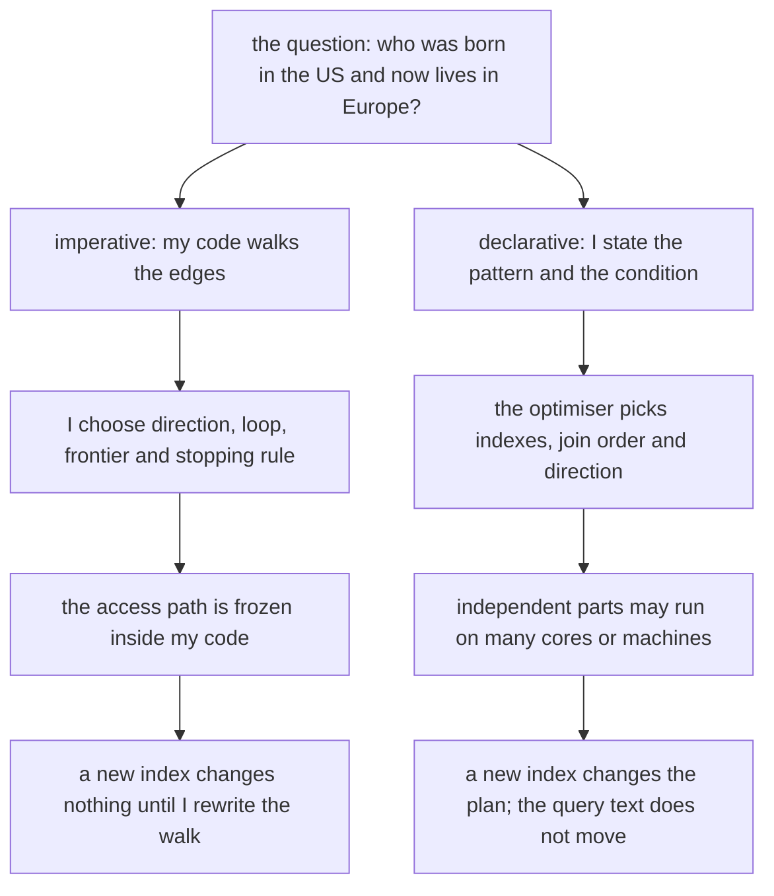
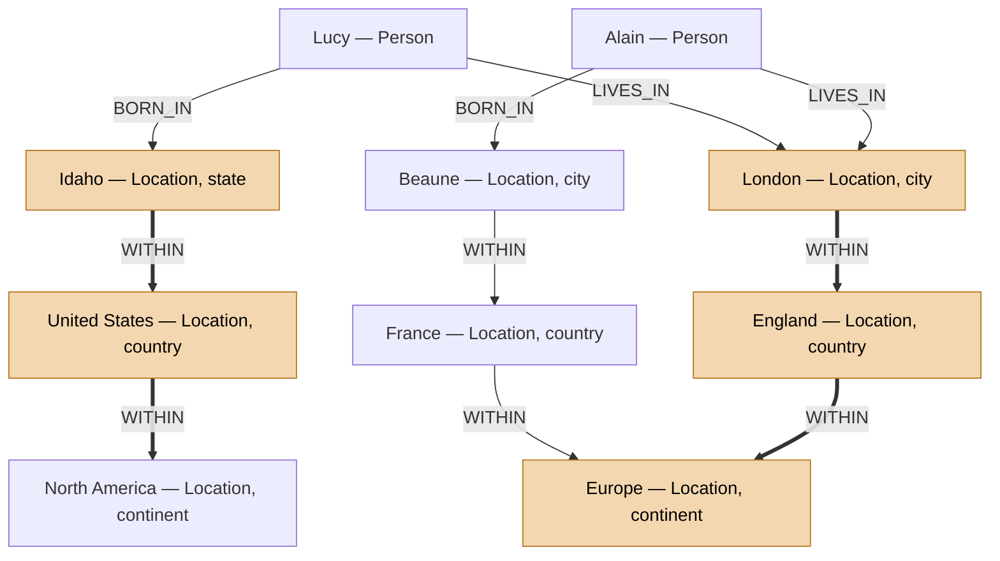
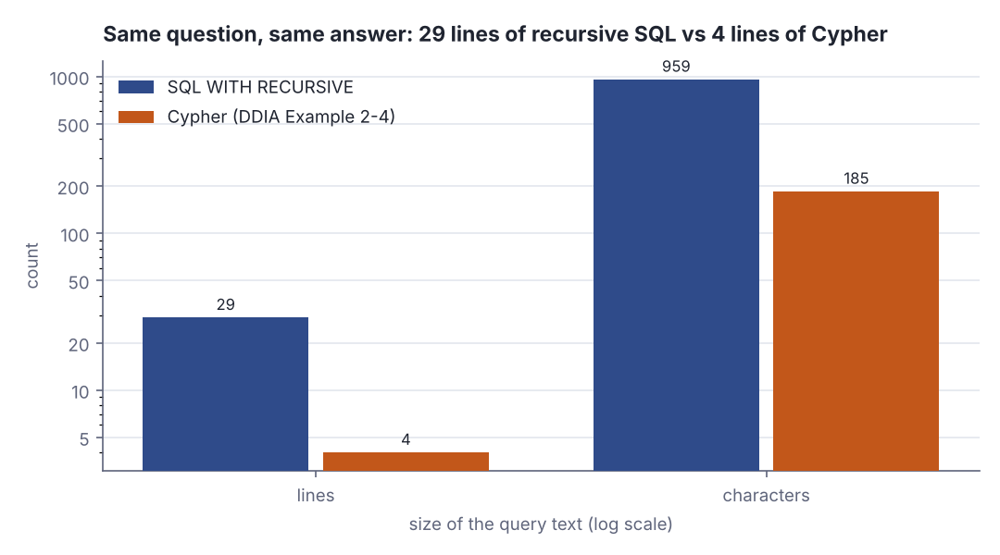
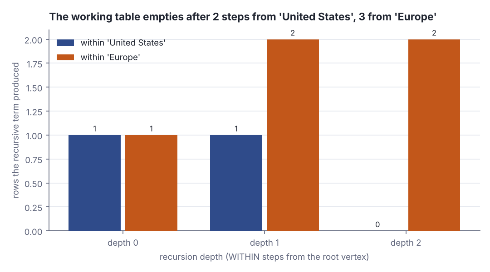

# Query languages and graph-like data models

> Designing Data-Intensive Applications · Beginner · ~20 min · rung 3 of 26 · needs: Relational vs document data models (ddia-02)

## Why this matters
Last rung decided how data is *shaped*. This one decides how you *ask* it questions, and the answer — say what you want, not how to get it — is the reason a query optimiser can exist at all, which is the whole premise of chapters 3 and 10 later on.
The second half of chapter 2 then does what the first half said documents are bad at: many-to-many relationships, modelled as a graph. You have written the hand-rolled version of this many times — an Akka actor walking a membership tree, a service chasing parent ids in a loop — and today you see the same traversal written once as a rule and handed to an engine.
It sits here because every storage and dataflow argument from now on assumes you know why declarative beats imperative, and why a variable-length traversal is the one shape SQL historically could not say in a single line.

## The idea

> Chapter map: Designing Data-Intensive Applications (Kleppmann, 1st ed., O'Reilly 2017), ch. 2 "Data Models and Query Languages", second half — §2.2 "Query Languages for Data" with §2.2.1 "Declarative Queries on the Web" and §2.2.2 "MapReduce Querying", then §2.3 "Graph-Like Data Models" with §2.3.1 "Property Graphs", §2.3.2 "The Cypher Query Language", §2.3.3 "Graph Queries in SQL", §2.3.4 "Triple-Stores and SPARQL" and §2.3.5 "The Foundation: Datalog". The § numbers are positional: DDIA does not number its sections. https://dataintensive.net/

### §2.2 Query Languages for Data
The relational model's bigger break was not tables but a *declarative* query language. IMS and CODASYL were queried imperatively: the application told the database how to walk the pointers. SQL says only what the result should look like — `SELECT * FROM animals WHERE family = 'Sharks'` — and nothing about scan order, index choice or join algorithm (Kleppmann, DDIA ch. 2, "Query Languages for Data").

The imperative half first, over the book's example graph flattened to `(tail, label, head)` triples:

```scala
var frontier = Set(usa)
var inUsa = Set(usa)
var depth = 0
while frontier.nonEmpty do
  println(s"  depth $depth: frontier ${frontier.size} -> ${nms(frontier)}")
  val next = edges.collect { case (t, "within", h) if frontier(h) => t }.toSet
  inUsa ++= next
  frontier = next
  depth += 1
println(s"  within the United States: ${nms(inUsa)}")
println(s"  loop iterations I had to write and get right: $depth")
```

```text
  depth 0: frontier 1 -> United States
  depth 1: frontier 1 -> Idaho
  within the United States: Idaho, United States
  loop iterations I had to write and get right: 2
```

Every decision there is mine: direction, frontier, stopping rule, order. Right, and frozen — add an index tomorrow and nothing changes until I rewrite the loop.

Now the rule instead of the walk: a location is within X if an edge says so, or if it is within something that is within X. Iterate to a fixpoint:

```scala
def within(root: Int): Set[Int] =
  def step(s: Set[Int]) = s ++ edges.collect { case (t, "within", h) if s(h) => t }
  Iterator.iterate(Set(root))(step).sliding(2).find(w => w(0) == w(1)).get.head
val born = edges.collect { case (p, "born_in", c) if within(usa)(c) => p }.toSet
val lives = edges.collect { case (p, "lives_in", c) if within(eu)(c) => p }.toSet
println(s"  born in the US          : ${nms(born)}")
println(s"  living in Europe        : ${nms(lives)}")
println(s"  answer                  : ${nms(born & lives)}")
```

```text
  born in the US          : Lucy
  living in Europe        : Alain, Lucy
  answer                  : Lucy
```

Same answer, no traversal order in the text. `step` could run on eight cores, or start from the people rather than the countries, without a word changing — the freedom a declarative language hands to the optimiser, and the reason such languages parallelise where loops do not.


*Figure 1: the same question, two ways of asking it. The declarative branch leaves the decisions on the engine's side of the line. Source: Kleppmann, DDIA ch. 2, "Query Languages for Data".*

### §2.2.1 Declarative Queries on the Web
The book's best argument is not about databases. To highlight the selected nav item you write CSS — `li.selected > p { background-color: blue; }` — and the browser decides how. The imperative version walks the DOM and sets `style.backgroundColor`. It is wrong three ways: it does not undo itself when the selection moves, it cannot use a faster DOM API that appears later, and "highlight every other row" — one CSS selector — becomes bookkeeping in code (Kleppmann, DDIA ch. 2, "Declarative Queries on the Web").

### §2.2.2 MapReduce Querying
MapReduce sits between the two. Counting shark sightings per month is `date_trunc` plus `GROUP BY` plus `SUM` in SQL; in MongoDB's `mapReduce` it is a `map` calling `emit(month, numAnimals)` per document and a `reduce` summing what the emitter grouped. Both must be **pure** — no database queries, no side effects, same output for the same input — so the engine may run them anywhere, in any order, and re-run them after a failure (Kleppmann, DDIA ch. 2, "MapReduce Querying"). The purity is the declarative part; handing over general-purpose code is the imperative part. MongoDB later added the **aggregation pipeline**, declarative JSON stages (`$match`, `$group`) that DDIA notes look rather like SQL in JSON clothing.

### §2.3 Graph-Like Data Models
When many-to-many relationships dominate, model a graph: **vertices** and **edges**. Social graphs, the web graph and road networks are the obvious cases; shortest path and PageRank assume that shape. DDIA's case is subtler: a graph need not be homogeneous — people, places and the containment hierarchy of places live in one graph, the edge label carrying the meaning.


*Figure 2: Lucy and Alain, their birthplaces and shared home city. The thick shaded chain is the variable-length WITHIN path, whose length is unknown when the query is written. Adapted from Kleppmann, Designing Data-Intensive Applications, ch. 2, Figure 2-5, https://dataintensive.net/*

### §2.3.1 Property Graphs
A **vertex** has a unique identifier, outgoing edges, incoming edges, and key-value properties. An **edge** has a unique identifier, a tail vertex (where it starts), a head vertex (where it ends), a label for the kind of relationship, and its own properties. That is two relational tables with foreign keys — `vertices(id, properties)` and `edges(tail_vertex, head_vertex, label, properties)` — and DDIA shows that schema (ch. 2, "Property Graphs").

Three properties matter: any vertex may have an edge to any other, with no schema saying which kinds of things may relate; you can walk forward or backward efficiently, because both endpoints are indexed; and labels let one graph hold many relationship types, so a new kind of fact is new rows, not a migration. That is where the model parts company with the 1970s CODASYL network model, which also gave a record several parents but enforced the nesting: the schema fixed which record type sat inside which, and reaching a record meant following a prescribed access path from a root (DDIA ch. 2, "Are Document Databases Repeating History?").

### §2.3.2 The Cypher Query Language
**Cypher** is the declarative query language for property graphs, built for Neo4j, named after a character in *The Matrix*. You create data by writing arrow patterns between named vertices, `(Idaho) -[:WITHIN]-> (USA)`. "Find people who emigrated from the US to Europe" is DDIA's Example 2-4:

```cypher
MATCH
  (person) -[:BORN_IN]->  () -[:WITHIN*0..]-> (us:Location {name:'United States'}),
  (person) -[:LIVES_IN]-> () -[:WITHIN*0..]-> (eu:Location {name:'Europe'})
RETURN person.name
```

`*0..` is the whole trick: *follow the WITHIN edge zero or more times*. The query neither knows nor needs to know that Idaho is two hops below North America, and says nothing about where to start — the optimiser may scan all people or walk backwards from the countries (DDIA ch. 2, "The Cypher Query Language").

### §2.3.3 Graph Queries in SQL
A graph fits in a relational database as the two tables above; querying it is the hard part. A traversal of unknown length means a *variable number of joins*, and `SELECT … JOIN … JOIN …` bakes its join count into the text. SQL:1999 answers with **recursive common table expressions**:

> "Using RECURSIVE, a WITH query can refer to its own output." … "So long as the working table is not empty, repeat these steps:" … "For UNION (but not UNION ALL), discard duplicate rows and rows that duplicate any previous result row."
>
> — PostgreSQL Global Development Group, *PostgreSQL 16 documentation, 7.8. WITH Queries (Common Table Expressions)*, §7.8.2 "Recursive Queries", https://www.postgresql.org/docs/current/queries-with.html

So: evaluate a seed term into a **working table**, then repeat the recursive term against it until it comes back empty. `UNION` rather than `UNION ALL` is the cycle guard — duplicate elimination is what empties the working table on a graph with loops. It works, and it is long:



*Figure 3: the same question in two languages, measured with `wc` in the Lab's Step 5; DDIA makes the same 29-versus-4 comparison (ch. 2, "Graph Queries in SQL"). Generated with `python3 dojo/engine/chart.py dojo/lessons/assets/2026-10-29-1-chart-1.json`.*

Not "SQL is bad": a data model carries a query language, and asking a graph question in one built for fixed-arity joins costs seven times the text and all the clarity.

### §2.3.4 Triple-Stores and SPARQL
Same idea, different vocabulary. Everything is **subject, predicate, object**, like `(Jim, likes, bananas)`. The subject is always a vertex. The object is either a primitive value, making the triple a *property* (`(lucy, age, 33)`), or another vertex, making the predicate an *edge label* and the object the head vertex (`(lucy, marriedTo, alain)`). Triples are written compactly in Turtle and round-trip through RDF/XML, the Semantic Web's heavier serialisation. **SPARQL** queries triple-stores using RDF; it predates Cypher and Cypher borrowed from it, so the emigration query reads almost the same — `?person` for variables, a trailing `*` for the variable-length path (DDIA ch. 2, "Triple-Stores and SPARQL").

### §2.3.5 The Foundation: Datalog
**Datalog** is older — studied since the 1980s, a subset of Prolog — and is the foundation the others build on. It writes a triple as `predicate(subject, object)`. On top of the facts you define **rules**, and a rule may refer to itself, which is where recursion comes from:

```text
  fact : within(idaho, united_states).
  fact : within(united_states, north_america).
  fact : within(london, england).
  rule : within_rec(X, Y) :- within(X, Y).
  rule : within_rec(X, Z) :- within(X, Y), within_rec(Y, Z).
  facts: 10, rules: 2, derived locations in Europe: 4
```

Read `:-` as "if", capitals as variables matched against every fact. Rule one: X is `within_rec` Y if an edge says so. Rule two: X is `within_rec` Z if X is within some Y and Y is `within_rec` Z. The engine derives new facts and repeats until nothing new appears — the fixpoint the Scala `within` computes by hand (DDIA ch. 2, "The Foundation: Datalog"). The payoff is composition: `within_rec` is a named thing other rules reuse, where a Cypher query is written out in full each time. The cost is that it takes getting used to, which is why the pretty languages sit on top.

## Lab
**The question:** write the book's emigration query — people born in the United States who now live in Europe — against a real relational graph store, and measure exactly what the relational detour costs in query text and in recursion steps.

Time: about 10 minutes. You need a local PostgreSQL (any version from 8.4 up has `WITH RECURSIVE`; the output below is from PostgreSQL 16.15). Everything here is SQL plus one small Scala program at the end.

### Step 1 — build the graph as two tables
Save this as `lab.sql`. It is DDIA's Figure 2-5 graph: ten vertices, ten edges.

```sql
\pset border 2
DROP TABLE IF EXISTS edges;
DROP TABLE IF EXISTS vertices;

CREATE TABLE vertices (
  id    int PRIMARY KEY,
  label text NOT NULL,          -- 'Person' or 'Location'
  name  text NOT NULL
);

CREATE TABLE edges (
  tail  int  NOT NULL REFERENCES vertices (id),
  head  int  NOT NULL REFERENCES vertices (id),
  label text NOT NULL           -- 'within' | 'born_in' | 'lives_in'
);
CREATE INDEX edges_tails ON edges (tail, label);
CREATE INDEX edges_heads ON edges (head, label);

INSERT INTO vertices VALUES
  (1, 'Location', 'North America'),
  (2, 'Location', 'United States'),
  (3, 'Location', 'Idaho'),
  (4, 'Location', 'Europe'),
  (5, 'Location', 'England'),
  (6, 'Location', 'London'),
  (7, 'Location', 'France'),
  (8, 'Location', 'Beaune'),
  (9, 'Person',   'Lucy'),
  (10, 'Person',  'Alain');

INSERT INTO edges VALUES
  (3, 2,  'within'),      -- Idaho   WITHIN United States
  (2, 1,  'within'),      -- United States WITHIN North America
  (6, 5,  'within'),      -- London  WITHIN England
  (5, 4,  'within'),      -- England WITHIN Europe
  (8, 7,  'within'),      -- Beaune  WITHIN France
  (7, 4,  'within'),      -- France  WITHIN Europe
  (9, 3,  'born_in'),     -- Lucy  BORN_IN  Idaho
  (9, 6,  'lives_in'),    -- Lucy  LIVES_IN London
  (10, 8, 'born_in'),     -- Alain BORN_IN  Beaune
  (10, 6, 'lives_in');    -- Alain LIVES_IN London

\echo
\echo '== STEP 1: the graph as two tables =='
SELECT v.id, v.label, v.name,
       (SELECT count(*) FROM edges e WHERE e.tail = v.id) AS out_edges,
       (SELECT count(*) FROM edges e WHERE e.head = v.id) AS in_edges
  FROM vertices v ORDER BY v.id;

SELECT t.name AS tail, e.label, h.name AS head
  FROM edges e JOIN vertices t ON t.id = e.tail JOIN vertices h ON h.id = e.head
 ORDER BY e.label, t.name;
```

Run it:

```bash
psql -X -q -f lab.sql
```

```text
== STEP 1: the graph as two tables ==
+----+----------+---------------+-----------+----------+
| id |  label   |     name      | out_edges | in_edges |
+----+----------+---------------+-----------+----------+
|  1 | Location | North America |         0 |        1 |
|  2 | Location | United States |         1 |        1 |
|  3 | Location | Idaho         |         1 |        1 |
|  4 | Location | Europe        |         0 |        2 |
|  5 | Location | England       |         1 |        1 |
|  6 | Location | London        |         1 |        2 |
|  7 | Location | France        |         1 |        1 |
|  8 | Location | Beaune        |         1 |        1 |
|  9 | Person   | Lucy          |         2 |        0 |
| 10 | Person   | Alain         |         2 |        0 |
+----+----------+---------------+-----------+----------+
(10 rows)

+---------------+----------+---------------+
|     tail      |  label   |     head      |
+---------------+----------+---------------+
| Alain         | born_in  | Beaune        |
| Lucy          | born_in  | Idaho         |
| Alain         | lives_in | London        |
| Lucy          | lives_in | London        |
| Beaune        | within   | France        |
| England       | within   | Europe        |
| France        | within   | Europe        |
| Idaho         | within   | United States |
| London        | within   | England       |
| United States | within   | North America |
+---------------+----------+---------------+
(10 rows)
```

### Step 2 — the query you are competing with
This is the Cypher from §2.3.2 above, saved as `cypher.cypher`. Nothing to run here — Postgres does not speak Cypher — it is the yardstick.

```cypher
MATCH
  (person) -[:BORN_IN]->  () -[:WITHIN*0..]-> (us:Location {name:'United States'}),
  (person) -[:LIVES_IN]-> () -[:WITHIN*0..]-> (eu:Location {name:'Europe'})
RETURN person.name
```

### Step 3 — the same question as a recursive CTE
Save as `recursive_cte.sql` next to `lab.sql`, and add these two lines to `lab.sql` so the run picks it up:

```sql
\echo '== STEP 3: people born in the US who now live in Europe (recursive CTE) =='
\i recursive_cte.sql
```

Four CTEs: two recursive ones that expand the containment hierarchy, two plain ones that pick the people, and a final join.

```sql
WITH RECURSIVE
  in_usa(vertex_id) AS (
      SELECT id FROM vertices WHERE name = 'United States'
    UNION
      SELECT edges.tail FROM edges
        JOIN in_usa ON edges.head = in_usa.vertex_id
       WHERE edges.label = 'within'
  ),
  in_europe(vertex_id) AS (
      SELECT id FROM vertices WHERE name = 'Europe'
    UNION
      SELECT edges.tail FROM edges
        JOIN in_europe ON edges.head = in_europe.vertex_id
       WHERE edges.label = 'within'
  ),
  born_in_usa(vertex_id) AS (
      SELECT edges.tail FROM edges
        JOIN in_usa ON edges.head = in_usa.vertex_id
       WHERE edges.label = 'born_in'
  ),
  lives_in_europe(vertex_id) AS (
      SELECT edges.tail FROM edges
        JOIN in_europe ON edges.head = in_europe.vertex_id
       WHERE edges.label = 'lives_in'
  )
SELECT vertices.name
  FROM vertices
  JOIN born_in_usa     ON vertices.id = born_in_usa.vertex_id
  JOIN lives_in_europe ON vertices.id = lives_in_europe.vertex_id;
```

```text
== STEP 3: people born in the US who now live in Europe (recursive CTE) ==
+------+
| name |
+------+
| Lucy |
+------+
(1 row)
```

### Step 4 — watch the working table fill and empty
The same recursion, instrumented with a `depth` column, plus the plan Postgres chose. Append this to `lab.sql`.

```sql
\echo
\echo '== STEP 4: rows the recursion produces at each depth =='
WITH RECURSIVE
  within_us(vertex_id, depth) AS (
      SELECT id, 0 FROM vertices WHERE name = 'United States'
    UNION ALL
      SELECT e.tail, w.depth + 1 FROM edges e
        JOIN within_us w ON e.head = w.vertex_id
       WHERE e.label = 'within'
  ),
  within_eu(vertex_id, depth) AS (
      SELECT id, 0 FROM vertices WHERE name = 'Europe'
    UNION ALL
      SELECT e.tail, w.depth + 1 FROM edges e
        JOIN within_eu w ON e.head = w.vertex_id
       WHERE e.label = 'within'
  )
SELECT 'United States' AS recursion_root, w.depth,
       count(*) AS rows_produced,
       string_agg(v.name, ', ' ORDER BY v.name) AS vertices_at_this_depth
  FROM within_us w JOIN vertices v ON v.id = w.vertex_id GROUP BY w.depth
UNION ALL
SELECT 'Europe', w.depth, count(*), string_agg(v.name, ', ' ORDER BY v.name)
  FROM within_eu w JOIN vertices v ON v.id = w.vertex_id GROUP BY w.depth
 ORDER BY recursion_root DESC, depth;

\echo
\echo '== STEP 4b: what the optimiser chose for the declarative query =='
EXPLAIN (COSTS OFF)
WITH RECURSIVE
  in_europe(vertex_id) AS (
      SELECT id FROM vertices WHERE name = 'Europe'
    UNION
      SELECT edges.tail FROM edges JOIN in_europe ON edges.head = in_europe.vertex_id
       WHERE edges.label = 'within'
  )
SELECT v.name FROM vertices v
  JOIN edges e ON e.tail = v.id AND e.label = 'lives_in'
  JOIN in_europe ON in_europe.vertex_id = e.head;
```

```text
== STEP 4: rows the recursion produces at each depth ==
+----------------+-------+---------------+------------------------+
| recursion_root | depth | rows_produced | vertices_at_this_depth |
+----------------+-------+---------------+------------------------+
| United States  |     0 |             1 | United States          |
| United States  |     1 |             1 | Idaho                  |
| Europe         |     0 |             1 | Europe                 |
| Europe         |     1 |             2 | England, France        |
| Europe         |     2 |             2 | Beaune, London         |
+----------------+-------+---------------+------------------------+
(5 rows)


== STEP 4b: what the optimiser chose for the declarative query ==
+-----------------------------------------------------------------+
|                           QUERY PLAN                            |
+-----------------------------------------------------------------+
| Nested Loop                                                     |
|   CTE in_europe                                                 |
|     ->  Recursive Union                                         |
|           ->  Seq Scan on vertices                              |
|                 Filter: (name = 'Europe'::text)                 |
|           ->  Hash Join                                         |
|                 Hash Cond: (in_europe_1.vertex_id = edges.head) |
|                 ->  WorkTable Scan on in_europe in_europe_1     |
|                 ->  Hash                                        |
|                       ->  Seq Scan on edges                     |
|                             Filter: (label = 'within'::text)    |
|   ->  Hash Join                                                 |
|         Hash Cond: (e.head = in_europe.vertex_id)               |
|         ->  Seq Scan on edges e                                 |
|               Filter: (label = 'lives_in'::text)                |
|         ->  Hash                                                |
|               ->  CTE Scan on in_europe                         |
|   ->  Index Scan using vertices_pkey on vertices v              |
|         Index Cond: (id = e.tail)                               |
+-----------------------------------------------------------------+
(19 rows)
```

### Step 5 — measure both query texts

```bash
wc -l recursive_cte.sql cypher.cypher
wc -c recursive_cte.sql cypher.cypher
```

```text
  29 recursive_cte.sql
   4 cypher.cypher
  33 total
 959 recursive_cte.sql
 185 cypher.cypher
1144 total
```

### Step 6 — the two styles side by side, in Scala
The two fragments from "The idea", in one runnable program, so you can see the imperative walk and the declarative fixpoint produce the same sets over the same edge list, and so the per-depth row counts can be checked against Postgres. Save as `Lab.scala`, run `scala Lab.scala`.

```scala
// file: Lab.scala

// DDIA ch. 2, "Query Languages for Data" and "Graph-Like Data Models".
// Scala 3.3, standard library only.
// The book's Figure 2-5 graph as a flat edge list, then the same question asked twice:
// once imperatively (I write the traversal) and once declaratively (I state the rule and
// let a fixpoint loop find the answer).

val vertices: Map[Int, (String, String)] = Map(
  1 -> ("Location", "North America"),
  2 -> ("Location", "United States"),
  3 -> ("Location", "Idaho"),
  4 -> ("Location", "Europe"),
  5 -> ("Location", "England"),
  6 -> ("Location", "London"),
  7 -> ("Location", "France"),
  8 -> ("Location", "Beaune"),
  9 -> ("Person", "Lucy"),
  10 -> ("Person", "Alain"))

// (tail, label, head) -- exactly the three columns of the Postgres `edges` table.
val edges: List[(Int, String, Int)] = List(
  (3, "within", 2), (2, "within", 1),
  (6, "within", 5), (5, "within", 4),
  (8, "within", 7), (7, "within", 4),
  (9, "born_in", 3), (9, "lives_in", 6),
  (10, "born_in", 8), (10, "lives_in", 6))

val usa = 2
val eu = 4
def nm(id: Int): String = vertices(id)._2
def nms(s: Iterable[Int]): String = s.map(nm).toList.sorted.mkString(", ")

@main def lab(): Unit =
  println("STEP 6a - imperative: I write the traversal myself")
  var frontier = Set(usa)
  var inUsa = Set(usa)
  var depth = 0
  while frontier.nonEmpty do
    println(s"  depth $depth: frontier ${frontier.size} -> ${nms(frontier)}")
    val next = edges.collect { case (t, "within", h) if frontier(h) => t }.toSet
    inUsa ++= next
    frontier = next
    depth += 1
  println(s"  within the United States: ${nms(inUsa)}")
  println(s"  loop iterations I had to write and get right: $depth")

  println()
  println("STEP 6b - declarative: I state the rule, a fixpoint finds the answer")
  def within(root: Int): Set[Int] =
    def step(s: Set[Int]) = s ++ edges.collect { case (t, "within", h) if s(h) => t }
    Iterator.iterate(Set(root))(step).sliding(2).find(w => w(0) == w(1)).get.head
  val born = edges.collect { case (p, "born_in", c) if within(usa)(c) => p }.toSet
  val lives = edges.collect { case (p, "lives_in", c) if within(eu)(c) => p }.toSet
  println(s"  within the United States: ${nms(within(usa))}")
  println(s"  within Europe           : ${nms(within(eu))}")
  println(s"  born in the US          : ${nms(born)}")
  println(s"  living in Europe        : ${nms(lives)}")
  println(s"  answer                  : ${nms(born & lives)}")

  println()
  println("STEP 6c - rows produced per recursion depth (the Postgres STEP 4 numbers)")
  for (root, label) <- List(usa -> "United States", eu -> "Europe") do
    var level = Set(root)
    var d = 0
    var running = true
    while running do
      val shown = if level.isEmpty then "(empty: recursion stops)" else nms(level)
      println(f"  $label%-13s depth $d%d: ${level.size}%d row(s) -> $shown")
      running = level.nonEmpty
      level = edges.collect { case (t, "within", h) if level(h) => t }.toSet
      d += 1

  println()
  println("STEP 6d - a Datalog-style rule set, read as facts plus two rules")
  val facts = edges.map((t, l, h) => s"$l(${nm(t).toLowerCase.replace(' ', '_')}, " +
    s"${nm(h).toLowerCase.replace(' ', '_')}).")
  facts.take(3).foreach(f => println(s"  fact : $f"))
  println("  rule : within_rec(X, Y) :- within(X, Y).")
  println("  rule : within_rec(X, Z) :- within(X, Y), within_rec(Y, Z).")
  println(s"  facts: ${facts.size}, rules: 2, derived locations in Europe: ${within(eu).size - 1}")
```

Real output, from `python3 dojo/engine/run_lab.py 2026-10-29-1` on 2026-10-29 with Scala 3.3.4:

```text
STEP 6a - imperative: I write the traversal myself
  depth 0: frontier 1 -> United States
  depth 1: frontier 1 -> Idaho
  within the United States: Idaho, United States
  loop iterations I had to write and get right: 2

STEP 6b - declarative: I state the rule, a fixpoint finds the answer
  within the United States: Idaho, United States
  within Europe           : Beaune, England, Europe, France, London
  born in the US          : Lucy
  living in Europe        : Alain, Lucy
  answer                  : Lucy

STEP 6c - rows produced per recursion depth (the Postgres STEP 4 numbers)
  United States depth 0: 1 row(s) -> United States
  United States depth 1: 1 row(s) -> Idaho
  United States depth 2: 0 row(s) -> (empty: recursion stops)
  Europe        depth 0: 1 row(s) -> Europe
  Europe        depth 1: 2 row(s) -> England, France
  Europe        depth 2: 2 row(s) -> Beaune, London
  Europe        depth 3: 0 row(s) -> (empty: recursion stops)

STEP 6d - a Datalog-style rule set, read as facts plus two rules
  fact : within(idaho, united_states).
  fact : within(united_states, north_america).
  fact : within(london, england).
  rule : within_rec(X, Y) :- within(X, Y).
  rule : within_rec(X, Z) :- within(X, Y), within_rec(Y, Z).
  facts: 10, rules: 2, derived locations in Europe: 4
```

### Reading the output

Columns and what "better" means:

- **`out_edges` / `in_edges`** (Step 1) — how many edges leave and enter a vertex. Neither direction is "better"; the point is that both are counted, because a property graph is walked both ways and both endpoints are indexed (`edges_tails`, `edges_heads`).
- **`name`** (Step 3) — the answer set. Correct is the only good value here: `Lucy`, and not `Alain`.
- **`depth`** (Step 4) — how many `WITHIN` hops from the root vertex. **Lower total depth is better**: it is the number of times the engine must re-run the recursive term.
- **`rows_produced`** (Step 4) — the size of the working table at that depth. This is the work per iteration; **lower is better**, and a 0 ends the loop.
- **lines / characters** (Step 5) — size of the query text for the same question. **Lower is better**, as a proxy for how much of the traversal you had to spell out yourself.

**Step 1.** Ten vertices, ten edges. Lucy and Alain have `out_edges = 2, in_edges = 0` — people point at places, nothing points at people. London has `in_edges = 2` because both of them live there; Europe has `in_edges = 2` because England and France are both within it, and `out_edges = 0` because it is a root of the containment hierarchy. **Verdict:** the graph is in two ordinary tables with ordinary indexes, and nothing about this schema says a `Person` may only point at a `Location` — exactly the "any vertex can connect to any other" property from §2.3.1.

**Step 3.** One row, `Lucy`. Trace why Alain is excluded: `in_usa` starts as {United States} and grows to {United States, Idaho}; `born_in_usa` therefore holds the tails of `born_in` edges whose head is in that set — `Lucy -> Idaho` qualifies, `Alain -> Beaune` does not, because Beaune is in {Europe, England, France, London, Beaune} instead. `lives_in_europe` holds both of them, since both live in London. The final join intersects {Lucy} with {Lucy, Alain}. **Verdict:** the recursive CTE gives the book's Cypher answer exactly, so the comparison that follows is about cost, not correctness.

**Step 4.** The depth table, with the terminating empty level from Step 6c added:

| recursion root | depth 0 | depth 1 | depth 2 | depth 3 |
|---|---:|---:|---:|---:|
| United States | 1 (United States) | 1 (Idaho) | 0 — stop | — |
| Europe | 1 (Europe) | 2 (England, France) | 2 (Beaune, London) | 0 — stop |

Trace the Europe arithmetic with digits: depth 0 is the seed, the single row `Europe`. The recursive term joins `edges.head = working_table.vertex_id` with `label = 'within'`, and two edges end at Europe (`England -> Europe`, `France -> Europe`), so depth 1 produces 1 × 2 = 2 rows. At depth 2 the working table is {England, France}; one `within` edge ends at each (`London -> England`, `Beaune -> France`), so 2 × 1 = 2 rows. At depth 3 nothing ends at London or Beaune: 0 rows, the working table is empty, the loop halts after 3 iterations. The Scala fixpoint in Step 6c prints precisely the same 1, 1, 0 and 1, 2, 2, 0.



*Figure 4: the working table filling and emptying, per root. Numbers from the Step 4 psql table and the Step 6c Scala output. Generated with `python3 dojo/engine/chart.py dojo/lessons/assets/2026-10-29-1-chart-2.json`.*

The `EXPLAIN` output names the same machinery in Postgres's own words: `Recursive Union` with a `WorkTable Scan on in_europe` inside it is the working table, re-scanned each iteration; the seed is the `Seq Scan on vertices` filtered to `name = 'Europe'`. Note what the optimiser did *without being told*: it chose a `Hash Join` for the recursive step, and an `Index Scan using vertices_pkey` for the final name lookup. **Verdict:** the plan is the engine's, not yours — which is the §2.2 argument made visible. In the imperative Scala version those choices are the three lines I wrote by hand.

**Step 5.** 29 lines and 959 characters of SQL against 4 lines and 185 characters of Cypher: 7.25× the lines and 5.2× the characters (959 ÷ 185 = 5.18) for the same answer on the same data. DDIA reports the same 29-versus-4 line count for its own version of these queries (ch. 2, "Graph Queries in SQL"). **Verdict:** the expansion is not style. Twenty-five of those extra lines are the containment recursion written out twice, once per root — work the `*0..` operator does implicitly because the data model knows what an edge is.

**Step 6.** The imperative walk and the declarative fixpoint return the same two sets. **Verdict:** the difference is not the answer; it is that the imperative version names an order and a stopping rule that the declarative one leaves to whoever executes it.

### Cause → consequence

1. **Cause.** A graph question is a traversal of unknown length: nothing in the query text knows that Idaho is one hop below the United States and London is two hops below Europe.
2. **Mechanism.** A language that owns the edge concept expresses that with one operator — Cypher's `-[:WITHIN*0..]->`, SPARQL's `*`, Datalog's self-referential rule. SQL has to simulate it with `WITH RECURSIVE`, hand-building a working table per root: measured here as 29 lines and 959 characters against 4 lines and 185, with the recursion re-running 2 times from the US root and 3 from the Europe root.
3. **Consequence.** You pay in query text and in people who can read it, not in correctness or necessarily in speed — Postgres's `EXPLAIN` shows a perfectly respectable `Recursive Union` plus `Hash Join` plan, chosen by the optimiser because the query stayed declarative.
4. **In practice.** Before reaching for a graph database, ask whether the traversals in your domain have *unbounded* depth. Fixed-depth joins (order → customer → region) are a relational job and always were. Unbounded ones — org charts, permission inheritance, "everything downstream of this service", social reach — are where `WITH RECURSIVE` starts appearing in three places in your codebase, each written slightly differently, and that is the signal. Until then, keep the shape in Postgres as `vertices`/`edges` with both endpoints indexed, as in Step 1: it is the property-graph model, it costs nothing, and it is the migration path if the depth ever does become unbounded.

## Self-check
1. Your service answers "which teams are inside org X?" with a Scala loop that fetches children level by level until it gets an empty page. A colleague says this is fine because it works. Using DDIA's §2.2 argument, name the three things that loop has taken away from you, and which of them a `WITH RECURSIVE` query would give back. <details><summary>Answer</summary>The loop is an imperative query: it specifies the access path, not the result. (1) **Choice of plan.** The loop fixes the direction (top-down), the batch size and the join order; the database cannot reorder it, cannot decide to start from the leaves, and a new index on the parent column changes nothing until someone rewrites the loop (Kleppmann, DDIA ch. 2, "Query Languages for Data"). (2) **Parallelism.** A declarative query's independent parts can be executed on many cores or machines, because the language guarantees only the result, not the order of operations; a `while` loop in your service is sequential by construction. (3) **Stability under change.** The loop is tied to the current storage layout and current API shape, so a storage change becomes an application change — the CODASYL failure mode. A `WITH RECURSIVE` CTE gives back all three: the optimiser picks the plan (the Lab's `EXPLAIN` shows it choosing a `Hash Join` for the recursive step and an index scan for the final lookup, neither of which was requested), it can parallelise, and it survives schema and index changes. What it does *not* give back is a smaller codebase — it is 29 lines here against 4 in Cypher — and it does not relieve you of making the recursion terminate.</details>
2. In the Lab, the `in_usa` CTE uses `UNION`, not `UNION ALL`, and the Step 4 instrumented version uses `UNION ALL`. Explain what each choice does to the working table and when one of them hangs. <details><summary>Answer</summary>Postgres evaluates the seed term into a working table, then repeats the recursive term against it, replacing the working table each round, until it is empty: "So long as the working table is not empty, repeat these steps" (PostgreSQL 16 docs, §7.8.2 "Recursive Queries", https://www.postgresql.org/docs/current/queries-with.html). With `UNION` it also discards duplicate rows and rows duplicating any previous result row. On an acyclic hierarchy like Figure 2-5 the two behave identically — each vertex is reached once by one path — which is why Step 4's `UNION ALL` prints the same 1, 1 and 1, 2, 2 counts as the `UNION` version in Step 3. The difference appears with a cycle, or with a diamond where one vertex is reachable by two paths. With a cycle, `UNION ALL` keeps re-deriving the same vertices forever and the working table never empties, so the query runs until the disk or your patience gives out; `UNION` removes the already-seen rows, the working table empties, and the query terminates. With a diamond and no cycle, `UNION ALL` terminates but returns the vertex once per path, inflating the counts. Rule of thumb: `UNION` unless you have proved the graph is a tree and you want the paths counted.</details>
3. A triple-store holds `(lucy, age, 33)` and `(lucy, marriedTo, alain)`. Both are three-part statements with the same shape — so what makes the first a property and the second an edge, and how does the Datalog notation for the same two facts differ? <details><summary>Answer</summary>The distinction is entirely in the **object**, not in the syntax (Kleppmann, DDIA ch. 2, "Triple-Stores and SPARQL"). In `(lucy, age, 33)` the object is a primitive value, so the triple is a key-value property of the subject vertex: predicate `age`, value `33`, equivalent to `{"age": 33}` inside the vertex in the property-graph model. In `(lucy, marriedTo, alain)` the object is another vertex, so the predicate becomes an **edge label**, the subject is the tail vertex and the object is the head vertex. The subject is always a vertex in both cases. In Datalog both are written `predicate(subject, object)` — `age(lucy, 33).` and `married_to(lucy, alain).` — the argument order is reversed relative to the Turtle/SPARQL habit of reading subject-first-then-predicate, and the point of the notation is that these are now *facts a rule can match against*. That is what the Lab's Step 6d prints: ten facts of the form `within(idaho, united_states).`, plus two rules that derive a new predicate `within_rec` from them, the second rule referring to itself. The triple-store gives you the storage shape; Datalog gives you the ability to name a derived relationship and reuse it, which is why DDIA calls it the foundation (ch. 2, "The Foundation: Datalog").</details>

## Sources
- [Designing Data-Intensive Applications (Kleppmann, 1st ed.)](https://dataintensive.net/) — Martin Kleppmann, O'Reilly, 2017 — ch. 2 "Data Models and Query Languages", second half. "Query Languages for Data" supplied the declarative-versus-imperative argument, the sharks `SELECT`, and the point that declarative languages parallelise; "Declarative Queries on the Web" supplied the CSS-versus-DOM-manipulation analogy and its three failure modes; "MapReduce Querying" supplied the shark-sightings-per-month example, the purity requirement on map and reduce, and MongoDB's declarative aggregation pipeline; "Graph-Like Data Models" supplied the Figure 2-5 example graph replicated as Figure 2 here; "Property Graphs" supplied the vertex/edge definitions, the equivalent two-table relational schema used in the Lab, and the three evolvability properties; "The Cypher Query Language" supplied Example 2-4, quoted in §2.3.2 and Step 2, and the `*0..` variable-length path; "Graph Queries in SQL" supplied the 29-lines-versus-4 comparison charted in Figure 3; "Triple-Stores and SPARQL" supplied the subject/predicate/object model and the primitive-value-versus-vertex distinction; "The Foundation: Datalog" supplied the `predicate(subject, object)` notation and the self-referential `within_recursive` rule reproduced in Step 6d (accessed 2026-10-29)
- [PostgreSQL documentation — WITH Queries (Common Table Expressions)](https://www.postgresql.org/docs/current/queries-with.html) — PostgreSQL Global Development Group, §7.8.2 "Recursive Queries" — the two quoted passages in §2.3.3 (the `RECURSIVE` modifier letting a `WITH` query refer to its own output, and the working-table evaluation algorithm with its `UNION` duplicate elimination), and the `WITH RECURSIVE` syntax used in Steps 3 and 4; verified at the version-pinned mirror https://access.crunchydata.com/documentation/postgresql16/16.0/queries-with.html, which carries the same §7.8.2 text for PostgreSQL 16, the version the Lab output was produced on (accessed 2026-10-29)

## Next on this track
Next on Designing Data-Intensive Applications: **Log-structured storage — hash indexes, SSTables and LSM-trees** (rung 4 of 26, Beginner).
