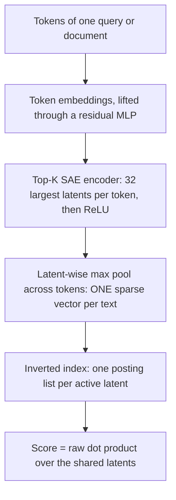
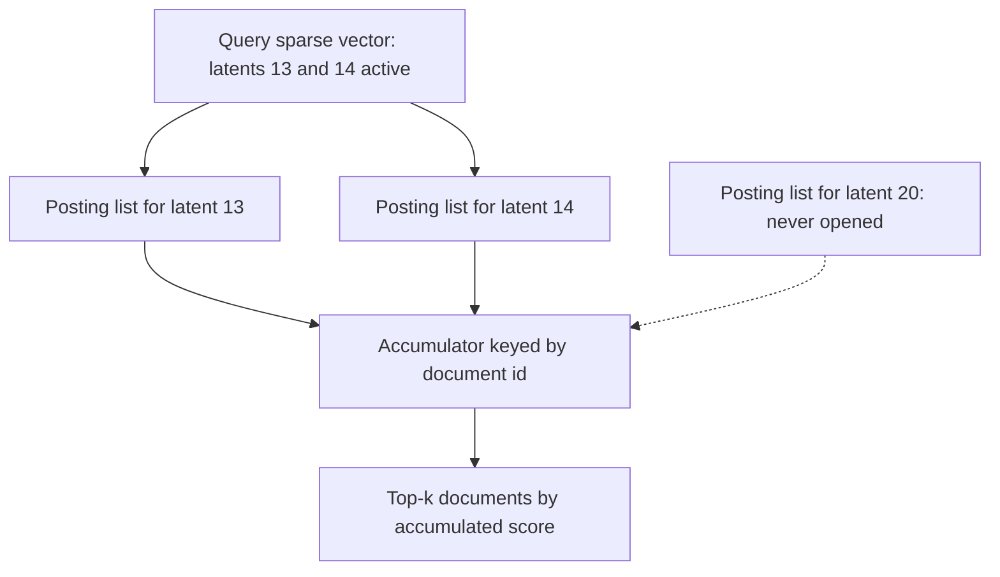
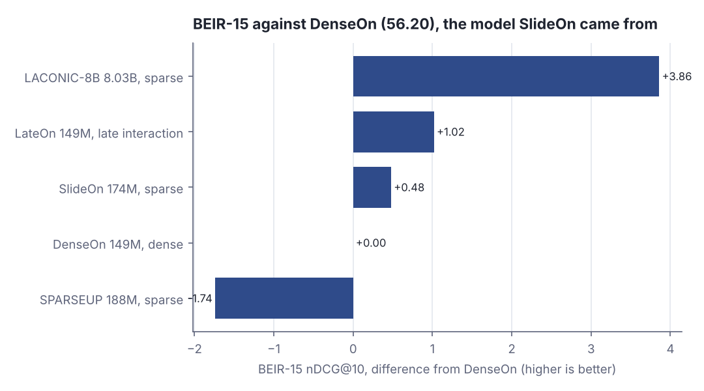
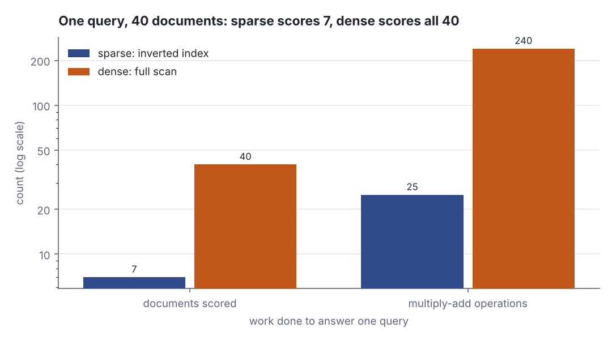

# Sparse retrieval: dot products over an inverted index

> Fresh · AI / ML foundations · Intermediate · ~25 min · from today's feeds

## Why this matters
Today's item is "SlideOn & mSlideOn: Sparsified Late-Interaction and Dense Retrievers", published by Paulo Moura and Raphael Sourty of LightOn AI on the Hugging Face blog on 19 October 2026: two released retrieval models, SlideOn (174M parameters, English) and mSlideOn (339M, multilingual, long-context and code), made by converting existing dense and late-interaction checkpoints into *learned sparse* ones instead of pretraining a retriever from scratch.
The engineering payload is the part you can reason about today: when a query vector and a document vector are mostly zeros, the similarity search you would have run as a scan over every embedding collapses back into an inverted-index lookup — the same data structure your database already uses for text — and the scoring function stays a plain dot product.
It is worth 25 minutes because you have just built up dot products and similarity, and this is the first point where that arithmetic meets an index: it turns "how do I search a million embeddings" from a vector-database question into a posting-list question, with a measurable cost you can count.

## Primer
**From dense to sparse.** In the two rungs you have just worked through — "Vectors and matrices as data" and "Dot products and similarity" — a text became one *dense* embedding: a few hundred mostly non-zero numbers, compared by dot product. A *sparse* vector puts the same kind of numbers in a far bigger space with almost every coordinate exactly zero.

**What an inverted index is.** A forward index maps document → contents. An *inverted* index maps coordinate → the list of documents where that coordinate is non-zero, each with its weight; that list is a *posting list*. It pays off only when most coordinates are zero for most documents: a query's few non-zero coordinates then read a few short lists, not every document. A relational full-text index has this shape: in PostgreSQL a `tsvector` is a sparse vector of weighted lexemes and a GIN index is the inverted index over it (PostgreSQL 16 documentation, ch. 12 "Full Text Search", §12.1 and §12.9).

**Latents and Top-K.** A latent is one learned dimension of that big space — not a word and not a token, but a direction a *sparse autoencoder* (SAE) learned, so two texts sharing no word can still share latents. The encoder scores every latent, keeps the K largest and zeroes the rest: SlideOn trains 32,768 latents and keeps the 32 largest per token (Moura and Sourty, LightOn AI, 19 October 2026). K is the sparsity knob — smaller K, shorter posting lists, cheaper queries, less information kept.

**The scoreboards.** nDCG@10 scores a query's top 10 results (reported here ×100) by how high the relevant documents rank; higher is better. BEIR-15 averages it over 15 datasets, so it measures generalisation. "Retrieval FLOPS" is a cost number for sparse models; lower is cheaper.

## The idea

### Zeros are not a compression trick, they are the index
Start from the definition the post gives:

> "Sparse retrieval represents each query and document as a vector in which most values are zero."
>
> — Paulo Moura and Raphael Sourty, LightOn AI, *SlideOn & mSlideOn: Sparsified Late-Interaction and Dense Retrievers*, 2026-10-19, https://huggingface.co/blog/lightonai/slideon-mslideon

A dense embedding has no zeros, so there is nothing to skip: to find the nearest neighbours of a query you compare it against every stored vector, or against an approximate-nearest-neighbour structure that is itself a separate piece of infrastructure. A sparse vector gives you something to skip, and the mechanism that creates the zeros is Top-K followed by ReLU: score every latent, keep the K largest, throw away the rest, and then drop anything that is still not positive.

```scala
val K = 3
val h = Vector((13, 0.95), (14, 0.50), (10, 0.30), (12, 0.20), (8, -0.40))
val kept = h.sortBy(-_._2).take(K).filter(_._2 > 0.0)
println(s"candidate latents: ${h.size}, kept after Top-$K then ReLU: ${kept.size}")
println(kept.map((j, w) => f"$j%d:$w%.2f").mkString(" "))
println(s"zeros in a 32768-latent vector: ${32768 - kept.size}")
```

```text
candidate latents: 5, kept after Top-3 then ReLU: 3
13:0.95 14:0.50 10:0.30
zeros in a 32768-latent vector: 32765
```

Two things fall out. The vector is enormous and almost entirely empty — three non-zeros in 32,768 slots — and the surviving weights are still ordinary positive numbers you can multiply. ReLU is the belt-and-braces half of that: Top-K alone would keep the K largest even if some were negative.

> "We additionally apply ReLU on h, providing an extra sparsity mechanism to the SAE encoder."
>
> — Paulo Moura and Raphael Sourty, LightOn AI, *SlideOn & mSlideOn: Sparsified Late-Interaction and Dense Retrievers*, 2026-10-19, https://huggingface.co/blog/lightonai/slideon-mslideon

### One vector per text, from many vectors per token
The encoder runs per token, so a 200-token document starts life as 200 sparse vectors. Keeping them all is *late interaction*: you match query tokens against document tokens, which scores well and costs the most of the three designs. SlideOn collapses them with a latent-wise **max pool** — for each latent, take the largest value any token gave it — producing one sparse vector for the whole text.

```scala
val perToken = Vector((13, 0.95), (14, 0.50), (14, 0.95), (1, 0.60), (1, 0.95), (14, 0.70))
val pooled = perToken.groupMapReduce(_._1)(_._2)(math.max)
println(s"per-token entries: ${perToken.size}")
println("pooled: " + pooled.toVector.sortBy(_._1).map((j, w) => f"$j%d:$w%.2f").mkString(" "))
println(s"one vector per document, not one per token: ${pooled.size} non-zeros")
```

```text
per-token entries: 6
pooled: 1:0.95 13:0.95 14:0.95
one vector per document, not one per token: 3 non-zeros
```

Six per-token entries became three non-zeros, and latent 14 kept 0.95 — the strongest evidence any token gave for it — rather than a sum or an average. Max pooling is what makes the document representation independent of length: a long document does not accumulate a bigger score simply by having more tokens.



*Figure 1: the SlideOn pipeline, from tokens to a scored document. Adapted from Moura and Sourty, LightOn AI, "SlideOn & mSlideOn", https://huggingface.co/blog/lightonai/slideon-mslideon*

### The dot product becomes an index lookup
Here is the move that makes the whole thing worth your attention. Scoring is still a dot product — no special kernel, no re-ranker — but because both vectors are mostly zeros, every term where either side is zero contributes nothing. So you never need to visit a document that shares no active latent with the query. The post describes the traversal exactly:

> "Active query latents select the lists to traverse, and query–document weight products are accumulated into document scores."
>
> — Paulo Moura and Raphael Sourty, LightOn AI, *SlideOn & mSlideOn: Sparsified Late-Interaction and Dense Retrievers*, 2026-10-19, https://huggingface.co/blog/lightonai/slideon-mslideon

```scala
val postings = Map(13 -> Vector(1, 2, 7), 14 -> Vector(1, 2, 5, 7), 20 -> Vector(8, 10))
val active = Vector(13, 14)
val touched = active.flatMap(postings).distinct.sorted
println(s"active query latents: ${active.mkString(", ")}")
println(s"documents the traversal touches: ${touched.mkString(", ")}")
println(s"documents in a 40-doc corpus never looked at: ${40 - touched.size}")
```

```text
active query latents: 13, 14
documents the traversal touches: 1, 2, 5, 7
documents in a 40-doc corpus never looked at: 36
```

Latent 20's posting list is never opened, so documents 8 and 10 are never scored — not scored low, *never scored*. That is the difference between pruning a ranking and pruning the work.



*Figure 2: only the query's active latents open a posting list; everything else in the corpus is untouched. Source: traversal described in Moura and Sourty, LightOn AI, "SlideOn & mSlideOn", 19 October 2026, https://huggingface.co/blog/lightonai/slideon-mslideon*

This is also the bridge to the other half of today's reading. A declarative query language asks for data by *structure* — these rows, joined this way, matching this pattern — and the engine answers it with an index. Vector retrieval asks by *similarity*, and normally answers it with a scan or a specialised nearest-neighbour service. Making the similarity vector sparse puts the similarity question back on the structural machinery: a posting-list lookup, the thing your storage engine has been good at for forty years.

### What the conversion costs, measured
The claim that justifies the whole exercise is that you do not need to pretrain a sparse retriever from scratch: SAE pretraining on an existing checkpoint plus supervised fine-tuning gets you there. The ablation in the post is the evidence — SAE pretraining then fine-tuning scored 57.03 on BEIR-15, against 55.00 for fine-tuning only, 55.88 for doing both jointly, and 40.61 for SAE pretraining alone (Moura and Sourty, LightOn AI, 19 October 2026). Order matters more than any single ingredient.

The released English model lands between the two designs it was built against: SlideOn (174M parameters) scores 56.68 on BEIR-15 with 30.87 retrieval FLOPS, against DenseOn (149M, dense) at 56.20 and LateOn (149M, late interaction) at 57.22 (Moura and Sourty, LightOn AI, 19 October 2026). On the comparison tables the authors summarise where their sparse model sits against the dense ones:

> "It also outperforms DenseOn and scores higher than all the dense baselines included here."
>
> — Paulo Moura and Raphael Sourty, LightOn AI, *SlideOn & mSlideOn: Sparsified Late-Interaction and Dense Retrievers*, 2026-10-19, https://huggingface.co/blog/lightonai/slideon-mslideon



*Figure 3: SlideOn gains +0.48 nDCG@10 over the dense model it was converted from and gives up 0.54 against late interaction; the 8B sparse model LACONIC-8B is 3.86 ahead of everything at 46 times SlideOn's parameter count. Generated from the Step 4 lab output below (`python3 dojo/engine/run_lab.py 2026-10-29-2`); figures are LightOn AI's own, published 2026-10-19.*

Read the FLOPS column with the quality column or you will be fooled: SPARSEUP is 5.0x cheaper in retrieval FLOPS than SlideOn (6.20 against 30.87) and 2.22 nDCG@10 worse (54.46 against 56.68) — cheap sparsity is easy, cheap sparsity that still retrieves is the hard part (Moura and Sourty, LightOn AI, 19 October 2026). The multilingual model shows the same shape from the other side: mSlideOn beats mDenseOn by +4.76 nDCG@10 on MIRACL and +10.18 on MLDR, at 44.88 retrieval FLOPS against BGE-M3's 1.69 (Moura and Sourty, LightOn AI, 19 October 2026). And the authors mark their own limit:

> "Our training data covers only 4 training splits (Arabic, English, French, and Spanish) of the 18 MIRACL's languages."
>
> — Paulo Moura and Raphael Sourty, LightOn AI, *SlideOn & mSlideOn: Sparsified Late-Interaction and Dense Retrievers*, 2026-10-19, https://huggingface.co/blog/lightonai/slideon-mslideon

One more trap worth knowing: a latent that no text ever activates is a wasted posting list. Initialising from a late-interaction checkpoint left 54.85% of latents dead, and a load-balancing loss brought that to 0.128% (Moura and Sourty, LightOn AI, 19 October 2026). A sparse index is only as good as the spread of its latents.

## Lab
**Question: on the same corpus and the same query, how many documents does a sparse retriever actually score compared with a dense one — and does it find the same answer?**

Run it with `python3 dojo/engine/run_lab.py 2026-10-29-2`, or save the program and run `scala Lab.scala`. Everything is hard-coded, so the output is identical on every run. No model is downloaded: the latent dictionary is written by hand and stands in for what a trained Top-K SAE produces, while the mechanism around it — Top-K, ReLU, latent-wise max pooling, an inverted index, a raw dot product — is the one the post describes.

### Step 1 — one document, from tokens to a sparse vector
Take document 7, `sparse inverted index ranking`. For each token, print the Top-3 latents that survive and how many candidates were dropped; then max-pool them into one vector and print how many of the 24 latents are non-zero. Print the dense baseline vector for the same document next to it, so you can count its zeros.

### Step 2 — build the inverted index over the whole corpus
40 documents: 10 on-topic and 30 off-topic fillers. Print how dense the corpus matrix really is, then encode the query `sparse vector inverted index` and print, per active query latent, its weight and the length of its posting list. The sum of those lengths is the cost of the traversal.

### Step 3 — score the query both ways and count the work
Walk the posting lists of the active query latents, accumulating weight products into a score per document; print the top 5 and trace one document's score latent by latent. Then do it densely: score all 40 documents by cosine over 6 dimensions. Print how many documents each method touched, how many multiply-adds each spent, and whether they agree on rank 1.

### Step 4 — the published benchmark
Print the English table from the post, with each model's BEIR-15 as a difference from DenseOn, so the numbers behind Figure 3 are in the output.

```scala
// file: Lab.scala
// Sparse retrieval by hand: Top-K latents, latent-wise max pooling, an inverted index,
// and a raw dot product. The latent dictionary below stands in for what a trained Top-K
// sparse autoencoder produces; the MECHANISM (Top-K -> ReLU -> max pool -> inverted index
// -> dot product) follows Moura & Sourty, "SlideOn & mSlideOn", LightOn AI, 2026-10-19.

val K     = 3    // latents kept per token (SlideOn keeps 32 of 32768)
val NLAT  = 24   // size of this toy latent space
val DDIM  = 6    // size of the dense baseline vector

val latentName = Vector(
  "storage-engine", "index-structure", "transactions",    "sql-relational",
  "document-model", "graph-model",     "traversal",       "declarative-query",
  "imperative-loop","join",            "vector-embedding","similarity-score",
  "dot-product",    "sparsity",        "inverted-index",  "ranking",
  "neural-net",     "training",        "latency",         "throughput",
  "cooking",        "travel",          "music",           "weather")

// token -> candidate (latent, pre-activation weight). Only K of these survive Top-K,
// and ReLU then drops anything that is not strictly positive.
val dict: Map[String, Vector[(Int, Double)]] = Map(
  "postgres"    -> Vector((0, 0.90), (3, 0.80), (1, 0.50), (14, 0.30)),
  "index"       -> Vector((1, 0.95), (14, 0.70), (0, 0.40), (15, 0.20)),
  "inverted"    -> Vector((14, 0.95), (1, 0.60), (13, 0.50), (8, 0.10)),
  "sparse"      -> Vector((13, 0.95), (14, 0.50), (10, 0.30), (12, 0.20)),
  "vector"      -> Vector((10, 0.90), (12, 0.60), (11, 0.40), (13, 0.20)),
  "embedding"   -> Vector((10, 0.95), (11, 0.50), (16, 0.40), (17, 0.20)),
  "dot"         -> Vector((12, 0.95), (11, 0.60), (10, 0.30), (15, 0.10)),
  "product"     -> Vector((12, 0.70), (11, 0.30), (19, 0.20), (20, 0.10)),
  "similarity"  -> Vector((11, 0.95), (12, 0.50), (10, 0.40), (15, 0.30)),
  "graph"       -> Vector((5, 0.95), (6, 0.60), (9, 0.30), (1, 0.10)),
  "traversal"   -> Vector((6, 0.95), (5, 0.50), (8, 0.40), (7, 0.10)),
  "declarative" -> Vector((7, 0.95), (3, 0.50), (8, -0.30), (15, 0.10)),
  "query"       -> Vector((7, 0.80), (3, 0.60), (1, 0.30), (15, 0.20)),
  "join"        -> Vector((9, 0.90), (3, 0.60), (0, 0.20), (6, 0.20)),
  "ranking"     -> Vector((15, 0.95), (11, 0.50), (12, 0.30), (1, 0.20)),
  "training"    -> Vector((17, 0.95), (16, 0.60), (10, 0.20), (13, 0.10)),
  "network"     -> Vector((16, 0.90), (17, 0.50), (10, 0.30), (18, 0.10)),
  "neural"      -> Vector((16, 0.95), (17, 0.55), (10, 0.25), (13, 0.05)),
  "recipe"      -> Vector((20, 0.95), (21, 0.20), (19, -0.20), (15, 0.10)),
  "onion"       -> Vector((20, 0.90), (21, 0.10), (23, -0.10), (22, 0.00)),
  "flight"      -> Vector((21, 0.95), (18, 0.30), (23, 0.20), (19, 0.10)),
  "weather"     -> Vector((23, 0.95), (21, 0.40), (18, 0.10), (22, 0.00)),
  "guitar"      -> Vector((22, 0.95), (21, 0.20), (17, 0.10), (20, 0.00)))

// --- the sparse side -------------------------------------------------------------------
def topK(h: Vector[(Int, Double)]): Vector[(Int, Double)] =
  h.sortBy(-_._2).take(K).filter(_._2 > 0.0)          // Top-K, then ReLU

def tokens(text: String): Vector[String] = text.split(" ").toVector

def sparseVec(text: String): Map[Int, Double] =       // latent-wise max pool over tokens
  tokens(text).flatMap(t => topK(dict.getOrElse(t, Vector.empty)))
    .groupMapReduce(_._1)(_._2)(math.max)

// --- the dense side: the SAME information squeezed into DDIM non-zero numbers ----------
// A block-dominant projection: latent j lands mostly in block j/4, and leaks 0.15 into
// every other dimension, which is why a dense vector has no zeros to exploit.
def proj(j: Int, d: Int): Double = if j / 4 == d then 1.0 else 0.15

def denseVec(text: String): Vector[Double] =
  val full = tokens(text).flatMap(t => dict.getOrElse(t, Vector.empty))
    .groupMapReduce(_._1)(_._2)(_ + _)
  val raw = Vector.tabulate(DDIM)(d => full.map((j, w) => w * proj(j, d)).sum)
  val n = math.sqrt(raw.map(x => x * x).sum)
  raw.map(_ / n)

def dot(a: Vector[Double], b: Vector[Double]): Double = a.lazyZip(b).map(_ * _).sum

// --- the corpus ------------------------------------------------------------------------
val core = Vector(
  "inverted index postgres query",
  "sparse vector dot product",
  "embedding similarity ranking",
  "graph traversal declarative query",
  "join query postgres index",
  "neural network training embedding",
  "sparse inverted index ranking",
  "recipe onion",
  "flight weather",
  "guitar recipe")

val offTopic = Vector("recipe", "onion", "flight", "weather", "guitar")
val filler = Vector.tabulate(30)(i => s"${offTopic(i % 5)} ${offTopic((i / 5 + 1) % 5)}")
val corpus = core ++ filler
val N = corpus.size

val QUERY = "sparse vector inverted index"

// published benchmark table (English), Moura & Sourty, LightOn AI, 2026-10-19
val published = Vector(
  ("SlideOn (sparse)",       0.174, 56.68, 30.87),
  ("DenseOn (dense)",        0.149, 56.20, Double.NaN),
  ("LateOn (late interact.)",0.149, 57.22, Double.NaN),
  ("SPARSEUP (sparse)",      0.188, 54.46, 6.20),
  ("LACONIC-8B (sparse)",    8.030, 60.06, 20.07))

@main def lab(): Unit =
  println("Sparse vs dense retrieval over a 40-document corpus")
  println()

  // ---------------- Step 1 ----------------
  println("Step 1 - one document from tokens to a sparse vector")
  val d = core(6)                                  // "sparse inverted index ranking"
  println(s"  document 7: \"$d\"")
  println("  token      Top-3 latents kept (latent:weight)")
  for t <- tokens(d) do
    val kept = topK(dict(t)).map((j, w) => f"$j%d(${latentName(j)}%s):$w%.2f")
    val dropped = dict(t).size - kept.size
    println(f"  $t%-10s ${kept.mkString("  ")}%s   [dropped ${dropped}%d]")
  val dv = sparseVec(d)
  println(f"  max-pooled sparse vector: ${dv.size}%d of $NLAT%d latents active "
        + f"(${100.0 * dv.size / NLAT}%.0f%% non-zero)")
  println("  " + dv.toVector.sortBy(-_._2).map((j, w) => f"$j%d:$w%.2f").mkString(" "))
  val dd = denseVec(d)
  println(f"  dense baseline vector: ${dd.count(_ != 0.0)}%d of $DDIM%d dims non-zero "
        + f"(${100.0 * dd.count(_ != 0.0) / DDIM}%.0f%% non-zero)")
  println("  " + dd.map(x => f"$x%+.3f").mkString(" "))
  println()

  // ---------------- Step 2 ----------------
  println("Step 2 - build the inverted index over all 40 documents")
  val sparseDocs = corpus.map(sparseVec)
  val postings: Map[Int, Vector[(Int, Double)]] =
    sparseDocs.zipWithIndex
      .flatMap((v, i) => v.toVector.map((j, w) => (j, (i, w))))
      .groupMap(_._1)(_._2)
      .view.mapValues(_.sortBy(_._1)).toMap
  val nnz = sparseDocs.map(_.size).sum
  println(f"  documents: $N%d    distinct latents used: ${postings.size}%d of $NLAT%d")
  println(f"  non-zero entries in the whole corpus: $nnz%d of ${N * NLAT}%d cells "
        + f"(${100.0 * nnz / (N * NLAT)}%.1f%% dense)")
  val q = sparseVec(QUERY)
  println(s"  query: \"$QUERY\"")
  println(f"  active query latents: ${q.size}%d")
  println("  latent  name                weight  posting-list length")
  for (j, w) <- q.toVector.sortBy(_._1) do
    println(f"  $j%6d  ${latentName(j)}%-18s  $w%6.2f  ${postings(j).size}%19d")
  val traversed = q.keys.toVector.map(j => postings(j).size).sum
  println(f"  multiply-adds the traversal costs: $traversed%d")
  println()

  // ---------------- Step 3 ----------------
  println("Step 3 - score the query both ways and count the work")
  val acc = scala.collection.mutable.Map.empty[Int, Double]
  for (j, qw) <- q.toVector.sortBy(_._1); (docId, dw) <- postings(j) do
    acc(docId) = acc.getOrElse(docId, 0.0) + qw * dw
  val sparseScored = acc.size
  println(f"  SPARSE: touched $sparseScored%d of $N%d documents, $traversed%d multiply-adds")
  println("  rank  doc   score  text")
  for ((docId, s), r) <- acc.toVector.sortBy(-_._2).take(5).zipWithIndex do
    println(f"  ${r + 1}%4d  ${docId + 1}%3d  $s%6.4f  ${corpus(docId)}%s")
  val best = acc.toVector.maxBy(_._2)._1
  println(f"  score of document ${best + 1}%d, latent by latent:")
  for (j, qw) <- q.toVector.sortBy(_._1); dw <- sparseDocs(best).get(j) do
    println(f"    ${latentName(j)}%-18s  query $qw%.2f x doc $dw%.2f = ${qw * dw}%.4f")
  println(f"    total ${acc(best)}%.4f")
  val qd = denseVec(QUERY)
  val denseScores = corpus.indices.map(i => (i, dot(qd, denseVec(corpus(i)))))
  val denseMults = N * DDIM
  println(f"  DENSE:  touched $N%d of $N%d documents, $denseMults%d multiply-adds")
  println("  rank  doc  cosine  text")
  for ((docId, s), r) <- denseScores.sortBy(-_._2).take(5).zipWithIndex do
    println(f"  ${r + 1}%4d  ${docId + 1}%3d  $s%6.3f  ${corpus(docId)}%s")
  println(f"  work ratio: documents ${N.toDouble / sparseScored}%.1fx, "
        + f"multiply-adds ${denseMults.toDouble / traversed}%.1fx in favour of sparse")
  println(f"  agree on the top document: ${acc.toVector.maxBy(_._2)._1 == denseScores.maxBy(_._2)._1}%s")
  println()

  // ---------------- Step 4 ----------------
  println("Step 4 - the published English benchmark (LightOn AI, 2026-10-19)")
  val denseBeir = 56.20                            // DenseOn, the dense model SlideOn is built from
  println("  model                     params B  BEIR-15 nDCG@10   vs DenseOn  retrieval FLOPS")
  for (name, p, beir, flops) <- published do
    val f = if flops.isNaN then "     n/a" else f"$flops%8.2f"
    println(f"  $name%-24s  $p%8.3f  $beir%15.2f  ${beir - denseBeir}%+11.2f  $f%s")
  println(f"  SlideOn - DenseOn = ${56.68 - 56.20}%+.2f nDCG@10;  "
        + f"SlideOn - LateOn = ${56.68 - 57.22}%+.2f nDCG@10")
  println(f"  SPARSEUP is ${30.87 / 6.20}%.1fx cheaper in FLOPS than SlideOn "
        + f"and ${54.46 - 56.68}%+.2f nDCG@10 behind it")
```

```text
Sparse vs dense retrieval over a 40-document corpus

Step 1 - one document from tokens to a sparse vector
  document 7: "sparse inverted index ranking"
  token      Top-3 latents kept (latent:weight)
  sparse     13(sparsity):0.95  14(inverted-index):0.50  10(vector-embedding):0.30   [dropped 1]
  inverted   14(inverted-index):0.95  1(index-structure):0.60  13(sparsity):0.50   [dropped 1]
  index      1(index-structure):0.95  14(inverted-index):0.70  0(storage-engine):0.40   [dropped 1]
  ranking    15(ranking):0.95  11(similarity-score):0.50  12(dot-product):0.30   [dropped 1]
  max-pooled sparse vector: 8 of 24 latents active (33% non-zero)
  14:0.95 1:0.95 13:0.95 15:0.95 11:0.50 0:0.40 10:0.30 12:0.30
  dense baseline vector: 6 of 6 dims non-zero (100% non-zero)
  +0.431 +0.175 +0.282 +0.802 +0.175 +0.175

Step 2 - build the inverted index over all 40 documents
  documents: 40    distinct latents used: 22 of 24
  non-zero entries in the whole corpus: 171 of 960 cells (17.8% dense)
  query: "sparse vector inverted index"
  active query latents: 7
  latent  name                weight  posting-list length
       0  storage-engine        0.40                    3
       1  index-structure       0.95                    4
      10  vector-embedding      0.90                    4
      11  similarity-score      0.40                    4
      12  dot-product           0.60                    3
      13  sparsity              0.95                    3
      14  inverted-index        0.95                    4
  multiply-adds the traversal costs: 25

Step 3 - score the query both ways and count the work
  SPARSE: touched 7 of 40 documents, 25 multiply-adds
  rank  doc   score  text
     1    7  3.5175  sparse inverted index ranking
     2    2  2.9975  sparse vector dot product
     3    1  2.6400  inverted index postgres query
     4    5  1.9275  join query postgres index
     5    3  1.5350  embedding similarity ranking
  score of document 7, latent by latent:
    storage-engine      query 0.40 x doc 0.40 = 0.1600
    index-structure     query 0.95 x doc 0.95 = 0.9025
    vector-embedding    query 0.90 x doc 0.30 = 0.2700
    similarity-score    query 0.40 x doc 0.50 = 0.2000
    dot-product         query 0.60 x doc 0.30 = 0.1800
    sparsity            query 0.95 x doc 0.95 = 0.9025
    inverted-index      query 0.95 x doc 0.95 = 0.9025
    total 3.5175
  DENSE:  touched 40 of 40 documents, 240 multiply-adds
  rank  doc  cosine  text
     1    7   0.994  sparse inverted index ranking
     2    2   0.956  sparse vector dot product
     3    3   0.886  embedding similarity ranking
     4    1   0.886  inverted index postgres query
     5    5   0.827  join query postgres index
  work ratio: documents 5.7x, multiply-adds 9.6x in favour of sparse
  agree on the top document: true

Step 4 - the published English benchmark (LightOn AI, 2026-10-19)
  model                     params B  BEIR-15 nDCG@10   vs DenseOn  retrieval FLOPS
  SlideOn (sparse)             0.174            56.68        +0.48     30.87
  DenseOn (dense)              0.149            56.20        +0.00       n/a
  LateOn (late interact.)      0.149            57.22        +1.02       n/a
  SPARSEUP (sparse)            0.188            54.46        -1.74      6.20
  LACONIC-8B (sparse)          8.030            60.06        +3.86     20.07
  SlideOn - DenseOn = +0.48 nDCG@10;  SlideOn - LateOn = -0.54 nDCG@10
  SPARSEUP is 5.0x cheaper in FLOPS than SlideOn and -2.22 nDCG@10 behind it
```

### Reading the output

**Step 1 — the sparse vector of one document.** Each token row shows the Top-3 latents that survived and `[dropped 1]`, the candidate that did not make the cut. `max-pooled sparse vector: 8 of 24 latents active (33% non-zero)` is the document's final representation; the dense line beneath it is the same information squeezed into 6 numbers, `6 of 6 dims non-zero (100% non-zero)`.

| representation | size | non-zeros | what can be skipped |
|---|---|---|---|
| sparse, max-pooled | 24 latents | 8 (33%) | every document that shares no active latent |
| dense baseline | 6 dims | 6 (100%) | nothing |

Trace the pooling by hand. Latent 14 (`inverted-index`) gets 0.50 from `sparse`, 0.95 from `inverted` and 0.70 from `index`; the max is 0.95, which is the value printed. Latent 15 (`ranking`) is touched by one token only, so it keeps 0.95 too. Nothing is summed, so the document's weights do not grow with its length.

**Verdict: the sparse vector is 33% full in a 24-latent toy space and the dense one is 100% full in 6 dimensions — in the real model that ratio is 32 non-zeros in 32,768 latents, and those zeros are the only thing an index can exploit.**

**Step 2 — the index and the query.** `non-zero entries in the whole corpus: 171 of 960 cells (17.8% dense)` is the whole corpus matrix: 40 documents × 24 latents, 82.2% of it zeros. The query encodes to 7 active latents; `posting-list length` is how many documents are non-zero on each, and lower means less to read.

| latent | name | query weight | posting-list length |
|---|---|---|---|
| 0 | storage-engine | 0.40 | 3 |
| 1 | index-structure | 0.95 | 4 |
| 10 | vector-embedding | 0.90 | 4 |
| 11 | similarity-score | 0.40 | 4 |
| 12 | dot-product | 0.60 | 3 |
| 13 | sparsity | 0.95 | 3 |
| 14 | inverted-index | 0.95 | 4 |

3 + 4 + 4 + 4 + 3 + 3 + 4 = 25, which is the `multiply-adds the traversal costs: 25` line. Note what the query did **not** activate: `cooking`, `travel`, `music` and `weather` are zero for it, so the posting lists holding the 30 filler documents are never opened.

**Verdict: the cost of a sparse query is the sum of its active latents' posting-list lengths — a quantity you can measure, cap, and tune with K, not a property of the corpus size.**

**Step 3 — the answer and the price.** Sparse touched 7 of 40 documents for 25 multiply-adds; dense touched 40 of 40 for 240 (40 documents × 6 dimensions). Both put document 7, `sparse inverted index ranking`, at rank 1, and both top-5 lists hold the same five documents — only their order below rank 2 differs, because the dense projection blurs latents that the sparse vectors keep apart.

| method | documents scored | multiply-adds | rank 1 |
|---|---|---|---|
| sparse, inverted index | 7 of 40 | 25 | doc 7 (score 3.5175) |
| dense, full scan | 40 of 40 | 240 | doc 7 (cosine 0.994) |

The score of document 7 is traced in the output, latent by latent: 0.40×0.40 = 0.1600, 0.95×0.95 = 0.9025, 0.90×0.30 = 0.2700, 0.40×0.50 = 0.2000, 0.60×0.30 = 0.1800, 0.95×0.95 = 0.9025, 0.95×0.95 = 0.9025, summing to 3.5175. That is a plain dot product over the seven latents the two vectors share — latent 15 (`ranking`) is non-zero in the document and zero in the query, so it contributes nothing and is never multiplied.



*Figure 4: the same query and the same answer, for 5.7x fewer documents scored and 9.6x fewer multiply-adds; the vertical axis is logarithmic because the four counts span 7 to 240. Generated from the Step 3 lab output above (`python3 dojo/engine/run_lab.py 2026-10-29-2`).*

**Verdict: the sparse method reached the same rank 1 while never looking at 33 of the 40 documents — the saving is in the documents it refused to score, and it grows with the corpus, because the fillers would never be opened no matter how many there were.**

**Step 4 — the published numbers.** `vs DenseOn` is each model's BEIR-15 minus DenseOn's 56.20, which is what Figure 3 plots; `retrieval FLOPS` is reported only for the sparse models, because it measures the density of the sparse vectors, and lower is cheaper. SlideOn is +0.48 over the dense model it was converted from and −0.54 under the late-interaction one (Moura and Sourty, LightOn AI, 19 October 2026).

**Verdict: converting a dense checkpoint to sparse cost about half a point of nDCG@10 against late interaction and gained about half a point against dense — the retrieval quality is a wash, and what changed is how the query is executed.**

### Cause → mechanism → consequence → what it means
1. **Cause.** Top-K keeps only the 32 largest latents per token and ReLU drops the rest, so a query or document vector is non-zero in a few dozen of 32,768 coordinates (Moura and Sourty, LightOn AI, 19 October 2026).
2. **Mechanism.** Every term of the dot product where either side is zero contributes nothing, so scoring reduces to walking one posting list per active query latent and accumulating weight products — the traversal the post describes, and the 25 multiply-adds over 7 documents measured in Step 3.
3. **Consequence.** Retrieval quality stays level with the dense checkpoint — SlideOn 56.68 against DenseOn 56.20 on BEIR-15 (Moura and Sourty, LightOn AI, 19 October 2026) — while the execution plan changes from "compare against everything" to "read a few short lists".
4. **What it means in practice.** If you are specifying a retrieval component, the sparse option lets you keep the whole thing inside a search engine or a relational full-text index you already run and can reason about, instead of adding a vector store and an approximate-nearest-neighbour index with its own recall knobs. The costs you take on are different ones: the FLOPS number, which is really posting-list length and therefore query latency, and the dead-latent problem — 54.85% dead latents without load balancing, 0.128% with it (Moura and Sourty, LightOn AI, 19 October 2026). Ask a vendor for both numbers, not just nDCG.

## Self-check
1. A query encodes to 30 active latents whose posting lists hold 400, 12, 9, … documents, in a corpus of 50 million. What determines the cost of answering it, and what does *not*? <details><summary>Answer</summary>The cost is the sum of the lengths of the posting lists of the query's active latents, plus the accumulator work over the union of documents those lists name. The corpus size does not enter it: 50 million documents that never activate one of those 30 latents are never read. In the lab this is the <code>multiply-adds the traversal costs: 25</code> line — 3 + 4 + 4 + 4 + 3 + 3 + 4 over seven latents — while the dense baseline spent 240 because it scored all 40 documents. The practical lever is K: fewer latents kept per token means shorter lists and a cheaper query, which is what "retrieval FLOPS" measures, and why the post reports SPARSEUP at 6.20 FLOPS against SlideOn's 30.87 with SlideOn 2.22 nDCG@10 ahead (Moura and Sourty, LightOn AI, 19 October 2026).</details>
2. Why does a *dense* embedding not get the same treatment — why can you not just build an inverted index over its 768 dimensions? <details><summary>Answer</summary>Because an inverted index earns its keep from zeros, and a dense vector has none. Every document would appear in every one of the 768 posting lists, so "the documents sharing an active dimension with the query" is the whole corpus and the traversal degenerates into the full scan you were trying to avoid — exactly the <code>6 of 6 dims non-zero (100% non-zero)</code> line in Step 1 of the lab. Dense retrieval therefore needs a different structure: exact nearest-neighbour search, or an approximate one that trades recall for speed. Sparsity is not a compression of the dense vector; it is what makes the index possible at all.</details>
3. Max pooling takes the largest value any token gave a latent. What would break if you summed instead? <details><summary>Answer</summary>Length bias. A sum grows with the number of tokens, so a long document would accumulate larger weights on every latent its tokens touch, and would outrank a short, precisely relevant one on a raw dot product. Max pooling keeps the strongest single piece of evidence per latent, so the representation says "this text supports latent 14 at strength 0.95" regardless of whether it said so once or twenty times — in the lab, latent 14 is touched by three tokens at 0.50, 0.95 and 0.70, and the pooled value is 0.95, not 2.15. It also keeps the weights in a bounded range, which matters because the final score is a raw dot product with no normalisation step.</details>

## Sources
- [SlideOn & mSlideOn: Sparsified Late-Interaction and Dense Retrievers](https://huggingface.co/blog/lightonai/slideon-mslideon) — Paulo Moura and Raphael Sourty, LightOn AI, Hugging Face blog, published 2026-10-19 — the primary source for everything in this lesson: the definition of sparse retrieval, the Top-K SAE encoder with its extra ReLU, latent-wise max pooling to one vector per text, the inverted-index traversal that accumulates query–document weight products, the two released models (SlideOn 174M English, mSlideOn 339M multilingual), the 32,768 latents and 32 kept per token, the training recipe (AuxK and load-balancing losses, InfoNCE, KL distillation from a cross-encoder, Matryoshka-style pruning), the English table (SlideOn 56.68 BEIR-15 at 30.87 FLOPS, DenseOn 56.20, LateOn 57.22, SPARSEUP 54.46 at 6.20 FLOPS, LACONIC-8B 60.06 at 20.07 FLOPS), the multilingual results (mSlideOn +4.76 on MIRACL and +10.18 on MLDR over mDenseOn, 44.88 FLOPS against BGE-M3's 1.69), the ablation (57.03 for SAE then fine-tuning, 55.00 fine-tuning only, 55.88 joint, 40.61 SAE only), the dead-latent rates (54.85% falling to 0.128% with load balancing) and the authors' own limitation on language coverage (accessed 2026-10-29).
- [PostgreSQL 16 documentation — Full Text Search](https://www.postgresql.org/docs/current/textsearch-intro.html) — PostgreSQL Global Development Group — cited for the background analogy only: ch. 12 "Full Text Search", §12.1 "Introduction" for the `tsvector` as a sparse vector of weighted lexemes, and §12.9 "Preferred Index Types for Text Search" for GIN as the inverted index over it. The page could not be retrieved from the machine that wrote this lesson on 2026-10-29, so nothing here is quoted from it and no number in this lesson depends on it.

## Next on this track
Fresh lessons sit outside the ladder; next on AI / ML foundations: **Gradient descent in one variable** (rung 6 of 38, Beginner).
