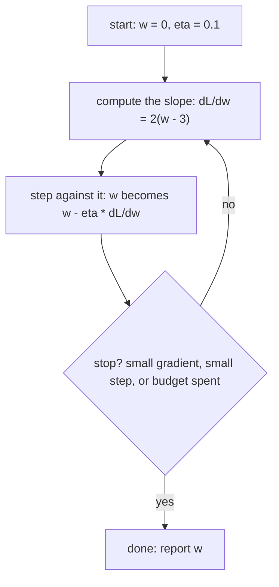
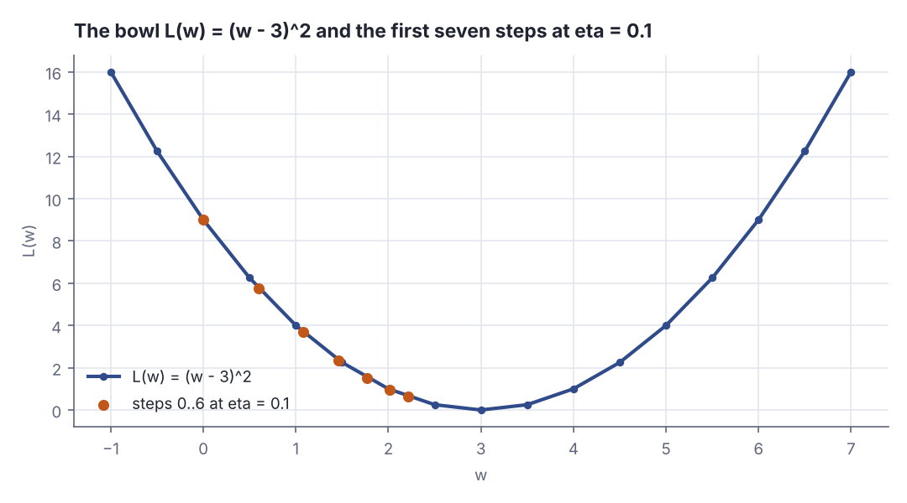
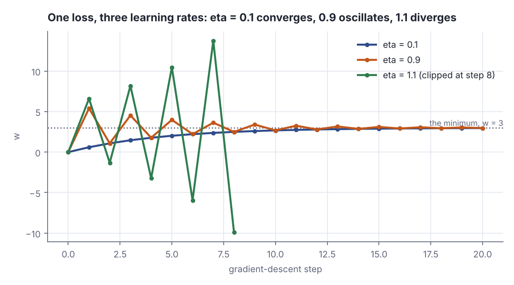
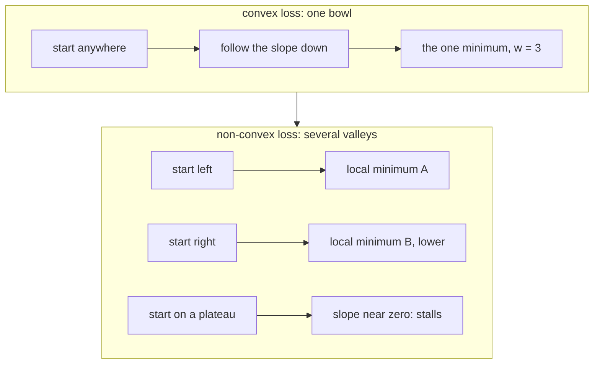

# Gradient descent in one variable

> AI / ML foundations · Beginner · ~20 min · rung 6 of 38 · needs: What machine learning actually optimises (ai-ml-01)

## Why this matters
Every training run you will ever launch — a logistic regression, a 70B-parameter transformer, a LoRA fine-tune — is the same three-line loop: measure the loss, measure its slope, step against the slope. The hyperparameter you will actually spend time on, the learning rate, is one number in that loop, and the failure modes you will see in a loss curve (crawling, sawtoothing, exploding to NaN) are all visible in a single-parameter toy you can run in twenty seconds. It sits here because rung 07 generalises exactly this loop to many parameters, and the neural-network rungs after it change nothing about the loop — only how the slope is computed.

## The idea

Training is a search. You have a **loss** `L` — one number saying how wrong the model is, smaller is better — and a **parameter** you may change. With one parameter, call it `w`, the loss is just a curve: every value of `w` gives one value of `L(w)`. This lesson uses `L(w) = (w − 3)²`, a bowl whose lowest point sits at `w = 3` with `L = 0`. The 3 stands in for "the value that fits the data" — in a real model you do not know it, which is the whole problem.

You cannot see the curve. You can only stand at your current `w` and ask: which way is downhill, and how steep? That has an exact answer, the **derivative** `dL/dw` — the slope of the curve at that point. Positive slope means the curve rises to the right, so downhill is left; negative slope means downhill is right. Here `dL/dw = 2(w − 3)`: the distance to the bottom, doubled.

```scala
// file: Slope.scala
def loss(w: Double): Double = (w - 3.0) * (w - 3.0)
def grad(w: Double): Double = 2.0 * (w - 3.0)

@main def slope(): Unit =
  println(f"${"w"}%6s${"L(w)"}%10s${"dL/dw"}%10s${"downhill is"}%14s")
  for w <- Vector(0.0, 1.0, 2.9, 3.0, 5.0) do
    val d = grad(w)
    val dir = if d > 0 then "left" else if d < 0 then "right" else "nowhere"
    println(f"$w%6.1f${loss(w)}%10.2f$d%10.2f$dir%14s")
```

```text
     w      L(w)     dL/dw   downhill is
   0.0      9.00     -6.00         right
   1.0      4.00     -4.00         right
   2.9      0.01     -0.20         right
   3.0      0.00      0.00       nowhere
   5.0      4.00      4.00          left
```

The slope carries two pieces of information at once. Its **sign** says which side of the minimum you are on (`−6.00` at `w = 0`, `+4.00` at `w = 5`), and its **size** says how far off you are: `−0.20` at `w = 2.9` is nearly flat, and at the bottom it is exactly `0.00`, which is what "minimum" means. 3Blue1Brown states the rule in those terms:

> "Specifically, find the slope of the function where you are. If the slope is negative, shift to the right."
> "If the slope is positive, shift to the left."
> — Grant Sanderson, *Gradient descent, how neural networks learn* (Deep learning ch. 2), https://www.3blue1brown.com/lessons/gradient-descent

So the update is: move against the slope. Written out, with `η` (eta) the **learning rate**:

`w ← w − η · dL/dw`

The minus sign is the whole algorithm. `η` is a small positive number you choose; it converts a slope into a distance to move. Nothing in the slope says how far to go — the derivative is a direction and a steepness, not a step size. Three steps from `w = 0` with `η = 0.1`:

```scala
// file: Step.scala
def grad(w: Double): Double = 2.0 * (w - 3.0)

@main def step(): Unit =
  var w = 0.0
  val eta = 0.1
  for k <- 1 to 3 do
    val g = grad(w)
    val next = w - eta * g
    println(f"step $k: w = $w%6.3f  g = $g%7.3f  new w = $next%6.3f")
    w = next
```

```text
step 1: w =  0.000  g =  -6.000  new w =  0.600
step 2: w =  0.600  g =  -4.800  new w =  1.080
step 3: w =  1.080  g =  -3.840  new w =  1.464
```

Each step is `w − 0.1 × g`: `0 − 0.1 × (−6) = 0.6`, then `0.6 − 0.1 × (−4.8) = 1.08`. The steps shrink on their own — `0.600`, `0.480`, `0.384` — because the gradient shrinks as you approach the bottom. That self-braking is why plain gradient descent converges without anyone scheduling the step size.



*Figure 1: The whole algorithm; only the "compute the slope" box changes as models get bigger. Source: the update rule `w ← w − η · dL/dw`, implemented in Step 1 of the lab.*



*Figure 2: The ball rolling downhill — the bowl with the first seven steps at `η = 0.1` on it, from `(0, 9)` to `(2.21, 0.62)`: big steps on the steep wall, tiny ones near the bottom. Generated from the Step 2 lab output. Adapted from 3Blue1Brown, Gradient descent, how neural networks learn, https://www.3blue1brown.com/lessons/gradient-descent*

### The learning rate decides everything

For this bowl the arithmetic is clean enough to see the whole story. Write `e = w − 3` for the distance to the minimum. Then `dL/dw = 2e`, so one step gives `e ← e − η · 2e = (1 − 2η) · e`. Every step multiplies your error by the same constant `1 − 2η`:

```scala
// file: Factor.scala
@main def factor(): Unit =
  def behaviour(f: Double): String =
    if f == 0.0 then "one jump to the bottom"
    else if math.abs(f) < 1 then "error shrinks: converges"
    else if math.abs(f) == 1 then "error never shrinks: stuck"
    else "error grows: diverges"
  println(f"${"eta"}%6s${"1 - 2*eta"}%12s${"behaviour"}%30s")
  for eta <- Vector(0.1, 0.5, 0.9, 1.0, 1.1) do
    println(f"$eta%6.2f${1.0 - 2.0 * eta}%12.2f${behaviour(1.0 - 2.0 * eta)}%30s")
```

```text
   eta   1 - 2*eta                     behaviour
  0.10        0.80      error shrinks: converges
  0.50        0.00        one jump to the bottom
  0.90       -0.80      error shrinks: converges
  1.00       -1.00    error never shrinks: stuck
  1.10       -1.20         error grows: diverges
```

Four regimes in one column. A positive factor under 1 (`η = 0.1`, factor `0.80`) shrinks the error while staying on the same side of the minimum: smooth convergence, and the smaller `η` is, the closer the factor is to 1 and the slower the run. A negative factor under 1 in size (`η = 0.9`, factor `−0.80`) shrinks the error too but flips sides every step — overshoot, far wall, overshoot back: oscillating convergence. At `η = 1.0` the factor is `−1.00`, so it bounces between two points forever. Past that (`η = 1.1`, factor `−1.20`) each step overshoots by *more* than it came in, the error grows 1.2× per step, and the run explodes.



*Figure 3: The same loss, three learning rates. `η = 0.1` creeps up to 3; `η = 0.9` straddles it (5.40, 1.08, 4.54); `η = 1.1` walks away, clipped at step 8 (`w = −9.90`) because by step 20 it reaches `−112.0128`. Generated from the Step 1 lab output.*

Google's crash course names the same two failures as loss-curve shapes:

> "Small updates to Weight and Bias values continue to result in slightly lower loss values." … "This indicates that the learning rate is too high, and model training will never reach convergence."
> — Google, *Machine Learning Crash Course: Linear regression — gradient descent exercise*, https://developers.google.cn/machine-learning/crash-course/linear-regression/gradient-descent-exercise?hl=en

### When to stop

Nothing in the loop ends by itself; `w` only ever gets closer, never exactly right. Three stopping rules are used, usually all three at once. **Small gradient**: stop when `|dL/dw| < tol` — flat enough here that there is nothing left to gain. **Small step**: stop when `η · |dL/dw| < tol` — the parameter has stopped moving in any way you care about, the same test scaled by the learning rate. **Step budget**: stop after N steps whatever happens, the only rule that also ends a diverging run. Step 3 of the lab fires each of the three.

### One bowl or many valleys

`(w − 3)²` is **convex**: it curves the same way everywhere, it has exactly one minimum, and gradient descent with a sane `η` finds it from any starting point. Linear and logistic regression have convex losses, which is why they train reliably. A neural network's loss is **non-convex** — a landscape of valleys, ridges and plateaus — so "downhill" is only ever downhill *from here*, and where you land depends on where you started.



*Figure 4: Convex (top) versus non-convex (bottom). In a bowl the starting point does not matter; among valleys it decides which minimum you reach, and a flat region stalls the loop because a near-zero gradient makes a near-zero step. Source: the convex case is this lesson's `L(w) = (w − 3)²`; the non-convex case follows 3Blue1Brown, Deep learning ch. 2, https://www.3blue1brown.com/lessons/gradient-descent*

3Blue1Brown is careful about exactly this word:

> "Checking the new slope at each point and doing this repeatedly, you approach some local minimum of the function."
> — Grant Sanderson, *Gradient descent, how neural networks learn* (Deep learning ch. 2), https://www.3blue1brown.com/lessons/gradient-descent

*Local*, not global. This matters less than it sounds — in a network with millions of parameters, most vanishing-gradient points are saddles rather than bad minima — but it is why training is re-run with different seeds, and why "it converged" is not the same claim as "it found the best answer".

## Lab

Does the learning rate alone decide between smooth convergence, oscillation and divergence on the same loss — and does gradient descent on mean squared error really land on the arithmetic mean?

### Step 1 — one loss, three learning rates

Minimise `L(w) = (w − 3)²` from `w = 0` for 20 steps with `η = 0.1`, `η = 0.9` and `η = 1.1`. The derivative `2(w − 3)` is written out by hand; nothing else is needed.

```scala
// file: Rates.scala
def loss(w: Double): Double = (w - 3.0) * (w - 3.0)
def grad(w: Double): Double = 2.0 * (w - 3.0)

def run(eta: Double, steps: Int): Vector[Double] =
  var w = 0.0
  val out = scala.collection.mutable.ArrayBuffer(w)
  for _ <- 1 to steps do
    w = w - eta * grad(w)
    out += w
  out.toVector

@main def rates(): Unit =
  val etas = Vector(0.1, 0.9, 1.1)
  val paths = etas.map(e => run(e, 20))
  println("L(w) = (w - 3)^2,  dL/dw = 2(w - 3),  start w = 0, 20 steps")
  val head = f"${"step"}%4s" + etas.map(e => f"${"w(" + e + ")"}%13s").mkString +
    etas.map(e => f"${"L(" + e + ")"}%13s").mkString
  println(head)
  for k <- 0 to 20 do
    val ws = paths.map(p => f"${p(k)}%13.6f").mkString
    val ls = paths.map(p => f"${loss(p(k))}%13.6f").mkString
    println(f"$k%4d" + ws + ls)
```

```text
L(w) = (w - 3)^2,  dL/dw = 2(w - 3),  start w = 0, 20 steps
step       w(0.1)       w(0.9)       w(1.1)       L(0.1)       L(0.9)       L(1.1)
   0     0.000000     0.000000     0.000000     9.000000     9.000000     9.000000
   1     0.600000     5.400000     6.600000     5.760000     5.760000    12.960000
   2     1.080000     1.080000    -1.320000     3.686400     3.686400    18.662400
   3     1.464000     4.536000     8.184000     2.359296     2.359296    26.873856
   4     1.771200     1.771200    -3.220800     1.509949     1.509949    38.698353
   5     2.016960     3.983040    10.464960     0.966368     0.966368    55.725628
   6     2.213568     2.213568    -5.957952     0.618475     0.618475    80.244904
   7     2.370854     3.629146    13.749542     0.395824     0.395824   115.552662
   8     2.496684     2.496684    -9.899451     0.253327     0.253327   166.395833
   9     2.597347     3.402653    18.479341     0.162130     0.162130   239.610000
  10     2.677877     2.677877   -15.575209     0.103763     0.103763   345.038399
  11     2.742302     3.257698    25.290251     0.066408     0.066408   496.855295
  12     2.793842     2.793842   -23.748301     0.042501     0.042501   715.471625
  13     2.835073     3.164927    35.097962     0.027201     0.027201  1030.279140
  14     2.868059     2.868059   -35.517554     0.017409     0.017409  1483.601961
  15     2.894447     3.105553    49.221065     0.011141     0.011141  2136.386824
  16     2.915558     2.915558   -52.465278     0.007131     0.007131  3076.397027
  17     2.932446     3.067554    69.558333     0.004564     0.004564  4430.011719
  18     2.945957     2.945957   -76.870000     0.002921     0.002921  6379.216875
  19     2.956765     3.043235    98.844000     0.001869     0.001869  9186.072300
  20     2.965412     2.965412  -112.012800     0.001196     0.001196 13227.944112
```

### Step 2 — the bowl, and where the steps land on it

Print the loss on a grid of `w` so the shape is on the page, then the first seven positions of the `η = 0.1` run with the gradient at each.

```scala
// file: Bowl.scala
def loss(w: Double): Double = (w - 3.0) * (w - 3.0)
def grad(w: Double): Double = 2.0 * (w - 3.0)

@main def bowl(): Unit =
  println("the bowl: L(w) on a grid from -1 to 7")
  println(f"${"w"}%8s${"L(w)"}%10s")
  var g = -1.0
  while g <= 7.0001 do
    println(f"$g%8.1f${loss(g)}%10.4f")
    g += 0.5
  println()
  println("where the first seven steps land, eta = 0.1")
  println(f"${"step"}%6s${"w"}%12s${"L(w)"}%12s${"dL/dw"}%12s")
  var w = 0.0
  for k <- 0 to 6 do
    println(f"$k%6d$w%12.6f${loss(w)}%12.6f${grad(w)}%12.6f")
    w = w - 0.1 * grad(w)
```

```text
the bowl: L(w) on a grid from -1 to 7
       w      L(w)
    -1.0   16.0000
    -0.5   12.2500
     0.0    9.0000
     0.5    6.2500
     1.0    4.0000
     1.5    2.2500
     2.0    1.0000
     2.5    0.2500
     3.0    0.0000
     3.5    0.2500
     4.0    1.0000
     4.5    2.2500
     5.0    4.0000
     5.5    6.2500
     6.0    9.0000
     6.5   12.2500
     7.0   16.0000

where the first seven steps land, eta = 0.1
  step           w        L(w)       dL/dw
     0    0.000000    9.000000   -6.000000
     1    0.600000    5.760000   -4.800000
     2    1.080000    3.686400   -3.840000
     3    1.464000    2.359296   -3.072000
     4    1.771200    1.509949   -2.457600
     5    2.016960    0.966368   -1.966080
     6    2.213568    0.618475   -1.572864
```

### Step 3 — the three stopping rules

Same descent, three different exit conditions: a gradient threshold, a step threshold, and a hard budget. Each run reports which rule fired and at which step.

```scala
// file: Stop.scala
def grad(w: Double): Double = 2.0 * (w - 3.0)

def descend(eta: Double, gradTol: Double, stepTol: Double, budget: Int): Unit =
  var w = 0.0
  var k = 0
  var reason = ""
  while reason == "" do
    val g = grad(w)
    val step = eta * g
    if math.abs(g) < gradTol then reason = "small gradient"
    else if math.abs(step) < stepTol then reason = "small step"
    else if k >= budget then reason = "step budget"
    else
      w = w - step
      k += 1
  println(f"eta = $eta%5.3f  gradTol = $gradTol%8.5f  stepTol = $stepTol%8.5f  " +
    f"budget = $budget%4d  ->  stopped at step $k%3d, w = $w%9.6f, |dL/dw| = ${math.abs(grad(w))}%9.6f, " +
    f"reason = $reason")

@main def stop(): Unit =
  descend(0.1, 0.01, 1e-12, 1000)
  descend(0.1, 1e-12, 1e-4, 1000)
  descend(0.001, 1e-12, 1e-12, 50)
```

```text
eta = 0.100  gradTol =  0.01000  stepTol =  0.00000  budget = 1000  ->  stopped at step  29, w =  2.995358, |dL/dw| =  0.009285, reason = small gradient
eta = 0.100  gradTol =  0.00000  stepTol =  0.00010  budget = 1000  ->  stopped at step  39, w =  2.999502, |dL/dw| =  0.000997, reason = small step
eta = 0.001  gradTol =  0.00000  stepTol =  0.00000  budget =   50  ->  stopped at step  50, w =  0.285760, |dL/dw| =  5.428481, reason = step budget
```

### Step 4 — fit an intercept to five numbers

Now a real, if tiny, model: predict every observation with a single constant `b`. The loss is mean squared error, `MSE(b) = (1/5) · Σ (b − yᵢ)²`, and its derivative is `dMSE/db = (2/5) · Σ (b − yᵢ)`. Gradient descent should walk `b` to the arithmetic mean of the five numbers.

```scala
// file: Intercept.scala
val ys = Vector(4.0, 7.0, 2.0, 9.0, 3.0)

def mse(b: Double): Double = ys.map(y => (b - y) * (b - y)).sum / ys.length
def grad(b: Double): Double = 2.0 * ys.map(y => b - y).sum / ys.length

@main def intercept(): Unit =
  println(s"five numbers: $ys")
  println(f"their mean = ${ys.sum / ys.length}%.6f")
  println()
  println("per-observation residuals at the start, b = 0")
  println(f"${"y"}%8s${"b - y"}%10s${"(b - y)^2"}%12s")
  for y <- ys do
    println(f"$y%8.1f${0.0 - y}%10.1f${(0.0 - y) * (0.0 - y)}%12.1f")
  println(f"sum of squares = ${ys.map(y => y * y).sum}%.1f   MSE(0) = ${mse(0.0)}%.4f")
  println(f"sum of residuals = ${ys.map(y => 0.0 - y).sum}%.1f   dMSE/db at 0 = ${grad(0.0)}%.4f")
  println()
  println("gradient descent on b, eta = 0.1")
  println(f"${"step"}%6s${"b"}%12s${"dMSE/db"}%12s${"MSE(b)"}%12s")
  var b = 0.0
  for k <- 0 to 20 do
    println(f"$k%6d$b%12.6f${grad(b)}%12.6f${mse(b)}%12.6f")
    if k < 20 then b = b - 0.1 * grad(b)
  println(f"b after 20 steps = $b%.6f   mean = ${ys.sum / ys.length}%.6f   gap = ${math.abs(b - ys.sum / ys.length)}%.6f")
```

```text
five numbers: Vector(4.0, 7.0, 2.0, 9.0, 3.0)
their mean = 5.000000

per-observation residuals at the start, b = 0
       y     b - y   (b - y)^2
     4.0      -4.0        16.0
     7.0      -7.0        49.0
     2.0      -2.0         4.0
     9.0      -9.0        81.0
     3.0      -3.0         9.0
sum of squares = 159.0   MSE(0) = 31.8000
sum of residuals = -25.0   dMSE/db at 0 = -10.0000

gradient descent on b, eta = 0.1
  step           b     dMSE/db      MSE(b)
     0    0.000000  -10.000000   31.800000
     1    1.000000   -8.000000   22.800000
     2    1.800000   -6.400000   17.040000
     3    2.440000   -5.120000   13.353600
     4    2.952000   -4.096000   10.994304
     5    3.361600   -3.276800    9.484355
     6    3.689280   -2.621440    8.517987
     7    3.951424   -2.097152    7.899512
     8    4.161139   -1.677722    7.503687
     9    4.328911   -1.342177    7.250360
    10    4.463129   -1.073742    7.088230
    11    4.570503   -0.858993    6.984467
    12    4.656403   -0.687195    6.918059
    13    4.725122   -0.549756    6.875558
    14    4.780098   -0.439805    6.848357
    15    4.824078   -0.351844    6.830949
    16    4.859263   -0.281475    6.819807
    17    4.887410   -0.225180    6.812677
    18    4.909928   -0.180144    6.808113
    19    4.927942   -0.144115    6.805192
    20    4.942354   -0.115292    6.803323
b after 20 steps = 4.942354   mean = 5.000000   gap = 0.057646
```

### Reading the output

**Step 1.** `step` is the iteration count. `w(η)` is the parameter after that many steps — closer to 3 is better. `L(η)` is the loss there — smaller is better, 0 is perfect. Reading down the three `w` columns:

| step | w(0.1) | w(0.9) | w(1.1) | L(0.1) | L(0.9) | L(1.1) |
|---|---|---|---|---|---|---|
| 0 | 0.000000 | 0.000000 | 0.000000 | 9.000000 | 9.000000 | 9.000000 |
| 1 | 0.600000 | 5.400000 | 6.600000 | 5.760000 | 5.760000 | 12.960000 |
| 2 | 1.080000 | 1.080000 | −1.320000 | 3.686400 | 3.686400 | 18.662400 |
| 3 | 1.464000 | 4.536000 | 8.184000 | 2.359296 | 2.359296 | 26.873856 |
| 8 | 2.496684 | 2.496684 | −9.899451 | 0.253327 | 0.253327 | 166.395833 |
| 20 | 2.965412 | 2.965412 | −112.012800 | 0.001196 | 0.001196 | 13227.944112 |

Traced with digits, one case: at step 0, `w = 0` and `dL/dw = 2(0 − 3) = −6`. With `η = 1.1` the step is `−1.1 × (−6) = +6.6`, so `w₁ = 6.6` — but the minimum was only 3 away, so the step of 6.6 lands 3.6 *past* it on the other side. Next gradient is `2(6.6 − 3) = +7.2`, the step is `−7.92`, and `w₂ = −1.32`, now 4.32 away. Each round-trip multiplies the distance by `|1 − 2 × 1.1| = 1.2`: `3 → 3.6 → 4.32 → 5.18 …`, which after 20 steps is `3 × 1.2²⁰ = 115.0128` and `w = 3 − 115.0128 = −112.0128`, with a loss of 13227.94.

Also note the oddity in the loss columns: `L(0.1)` and `L(0.9)` are *identical* at every step. That is `|1 − 2 × 0.1| = |1 − 2 × 0.9| = 0.8` — the same error magnitude each step, differing only in sign. `η = 0.9` is not slower than `η = 0.1` here; it is equally fast and merely ugly, which is exactly the "sawtooth loss curve that still goes down" you see in real training.

**Verdict:** on one fixed loss, with one fixed starting point, `η` alone decided the outcome: `0.1` converged smoothly, `0.9` converged by oscillating, `1.1` diverged to −112 within 20 steps. Nothing about the model or the data changed.

**Step 2.** The grid table is the bowl: `L` falls from 16.0 at `w = −1` to 0.0 at `w = 3` and rises symmetrically to 16.0 at `w = 7`. The seven-row table is the ball on that bowl. `dL/dw` is the slope under the ball; `|dL/dw|` falling from 6.0 to 1.57 is the braking effect, and the step length is `0.1 ×` that column.

| step | w | L(w) | dL/dw | step taken = −0.1·dL/dw |
|---|---|---|---|---|
| 0 | 0.000000 | 9.000000 | −6.000000 | +0.600000 |
| 1 | 0.600000 | 5.760000 | −4.800000 | +0.480000 |
| 2 | 1.080000 | 3.686400 | −3.840000 | +0.384000 |
| 3 | 1.464000 | 2.359296 | −3.072000 | +0.307200 |
| 4 | 1.771200 | 1.509949 | −2.457600 | +0.245760 |
| 5 | 2.016960 | 0.966368 | −1.966080 | +0.196608 |
| 6 | 2.213568 | 0.618475 | −1.572864 | +0.157286 |

Traced: at `w = 1.464`, `L = (1.464 − 3)² = (−1.536)² = 2.359296` and `dL/dw = 2 × (−1.536) = −3.072`; the step is `−0.1 × (−3.072) = +0.3072`, giving `w = 1.7712`. Every step is 80% of the previous one, because `1 − 2η = 0.8`.

**Verdict:** the step size is not constant even though `η` is. The algorithm takes big strides on the steep wall and small ones near the bottom, with no scheduling — that is the derivative doing the work.

**Step 3.** Three exits from the same descent. `stopped at step` is lower-is-cheaper; `|dL/dw|` at the exit is lower-is-more-converged.

| rule | threshold | stopped at step | w | \|dL/dw\| |
|---|---|---|---|---|
| small gradient | 0.01 | 29 | 2.995358 | 0.009285 |
| small step | 1e−4 | 39 | 2.999502 | 0.000997 |
| step budget | 50 steps, η = 0.001 | 50 | 0.285760 | 5.428481 |

Traced: with `η = 0.1`, `|dL/dw| = 6 × 0.8ᵏ`. Setting `6 × 0.8ᵏ < 0.01` gives `0.8ᵏ < 0.0016667`, so `k > ln(0.0016667)/ln(0.8) = (−6.3969)/(−0.2231) = 28.7` — the loop exits at step 29, exactly as printed. The step-size rule tests `0.1 × 6 × 0.8ᵏ < 0.0001`, i.e. `|dL/dw| < 0.001` — ten times tighter — and so needs ten more steps, because `0.8¹⁰ = 0.107` is about one tenth.

**Verdict:** the gradient rule and the step rule say the same thing scaled by `η`, so with a small `η` the step rule stops far too early unless you tighten it. The budget is the only rule that protects you from the diverging run of Step 1 — it is a safety fuse, not a convergence test, and the third row proves it: it returned `w = 0.286` with a gradient still at 5.43.

**Step 4.** `b` is the single fitted parameter, `dMSE/db` is its gradient, `MSE(b)` is the loss — lower is better.

| step | b | dMSE/db | MSE(b) |
|---|---|---|---|
| 0 | 0.000000 | −10.000000 | 31.800000 |
| 1 | 1.000000 | −8.000000 | 22.800000 |
| 2 | 1.800000 | −6.400000 | 17.040000 |
| 5 | 3.361600 | −3.276800 | 9.484355 |
| 10 | 4.463129 | −1.073742 | 7.088230 |
| 20 | 4.942354 | −0.115292 | 6.803323 |

Traced: at `b = 0` the residuals are `−4, −7, −2, −9, −3`, summing to `−25`, so `dMSE/db = 2 × (−25)/5 = −10` and the first step is `0 − 0.1 × (−10) = 1.0`. The sum of squares is `16 + 49 + 4 + 81 + 9 = 159`, so `MSE(0) = 159/5 = 31.8`. The mean of the five numbers is `25/5 = 5.0`, and after 20 steps `b = 4.942354` — a gap of `0.057646`, which is `5 × 0.8²⁰`, the same `(1 − 2η)` factor as before. Note that the loss does not go to 0: it flattens at `6.803323`, heading for the variance of the five numbers, `34/5 = 6.8`. A single constant cannot fit five different numbers; the best it can do is their mean.

**Verdict:** gradient descent on MSE with one parameter rediscovers the arithmetic mean, to 0.06 after 20 steps, without ever being told the formula. That is the point of the whole method — you supply a loss and a derivative, and the optimum falls out.

### Cause → mechanism → consequence → practice

1. **Cause:** the derivative gives a direction and a steepness, but no distance. The learning rate `η` is the number that turns the one into the other, and it is yours to pick.
2. **Mechanism:** on a locally quadratic loss, one step multiplies the distance-to-minimum by `1 − 2ηc` for a curvature `c` (here `c = 1`, so `1 − 2η`). That factor's size decides convergence and its sign decides whether you approach from one side or straddle.
3. **Consequence:** `|1 − 2ηc| < 1` converges, `= 1` stalls, `> 1` diverges geometrically — the same loss and starting point gave `w = 2.965412`, `w = 2.965412` and `w = −112.012800` for `η = 0.1`, `0.9` and `1.1`.
4. **In practice:** read a loss curve as a diagnosis of `η`, not of the model. Smoothly falling but barely moving → `η` too small, raise it (powers of ten first: 0.001 → 0.01 → 0.1). Falling with a sawtooth → `η` a little too large but still usable; lower it to smooth the tail. Rising, or NaN within a few steps → `η` above the divergence threshold; cut it by 10× before you touch anything else. And always set a step budget, because a diverging run is the one case where no convergence test will ever stop the loop.

## Self-check
1. You are at `w = 10` on `L(w) = (w − 3)²` and you take one step with `η = 0.2`. Where do you land, and is that progress? <details><summary>Answer</summary>`dL/dw = 2(10 − 3) = 14`. The step is `10 − 0.2 × 14 = 10 − 2.8 = 7.2`. Distance to the minimum went from 7 to 4.2, so yes — it is progress, and the shrink factor is `|1 − 2 × 0.2| = 0.6`, matching `7 × 0.6 = 4.2`. Positive slope, so the step went left, as expected.</details>
2. A training run's loss falls for 30 steps, then jumps around between two roughly equal values and never improves. What is the single most likely cause, and what do you change? <details><summary>Answer</summary>The learning rate is at or near the threshold where `|1 − 2ηc| ≈ 1`: each step overshoots by about as much as it came in, so the error flips sign without shrinking — the `η = 1.0` row of the Factor example, and the shape of the `η = 0.9` oscillation in Step 1. Lower `η` (typically by 3–10×), or decay it over time so the tail converges. It is not a sign that the model has stopped learning or that the data is exhausted.</details>
3. Why is a "small gradient" stopping rule not a guarantee that you have found the best possible parameter value? <details><summary>Answer</summary>Because a near-zero gradient only means the loss is locally flat. On a non-convex loss that happens at a local minimum, at a saddle point and on a plateau — and all three can sit far above the global minimum, as Figure 4 shows with local minima A and B. On a convex loss like `(w − 3)²` there is exactly one flat point, so there the rule is sound; the distinction is exactly the convex / non-convex line, and it is why network training is repeated with different random seeds.</details>

## Sources
- [3Blue1Brown — Gradient descent, how neural networks learn](https://www.3blue1brown.com/lessons/gradient-descent) — Grant Sanderson, Deep learning ch. 2; quoted for the "find the slope, shift left or right" rule and for "you approach some local minimum"; the ball-rolling-downhill image behind Figure 2 (accessed 2026-11-03)
- [3Blue1Brown — Neural Networks](https://www.3blue1brown.com/topics/neural-networks) — Grant Sanderson; the series index, ch. 2 "Gradient descent, how neural networks learn", which is the chapter page above; the cost-function framing used in "The idea" (accessed 2026-11-03)
- [Google — Machine Learning Crash Course: Linear regression, gradient descent exercise](https://developers.google.cn/machine-learning/crash-course/linear-regression/gradient-descent-exercise?hl=en) — Google; quoted for the two learning-rate failure shapes ("slightly lower loss values" and "will never reach convergence"); the `developers.google.com` copy of this page blocks automated fetching, so this is Google's own mirror of the same text (accessed 2026-11-03)
- [Google Machine Learning Crash Course](https://developers.google.com/machine-learning/crash-course) — Google; module "Linear regression" → pages "Gradient descent" and "Hyperparameters", the source of the learning-rate-as-step-size framing and of the convergence vocabulary used here (accessed 2026-11-03)
- [StatQuest — Gradient Descent, Step-by-Step](https://statquest.org/video-index/) — Josh Starmer; video index entry "Gradient Descent, Step by Step", whose first half fits an intercept-only model by gradient descent — the shape of Step 4 of the lab, including the check against the mean (accessed 2026-11-03)

## Next on this track
Next on AI / ML foundations: **Gradient descent in many variables: fitting linear regression** (rung 7 of 38, Beginner).
