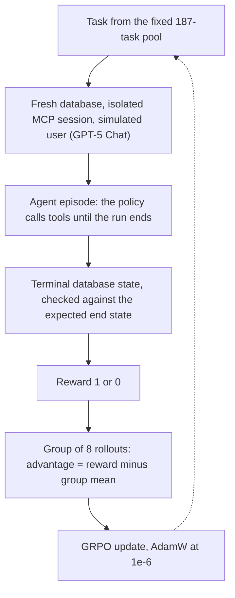
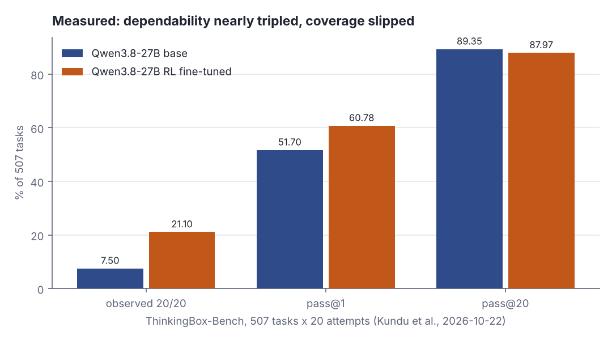
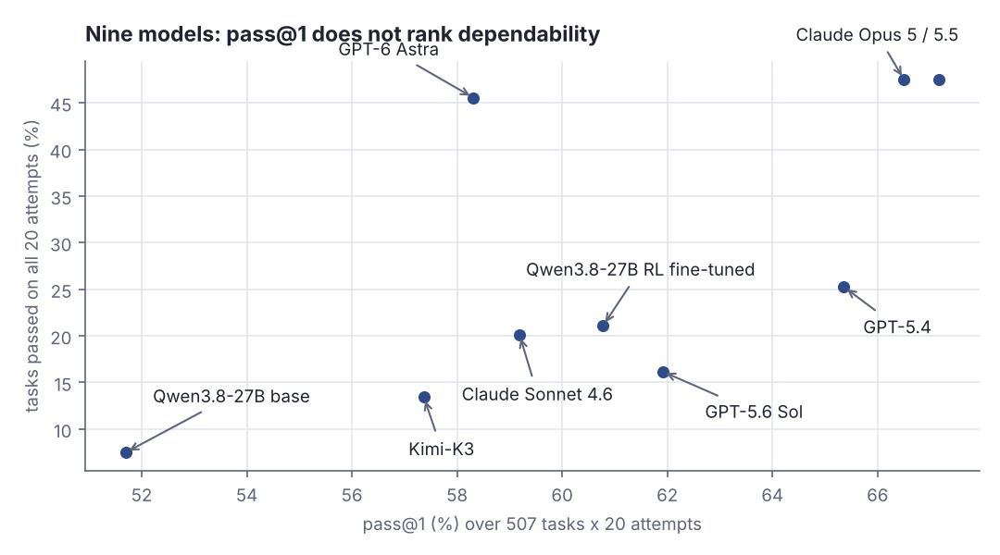
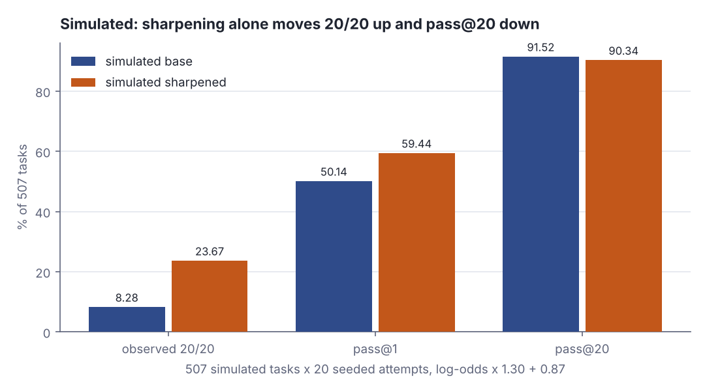

# When the reward is just a database check: RL post-training, measured

> Fresh · AI / ML foundations · Intermediate · ~22 min · from today's feeds

## Why this matters
Today's item is "Turning Database Grading into RL Rewards: Post-Training Agents with ThinkingBox", a joint Microsoft and Hugging Face post published on the Hugging Face blog on 22 October 2026 (lead author Tuhin Kundu, with contributors from Microsoft, Hugging Face and the University of Pittsburgh); it reports what happened when an agent model was fine-tuned with reinforcement learning whose only reward signal was a deterministic check run against a database's final state.
The hook for you is the QA-lead question, not the ML: *what exactly did you measure?* — because the headline here is not that the model got better, it is that average success and repeatability moved in opposite directions, and only one of them is what you would put in a runbook.
This morning's core lesson showed gradient descent turning a slope into a step; this lesson is the other half of that loop — where the number you are descending on comes from when there is no labelled dataset to compute a loss against.

## Primer
**Pretraining and post-training.** Pretraining is the long run that makes a base model: predict the next token over a very large text corpus, with the loss computed directly from the text itself. *Post-training* is everything done to that finished base model afterwards to make it behave a particular way — instruction tuning, preference tuning, and the reinforcement-learning stage this lesson is about. It is short, it is targeted, and it changes behaviour far more than it adds knowledge.

**Policy, rollout, episode.** In reinforcement-learning language the model is the *policy*: given a state, it produces an action. For an agent, one *rollout* (used interchangeably here with *episode*) is a whole run — the user asks for something, the model calls tools, the tools change a backend, the run ends. A rollout is not one token and not one reply; it is one complete attempt at a task.

**Why reinforcement learning and not a loss.** Gradient descent needs a differentiable loss: you need ∂loss/∂parameter. But "did the database end up correct" is a scalar produced by running a program; there is no derivative through it. Reinforcement learning is the machinery for exactly this case — you cannot differentiate the reward, so you estimate a gradient from the *spread of rewards across sampled rollouts* instead, and then take an ordinary downhill step with that estimate.

**GRPO in one paragraph.** Group Relative Policy Optimization samples a *group* of rollouts for the same task, scores each, and uses each rollout's reward minus the group's mean reward as its *advantage*. Rollouts above the group mean get pushed up, rollouts below get pushed down. The consequence to hold on to: if every rollout in a group scores the same, every advantage is zero and the group contributes nothing to the update.

**The three scoreboards.** With 20 attempts per task: **pass@1** is the plain average success rate over all attempts; **pass@20** is the fraction of tasks solved at least once in 20 tries (reach); **observed 20/20** is the fraction solved on *every* one of the 20 tries (dependability). They can move independently, and in this report they did.

## The idea

### The reward is a program, not an opinion
The ThinkingBox sandbox runs each task against a real backend. When the episode finishes it does not read the transcript and decide whether the agent sounded competent; it extracts what changed in the database and runs the task's checks against that terminal state.

> "When an episode ends, the sandbox extracts what actually changed in the backend and runs the task's deterministic checks against the terminal state. Any trajectory that produces the correct end state passes."
>
> — Tuhin Kundu and co-authors, Microsoft and Hugging Face, *Turning Database Grading into RL Rewards: Post-Training Agents with ThinkingBox*, 2026-10-22, https://huggingface.co/blog/microsoft/thinkingbox-training

That is an assertion in an integration test, and the authors make the jump explicit:

> "That is not just a grader. This can be a reward function."
>
> — Kundu et al., Microsoft and Hugging Face, *Turning Database Grading into RL Rewards*, 2026-10-22, https://huggingface.co/blog/microsoft/thinkingbox-training

Here is the whole grader: compare the rows you care about with the rows you expected.

```scala
type State = Map[String, String]
val want: State = Map("booking.status" -> "changed", "approval.state" -> "granted")
val viaUi: State = Map("booking.status" -> "changed", "approval.state" -> "granted")
val viaApi: State = Map("booking.status" -> "changed", "approval.state" -> "granted")
val noApproval: State = Map("booking.status" -> "changed", "approval.state" -> "absent")
def reward(actual: State): Int = if actual == want then 1 else 0
println(s"A: 11 tool calls through the UI      -> reward ${reward(viaUi)}")
println(s"B:  4 tool calls through the API     -> reward ${reward(viaApi)}")
println(s"C: booking changed, approval missing -> reward ${reward(noApproval)}")
println("C failed on: " + want.filter((k, v) => noApproval(k) != v).keys.mkString(", "))
```

```text
A: 11 tool calls through the UI      -> reward 1
B:  4 tool calls through the API     -> reward 1
C: booking changed, approval missing -> reward 0
C failed on: approval.state
```

Two different trajectories — eleven tool calls and four — score identically because the end state is identical; the third scores zero on one key. What you buy is a signal that cannot be talked into passing, is cheap to run and is indifferent to how the agent got there. What you pay is equally sharp: the reward is binary, so nine of ten rows right scores the same zero as doing nothing, and the check only measures what someone wrote a check for — `approval.state` is graded because a human decided it mattered. A minority of narrow requirements are still scored by an LLM judge answering a binary rubric question, which is the seam where "executable" stops.



*Figure 1: one training rollout, from a fresh database to a parameter update. Source: mechanism described in Kundu et al., Microsoft and Hugging Face, "Turning Database Grading into RL Rewards: Post-Training Agents with ThinkingBox", 2026-10-22, https://huggingface.co/blog/microsoft/thinkingbox-training*

### Choosing tasks the gradient can see
A binary reward and a group-relative advantage together create a hard constraint on which tasks are worth training on. The authors call their answer *offline policy-relative difficulty*: probe the base policy n times on each candidate task, model its success rate with a Jeffreys posterior, bucket the tasks by that estimate, and drop the extremes.

> "tasks the model always fails are unlikely to teach it yet; tasks it always passes are already learned"
>
> — Kundu et al., Microsoft and Hugging Face, *Turning Database Grading into RL Rewards*, 2026-10-22, https://huggingface.co/blog/microsoft/thinkingbox-training

The arithmetic behind that sentence is three lines long:

```scala
def adv(r: Vector[Int]): Vector[Double] =
  val m = r.sum.toDouble / r.size
  r.map(_ - m)
def show(label: String, r: Vector[Int]): Unit =
  val m = r.sum.toDouble / r.size
  val a = adv(r).map(x => f"$x%+.3f").mkString(" ")
  println(f"$label%-9s ${r.mkString}%s  mean $m%.3f  advantages $a%s")
show("mixed", Vector(1, 0, 0, 1, 0, 0, 0, 1))
show("all pass", Vector(1, 1, 1, 1, 1, 1, 1, 1))
show("all fail", Vector(0, 0, 0, 0, 0, 0, 0, 0))
```

```text
mixed     10010001  mean 0.375  advantages +0.625 -0.375 -0.375 +0.625 -0.375 -0.375 -0.375 +0.625
all pass  11111111  mean 1.000  advantages +0.000 +0.000 +0.000 +0.000 +0.000 +0.000 +0.000 +0.000
all fail  00000000  mean 0.000  advantages +0.000 +0.000 +0.000 +0.000 +0.000 +0.000 +0.000 +0.000
```

A mixed group pushes three rollouts up by 0.625 and five down by 0.375; a uniform group — pass or fail, no difference — produces eight zeros and contributes exactly nothing, having spent eight full agent episodes. Difficulty filtering is therefore throughput, not curriculum nicety: the pool is chosen so groups come out mixed. The reference run used 187 tasks and 50 GRPO steps, with each update generating 18 groups of 8 rollouts (144 episodes) across 24 H100s, zero-variance groups replaced DAPO-style during training, and system errors such as a backend timeout refilled rather than scored as failures (Kundu et al., Microsoft and Hugging Face, 2026-10-22).

> "Training ran synchronously with parameter and optimizer offload; AdamW used a `1e-6` learning rate and zero weight decay."
>
> — Kundu et al., Microsoft and Hugging Face, *Turning Database Grading into RL Rewards*, 2026-10-22, https://huggingface.co/blog/microsoft/thinkingbox-training

Two caveats the authors state themselves and you should carry: difficulty is estimated once from the base policy and never re-probed, and the pool is fixed for the whole run — so a task that was at the edge of the model's ability at step 0 may be fully learned by step 40 and is still being sampled.

### Repeatable, not broader
Now the measurement. On ThinkingBox-Bench — 507 tasks, 20 attempts each, held out from training — the fine-tune produced this:

> "For Qwen3.8-27B, average success rose from 51.70% to 60.78%, while tasks completed correctly on all twenty attempts rose from 38 to 107 with 50 GRPO steps."
>
> — Kundu et al., Microsoft and Hugging Face, *Turning Database Grading into RL Rewards*, 2026-10-22, https://huggingface.co/blog/microsoft/thinkingbox-training



*Figure 2: observed 20/20 went 7.50% → 21.10% and pass@1 went 51.70% → 60.78%, while pass@20 went 89.35% → 87.97% — 453 tasks down to 446. Source: numbers from Kundu et al., Microsoft and Hugging Face, "Turning Database Grading into RL Rewards", 2026-10-22, https://huggingface.co/blog/microsoft/thinkingbox-training*

The third bar is the interesting one, and the authors do not hide it:

> "Overall, the model did not become broader. It became more repeatable."
>
> — Kundu et al., Microsoft and Hugging Face, *Turning Database Grading into RL Rewards*, 2026-10-22, https://huggingface.co/blog/microsoft/thinkingbox-training

Seven tasks the base model could solve at least once in twenty tries, the fine-tune never solved, and auto insurance lost the most breadth at −7.0 points on pass@20 (Kundu et al., Microsoft and Hugging Face, 2026-10-22). The gain is concentration of probability mass, not new capability. The post's concrete example is one a QA lead will recognise: on a hotel booking change requiring manager approval, the base model changed the booking and issued refunds without approval in 15 of 20 attempts; the fine-tune preserved booking and payment state in all 20 (Kundu et al., Microsoft and Hugging Face, 2026-10-22).



*Figure 3: the two scoreboards are not the same ranking — GPT-6 Astra is eighth of nine on pass@1 (58.31%) and third on 20/20 (45.56%), while GPT-5.6 Sol is sixth on pass@1 (61.91%) and eighth on 20/20 (16.17%). Adapted from the comparison table in Kundu et al., Microsoft and Hugging Face, "Turning Database Grading into RL Rewards", 2026-10-22, https://huggingface.co/blog/microsoft/thinkingbox-training; every value is printed in Step 5 of the lab below.*

Because dependability is what you can build a process on, the authors price it per *dependable* task rather than per attempt: $24.36 for the base model against $8.00 for the fine-tune, a 67.2% fall (Kundu et al., Microsoft and Hugging Face, 2026-10-22).

> "At $8.00 per dependable task, the fine-tuned model came close to GPT-5.4 ($6.80), GPT-6 Astra ($7.45), and Claude Opus 5.5 ($7.80) in the companion comparison."
>
> — Kundu et al., Microsoft and Hugging Face, *Turning Database Grading into RL Rewards*, 2026-10-22, https://huggingface.co/blog/microsoft/thinkingbox-training

Read it with its own disclaimer, and knowing the calculation excludes the training run and the policy probes:

> "The dollar values are a comparative serving index, not invoice or cloud bills."
>
> — Kundu et al., Microsoft and Hugging Face, *Turning Database Grading into RL Rewards*, 2026-10-22, https://huggingface.co/blog/microsoft/thinkingbox-training

One more honesty marker, and it is the limit of the whole result — the benchmark was held out, but it is not independent of the training set:

> "These shared elements limit the scope of the transfer claim."
>
> — Kundu et al., Microsoft and Hugging Face, *Turning Database Grading into RL Rewards*, 2026-10-22, https://huggingface.co/blog/microsoft/thinkingbox-training

The two sets share the framework, the simulated-user machinery, the executable grading and some tools; every benchmark task is a synthetic reconstruction; it is one model and one reference run. The published repository fits that picture: MIT-licensed code whose `data/examples/training_tasks.example.yaml` holds "39 public development selectors for exercising the interface", and which tells you to "Provide an authorized ThinkingBox-compatible task source at runtime" rather than shipping the 187 training tasks (microsoft/thinkingbox-training, README).

## Lab
**Question: if post-training did nothing but sharpen a model's per-task success probabilities — pushing the ones it half-knows towards certainty — would that alone reproduce the shape of the published result: 20/20 up a lot, pass@1 up, pass@20 slightly down?**

Run it with `python3 dojo/engine/run_lab.py 2026-11-03-2`, or save the program and run `scala Lab.scala`. One seed, no network, identical output every time. This is an illustration of the *mechanism*, not a reproduction of their training run: nobody trains anything here, the per-task probabilities are constructed rather than measured, and the only claim is about how three metrics move when probabilities get sharper.

### Step 1 — give every one of 507 tasks a success probability
Lay the 507 tasks on the quantiles of an arcsine distribution — many near-hopeless, many near-certain, a thin middle, which is the shape offline policy-relative difficulty is probing for — and clamp to [0.02, 0.96] so nothing is literally impossible or guaranteed. Print eight sample tasks with their probability, log-odds and bucket.

### Step 2 — apply one sharpening map to all of them
Post-training is modelled as a single affine move in log-odds: `logit(p) × 1.30 + 0.87`. The gain of 1.30 stretches the scale (confident tasks get more confident, hopeless ones more hopeless) and the shift of 0.87 lifts everything. Print the before/after for the same eight tasks.

### Step 3 — run 20 attempts per task on the same coin flips
Draw a 507 × 20 matrix of uniforms once and reuse it for both policies, so every difference comes from the probabilities and nothing else. Print the actual 20-attempt pattern for the eight sample tasks under both policies, then a per-bucket table of where the 20/20 and pass@20 counts landed.

### Step 4 — compare the simulated triple with the measured one
Print pass@1, observed 20/20 and pass@20 for both simulated policies next to the four published numbers.

### Step 5 — print the published cross-model table
So that every number in Figure 3 appears in the lesson's own output.

```scala
// file: Lab.scala
// Does "sharpening" alone reproduce the shape of the ThinkingBox result?
// 507 tasks x 20 attempts, one success probability per task, one fixed seed.
// Measured numbers it is compared against: Kundu et al., Microsoft + Hugging Face,
// "Turning Database Grading into RL Rewards: Post-Training Agents with ThinkingBox",
// 2026-10-22, https://huggingface.co/blog/microsoft/thinkingbox-training

val NTASK = 507      // benchmark size
val NATT  = 20       // attempts per task
val LO    = 0.02     // floor on a task's success probability
val HI    = 0.96     // ceiling on it
val GAIN  = 1.30     // how much post-training stretches the log-odds
val SHIFT = 0.87     // how much it lifts them

def clamp(p: Double): Double = math.max(LO, math.min(HI, p))
def logit(p: Double): Double = math.log(p / (1.0 - p))
def sigmoid(x: Double): Double = 1.0 / (1.0 + math.exp(-x))

// Arcsine = Beta(1/2, 1/2) quantiles: many near-hopeless tasks, many near-certain ones,
// a thin middle. That is the shape "offline policy-relative difficulty" probes for.
def baseP(i: Int): Double =
  clamp(math.pow(math.sin(math.Pi * (i + 0.5) / (2.0 * NTASK)), 2))
def sharpP(p: Double): Double = sigmoid(GAIN * logit(p) + SHIFT)

val base  = Vector.tabulate(NTASK)(baseP)
val sharp = base.map(sharpP)

// Common random numbers: both policies face the SAME 507 x 20 coin flips, so every
// difference below comes from the probabilities and nothing else.
val rng = scala.util.Random(20261103)
val u   = Vector.fill(NTASK, NATT)(rng.nextDouble())

def attempts(p: Vector[Double]): Vector[Vector[Boolean]] =
  Vector.tabulate(NTASK, NATT)((i, a) => u(i)(a) < p(i))

def bits(row: Vector[Boolean]): String = row.map(if _ then '1' else '.').mkString

case class Score(pass1: Double, pass20: Int, perfect: Int, hits: Int)
def score(out: Vector[Vector[Boolean]]): Score =
  val hits = out.map(_.count(identity)).sum
  Score(100.0 * hits / (NTASK * NATT), out.count(_.contains(true)),
        out.count(_.forall(identity)), hits)

val outB = attempts(base)
val outS = attempts(sharp)
val sB   = score(outB)
val sS   = score(outS)

val edges = Vector(0.0, 0.05, 0.35, 0.65, 0.95, 1.01)
val names = Vector("never  p<0.05", "rare   0.05-0.35", "coin   0.35-0.65",
                   "likely 0.65-0.95", "always p>=0.95")
def bucketOf(p: Double): Int = edges.indices.init.lastIndexWhere(k => p >= edges(k))

// The article's own cross-model table (pass@1 %, observed 20/20 count)
val models = Vector(
  ("Claude Opus 5.5",      67.16, 241), ("Claude Opus 5",     66.50, 241),
  ("GPT-5.4",              65.36, 128), ("GPT-5.6 Sol",       61.91,  82),
  ("Qwen3.8-27B RL FT",    60.78, 107), ("Claude Sonnet 4.6", 59.19, 102),
  ("GPT-6 Astra",          58.31, 231), ("Kimi-K3",           57.37,  68),
  ("Qwen3.8-27B base",     51.70,  38))

@main def lab(): Unit =
  println("Sharpening a policy: what moves, 20/20 or pass@20?")
  println()

  println("Step 1 - the 507 per-task success probabilities of the base policy")
  println("  task    base p   log-odds   bucket")
  val sample = Vector(0, 40, 120, 200, 253, 320, 420, 500)
  for i <- sample do
    println(f"  ${i + 1}%4d  ${base(i)}%8.4f  ${logit(base(i))}%+9.3f   ${names(bucketOf(base(i)))}%s")
  println(f"  mean base p over all $NTASK%d tasks: ${100.0 * base.sum / NTASK}%.2f%%")
  println()

  println("Step 2 - the sharpening map: log-odds x 1.30 + 0.87")
  println("  task    base p   sharp p    change   bucket moved to")
  for i <- sample do
    println(f"  ${i + 1}%4d  ${base(i)}%8.4f  ${sharp(i)}%8.4f  ${sharp(i) - base(i)}%+8.4f   ${names(bucketOf(sharp(i)))}%s")
  println(f"  mean sharp p over all $NTASK%d tasks: ${100.0 * sharp.sum / NTASK}%.2f%%")
  println()

  println("Step 3 - 20 attempts per task, the same coin flips for both policies")
  println("  task  policy  p        20 attempts (1 = DB check passed)   hits  20/20")
  for i <- sample do
    println(f"  ${i + 1}%4d  base    ${base(i)}%.4f   ${bits(outB(i))}%s   ${outB(i).count(identity)}%4d  ${outB(i).forall(identity)}%-5s")
    println(f"        sharp   ${sharp(i)}%.4f   ${bits(outS(i))}%s   ${outS(i).count(identity)}%4d  ${outS(i).forall(identity)}%-5s")
  println()
  println("  per-bucket counts (tasks bucketed by their BASE probability)")
  println("  bucket              tasks   20/20 base  20/20 sharp   pass@20 base  pass@20 sharp")
  for k <- names.indices do
    val ids = (0 until NTASK).filter(i => bucketOf(base(i)) == k)
    val pb  = ids.count(i => outB(i).forall(identity))
    val psh = ids.count(i => outS(i).forall(identity))
    val cb  = ids.count(i => outB(i).contains(true))
    val csh = ids.count(i => outS(i).contains(true))
    println(f"  ${names(k)}%-18s  ${ids.size}%5d   ${pb}%10d  ${psh}%11d   ${cb}%12d  ${csh}%13d")
  println()

  println("Step 4 - simulated against measured")
  println("  metric                simulated base  simulated sharp     measured base  measured RL FT")
  println(f"  pass@1                ${sB.pass1}%13.2f%%  ${sS.pass1}%14.2f%%  ${51.70}%16.2f%%  ${60.78}%13.2f%%")
  println(f"  observed 20/20        ${sB.perfect}%14d  ${sS.perfect}%15d  ${38}%17d  ${107}%14d")
  println(f"  pass@20               ${sB.pass20}%14d  ${sS.pass20}%15d  ${453}%17d  ${446}%14d")
  println(f"  20/20 as %% of $NTASK%d    ${100.0 * sB.perfect / NTASK}%13.2f%%  ${100.0 * sS.perfect / NTASK}%14.2f%%  ${7.50}%16.2f%%  ${21.10}%13.2f%%")
  println(f"  pass@20 as %% of $NTASK%d  ${100.0 * sB.pass20 / NTASK}%13.2f%%  ${100.0 * sS.pass20 / NTASK}%14.2f%%  ${89.35}%16.2f%%  ${87.97}%13.2f%%")
  println(f"  simulated change: 20/20 ${sS.perfect - sB.perfect}%+d tasks, pass@20 ${sS.pass20 - sB.pass20}%+d tasks")
  println(f"  measured change:  20/20 ${107 - 38}%+d tasks, pass@20 ${446 - 453}%+d tasks")
  println()

  println("Step 5 - the article's own cross-model table: pass@1 does not rank dependability")
  println("  model                 pass@1 %    observed 20/20   20/20 %")
  for (name, p1, perfect) <- models do
    println(f"  $name%-20s  $p1%7.2f   ${perfect}%14d   ${100.0 * perfect / NTASK}%6.2f%%")
  println(f"  GPT-5.6 Sol leads the RL fine-tune on pass@1 by ${61.91 - 60.78}%+.2f points")
  println(f"  and trails it on 20/20 by ${82 - 107}%+d tasks")
```

```text
Sharpening a policy: what moves, 20/20 or pass@20?

Step 1 - the 507 per-task success probabilities of the base policy
  task    base p   log-odds   bucket
     1    0.0200     -3.892   never  p<0.05
    41    0.0200     -3.892   never  p<0.05
   121    0.1330     -1.874   rare   0.05-0.35
   201    0.3387     -0.669   rare   0.05-0.35
   254    0.5000     -0.000   coin   0.35-0.65
   321    0.7017     +0.855   likely 0.65-0.95
   421    0.9299     +2.585   likely 0.65-0.95
   501    0.9600     +3.178   always p>=0.95
  mean base p over all 507 tasks: 49.78%

Step 2 - the sharpening map: log-odds x 1.30 + 0.87
  task    base p   sharp p    change   bucket moved to
     1    0.0200    0.0149   -0.0051   never  p<0.05
    41    0.0200    0.0149   -0.0051   never  p<0.05
   121    0.1330    0.1727   +0.0396   rare   0.05-0.35
   201    0.3387    0.5001   +0.1614   coin   0.35-0.65
   254    0.5000    0.7047   +0.2047   likely 0.65-0.95
   321    0.7017    0.8789   +0.1772   likely 0.65-0.95
   421    0.9299    0.9857   +0.0558   always p>=0.95
   501    0.9600    0.9933   +0.0333   always p>=0.95
  mean sharp p over all 507 tasks: 58.96%

Step 3 - 20 attempts per task, the same coin flips for both policies
  task  policy  p        20 attempts (1 = DB check passed)   hits  20/20
     1  base    0.0200   .....1..............      1  false
        sharp   0.0149   ....................      0  false
    41  base    0.0200   ....................      0  false
        sharp   0.0149   ....................      0  false
   121  base    0.1330   ..........11..11.1..      5  false
        sharp   0.1727   ...1......11..11.1..      6  false
   201  base    0.3387   11...1.11..........1      6  false
        sharp   0.5001   11..11.111......1..1      9  false
   254  base    0.5000   111..1..111.....11..      9  false
        sharp   0.7047   111.11111111..1111..     15  false
   321  base    0.7017   ..11111111111..111.1     15  false
        sharp   0.8789   1.111111111111111111     19  false
   421  base    0.9299   111111111111111.1111     19  false
        sharp   0.9857   11111111111111111111     20  true 
   501  base    0.9600   1111111111.111111111     19  false
        sharp   0.9933   11111111111111111111     20  true 

  per-bucket counts (tasks bucketed by their BASE probability)
  bucket              tasks   20/20 base  20/20 sharp   pass@20 base  pass@20 sharp
  never  p<0.05          73            0            0             37             29
  rare   0.05-0.35      131            0            0            124            126
  coin   0.35-0.65       99            0            0             99             99
  likely 0.65-0.95      131            8           57            131            131
  always p>=0.95         73           34           63             73             73

Step 4 - simulated against measured
  metric                simulated base  simulated sharp     measured base  measured RL FT
  pass@1                        50.14%           59.44%             51.70%          60.78%
  observed 20/20                    42              120                 38             107
  pass@20                          464              458                453             446
  20/20 as % of 507             8.28%           23.67%              7.50%          21.10%
  pass@20 as % of 507          91.52%           90.34%             89.35%          87.97%
  simulated change: 20/20 +78 tasks, pass@20 -6 tasks
  measured change:  20/20 +69 tasks, pass@20 -7 tasks

Step 5 - the article's own cross-model table: pass@1 does not rank dependability
  model                 pass@1 %    observed 20/20   20/20 %
  Claude Opus 5.5         67.16              241    47.53%
  Claude Opus 5           66.50              241    47.53%
  GPT-5.4                 65.36              128    25.25%
  GPT-5.6 Sol             61.91               82    16.17%
  Qwen3.8-27B RL FT       60.78              107    21.10%
  Claude Sonnet 4.6       59.19              102    20.12%
  GPT-6 Astra             58.31              231    45.56%
  Kimi-K3                 57.37               68    13.41%
  Qwen3.8-27B base        51.70               38     7.50%
  GPT-5.6 Sol leads the RL fine-tune on pass@1 by +1.13 points
  and trails it on 20/20 by -25 tasks
```

### Reading the output

**Step 1 — the starting probabilities.** `base p` is the chance that one attempt at that task ends with the database in the expected state; `log-odds` is `ln(p / (1 − p))`, the scale the sharpening acts on; `bucket` is a label for reading the table later. Higher `base p` is better.

| task | base p | log-odds | bucket |
|---|---|---|---|
| 1 | 0.0200 | −3.892 | never p<0.05 |
| 121 | 0.1330 | −1.874 | rare 0.05–0.35 |
| 254 | 0.5000 | −0.000 | coin 0.35–0.65 |
| 421 | 0.9299 | +2.585 | likely 0.65–0.95 |
| 501 | 0.9600 | +3.178 | always p≥0.95 |

The mean over all 507 is 49.78%, close to the base model's measured pass@1 of 51.70% (Kundu et al., Microsoft and Hugging Face, 2026-10-22), which is the only sense in which this starting point is calibrated.

**Verdict: the simulated base policy starts at 49.78% average success against the real base model's 51.70% — near enough that the movements below are comparable in shape, not a claim of replication.**

**Step 2 — what sharpening does.** `sharp p` is `sigmoid(1.30 × log-odds + 0.87)`; `change` is `sharp p − base p`, and the sign is the whole point.

| task | base p | sharp p | change |
|---|---|---|---|
| 1 | 0.0200 | 0.0149 | −0.0051 |
| 201 | 0.3387 | 0.5001 | +0.1614 |
| 254 | 0.5000 | 0.7047 | +0.2047 |
| 421 | 0.9299 | 0.9857 | +0.0558 |
| 501 | 0.9600 | 0.9933 | +0.0333 |

Trace task 254 by hand: `logit(0.5000) = ln(0.5/0.5) = 0.000`; `1.30 × 0.000 + 0.87 = 0.870`; `sigmoid(0.870) = 1 / (1 + e^−0.870) = 1 / (1 + 0.41895) = 0.70476`, printed as `0.7047`. Now trace task 1, the one that goes the other way: `logit(0.0200) = ln(0.02/0.98) = −3.8918`; `1.30 × (−3.8918) + 0.87 = −4.1893`; `sigmoid(−4.1893) = 1 / (1 + e^4.1893) = 1 / (1 + 65.95) = 0.01494`, printed as `0.0149`. A gain above 1 moves a task *away* from 0.5 in log-odds, and for a task already below 0.5 the shift of 0.87 is not enough to cancel it.

**Verdict: the same single map lifts the middle hard (+0.2047 at p = 0.5) and pushes the hopeless tail down (−0.0051 at p = 0.02) — one operation, two opposite effects, which is exactly how one training run can raise dependability and lose coverage at the same time.**

**Step 3 — twenty attempts.** Each row is one task's 20 attempts, `1` for a passing database check and `.` for a failing one; `hits` counts the ones, `20/20` is true only when all twenty passed. Both policies see the same random numbers, so a `.` that becomes a `1` is caused purely by the probability moving.

| bucket | tasks | 20/20 base | 20/20 sharp | pass@20 base | pass@20 sharp |
|---|---|---|---|---|---|
| never p<0.05 | 73 | 0 | 0 | 37 | 29 |
| rare 0.05–0.35 | 131 | 0 | 0 | 124 | 126 |
| coin 0.35–0.65 | 99 | 0 | 0 | 99 | 99 |
| likely 0.65–0.95 | 131 | 8 | 57 | 131 | 131 |
| always p≥0.95 | 73 | 34 | 63 | 73 | 73 |

Every single 20/20 gain comes from the top two buckets: 8 → 57 and 34 → 63, 78 extra tasks in all. Every pass@20 loss comes from the bottom bucket: 37 → 29. Check that loss against Step 2's arithmetic — for a task pinned at the floor, the chance of failing all twenty attempts rises from `0.98^20 = 0.6676` to `0.9851^20 = 0.7406`, so about seven percentage points more of those 73 tasks now go cold.

**Verdict: the 20/20 gain and the pass@20 loss are not a trade made inside one task — they happen in different buckets, which is why an aggregate like pass@1 shows you the sum and hides the shape.**

**Step 4 — against the published numbers.**

| metric | simulated base | simulated sharpened | measured base | measured RL fine-tuned |
|---|---|---|---|---|
| pass@1 | 50.14% | 59.44% | 51.70% | 60.78% |
| observed 20/20 | 42 (8.28%) | 120 (23.67%) | 38 (7.50%) | 107 (21.10%) |
| pass@20 | 464 (91.52%) | 458 (90.34%) | 453 (89.35%) | 446 (87.97%) |
| change in 20/20 | — | +78 tasks | — | +69 tasks |
| change in pass@20 | — | −6 tasks | — | −7 tasks |

All three directions and both magnitudes of change match the measured run closely: +78 against +69 at 20/20, −6 against −7 at pass@20 (measured figures from Kundu et al., Microsoft and Hugging Face, 2026-10-22). Note where it does *not* match: the simulation reaches 23.67% at 20/20 on only 59.44% pass@1, while the real fine-tune reached 21.10% on a higher 60.78%. Pure sharpening is slightly *more* concentrating than what the real run did, so the real run's gain was not purely a sharpening of the same abilities.



*Figure 4: one affine move in log-odds reproduces the published pattern — observed 20/20 8.28% → 23.67%, pass@1 50.14% → 59.44%, pass@20 91.52% → 90.34%. Generated from the Step 4 lab output above (`python3 dojo/engine/run_lab.py 2026-11-03-2`).*

**Verdict: a single sharpening parameter reproduces the published pattern, so "the model became more repeatable, not broader" needs no exotic explanation — it is what sharpening looks like when you measure it three ways.**

**Step 5 — the cross-model table.** `pass@1 %` is average success; `observed 20/20` is how many of the 507 tasks a model solved on all twenty attempts; both higher is better, and they do not agree. GPT-6 Astra sits eighth of nine on pass@1 at 58.31% and third on 20/20 at 231 tasks (45.56%); GPT-5.6 Sol leads the RL fine-tune on pass@1 by +1.13 points and trails it on 20/20 by 25 tasks (Kundu et al., Microsoft and Hugging Face, 2026-10-22).

**Verdict: ranking agent models by average success rate tells you almost nothing about which one you could put behind an unattended workflow — the two columns disagree by up to six places.**

### Cause → mechanism → consequence → what it means
1. **Cause.** The reward is an executable check of the terminal database state, returning 1 or 0, so the training signal says only "correct end state or not" and says it about every trajectory equally (Kundu et al., Microsoft and Hugging Face, 2026-10-22).
2. **Mechanism.** GRPO turns a group of such binary rewards into advantages by subtracting the group mean, so learning happens only where a group comes out mixed; the pool is filtered to those tasks in advance, and what the update does to a policy already near the right answer is sharpen it — raise its log-odds, as modelled by the `×1.30 + 0.87` map in Step 2.
3. **Consequence.** Sharpening concentrates probability mass: tasks in the "likely" and "always" buckets become perfect (8 → 57 and 34 → 63 in the lab), while tasks in the hopeless tail get pushed further down (pass@20 37 → 29). Measured, that is 20/20 rising 38 → 107 and pass@20 falling 453 → 446 (Kundu et al., Microsoft and Hugging Face, 2026-10-22).
4. **What it means in practice.** If you are deciding whether an agent can own a workflow that touches your database, the number to ask for is the 20/20 rate on *your* tasks, not pass@1 — and the grader is the deliverable, because an agent can only be trained or evaluated on the state transitions someone bothered to write an assertion for. The approval field in the booking example was caught because it was checked; whatever your equivalent is, it is a line in a test suite before it is a reward. And demand the companion number too: the breadth you gave up, because a model that is dependable on a narrower set is a different operational risk from one that is flaky on a wider one.

## Self-check
1. A GRPO training run samples 8 rollouts per task. On task A all 8 rollouts pass; on task B all 8 fail; on task C three pass. Which of the three contributes to the parameter update, and what does that imply about how you would build a training pool for your own agent? <details><summary>Answer</summary>Only task C. The advantage of a rollout is its reward minus the group mean, so a group where every rollout scores the same yields advantages of exactly zero — the lab's <code>all pass</code> and <code>all fail</code> rows print eight <code>+0.000</code>s each, while the <code>mixed</code> row prints three at +0.625 and five at −0.375. Task A and task B burn eight full agent episodes apiece and contribute nothing. The implication is that a training pool is not "all the tasks you have": you probe the base policy on each candidate, estimate its success rate, and keep the band where outcomes still vary. This is what the post calls offline policy-relative difficulty — "tasks the model always fails are unlikely to teach it yet; tasks it always passes are already learned" (Kundu et al., Microsoft and Hugging Face, 2026-10-22). Its stated weakness is that the estimate is made once from the base policy and never re-probed, so a task that has since been learned keeps being sampled.</details>
2. The fine-tuned model's pass@1 rose by 9.08 points while its pass@20 fell by 7 tasks. Explain how one training run can do both, and say which number you would put in front of an operations team. <details><summary>Answer</summary>Because the two metrics read different parts of the same distribution. pass@1 is the average per-attempt success probability across all 507 tasks, so it rises whenever the middle of the distribution moves up. pass@20 asks only whether a task was ever solved in twenty tries, which is governed entirely by the tasks with probabilities near zero — and the same sharpening that lifts a half-known task also drives a nearly-hopeless one further down. The lab shows this cleanly: the whole 20/20 gain (8 → 57 and 34 → 63) comes from the "likely" and "always" buckets, while the whole pass@20 loss (37 → 29) comes from the "never" bucket, and for a task at the 0.02 floor the probability of failing all twenty attempts rises from 0.98²⁰ = 0.6676 to 0.9851²⁰ = 0.7406. For an operations team the number is the observed 20/20 rate — 7.50% to 21.10% (Kundu et al., Microsoft and Hugging Face, 2026-10-22) — because that is the rate at which you could leave the agent unattended; pass@20 describes a workflow where a human retries up to twenty times.</details>
3. Your team wants to copy this recipe for an internal agent that edits records in your own service. What has to exist before a single training step can run, and what would make the resulting reward signal misleading? <details><summary>Answer</summary>Four things must exist first: a sandboxed backend that can be reset to a known state for every rollout, so one episode cannot contaminate the next; a way to drive the agent end-to-end, including whatever plays the user; a *written expectation* of the terminal state for each task; and an executable check comparing the two, returning 1 or 0 — "Any trajectory that produces the correct end state passes" (Kundu et al., Microsoft and Hugging Face, 2026-10-22). The reward becomes misleading in two ways. First, under-specification: the check only grades the fields someone asserted on, so an agent can reach a passing end state while wrecking a column nobody wrote a check for — the approval field in the post's booking example was caught precisely because it was asserted. Second, leakage between training and evaluation: the post's own caution is "These shared elements limit the scope of the transfer claim" (Kundu et al., Microsoft and Hugging Face, 2026-10-22), because the benchmark shared the framework, simulated user, grading method and some tools with the training pool. If your evaluation tasks are built by the same generator as your training tasks, a rising 20/20 rate may be measuring the generator rather than the agent.</details>

## Sources
- [Turning Database Grading into RL Rewards: Post-Training Agents with ThinkingBox](https://huggingface.co/blog/microsoft/thinkingbox-training) — Tuhin Kundu and co-authors, Microsoft and Hugging Face (with the University of Pittsburgh), Hugging Face blog, published 2026-10-22 — the primary source for everything in this lesson: the deterministic terminal-state grading and the binary reward, the LLM-judge minority for narrow rubric requirements, the per-rollout sandbox (fresh backend, isolated MCP session, GPT-5 Chat as simulated user), offline policy-relative difficulty with its Jeffreys posterior and fixed pool, the training loop (full-parameter GRPO, 50 steps, 187-task pool, 18 groups of 8 rollouts for 144 episodes per update, 24 H100s, AdamW at 1e-6 with zero weight decay, DAPO-style replacement of zero-variance groups, system errors refilled), the ThinkingBox-Bench results (507 tasks × 20 attempts; 20/20 38 → 107, pass@1 51.70% → 60.78%, pass@20 453 → 446), the cross-model comparison table used in Figure 3, the cost-per-dependable-task figures ($24.36 → $8.00, GPT-5.4 at $6.80) with their disclaimer, the hotel-booking approval example (15 of 20 base attempts without approval), the −7.0 point auto-insurance breadth loss, and the authors' own limits on transfer. All nine passages quoted above were re-fetched and checked word for word on 2026-11-03 (accessed 2026-11-03).
- [microsoft/thinkingbox-training](https://github.com/microsoft/thinkingbox-training) — Microsoft — the companion code repository: confirmed that it is released under the MIT Licence, that it ships the trainer, scripts and Verl patches plus `data/examples/training_tasks.example.yaml` with "39 public development selectors for exercising the interface", and that it instructs you to "Provide an authorized ThinkingBox-compatible task source at runtime" rather than shipping the 187-task training pool. The MIT licence covers that code, not the blog post's artwork, which is why Figure 3 is a redrawn adaptation rather than a downloaded image (accessed 2026-11-03).

## Next on this track
Fresh lessons sit outside the ladder; next on AI / ML foundations: **Gradient descent in many variables: fitting linear regression** (rung 7 of 38, Beginner).
