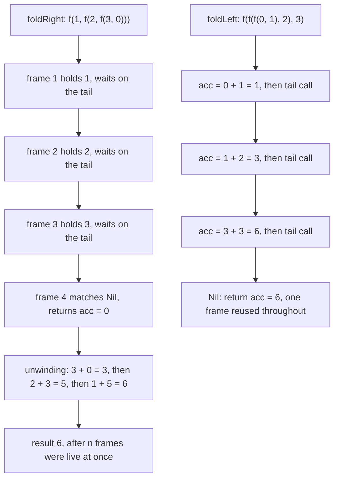
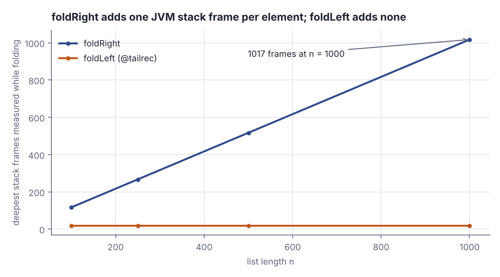
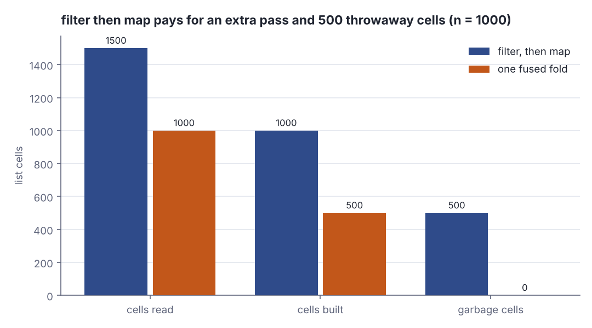
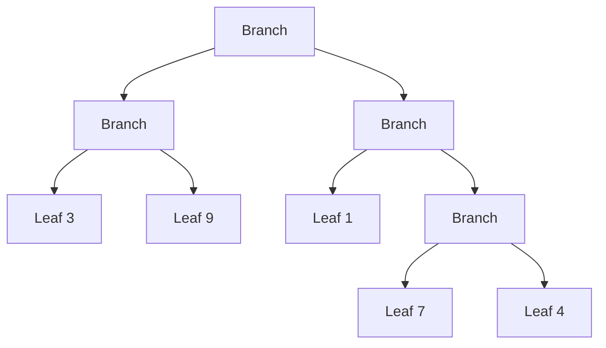

# Functional data structures II: foldRight, foldLeft and trees

> Functional Programming in Scala (red book) · Beginner · ~25 min · rung 4 of 26 · needs: Functional data structures I: the List ADT, pattern matching and data sharing (fp-scala-03)

## Why this matters
Every `foldLeft` you have put on an Akka hot path is this chapter: `foldRight` and `foldLeft` are the same loop with the recursion turned round, and only one of them survives a long list on a JVM thread whose stack is a few hundred kilobytes.
Writing both by hand is how stack overflows stop being a surprise and become something you can predict from the signature, and §3.4.2 — `map` after `filter` is two passes plus a throwaway list — is the cost model behind every fusion and lazy-stream trick the book pulls later.
It sits here because folds are the vocabulary for the rest of the book: `Option`, `State`, `LazyList`, the parser combinators and `Foldable` are all defined in terms of them.

## The idea

> Chapter map: Functional Programming in Scala, 2nd ed., ch. 3 Functional data structures — §3.4 Recursion over lists and generalizing to higher-order functions, §3.4.1 More functions for working with lists, §3.4.2 Loss of efficiency when assembling list functions from simpler components, §3.5 Trees. The earlier sections of the chapter, §3.1–§3.3, built the List itself and were the previous rung.

Everything here runs on the book's own singly linked list: an **algebraic data type** with two **data constructors**, `Nil` and `Cons` (one element in front of another list). Alongside it, the **fold** the chapter is about:

```scala
enum List[+A]:
  case Nil
  case Cons(head: A, tail: List[A])

def foldRight[A, B](as: List[A], acc: B)(f: (A, B) => B): B = as match
  case Nil         => acc
  case Cons(x, xs) => f(x, foldRight(xs, acc)(f))
```

### §3.4 Recursion over lists and generalizing to higher-order functions

`sum` and `product` from §3.1 have the same skeleton: one equation per data constructor — a value for `Nil`, and for `Cons` a way to combine the head with the folded tail. The only differences are *which* value (`0` or `1.0`) and *which* combiner (`+` or `*`). Make those two the parameters and you have `foldRight`. `sum`, `product` and `length` (Exercise 3.9) then become one-liners:

```scala
def sum(ns: List[Int]): Int = foldRight(ns, 0)(_ + _)
def product(ds: List[Double]): Double = foldRight(ds, 1.0)(_ * _)
def length[A](as: List[A]): Int = foldRight(as, 0)((_, n) => n + 1)
val xs = Cons(1, Cons(2, Cons(3, Nil)))
println(s"sum     = ${sum(xs)}")
println(s"product = ${product(Cons(2.0, Cons(0.0, Cons(9.9, Nil))))}")
println(s"length  = ${length(xs)}")
```

```text
sum     = 6
product = 0.0
length  = 3
```

Three questions, one recursion. `length` is the giveaway: its combiner ignores the element and only counts, because `f` gets the head and the folded tail and may do anything with them.

The two parameter lists — `foldRight(as, acc)(f)`, not `foldRight(as, acc, f)` — are not decoration: Scala infers types left to right across parameter lists, so `A` and `B` are fixed by the first and `_ + _` compiles without annotations:

> "We gain type inference benefits from grouping arguments into two argument lists, as in xs.foldRight(0)(_ + _)."
>
> — fpinscala contributors, *Chapter 3: Functional data structures* (companion wiki), undated, https://www.github.com/fpinscala/fpinscala/wiki/Chapter-3:-Functional-data-structures

Now the catch. In `f(x, foldRight(xs, acc)(f))` the recursion is an *argument* to `f`, so `f` cannot run until the whole tail has been folded. Fold into a string and the shape is visible:

```scala
val xs = Cons(1, Cons(2, Cons(3, Nil)))
println(foldRight(xs, "0")((x, acc) => s"($x + $acc)"))
println(foldLeft(xs, "0")((acc, x) => s"($acc + $x)"))
```

```text
(1 + (2 + (3 + 0)))
(((0 + 1) + 2) + 3)
```

`foldRight` nests to the right: the outermost addition belongs to the *first* element and is the *last* one evaluable. `foldLeft` nests to the left, so each addition completes before the next begins.



*Figure 1: The two expression shapes from the output above. foldRight suspends each element in its own frame and adds on the way back out; foldLeft folds as it walks, handing the accumulator forward in a tail call. Source: the example above, run with `python3 dojo/engine/run_lab.py 2026-11-04-1`.*

Two consequences. First, **`foldRight` is not stack-safe**: an *n*-element list means *n* live frames before a single `f` runs, so a long enough list overflows the stack. Second, **`foldRight` cannot short-circuit** — Exercise 3.7 asks whether `product` written with `foldRight` can halt on a `0.0`, and the answer is no: the combiner is handed the already-computed tail, so by the time it sees the zero everything has been multiplied. The §3.1 recursion could stop there because `case Cons(0.0, _)` matched *before* recursing; a general `f` never gets that chance. Step 1 of the lab traces it.

Exercise 3.8 makes the positive half of the same observation. Pass `Nil` as the starting value and `Cons` as the combiner:

```scala
val rebuilt = foldRight(xs, Nil: List[Int])(Cons(_, _))
println(s"rebuilt       = $rebuilt")
println(s"rebuilt == xs = ${rebuilt == xs}")
println(s"rebuilt eq xs = ${rebuilt eq xs}")
```

```text
rebuilt       = Cons(1,Cons(2,Cons(3,Nil)))
rebuilt == xs = true
rebuilt eq xs = false
```

The same list comes back, cell for cell, but as a brand-new chain (`eq` is reference identity, and it is `false`). That is the sentence to remember: **a fold replaces the data constructors with whatever you give it** — `Cons` becomes `f`, `Nil` becomes `acc`. Put back the originals and nothing changes; put back `+` and `0` and you get a sum; put back `Leaf` and `Branch` and you get §3.5.

### §3.4.1 More functions for working with lists

`foldLeft` (Exercise 3.10) is the stack-safe twin. Its combiner takes the accumulator first, `(B, A) => B`, because it is threaded forward rather than received from behind, and the recursive call is the entire body — a **tail call**, which Scala compiles to a jump, not a new frame. `@annotation.tailrec` fails the build if that is ever untrue:

```scala
@annotation.tailrec
def foldLeft[A, B](as: List[A], acc: B)(f: (B, A) => B): B = as match
  case Nil         => acc
  case Cons(x, xs) => foldLeft(xs, f(acc, x))(f)
```

The rest of the chapter's list library falls out of these two. `reverse` (3.12) is `foldLeft` from `Nil`, consing each element onto the front. `append` (3.14) is `foldRight` over the first list with the *second list* as the starting value, so it copies only the first and shares the second whole. `foldRight` via `foldLeft` (3.13) is `reverse` then `foldLeft` with `f`'s arguments flipped, and is stack-safe:

```scala
def reverse[A](as: List[A]) = foldLeft(as, Nil: List[A])((t, h) => Cons(h, t))
def append[A](a1: List[A], a2: List[A]) = foldRight(a1, a2)(Cons(_, _))
def foldRightViaFoldLeft[A, B](as: List[A], acc: B)(f: (A, B) => B): B =
  foldLeft(reverse(as), acc)((b, a) => f(a, b))
val big = fill(100000)
println(s"reverse(xs)          = ${reverse(xs)}")
println(s"append(xs, xs)       = ${append(xs, xs)}")
println(s"foldLeft sums 100000 = ${foldLeft(big, 0L)((acc, x) => acc + x)}")
println(s"via foldLeft too     = ${foldRightViaFoldLeft(big, 0L)((x, acc) => acc + x)}")
```

```text
reverse(xs)          = Cons(3,Cons(2,Cons(1,Nil)))
append(xs, xs)       = Cons(1,Cons(2,Cons(3,Cons(1,Cons(2,Cons(3,Nil))))))
foldLeft sums 100000 = 5000050000
via foldLeft too     = 5000050000
```

`5000050000` is `100000 × 100001 / 2`, so both got the arithmetic right on a list plain `foldRight` cannot finish. The price of `foldRightViaFoldLeft` is one extra traversal and one extra copy of the spine for the `reverse`. `map` (3.18), `filter` (3.19) and `flatMap` (3.20) are three more `foldRight`s whose combiner conses, conses conditionally, or appends.



*Figure 2: Measured with `Thread.currentThread.getStackTrace.length` inside the combiner. foldRight's stack grows one frame per element — 117, 267, 517, 1017 — while foldLeft stays at 18. Generated from Step 2a of the lab.*

### §3.4.2 Loss of efficiency when assembling list functions from simpler components

Writing `filter` and `map` as folds is elegant, and the book presents the bill. `map(filter(xs)(even))(times10)` walks the list to filter, builds an intermediate list nobody wants, then walks *that* to map. Count cells read and built and the waste is exact:

```scala
val ys = fill(10)
def fuse(x: Int, acc: List[Int]) = if x % 2 == 0 then consC(x * 10, acc) else acc
val two = mapC(filterC(ys)(_ % 2 == 0))(_ * 10)
println(s"filter then map: read $reads, built $builds -> $two")
reads = 0; builds = 0
val one = foldRightC(ys, Nil: List[Int])(fuse)
println(s"one fused fold:  read $reads, built $builds -> $one")
```

```text
filter then map: read 15, built 10 -> Cons(20,Cons(40,Cons(60,Cons(80,Cons(100,Nil)))))
one fused fold:  read 10, built 5 -> Cons(20,Cons(40,Cons(60,Cons(80,Cons(100,Nil)))))
```

Same answer, half the allocation: the composed version reads 15 cells and builds 10, five of them garbage the moment `map` has copied them. `consC` and `foldRightC` are the ordinary `Cons` and `foldRight` with a counter added, so these are counts, not estimates.




*Figure 3: The same comparison at n = 1000 — 1500 cells read and 1000 built against 1000 and 500, with 500 cells allocated purely to be thrown away. Generated from Step 3 of the lab.*

**The trade-off.** Hand-fusing halves the allocation but gives up what made the library worth having: `filter` and `map` are separately testable and obviously correct, while a bespoke combiner must be re-reasoned whenever the predicate or the function changes. The book's own answer is to change the data type — ch. 5 replaces the strict `List` with a lazy one, where the composition fuses itself. Until then: compose by default, fuse where a profile says the allocation matters.

### §3.5 Trees

Swap the list's two constructors for two *other* constructors and you get a binary tree carrying its data in the leaves:

```scala
enum Tree[+A]:
  case Leaf(value: A)
  case Branch(left: Tree[A], right: Tree[A])
```

`size` counts every node, branches included; `maximum` is the largest `Int` in the leaves; `depth` the longest root-to-leaf path; `map` rebuilds the tree with every leaf transformed (Exercises 3.24–3.27 in the 2nd ed., 3.25–3.28 in the 1st). All four are the same two-case recursion with a different combiner — the observation that produced `foldRight` — so the chapter closes by generalising them (Exercise 3.28 in the 2nd ed., 3.29 in the 1st): `fold` takes `f` for a leaf's value and `g` for joining two folded subtrees.

```scala
val t = Branch(Leaf(1), Branch(Leaf(2), Leaf(3)))
println(s"size    = ${t.fold(_ => 1, 1 + _ + _)}")
println(s"maximum = ${t.fold(a => a, (l: Int, r: Int) => l max r)}")
println(s"depth   = ${t.fold(_ => 0, (l: Int, r: Int) => 1 + (l max r))}")
```

```text
size    = 5
maximum = 3
depth   = 2
```

Three answers from one traversal, each a pair of tiny lambdas. `size` is 5 — three leaves and two branches; `depth` is 2 — the longest path crosses two branches. It is Exercise 3.8 again on another type: the fold puts `f` where `Leaf` was and `g` where `Branch` was, so `fold(Leaf(_), Branch(_, _))` rebuilds the tree unchanged.



*Figure 4: The lab's tree — 5 leaves, 4 branches, size 9, depth 3, maximum 9. A fold rewrites every `Leaf` box with `f` and every `Branch` with `g`. Adapted from the Tree enum in the fpinscala companion repository (MIT), https://github.com/fpinscala/fpinscala*

**Beyond the book:** the companion repository's chapter-3 notes flag a cousin of this type, the rose tree, differing in the one place that matters for a fold — where the data lives:

> "It is a nonempty multi-way tree that contains data at the nodes rather than at the leaves."
>
> — fpinscala contributors, *Chapter 3: Functional data structures* (companion wiki), undated, https://www.github.com/fpinscala/fpinscala/wiki/Chapter-3:-Functional-data-structures

Its fold therefore takes a node value *and* a list of folded children — which is why it cannot be written without the list folds of §3.4.

## Lab

Does `foldLeft` really survive a list that kills `foldRight`, by how much, and what does the same generalisation buy you on a tree?

### Step 1 — foldRight: the expression it builds, and the two things it cannot do

Exercises 3.7 and 3.8. The first block prints the *shape* of each fold by folding into a string, then traces every multiplication `product` performs on a list that begins with `0.0`, and compares it with the hand-written version from §3.1 that pattern-matches the zero. The last part is Exercise 3.8.

```scala
// file: Fold.scala
enum List[+A]:
  case Nil
  case Cons(head: A, tail: List[A])

import List.*

def foldRight[A, B](as: List[A], acc: B)(f: (A, B) => B): B = as match
  case Nil         => acc
  case Cons(x, xs) => f(x, foldRight(xs, acc)(f))

@annotation.tailrec
def foldLeft[A, B](as: List[A], acc: B)(f: (B, A) => B): B = as match
  case Nil         => acc
  case Cons(x, xs) => foldLeft(xs, f(acc, x))(f)

@main def fold(): Unit =
  val xs = Cons(1, Cons(2, Cons(3, Nil)))

  println("-- 1a: the shape of the expression each fold builds --")
  val rightExpr = foldRight(xs, "0")((x, acc) => s"($x + $acc)")
  val leftExpr  = foldLeft(xs, "0")((acc, x) => s"($acc + $x)")
  println(s"foldRight(xs, 0)(_ + _) = $rightExpr = ${foldRight(xs, 0)(_ + _)}")
  println(s"foldLeft (xs, 0)(_ + _) = $leftExpr = ${foldLeft(xs, 0)(_ + _)}")

  println()
  println("-- 1b: Exercise 3.7, can product short-circuit on a 0.0? --")
  val ds = Cons(0.0, Cons(2.0, Cons(3.0, Nil)))
  var step = 0
  def mulTraced(x: Double, acc: Double): Double =
    step += 1
    val out = x * acc
    println(f"  step $step%d: f(x = $x%4.1f, acc = $acc%5.1f) = $out%5.1f")
    out
  println(s"  list = $ds")
  val p = foldRight(ds, 1.0)(mulTraced)
  println(s"  product via foldRight = $p after $step multiplication(s)")

  var cells = 0
  def productDirect(l: List[Double]): Double =
    cells += 1
    l match
      case Nil          => 1.0
      case Cons(0.0, _) => 0.0
      case Cons(x, t)   => x * productDirect(t)
  val pd = productDirect(ds)
  println(s"  product with its own 0.0 case = $pd after reading $cells cell(s) of 3")

  println()
  println("-- 1c: Exercise 3.8, foldRight with Nil and Cons --")
  val rebuilt = foldRight(xs, Nil: List[Int])(Cons(_, _))
  println(s"  xs            = $xs")
  println(s"  rebuilt       = $rebuilt")
  println(s"  rebuilt == xs = ${rebuilt == xs}   (same shape, same elements)")
  println(s"  rebuilt eq xs = ${rebuilt eq xs}   (a brand-new chain of cells)")
```

```text
-- 1a: the shape of the expression each fold builds --
foldRight(xs, 0)(_ + _) = (1 + (2 + (3 + 0))) = 6
foldLeft (xs, 0)(_ + _) = (((0 + 1) + 2) + 3) = 6

-- 1b: Exercise 3.7, can product short-circuit on a 0.0? --
  list = Cons(0.0,Cons(2.0,Cons(3.0,Nil)))
  step 1: f(x =  3.0, acc =   1.0) =   3.0
  step 2: f(x =  2.0, acc =   3.0) =   6.0
  step 3: f(x =  0.0, acc =   6.0) =   0.0
  product via foldRight = 0.0 after 3 multiplication(s)
  product with its own 0.0 case = 0.0 after reading 1 cell(s) of 3

-- 1c: Exercise 3.8, foldRight with Nil and Cons --
  xs            = Cons(1,Cons(2,Cons(3,Nil)))
  rebuilt       = Cons(1,Cons(2,Cons(3,Nil)))
  rebuilt == xs = true   (same shape, same elements)
  rebuilt eq xs = false   (a brand-new chain of cells)
```

### Step 2 — Exercise 3.10: foldLeft, and where foldRight gives up

Build a 100 000-element list with a small tail-recursive helper — the book's variadic `List(1, 2, 3)` is itself recursive and would overflow before the fold ever ran — then sum it three ways. Part 2a measures the real JVM stack depth from inside the combiner; part 2b runs each fold against lists from 1 000 to 1 000 000, catching `StackOverflowError` so the program still finishes; part 2c walks the length up in steps of 500 to find where `foldRight` actually dies.

```scala
// file: Ceiling.scala
enum List[+A]:
  case Nil
  case Cons(head: A, tail: List[A])

import List.*

def foldRight[A, B](as: List[A], acc: B)(f: (A, B) => B): B = as match
  case Nil         => acc
  case Cons(x, xs) => f(x, foldRight(xs, acc)(f))

@annotation.tailrec
def foldLeft[A, B](as: List[A], acc: B)(f: (B, A) => B): B = as match
  case Nil         => acc
  case Cons(x, xs) => foldLeft(xs, f(acc, x))(f)

def reverse[A](as: List[A]): List[A] =
  foldLeft(as, Nil: List[A])((t, h) => Cons(h, t))

def foldRightViaFoldLeft[A, B](as: List[A], acc: B)(f: (A, B) => B): B =
  foldLeft(reverse(as), acc)((b, a) => f(a, b))

def fill(n: Int): List[Int] =
  @annotation.tailrec
  def go(i: Int, out: List[Int]): List[Int] =
    if i == 0 then out else go(i - 1, Cons(i, out))
  go(n, Nil)

def frames(): Int = Thread.currentThread.getStackTrace.length

@main def ceiling(): Unit =
  println("-- 2a: deepest JVM stack while the fold runs --")
  println(f"${"n"}%8s${"foldRight frames"}%19s${"foldLeft frames"}%18s")
  for n <- Vector(100, 250, 500, 1000) do
    val xs = fill(n)
    var deepR = 0
    foldRight(xs, 0L)((x, acc) => { deepR = deepR max frames(); acc + x })
    var deepL = 0
    foldLeft(xs, 0L)((acc, x) => { deepL = deepL max frames(); acc + x })
    println(f"$n%8d$deepR%19d$deepL%18d")

  println()
  println("-- 2b: how long a list each fold survives (sum as Long) --")
  def attempt(label: String, body: () => Long): String =
    try body().toString catch case _: StackOverflowError => "StackOverflowError"
  println(f"${"n"}%10s${"foldRight"}%22s${"foldLeft"}%14s${"foldRight via foldLeft"}%24s")
  for n <- Vector(1000, 5000, 10000, 100000, 1000000) do
    val xs = fill(n)
    val r = attempt("foldRight", () => foldRight(xs, 0L)((x, acc) => acc + x))
    val l = attempt("foldLeft", () => foldLeft(xs, 0L)((acc, x) => acc + x))
    val v = attempt("via", () => foldRightViaFoldLeft(xs, 0L)((x, acc) => acc + x))
    println(f"$n%10d$r%22s$l%14s$v%24s")

  println()
  println("-- 2c: where exactly does foldRight give up? --")
  var last = 0
  var n = 500
  var alive = true
  while alive && n <= 40000 do
    val xs = fill(n)
    try
      foldRight(xs, 0L)((x, acc) => acc + x)
      last = n
      n += 500
    catch case _: StackOverflowError => alive = false
  println(s"  deepest list foldRight summed: $last elements; it failed at $n")

  println()
  println(s"check: 100000 * 100001 / 2 = ${100000L * 100001L / 2}")
```

```text
-- 2a: deepest JVM stack while the fold runs --
       n   foldRight frames   foldLeft frames
     100                117                18
     250                267                18
     500                517                18
    1000               1017                18

-- 2b: how long a list each fold survives (sum as Long) --
         n             foldRight      foldLeft  foldRight via foldLeft
      1000                500500        500500                  500500
      5000              12502500      12502500                12502500
     10000    StackOverflowError      50005000                50005000
    100000    StackOverflowError    5000050000              5000050000
   1000000    StackOverflowError  500000500000            500000500000

-- 2c: where exactly does foldRight give up? --
  deepest list foldRight summed: 23500 elements; it failed at 24000

check: 100000 * 100001 / 2 = 5000050000
```

### Step 3 — §3.4.2: one fold or two?

Keep the even elements of a 1 000-element list and multiply them by ten, first as `filter` then `map`, then as a single `foldRight`. Both `foldRight` and `Cons` are wrapped in counters so every cell read and every cell allocated is tallied.

```scala
// file: Passes.scala
enum List[+A]:
  case Nil
  case Cons(head: A, tail: List[A])

import List.*

var reads = 0
var builds = 0

def foldRightC[A, B](as: List[A], acc: B)(f: (A, B) => B): B = as match
  case Nil => acc
  case Cons(x, xs) =>
    reads += 1
    f(x, foldRightC(xs, acc)(f))

def consC[A](h: A, t: List[A]): List[A] =
  builds += 1
  Cons(h, t)

def fill(n: Int): List[Int] =
  @annotation.tailrec
  def go(i: Int, out: List[Int]): List[Int] =
    if i == 0 then out else go(i - 1, Cons(i, out))
  go(n, Nil)

def length[A](as: List[A]): Int = foldRightC(as, 0)((_, n) => n + 1)

def filterC(as: List[Int])(p: Int => Boolean): List[Int] =
  foldRightC(as, Nil: List[Int])((a, acc) => if p(a) then consC(a, acc) else acc)

def mapC(as: List[Int])(f: Int => Int): List[Int] =
  foldRightC(as, Nil: List[Int])((a, acc) => consC(f(a), acc))

@main def passes(): Unit =
  val n = 1000
  val xs = fill(n)
  def even(x: Int) = x % 2 == 0
  def times10(x: Int) = x * 10

  println(s"-- 3: one list of $n, keep the even elements, multiply them by 10 --")
  println(f"${"strategy"}%22s${"cells read"}%13s${"cells built"}%13s${"garbage cells"}%15s${"out"}%6s")

  reads = 0; builds = 0
  val mid = filterC(xs)(even)
  val readsFilter = reads
  val buildsFilter = builds
  val two = mapC(mid)(times10)
  val readsTwo = reads
  val buildsTwo = builds
  val outTwo = length(two)
  reads = 0; builds = 0
  println(f"${"filter, then map"}%22s$readsTwo%13d$buildsTwo%13d$buildsFilter%15d$outTwo%6d")

  def fuse(x: Int, acc: List[Int]) = if even(x) then consC(times10(x), acc) else acc
  val one = foldRightC(xs, Nil: List[Int])(fuse)
  val readsOne = reads
  val buildsOne = builds
  val outOne = length(one)
  println(f"${"one fused fold"}%22s$readsOne%13d$buildsOne%13d${0}%15d$outOne%6d")

  println()
  println(s"  filter alone:  read $readsFilter, built $buildsFilter")
  println(s"  map over it:   read ${readsTwo - readsFilter}, built ${buildsTwo - buildsFilter}")
  println(s"  same answer?   ${two == one}")
```

```text
-- 3: one list of 1000, keep the even elements, multiply them by 10 --
              strategy   cells read  cells built  garbage cells   out
      filter, then map         1500         1000            500   500
        one fused fold         1000          500              0   500

  filter alone:  read 1000, built 500
  map over it:   read 500, built 500
  same answer?   true
```

### Step 4 — §3.5: four tree functions collapse into one

Exercise 3.28 (3.29 in the 1st ed.). Write `size`, `depth`, `maximum` and `map` by direct recursion, then write `fold` once and rewrite all four through it, checking that each pair agrees.

```scala
// file: Trees.scala
enum Tree[+A]:
  case Leaf(value: A)
  case Branch(left: Tree[A], right: Tree[A])

  def size: Int = this match
    case Leaf(_)      => 1
    case Branch(l, r) => 1 + l.size + r.size

  def depth: Int = this match
    case Leaf(_)      => 0
    case Branch(l, r) => 1 + (l.depth max r.depth)

  def map[B](f: A => B): Tree[B] = this match
    case Leaf(a)      => Leaf(f(a))
    case Branch(l, r) => Branch(l.map(f), r.map(f))

  def fold[B](f: A => B, g: (B, B) => B): B = this match
    case Leaf(a)      => f(a)
    case Branch(l, r) => g(l.fold(f, g), r.fold(f, g))

  def sizeViaFold: Int                  = fold(_ => 1, 1 + _ + _)
  def depthViaFold: Int                 = fold(_ => 0, (l, r) => 1 + (l max r))
  def mapViaFold[B](f: A => B): Tree[B] = fold(a => Leaf(f(a)), Branch(_, _))

object Tree:
  extension (t: Tree[Int])
    def maximum: Int = t match
      case Leaf(a)      => a
      case Branch(l, r) => l.maximum max r.maximum
    def maximumViaFold: Int = t.fold(a => a, _ max _)

import Tree.*

@main def trees(): Unit =
  val t = Branch(Branch(Leaf(3), Leaf(9)), Branch(Leaf(1), Branch(Leaf(7), Leaf(4))))
  println(s"-- 4: one tree, four questions, one fold --")
  println(s"  tree = $t")
  println()
  println(f"${"function"}%12s${"direct recursion"}%19s${"via fold"}%20s${"agree"}%8s")
  println(f"${"size"}%12s${t.size}%19d${t.sizeViaFold}%20d${t.size == t.sizeViaFold}%8s")
  println(f"${"depth"}%12s${t.depth}%19d${t.depthViaFold}%20d${t.depth == t.depthViaFold}%8s")
  println(f"${"maximum"}%12s${t.maximum}%19d${t.maximumViaFold}%20d${t.maximum == t.maximumViaFold}%8s")
  val m1 = t.map(_ * 2)
  val m2 = t.mapViaFold(_ * 2)
  println(f"${"map(_ * 2)"}%12s${"(printed below)"}%19s${"(printed below)"}%20s${m1 == m2}%8s")
  println()
  println(s"  map direct   = $m1")
  println(s"  map via fold = $m2")
  println()
  println(s"  leaves = ${t.fold(_ => 1, _ + _)}, branches = ${t.size - t.fold(_ => 1, _ + _)}")
```

```text
-- 4: one tree, four questions, one fold --
  tree = Branch(Branch(Leaf(3),Leaf(9)),Branch(Leaf(1),Branch(Leaf(7),Leaf(4))))

    function   direct recursion            via fold   agree
        size                  9                   9    true
       depth                  3                   3    true
     maximum                  9                   9    true
  map(_ * 2)    (printed below)     (printed below)    true

  map direct   = Branch(Branch(Leaf(6),Leaf(18)),Branch(Leaf(2),Branch(Leaf(14),Leaf(8))))
  map via fold = Branch(Branch(Leaf(6),Leaf(18)),Branch(Leaf(2),Branch(Leaf(14),Leaf(8))))

  leaves = 5, branches = 4
```

### Reading the output

**Step 1.** Block 1a prints each fold's expression tree as text; both evaluate to 6, so the two folds agree on `+` and `0` — they would not agree on `-`. In 1b, `step` counts calls to the combiner and `cells` counts cells the hand-written `product` had to pattern-match; fewer is better for both.

| what | value | meaning |
|---|---|---|
| `foldRight` expression | `(1 + (2 + (3 + 0)))` | outermost addition belongs to the *first* element |
| `foldLeft` expression | `(((0 + 1) + 2) + 3)` | outermost addition belongs to the *last* element |
| multiplications by `foldRight` | 3 | every element multiplied, zero or not |
| cells read by the direct version | 1 of 3 | it stopped at the zero |

Traced with digits: the list is `0.0, 2.0, 3.0`, and the trace runs **backwards** — `f(3.0, 1.0) = 3.0`, then `f(2.0, 3.0) = 6.0`, then `f(0.0, 6.0) = 0.0`. The zero is the *first* element of the list and the *last* thing the fold looks at, which is the whole of Exercise 3.7: the combiner receives an already-computed accumulator, so there is nothing left to skip. The hand-written version matched `Cons(0.0, _)` on cell 1 and returned immediately: 1 cell against 3, and it never multiplied at all. Block 1c then shows `foldRight(xs, Nil)(Cons(_, _))` returning a list that is `==` to the original and not `eq` to it.

**Verdict:** `foldRight` buys generality by evaluating the tail first, and pays for it with the two things a fold cannot do — stop early, and stay off the stack.

**Step 2.** `frames` is the real number of entries in the thread's stack trace during the fold; lower is better, and a number that grows with `n` is the warning sign. In 2b, a number is the sum and `StackOverflowError` means the fold died.

| n | foldRight frames | foldLeft frames |
|---|---|---|
| 100 | 117 | 18 |
| 250 | 267 | 18 |
| 500 | 517 | 18 |
| 1000 | 1017 | 18 |

Traced with digits: at `n = 500` the stack is 517 frames deep — 500 suspended `foldRight` calls plus the 17 frames of `main`, the `@main` wrapper and the JVM launcher, exactly the 17-frame constant visible at every size (`117 − 100`, `267 − 250`, `1017 − 1000`). `foldLeft` sits at 18 at every size: one frame for the combiner on top of the same base, because `@annotation.tailrec` turned the recursion into a loop that reuses a single frame.

| n | foldRight | foldLeft | foldRight via foldLeft |
|---|---|---|---|
| 1 000 | 500500 | 500500 | 500500 |
| 5 000 | 12502500 | 12502500 | 12502500 |
| 10 000 | StackOverflowError | 50005000 | 50005000 |
| 100 000 | StackOverflowError | 5000050000 | 5000050000 |
| 1 000 000 | StackOverflowError | 500000500000 | 500000500000 |

`5000050000` checks out as `100000 × 100001 / 2`, printed on the last line of the program. Note the apparent contradiction with 2c, which reports `foldRight` surviving 23 500 elements after dying at 10 000 in 2b: the ceiling is not a constant. By the time 2c runs, the JVM has JIT-compiled `foldRight` and its frames are smaller than the interpreted ones in 2b, so the same code reaches more than twice as deep. That is the real lesson of the number — there is no list length you can declare safe.

**Verdict:** `foldLeft` and `foldRight`-via-`foldLeft` handled a million elements; plain `foldRight` failed somewhere between 5 000 and 24 000 depending on what the JIT had done by then. On a JVM, "deep recursion that usually works" is a latent production incident.

**Step 3.** `cells read` counts `Cons` cells pattern-matched, `cells built` counts `Cons` cells allocated, `garbage cells` are the ones allocated and immediately discarded; lower is better for all three, and `out` must stay 500 for the comparison to be fair.

| strategy | cells read | cells built | garbage cells | out |
|---|---|---|---|---|
| filter, then map | 1500 | 1000 | 500 | 500 |
| one fused fold | 1000 | 500 | 0 | 500 |

Traced with digits: `filter` reads all 1000 cells and builds 500 (every second element passes); `map` then reads those 500 and builds 500 more — `1000 + 500 = 1500` read and `500 + 500 = 1000` built, of which `filter`'s 500 are garbage the instant `map` is done with them. The fused fold reads 1000 and builds 500: `1500 / 1000 = 1.5×` the reads and `1000 / 500 = 2×` the allocation for the composed version, and the last line confirms both produce the same list.

**Verdict:** composing two folds costs one extra traversal of the intermediate result and one extra list; that is the price of the modularity, and at these sizes it is usually worth paying.

**Step 4.** `direct recursion` and `via fold` are two implementations of the same function; `agree` must be `true` in every row or the generalisation is wrong.

| function | direct recursion | via fold | agree |
|---|---|---|---|
| size | 9 | 9 | true |
| depth | 3 | 3 | true |
| maximum | 9 | 9 | true |
| map(_ * 2) | see output | see output | true |

Traced with digits: `size` via fold is `fold(_ => 1, 1 + _ + _)`. Every leaf contributes 1, so the five leaves give `3, 9, 1, 7, 4 → 1, 1, 1, 1, 1`; the branch over `Leaf(7)` and `Leaf(4)` gives `1 + 1 + 1 = 3`; its parent gives `1 + 1 + 3 = 5`; the left branch gives `1 + 1 + 1 = 3`; the root gives `1 + 3 + 5 = 9`. The last line splits that into 5 leaves and 4 branches, and `depth = 3` is the three branches on the path from the root down to `Leaf(7)`.

**Verdict:** one 3-line `fold` replaced four 3-line recursions, and each replacement is a pair of lambdas short enough to read at a glance — the same win `foldRight` gave for lists, on a different shape of data.

### Cause → mechanism → consequence → practice

1. **Cause:** `foldRight`'s recursive call is an argument to the combiner, so `f` cannot be applied until the end of the list has been reached.
2. **Mechanism:** every element therefore occupies a live JVM stack frame — 1017 frames for 1000 elements, measured in Step 2a — and the combiner only ever sees a fully-computed accumulator, so it has nothing left to short-circuit.
3. **Consequence:** `foldRight` overflows somewhere in the low tens of thousands of elements, with no fixed limit you can rely on (10 000 failed cold, 23 500 survived warm), and `product` written with it multiplies by every element even when the first is `0.0`.
4. **In practice:** reach for `foldLeft` whenever the list length is unbounded or comes from outside the process, which in Scala means `foldLeft` on a `List` for aggregation and never `foldRight` over a request payload; when you genuinely need right-associated folding on a long list, either express it as `reverse` plus `foldLeft` (Exercise 3.13) and accept the extra pass, or move to a lazily-evaluated structure, which is how `cats.Foldable.foldRight` with `Eval` and the standard library's `LazyList` both solve it. The same reasoning transfers to trees: a `fold` over a 10-million-node tree is only safe if the tree is balanced, because its stack depth is the tree's *depth*, not its size.

## Self-check
1. `foldRight(List(1, 2, 3), Nil: List[Int])(Cons(_, _))` returns a list that is `==` to the input but not `eq` to it. What does that tell you about what a fold does, and what would `foldRight(xs, 0)((_, n) => n + 1)` therefore be? <details><summary>Answer</summary>A fold replaces the data constructors: `Cons` is replaced by the function you pass and `Nil` by the starting value. Pass back `Cons` and `Nil` themselves and you rebuild the same structure — same shape, same elements, so `==` is `true` — but out of freshly allocated cells, so `eq` is `false` (Exercise 3.8). Replacing `Cons` with "ignore the element and add one" and `Nil` with `0` counts the cells, so `foldRight(xs, 0)((_, n) => n + 1)` is `length` (Exercise 3.9).</details>
2. Someone replaces `foldLeft` with `foldRight` in an aggregation over a `List` built from an HTTP request body, because "the order reads better". The change passes every test and CI. What breaks, and why did the tests not catch it? <details><summary>Answer</summary>`foldRight` keeps one JVM stack frame alive per element, so a long enough body overflows the thread's stack — in the lab, 1000 elements already meant 1017 frames, and a 10 000-element list threw `StackOverflowError`. The tests pass because fixtures are small, and because the exact ceiling moves: the same `foldRight` died at 10 000 elements cold and survived 23 500 once the JIT had compiled it, so there is no list length that is reliably safe. The fix is `foldLeft`, or `reverse` plus `foldLeft` if right-associated folding is genuinely needed (Exercise 3.13).</details>
3. Write `depth` for the book's `Tree` using only `fold(f, g)`, and say why `fold(_ => 1, 1 + _ + _)` gives `size` rather than the number of leaves. <details><summary>Answer</summary>`fold(_ => 0, (l, r) => 1 + (l max r))`: a leaf is at depth 0, and a branch is one deeper than the deeper of its two subtrees. `size` counts nodes, and the `1 +` in `1 + _ + _` is the branch itself being counted alongside its two subtrees; drop it, as in `fold(_ => 1, _ + _)`, and you count only the leaves — 5 for the lab's tree, against a size of 9.</details>

## Sources
- [Functional Programming in Scala, 2nd ed. (Chiusano, Bjarnason, Pilquist)](https://www.manning.com/books/functional-programming-in-scala-second-edition) — Manning; ch. 3, §3.4 'Recursion over lists and generalizing to higher-order functions' with §3.4.1 and §3.4.2, and §3.5 'Trees' — the source of every definition, exercise number and conclusion restated in "The idea" (Exercises 3.7, 3.8, 3.9, 3.10, 3.12, 3.13, 3.14, 3.18–3.20 and the tree exercises 3.24–3.28) (accessed 2026-11-04)
- [fpinscala companion repository](https://github.com/fpinscala/fpinscala) — fpinscala contributors; the exercise stubs and answer key for the `datastructures` chapter (`List.scala`, `Tree.scala`), the shape of the `Tree` enum replicated as Figure 4; MIT-licensed code (accessed 2026-11-04)
- [fpinscala wiki — Chapter 3: Functional data structures](https://www.github.com/fpinscala/fpinscala/wiki/Chapter-3:-Functional-data-structures) — fpinscala contributors; quoted for why `foldRight` takes two parameter lists (type inference) and for the rose-tree definition used in the "Beyond the book" note (accessed 2026-11-04)
- Related in your knowledge base: `02-functional-programming/Functional-Data-Structures.md` (§3 Trees) — the fold-based derivations in this lesson extend it.

## Next on this track
Next on Functional Programming in Scala (red book): **Handling errors without exceptions: Option and Either** (rung 5 of 26, Beginner).
