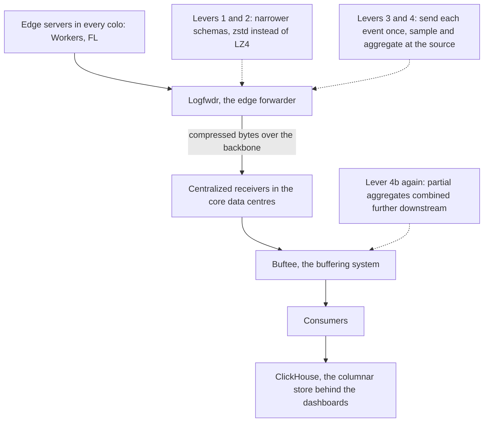
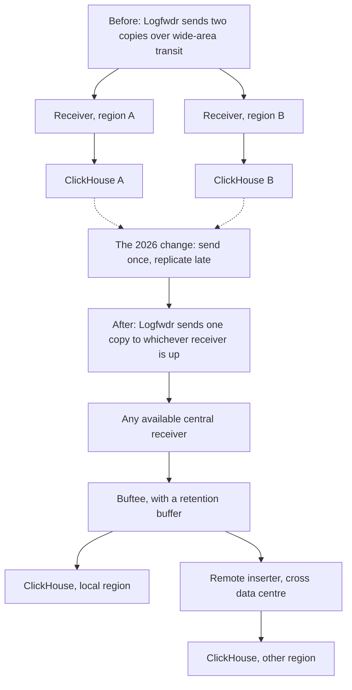
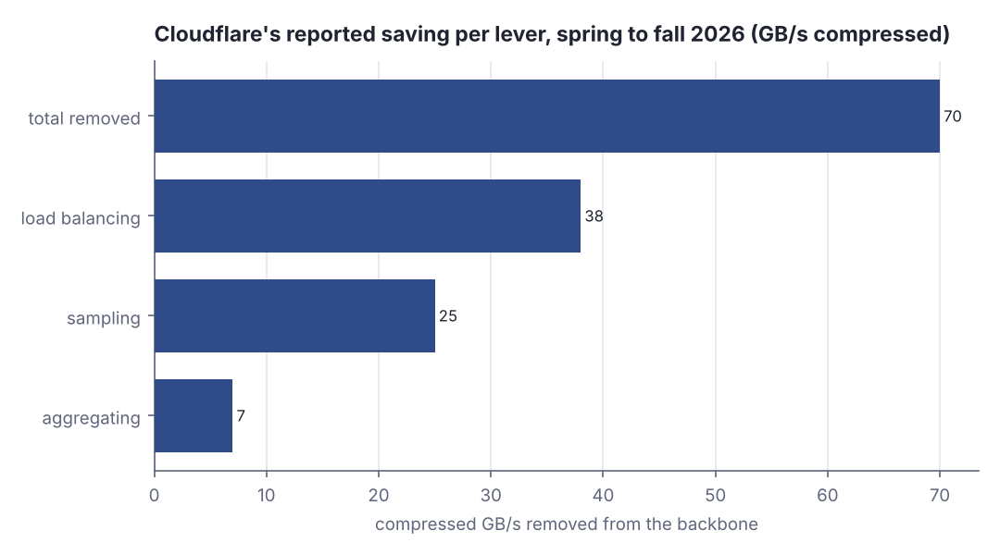
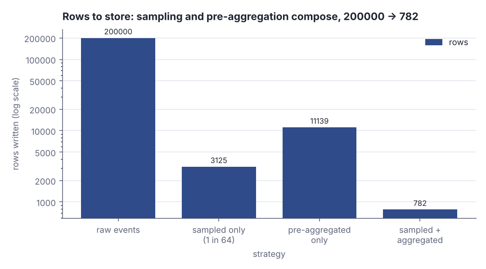
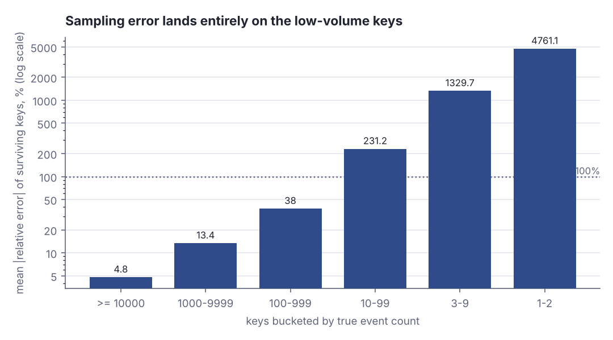

# Shrinking the firehose: four levers Cloudflare pulled on its telemetry pipeline

> Fresh · Software architecture & design · Intermediate · ~25 min · from today's feeds

## Why this matters
Today's item is "Rewinding the exponential: How we keep hardware usage down", published on the Cloudflare Blog on 2026-10-13 by Cathy Chi, Sergey Nuzhdin and Christian Endres of Cloudflare's Data team — a capacity post that names its levers and prints its numbers, about a pipeline that was delivering roughly two billion events per second in May 2026.
The engineering is interesting, but the decision is the lesson: faced with demand growing faster than the hardware budget, the team changed *what the system is asked to carry* instead of buying more of it, and then stated in public exactly which questions they can no longer answer as a result.
That is a product trade dressed as an infrastructure trade, and it is the kind you now sign off on rather than implement — so it belongs here, one level above your current architecture rung, with the pipeline vocabulary filled in first.

## Primer
**What a telemetry pipeline is.** A CDN like Cloudflare runs servers in hundreds of locations ("colos"). Every request those servers handle produces an *event* — a small record with the colo, the HTTP status, the host, the response time, the customer, and so on. Nobody queries those records where they are produced; they are shipped to a few central data centres so that dashboards, alerts and customer analytics can run over all of them at once. That shipping-and-landing machinery is the telemetry pipeline, and Cloudflare's has four named stages: **Logfwdr**, the forwarder that runs next to the producers at the edge; **centralized receivers**, which accept what Logfwdr sends; **Buftee**, a buffer the receivers write into; and **consumers**, which read Buftee and load the data into **ClickHouse** (Chi, Nuzhdin and Endres, Cloudflare, 2026-10-13, https://blog.cloudflare.com/rewinding-the-exponential/).

**Columnar store.** ClickHouse stores a table column by column rather than row by row, so a query that touches three columns of a trillion-row table reads only those three columns, and each column compresses well because neighbouring values are alike. It is what makes "count every 502 in Frankfurt last hour" cheap, and it is why the pipeline's unit of work is *rows written*.

**Compressed bytes on the backbone.** Cloudflare's own private network between its sites is the "backbone". Events are batched and compressed before they cross it, so the capacity number the team actually manages is **compressed bytes per second on the backbone** — not event counts, not raw size. Every figure in this lesson quoted in GB/s is compressed bytes per second.

**Sampling** means keeping only a fraction of the events — one in N — and multiplying what survives by N to estimate the whole. **Pre-aggregation** means replacing many event rows with one summary row per key per time window, for example "AMS, status 200, 14:00–14:01 → 1.2 M requests, 41 GB". Both shrink what travels; both throw information away, and the rest of this lesson is about which information.

## The idea
The frame the authors open with is not a technology problem, it is an arithmetic one:

> "Year after year, we tackle the same problem — exponential traffic growth against linear hardware growth."
>
> — Cathy Chi, Sergey Nuzhdin and Christian Endres, *Rewinding the exponential: How we keep hardware usage down*, 2026-10-13, https://blog.cloudflare.com/rewinding-the-exponential/

Two curves with different shapes always cross, so "add more receivers" is a schedule, not a fix. The only durable move is to reduce the work per unit of demand, and the post is a catalogue of four ways to do it, each acting at a different point in the same pipeline.



*Figure 1: the pipeline and where each lever acts — three of the four at the forwarder, before anything crosses the backbone. Source: Chi, Nuzhdin and Endres, Cloudflare, "Rewinding the exponential: How we keep hardware usage down", 2026-10-13, https://blog.cloudflare.com/rewinding-the-exponential/*

### Lever 1 — stop sending every field to everyone (2022)
The original design was one firehose: a single schema carrying every product's fields, so every consumer received every field whether it wanted it or not. Splitting it into product-specific schemas duplicates some fields across streams, which looks like it should cost bandwidth, and did not:

> "replacing this firehose with product-specific schemas actually reduced the backbone bandwidth usage by 35-40%"
>
> — Cathy Chi, Sergey Nuzhdin and Christian Endres, *Rewinding the exponential: How we keep hardware usage down*, 2026-10-13, https://blog.cloudflare.com/rewinding-the-exponential/

The duplicated fields are cheap; the empty ones were not. A shared schema makes every event carry placeholders for fields belonging to products that event has nothing to do with, and placeholders are still bytes once you count them a trillion times.

### Lever 2 — change the compression, not the data (2024)
The second lever changed nothing about what is sent, only how it is encoded on the wire: LZ4 gave way to zstd.

> "In the end, there was nearly a 40% reduction in compressed traffic throughput."
>
> — Cathy Chi, Sergey Nuzhdin and Christian Endres, *Rewinding the exponential: How we keep hardware usage down*, 2026-10-13, https://blog.cloudflare.com/rewinding-the-exponential/

The fear with any such swap is that you pay the bandwidth back in CPU at the edge; the post reports no noticeable CPU increase after rollout. The shape of that dial is easy to feel with the JDK's own deflate as a stand-in — same data, three effort levels:

```scala
val r = scala.util.Random(7)
val rows = Vector.fill(2000)(s"""{"c":"${r.nextInt(9)}","s":${200 + r.nextInt(300)}}""")
val raw = rows.mkString("\n").getBytes("UTF-8")
def squeeze(level: Int): Int =
  val d = java.util.zip.Deflater(level)
  d.setInput(raw)
  d.finish()
  val out = new Array[Byte](raw.length)
  try d.deflate(out) finally d.end()
for level <- Vector(1, 6, 9) do
  val n = squeeze(level)
  println(f"level $level%d: ${raw.length}%6d B -> $n%5d B  ${raw.length.toDouble / n}%4.1fx")
```

```text
level 1:  35999 B ->  6998 B   5.1x
level 6:  35999 B ->  5338 B   6.7x
level 9:  35999 B ->  5155 B   7.0x
```

Effort 1 to 6 buys 1.6x; 6 to 9 buys 0.3x more for a lot more work. That is why a codec change can be a free 40%: the gain is in the *algorithm*, not in turning the effort knob up, so you can take it without paying edge CPU for it.

### Lever 3 — stop sending the same event twice (2026)
Analytics must survive the loss of a region, so non-regional events live in two central regions. The original implementation bought that redundancy at the edge: Logfwdr sent two full copies over wide-area transit, one to each region. The 2026 change sends each event *once*, to whichever receiver is available, and makes the second copy inside the pipeline — a remote inserter streams it from Buftee to the other region's ClickHouse, catching up from Buftee's retention buffer after a backbone interruption.



*Figure 2: the same redundancy, moved from the expensive hop to the cheap one. Adapted from the before/after diagram in Cloudflare, "Rewinding the exponential: How we keep hardware usage down", https://blog.cloudflare.com/rewinding-the-exponential/*

The accounting is about 43 GB/s of transit removed against about 7 GB/s of replication added, a net reduction near 36 GB/s; replication now happens *after* sampling and after the central batches have been rebuilt over wider windows, so it carries less and compresses better (Chi, Nuzhdin and Endres, Cloudflare, 2026-10-13). The first stream cut over, HTTP analytics, gave back about 20 GB/s:

> "In mid-May, load balancing dropped traffic by 50%, plunging from ~26 GB/s to ~13 GB/s."
>
> — Cathy Chi, Sergey Nuzhdin and Christian Endres, *Rewinding the exponential: How we keep hardware usage down*, 2026-10-13, https://blog.cloudflare.com/rewinding-the-exponential/

### Lever 4 — sample and aggregate at the source (2026)
The receivers already sampled. The 2026 change moved sampling *in front of* the backbone hop, into Logfwdr itself, so the bytes are never sent at all:

> "Concretely, a total of 11.6 million events is represented by 18k rows in ClickHouse as opposed to 79k."
>
> — Cathy Chi, Sergey Nuzhdin and Christian Endres, *Rewinding the exponential: How we keep hardware usage down*, 2026-10-13, https://blog.cloudflare.com/rewinding-the-exponential/

Across the three top datasets that was about 25 GB/s. What you get back is an estimate: each survivor stands for N of its fellows, and you multiply. That arithmetic, on four real keys from this lesson's lab:

```scala
val rate = 64
def estimate(sampled: Int): Int = sampled * rate
val probes = Vector(("AMS/200/h001", 40837, 672), ("KBP/304/h001", 2531, 42),
                    ("FRA/500/h017", 26, 0), ("CDG/502/h200", 1, 0))
for (k, truth, kept) <- probes do
  val est = estimate(kept)
  val rel = 100.0 * (est - truth) / truth
  println(f"$k%-14s true=$truth%6d kept=$kept%4d est=$est%6d rel=$rel%+8.1f%%")
```

```text
AMS/200/h001   true= 40837 kept= 672 est= 43008 rel=    +5.3%
KBP/304/h001   true=  2531 kept=  42 est=  2688 rel=    +6.2%
FRA/500/h017   true=    26 kept=   0 est=     0 rel=  -100.0%
CDG/502/h200   true=     1 kept=   0 est=     0 rel=  -100.0%
```

The busy keys come back within a few percent; the quiet keys come back as zero, because the smallest non-zero estimate the scheme can produce is 64 and they never had 64 events. Sampling does not degrade accuracy evenly — it deletes the tail.

The twin lever is pre-aggregation, moved to the same place: combine partial aggregates at several stages, from Logfwdr through ClickHouse.

> "In just this one dataset alone, we dropped from 9+ GB/s to <2 GB/s in compressed bytes traffic."
>
> — Cathy Chi, Sergey Nuzhdin and Christian Endres, *Rewinding the exponential: How we keep hardware usage down*, 2026-10-13, https://blog.cloudflare.com/rewinding-the-exponential/

Aggregation keeps exact counts and loses the individual rows, which means it loses every question you did not decide to ask:

```scala
case class Ev(colo: String, code: Int, ms: Int)
val evs = Vector(Ev("AMS", 200, 12), Ev("AMS", 200, 480),
                 Ev("FRA", 500, 31), Ev("AMS", 200, 7))
val agg = evs.groupBy(e => (e.colo, e.code))
  .view.mapValues(g => (g.size, g.map(_.ms).sum)).toMap
println(s"raw rows = ${evs.size}, aggregated rows = ${agg.size}")
for ((colo, code), (n, ms)) <- agg.toVector.sortBy(-_._2._1) do
  println(f"  $colo%s/$code%d  requests=$n%d  total_ms=$ms%d  mean_ms=${ms.toDouble / n}%.1f")
println("  p99_ms per colo: not answerable from these rows")
```

```text
raw rows = 4, aggregated rows = 2
  AMS/200  requests=3  total_ms=499  mean_ms=166.3
  FRA/500  requests=1  total_ms=31  mean_ms=31.0
  p99_ms per colo: not answerable from these rows
```

Four rows became two, the counts are exact, and the mean is exact — but the 480 ms outlier has been averaged into 166.3 and cannot be recovered. Sum and count are additive, so they survive aggregation; a percentile is not, so it does not. The authors state the constraint plainly:

> "we answer a fixed set of questions exactly, provided we choose the dimensions and metrics up front"
>
> — Cathy Chi, Sergey Nuzhdin and Christian Endres, *Rewinding the exponential: How we keep hardware usage down*, 2026-10-13, https://blog.cloudflare.com/rewinding-the-exponential/

### What the four levers bought


*Figure 3: load balancing about 38 GB/s, sampling about 25 GB/s, aggregating about 7 GB/s, totalling about 70 GB/s removed from the backbone between spring and fall 2026. Adapted from the pipeline-wide savings reported in Cloudflare, "Rewinding the exponential: How we keep hardware usage down", https://blog.cloudflare.com/rewinding-the-exponential/; the post reports ~36 GB/s net for load balancing in its load-balancing section and ~38 GB/s in its impact summary, and this chart uses the latter. Every value is printed in Step 5 of the lab below.*

Together the 2026 levers "eliminated ~70 GB/s of compressed traffic from our backbone", and on the Ready-Analytics receivers the CPU and memory draw fell by "a ~50% reduction, regaining ~750 CPUs and 3.5 TiB of memory" (Chi, Nuzhdin and Endres, Cloudflare, 2026-10-13). In the only currency a capacity plan understands:

> "With these efforts, throughput is now roughly eight months behind its previously projected growth trajectory."
>
> — Cathy Chi, Sergey Nuzhdin and Christian Endres, *Rewinding the exponential: How we keep hardware usage down*, 2026-10-13, https://blog.cloudflare.com/rewinding-the-exponential/

which the authors price as "equivalent to deferring two and a half years of hardware expansion" (Chi, Nuzhdin and Endres, Cloudflare, 2026-10-13). And then, in the same section, the sentence that keeps the whole post honest — Ready-Analytics had dropped to about 13 GB/s in mid-May and was back near 20 GB/s two months later:

> "That's about half of the reduction, erased by organic traffic growth."
>
> — Cathy Chi, Sergey Nuzhdin and Christian Endres, *Rewinding the exponential: How we keep hardware usage down*, 2026-10-13, https://blog.cloudflare.com/rewinding-the-exponential/

An efficiency win against an exponential is a *translation of the curve*, not a change of its shape. Eight months is a real eight months, and it is also eight months.

## Lab
**Question: on a realistically skewed event stream, how many rows do sampling and pre-aggregation actually remove, and exactly which keys pay for it in accuracy?**

Run it with `python3 dojo/engine/run_lab.py 2026-11-04-2`, or save the program and run `scala Lab.scala`. One seed, no network, identical output every time. Nothing here reproduces Cloudflare's pipeline: the event stream is synthetic, the byte sizes are flat estimates, and the only claims are about how row counts and per-key accuracy move when you pull the two levers from the previous section.

### Step 1 — build a skewed stream
Draw 200,000 request events over a key space of 20,000 possible `(colo, status, host)` triples, with the probability of rank *k* proportional to *k*^−1.2 — a Zipf law, which is what request traffic over hosts and status codes actually looks like. Print the busiest keys with their share of the stream, and count how many keys carry almost nothing.

### Step 2 — sample one event in 64 and scale back up
Keep every 64th event (a counter, which is how a real forwarder does head sampling cheaply), then estimate each key's count as `sampled × 64`. Print true count, sampled count, estimate, absolute error and relative error for five high-volume keys and five long-tail keys.

### Step 3 — count rows and bytes under four strategies
Raw events; sampled only; pre-aggregated only (one row per key seen); sampled *and* aggregated. Print rows, estimated compressed bytes at 180 B per raw row and 220 B per aggregate row, and the share of the raw byte count.

### Step 4 — find where the error lands
Bucket the keys by their true volume and print, per bucket, how many keys it holds, how many events, how many keys vanished from the sample entirely, and the mean absolute relative error of the ones that survived.

### Step 5 — print the published numbers
So that every value in Figure 3 appears in this lesson's own output.

```scala
// file: Lab.scala
// What do sampling and pre-aggregation actually cost you, in rows and in accuracy?
// A synthetic request-event stream with a Zipf-skewed key space, one fixed seed.
// Modelled on the levers in Cathy Chi, Sergey Nuzhdin and Christian Endres,
// "Rewinding the exponential: How we keep hardware usage down", 2026-10-13,
// https://blog.cloudflare.com/rewinding-the-exponential/

val NEVENT = 200000     // synthetic request events in the window
val NKEY   = 20000      // distinct (colo, status, host) keys available
val RATE   = 64         // head sampling: keep 1 event in 64
val ZIPF   = 1.20       // skew of the key distribution
val RAWB   = 180        // estimated compressed bytes of one raw event row
val AGGB   = 220        // estimated compressed bytes of one pre-aggregated row

val colos = Vector("AMS", "FRA", "WAW", "KBP", "LHR", "CDG")
val codes = Vector(200, 304, 404, 500, 502)
def keyName(k: Int): String =
  val colo = colos(k % colos.size)
  val code = codes((k / colos.size) % codes.size)
  val host = f"h${k / (colos.size * codes.size) + 1}%03d.example"
  f"$colo%s/$code%d/$host%s"

// Zipf weights over the key ranks: rank 1 is the busiest key, rank NKEY the rarest.
val weight = Array.tabulate(NKEY)(k => math.pow(k + 1.0, -ZIPF))
val total  = weight.sum
val cum: Array[Double] =
  val c = Array.ofDim[Double](NKEY)
  var acc = 0.0
  for k <- 0 until NKEY do
    acc += weight(k) / total
    c(k) = acc
  c

def pick(u: Double): Int =
  var lo = 0; var hi = NKEY - 1
  while lo < hi do
    val mid = (lo + hi) / 2
    if cum(mid) < u then lo = mid + 1 else hi = mid
  lo

val trueC = Array.fill(NKEY)(0)   // exact count per key
val sampC = Array.fill(NKEY)(0)   // count per key among the sampled events

@main def lab(): Unit =
  val rng = scala.util.Random(20261104)
  var seen = 0
  var kept = 0
  for _ <- 0 until NEVENT do
    val k = pick(rng.nextDouble())
    trueC(k) += 1
    seen += 1
    if seen % RATE == 0 then { sampC(k) += 1; kept += 1 }   // keep every RATE-th event

  val seenAll  = (0 until NKEY).count(k => trueC(k) > 0)
  val seenSamp = (0 until NKEY).count(k => sampC(k) > 0)

  println("Sampling and pre-aggregation on 200,000 synthetic request events")
  println()

  println(s"Step 1 - the key space is skewed: ${NKEY} keys available, $seenAll actually seen")
  println("   rank  key                      true count   share of stream")
  for r <- Vector(1, 2, 3, 5, 10) do
    val k = r - 1
    println(f"  $r%5d  ${keyName(k)}%-22s  ${trueC(k)}%10d   ${100.0 * trueC(k) / NEVENT}%6.3f%%")
  val top10 = (0 until 10).map(trueC).sum
  println(f"  top 10 keys carry ${top10}%d of $NEVENT%d events (${100.0 * top10 / NEVENT}%.2f%%)")
  val tailKeys = (0 until NKEY).filter(k => trueC(k) > 0 && trueC(k) <= 2)
  println(f"  ${tailKeys.size}%d of the $seenAll%d seen keys carry 1 or 2 events each")
  println()

  println(s"Step 2 - head sampling at 1 in $RATE, then scale the survivors back up")
  println("   rank  key                      true   sampled   estimate   abs err   rel err")
  val probe = Vector(1, 2, 3, 5, 10, 500, 2000, 6000, 12000, 18000)
  for r <- probe do
    val k = r - 1
    val est = sampC(k) * RATE
    val err = est - trueC(k)
    val rel = if trueC(k) == 0 then "   n/a" else f"${100.0 * err / trueC(k)}%+6.1f%%"
    println(f"  $r%5d  ${keyName(k)}%-22s ${trueC(k)}%6d  ${sampC(k)}%7d  ${est}%9d  ${err}%+8d  $rel%7s")
  println(f"  kept $kept%d of $NEVENT%d events (exactly 1 in $RATE%d)")
  val estTotal = (0 until NKEY).map(sampC).sum * RATE
  println(f"  stream total: true $NEVENT%d, estimated $estTotal%d, rel err ${100.0 * (estTotal - NEVENT) / NEVENT}%+.2f%%")
  println()

  println("Step 3 - rows and estimated compressed bytes under the four strategies")
  println("  strategy                       rows   est. bytes   bytes vs raw   answers exact counts?")
  val strategies = Vector(
    ("raw events",            NEVENT,   NEVENT.toLong * RAWB, "yes, per event"),
    ("sampled only",          kept,     kept.toLong * RAWB,   "no, scaled estimates"),
    ("pre-aggregated only",   seenAll,  seenAll.toLong * AGGB, "yes, for the chosen key"),
    ("sampled + aggregated",  seenSamp, seenSamp.toLong * AGGB, "no, scaled estimates"))
  val rawBytes = NEVENT.toLong * RAWB
  for (name, rows, bytes, exact) <- strategies do
    println(f"  $name%-22s  ${rows}%9d  ${bytes}%11d   ${100.0 * bytes / rawBytes}%11.2f%%   $exact%s")
  println(f"  pre-aggregation alone: $NEVENT%d events -> $seenAll%d rows (${NEVENT.toDouble / seenAll}%.1fx fewer)")
  println(f"  sampling first:        $NEVENT%d events -> $seenSamp%d rows instead of $seenAll%d")
  println()

  println("Step 4 - where the sampling error lands: keys bucketed by true volume")
  println("  volume bucket      keys   total events   keys lost   mean |rel err| of survivors")
  val edges = Vector((10000, Int.MaxValue), (1000, 9999), (100, 999), (10, 99), (3, 9), (1, 2))
  val names = Vector(">= 10000", "1000-9999", "100-999", "10-99", "3-9", "1-2")
  for i <- edges.indices do
    val (lo, hi) = edges(i)
    val ks = (0 until NKEY).filter(k => trueC(k) >= lo && trueC(k) <= hi)
    val ev = ks.map(trueC).sum
    val lost = ks.count(k => sampC(k) == 0)
    val surv = ks.filter(k => sampC(k) > 0)
    val mre = if surv.isEmpty then "    n/a"
              else f"${surv.map(k => math.abs(100.0 * (sampC(k) * RATE - trueC(k)) / trueC(k))).sum / surv.size}%6.1f%%"
    println(f"  ${names(i)}%-14s  ${ks.size}%6d   ${ev}%12d   ${lost}%9d   $mre%21s")
  println()

  println("Step 5 - the published numbers this models (Chi, Nuzhdin and Endres, 2026-10-13)")
  println("  lever                         reported saving")
  for (lever, gbs) <- Vector(("load balancing", 38.0), ("sampling", 25.0), ("aggregating", 7.0)) do
    println(f"  $lever%-26s  ${gbs}%6.1f GB/s compressed")
  println(f"  total removed from backbone    ${70.0}%6.1f GB/s compressed")
  println("  Ready-Analytics receivers: ~750 CPUs and 3.5 TiB of memory regained (~50%)")
  println("  ClickHouse rows for one window: 18k with sampling first, 79k without")
  println(f"  this lab's analogue:        ${seenSamp}%d rows with sampling first, ${seenAll}%d without")
```

```text
Sampling and pre-aggregation on 200,000 synthetic request events

Step 1 - the key space is skewed: 20000 keys available, 11139 actually seen
   rank  key                      true count   share of stream
      1  AMS/200/h001.example         40837   20.419%
      2  FRA/200/h001.example         17740    8.870%
      3  WAW/200/h001.example         10888    5.444%
      5  LHR/200/h001.example          5850    2.925%
     10  KBP/304/h001.example          2531    1.266%
  top 10 keys carry 100618 of 200000 events (50.31%)
  7324 of the 11139 seen keys carry 1 or 2 events each

Step 2 - head sampling at 1 in 64, then scale the survivors back up
   rank  key                      true   sampled   estimate   abs err   rel err
      1  AMS/200/h001.example    40837      672      43008     +2171    +5.3%
      2  FRA/200/h001.example    17740      298      19072     +1332    +7.5%
      3  WAW/200/h001.example    10888      173      11072      +184    +1.7%
      5  LHR/200/h001.example     5850       89       5696      -154    -2.6%
     10  KBP/304/h001.example     2531       42       2688      +157    +6.2%
    500  FRA/500/h017.example       26        0          0       -26  -100.0%
   2000  FRA/500/h067.example        5        0          0        -5  -100.0%
   6000  CDG/502/h200.example        1        0          0        -1  -100.0%
  12000  CDG/502/h400.example        1        0          0        -1  -100.0%
  18000  CDG/502/h600.example        0        0          0        +0      n/a
  kept 3125 of 200000 events (exactly 1 in 64)
  stream total: true 200000, estimated 200000, rel err +0.00%

Step 3 - rows and estimated compressed bytes under the four strategies
  strategy                       rows   est. bytes   bytes vs raw   answers exact counts?
  raw events                 200000     36000000        100.00%   yes, per event
  sampled only                 3125       562500          1.56%   no, scaled estimates
  pre-aggregated only         11139      2450580          6.81%   yes, for the chosen key
  sampled + aggregated          782       172040          0.48%   no, scaled estimates
  pre-aggregation alone: 200000 events -> 11139 rows (18.0x fewer)
  sampling first:        200000 events -> 782 rows instead of 11139

Step 4 - where the sampling error lands: keys bucketed by true volume
  volume bucket      keys   total events   keys lost   mean |rel err| of survivors
  >= 10000             3          69465           0                    4.8%
  1000-9999           19          49297           0                   13.4%
  100-999            125          34209           7                   38.0%
  10-99              951          25141         629                  231.2%
  3-9               2717          12414        2528                 1329.7%
  1-2               7324           9474        7193                 4761.1%

Step 5 - the published numbers this models (Chi, Nuzhdin and Endres, 2026-10-13)
  lever                         reported saving
  load balancing                38.0 GB/s compressed
  sampling                      25.0 GB/s compressed
  aggregating                    7.0 GB/s compressed
  total removed from backbone      70.0 GB/s compressed
  Ready-Analytics receivers: ~750 CPUs and 3.5 TiB of memory regained (~50%)
  ClickHouse rows for one window: 18k with sampling first, 79k without
  this lab's analogue:        782 rows with sampling first, 11139 without
```

### Reading the output

**Step 1 — the stream.** `true count` is how many of the 200,000 events carried that key; `share of stream` is that count over 200,000. The distribution is the point: higher concentration at the head means sampling has more to work with.

| rank | key | true count | share |
|---|---|---|---|
| 1 | AMS/200/h001.example | 40837 | 20.419% |
| 2 | FRA/200/h001.example | 17740 | 8.870% |
| 3 | WAW/200/h001.example | 10888 | 5.444% |
| 5 | LHR/200/h001.example | 5850 | 2.925% |
| 10 | KBP/304/h001.example | 2531 | 1.266% |

Ten keys out of 20,000 carry 100,618 events, 50.31% of the stream; at the other end, 7,324 of the 11,139 keys that appeared at all carry one or two events each. Only 11,139 of the 20,000 possible keys were seen, so 8,861 never occurred.

**Verdict: two thirds of the keys that exist in this stream are statistically invisible — 7,324 keys sharing 9,474 events — while ten keys hold half of it. Every number below follows from that one fact.**

**Step 2 — sampling.** `sampled` is how many of that key's events survived the 1-in-64 counter; `estimate` is `sampled × 64`; `rel err` is `(estimate − true) / true`, and closer to zero is better.

| rank | key | true | sampled | estimate | rel err |
|---|---|---|---|---|---|
| 1 | AMS/200/h001.example | 40837 | 672 | 43008 | +5.3% |
| 2 | FRA/200/h001.example | 17740 | 298 | 19072 | +7.5% |
| 3 | WAW/200/h001.example | 10888 | 173 | 11072 | +1.7% |
| 5 | LHR/200/h001.example | 5850 | 89 | 5696 | −2.6% |
| 10 | KBP/304/h001.example | 2531 | 42 | 2688 | +6.2% |
| 500 | FRA/500/h017.example | 26 | 0 | 0 | −100.0% |
| 2000 | FRA/500/h067.example | 5 | 0 | 0 | −100.0% |
| 6000 | CDG/502/h200.example | 1 | 0 | 0 | −100.0% |
| 12000 | CDG/502/h400.example | 1 | 0 | 0 | −100.0% |

Trace rank 3 by hand: 173 survivors × 64 = 11,072 against a true 10,888, so the error is 11,072 − 10,888 = +184, and 184 / 10,888 = 0.0169 = +1.7%. Now trace rank 500: 26 events, zero survivors, estimate 0 × 64 = 0, error −26 out of 26 = −100.0%. The granularity of the estimator is 64: it can report 0, or 64, or 128, and nothing in between, so any key whose true count is well under 64 is reported either as absent or as a number several times too large. Note also that the *stream total* is exact — 3,125 kept × 64 = 200,000, +0.00% — because a counter samples exactly one in 64. Accuracy at the top is free; accuracy at the bottom is gone.

**Verdict: sampling is not a uniform loss of precision. The stream total is exact, the top five keys land within 7.5%, and every key under about 64 events is reported as zero.**

**Step 3 — what it saves.**

| strategy | rows | est. bytes | bytes vs raw | exact counts? |
|---|---|---|---|---|
| raw events | 200000 | 36000000 | 100.00% | yes, per event |
| sampled only | 3125 | 562500 | 1.56% | no, scaled estimates |
| pre-aggregated only | 11139 | 2450580 | 6.81% | yes, for the chosen key |
| sampled + aggregated | 782 | 172040 | 0.48% | no, scaled estimates |

Pre-aggregation alone turns 200,000 events into 11,139 rows, 18.0× fewer, *with exact counts* — it is the lever that costs no accuracy at all on the dimensions you kept. Sampling first changes the aggregate from 11,139 rows to 782, because a key with two events almost always loses both and stops producing a row. That is the same mechanism as Cloudflare's "18k rows in ClickHouse as opposed to 79k" (Chi, Nuzhdin and Endres, Cloudflare, 2026-10-13), at a different scale: the saving is not that each surviving key is cheaper, it is that most keys stop existing.



*Figure 4: 200,000 raw rows, 11,139 pre-aggregated, 3,125 sampled, 782 sampled and aggregated. Log scale, because the span is more than two orders of magnitude. Generated from the Step 3 lab output above (`python3 dojo/engine/run_lab.py 2026-11-04-2`).*

**Verdict: pre-aggregation is the cheap lever — 18.0× fewer rows with exact counts — and sampling on top of it is a further 14.2× that you pay for entirely in the tail.**

**Step 4 — the bill, itemised by key size.** `keys lost` is how many keys in that bucket got zero sampled events and therefore disappear; `mean |rel err|` is averaged over the keys that did survive, so it understates the damage by excluding the lost ones.

| volume bucket | keys | total events | keys lost | mean abs rel err |
|---|---|---|---|---|
| ≥ 10000 | 3 | 69465 | 0 | 4.8% |
| 1000–9999 | 19 | 49297 | 0 | 13.4% |
| 100–999 | 125 | 34209 | 7 | 38.0% |
| 10–99 | 951 | 25141 | 629 | 231.2% |
| 3–9 | 2717 | 12414 | 2528 | 1329.7% |
| 1–2 | 7324 | 9474 | 7193 | 4761.1% |



*Figure 5: mean absolute relative error climbs from 4.8% on the three busiest keys to 4761.1% on the keys with one or two events — three orders of magnitude across the same single sampling rate. Generated from the Step 4 lab output above (`python3 dojo/engine/run_lab.py 2026-11-04-2`).*

Check the worst bucket against Step 2's arithmetic: a key with 1 event either loses it (estimate 0, error −100%) or keeps it (estimate 64, error +6300%). Averaging those over the 131 survivors of 7,324 is how you get 4761.1%. Meanwhile 22 keys out of 11,139 — the top two buckets — carry 118,762 events, 59.4% of the stream, at under 14% error.

**Verdict: one sampling rate produces 4.8% error on the traffic that matters and useless numbers on the traffic that does not, which is precisely the bargain. It is a good bargain if and only if nobody needs the tail.**

### Cause → mechanism → consequence → what it means
1. **Cause.** Demand grows exponentially and the hardware budget grows linearly, so capacity bought at today's rate is consumed at tomorrow's — "exponential traffic growth against linear hardware growth" (Chi, Nuzhdin and Endres, Cloudflare, 2026-10-13).
2. **Mechanism.** Each lever removes a different kind of waste at a different stage: fields nobody reads (product-specific schemas, 35–40% of backbone bandwidth), bytes an older codec could not pack (zstd, nearly 40%), copies sent over the expensive hop instead of the cheap one (send once and replicate from Buftee, about 36 GB/s net), and rows nobody will ever look at individually (sampling and pre-aggregation moved into Logfwdr, about 25 GB/s and 7+ GB/s). The first three cost nothing in answers; only the fourth does.
3. **Consequence.** About 70 GB/s of compressed backbone traffic gone, about 750 CPUs and 3.5 TiB of memory returned on the Ready-Analytics receivers, and throughput roughly eight months behind its projected curve — about two and a half years of deferred hardware expansion (Chi, Nuzhdin and Endres, Cloudflare, 2026-10-13). The price is exactly what the lab prints: exact totals, a few percent on high-volume keys, nothing usable below roughly one sampling interval, and no ad hoc query on any dimension that was not pre-aggregated.
4. **What it means in practice.** Order your levers by what they cost in answers, not by what they save in bytes: schema narrowing and codec changes are free, routing changes cost operational complexity (remote inserters, retention buffers, a dependency on replication to keep both regions whole), and sampling and pre-aggregation cost product scope. The last one is the only one that reaches your customers, so it is the only one that is your decision rather than an engineering one — and the question to ask is not "what accuracy do we lose", it is "which keys are we about to stop being able to see at all", because that is where the loss is concentrated. Then budget for the fact that growth eats the win: half of the Ready-Analytics gain was gone in two months, so an efficiency programme buys a dated extension, not a solved problem.

## Self-check
1. The post reports that replacing one monolithic schema with several product-specific schemas cut backbone bandwidth by 35–40%, even though fields are now duplicated across streams. Why does duplication not make it worse? <details><summary>Answer</summary>Because the duplicated fields are a small, fixed set — identifiers and timestamps shared by several products — while the fields the monolith forced on every event were a large, mostly empty set. In a single schema covering every product, each event must carry a slot for every product's fields, including the ones irrelevant to that event; those slots are placeholders, and a placeholder is still bytes on the wire once you multiply by roughly two billion events per second. Splitting the schema means an event carries only its own product's fields plus a handful of shared ones. The post's own figure is that "replacing this firehose with product-specific schemas actually reduced the backbone bandwidth usage by 35-40%" (Chi, Nuzhdin and Endres, Cloudflare, 2026-10-13, https://blog.cloudflare.com/rewinding-the-exponential/). The general shape: wide sparse records compress and transmit worse than narrow dense ones, and sharing a schema across unrelated consumers is how records get wide and sparse.</details>
2. A customer dashboard built on a 1-in-64 sampled, pre-aggregated dataset shows "502 errors: 0" for a small host, and separately cannot show p99 latency per colo at all. Explain which lever caused each symptom and whether either can be fixed without re-sending the data. <details><summary>Answer</summary>Two different losses. The "0" is sampling: the estimator's quantum is 64, so a key with fewer than roughly 64 events in the window is reported either as absent or as 64-and-up. In the lab, every probed key with a true count of 26, 5 or 1 came back as 0, a −100.0% relative error, and the 1–2 event bucket averages 4761.1% absolute relative error over the keys that survived at all. It cannot be fixed downstream — the events were discarded at Logfwdr before they crossed the backbone — only by sampling that dataset less aggressively, or not at all for low-volume customers. The missing p99 is pre-aggregation: a percentile is not additive, so it cannot be reconstructed from per-key counts and sums the way a mean can. The lab shows this with four events where a 480 ms outlier is averaged into a mean of 166.3 and is unrecoverable. Its fix is also upstream, because "we answer a fixed set of questions exactly, provided we choose the dimensions and metrics up front" (Chi, Nuzhdin and Endres, Cloudflare, 2026-10-13, https://blog.cloudflare.com/rewinding-the-exponential/) — you would have to add a sketch or a quantile digest to the aggregate and start computing it at the source.</details>
3. Your own service's telemetry bill is growing faster than its budget. Using this post's four levers, in what order would you evaluate them, and what would you require before approving the last one? <details><summary>Answer</summary>In increasing order of what they cost in answers, which is the opposite of the order they appear in a bytes-saved chart. First, narrow the schema: stop shipping fields no consumer reads, and split shared streams into per-consumer ones — Cloudflare got 35–40% of backbone bandwidth back and gave up nothing. Second, change the codec: nearly 40% for Cloudflare with no noticeable CPU increase after rollout, and no change to what any query can answer. Third, stop paying for redundancy on the expensive hop: send each event once and replicate late, which cost about 43 GB/s of transit against about 7 GB/s added, a net 36 GB/s — this one is free in answers but not in operations, since it adds remote inserters, a retention buffer for backbone interruptions, and a dependency on the replication layer to keep both regions complete. Only then sampling and pre-aggregation, because they are the only levers that change the product. Before approving them I would require three things: a named list of the dimensions and metrics to pre-aggregate, since anything else becomes unanswerable; the sampling rate expressed as "the smallest key we can still see", not as a percentage, because the error is concentrated entirely in the tail — 4.8% on the busiest keys against 4761.1% on the rarest in the lab; and a growth forecast against the saving, since half of Cloudflare's Ready-Analytics gain was "about half of the reduction, erased by organic traffic growth" (Chi, Nuzhdin and Endres, Cloudflare, 2026-10-13, https://blog.cloudflare.com/rewinding-the-exponential/) within two months.</details>

## Sources
- [Rewinding the exponential: How we keep hardware usage down](https://blog.cloudflare.com/rewinding-the-exponential/) — Cathy Chi, Sergey Nuzhdin and Christian Endres, Cloudflare Data team, The Cloudflare Blog, published 2026-10-13 (page metadata lists a 2026-10-14 modification) — the primary and only source for every claim in this lesson: the pipeline stages (Logfwdr, centralized receivers, Buftee, consumers, ClickHouse) and the roughly two billion events per second in May 2026; the 2022 schema split and its 35–40% backbone bandwidth reduction; the 2024 LZ4-to-zstd move and its nearly 40% reduction in compressed throughput with no noticeable CPU increase; the 2026 load-balancing cutover (about 43 GB/s of transit removed against about 7 GB/s of replication added, about 20 GB/s on HTTP analytics, Ready-Analytics from about 28 to about 16 GB/s, and the mid-May 26 → 13 GB/s halving), with its remote inserters and Buftee retention buffer; sampling moved into Logfwdr (11.6 million events as 18k ClickHouse rows instead of 79k, about 25 GB/s across the three top datasets); pre-aggregation moved earlier (one dataset from 9+ GB/s to under 2 GB/s) and the "fixed set of questions" constraint; and the impact figures — about 70 GB/s removed, about 750 CPUs and 3.5 TiB of memory regained in a roughly 50% reduction, throughput about eight months behind its projected trajectory, about two and a half years of deferred hardware expansion, and the admission that organic growth erased about half of the Ready-Analytics gain within two months. All nine passages quoted above were fetched and checked word for word on 2026-11-04 (accessed 2026-11-04). Cloudflare's blog artwork is not openly licensed, so Figures 2 and 3 are redrawn adaptations rather than downloaded images.

## Next on this track
Fresh lessons sit outside the ladder; next on Software architecture & design: **SOLID in practice I — SRP, OCP, LSP** (rung 3 of 20, Beginner).
