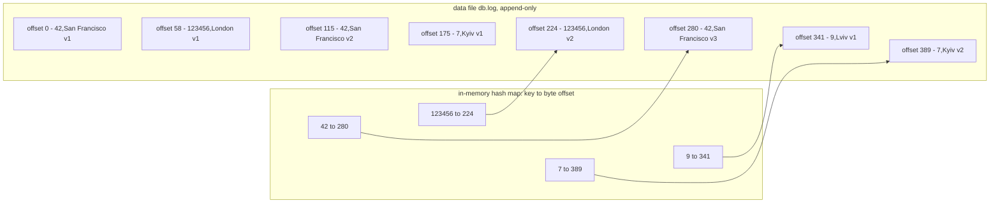
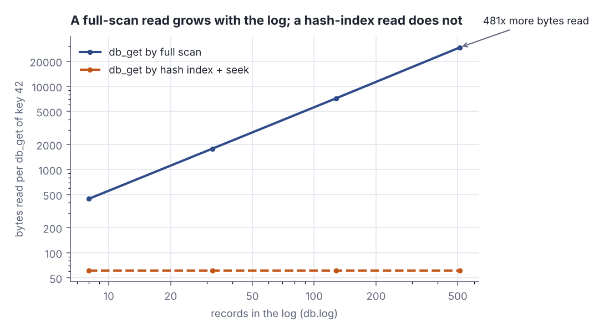
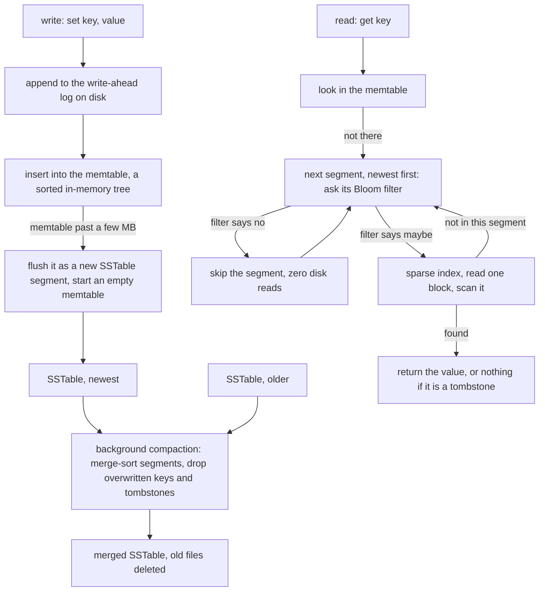

# Log-structured storage — hash indexes, SSTables and LSM-trees

> Designing Data-Intensive Applications · Beginner · ~25 min · rung 4 of 26 · needs: Reliability, scalability, maintainability — the three concerns (ddia-01)

## Why this matters
Every storage engine you actually operate — Cassandra, RocksDB under Kafka Streams, Lucene under Elasticsearch — is assembled from the moves in this half-chapter, and all of them fall out of one fact: appending to a file is cheap and random writes are not.
When a cluster doubles its disk use overnight, or reads slow down after a bulk load while writes stay fast, the answer is compaction, and compaction means nothing until the memtable-and-SSTable picture is concrete.
It sits here because the next rung puts LSM-trees next to B-trees, and that comparison is empty unless you can derive the log-structured side yourself.

## The idea

> Chapter map: Designing Data-Intensive Applications (Kleppmann, 1st ed., O'Reilly 2017), ch. 3 "Storage and Retrieval", first half — §3.1 "Data Structures That Power Your Database", §3.1.1 "Hash Indexes", §3.1.2 "SSTables and LSM-Trees" with §3.1.2.1 "Constructing and maintaining SSTables", §3.1.2.2 "Making an LSM-tree out of SSTables" and §3.1.2.3 "Performance optimizations". The § numbers are positional: DDIA does not number its sections. https://dataintensive.net/

### §3.1 Data Structures That Power Your Database
The chapter splits storage engines into log-structured and page-oriented (B-tree) families, on the grounds that you need enough internals to pick and tune one, not to write one. It starts from the world's simplest database, two Bash functions (Kleppmann, DDIA ch. 3, "Data Structures That Power Your Database"):

```bash
db_set () { echo "$1,$2" >> database; }
db_get () { grep "^$1," database | sed -e "s/^$1,//" | tail -n 1; }
```

`db_set` appends a `key,value` line; `db_get` keeps the **last** line for the key, because a later append supersedes an earlier one instead of editing it. The file is a **log**: an append-only sequence of records, a storage-engine data file rather than what your service prints. `db_set` performs genuinely well, appending sequentially; `db_get` is O(n).

```scala
def dbSet(key: String, value: String): (Long, Int) =
  val rec = s"$key,$value\n".getBytes(UTF_8)
  val off = Files.size(log)                       // append point = current end of file
  Files.write(log, rec, StandardOpenOption.APPEND)
  index(key) = (off, rec.length)                  // the hash index of §3.1.1
  (off, rec.length)
```

```text
 #  key      offset  len file bytes
 1  42            0   58         58
 2  123456       58   57        115
 3  42          115   60        175
 4  7           175   49        224
 5  123456      224   56        280
 6  42          280   61        341
 7  9           341   48        389
 8  7           389   56        445
```

Eight writes over four keys and the file only grows: key 42 lands at offsets 0, 115 and 280, and the old bytes just stop being the answer.

The fix for `db_get` is an **index**: an *additional* structure derived from the primary data, so adding or dropping one changes query speed, never contents. Hence the chapter's central trade-off — indexes speed reads and slow writes — which is why databases index nothing by default (Kleppmann, DDIA ch. 3, "Data Structures That Power Your Database").

### §3.1.1 Hash Indexes
The simplest index for a key-value store: an in-memory hash map from key to the **byte offset** of that key's latest record. Each append updates the map; each read looks up the offset, seeks, reads one record. **Bitcask**, Riak's default engine, is exactly this, and it suits many writes per key with few distinct keys — the book's example counts plays per video URL. Values may exceed RAM, since one seek fetches a value; keys may not, because the map is memory-resident (Kleppmann, DDIA ch. 3, "Hash Indexes").


*Figure 1: an append-only key-value log with a hash map of each key's latest byte offset; all three records for key 42 stay on disk, only the newest is pointed at. Adapted from Kleppmann, DDIA ch. 3, "Hash Indexes", https://dataintensive.net/*

Reading through that map instead of scanning changes what a lookup costs:

```scala
Vector("42", "123456", "7", "9").foreach { k =>
  val (vs, scanned, hits) = dbGetScan(k)   // read every line, keep the last match
  val (vi, read) = dbGetIndexed(k)         // hash map -> seek -> read one record
  assert(vs == vi, s"scan and index disagree on $k")
  val ratio = scanned.toDouble / read
  println(f"$k%-7s $hits%4d $scanned%7d $read%7d $ratio%6.1fx  ${vs.get.take(30)}")
}
```

```text
42         3     445      61    7.3x  {"name":"San Francisco","attra
123456     2     445      56    7.9x  {"name":"London","attractions"
7          2     445      56    7.9x  {"name":"Kyiv","attractions":[
9          1     445      48    9.3x  {"name":"Lviv","attractions":[
```

Both paths return the same value, but the scan touches all 445 bytes for every key while the index touches one record: the scan column is the file size, the seek column a record length that stays put as the log grows.


*Figure 2: the same lookup of key 42 at four log sizes. Generated from the Step 3 output of `python3 dojo/engine/run_lab.py 2026-11-05-1`.*

A file that only grows is the obvious objection, answered with **segments**: close the log at a certain size, start a new one, **compact** each segment down to the latest update per key, and **merge** several compacted segments at once. Segments are immutable once written, so a background thread writes the merge to a new file while reads continue from the old segments, which are swapped out and deleted afterwards; each segment keeps its own hash map, and a lookup tries the newest first (Kleppmann, DDIA ch. 3, "Hash Indexes").

Four engineering details follow. A binary format with a length prefix beats CSV and its escaping. A **delete** is an appended **tombstone** telling the merge to discard earlier values for that key. **Crash recovery** must not mean re-reading every segment to rebuild the maps, so Bitcask snapshots each hash map to disk; a crash mid-append leaves a **partially written record**, which checksums let the engine ignore. Concurrency is easy — one writer appends, many readers share the immutable segments — and append-only also beats overwriting because sequential writes are faster and merging prevents fragmentation.

Two limitations motivate the next section: the hash table must fit in memory (on disk it means random I/O, costly growth, collision handling), and **range queries are inefficient** — `key00000` to `key99999` means looking up every key separately (Kleppmann, DDIA ch. 3, "Hash Indexes").

### §3.1.2 SSTables and LSM-Trees
Change one requirement: each segment is **sorted by key**, each key appearing once — which compaction already guarantees. That is a **Sorted String Table**, an SSTable, and it buys three things (Kleppmann, DDIA ch. 3, "SSTables and LSM-Trees"). First, merging is simple and efficient even for files bigger than memory: walk the inputs side by side like mergesort's merge step, copy the lowest key, and on a tie keep the most recent segment's value.

```scala
val c = older(i)._1.compare(newer(j)._1)
if c < 0 then { out += older(i); i += 1 }        // the older segment has the lower key
else if c > 0 then { out += newer(j); j += 1 }   // the newer segment has the lower key
else { out += newer(j); i += 1; j += 1 }         // same key: the newer segment wins
```

```text
   step 1: emit   123456  = London/v2   (newer is lower)
   step 2: emit   42      = SF/v2       (same key: newer wins)
   step 3: emit   7       = Kyiv/v1     (older is lower)
   step 4: emit   9       = Lviv/v2     (newer is lower)
   step 5: drop   99      = <tombstone> (same key: newer wins)
```

Five steps consumed seven records on two cursors: key 42 collapsed to the newer value, key 99's tombstone removed the older record.

Second, no in-memory index of all keys is needed: sorting allows a **sparse index** — one key every few kilobytes with its offset — since you jump to the nearest smaller key and scan forward. Third, as a read scans a range anyway, records are grouped into a **block** and compressed before writing, each sparse entry pointing at a block start, saving space and I/O bandwidth.

#### §3.1.2.1 Constructing and maintaining SSTables
Sorting on disk is possible (that is B-trees); sorting in memory is easier, with a red-black or AVL tree that takes keys in any order and returns them sorted. Each write goes into that tree, the **memtable**; past a few megabytes it is written out as an SSTable, the newest segment, while writes continue into a fresh memtable. A read tries the memtable, then segments newest-first; background compaction combines segments and drops overwritten and deleted values. A crash would lose the memtable, so every write first goes to a separate unsorted **write-ahead log**, whose only job is restoring the memtable and which is discarded once that memtable is flushed (Kleppmann, DDIA ch. 3, "Constructing and maintaining SSTables").


*Figure 3: the LSM write path (WAL, memtable, flush, compaction) and read path (memtable, then segments newest-first). Source: Kleppmann, DDIA ch. 3, "Constructing and maintaining SSTables", "Performance optimizations".*

#### §3.1.2.2 Making an LSM-tree out of SSTables
That algorithm is LevelDB and RocksDB, and the same memtable-plus-SSTables design runs Cassandra and HBase, both inspired by Google's Bigtable paper, which introduced the terms SSTable and memtable. O'Neil et al. first described it as the Log-Structured Merge-Tree, so engines built on merging and compacting sorted files are **LSM storage engines**; Lucene, inside Elasticsearch and Solr, applies it to its term dictionary of term-to-document lists. Compaction strategy is the knob: **size-tiered** merges newer, smaller SSTables into older, larger ones, while **leveled** splits the key range into smaller SSTables across levels, compacting incrementally on less disk space — LevelDB and RocksDB leveled, HBase size-tiered, Cassandra both (Kleppmann, DDIA ch. 3, "Making an LSM-tree out of SSTables").

#### §3.1.2.3 Performance optimizations
The read path's weak spot is a key that **does not exist**: the engine checks the memtable, then every segment back to the oldest, possibly reading disk each time. The fix is a **Bloom filter**, a memory-efficient approximation of a set's contents that reports a key as definitely absent, so those reads never happen (Kleppmann, DDIA ch. 3, "Performance optimizations"). *Beyond the book:* it never calls a present key absent, but may call an absent key "maybe present" — one wasted block read, never a wrong answer. The design holds up past the size of memory because data stays sorted, so range queries work, and writes are sequential, so throughput stays high. The next rung sets that against the B-tree.

## Lab
Does an in-memory hash map of byte offsets actually change what a read costs, and what does compaction buy back after 512 appends?

Everything below is one Scala 3 script, standard library only. Run it with `python3 dojo/engine/run_lab.py 2026-11-05-1`; the outputs are that run's real output, and the whole program is at the end of the Lab.

### Step 1 — the simplest possible database: append, then scan
`dbSet` appends `key,value` and records where the record landed. Nothing is ever edited in place.

```scala
def dbSet(key: String, value: String): (Long, Int) =
  val rec = s"$key,$value\n".getBytes(UTF_8)
  val off = Files.size(log)
  Files.write(log, rec, StandardOpenOption.APPEND)
  index(key) = (off, rec.length)
  (off, rec.length)
```

```text
== Step 1: db_set appends; the file only grows ==
 #  key      offset  len file bytes
 1  42            0   58         58
 2  123456       58   57        115
 3  42          115   60        175
 4  7           175   49        224
 5  123456      224   56        280
 6  42          280   61        341
 7  9           341   48        389
 8  7           389   56        445
   distinct keys = 4, records = 8, file = 445 bytes
```

### Step 2 — db_get two ways
`dbGetScan` is the book's `db_get`: read every line, keep the last match. `dbGetIndexed` asks the hash map for an offset and seeks straight to it.

```scala
def dbGetIndexed(key: String): (Option[String], Long) =
  index.get(key) match
    case None           => (None, 0L)
    case Some((o, len)) => (Some(valueOf(readAt(o, len))), len.toLong)
```

```text
== Step 2: db_get by full scan vs. by hash index + seek ==
key     hits  scan B  seek B   ratio  value read back
42         3     445      61    7.3x  {"name":"San Francisco","attra
123456     2     445      56    7.9x  {"name":"London","attractions"
7          2     445      56    7.9x  {"name":"Kyiv","attractions":[
9          1     445      48    9.3x  {"name":"Lviv","attractions":[
   miss: key 99 -> scan 445 bytes and finds nothing; the index says absent with 0 bytes of I/O
```

### Step 3 — let the log grow and re-measure
Writes keep arriving (60 rotating keys plus the original four), and the same lookup of key 42 is measured at four log sizes.

```scala
Vector(8, 32, 128, 512).foreach { n =>
  growTo(n)
  val (_, scanned, _) = dbGetScan("42")
  val (_, read) = dbGetIndexed("42")
  val ratio = scanned.toDouble / read
  println(f"$n%8d ${Files.size(log)}%11d ${index.size}%11d $scanned%8d $read%7d $ratio%7.1fx")
}
```

```text
== Step 3: let the log grow; what each read costs ==
 records  file bytes  index keys   scan B  seek B    ratio
       8         445           4      445      61     7.3x
      32        1785          28     1785      61    29.3x
     128        7181          64     7181      61   117.7x
     512       29331          64    29331      61   480.8x
```

### Step 4 — compaction
The index already holds the offset of every key's latest record, so compaction is: read those records, write them to a new file, done.

```scala
val live = index.toVector.map { case (k, (o, len)) => (k, valueOf(readAt(o, len))) }
live.foreach { case (k, v) =>
  Files.write(compacted, s"$k,$v\n".getBytes(UTF_8), StandardOpenOption.APPEND)
}
val sizeAfter = Files.size(compacted)
```

```text
== Step 4: compaction keeps only the latest value per key ==
   index: 42      -> offset    280, length   61
   index: 123456  -> offset    224, length   56
   index: 7       -> offset    389, length   56
   index: 9       -> offset    341, length   48
   records before = 512  -> after = 64
   file bytes before = 29331 -> after = 3681, reclaimed = 25650
```

### Step 5 — merging two sorted segments, with a tombstone
Two SSTable-shaped segments, each sorted by key, merged in one linear pass: the lower key is emitted, a tie goes to the newer segment, and a tombstone deletes instead of emitting.

```text
== Step 5: merging two sorted segments (SSTables); newer wins, tombstones delete ==
   older segment: 42=SF/v1, 7=Kyiv/v1, 99=Odesa/v1
   newer segment: 123456=London/v2, 42=SF/v2, 9=Lviv/v2, 99=<tombstone>
   step 1: emit   123456  = London/v2   (newer is lower)
   step 2: emit   42      = SF/v2       (same key: newer wins)
   step 3: emit   7       = Kyiv/v1     (older is lower)
   step 4: emit   9       = Lviv/v2     (newer is lower)
   step 5: drop   99      = <tombstone> (same key: newer wins)
   merged: 123456=London/v2, 42=SF/v2, 7=Kyiv/v1, 9=Lviv/v2
   steps = 5 for 7 input records: one linear pass, two cursors, no sorting in memory
```

Keys sort as strings here, so `123456` precedes `42`; an SSTable only needs a total order, not a numeric one.

### The whole program

```scala
// file: Lab.scala
import java.io.RandomAccessFile
import java.nio.charset.StandardCharsets.UTF_8
import java.nio.file.{Files, StandardOpenOption}
import scala.collection.mutable

@main def lab(): Unit =
  val dir = Files.createTempDirectory("ddia-ch3")
  val log = dir.resolve("db.log")
  Files.write(log, Array.emptyByteArray)

  val writes = Vector(
    ("42",     """{"name":"San Francisco","attractions":["Golden Gate"]}"""),
    ("123456", """{"name":"London","attractions":["Big Ben","Eye"]}"""),
    ("42",     """{"name":"San Francisco","attractions":["Exploratorium"]}"""),
    ("7",      """{"name":"Kyiv","attractions":["Saint Sophia"]}"""),
    ("123456", """{"name":"London","attractions":["Tower Bridge"]}"""),
    ("42",     """{"name":"San Francisco","attractions":["Ferry Building"]}"""),
    ("9",      """{"name":"Lviv","attractions":["High Castle"]}"""),
    ("7",      """{"name":"Kyiv","attractions":["Golden Gate","Podil"]}""")
  )

  val index = mutable.LinkedHashMap.empty[String, (Long, Int)]

  def dbSet(key: String, value: String): (Long, Int) =
    val rec = s"$key,$value\n".getBytes(UTF_8)
    val off = Files.size(log)
    Files.write(log, rec, StandardOpenOption.APPEND)
    index(key) = (off, rec.length)
    (off, rec.length)

  def valueOf(line: String): String = line.drop(line.indexOf(',') + 1)

  def dbGetScan(key: String): (Option[String], Long, Int) =
    var last: Option[String] = None
    var scanned = 0L
    var hits = 0
    val src = scala.io.Source.fromFile(log.toFile, "UTF-8")
    for line <- src.getLines() do
      scanned += line.getBytes(UTF_8).length + 1
      if line.take(line.indexOf(',')) == key then
        last = Some(valueOf(line)); hits += 1
    src.close()
    (last, scanned, hits)

  def readAt(off: Long, len: Int): String =
    val raf = new RandomAccessFile(log.toFile, "r")
    raf.seek(off)
    val buf = new Array[Byte](len)
    raf.readFully(buf)
    raf.close()
    new String(buf, UTF_8).stripLineEnd

  def dbGetIndexed(key: String): (Option[String], Long) =
    index.get(key) match
      case None           => (None, 0L)
      case Some((o, len)) => (Some(valueOf(readAt(o, len))), len.toLong)

  println("== Step 1: db_set appends; the file only grows ==")
  println(f"${"#"}%2s  ${"key"}%-7s ${"offset"}%7s ${"len"}%4s ${"file bytes"}%10s")
  writes.zipWithIndex.foreach { case ((k, v), i) =>
    val (off, len) = dbSet(k, v)
    println(f"${i + 1}%2d  $k%-7s $off%7d $len%4d ${Files.size(log)}%10d")
  }
  val sizeBefore = Files.size(log)
  println(s"   distinct keys = ${index.size}, records = ${writes.size}, file = $sizeBefore bytes")

  println()
  println("== Step 2: db_get by full scan vs. by hash index + seek ==")
  println(f"${"key"}%-7s ${"hits"}%4s ${"scan B"}%7s ${"seek B"}%7s ${"ratio"}%7s  value read back")
  Vector("42", "123456", "7", "9").foreach { k =>
    val (vs, scanned, hits) = dbGetScan(k)
    val (vi, read) = dbGetIndexed(k)
    assert(vs == vi, s"scan and index disagree on $k")
    val ratio = scanned.toDouble / read
    println(f"$k%-7s $hits%4d $scanned%7d $read%7d $ratio%6.1fx  ${vs.get.take(30)}")
  }
  println(f"   miss: key 99 -> scan ${dbGetScan("99")._2}%d bytes and finds nothing; the index says absent with 0 bytes of I/O")

  println()
  println("== Step 3: let the log grow; what each read costs ==")
  var written = writes.size
  def growTo(n: Int): Unit =
    while written < n do
      written += 1
      val k = s"city-${written % 60}"
      dbSet(k, s"""{"name":"$k","attractions":["a$written"],"v":$written}""")
  println(f"${"records"}%8s ${"file bytes"}%11s ${"index keys"}%11s ${"scan B"}%8s ${"seek B"}%7s ${"ratio"}%8s")
  Vector(8, 32, 128, 512).foreach { n =>
    growTo(n)
    val (_, scanned, _) = dbGetScan("42")
    val (_, read) = dbGetIndexed("42")
    val ratio = scanned.toDouble / read
    println(f"$n%8d ${Files.size(log)}%11d ${index.size}%11d $scanned%8d $read%7d $ratio%7.1fx")
  }

  println()
  println("== Step 4: compaction keeps only the latest value per key ==")
  val sizeGrown = Files.size(log)
  val hot = Vector("42", "123456", "7", "9")
  hot.foreach { k => val (o, len) = index(k); println(f"   index: $k%-7s -> offset $o%6d, length $len%4d") }
  val live = index.toVector.map { case (k, (o, len)) => (k, valueOf(readAt(o, len))) }
  val compacted = dir.resolve("db.compact.log")
  Files.write(compacted, Array.emptyByteArray)
  live.foreach { case (k, v) => Files.write(compacted, s"$k,$v\n".getBytes(UTF_8), StandardOpenOption.APPEND) }
  val sizeAfter = Files.size(compacted)
  println(f"   records before = $written%d  -> after = ${live.size}%d")
  println(f"   file bytes before = $sizeGrown%d -> after = $sizeAfter%d, reclaimed = ${sizeGrown - sizeAfter}%d")

  println()
  println("== Step 5: merging two sorted segments (SSTables); newer wins, tombstones delete ==")
  val TOMB = "<tombstone>"
  val older = Vector("7" -> "Kyiv/v1", "42" -> "SF/v1", "99" -> "Odesa/v1").sortBy(_._1)
  val newer = Vector("123456" -> "London/v2", "42" -> "SF/v2", "9" -> "Lviv/v2", "99" -> TOMB).sortBy(_._1)
  println(s"   older segment: ${older.map((k, v) => s"$k=$v").mkString(", ")}")
  println(s"   newer segment: ${newer.map((k, v) => s"$k=$v").mkString(", ")}")
  var i = 0
  var j = 0
  var steps = 0
  val out = mutable.ArrayBuffer.empty[(String, String)]
  while i < older.length || j < newer.length do
    steps += 1
    val (rec, from) =
      if j >= newer.length then { val r = older(i); i += 1; (r, "older only") }
      else if i >= older.length then { val r = newer(j); j += 1; (r, "newer only") }
      else
        val c = older(i)._1.compare(newer(j)._1)
        if c < 0 then { val r = older(i); i += 1; (r, "older is lower") }
        else if c > 0 then { val r = newer(j); j += 1; (r, "newer is lower") }
        else { val r = newer(j); i += 1; j += 1; (r, "same key: newer wins") }
    val kept = rec._2 != TOMB
    if kept then out += rec
    val verb = if kept then "emit   " else "drop   "
    println(f"   step $steps%d: $verb${rec._1}%-7s = ${rec._2}%-11s ($from%s)")
  println(s"   merged: ${out.map((k, v) => s"$k=$v").mkString(", ")}")
  println(f"   steps = $steps%d for ${older.length + newer.length}%d input records: one linear pass, two cursors, no sorting in memory")
```

### Reading the output
**Step 1.** `offset` is the byte position where the record starts, `len` its length in bytes including the newline, `file bytes` the file size after the append. Fewer bytes for the same data is better, and this column only goes up. Trace write 6: the file held 280 bytes, so key 42's third record starts at offset 280 and is 61 bytes long, giving 280 + 61 = 341 — exactly the `file bytes` on that row, and the offset the index now stores for key 42.

| write | key | offset | len | file bytes |
|---|---|---|---|---|
| 3 | 42 | 115 | 60 | 175 |
| 6 | 42 | 280 | 61 | 341 |
| 8 | 7 | 389 | 56 | 445 |

**Verdict:** three writes of key 42 produced three live records; the log has no idea that two of them are garbage.

**Step 2.** `hits` is how many records in the log carry that key — how much duplicate work the scan does. `scan B` and `seek B` are bytes read per lookup; lower is better. `445 / 61 = 7.3` for key 42, and the scan figure is the same 445 for every key because a full scan is a full scan. The miss is the sharper case: the scan reads all 445 bytes to conclude nothing, the index answers from memory with no I/O at all — the same asymmetry a Bloom filter buys at segment level later.

**Verdict:** the index does not make reads a bit faster, it changes what a read *is*: one seek and one record instead of the whole file.

**Step 3.** `records` is how many appends have happened, `index keys` how many entries the in-memory map holds (RAM cost), `scan B` and `seek B` as before. At 512 records the file is 29,331 bytes and the scan reads all of them, while the indexed read still reads 61: `29331 / 61 = 480.8`. Note `index keys` stops at 64 while records climb to 512 — the map is sized by *distinct keys*, which is exactly why Bitcask's limit is "all keys must fit in RAM" and not "all data must fit in RAM".

| records | file bytes | index keys | scan B | seek B | ratio |
|---|---|---|---|---|---|
| 8 | 445 | 4 | 445 | 61 | 7.3x |
| 32 | 1785 | 28 | 1785 | 61 | 29.3x |
| 128 | 7181 | 64 | 7181 | 61 | 117.7x |
| 512 | 29331 | 64 | 29331 | 61 | 480.8x |

**Verdict:** scan cost is O(file size) and index cost is O(record size); the gap is not a constant factor, it widens with every append. Those are the two lines in Figure 2.

**Step 4.** 512 records collapse to 64, one per distinct key: 29,331 − 3,681 = 25,650 bytes reclaimed, 87.5% of the file, and not one byte of live data lost. The arithmetic the engine relies on: 512 records over 64 keys is 8 versions per key on average, so a compacted segment is roughly one eighth the size and every subsequent scan of it is eight times cheaper.

**Verdict:** compaction is what makes an append-only design affordable; without it the only thing that grows faster than your disk is your merge backlog.

**Step 5.** The merge emitted 4 records from 7 inputs in 5 steps — one step per distinct key. Each step compares the two cursor keys only, so the cost is linear in the inputs and the memory held is two records, which is why segments far larger than RAM can be merged. The tombstone for key 99 did not land in the output: it outranked the older `Odesa/v1` because it came from the newer segment, and the merge dropped both.

**Verdict:** sorting the segments turns "resolve duplicates and deletes" from a hash-map-sized memory problem into a two-cursor streaming problem, which is the entire argument for SSTables over Bitcask's hash index.

### Cause → consequence
1. **Cause** — writes only ever append, so a key's history accumulates in the file and the latest value's position is the only thing worth remembering.
2. **Mechanism** — an in-memory map from key to byte offset turns a lookup into one seek plus one record read (61 bytes here), independent of file size; sorting the segments then replaces that full map with a sparse one and makes merges a two-cursor pass.
3. **Consequence** — reads stop scaling with data volume and start scaling with record size, while disk use scales with *write* volume until compaction reclaims it (87.5% in Step 4).
4. **In practice** — this is why a Cassandra node answers a point read in milliseconds but needs headroom for compaction, why its memory pressure tracks the key space rather than the data size, and why a RocksDB state store under a Kafka Streams or Akka stream job behaves exactly the same way: when your ingest actor outruns compaction, read amplification is the first thing to move. When sizing one, the questions this lab answers are the right ones — how many distinct keys (RAM), how many versions per key (compaction debt), and how often you ask for keys that do not exist (Bloom filters).

## Self-check
1. Bitcask keeps a hash map from key to byte offset in memory. Which of the two — total data size or number of distinct keys — sets the limit, and why? <details><summary>Answer</summary>The number of distinct keys. The map holds one entry per key, and values are fetched from disk by a single seek at the stored offset, so values may be far larger than RAM. A dataset with a few keys and millions of versions is fine; one with a billion distinct tiny keys is not (Kleppmann, DDIA ch. 3, "Hash Indexes"). In the Lab, 512 records produced only 64 index entries.</details>
2. SSTable segments are sorted by key. Name the two things that sorting buys you that an unsorted log segment with a hash index cannot give. <details><summary>Answer</summary>First, merging and compacting segments becomes a mergesort-style linear pass over inputs larger than memory, holding only one cursor per segment, with the newer segment winning on equal keys. Second, you no longer need every key in memory: a sparse index with one key every few kilobytes is enough, because you can jump to the nearest smaller key and scan forward — which also lets records be grouped into compressed blocks (Kleppmann, DDIA ch. 3, "SSTables and LSM-Trees"). Range scans come free with the ordering, where the hash index had to look up each key separately.</details>
3. A write arrives, and a millisecond later the process is killed. The memtable is gone. What makes the write survive, and what happens to that structure afterwards? <details><summary>Answer</summary>Every write is appended to a write-ahead log on disk before it enters the memtable. It is unsorted and never read in normal operation; after a crash it is replayed to rebuild the memtable. As soon as the memtable is flushed to an SSTable, the corresponding WAL segment is discarded, because the data is now durable in sorted form (Kleppmann, DDIA ch. 3, "Constructing and maintaining SSTables").</details>

## Sources
- [Designing Data-Intensive Applications (Kleppmann, 1st ed.)](https://dataintensive.net/) — Martin Kleppmann, O'Reilly, 2017 — your own copy; ch. 3 "Storage and Retrieval", first half. "Data Structures That Power Your Database" supplied the two-family split, the `db_set`/`db_get` Bash pair reproduced at the top of The idea, the definition of a log and the index trade-off (reads faster, writes slower); "Hash Indexes" supplied Bitcask and the key-to-byte-offset map replicated as Figure 1, the plays-per-video-URL workload, the keys-must-fit-in-RAM and poor-range-query limits, segments, compaction and background merging, tombstones, the hash-map snapshots for crash recovery, partially written records with checksums, the single-writer concurrency model, and the three reasons append-only beats updating in place; "SSTables and LSM-Trees" supplied the sorted-segment definition and its three advantages — mergesort-style merging (Step 5), the sparse index and compressed blocks; "Constructing and maintaining SSTables" supplied the memtable, the flush threshold of a few megabytes, the newest-first read path and the write-ahead log, drawn as Figure 3; "Making an LSM-tree out of SSTables" supplied LevelDB, RocksDB, Cassandra, HBase, the Bigtable lineage, the O'Neil LSM-tree name, Lucene's term dictionary and the size-tiered versus leveled compaction split; "Performance optimizations" supplied Bloom filters for absent keys and the closing argument on sorted data and sequential writes (accessed 2026-11-05)

## Next on this track
Next on Designing Data-Intensive Applications: **B-trees, and how they compare with LSM-trees** (rung 5 of 26, Intermediate).
