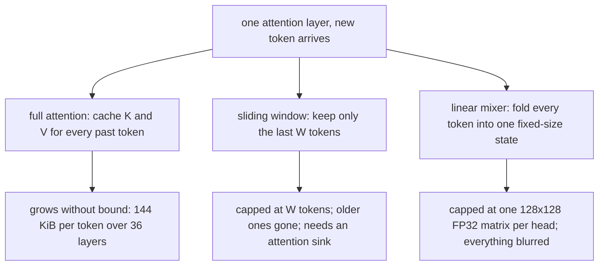
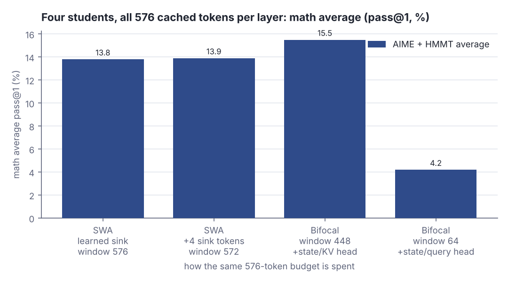
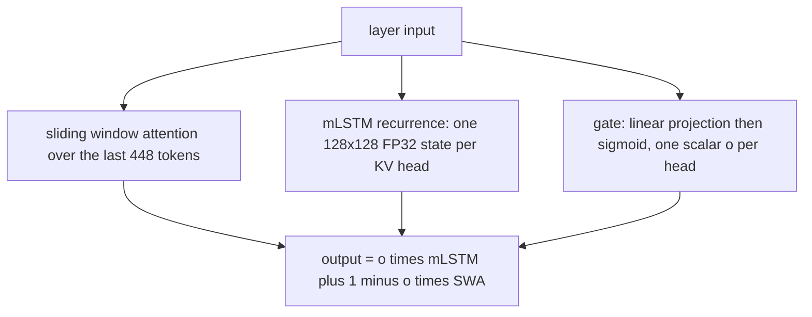
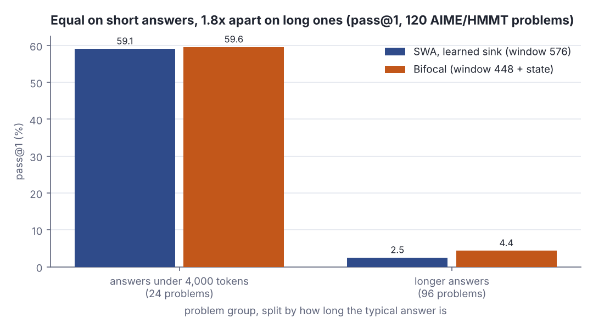
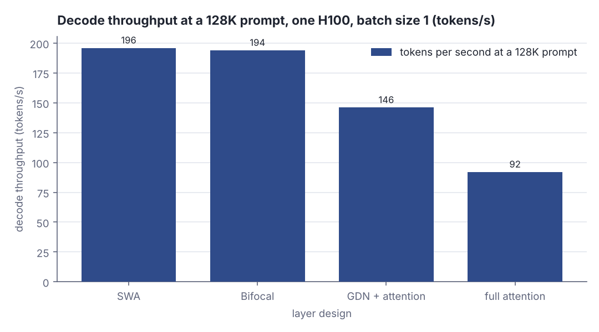
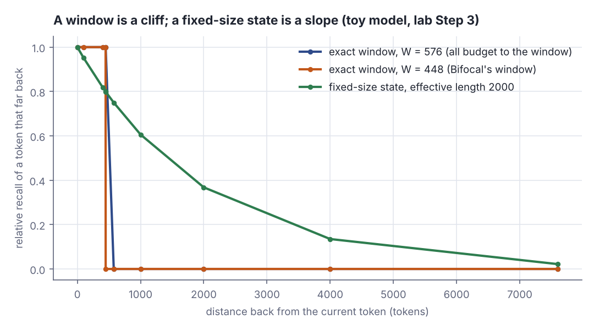

# Forget or compress: sliding windows vs linear attention on a fixed memory budget

> Fresh · AI / ML foundations · Intermediate · ~25 min · from today's feeds

## Why this matters
Today's item is a Hugging Face community post by Lukas, handle "sirluk", published 2 November 2026, which takes a recent paper's headline — sliding window attention beats linear attention — and shows exactly where it stops holding: on answers that run for thousands of tokens, which is what reasoning agents generate all day.
The decision underneath is one you already make in storage: on a fixed memory budget, do you keep the recent records exactly and forget the old ones, or compact everything into one small summary you can always read but never read precisely?
The item sits one rung above your current AI/ML ground, so the Primer fills in queries, keys, values, the KV cache and grouped-query attention before the argument starts.

## Primer
**Query, key, value.** Inside a transformer every token is a vector. An attention layer turns each token's vector into three new vectors by multiplying it with three learned matrices: a **query** (what this token is looking for), a **key** (what this token offers to others) and a **value** (what this token hands over when chosen). To decide how much token *i* should take from token *j*, the layer computes the dot product of *i*'s query with *j*'s key — the same similarity measure you met with embeddings: large when the two vectors point the same way, near zero when they are unrelated.

**Softmax over a set of tokens.** Those dot products are raw scores, not weights. Softmax turns a list of scores into a list of non-negative numbers that sum to 1: exponentiate each score, then divide by the sum of all of them. Two consequences matter here. First, the weights are *relative* — a score only means something next to the other scores in the same list. Second, the weights must sum to 1, so a head that has nothing useful to attend to cannot output "nothing"; it has to put its probability mass somewhere. When a layer attends only over the last W tokens, people say it does "softmax over the window": the divisor is the sum over those W tokens only.

**The KV cache and why it grows.** Generation is one token at a time, and each new token attends to every token before it. Recomputing all the earlier keys and values at every step would be quadratic waste, so they are computed once and kept — that is the KV cache you met in the lesson on why the first token is slow and the rest are fast. The cache has one entry per token, per layer, holding that token's key vector and value vector. Nothing evicts it, so it grows for the whole length of the answer. That is the cost this lesson is about.

**Grouped-query attention (GQA).** A layer does not run one attention computation but several in parallel, called **heads**, each with its own query/key/value matrices, so different heads can track different relationships. GQA is a memory optimisation on top of that: keep many **query heads** but let groups of them share one set of **key/value heads**. Qwen3-4B-Instruct-2507 has 32 query heads and 8 KV heads per layer, so four query heads share each KV head — and the cache stores 8 keys and 8 values per token, not 32. That ratio becomes load-bearing later.

**A recurrent fixed-size state.** The alternative to caching every token is to keep one fixed-size object that is *updated* by every token and never grows: a matrix S that starts at zero and, at each step, is modified using the current token's key and value (roughly `S := decay * S + outer(k, v)`), after which the current query reads from S. This is a recurrence in the old RNN sense — state in, state out — and its size is set by the head dimension, not by how many tokens have gone past. Everything is still in there in some form; nothing is in there exactly.

This lesson previews two core rungs you have not reached yet: **ai-ml-21, "Attention from first principles"** (where the query/key/value mechanism and softmax are derived rather than asserted) and **ai-ml-22, "The Transformer, block by block"** (where heads, layers and the residual stream are assembled). You can follow today's argument with the sketch above; those rungs make it rigorous.

## The idea

### The bottleneck is a cache that never evicts
Everything starts from one unbounded data structure:

> "A transformer stores a key and a value for every token it has seen, in every attention layer. This KV cache grows with every token the model generates."
>
> — Lukas (sirluk), *Sliding window beats linear attention, but only on short answers*, 2 November 2026, https://huggingface.co/blog/sirluk/sliding-window-beats-linear-attention

For Qwen3-4B that is about 144 KiB per token, so a 10,000-token answer carries roughly 1.4 GiB of cache (Lukas (sirluk), 2 November 2026, https://huggingface.co/blog/sirluk/sliding-window-beats-linear-attention). There are exactly two ways to bound it: **forget** the old tokens, or **compress** them.



*Figure 1: the three ways to spend one attention layer's memory — unbounded, bounded by forgetting, bounded by compressing. Source: Lukas (sirluk), 2 November 2026, https://huggingface.co/blog/sirluk/sliding-window-beats-linear-attention*

The whole experiment is built on making those two options cost the same, so the arithmetic is the experiment's foundation. Per layer, one cached token holds 8 KV heads × 128 dimensions × (one key and one value) × 2 bytes; one recurrent state is a 128×128 FP32 matrix:

```scala
val kvHeads = 8
val headDim = 128
val bytesPerToken = kvHeads * headDim * 2 * 2
val bytesPerState = headDim * headDim * 4
println(s"one cached token: ${bytesPerToken / 1024} KiB")
println(s"one FP32 state:   ${bytesPerState / 1024} KiB")
println(s"state per KV head:    ${kvHeads * bytesPerState / bytesPerToken} tokens")
println(s"state per query head: ${32 * bytesPerState / bytesPerToken} tokens")
```

```text
one cached token: 4 KiB
one FP32 state:   64 KiB
state per KV head:    128 tokens
state per query head: 512 tokens
```

A state is not free: one state per KV head costs the same as 128 cached tokens, and one state per *query* head costs 512 — four times as much, because 32 query heads share only 8 KV heads. On a 576-token budget that is the difference between a 448-token window and a 64-token window.



*Figure 2: the memory-matched comparison — four students, every one worth 576 cached tokens per layer, scored on the AIME/HMMT average. Adapted from Lukas (sirluk), "Sliding window beats linear attention, but only on short answers", 2 November 2026, https://huggingface.co/blog/sirluk/sliding-window-beats-linear-attention*

### Forgetting: the window, and the sink it needs
A sliding window keeps the last W tokens exactly and drops the rest; older tokens reach the current step only indirectly, relayed through earlier layers. Converting a pretrained model this way breaks it: heads park spare probability mass on the first tokens of the sequence, and when those leave the window the model collapses. Two repairs exist. StreamingLLM pins the first four tokens permanently in the cache (https://arxiv.org/abs/2309.17453), at the price of a cache that no longer fits standard sliding-window kernels. A **learned sink**, as in gpt-oss (https://arxiv.org/abs/2508.10925), instead adds a learned bias to each head's softmax denominator — somewhere for the unused mass to go, storing no extra tokens; the idea goes back to Evan Miller's "Attention Is Off By One" (https://www.evanmiller.org/attention-is-off-by-one.html).

### Compressing: the linear mixer, which cannot stand alone
The other bound drops softmax so the layer can be trained in a fast parallel form and unrolled at inference into a recurrence that accumulates outer products of keys and values, kept in FP32 so it does not drift from the training form. On its own it is not enough:

> "A linear mixer compresses all past tokens into a fixed-size state. In linearization, where a pretrained transformer is converted into a cheaper student, a linear mixer alone does not work well."
>
> — Lukas (sirluk), *Sliding window beats linear attention, but only on short answers*, 2 November 2026, https://huggingface.co/blog/sirluk/sliding-window-beats-linear-attention

The teacher's attention leans on the last few hundred tokens at full resolution, and a blurred summary cannot supply that. Pairing an mLSTM (https://arxiv.org/abs/2405.04517) with a sliding window lowered cross-entropy loss uniformly by restoring exact short-range recall, and LoLCATs adds a window for the same reason (https://arxiv.org/abs/2410.10254). The post's **Bifocal** layer runs both in parallel and lets the model choose per head.



*Figure 3: the Bifocal layer — exact recent recall and a compressed summary of everything, blended by a data-dependent per-head gate. Source: Lukas (sirluk), 2 November 2026, https://huggingface.co/blog/sirluk/sliding-window-beats-linear-attention*

### Why the answer's length flips the verdict
On AIME and HMMT the students write about 7,600 tokens per answer (Lukas (sirluk), 2 November 2026, https://huggingface.co/blog/sirluk/sliding-window-beats-linear-attention), and that changes what a 576-token window is:

> "At any step, the window only covers about 8% of that. After a few hundred tokens of reasoning, the question itself has left the window, and as the answer grows, intermediate results from earlier steps leave it too."
>
> — Lukas (sirluk), *Sliding window beats linear attention, but only on short answers*, 2 November 2026, https://huggingface.co/blog/sirluk/sliding-window-beats-linear-attention

A window is a cliff and a state is a slope — recall 1 inside the window and 0 outside, against a signal that decays geometrically with distance:

```scala
val answerLen = 7600
val w = 576
val lambda = 1.0 - 1.0 / 2000.0
def exact(d: Int) = if d < w then 1.0 else 0.0
def retention(d: Int) = math.pow(lambda, d)
println(f"window covers ${100.0 * w / answerLen}%.1f%% of the answer")
Seq(400, 1000, 4000).foreach { d =>
  println(f"d=$d%5d  window ${exact(d)}%.2f  state ${retention(d)}%.3f")
}
```

```text
window covers 7.6% of the answer
d=  400  window 1.00  state 0.819
d= 1000  window 0.00  state 0.606
d= 4000  window 0.00  state 0.135
```

At 400 tokens back the window is perfect and the state is already lossy; at 1,000 tokens back the window has nothing at all and the state still carries 0.606 of the signal. Depth does not patch the hole: 36 stacked 576-token windows have a theoretical reach of 20,736 tokens, but influence decays roughly exponentially in the number of windows a token must be relayed through, leaving an effective range of about 1.5 windows whatever the depth (Guangxuan Xiao, https://guangxuanx.com/blog/stacking-swa.html). A state needs no relay.



*Figure 4: the finding in one picture — on the 24 problems with answers under 4,000 tokens the two are level, on the other 96 Bifocal is 1.8× SWA. Source: Lukas (sirluk), 2 November 2026, https://huggingface.co/blog/sirluk/sliding-window-beats-linear-attention*

### What it costs, and how sure we are
The flip side is real: on short tasks SWA leads by 1.5 points on GSM8K, 0.7 on IFEval and 1.2 on HumanEval, and it keeps the teacher's architecture (Lukas (sirluk), 2 November 2026, https://huggingface.co/blog/sirluk/sliding-window-beats-linear-attention). The trade also has a hard floor:

> "The sliding window still matters, though. When Bifocal gives almost all of its memory to the linear mixer, the math scores collapse."
>
> — Lukas (sirluk), *Sliding window beats linear attention, but only on short answers*, 2 November 2026, https://huggingface.co/blog/sirluk/sliding-window-beats-linear-attention



*Figure 5: at a 128K prompt the bounded-memory designs decode at 196 and 194 tokens/s while full attention has fallen to 92. Source: Lukas (sirluk), 2 November 2026, https://huggingface.co/blog/sirluk/sliding-window-beats-linear-attention*

This is today's core lesson in another costume: a sliding window is the memtable, holding the recent records exactly, and a linear state is the compacted segment plus its Bloom filter, a fixed-size summary of everything that answers approximately. The read-amplification question is identical — how far back must you pay to reach, and how precisely?

## Lab
**The question:** on a fixed per-layer memory budget, exactly how much window does a recurrent state cost, and what does the trade buy over a 7,600-token answer?

Steps 1 and 2 recompute the post's own arithmetic and print its measured scores next to it. Steps 3 and 4 are a toy model of the mechanism written from scratch in Scala — an illustration of why length flips the verdict, not a reproduction of the paper's experiment.

### Step 1 — bytes, states and tokens
One cached token is 8 KV heads × 128 dims × key-and-value × 2 bytes. One state is a 128×128 FP32 matrix. Dividing the second by the first says how many tokens of window a state costs.

### Step 2 — the four memory-matched students
All four students replace every one of the teacher's 36 attention layers and are given the same 576 cached tokens per layer; only the split differs. Their measured math averages come from the post.

### Step 3 — recall over a 7,600-token answer
Exact-window recall (1 inside, 0 outside) against a fixed-size state modelled as geometric decay with an effective length of 2,000 tokens, normalised so that the "ppm" columns show how each design spreads one unit of read-out mass over the answer.

### Step 4 — does depth rescue the window?
Naive stacked reach (36 × 576) against the post's effective reach of about 1.5 windows.

```scala
// file: Lab.scala
// Memory-matched attention budgets in the shape of Qwen3-4B-Instruct-2507:
// 8 KV heads, 32 query heads, head dim 128, 36 layers.
// Steps 1 and 2 recompute the post's own arithmetic and quote its measured scores.
// Steps 3 and 4 are my toy models of the mechanism, not a reproduction of the paper.

val kvHeads = 8
val queryHeads = 32
val headDim = 128
val layers = 36
val budget = 576
val answerLen = 7600
val effLen = 2000.0
val lambda = 1.0 - 1.0 / effLen

def bytesPerCachedToken: Int = kvHeads * headDim * 2 * 2
def bytesPerState: Int = headDim * headDim * 4
def stateTokens(nStates: Int): Int = nStates * bytesPerState / bytesPerCachedToken

def exact(w: Int, d: Int): Double = if d < w then 1.0 else 0.0
def retention(d: Int): Double = math.pow(lambda, d)
val zState: Double = (0 until answerLen).map(retention).sum
def stateShare(d: Int): Double = retention(d) / zState
def windowShare(w: Int, d: Int): Double = if d < w then 1.0 / w else 0.0

val dists = Seq(0, 100, 400, 447, 448, 576, 1000, 2000, 4000, 7599)

@main def lab(): Unit =
  println("== Step 1 - bytes, states, tokens (the post's arithmetic, recomputed) ==")
  println(s"one cached token: ${bytesPerCachedToken / 1024} KiB")
  println(s"one FP32 state:   ${bytesPerState / 1024} KiB")
  println(s"state per KV head:    ${stateTokens(kvHeads)} tokens")
  println(s"state per query head: ${stateTokens(queryHeads)} tokens")
  println()
  println(f"${"placement"}%-19s${"states"}%7s${"KiB"}%8s${"=tokens"}%9s${"window@576"}%12s${"win share"}%11s")
  Seq(("none (pure SWA)", 0), ("one per KV head", kvHeads), ("one per query head", queryHeads))
    .foreach { case (name, n) =>
      val t = stateTokens(n)
      val w = budget - t
      println(f"$name%-19s$n%7d${n * bytesPerState / 1024}%8d$t%9d$w%12d${100.0 * w / budget}%10.1f%%")
    }

  println()
  println("== Step 2 - four students, 576 cached tokens per layer each (scores from the post) ==")
  println(f"${"student"}%-26s${"window"}%8s${"sinks"}%7s${"state"}%7s${"total"}%7s${"math avg %"}%12s")
  Seq(("SWA, learned sink", 576, 0, 0, 13.8),
      ("SWA + sink tokens", 572, 4, 0, 13.9),
      ("Bifocal, state/KV head", 448, 0, 128, 15.5),
      ("Bifocal window 64", 64, 0, 512, 4.2))
    .foreach { case (n, w, s, st, avg) =>
      println(f"$n%-26s$w%8d$s%7d$st%7d${w + s + st}%7d$avg%12.1f")
    }

  println()
  println("== Step 3 - recall over a 7,600-token answer (my toy model) ==")
  println(f"window covers ${100.0 * budget / answerLen}%.1f%% of the answer")
  Seq(400, 1000, 4000).foreach { d =>
    println(f"d=$d%5d  window ${exact(budget, d)}%.2f  state ${retention(d)}%.3f")
  }
  println()
  println(f"${"distance"}%9s${"win576"}%8s${"win448"}%8s${"state"}%8s${"win448 ppm"}%12s${"state ppm"}%11s")
  dists.foreach { d =>
    println(f"$d%9d${exact(576, d)}%8.2f${exact(448, d)}%8.2f${retention(d)}%8.3f" +
      f"${1e6 * windowShare(448, d)}%12.0f${1e6 * stateShare(d)}%11.0f")
  }
  println()
  println(f"smallest state retention over the whole answer: ${retention(answerLen - 1)}%.4f")
  println(f"positions the 448-token window sees exactly: ${100.0 * 448 / answerLen}%.1f%%")

  println()
  println("== Step 4 - does depth rescue the window? (claim from the post, arithmetic mine) ==")
  val naive = layers * budget
  val effective = (1.5 * budget).toInt
  println(s"layers=$layers  window=$budget")
  println(f"naive reach     $naive%6d tokens = ${100.0 * naive / answerLen}%6.1f%% of the answer")
  println(f"effective reach $effective%6d tokens = ${100.0 * effective / answerLen}%6.1f%% of the answer")
  println(f"naive / effective = ${naive.toDouble / effective}%.1fx")
```

Run it with `python3 dojo/engine/run_lab.py 2026-11-05-2`:

```text
== Step 1 - bytes, states, tokens (the post's arithmetic, recomputed) ==
one cached token: 4 KiB
one FP32 state:   64 KiB
state per KV head:    128 tokens
state per query head: 512 tokens

placement           states     KiB  =tokens  window@576  win share
none (pure SWA)          0       0        0         576     100.0%
one per KV head          8     512      128         448      77.8%
one per query head      32    2048      512          64      11.1%

== Step 2 - four students, 576 cached tokens per layer each (scores from the post) ==
student                     window  sinks  state  total  math avg %
SWA, learned sink              576      0      0    576        13.8
SWA + sink tokens              572      4      0    576        13.9
Bifocal, state/KV head         448      0    128    576        15.5
Bifocal window 64               64      0    512    576         4.2

== Step 3 - recall over a 7,600-token answer (my toy model) ==
window covers 7.6% of the answer
d=  400  window 1.00  state 0.819
d= 1000  window 0.00  state 0.606
d= 4000  window 0.00  state 0.135

 distance  win576  win448   state  win448 ppm  state ppm
        0    1.00    1.00   1.000        2232        511
      100    1.00    1.00   0.951        2232        486
      400    1.00    1.00   0.819        2232        419
      447    1.00    1.00   0.800        2232        409
      448    1.00    0.00   0.799           0        409
      576    0.00    0.00   0.750           0        383
     1000    0.00    0.00   0.606           0        310
     2000    0.00    0.00   0.368           0        188
     4000    0.00    0.00   0.135           0         69
     7599    0.00    0.00   0.022           0         11

smallest state retention over the whole answer: 0.0224
positions the 448-token window sees exactly: 5.9%

== Step 4 - does depth rescue the window? (claim from the post, arithmetic mine) ==
layers=36  window=576
naive reach      20736 tokens =  272.8% of the answer
effective reach    864 tokens =   11.4% of the answer
naive / effective = 24.0x
```



*Figure 6: Step 3's two recall curves — the window is perfect then zero, the state is never perfect and never zero. Generated from the lab output.*

### Reading the output

**Step 1 — what a state costs.** `states` is how many 128×128 FP32 matrices the layer keeps, `KiB` their total size per layer, `=tokens` how many cached tokens that size would have bought, `window@576` what is left of the 576-token budget, `win share` the fraction of the budget still spent on exact recent recall. Bigger `window@576` means more exact recall; bigger `=tokens` means more compressed history. There is no "better" column — that is the whole trade.

| placement | states | KiB | = tokens | window @ 576 | win share |
|---|---|---|---|---|---|
| none (pure SWA) | 0 | 0 | 0 | 576 | 100.0% |
| one per KV head | 8 | 512 | 128 | 448 | 77.8% |
| one per query head | 32 | 2048 | 512 | 64 | 11.1% |

The chain, traced with digits: one cached token is 8 × 128 × 2 × 2 = 4,096 bytes = 4 KiB. One state is 128 × 128 × 4 = 65,536 bytes = 64 KiB. One state per KV head is 8 × 65,536 = 524,288 bytes = 512 KiB, and 524,288 ÷ 4,096 = **128 tokens**, so the window is 576 − 128 = **448**. Put the states on query heads instead and it is 32 × 65,536 = 2,097,152 bytes, 2,097,152 ÷ 4,096 = 512 tokens, leaving 576 − 512 = **64**. As a cross-check on the whole model: 4 KiB per layer × 36 layers = 144 KiB per token, which is the post's own per-token cache figure (Lukas (sirluk), 2 November 2026, https://huggingface.co/blog/sirluk/sliding-window-beats-linear-attention).

**Verdict:** under GQA a state is cheap on KV heads and expensive on query heads, because 32 query heads share only 8 KV heads. The 4× is not a detail; it is what starves the window in the fourth student.

**Step 2 — the memory-matched table.** `window` + `sinks` + `state` = `total`, and `total` is 576 for every row, which is what makes the comparison fair. `math avg %` is pass@1 averaged over AIME 2024, AIME 2025, HMMT Feb 2025 and HMMT Nov 2025 — 120 problems, 16 samples each — as measured in the post (Lukas (sirluk), 2 November 2026, https://huggingface.co/blog/sirluk/sliding-window-beats-linear-attention). Higher is better.

| student | window | sinks | state | total | math avg % |
|---|---|---|---|---|---|
| SWA, learned sink | 576 | 0 | 0 | 576 | 13.8 |
| SWA + sink tokens | 572 | 4 | 0 | 576 | 13.9 |
| Bifocal, state per KV head | 448 | 0 | 128 | 576 | 15.5 |
| Bifocal, window 64 | 64 | 0 | 512 | 576 | 4.2 |

The averages hide the shape of the win, which the post states plainly:

> "On math problems that need long answers (from AIME and HMMT), Bifocal solves almost twice as many as SWA."
>
> — Lukas (sirluk), *Sliding window beats linear attention, but only on short answers*, 2 November 2026, https://huggingface.co/blog/sirluk/sliding-window-beats-linear-attention

**Verdict:** spending 128 tokens of the budget on a state buys +1.7 points of math average (13.8 → 15.5); spending 512 of them costs 9.6 points (13.8 → 4.2). The relationship is not monotone, so "more compressed history" is not a direction you can simply push. Honesty about the size of the win: the post reports a paired bootstrap over problems with 20,000 resamples giving Bifocal's gain on the math average a 95% interval of 0.0 to 3.4 points, and 0.7 to 3.3 on the 96 long-answer problems — with 120 problems this sits right at the edge of significance (Lukas (sirluk), 2 November 2026, https://huggingface.co/blog/sirluk/sliding-window-beats-linear-attention).

**Step 3 — recall by distance.** `distance` is how far back the token of interest is. `win576` and `win448` are exact-recall indicators for the two window sizes (1 = still in the window). `state` is my decay model's retained signal. The two `ppm` columns normalise each design to one unit of read-out mass spread over the 7,600 positions, in parts per million, so they are comparable: the window concentrates 1/448 = 2,232 ppm on each token it can see and 0 on the rest; the state spreads a thinner but non-zero share everywhere. Higher is better per column, but the shapes are the point.

| distance | win576 | win448 | state | win448 ppm | state ppm |
|---|---|---|---|---|---|
| 0 | 1.00 | 1.00 | 1.000 | 2232 | 511 |
| 400 | 1.00 | 1.00 | 0.819 | 2232 | 419 |
| 448 | 1.00 | 0.00 | 0.799 | 0 | 409 |
| 576 | 0.00 | 0.00 | 0.750 | 0 | 383 |
| 1000 | 0.00 | 0.00 | 0.606 | 0 | 310 |
| 2000 | 0.00 | 0.00 | 0.368 | 0 | 188 |
| 4000 | 0.00 | 0.00 | 0.135 | 0 | 69 |
| 7599 | 0.00 | 0.00 | 0.022 | 0 | 11 |

Traced: at distance 0 the window's share is 1 ÷ 448 = 0.002232 = 2,232 ppm, while the state's is 1 ÷ 1,955.3 = 0.000511 = 511 ppm (1,955.3 is the sum of 0.9995^d over all 7,600 positions). So inside the window the window is about 4.4× sharper per token — and at distance 1,000 it is 0 against 310 ppm.

**Verdict:** the model reproduces the post's framing exactly. A 576-token window covers 7.6% of a 7,600-token answer, and four-fifths of the answer sits at distances where the window holds literally nothing while the state still holds something. Exact recall is sharper where it reaches; it just does not reach.

**Step 4 — depth is not a substitute.** `naive reach` multiplies the window by the layer count as if influence travelled undamped; `effective reach` applies the post's ~1.5-window rule. Smaller gap means stacking works; it does not.

| measure | tokens | share of a 7,600-token answer |
|---|---|---|
| naive reach, 36 × 576 | 20,736 | 272.8% |
| effective reach, 1.5 × 576 | 864 | 11.4% |

**Verdict:** the paper-napkin argument that depth gives a sliding-window model unlimited reach overstates it by 24×. Relaying information across windows attenuates it roughly exponentially in the number of hops (Guangxuan Xiao, https://guangxuanx.com/blog/stacking-swa.html), so a 36-layer SWA student effectively sees about 864 tokens of a 7,600-token answer — and the question it was asked is long gone.

One framing to carry out of the lab, in the post's own words:

> "When answers are only a few hundred tokens long, the prompt and response mostly fit inside the window anyway, so the model rarely needs to fall back on a compressed state."
>
> — Lukas (sirluk), *Sliding window beats linear attention, but only on short answers*, 2 November 2026, https://huggingface.co/blog/sirluk/sliding-window-beats-linear-attention

### Cause → consequence

1. **Cause.** The KV cache grows one entry per token per layer, so a long answer's memory cost is linear in its own length and unbounded in principle.
2. **Mechanism.** Bounding it forces a choice between forgetting (a window, exact over W tokens, nothing beyond) and compressing (a fixed-size recurrent state, approximate over everything). Memory-matching makes them directly comparable: one state per KV head = 128 tokens of window.
3. **Consequence.** The two designs tie when the whole interaction fits in the window — 59.1% against 59.6% on problems whose answers run under 4,000 tokens — and separate when it does not: 2.5% against 4.4% on the other 96 problems, 66 correct long rollouts against 26 (Lukas (sirluk), 2 November 2026, https://huggingface.co/blog/sirluk/sliding-window-beats-linear-attention). Give the state nearly all the memory and both collapse, because exact short-range recall is not optional.
4. **What it means in practice.** For the agent and long-reasoning workloads you ship, answer length is the variable that decides which bounded-memory model is the right buy. A classifier or a gate that emits a few hundred tokens will be served best by a pure window: cheaper, simpler, and slightly better on short tasks. A planner that writes several thousand tokens of reasoning before it acts is precisely where a compressed state earns its keep, because the instruction it was given has left the window long before it finishes. This is today's DDIA chapter restated for model memory: keep the recent records exactly, compact the rest into something small you can still consult, and accept that reading the compacted part costs precision. The read-amplification question — how far back do I have to pay to reach, and how exactly? — is the same question in both systems. Two operational cautions from the post before you quote any of this: 24% of Bifocal's rollouts and 12% of SWA's hit the token limit, mostly repeating an answer already written, and the speed numbers were measured with synthetic weights at batch size 1 (Lukas (sirluk), 2 November 2026, https://huggingface.co/blog/sirluk/sliding-window-beats-linear-attention).

## Self-check
1. On a budget of 576 cached tokens per layer, why does moving the recurrent state from the KV heads to the query heads shrink the window from 448 tokens to 64? <details><summary>Answer</summary>Because the model has 32 query heads sharing 8 KV heads, so "one state per query head" means 32 states instead of 8. Each state is a 128×128 FP32 matrix = 65,536 bytes = 64 KiB, and one cached token is 8 × 128 × 2 × 2 = 4,096 bytes = 4 KiB. Eight states are 524,288 ÷ 4,096 = 128 tokens of window, thirty-two states are 2,097,152 ÷ 4,096 = 512 tokens. The budget is fixed at 576, so the window is 576 − 128 = 448 in one case and 576 − 512 = 64 in the other. The post measures the consequence: the window-64 student's math average falls to 4.2% against 15.5% (Lukas (sirluk), 2 November 2026, https://huggingface.co/blog/sirluk/sliding-window-beats-linear-attention).</details>
2. Why does a 36-layer sliding-window model not behave as though it had a 20,736-token context? <details><summary>Answer</summary>That number assumes a token's influence passes undamped from window to window as it is relayed up the layers. It does not: influence decays roughly exponentially in the number of windows in between, so the effective range is about 1.5 windows regardless of depth (Guangxuan Xiao, https://guangxuanx.com/blog/stacking-swa.html). For a 576-token window that is about 864 tokens, 24× less than the naive figure, and 11.4% of a 7,600-token answer. A fixed-size recurrent state has no relay in the path: every past token was folded into the state directly, so its contribution decays with token distance, not with layer hops.</details>
3. A teammate proposes converting a production model to a pure sliding window to cap memory, and benchmarks it on your intent-classification prompts, which produce 200-token answers. What is wrong with generalising that result, and what would you measure instead? <details><summary>Answer</summary>At 200 tokens the prompt and the whole answer sit inside a 576-token window, so the benchmark never exercises the thing the window gives up. That is exactly the regime where the post finds SWA ahead — by 1.5 points on GSM8K, 0.7 on IFEval and 1.2 on HumanEval (Lukas (sirluk), 2 November 2026, https://huggingface.co/blog/sirluk/sliding-window-beats-linear-attention). The measurement that decides the question is a length-grouped one: split the evaluation by typical answer length and score the groups separately, as the post does when it reports 59.1% against 59.6% on answers under 4,000 tokens and 2.5% against 4.4% on longer ones. Add a decode-throughput curve against prompt length, since bounded-memory designs hold ~194–196 tokens/s at a 128K prompt where full attention has dropped to 92.</details>

## Sources
- [Sliding window beats linear attention, but only on short answers](https://huggingface.co/blog/sirluk/sliding-window-beats-linear-attention) — Lukas (sirluk), Hugging Face Community Article, 2 November 2026 — the whole argument, the Bifocal layer and its gate, the memory arithmetic (4 KiB per cached token, 64 KiB per state, 128 and 512 tokens), the four memory-matched students, every math and short-answer score, the bootstrap intervals, the throughput figures and the stated caveats; accessed 2026-11-05.
- [Sliding-window beats linear attention](https://arxiv.org/abs/2608.28444) — the paper whose claim the post tests and partly contradicts; accessed 2026-11-05.
- [Efficient Streaming Language Models with Attention Sinks (StreamingLLM)](https://arxiv.org/abs/2309.17453) — the sink-token fix: pinning the first four tokens in the cache; accessed 2026-11-05.
- [gpt-oss](https://arxiv.org/abs/2508.10925) — the learned-sink alternative: a bias term in each head's softmax denominator; accessed 2026-11-05.
- [Attention Is Off By One](https://www.evanmiller.org/attention-is-off-by-one.html) — Evan Miller — the origin of the idea that softmax needs somewhere to put unused probability mass; accessed 2026-11-05.
- [xLSTM / mLSTM](https://arxiv.org/abs/2405.04517) — the linear mixer used inside the Bifocal layer; accessed 2026-11-05.
- [LoLCATs](https://arxiv.org/abs/2410.10254) — a prior linearization method that also adds a sliding window for short-range recall; accessed 2026-11-05.
- [Stacking sliding window attention](https://guangxuanx.com/blog/stacking-swa.html) — Guangxuan Xiao — the effective-range argument: about 1.5 windows regardless of depth; accessed 2026-11-05.
- [Qwen3-4B-Instruct-2507](https://huggingface.co/Qwen/Qwen3-4B-Instruct-2507) — the teacher model: 36 attention layers, 32 query heads, 8 KV heads; accessed 2026-11-05.

## Next on this track
Fresh lessons sit outside the ladder; next on AI / ML foundations: **Gradient descent in many variables: fitting linear regression** (rung 7 of 38, Beginner).
