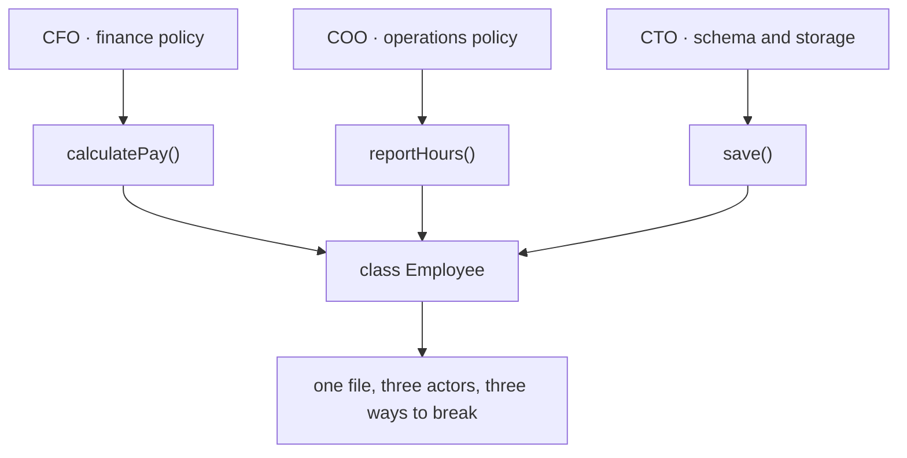
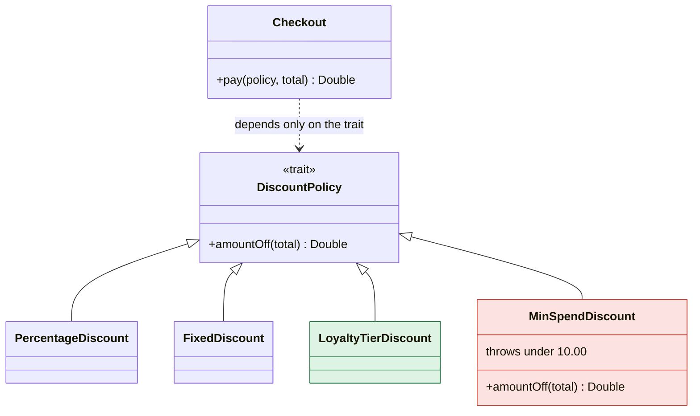
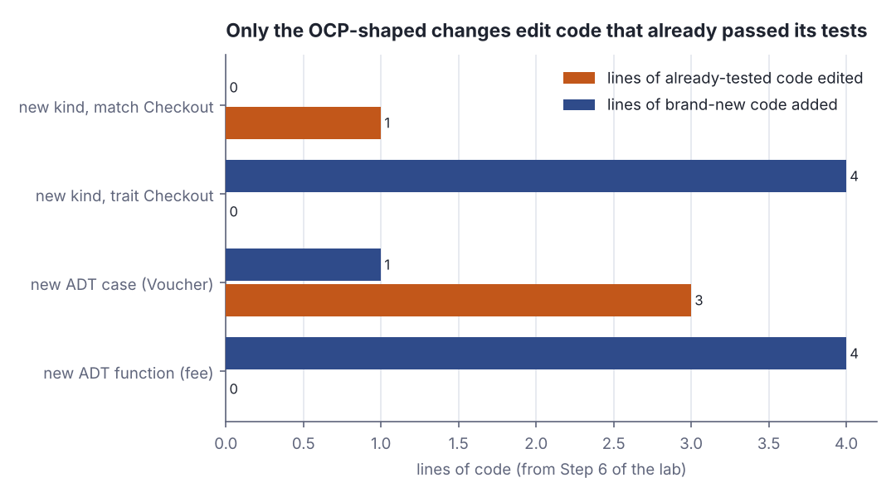

# SOLID in practice I — SRP, OCP, LSP

> Software architecture & design · Beginner · ~25 min · rung 3 of 20 · needs: Dependency direction and the dependency rule (architecture-02)

## Why this matters
You already push dependencies inward, toward the stable core; SRP, OCP and LSP are the same decision one zoom level down, inside a single module.
Read as slogans they are worthless — "do one thing" is not a design rule. Read as questions about *who asks for the change* and *what a caller is allowed to assume*, they tell you exactly where to cut.
Everything later on this track — ports and adapters, aggregate boundaries, the ADRs you will write for the POS — is these three heuristics applied to bigger boxes.

## The idea

### SRP — one actor, not one thing

Robert C. Martin states the Single Responsibility Principle as a rule about change, not about size:

> "The Single Responsibility Principle (SRP) states that each software module should have one and only one reason to change."
>
> — Robert C. Martin, *The Single Responsibility Principle*, 8 May 2014, https://blog.cleancoder.com/uncle-bob/2014/05/08/SingleReponsibilityPrinciple.html

The load-bearing part is what counts as *a reason*. Code does not change by itself; somebody asks for the change. So a reason to change is a person, or a role:

> "This principle is about people."
>
> — Robert C. Martin, *The Single Responsibility Principle*, 8 May 2014, https://blog.cleancoder.com/uncle-bob/2014/05/08/SingleReponsibilityPrinciple.html

His example is an `Employee` class with `calculatePay`, `reportHours` and `save`. Each answers to a different officer: pay to the CFO, the hours report to the COO, persistence to the CTO. The class "does one thing" in English and still violates SRP, because three independent people can force it to change, and a change made for one can break the other two.


*Figure 1: three actors pulling on one class — the shape SRP forbids. Adapted from Robert C. Martin, "The Single Responsibility Principle", https://blog.cleancoder.com/uncle-bob/2014/05/08/SingleReponsibilityPrinciple.html*

The practical test: for each public method, name the person who would ask you to change it. Two names means two modules. Twelve methods that all answer to Marketing are fine; two methods answering to Marketing and Finance are not.

### OCP — add code instead of editing tested code

The Open Closed Principle is the mechanical consequence. Martin restates it like this:

> "It should be easy to change the behavior of a module without changing the source code of that module."
>
> — Robert C. Martin, *An Open and Closed Case*, 8 March 2013, https://blog.cleancoder.com/uncle-bob/2013/03/08/AnOpenAndClosedCase.html

A `Checkout` that chooses the discount with `kind match { case "percent" => … }` fails that test: every new discount kind is an edit inside a method that already has passing tests. Put the choice behind a trait and the new kind is a new file:

```scala
object LoyaltyTierDiscount extends DiscountPolicy:
  val name = "loyalty"
  def amountOff(total: Double) =
    if total >= 50.0 then total * 0.15 else total * 0.05

// Checkout is not edited; it is only handed the new policy:
for p <- List(FixedDiscount, LoyaltyTierDiscount); t <- List(80.00) do
  println(f"${p.name}%-9s $t%8.2f ${r2(p.amountOff(t))}%6.2f ${Checkout.pay(p, t)}%7.2f")
```

```text
fixed        80.00   5.00   75.00
loyalty      80.00  12.00   68.00
```

`Checkout.pay` computed both rows without knowing either policy exists: 80.00 − 5.00 = 75.00 for the flat five off, 80.00 − 12.00 = 68.00 for the 15% tier. The behaviour changed; the source did not.

OCP is directional, and that is the part people skip. The trait protects exactly one axis — **new kinds of discount** — and nothing against a change to the *shape* of the call: if discounts suddenly need the customer's country, every policy is edited. Choosing an abstraction is choosing which axis is cheap and admitting the others are not; one guessed against the wrong axis is pure cost.


*Figure 2: LoyaltyTierDiscount is added without touching Checkout (OCP); MinSpendDiscount is a subtype that throws for small totals and breaks every caller that was written against the trait (LSP). Source: the lab in this lesson.*

### LSP — the subtype keeps the promise

Extension only works while every implementation is genuinely usable where the trait is expected. Liskov and Wing make that precise with rules on pre- and postconditions:

> "The pre-condition rule ensures the subtype's method can be called at least in any state required by the supertype."
>
> — Barbara H. Liskov and Jeannette M. Wing, *A Behavioral Notion of Subtyping*, ACM TOPLAS 16(6), November 1994, https://www.cs.columbia.edu/~wing/publications/LiskovWing94.pdf

Two clauses, both checkable by hand: a subtype may not demand **more** than the base type did (no stronger precondition), nor deliver **less** than it promised (no weaker postcondition). `DiscountPolicy.amountOff` promises that any non-negative total is accepted and the result lies between 0 and the total. A minimum spend demands more:

```scala
object MinSpendDiscount extends DiscountPolicy:
  val name = "minspend"
  def amountOff(total: Double) =
    if total < 10.0 then throw IllegalArgumentException(s"total $total below minimum 10.0")
    else 3.0

// the existing caller, unchanged:
for p <- List(FixedDiscount, MinSpendDiscount) do
  Try(cartReport(p, carts)) match
    case Success(line) => println(f"${p.name}%-9s  $line")
    case Failure(e) =>
      println(f"${p.name}%-9s  BROKEN ${e.getClass.getSimpleName}: ${e.getMessage}")
```

```text
fixed      paid [2.50 7.00 75.00] sum=84.50
minspend   BROKEN IllegalArgumentException: total 7.5 below minimum 10.0
```

`cartReport` was correct for every earlier policy and was not touched. The 7.50 cart is inside the trait's contract and outside this subtype's, so the caller dies — and the compiler had nothing to say, because the types check. That is the whole of LSP: the type system enforces the signature, you enforce the contract.

The classic trap is the same move in geometry: `Square extends Rectangle` type-checks, then `setWidth(5)` on a square silently also sets the height, and a caller that assumed "setting the width leaves the height alone" computes the wrong area. "A square is a rectangle" is true of shapes and false of *mutable rectangle objects*. Inheritance follows the contract, not the noun.

### In Scala: sealed ADTs trade the axes the other way

A trait open to new implementations makes **new cases cheap and new operations expensive** — add a method to the trait and every implementation must be edited. A `sealed trait` ADT with exhaustive `match` inverts it: **new operations are cheap, new cases are expensive**. That is the expression problem, and Scala lets you pick a side per type.

```scala
sealed trait Payment
case class Cash(amount: Double) extends Payment
case class Card(amount: Double) extends Payment
case class Voucher(code: String) extends Payment   // the case added today

def label(p: Payment): String = p match      // written before Voucher existed
  case Cash(a) => f"cash $a%.2f"
  case Card(a) => f"card $a%.2f"
```

```text
-- [E029] Pattern Match Exhaustivity Warning: Payments.scala:12:32
12 |def label(p: Payment): String = p match      // written before Voucher existed
   |                                ^
   |                               match may not be exhaustive.
   |
   |                               It would fail on pattern case: Voucher(_)
1 warning found
Voucher(WELCOME)     amount=  0.00 fee= 0.00 label=BROKEN MatchError
```

Adding `Voucher` forced an edit in every existing `match`; the compiler found them all, and the one left alone threw `MatchError` at runtime. Adding a whole new function `fee` over the same ADT touches nothing. So `sealed` is not anti-OCP by accident — it is OCP pointed at the other axis, bought in exchange for exhaustiveness checking. Use a sealed ADT when the cases are stable and the operations grow (an error type, a protocol message); use an open trait when the implementations grow and the operations are stable (a discount policy, a repository).

## Lab

Which kind of change edits code that already passed its tests, and which existing caller breaks when a subtype quietly tightens its precondition?

### Step 1 — the match-based `Checkout`

Discount kinds are strings; one `match` inside `Checkout` turns a string into money off.

```scala
// file: Checkout.scala
def r2(x: Double): Double =
  BigDecimal(x).setScale(2, BigDecimal.RoundingMode.HALF_UP).toDouble

object CheckoutV1:
  def amountOff(kind: String, total: Double): Double = kind match
    case "none"    => 0.0
    case "percent" => total * 0.10
    case "fixed"   => math.min(5.0, total)
    case other     => throw IllegalArgumentException(s"unknown discount kind: $other")

  def pay(kind: String, total: Double): Double = r2(total - amountOff(kind, total))

@main def v1(): Unit =
  val carts = List(7.50, 12.00, 80.00)
  println("kind      subtotal    off     pay")
  for k <- List("none", "percent", "fixed"); t <- carts do
    val off = r2(CheckoutV1.amountOff(k, t))
    println(f"$k%-9s $t%8.2f $off%6.2f ${CheckoutV1.pay(k, t)}%7.2f")
  println()
  println("marketing now asks for a loyalty tier discount:")
  try println(CheckoutV1.pay("loyalty", 80.00))
  catch case e: IllegalArgumentException =>
    println(s"  ${e.getClass.getSimpleName}: ${e.getMessage}")
  println("  supporting it means editing the match inside CheckoutV1 - tested code.")
```

```text
kind      subtotal    off     pay
none          7.50   0.00    7.50
none         12.00   0.00   12.00
none         80.00   0.00   80.00
percent       7.50   0.75    6.75
percent      12.00   1.20   10.80
percent      80.00   8.00   72.00
fixed         7.50   5.00    2.50
fixed        12.00   5.00    7.00
fixed        80.00   5.00   75.00

marketing now asks for a loyalty tier discount:
  IllegalArgumentException: unknown discount kind: loyalty
  supporting it means editing the match inside CheckoutV1 - tested code.
```

### Step 2 — the same behaviour behind a trait, plus the loyalty tier

`DiscountPolicy` carries the contract in a comment and in the tests you would write against it. `LoyaltyTierDiscount` is appended below `Checkout`; nothing above it changes.

```scala
// file: Policies.scala
def r2(x: Double): Double =
  BigDecimal(x).setScale(2, BigDecimal.RoundingMode.HALF_UP).toDouble

trait DiscountPolicy:
  def name: String
  def amountOff(total: Double): Double        // 0 <= result <= total, never throws

object NoDiscount extends DiscountPolicy:
  val name = "none"
  def amountOff(total: Double) = 0.0

object PercentageDiscount extends DiscountPolicy:
  val name = "percent"
  def amountOff(total: Double) = total * 0.10

object FixedDiscount extends DiscountPolicy:
  val name = "fixed"
  def amountOff(total: Double) = math.min(5.0, total)

// Checkout: written once, closed for modification from here on
object Checkout:
  def pay(policy: DiscountPolicy, total: Double): Double =
    r2(total - policy.amountOff(total))

// added afterwards, in its own file; nothing above this line changed
object LoyaltyTierDiscount extends DiscountPolicy:
  val name = "loyalty"
  def amountOff(total: Double) =
    if total >= 50.0 then total * 0.15 else total * 0.05

@main def v2(): Unit =
  val carts = List(7.50, 12.00, 80.00)
  val policies = List(NoDiscount, PercentageDiscount, FixedDiscount, LoyaltyTierDiscount)
  println("policy    subtotal    off     pay")
  for p <- policies; t <- carts do
    println(f"${p.name}%-9s $t%8.2f ${r2(p.amountOff(t))}%6.2f ${Checkout.pay(p, t)}%7.2f")
```

```text
policy    subtotal    off     pay
none          7.50   0.00    7.50
none         12.00   0.00   12.00
none         80.00   0.00   80.00
percent       7.50   0.75    6.75
percent      12.00   1.20   10.80
percent      80.00   8.00   72.00
fixed         7.50   5.00    2.50
fixed        12.00   5.00    7.00
fixed        80.00   5.00   75.00
loyalty       7.50   0.38    7.13
loyalty      12.00   0.60   11.40
loyalty      80.00  12.00   68.00
```

### Step 3 — a policy that throws under 10.00, and the caller it breaks

`cartReport` is the existing caller: it pays every cart in the basket list and sums the result. It is correct for all four policies above. Now add a fifth that demands a minimum spend.

```scala
// file: Broken.scala
import scala.util.{Try, Success, Failure}

def r2(x: Double): Double =
  BigDecimal(x).setScale(2, BigDecimal.RoundingMode.HALF_UP).toDouble

trait DiscountPolicy:
  def name: String
  def amountOff(total: Double): Double        // 0 <= result <= total, never throws

object NoDiscount extends DiscountPolicy:
  val name = "none"
  def amountOff(total: Double) = 0.0

object PercentageDiscount extends DiscountPolicy:
  val name = "percent"
  def amountOff(total: Double) = total * 0.10

object FixedDiscount extends DiscountPolicy:
  val name = "fixed"
  def amountOff(total: Double) = math.min(5.0, total)

object LoyaltyTierDiscount extends DiscountPolicy:
  val name = "loyalty"
  def amountOff(total: Double) =
    if total >= 50.0 then total * 0.15 else total * 0.05

// the subtype that tightens the precondition: "only call me with total >= 10"
object MinSpendDiscount extends DiscountPolicy:
  val name = "minspend"
  def amountOff(total: Double) =
    if total < 10.0 then throw IllegalArgumentException(s"total $total below minimum 10.0")
    else 3.0

object Checkout:
  def pay(policy: DiscountPolicy, total: Double): Double =
    r2(total - policy.amountOff(total))

// the existing caller: one report over every cart in the basket list
def cartReport(p: DiscountPolicy, carts: List[Double]): String =
  val paid = carts.map(t => Checkout.pay(p, t))
  f"paid [${paid.map(v => f"$v%.2f").mkString(" ")}] sum=${paid.sum}%.2f"

@main def lsp(): Unit =
  val carts = List(7.50, 12.00, 80.00)
  val all = List(NoDiscount, PercentageDiscount, FixedDiscount,
                 LoyaltyTierDiscount, MinSpendDiscount)
  var broken = 0
  println("policy     existing caller: cartReport over carts 7.50 / 12.00 / 80.00")
  for p <- all do
    Try(cartReport(p, carts)) match
      case Success(line) => println(f"${p.name}%-9s  $line")
      case Failure(e) =>
        broken += 1
        println(f"${p.name}%-9s  BROKEN ${e.getClass.getSimpleName}: ${e.getMessage}")
  println(s"callers broken: $broken of ${all.size} policies")
```

```text
policy     existing caller: cartReport over carts 7.50 / 12.00 / 80.00
none       paid [7.50 12.00 80.00] sum=99.50
percent    paid [6.75 10.80 72.00] sum=89.55
fixed      paid [2.50 7.00 75.00] sum=84.50
loyalty    paid [7.13 11.40 68.00] sum=86.53
minspend   BROKEN IllegalArgumentException: total 7.5 below minimum 10.0
callers broken: 1 of 5 policies
```

### Step 4 — the other axis: a sealed ADT, the line counts, and the actors

Three things in one program. First a `sealed trait Payment` that just gained a `Voucher` case, with one `match` left as it was. Then the line counts: the four changes are stored as before/after source strings and diffed, so the numbers are measured, not asserted. Then the SRP question answered for each class.

```scala
// file: Payments.scala
import scala.util.{Try, Success, Failure}

def r2(x: Double): Double =
  BigDecimal(x).setScale(2, BigDecimal.RoundingMode.HALF_UP).toDouble

sealed trait Payment
case class Cash(amount: Double) extends Payment
case class Card(amount: Double) extends Payment
case class Voucher(code: String) extends Payment   // the case added today

def label(p: Payment): String = p match      // written before Voucher existed
  case Cash(a) => f"cash $a%.2f"
  case Card(a) => f"card $a%.2f"

def amountOf(p: Payment): Double = p match   // updated for Voucher
  case Cash(a)    => a
  case Card(a)    => a
  case Voucher(_) => 0.0

def fee(p: Payment): Double = p match        // a brand-new function, nothing else edited
  case Cash(_)    => 0.0
  case Card(a)    => r2(a * 0.015)
  case Voucher(_) => 0.0

// ---- counting the change: real line diffs of the modules that moved ----
def lines(s: String): List[String] =
  s.linesIterator.map(_.trim).filter(_.nonEmpty).toList

def added(before: String, after: String): Int = lines(after).diff(lines(before)).size

val matchV1 = """def amountOff(kind: String, total: Double): Double = kind match
  case "none"    => 0.0
  case "percent" => total * 0.10
  case "fixed"   => math.min(5.0, total)
  case other     => throw IllegalArgumentException(s"unknown kind: $other")"""

val matchV2 = """def amountOff(kind: String, total: Double): Double = kind match
  case "none"    => 0.0
  case "percent" => total * 0.10
  case "fixed"   => math.min(5.0, total)
  case "loyalty" => if total >= 50.0 then total * 0.15 else total * 0.05
  case other     => throw IllegalArgumentException(s"unknown kind: $other")"""

val checkoutV1 = """object Checkout:
  def pay(policy: DiscountPolicy, total: Double): Double =
    r2(total - policy.amountOff(total))"""

val loyaltyFile = """object LoyaltyTierDiscount extends DiscountPolicy:
  val name = "loyalty"
  def amountOff(total: Double) =
    if total >= 50.0 then total * 0.15 else total * 0.05"""

val fnsBefore = """def amountOf(p: Payment): Double = p match
  case Cash(a) => a
  case Card(a) => a
def label(p: Payment): String = p match
  case Cash(a) => f"cash"
  case Card(a) => f"card"
def audit(p: Payment): String = p match
  case Cash(a) => s"CASH"
  case Card(a) => s"CARD""""

val fnsAfter = """def amountOf(p: Payment): Double = p match
  case Cash(a) => a
  case Card(a) => a
  case Voucher(_) => 0.0
def label(p: Payment): String = p match
  case Cash(a) => f"cash"
  case Card(a) => f"card"
  case Voucher(c) => s"voucher"
def audit(p: Payment): String = p match
  case Cash(a) => s"CASH"
  case Card(a) => s"CARD"
  case Voucher(c) => s"VOUCHER""""

val voucherFile = """case class Voucher(code: String) extends Payment"""

val feeFile = """def fee(p: Payment): Double = p match
  case Cash(_) => 0.0
  case Card(a) => r2(a * 0.015)
  case Voucher(_) => 0.0"""

@main def adt(): Unit =
  println("-- 4a: the sealed ADT after a new case was added --")
  for p <- List(Cash(20.0), Card(30.0), Voucher("WELCOME")) do
    val lbl = Try(label(p)) match
      case Success(s) => s
      case Failure(e) => s"BROKEN ${e.getClass.getSimpleName}"
    println(f"${p.toString}%-20s amount=${amountOf(p)}%6.2f fee=${fee(p)}%5.2f label=$lbl")

  println()
  println("-- 4b: lines edited in tested code vs lines of new code --")
  val rows = List(
    ("new kind, match Checkout", added(matchV1, matchV2),       0),
    ("new kind, trait Checkout", added(checkoutV1, checkoutV1), lines(loyaltyFile).size),
    ("new ADT case (Voucher)",   added(fnsBefore, fnsAfter),    lines(voucherFile).size),
    ("new ADT function (fee)",   0,                             lines(feeFile).size)
  )
  println("change                      edited_tested_lines  new_lines")
  for (what, edited, fresh) <- rows do
    println(f"$what%-28s $edited%19d $fresh%10d")

  println()
  println("-- 4c: SRP, the actor each class answers to --")
  val actors = List(
    ("PercentageDiscount",  "Marketing",                  "changes the campaign rate"),
    ("LoyaltyTierDiscount", "Loyalty programme owner",    "changes the tier thresholds"),
    ("Checkout",            "Finance",                    "changes how money is rounded"),
    ("MinSpendDiscount",    "no single actor (broken)",   "n/a")
  )
  println("class                 actor                       reason to change")
  for (c, a, why) <- actors do println(f"$c%-21s $a%-27s $why")
```

```text
-- 4a: the sealed ADT after a new case was added --
Cash(20.0)           amount= 20.00 fee= 0.00 label=cash 20.00
Card(30.0)           amount= 30.00 fee= 0.45 label=card 30.00
Voucher(WELCOME)     amount=  0.00 fee= 0.00 label=BROKEN MatchError

-- 4b: lines edited in tested code vs lines of new code --
change                      edited_tested_lines  new_lines
new kind, match Checkout                       1          0
new kind, trait Checkout                       0          4
new ADT case (Voucher)                         3          1
new ADT function (fee)                         0          4

-- 4c: SRP, the actor each class answers to --
class                 actor                       reason to change
PercentageDiscount    Marketing                   changes the campaign rate
LoyaltyTierDiscount   Loyalty programme owner     changes the tier thresholds
Checkout              Finance                     changes how money is rounded
MinSpendDiscount      no single actor (broken)    n/a
```

Running `scala Payments.scala` also prints a compiler warning before any of that, because `label` no longer covers every case of the sealed type:

```text
-- [E029] Pattern Match Exhaustivity Warning: Payments.scala:12:32
12 |def label(p: Payment): String = p match      // written before Voucher existed
   |                                ^
   |                               match may not be exhaustive.
   |
   |                               It would fail on pattern case: Voucher(_)
1 warning found
```



*Figure 3: the four rows of block 4b, drawn. Generated from the lab output with `python3 dojo/engine/chart.py dojo/lessons/assets/2026-11-06-1-chart-1.json`.*

### Reading the output

**Step 1 table.** `kind` is the discount string, `subtotal` the cart before discount, `off` the money removed, `pay` what the customer is charged; `pay = subtotal − off` in every row. Trace the `fixed` policy on the 7.50 cart: `math.min(5.0, 7.50) = 5.00`, so `pay = 7.50 − 5.00 = 2.50`, which is the printed row. The last three lines are the interesting ones: `"loyalty"` falls into the `case other` arm and throws, because the only place that knows which kinds exist is the `match` inside `CheckoutV1`.

**Verdict: in the match version, a new discount kind is an edit to a method that already has passing tests. Lower is better on "edited tested lines", and this version cannot score zero.**

**Step 2 table.** Same four columns, now with `policy` instead of `kind`, and a fourth policy present. Trace `loyalty` on 80.00: 80.00 ≥ 50.00, so the rate is 15%, `off = 80.00 × 0.15 = 12.00` and `pay = 80.00 − 12.00 = 68.00`. On the 7.50 cart the rate is 5%: `off = 7.50 × 0.05 = 0.375`, printed as `0.38`, and `pay = r2(7.50 − 0.375) = 7.13` — note the rounding happens once, inside `Checkout`, which is why `7.50 − 0.38` and the printed `7.13` differ by a cent in the unrounded arithmetic.

**Verdict: the loyalty tier reached production as four new lines with zero edits to `Checkout`. That is OCP working on the axis it was designed for.**

**Step 3 table.** Each row is one run of the unchanged `cartReport` caller over the same three carts: the bracketed list is what each cart was charged, `sum` is their total. `fixed` pays 2.50 + 7.00 + 75.00 = 84.50, which matches. The last row is the finding: `minspend` never produces a list at all, because the first cart (7.50) is below its private minimum of 10.00 and it throws instead of returning a number.

**Verdict: 1 of 5 policies breaks a caller that was correct before it existed. The subtype is type-correct and contract-wrong — a stronger precondition is exactly the LSP violation Liskov and Wing's pre-condition rule forbids.**

**Step 4, block 4a.** `amount` and `fee` handle all three payment cases; `label` handles two. The `Voucher` row shows `label=BROKEN MatchError` while the other two columns are fine — one stale `match`, one broken function, two untouched ones.

**Step 4, block 4b.** `edited_tested_lines` counts lines that changed inside a module that already existed and had tests; `new_lines` counts lines in a module that did not exist before. Lower is better on the first column, and the second column is the price you pay for it. The `new ADT case (Voucher)` row reads 3 and 1: three `match` sites each gained one `case Voucher(…)` line, and the `case class Voucher` declaration is the single new line. The `new kind, trait Checkout` row reads 0 and 4: diffing `Checkout` against itself gives 0, and `LoyaltyTierDiscount` is four non-blank lines.

**Verdict: the two OCP-shaped changes (new policy behind a trait, new function over an ADT) edit zero tested lines and add four; the two closed-axis changes edit 1 and 3. Figure 3 is this table.**

**Step 4, block 4c and the compiler warning.** Each class is listed with the single role that can force it to change. `MinSpendDiscount` has no clean answer, which is itself the signal. The warning proves the sealed ADT's compensation: the compiler located the stale `match` at line 12 and named the missing case before the program ran.

### Cause → consequence

1. **Cause:** the discount kind is chosen by a `match` over strings inside `Checkout`.
2. **Mechanism:** every new kind must add an arm to that `match`, so the edit lands inside a module whose tests already pass (Step 1: 1 edited tested line, and `"loyalty"` throws until you make it).
3. **Consequence:** each new campaign re-opens a tested, money-handling method, and the blast radius of a typo is the whole checkout.
4. **In practice:** when the axis of change is "more kinds of the same thing", put the kinds behind a trait and let `Checkout` close (Step 2: 0 edited lines, 4 new ones).
5. **But:** the trait only pays off while every implementation honours its contract. One subtype with a stronger precondition took down a caller that had been correct for four policies (Step 3: 1 of 5). Write the contract down next to the trait, and test every implementation against the same suite.
6. **And:** when the set of cases is fixed and the operations keep growing, flip the axis — a `sealed trait` makes new functions free and makes the compiler point at every stale `match` when a case does appear (Step 4).

## Self-check
1. A `ReportService` has `renderPdf`, `renderCsv` and `emailToFinance`. It "does one thing" — it produces reports. Does it satisfy SRP? <details><summary>Answer</summary>Probably not. SRP counts actors, not verbs. `renderPdf` and `renderCsv` answer to whoever owns report layout; `emailToFinance` answers to Finance, who can change recipients, schedule or the covering text without any layout change. Two actors, two reasons to change, so the mailing belongs in its own module. The test is the one Martin's `Employee` example sets up: name the person who asks for each change, and split where the names differ.</details>
2. You added `DiscountPolicy` so that new discounts never touch `Checkout`. Two sprints later, discounts must depend on the customer's country, so `amountOff` needs a second argument. How much of your OCP win survives? <details><summary>Answer</summary>None of it, on that axis. OCP closes a module against one specific direction of change — here "more kinds of discount" — and the trait's own signature is wide open: adding a parameter edits the trait and every implementation. That is not a failure of the principle, it is the trade you made when you chose the abstraction. The lesson is to pick the axis from observed change (campaigns arrive monthly, the call shape has not moved in two years), and to accept that an abstraction guessed against the wrong axis is pure cost.</details>
3. `MinSpendDiscount` throws for totals under 10.00 and the type checker is happy. Name the rule it breaks and two ways to fix it without lying to callers. <details><summary>Answer</summary>It strengthens the precondition: the trait accepts any non-negative total, the subtype accepts only totals of 10.00 or more, which is exactly what Liskov and Wing's pre-condition rule forbids ("can be called at least in any state required by the supertype"). Fix 1: honour the contract — return `0.0` below the minimum, so the policy is total and the caller never changes. Fix 2: move the condition into the type — make the method return `Option[Double]` or `Either[Reason, Double]` for every policy, so "no discount applies" is part of the contract all callers already handle. What you must not do is leave the throw in and document it; the compiler cannot see a comment, and `cartReport` will keep dying on small carts.</details>

## Sources
- [The Single Responsibility Principle](https://blog.cleancoder.com/uncle-bob/2014/05/08/SingleReponsibilityPrinciple.html) — Robert C. Martin, 8 May 2014 — the one-reason-to-change statement, "This principle is about people", and the `Employee` example whose `calculatePay`, `reportHours` and `save` answer to the CFO, the COO and the CTO (Figure 1 is adapted from it); accessed 2026-11-06.
- [An Open and Closed Case](https://blog.cleancoder.com/uncle-bob/2013/03/08/AnOpenAndClosedCase.html) — Robert C. Martin, 8 March 2013 — the quoted statement of the Open Closed Principle used in "The idea"; accessed 2026-11-06.
- [The Clean Code Blog](https://blog.cleancoder.com/) — Robert C. Martin — the blog index, which dates "The Single Responsibility Principle" to 05-08-2014 and "The Open Closed Principle" to 05-12-2014; accessed 2026-11-06.
- [A Behavioral Notion of Subtyping](https://www.cs.columbia.edu/~wing/publications/LiskovWing94.pdf) — Barbara H. Liskov and Jeannette M. Wing, ACM TOPLAS 16(6), November 1994 — the pre-condition rule quoted for LSP, and the pre/postcondition framing used throughout the LSP section; accessed 2026-11-06.
- [The Principles of OOD](http://butunclebob.com/ArticleS.UncleBob.PrinciplesOfOod) — Robert C. Martin — the original index that groups SRP, OCP and LSP as the class-design principles and links his 1996 articles; the statements used here are quoted from the Clean Coder posts above rather than from this page (link checked 2026-11-06).

## Next on this track
Next on Software architecture & design: **SOLID in practice II — ISP and DIP** (rung 4 of 20, Beginner).
