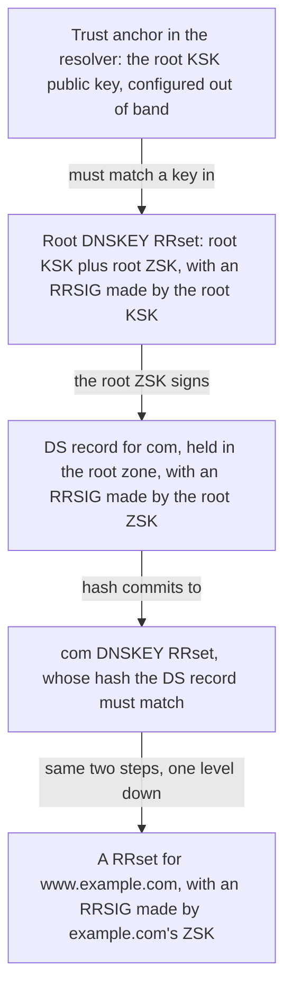
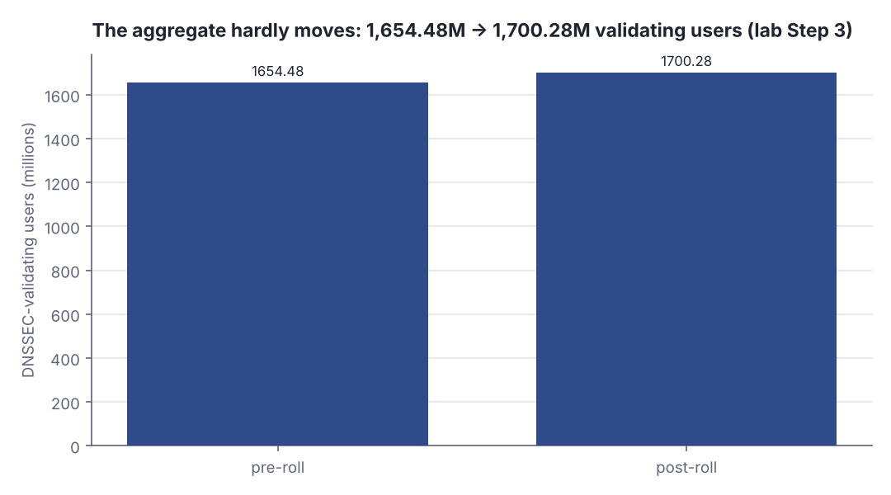
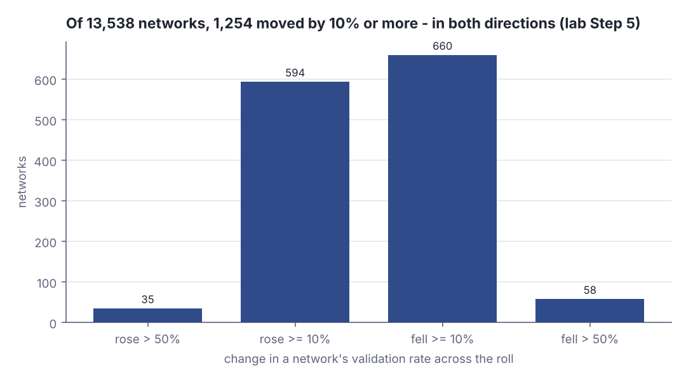
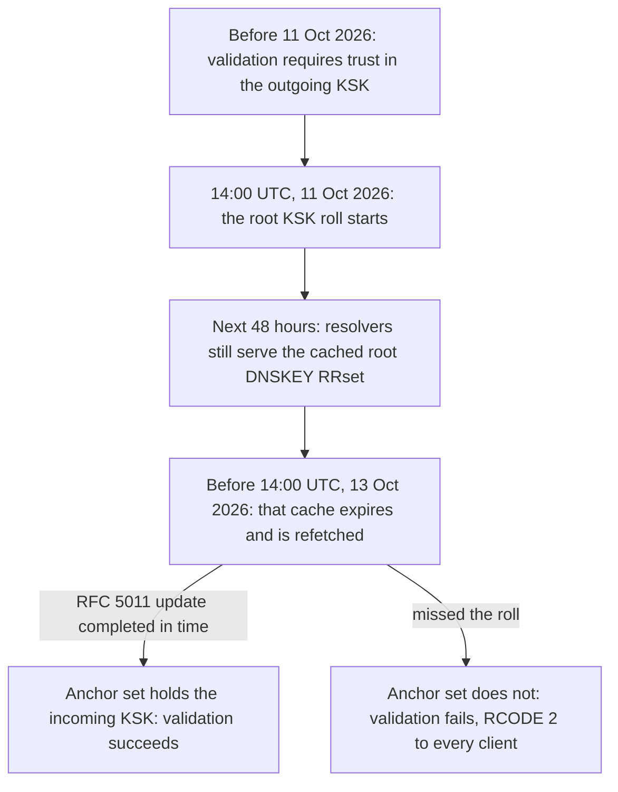
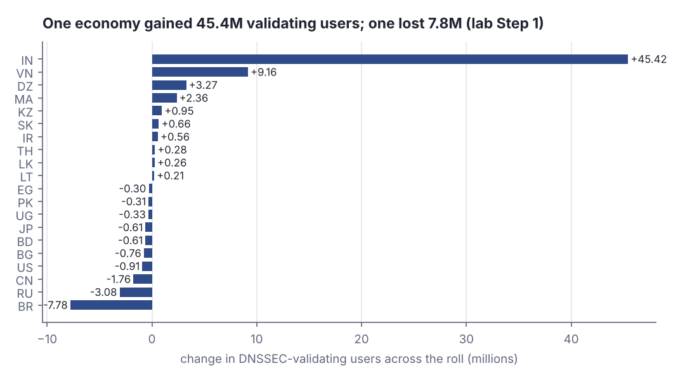

# The root key rolled — what the measurements showed

> Fresh · Networking, modern · Intermediate · ~25 min · from today's feeds

## Why this matters
On 11 October 2026 the DNS root zone's Key Signing Key was replaced — the one cryptographic key every validating resolver on Earth has to hold out of band, and the one whose failure makes names stop resolving rather than merely resolve slowly.
Geoff Huston published the measurements ten days later, and they are a rare public worked example of judging a key rotation you cannot instrument: nobody can enumerate the world's resolvers, so you infer their state from the client side and argue from statistics.
That inference problem — a flat aggregate hiding a long tail of instances that broke, and others that quietly healed — is exactly what you face when you rotate a signing key in a system whose clients you do not own.

## Primer
DNSSEC does not sign DNS messages. It signs **RRsets** — the set of records sharing one owner name, class and type — and puts the signature in an `RRSIG` record beside them (RFC 4034 §3, §3.1.8). A validator then walks an *authentication chain*: an alternating sequence of `DNSKEY` RRsets and `DS` (Delegation Signer) RRsets, each link vouching for the next (RFC 4033 §2). The root's `DS` record for `com` commits, by hash, to `com`'s `DNSKEY` RRset; `com`'s `DS` for `example.com` commits to that zone's keys; and so on down.

Zones split their key material. The **Zone Signing Key (ZSK)** signs ordinary RRsets and is rolled often. The **Key Signing Key (KSK)** signs only the `DNSKEY` RRset, and it is the key the parent's `DS` points at. The root has no parent, so the root KSK must be configured locally: it is the **trust anchor**, defined as "a configured DNSKEY RR or DS RR hash of a DNSKEY RR" obtained out of band and used as the starting point for building every chain (RFC 4033 §2).

Replacing a trust anchor is therefore not a DNS operation — it is a configuration change in every validating resolver in the world. RFC 5011, *Automated Updates of DNS Security (DNSSEC) Trust Anchors*, automates it (§2, "Theory of Operation"): a resolver that sees a new Secure Entry Point key inside a `DNSKEY` RRset validly signed by a key it already trusts starts a 30-day *add hold-down* timer, and adds the key to its anchor set only after it expires (§2.2); a `REVOKE` bit retires the old key (§2.1).

A resolver that misses all this answers RCODE 2 — server failure, SERVFAIL — for every name under the broken chain (RFC 4035 §5.5, "Resolver Behavior When Signatures Do Not Validate"; RCODE 2 is server failure, RFC 4035 §3.2.2). Not slow: gone.

And since you cannot ask those resolvers what they hold, RFC 8509, *A Root Key Trust Anchor Sentinel for DNSSEC*, has clients ask instead: a resolver that implements it answers names whose leftmost label is `root-key-sentinel-is-ta-<key-tag>` or `root-key-sentinel-not-ta-<key-tag>` according to whether that key tag is in its trust anchor set (RFC 8509 §2, §2.1).

## The idea

### The roll, and the 48 hours that decide it

The root KSK rolled at 14:00 UTC on 11 October 2026 (Huston, 21 Oct 2026). Nothing breaks at that instant, because validating resolvers are still serving a cached copy of the root `DNSKEY` RRset, whose cached lifetime is two days (Huston, 21 Oct 2026). The deadline is the cache expiry:

> "Once the locally cached `DNSKEY` resource record was refreshed  — sometime before 14:00 UTC on 13 October — a validating resolver would need to trust the incoming KSK to successfully perform a validation operation."
> — Geoff Huston, *Rolling the root key: What happened?*, 21 Oct 2026, https://blog.apnic.net/2026/10/21/rolling-the-root-key-what-happened/

So the failure, if it comes, is spread smoothly across a 48-hour window as each resolver's cache happens to expire — not a cliff edge at 14:00.



*Figure 1: the authentication chain a validator walks, and the single place the root KSK enters it. Source: RFC 4033 §2 and RFC 4034 §3, §5, https://datatracker.ietf.org/doc/html/rfc4033.*

### Why this is a measurement problem

Nobody holds a register of the world's recursive resolvers, and the DNS is deliberately loosely coupled, so "did the roll work?" cannot be answered by asking. It has to be answered by sampling clients:

> "We will again use the Key Signing Key (KSK) Sentinel signal to see which networks have successfully tracked the rolling of the root key."
> — Geoff Huston, *Rolling the root key: What happened?*, 21 Oct 2026, https://blog.apnic.net/2026/10/21/rolling-the-root-key-what-happened/

The sentinel names from RFC 8509 §2 turn a resolver's private configuration into an observable: the same browser asks for both `root-key-sentinel-is-ta-<tag>` and `root-key-sentinel-not-ta-<tag>`, and the pair of answers pins down whether the resolver holds that tag. Served to millions of browsers through an ad network, that gives per-network coverage nobody could get by asking operators. Here is the decision table it reveals, with the before-and-after state of a resolver that holds, or does not hold, each key:

```scala
def probe(incumbent: Boolean, incoming: Boolean): String =
  val before = if incumbent then "validates" else "fails"
  val after  = if incoming  then "validates" else "fails"
  val isTa   = if incoming then "resolves" else "SERVFAIL"
  f"before=$before%-9s after=$after%-9s  is-ta-<new>=$isTa"
for a <- List(true, false); b <- List(true, false) do
  println(f"incumbent=$a%-5s incoming=$b%-5s  ${probe(a, b)}")
```

```text
incumbent=true  incoming=true   before=validates after=validates  is-ta-<new>=resolves
incumbent=true  incoming=false  before=validates after=fails      is-ta-<new>=SERVFAIL
incumbent=false incoming=true   before=fails     after=validates  is-ta-<new>=resolves
incumbent=false incoming=false  before=fails     after=fails      is-ta-<new>=SERVFAIL
```

Look at the third row. A resolver that trusted the *incoming* key but not the *incumbent* one was already broken before the roll, and the roll repaired it. That row is why a measurement of this kind produces large *improvements* as well as regressions, and it is the key to reading the tail below.

### The global number barely moves

> "This data indicates that the global average DNSSEC validation rate rose from a pre-roll value of 39.7% to a post-roll value of 40.6%."
> — Geoff Huston, *Rolling the root key: What happened?*, 21 Oct 2026, https://blog.apnic.net/2026/10/21/rolling-the-root-key-what-happened/

> "Across the KSK roll, we observed a net increase of 45.8 million DNSSEC-validating users."
> — Geoff Huston, *Rolling the root key: What happened?*, 21 Oct 2026, https://blog.apnic.net/2026/10/21/rolling-the-root-key-what-happened/

In absolute terms that is 1,654,477,399 users before and 1,700,275,794 after, out of 4,308,517,174 measured (Huston, 21 Oct 2026). Put those three numbers through the arithmetic and the headline shrinks:

```scala
val pre    = 1654477399L          // validating users before the roll
val post   = 1700275794L          // validating users after the roll
val brazil = -7780266L            // Brazil's change, Huston's Table 2
val net    = post - pre
println(s"net = $post - $pre = $net")
println(f"net / pre = ${net.toDouble / pre}%.5f  (${net.toDouble * 100 / pre}%+.2f%%)")
println(f"Brazil inside that net: ${brazil.toDouble * 100 / net}%+.1f%% of it")
println(f"rate Huston reports:    39.7%% -> 40.6%% = ${40.6 - 39.7}%+.1f points")
```

```text
net = 1700275794 - 1654477399 = 45798395
net / pre = 0.02768  (+2.77%)
Brazil inside that net: -17.0% of it
rate Huston reports:    39.7% -> 40.6% = +0.9 points
```

A 2.77% relative change, 0.9 percentage points on the measured population — and a single economy's regression equal to 17% of the net sits inside it, invisible.



*Figure 2: the global aggregate across the roll, from the lab's Step 3 output (`python3 dojo/engine/run_lab.py 2026-11-06-2`). Source: counts from Geoff Huston, Rolling the root key: What happened?, 21 Oct 2026, https://blog.apnic.net/2026/10/21/rolling-the-root-key-what-happened/.*

### The tail is the story

Huston also measured 13,538 individual networks with at least about 20 samples a day, against a baseline of the first ten days of October (Huston, 21 Oct 2026). Of those, 35 networks rose by more than 50% and 594 by 10% or more, while 58 fell by 50% or more and 660 by 10% or more (Huston, 21 Oct 2026).



*Figure 3: the distribution of per-network change across the roll, printed by the lab's Step 5 (`python3 dojo/engine/run_lab.py 2026-11-06-2`). Adapted from Geoff Huston, Rolling the root key: What happened?, https://blog.apnic.net/2026/10/21/rolling-the-root-key-what-happened/.*

The 35 big risers are the third row of the table above: they most likely trusted the incoming KSK and not the incumbent, so they had been failing before the roll and the roll fixed them. The 58 big fallers are the ones that genuinely missed it — and Huston offers no explanation for them. Both groups cancel in the aggregate.

### Two economies, and one phone call

India's validation rate went from 55% to 59% across the roll after Huston contacted a major Indian ISP about its sentinel signal on 9 October; Brazil's went from 54% to 50%, because its ISPs showing the same signal were not reached in time (Huston, 21 Oct 2026). In users, that is +45,423,360 for India and −7,780,266 for Brazil (Huston, Tables 1 and 2, 21 Oct 2026).



*Figure 4: the roll timeline and the two outcomes at cache expiry. Source: timings from Geoff Huston, Rolling the root key: What happened?, 21 Oct 2026, https://blog.apnic.net/2026/10/21/rolling-the-root-key-what-happened/; failure behaviour from RFC 4035 §5.5.*

And the group everyone expected to break did not:

> "Surprisingly, none of these networks was stranded when the KSK rolled."
> — Geoff Huston, *Rolling the root key: What happened?*, 21 Oct 2026, https://blog.apnic.net/2026/10/21/rolling-the-root-key-what-happened/

All 50 networks with the lowest acceptance of the outgoing KSK-2024 in the 9 October survey added the new key between 7 and 13 October, and all crossed above 50% acceptance (Huston, 21 Oct 2026).

### What to take into your own work

This is what "the rotation went fine" looks like when you can only observe it statistically. The aggregate moved 0.9 points; underneath it, 93 of 13,538 networks moved by more than half their validation rate, in both directions, and one economy lost 7.8 million users. If you rotate a JWT signing key, a CA, or a schema version against clients you do not control, the mean will tell you nothing: you need a per-client observable (the sentinel's role), a pre-roll baseline to diff against, and the discipline to look at the tail — including the clients that *improved*, because those were the ones already broken.

## Lab

**The question:** why did the global validation rate barely move while hundreds of individual networks broke?

### Step 1 — hold the article's real numbers and print every row

The program carries Huston's Table 1 (largest gains) and Table 2 (largest drops) verbatim, plus the global totals. Where the article publishes only a difference for an economy, the pre and post columns print `-` rather than a guess. Save it as `Lab.scala` and run `scala Lab.scala` (in this repo: `dojo/engine/run_lab.py 2026-11-06-2`).

```scala
// file: Lab.scala
// Lesson 2026-11-06-2 -- the October 2026 root KSK roll, measured from the client side.
// Every input number below is from Geoff Huston, "Rolling the root key: What happened?",
// APNIC Blog, 21 Oct 2026. Nothing here is estimated; the derived columns are arithmetic.

/** One economy from Huston's Table 1 / Table 2. pop/pre/post are 0 when the article
  * publishes only the difference for that economy. */
case class Eco(cc: String, pop: Long, pre: Long, post: Long, delta: Long):
  def known: Boolean = pre > 0
  def pct: Double = delta.toDouble * 100.0 / pre.toDouble
  def prePctOfPop: Double = pre.toDouble * 100.0 / pop.toDouble
  def postPctOfPop: Double = post.toDouble * 100.0 / pop.toDouble

val gains = List(
  Eco("IN", 655274727L, 321679249L, 367102609L, 45423360L),
  Eco("VN", 0L, 0L, 0L, 9157450L),
  Eco("DZ", 0L, 0L, 0L, 3266261L),
  Eco("MA", 0L, 0L, 0L, 2360854L),
  Eco("KZ", 0L, 0L, 0L, 950982L),
  Eco("SK", 0L, 0L, 0L, 664669L),
  Eco("IR", 0L, 0L, 0L, 558706L),
  Eco("TH", 0L, 0L, 0L, 282420L),
  Eco("LK", 0L, 0L, 0L, 263373L),
  Eco("LT", 0L, 0L, 0L, 208987L)
)

val drops = List(
  Eco("BR", 162001400L, 80503978L, 72723712L, -7780266L),
  Eco("RU", 0L, 0L, 0L, -3078946L),
  Eco("CN", 0L, 0L, 0L, -1756584L),
  Eco("US", 0L, 0L, 0L, -906565L),
  Eco("BG", 0L, 0L, 0L, -760869L),
  Eco("BD", 0L, 0L, 0L, -610974L),
  Eco("JP", 0L, 0L, 0L, -609093L),
  Eco("UG", 0L, 0L, 0L, -329937L),
  Eco("PK", 0L, 0L, 0L, -312472L),
  Eco("EG", 0L, 0L, 0L, -300999L)
)

// Global totals, Huston 21 Oct 2026.
val preGlobal  = 1654477399L
val postGlobal = 1700275794L
val measuredUsers = 4308517174L
val statedPreRate  = 39.7  // % of measurements using only validating resolvers, pre-roll
val statedPostRate = 40.6  // % post-roll

// Figure 4: per-network change across 13,538 networks, 20 samples/day on average.
val networksTotal = 13538
val buckets = List(
  ("rose  > 50%", 35),
  ("rose >= 10%", 594),
  ("fell >= 10%", 660),
  ("fell  > 50%", 58)
)

def grp(n: Long): String =
  val s = math.abs(n).toString
  val withSep = s.reverse.grouped(3).mkString(",").reverse
  if n < 0 then "-" + withSep else withSep

def pad(s: String, w: Int): String = " " * math.max(0, w - s.length) + s

@main def lab(): Unit =
  println("STEP 1 -- per-economy change in DNSSEC-validating users across the roll")
  println("(source: Huston, Table 1 and Table 2, 21 Oct 2026; '-' = article gives only the delta)")
  println("")
  println(pad("eco", 4) + pad("pre", 14) + pad("post", 14) + pad("delta", 13) +
          pad("%delta", 9) + pad("delta/1e6", 11))
  println("-" * 65)
  val all = (gains ++ drops).sortBy(e => -e.delta)
  for e <- all do
    val pre  = if e.known then grp(e.pre)  else "-"
    val post = if e.known then grp(e.post) else "-"
    val pc   = if e.known then f"${e.pct}%+.2f%%" else "-"
    val mil  = f"${e.delta / 1e6}%+.2f"
    println(pad(e.cc, 4) + pad(pre, 14) + pad(post, 14) + pad(grp(e.delta), 13) +
            pad(pc, 9) + pad(mil, 11))
  println("")

  val sumGains  = gains.map(_.delta).sum
  val sumDrops  = drops.map(_.delta).sum
  val netTop20  = sumGains + sumDrops
  println("STEP 2 -- add the two columns up")
  println(s"  sum of the 10 largest gains : ${grp(sumGains)}")
  println(s"  sum of the 10 largest drops : ${grp(sumDrops)}")
  println(s"  net of these 20 economies   : ${grp(netTop20)}")
  println(s"  India alone is ${f"${gains.head.delta.toDouble * 100 / sumGains}%.1f"}% of the gains column")
  println("")

  val netGlobal = postGlobal - preGlobal
  val relative  = netGlobal.toDouble * 100.0 / preGlobal.toDouble
  val restOfWorld = netGlobal - netTop20
  println("STEP 3 -- the global aggregate and what the net does to it")
  println(f"  pre/post in millions        : ${preGlobal / 1e6}%.2f -> ${postGlobal / 1e6}%.2f")
  println(s"  pre-roll  validating users  : ${grp(preGlobal)}")
  println(s"  post-roll validating users  : ${grp(postGlobal)}")
  println(s"  net                         : ${grp(netGlobal)}  (Huston: '+45.8 million')")
  println(s"  net as % of the pre-roll base: ${f"$relative%+.3f"}%")
  println(s"  every other economy, netted : ${grp(restOfWorld)}")
  println(s"  share of measured users     : ${f"${preGlobal.toDouble*100/measuredUsers}%.2f"}% -> " +
          f"${postGlobal.toDouble*100/measuredUsers}%.2f%%  (derived from the user counts)")
  println(s"  Huston's measured rate      : $statedPreRate% -> $statedPostRate%  " +
          f"(a ${statedPostRate - statedPreRate}%+.1f point move)")
  println("")

  val br = drops.head
  println("STEP 4 -- trace one regression, digits shown (Brazil)")
  println(s"  ${grp(br.post)} - ${grp(br.pre)} = ${grp(br.delta)}")
  println(f"  ${br.delta}%d / ${br.pre}%d = ${br.pct / 100}%.6f  -> ${br.pct}%+.2f%% of Brazil's validating users")
  println(f"  ${br.delta}%d / ${br.pop}%d = ${br.delta.toDouble / br.pop}%.6f -> " +
          f"${br.postPctOfPop - br.prePctOfPop}%+.2f points of its ${grp(br.pop)} measured users")
  println(f"  Brazil's own rate, from these counts: ${br.prePctOfPop}%.2f%% -> ${br.postPctOfPop}%.2f%%")
  println(f"  Brazil is ${br.delta.toDouble * 100 / netGlobal}%+.1f%% of the global net")
  println("")

  println("STEP 5 -- the per-network tail behind that aggregate")
  println(s"  networks measured           : ${grp(networksTotal)} (avg 20 samples/day)")
  for (label, n) <- buckets do
    val share = n.toDouble * 100.0 / networksTotal
    println(f"  $label%-12s : ${pad(n.toString, 5)}  (${share}%.2f%% of networks)")
  val moved10 = buckets.filter((l, _) => l.contains("10")).map(_._2).sum
  val moved50 = buckets.filter((l, _) => l.contains("50")).map(_._2).sum
  println(s"  moved by 10% or more        : ${grp(moved10)}")
  println(s"  moved by 50% or more        : ${grp(moved50)}")
  println(f"  networks that barely moved  : ${grp(networksTotal - moved10)} " +
          f"(${(networksTotal - moved10).toDouble * 100 / networksTotal}%.1f%%)")
```

### Step 2 — read the real output

```text
STEP 1 -- per-economy change in DNSSEC-validating users across the roll
(source: Huston, Table 1 and Table 2, 21 Oct 2026; '-' = article gives only the delta)

 eco           pre          post        delta   %delta  delta/1e6
-----------------------------------------------------------------
  IN   321,679,249   367,102,609   45,423,360  +14.12%     +45.42
  VN             -             -    9,157,450        -      +9.16
  DZ             -             -    3,266,261        -      +3.27
  MA             -             -    2,360,854        -      +2.36
  KZ             -             -      950,982        -      +0.95
  SK             -             -      664,669        -      +0.66
  IR             -             -      558,706        -      +0.56
  TH             -             -      282,420        -      +0.28
  LK             -             -      263,373        -      +0.26
  LT             -             -      208,987        -      +0.21
  EG             -             -     -300,999        -      -0.30
  PK             -             -     -312,472        -      -0.31
  UG             -             -     -329,937        -      -0.33
  JP             -             -     -609,093        -      -0.61
  BD             -             -     -610,974        -      -0.61
  BG             -             -     -760,869        -      -0.76
  US             -             -     -906,565        -      -0.91
  CN             -             -   -1,756,584        -      -1.76
  RU             -             -   -3,078,946        -      -3.08
  BR    80,503,978    72,723,712   -7,780,266   -9.66%      -7.78

STEP 2 -- add the two columns up
  sum of the 10 largest gains : 63,137,062
  sum of the 10 largest drops : -16,446,705
  net of these 20 economies   : 46,690,357
  India alone is 71.9% of the gains column

STEP 3 -- the global aggregate and what the net does to it
  pre/post in millions        : 1654.48 -> 1700.28
  pre-roll  validating users  : 1,654,477,399
  post-roll validating users  : 1,700,275,794
  net                         : 45,798,395  (Huston: '+45.8 million')
  net as % of the pre-roll base: +2.768%
  every other economy, netted : -891,962
  share of measured users     : 38.40% -> 39.46%  (derived from the user counts)
  Huston's measured rate      : 39.7% -> 40.6%  (a +0.9 point move)

STEP 4 -- trace one regression, digits shown (Brazil)
  72,723,712 - 80,503,978 = -7,780,266
  -7780266 / 80503978 = -0.096644  -> -9.66% of Brazil's validating users
  -7780266 / 162001400 = -0.048026 -> -4.80 points of its 162,001,400 measured users
  Brazil's own rate, from these counts: 49.69% -> 44.89%
  Brazil is -17.0% of the global net

STEP 5 -- the per-network tail behind that aggregate
  networks measured           : 13,538 (avg 20 samples/day)
  rose  > 50%  :    35  (0.26% of networks)
  rose >= 10%  :   594  (4.39% of networks)
  fell >= 10%  :   660  (4.88% of networks)
  fell  > 50%  :    58  (0.43% of networks)
  moved by 10% or more        : 1,254
  moved by 50% or more        : 93
  networks that barely moved  : 12,284 (90.7%)
```



*Figure 5: the twenty economies of Huston's Tables 1 and 2, from the lab's `delta/1e6` column (`python3 dojo/engine/run_lab.py 2026-11-06-2`). Source: Geoff Huston, Rolling the root key: What happened?, 21 Oct 2026, https://blog.apnic.net/2026/10/21/rolling-the-root-key-what-happened/.*

### Reading the output

**Step 1 table.** `eco` is the ISO country code. `pre` and `post` are the number of users behind DNSSEC-validating resolvers in that economy before and after the roll; higher is better. `delta` is `post − pre`; positive is better. `%delta` is `delta / pre` and exists only for the two economies where the article publishes both counts (IN and BR) — for the other eighteen Huston gives the difference alone, so printing a percentage there would be invention. `delta/1e6` is the same delta in millions, and it is the column charted in Figure 5. The rows are sorted by delta, so the two ends of the table are the two ends of the distribution: India at +45,423,360 and Brazil at −7,780,266.

**Verdict:** the per-economy picture is dominated by two countries moving in opposite directions.

**Step 2.** The ten largest gains add to +63,137,062 and the ten largest drops to −16,446,705, netting +46,690,357 across these twenty economies. India alone is 71.9% of the gains column.

**Verdict:** even the "largest movers" list is really one country plus noise.

**Step 3.** The global totals net to 1,700,275,794 − 1,654,477,399 = +45,798,395, which rounds to the +45.8 million Huston reports. That is +2.768% of the pre-roll base. Note `every other economy, netted : -891,962`: the twenty listed economies net *more* than the world does, so everything outside the two tables is slightly negative in sum. The last two lines are two different estimates of the same thing and should not be confused: 38.40% → 39.46% is the ratio of the user counts, while 39.7% → 40.6% is Huston's measured validation rate over samples. The rate is computed from the sampled measurements, the user counts from per-network population weighting, so they differ by about 1.3 points in level while agreeing on the direction and roughly on the size of the move.

**Verdict:** whichever estimate you use, the global signal is under one percentage point.

**Step 4 — the arithmetic traced, digits shown.** Brazil: 72,723,712 − 80,503,978 = −7,780,266. Divide by the pre-roll count: −7,780,266 / 80,503,978 = −0.096644, that is −9.66% of Brazil's validating users gone. Divide instead by Brazil's measured population of 162,001,400: −7,780,266 / 162,001,400 = −0.048026, so Brazil's own validation rate computed from these counts falls 49.69% → 44.89%, a −4.80 point move. And −7,780,266 / 45,798,395 = −17.0%: Brazil's loss is 17% of the global net gain, yet it is nowhere visible in the global figure.

**Verdict:** a −4.8 point regression for 162 million people disappears inside a +0.9 point global move.

**Step 5 distribution.** `networks measured` is the 13,538 networks with roughly 20 samples a day. The four buckets are Huston's: 35 rose by more than 50%, 594 by 10% or more, 660 fell by 10% or more, 58 fell by more than 50%. Reading the larger buckets as containing the smaller ones (594 includes the 35; 660 includes the 58), 1,254 networks moved by 10% or more and 93 by 50% or more, leaving 12,284 — 90.7% — that barely moved.

**Verdict:** 9.3% of measured networks moved materially, in both directions, and they cancel almost exactly in the aggregate.

### Cause → consequence

1. **Cause:** a trust anchor lives in each resolver's local configuration, not in the DNS, so the roll's success depends on 13,538-plus independent configuration states that nobody can enumerate.
2. **Mechanism:** each resolver keeps serving its cached root `DNSKEY` RRset for up to two days, so the consequences of a missing anchor arrive smeared over the 48 hours after 14:00 UTC on 11 October, resolver by resolver, as RCODE 2 for everything under the chain (RFC 4035 §5.5).
3. **Consequence:** the only available instrument is a client-side one — RFC 8509 sentinel queries served through an ad network — and it produces a *distribution*, not a verdict. Networks that were already broken appear as large gains, networks that missed the roll as large losses, and the two groups largely cancel: +0.9 points globally while 93 networks moved by more than half their rate.
4. **In practice:** when you rotate a key or a schema against clients you do not control, instrument per client and diff against a pre-change baseline, not against the mean. Keep the improvements in the report as well as the regressions — a client that starts working the moment you rotate was broken before you touched anything, and that is a defect you would otherwise never have found.

Huston's own summary:

> "In that light, the measurements we’ve undertaken support the conclusion that the KSK roll of October 2026 was a success."
> — Geoff Huston, *Rolling the root key: What happened?*, 21 Oct 2026, https://blog.apnic.net/2026/10/21/rolling-the-root-key-what-happened/

## Self-check
1. The root KSK rolled at 14:00 UTC on 11 October 2026, yet Huston looks at a 48-hour window rather than at that instant. Why? <details><summary>Answer</summary>Validating resolvers serve a locally cached copy of the root `DNSKEY` RRset whose cached lifetime is two days (Huston, 21 Oct 2026). Until that cache expires nothing changes for them; only when it is refetched does validation require trust in the incoming KSK — "sometime before 14:00 UTC on 13 October" (Huston, 21 Oct 2026). So breakage arrives spread across the two days, resolver by resolver, rather than all at once.</details>
2. Thirty-five networks' validation rates rose by *more than 50%* across the roll. Why is a large rise evidence of a pre-existing fault rather than of a successful update? <details><summary>Answer</summary>A validation rate can only jump that far if validation was failing before and started succeeding after. The likely state is a resolver that had the incoming KSK in its trust anchor set but not the incumbent one, so it was returning RCODE 2 (RFC 4035 §5.5) for signed names before 11 October; once the root started signing with the incoming KSK its chain closed. The roll did not improve those networks — it repaired a fault that the sentinel measurement would otherwise never have surfaced.</details>
3. Brazil lost 7,780,266 validating users while the global figure rose 0.9 percentage points. Show why both statements are true at once. <details><summary>Answer</summary>The global base is 1,654,477,399 validating users of 4,308,517,174 measured (Huston, 21 Oct 2026). Brazil's −7,780,266 is −9.66% of its own 80,503,978, and −4.80 points of its 162,001,400 measured users, but only −0.47% of the global base — and it is more than offset by India's +45,423,360. The net, +45,798,395, is +2.768% of the base, which lands as Huston's 39.7% → 40.6%. Aggregation sums signed deltas, so a large regression in one place and a larger gain in another both vanish into a sub-point move.</details>

## Sources
- [Rolling the root key: What happened?](https://blog.apnic.net/2026/10/21/rolling-the-root-key-what-happened/) — Geoff Huston, APNIC Blog, 21 Oct 2026 — the primary source: the roll timeline, the KSK Sentinel method, the 39.7% → 40.6% global rate, the +45.8 million net, the 13,538-network distribution, Tables 1 and 2, and the 50 previously-at-risk networks. Every quoted passage in this lesson comes from it (accessed 2026-11-06).
- [RFC 4033, DNS Security Introduction and Requirements](https://datatracker.ietf.org/doc/html/rfc4033) — IETF, March 2005 — §2 definitions used in the Primer: trust anchor ("a configured DNSKEY RR or DS RR hash of a DNSKEY RR") and the authentication chain of alternating `DNSKEY` and `DS` RRsets (accessed 2026-11-06).
- [RFC 4034, Resource Records for the DNS Security Extensions](https://datatracker.ietf.org/doc/html/rfc4034) — IETF, March 2005 — §3 and §3.1.8 for `RRSIG` covering an RRset, §2 for `DNSKEY`, §5 for `DS`, §2.1.1 for the Secure Entry Point flag (accessed 2026-11-06).
- [RFC 4035, Protocol Modifications for the DNS Security Extensions](https://www.rfc-editor.org/info/rfc4035/) — IETF, March 2005 — §5.5 "Resolver Behavior When Signatures Do Not Validate", which requires RCODE 2 to the originating client; §3.2.2 identifies RCODE 2 as server failure (accessed 2026-11-06).
- [RFC 5011, Automated Updates of DNS Security (DNSSEC) Trust Anchors](https://datatracker.ietf.org/doc/html/rfc5011) — IETF, September 2007 — §2 "Theory of Operation", §2.2 the 30-day add hold-down before a new key becomes a trust anchor, §2.1 the `REVOKE` bit (accessed 2026-11-06).
- [RFC 8509, A Root Key Trust Anchor Sentinel for DNSSEC](https://www.rfc-editor.org/rfc/rfc8509.html) — IETF, December 2018 — §2 and §2.1: the `root-key-sentinel-is-ta-<key-tag>` and `root-key-sentinel-not-ta-<key-tag>` labels that make a resolver's trust anchor set observable from the client (accessed 2026-11-06).

Follow-up reading, **not quoted in this lesson and not fetched for it** — listed because the article points at them:
- https://blog.apnic.net/2026/05/05/rolling-the-root-key/ — Geoff Huston, APNIC Blog, 5 May 2026 — the companion post written ahead of the roll.
- https://blog.apnic.net/2026/10/09/rolling-the-root-key-2/ — Geoff Huston, APNIC Blog, 9 Oct 2026 — the companion post carrying the table of the 50 lowest-acceptance networks that Figure 3 of the 21 Oct article tracks.
- https://ispcol.potaroo.net/2026-10/ksk-as.csv and https://ispcol.potaroo.net/2026-10/ksk-as.txt — the per-AS data file the article publishes, and the explanation of its columns.
- https://stats.labs.apnic.net/dnssec and https://stats.labs.apnic.net/aspop — APNIC Labs' running DNSSEC validation and AS population measurements, the data sources behind the per-economy tables.

## Next on this track
Fresh lessons sit outside the ladder; next on Networking, modern: **Congestion control intuition: slow start, CUBIC vs BBR** (rung 3 of 16, Beginner).
