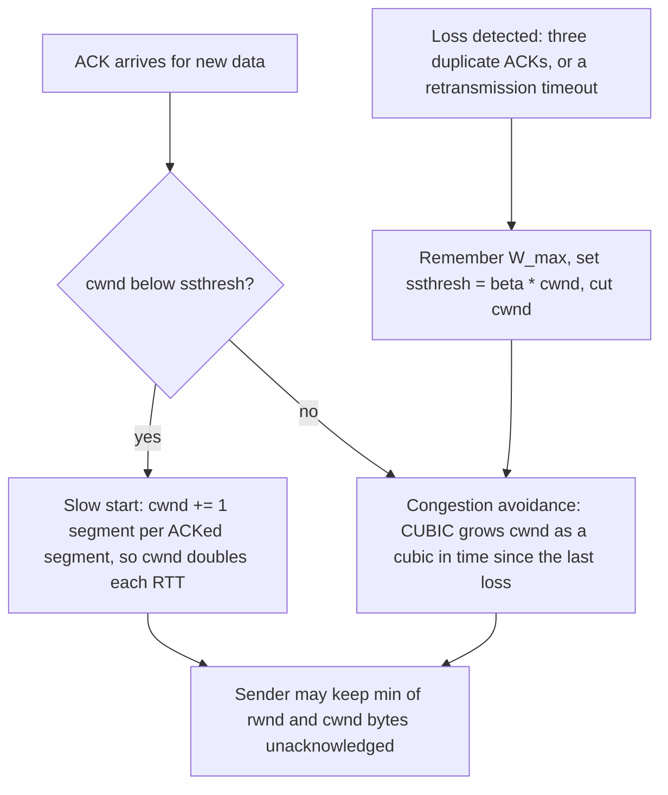
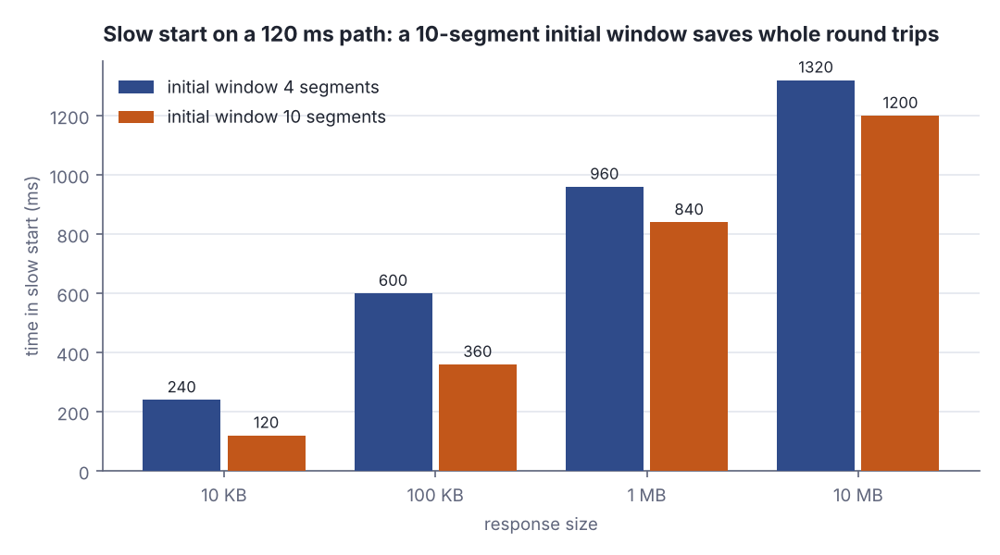
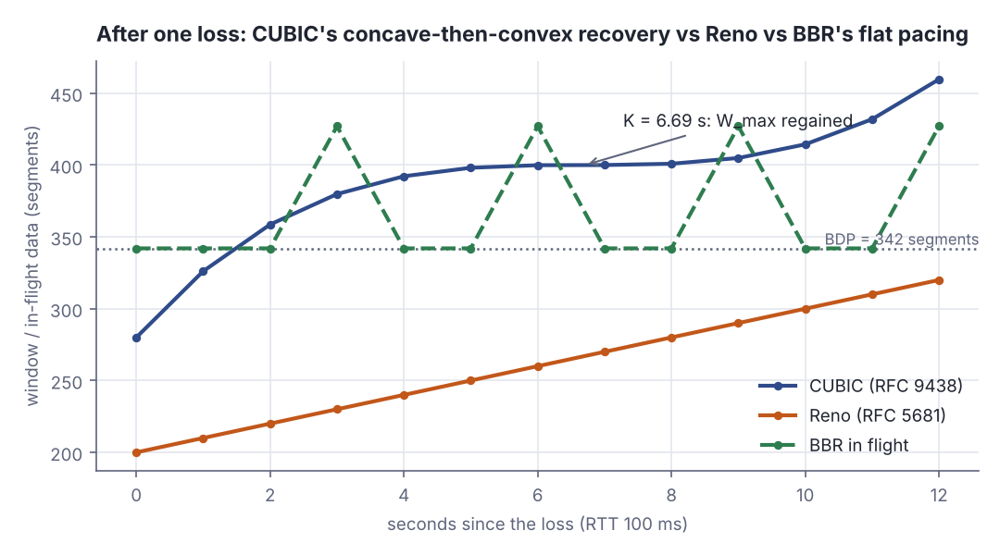

# Congestion control intuition: slow start, CUBIC vs BBR

> Networking, modern · Beginner · ~25 min · rung 3 of 16 · needs: What really happens in a TCP handshake and teardown (networking-01); Latency vs bandwidth, RTT, and why the speed of light is the budget (networking-02)

## Why this matters

You tune pool sizes, timeouts and region placement, but the number that decides how long a cold 100 KB JSON response takes is a counter in the kernel that nobody configured: the congestion window.
It is why latency jumps after a scale-out that opens fresh sockets, why one dropped packet on a long path costs whole seconds, and why "add bandwidth" so often changes nothing.
Last rung you measured RTT; this rung is what TCP does with it.

## The idea

TCP does not know how fast the path is. Nothing tells the sender the bottleneck link rate, the queue depth at the slowest hop, or how many other flows share it. So it starts low, probes upward, and treats the feedback it gets — loss, or for BBR a measured delivery rate — as its map of the path. Everything below follows from that.

### Two windows, and the sender obeys the smaller one

Two separate limits cap unacknowledged ("in-flight") data. The **receive window**, `rwnd`, is flow control: the receiver advertises in every ACK how much buffer it has left, so a fast sender cannot drown a slow reader. The **congestion window**, `cwnd`, is congestion control: the sender's private estimate of what the *path* will carry, never advertised, never negotiated. At any instant the sender may have `min(rwnd, cwnd)` bytes outstanding (HPBN ch. 2, "Congestion Avoidance and Control").

```scala
// file: Ex1.scala
@main def ex1(): Unit =
  val mss = 1460
  val rwnd = 262144
  for seg <- List(10, 40, 160, 640) do
    val cwnd = seg * mss
    val flight = math.min(rwnd, cwnd)
    val cap = if cwnd < rwnd then "cwnd" else "rwnd"
    println(f"cwnd $seg%3d seg = $cwnd%7d B | rwnd $rwnd B | in flight $flight%7d B ($cap)")
```

```text
cwnd  10 seg =   14600 B | rwnd 262144 B | in flight   14600 B (cwnd)
cwnd  40 seg =   58400 B | rwnd 262144 B | in flight   58400 B (cwnd)
cwnd 160 seg =  233600 B | rwnd 262144 B | in flight  233600 B (cwnd)
cwnd 640 seg =  934400 B | rwnd 262144 B | in flight  262144 B (rwnd)
```

With a 256 KB receive window, `cwnd` is the binding limit for the first three rows and only loses the `min` at 640 segments. A connection that has just opened sits far down that list, so enlarging receive buffers does nothing for a first request.



*Figure 1: The congestion window is updated on every ACK; which rule applies depends only on whether cwnd has passed ssthresh, and a loss resets both. Source: RFC 5681 §3.1 and RFC 9438 §4, drawn for this lesson.*

### Slow start: doubling, so small responses are RTT-bound

A fresh connection starts at the **initial window** — 10 segments since RFC 6928, up from the earlier 3–4, which at a 1460-byte MSS is about 14 KB of permission to send before the first ACK returns. In slow start the sender adds one segment to `cwnd` per segment acknowledged, so `cwnd` doubles each round trip — 10, 20, 40, 80 — until a loss happens or `cwnd` crosses the slow-start threshold `ssthresh` (RFC 5681 §3.1).

```scala
// file: Ex2.scala
@main def ex2(): Unit =
  val mss = 1460
  var cwnd = 10
  var sent = 0
  var rtt = 0
  while sent < 100000 do
    rtt += 1
    sent += cwnd * mss
    println(f"after RTT $rtt: cwnd $cwnd%3d seg, delivered $sent%7d B")
    cwnd *= 2
  println(s"100 KB needs $rtt RTTs of data in slow start")
```

```text
after RTT 1: cwnd  10 seg, delivered   14600 B
after RTT 2: cwnd  20 seg, delivered   43800 B
after RTT 3: cwnd  40 seg, delivered  102200 B
100 KB needs 3 RTTs of data in slow start
```

The response finishes after three round trips and never leaves slow start, so the link rate never enters the calculation. Up to a few hundred KB the delivery time is just *doublings × RTT* — which is why a warm connection, whose `cwnd` is already large, beats a faster pipe.



*Figure 2: On a 120 ms path the 10-segment initial window removes 240 ms from a 100 KB response and 120 ms even from 10 MB; the saving is in whole round trips, not bytes per second. Generated from the Step 2 lab output below.*

### Congestion avoidance, multiplicative decrease, CUBIC

Past `ssthresh` the sender switches to **congestion avoidance**: growth turns cautious, and a loss triggers a **multiplicative decrease** — the window is cut by a constant factor, not a byte count. Reno adds about one segment per RTT and halves `cwnd` on loss (RFC 5681 §3.1); on a long fat path that is hopeless. CUBIC replaces the straight line with a cubic in *wall-clock time since the last loss*, so recovery no longer slows down merely because the RTT is long (RFC 9438 §4). It remembers `W_max`, the window at the loss, multiplies by `beta_cubic = 0.7` rather than 0.5, then grows as `W(t) = C (t − K)^3 + W_max` with `C = 0.4` and `K = cbrt(W_max (1 − beta_cubic) / C)` (RFC 9438 §4.1–§4.2). The shape is the idea: **concave** back toward `W_max` — fast, then braking near the level known to work — then **convex**, accelerating past it to look for new capacity. A TCP-friendly region falls back to Reno-like growth whenever Reno would be faster, so CUBIC never starves classic flows (RFC 9438 §4.2).



*Figure 3: The same loss on the same path. CUBIC is back to 399.9 of its 400 segments after 6 s; Reno is at 260. BBR ignores the loss and paces near the 342-segment BDP, bumping to 427 when it probes. Adapted from RFC 9438 §4, Figure 1 "CUBIC Window Growth Function", https://www.rfc-editor.org/rfc/rfc9438.html — numbers generated from the Step 3 lab output below.*

### BBR: model the path instead of waiting for loss

Loss as a signal assumes a buffer small enough to overflow roughly when the path fills. Modern paths break that in both directions: deep last-mile buffers absorb the overshoot and become standing queues ("bufferbloat"), while shallow-buffered high-speed links drop packets at low utilisation and cost CUBIC 30% of its window for nothing (draft-ietf-ccwg-bbr, "Introduction"). BBR — Bottleneck Bandwidth and Round-trip propagation time, first described by Cardwell and colleagues in ACM Queue in 2016 — drops loss as the primary signal:

> "BBR uses recent measurements of a transport connection's delivery rate, round-trip time, and packet loss rate to build an explicit model of the network path, including its estimated available bandwidth, bandwidth-delay product, and the maximum volume of data that the connection can place in flight in the network without causing excessive queue pressure."
> — Cardwell, Swett and Beshay (eds.), *BBR Congestion Control*, draft-ietf-ccwg-bbr, accessed 2026-11-07, https://github.com/ietf-wg-ccwg/draft-ietf-ccwg-bbr/blob/main/draft-ietf-ccwg-bbr.md

Two running estimates carry that model: a max-filtered bottleneck bandwidth and a min-filtered RTT, both over a 10-second window (draft-ietf-ccwg-bbr, "BBR.MinRTTFilterLen"). The sender then *paces* at the estimated rate instead of firing a whole window at once, cruising at 0.90 of its bandwidth estimate and probing at a gain of 1.25 every two to three seconds ("ProbeBW_UP", "PickProbeWait"). That is the flat dashed line in Figure 3: the queue stays near empty, latency under load stays near the propagation floor, and a random 1% drop does not cost 30% of the window.

Sharing a bottleneck with CUBIC is the hard part, and the specification says so when it justifies that probing interval:

> "Choosing a value smaller than roughly 60 would imply that when BBR flows coexisted with Reno/CUBIC flows on public Internet broadband links, the Reno/CUBIC flows would not be able to achieve enough bandwidth to show 4K video."
> — Cardwell, Swett and Beshay (eds.), *BBR Congestion Control*, draft-ietf-ccwg-bbr, accessed 2026-11-07, https://github.com/ietf-wg-ccwg/draft-ietf-ccwg-bbr/blob/main/draft-ietf-ccwg-bbr.md

A sender that does not back off on loss takes bandwidth from one that does, unless it is forced to probe on a comparable timescale.

### What this changes in your work

Keep connections warm: a pool that holds sockets open keeps `cwnd` large, and HTTP/2 or HTTP/3 multiplexing puts many requests on one grown window, while a connection per request pays slow start every time. And know what your servers run — `sysctl net.ipv4.tcp_congestion_control` on Linux — because CUBIC and BBR fail in opposite ways.

## Lab

**The question:** how many round trips does slow start need for responses of 10 KB to 10 MB, how much does the initial window change that, and what does a single loss cost under CUBIC compared with Reno and BBR?

### Step 1 — do the 100 KB case by hand first

MSS is 1460 bytes; the initial window is 10 segments (RFC 6928). Each round trip the window doubles, so the cumulative bytes delivered after *n* round trips are `1460 * 10 * (2^n - 1)`:

- after 1 RTT: 10 segments = 14,600 B
- after 2 RTTs: 10 + 20 = 30 segments = 43,800 B
- after 3 RTTs: 10 + 20 + 40 = 70 segments = 102,200 B

102,200 ≥ 100,000, so a 100 KB response clears in **3 round trips of data**, entirely inside slow start. Predict the rest of the table before you run anything: 10 KB should need 1 RTT, and each further doubling of size should add roughly one RTT.

### Step 2 — run the simulator

Save this as `Lab.scala` and run `scala Lab.scala` (Scala 3, standard library only). It prints three blocks, headed `Step 1`, `Step 2` and `Step 3` in the output: the 100 KB walk you just did by hand, the slow-start recurrence for four payload sizes at two initial windows, and the CUBIC, Reno and BBR windows after one loss.

```scala
// file: Lab.scala

val MSS = 1460

@main def lab(): Unit =
  step1()
  step2()
  step3()

def step1(): Unit =
  println("=== Step 1: slow start for a 100 KB response, MSS 1460 B, initial window 10 seg ===")
  println("RTT  cwnd(seg)  sent this RTT(B)  cumulative(B)  cumulative(KB)")
  var cwnd = 10
  var sent = 0
  var rtt = 0
  while sent < 100000 do
    rtt += 1
    val thisRtt = cwnd * MSS
    sent += thisRtt
    val kb = sent / 1000.0
    println(f"$rtt%3d  $cwnd%9d  $thisRtt%16d  $sent%13d  $kb%14.1f")
    cwnd *= 2
  println(f"-> 100000 B delivered after $rtt round trips of data")

def rounds(payload: Int, iw: Int): Int =
  var cwnd = iw
  var sent = 0L
  var n = 0
  while sent < payload do
    sent += cwnd.toLong * MSS
    cwnd *= 2
    n += 1
  n

def step2(): Unit =
  println()
  println("=== Step 2: round trips and milliseconds in slow start (no loss) ===")
  println("payload    IW  RTTs  near RTT 10 ms  far RTT 120 ms")
  val sizes = List(("10 KB", 10000), ("100 KB", 100000), ("1 MB", 1000000), ("10 MB", 10000000))
  for (name, bytes) <- sizes; iw <- List(4, 10) do
    val n = rounds(bytes, iw)
    println(f"$name%-7s $iw%4d  $n%4d  ${n * 10}%12d ms  ${n * 120}%11d ms")

def step3(): Unit =
  println()
  println("=== Step 3: congestion window after one loss (W_max 400 seg, RTT 100 ms, BDP 342 seg) ===")
  val wMax = 400.0
  val beta = 0.7
  val c = 0.4
  val k = math.cbrt(wMax * (1 - beta) / c)
  println(f"CUBIC: beta_cubic $beta%.1f -> cwnd falls to ${wMax * beta}%.0f seg, C = $c%.1f")
  println(f"CUBIC: K = cbrt(W_max * (1 - beta) / C) = cbrt(300.0) = $k%.4f s")
  println(" t(s)  CUBIC(seg)  Reno(seg)  BBR inflight(seg)")
  for t <- 0 to 12 do
    val cubic = c * math.pow(t - k, 3) + wMax
    val reno = 200.0 + 10.0 * t
    val bbr = if t > 0 && t % 3 == 0 then 427 else 342
    println(f"$t%4d  $cubic%10.1f  $reno%9.1f  $bbr%17d")
```

```text
=== Step 1: slow start for a 100 KB response, MSS 1460 B, initial window 10 seg ===
RTT  cwnd(seg)  sent this RTT(B)  cumulative(B)  cumulative(KB)
  1         10             14600          14600            14.6
  2         20             29200          43800            43.8
  3         40             58400         102200           102.2
-> 100000 B delivered after 3 round trips of data

=== Step 2: round trips and milliseconds in slow start (no loss) ===
payload    IW  RTTs  near RTT 10 ms  far RTT 120 ms
10 KB      4     2            20 ms          240 ms
10 KB     10     1            10 ms          120 ms
100 KB     4     5            50 ms          600 ms
100 KB    10     3            30 ms          360 ms
1 MB       4     8            80 ms          960 ms
1 MB      10     7            70 ms          840 ms
10 MB      4    11           110 ms         1320 ms
10 MB     10    10           100 ms         1200 ms

=== Step 3: congestion window after one loss (W_max 400 seg, RTT 100 ms, BDP 342 seg) ===
CUBIC: beta_cubic 0.7 -> cwnd falls to 280 seg, C = 0.4
CUBIC: K = cbrt(W_max * (1 - beta) / C) = cbrt(300.0) = 6.6943 s
 t(s)  CUBIC(seg)  Reno(seg)  BBR inflight(seg)
   0       280.0      200.0                342
   1       326.1      210.0                342
   2       358.6      220.0                342
   3       379.8      230.0                427
   4       392.2      240.0                342
   5       398.1      250.0                342
   6       399.9      260.0                427
   7       400.0      270.0                342
   8       400.9      280.0                342
   9       404.9      290.0                427
  10       414.4      300.0                342
  11       431.9      310.0                342
  12       459.7      320.0                427
```

### Step 3 — look at the real thing (any Linux box or container, optional)

```bash
sysctl net.ipv4.tcp_congestion_control
sysctl net.ipv4.tcp_available_congestion_control
curl -o /dev/null -s https://speed.hetzner.de/100MB.bin &
ss -ti state established '( dport = :443 )'
```

`ss -ti` prints `cwnd:`, `rtt:<srtt>/<variance>`, `ssthresh:` and `bytes_acked:` per socket, and the first token of the line is the algorithm name (`cubic`, `bbr`). Run `ss -ti` a few times during the download and watch `cwnd` climb and then drop.

### Reading the output

**Step 1 — slow start for 100 KB.** `cwnd(seg)` is the window at the start of that round trip; `sent this RTT(B)` is `cwnd × 1460`; `cumulative(B)` is everything delivered so far. Smaller is worse here — you want the cumulative column to reach the payload in as few rows as possible.

| RTT | cwnd (seg) | sent this RTT (B) | cumulative (B) |
|---|---|---|---|
| 1 | 10 | 14,600 | 14,600 |
| 2 | 20 | 29,200 | 43,800 |
| 3 | 40 | 58,400 | 102,200 |

Traced with digits: 10 × 1460 = 14,600; 20 × 1460 = 29,200 and 14,600 + 29,200 = 43,800; 40 × 1460 = 58,400 and 43,800 + 58,400 = 102,200, which clears 100,000.

**Verdict:** a 100 KB response is a three-round-trip problem, not a bandwidth problem. On a 120 ms path that is 360 ms of pure waiting, and no link upgrade touches it.

**Step 2 — round trips and milliseconds.** `IW` is the initial window in segments, `RTTs` the number of doublings needed, and the last two columns are `RTTs × RTT` for a near (10 ms) and a far (120 ms) server. Fewer RTTs is better.

| payload | RTTs at IW 4 | RTTs at IW 10 | far-path ms at IW 4 | far-path ms at IW 10 |
|---|---|---|---|---|
| 10 KB | 2 | 1 | 240 | 120 |
| 100 KB | 5 | 3 | 600 | 360 |
| 1 MB | 8 | 7 | 960 | 840 |
| 10 MB | 11 | 10 | 1320 | 1200 |

Traced with digits for 100 KB at IW 4: cumulative segments are 4, 12, 28, 60, 124, so bytes are 5,840 / 17,520 / 40,880 / 87,600 / 181,040 — the fifth round is the first to pass 100,000, hence 5 RTTs and 5 × 120 = 600 ms.

**Verdict:** raising the initial window from 4 to 10 removes two whole round trips from a 100 KB response (600 ms → 360 ms on the far path) and only one from 10 MB. The initial window is a small-response optimisation; for large transfers the exponent has already taken over.

**Step 3 — recovery after one loss.** Each row is one second after the loss. `CUBIC(seg)` and `Reno(seg)` are congestion windows in segments; `BBR inflight(seg)` is the data BBR keeps in flight. Higher is better only up to the 342-segment BDP — beyond that the extra packets sit in a queue and buy delay, not throughput.

| t (s) | CUBIC | Reno | BBR in flight |
|---|---|---|---|
| 0 | 280.0 | 200.0 | 342 |
| 3 | 379.8 | 230.0 | 427 |
| 6 | 399.9 | 260.0 | 427 |
| 9 | 404.9 | 290.0 | 427 |
| 12 | 459.7 | 320.0 | 427 |

Traced with digits: `K = cbrt(400 × (1 − 0.7) / 0.4) = cbrt(300) = 6.6943`. At t = 3, `W = 0.4 × (3 − 6.6943)^3 + 400 = 0.4 × (−50.42) + 400 = 379.8`. At t = 12, `W = 0.4 × (5.3057)^3 + 400 = 0.4 × 149.36 + 400 = 459.7`. Reno is simply `200 + 10 t`, because 0.5 × 400 = 200 and one segment per 100 ms RTT is ten per second.

**Verdict:** CUBIC is within 0.1 segments of its pre-loss window after 6 s; Reno needs 20 s to get there. BBR never pays the penalty at all, because that single drop never entered its model — but notice it also never exceeds 427 segments, so it is not stealing throughput, it is refusing to fill a queue.

### Cause → consequence

1. **Cause:** the sender has no way to learn path capacity, so it must probe. **Mechanism:** `cwnd` starts at 10 segments and doubles per RTT. **Consequence:** small responses finish inside slow start and cost *doublings × RTT*. **In practice:** a connection-per-request client pays 360 ms for a 100 KB payload from a 120 ms-away region that a warm pool delivers in 120 ms.
2. **Cause:** loss is the only congestion signal CUBIC has. **Mechanism:** one drop multiplies `cwnd` by 0.7 and restarts the cubic clock. **Consequence:** on a shallow-buffered or lossy path a random drop costs 30% of the window and seconds of recovery. **In practice:** blaming "packet loss on the link" is incomplete — the algorithm's reaction is most of the damage.
3. **Cause:** deep last-mile buffers absorb the overshoot instead of dropping. **Mechanism:** CUBIC keeps growing until the buffer finally overflows, so the queue sits full. **Consequence:** throughput looks fine while latency under load collapses (bufferbloat). **In practice:** measure RTT *during* a transfer, not on an idle link, or you will measure the wrong thing.
4. **Cause:** BBR models bandwidth and minimum RTT instead. **Mechanism:** it paces at the estimated bottleneck rate and keeps roughly one BDP in flight, probing at gain 1.25 every 2–3 s. **Consequence:** high throughput on lossy paths and low queueing delay on deep-buffered ones, at the cost of needing explicit rules to stay fair to CUBIC. **In practice:** check `sysctl net.ipv4.tcp_congestion_control` before you tune anything else; switching the egress hosts of a long-haul, lossy service to `bbr` is often a bigger win than any code change.

## Self-check

1. A server advertises a 1 MB receive window and the client's `cwnd` is 20 segments with a 1460-byte MSS. How many bytes may be in flight, and which window is binding? <details><summary>Answer</summary>`min(rwnd, cwnd)` = `min(1,048,576, 20 × 1460 = 29,200)` = **29,200 bytes**, and `cwnd` is binding. The receive window only matters once the congestion window has grown past it, which on a new connection it has not.</details>
2. Your API returns 100 KB from a region 120 ms away, over a fresh TCP connection, and you double the server's link from 1 Gbps to 2 Gbps. What happens to the response time? <details><summary>Answer</summary>Essentially nothing. At MSS 1460 and an initial window of 10 segments the transfer needs 3 round trips (14,600 → 43,800 → 102,200 bytes), so it takes about 3 × 120 = 360 ms and never leaves slow start. Link rate is not in that calculation. Reusing a warm connection, or moving the region closer, is what helps.</details>
3. Why does a single random packet drop hurt CUBIC far more than it hurts BBR, and what does BBR pay for that? <details><summary>Answer</summary>CUBIC treats loss as the congestion signal: one drop multiplies `cwnd` by `beta_cubic` = 0.7 and restarts the cubic growth clock from the new `W_max`, so recovery takes seconds (RFC 9438 §4). BBR builds a model from delivery rate and minimum RTT, so an isolated drop barely moves its bandwidth estimate. The cost is fairness: a sender that does not back off on loss would starve one that does, which is why the BBR specification forces a bandwidth probe at least every ~62 round trips so Reno and CUBIC flows keep their share.</details>

## Sources

- [BBR Congestion Control, draft-ietf-ccwg-bbr (IETF CCWG working document)](https://github.com/ietf-wg-ccwg/draft-ietf-ccwg-bbr/blob/main/draft-ietf-ccwg-bbr.md) — Neal Cardwell, Ian Swett, Joseph Beshay (eds.), Google and Meta — fetched and quoted this run; source of the three verbatim passages, of the model BBR builds (delivery rate, RTT, loss rate), of `BBR.MinRTTFilterLen` = 10 s, of the ProbeBW cruise gain 0.90 and probe gain 1.25, of the 2–3 s `bw_probe_wait`, and of the Reno/CUBIC coexistence rule (accessed 2026-11-07).
- [RFC 9438: CUBIC for Fast and Long-Distance Networks](https://www.rfc-editor.org/rfc/rfc9438.html) — IETF, 2023 — §4 "CUBIC Congestion Control": the window growth function `W(t) = C (t − K)^3 + W_max`, `C = 0.4`, `beta_cubic = 0.7`, the concave/convex regions and the TCP-friendly region used in The idea and in Step 3 (cited inline by section; the rfc-editor.org host was unreachable from this run's sandbox, so the link itself could not be re-verified today) (accessed 2026-11-07).
- [RFC 6928: Increasing TCP's Initial Window](https://www.rfc-editor.org/rfc/rfc6928.html) — IETF, 2013 — the initial window of 10 segments used in every calculation here (cited inline; link not re-verified this run, host unreachable) (accessed 2026-11-07).
- [RFC 5681: TCP Congestion Control](https://www.rfc-editor.org/rfc/rfc5681.html) — IETF, 2009 — §3.1: slow start, `ssthresh`, congestion avoidance and Reno's halve-on-loss behaviour used as the baseline in Step 3 (cited inline; link not re-verified this run, host unreachable) (accessed 2026-11-07).
- [High Performance Browser Networking, ch. 2 "Building Blocks of TCP"](https://hpbn.co/building-blocks-of-tcp/) — Ilya Grigorik, O'Reilly — "Congestion Avoidance and Control", "Slow-Start" and "Bandwidth-Delay Product": the framing of `min(rwnd, cwnd)` and of slow start as the dominant cost for small transfers (cited inline by section; link not re-verified this run, host unreachable) (accessed 2026-11-07).
- [BBR: Congestion-Based Congestion Control, ACM Queue, October 2016](https://queue.acm.org/detail.cfm?id=3022184) — Neal Cardwell, Yuchung Cheng, C. Stephen Gunn, Soheil Hassas Yeganeh, Van Jacobson — the original BBRv1 description; **not reachable from this run's sandbox**, so nothing is quoted from it and every BBR claim above is taken from the IETF draft instead (accessed 2026-11-07, fetch blocked).

## Next on this track
Next on Networking, modern: **UDP and when to choose it** (rung 4 of 16, Beginner).
