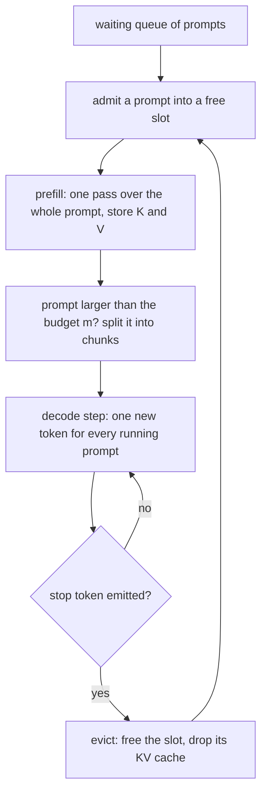
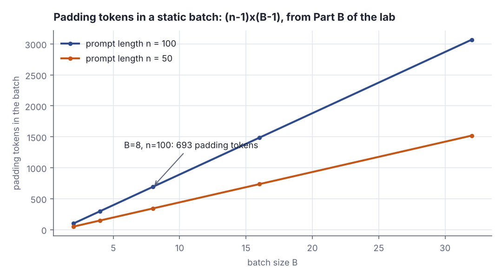
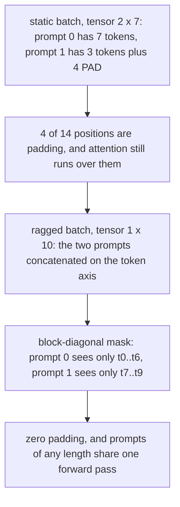
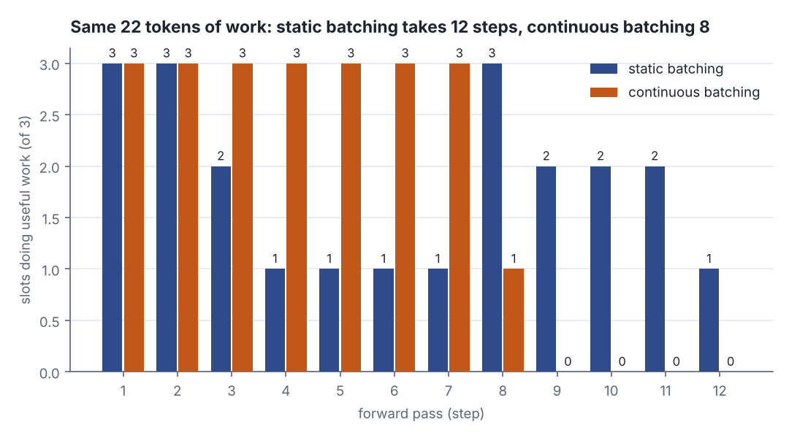

# Continuous batching: how one GPU serves many prompts at once

> Fresh · AI / ML foundations · Intermediate · ~25 min · from today's feeds

## Why this matters
Today's item is "Continuous batching from first principles", a Hugging Face engineering post by Rémi Ouazan Reboul, Arthur Zucker and Luc Georges, published 25 November 2025 (https://huggingface.co/blog/continuous_batching); it derives, step by step, the scheduler that lets one GPU answer many users at the same time.
The feeds' freshness window is 90 days and nothing inside it could be scanned today — the feed index pages were unreachable in this run — so this is the protocol's fallback: a timeless classic from the same feed, the Hugging Face blog.
You have built request schedulers before, so the shape is familiar — a fixed pool of workers, jobs of unknown length, head-of-line blocking — but with one twist you have not had to price: every in-flight request owns a block of GPU memory that grows with each token it emits and is only released when it finishes.

## Primer
**Token.** A language model reads **tokens**: integer ids from a fixed vocabulary, roughly a short word or word-piece each. The post's example prompt `I am sure this project` is 7 tokens. Inside the model each id becomes a vector of `d` numbers, so a prompt of `n` tokens is a tensor of shape `[1, n, d]`.

**Attention: Q, K and V.** Each attention layer multiplies every token's vector by three learned matrices, producing a **query** (what this token is looking for), a **key** (what it offers) and a **value** (what it hands over when chosen); stacked, these are `Q`, `K` and `V`. The layer computes the score matrix `QKᵀ`: entry *(i, j)* is the dot product of token *i*'s query with token *j*'s key — large when they point the same way, near zero when unrelated. Scores become weights summing to 1; each token's output is the weighted sum of the `V` rows. `QKᵀ` is `n × n`, which is where this lesson's quadratic cost comes from.

**The causal mask.** A text model predicts the next token, so token *i* must not see later tokens. Before weighting, the entries of `QKᵀ` above the diagonal are set to minus infinity, driving their weight to zero, so a token attends only to itself and earlier ones. The mask is just a table of allowed and forbidden pairs — hold that thought; the lesson turns on it.

**Prefill and decode.** Serving a prompt has two phases. **Prefill** runs the whole prompt through the model in one pass, producing `K` and `V` for every prompt token. **Decode** then goes one token at a time, reusing the stored `K` and `V` instead of recomputing them. Prefill is one big parallel pass; decode is a long run of tiny ones. Everything below follows from that asymmetry.

## The idea

The post states its own route in one line:

> "TL;DR: in this blog post, starting from attention mechanisms and KV caching, we derive continuous batching by optimizing for throughput."
>
> — Rémi Ouazan Reboul, Arthur Zucker and Luc Georges, *Continuous batching from first principles*, Hugging Face, 2025-11-25, https://huggingface.co/blog/continuous_batching

Take that literally: each step below is forced by the one before it.

### Step one: the cache that makes decoding cheap, and expensive

Recomputing `K` and `V` for the whole sequence at every token would be absurd, so they are kept:

> "This is the KV cache: the list of key and value states created during generation."
>
> — Rémi Ouazan Reboul, Arthur Zucker and Luc Georges, *Continuous batching from first principles*, Hugging Face, 2025-11-25, https://huggingface.co/blog/continuous_batching

The cache is what makes decoding cheap, and it is paid for in memory. The post's formula is `2 * L * A * H` values per token — 2 for key *and* value, `L` layers, `H` heads, `A` dimensions per head — grounded with Llama-2-7B:

> "For instance, Llama-2-7B with L=32 layers, H=32 heads, and A=128 requires 2×32×128=8,192 values per token per layer."
>
> — Rémi Ouazan Reboul, Arthur Zucker and Luc Georges, *Continuous batching from first principles*, Hugging Face, 2025-11-25, https://huggingface.co/blog/continuous_batching

> "With float16 precision, this takes 2AH×2 bytes =16 KB in memory."
>
> — Rémi Ouazan Reboul, Arthur Zucker and Luc Georges, *Continuous batching from first principles*, Hugging Face, 2025-11-25, https://huggingface.co/blog/continuous_batching

Read the units: both say **per layer**. Carry the layer count and the number is 32× bigger:

```scala
val L = 32; val H = 32; val A = 128
val perLayer = 2 * A * H
val whole = 2 * L * A * H
println(s"one layer : $perLayer values = ${perLayer * 2 / 1024} KB")
println(s"all layers: $whole values = ${whole * 2 / 1024} KB")
```

```text
one layer : 8192 values = 16 KB
all layers: 262144 values = 512 KB
```

The post's two numbers agree with each other; the mistake is the reader's to make. 16 KB is one token in one layer; a token costs 32 × 16 KB = 512 KB across the model, so one 2,048-token context is 1,024 MB of cache. That is why a serving slot is scarce: it is not a thread, it is a gigabyte.



*Figure 1: the loop — admit, prefill, decode, evict, admit again — with eviction and admission between forward passes, not between batches. Source: Rémi Ouazan Reboul, Arthur Zucker and Luc Georges, Continuous batching from first principles, Hugging Face, 2025-11-25, https://huggingface.co/blog/continuous_batching*

### Step two: chunked prefill, because one pass may not fit

Prefill is quadratic in prompt length, so a long prompt can exceed the memory you will spend on one forward pass:

> "Thus we cannot perform prefill in a single forward pass: we have to split the prefill in chunks."
>
> — Rémi Ouazan Reboul, Arthur Zucker and Luc Georges, *Continuous batching from first principles*, Hugging Face, 2025-11-25, https://huggingface.co/blog/continuous_batching

With a budget of `m` tokens per pass, `n` tokens need `⌈n/m⌉` passes, each chunk's keys and values prepended to the next so the mask still sees the whole prompt:

```scala
for (n, m) <- List((7, 4), (100, 32)) do
  val chunks = (n + m - 1) / m
  val sizes = (0 until chunks).map(i => math.min(m, n - i * m))
  println(s"n=$n m=$m -> $chunks chunks, sizes ${sizes.mkString(",")}")
```

```text
n=7 m=4 -> 2 chunks, sizes 4,3
n=100 m=32 -> 4 chunks, sizes 32,32,32,4
```

The first line is the post's own 7-token prompt at `m=4`. The operational point is the second: prefill is now a stream of fixed-size units, so it can be interleaved with other work instead of monopolising the GPU.

### Step three: batching, and the rectangle it forces

Batching the obvious way stacks prompts into one tensor, which needs equal lengths, which needs padding. The post's count is `(n−1)(B−1)` padding tokens for `B` prompts of length up to `n`:

> "For instance, with B=8 and n=100, we'd need 99×7=693 padding tokens!"
>
> — Rémi Ouazan Reboul, Arthur Zucker and Luc Georges, *Continuous batching from first principles*, Hugging Face, 2025-11-25, https://huggingface.co/blog/continuous_batching

```scala
for b <- List(2, 8, 32) do
  println(s"B=$b n=100 -> ${(100 - 1) * (b - 1)} padding tokens")
```

```text
B=2 n=100 -> 99 padding tokens
B=8 n=100 -> 693 padding tokens
B=32 n=100 -> 3069 padding tokens
```



*Figure 2: padding in a static batch, (n−1)×(B−1), from Part B of the lab output, printed by `python3 dojo/engine/run_lab.py 2026-11-07-2`. Source: formula from Rémi Ouazan Reboul, Arthur Zucker and Luc Georges, Continuous batching from first principles, Hugging Face, 2025-11-25, https://huggingface.co/blog/continuous_batching*

The post describes how that bill grows:

> "The padding cost grows quadratically with both batch size and prompt length."
>
> — Rémi Ouazan Reboul, Arthur Zucker and Luc Georges, *Continuous batching from first principles*, Hugging Face, 2025-11-25, https://huggingface.co/blog/continuous_batching

Read that precisely: the *count* `(n−1)(B−1)` is linear in `B` and linear in `n`. "Quadratically" is about *cost* — as the Primer showed, `QKᵀ` is `n × n`, so the work a padded row wastes grows with `n²`. Figure 2 plots the count; the compute bill bends harder than those lines.

### Step four: delete the batch dimension

Padding exists only because a tensor must be rectangular. So stop making it rectangular:

> "the only way to batch prompts together is to concatenate them"
>
> — Rémi Ouazan Reboul, Arthur Zucker and Luc Georges, *Continuous batching from first principles*, Hugging Face, 2025-11-25, https://huggingface.co/blog/continuous_batching

Lay the prompts end to end on the token axis, one flat sequence. The objection is that prompt 0's tokens would now attend to prompt 1's, and the answer is what the Primer told you to hold on to:

> "Luckily for us, we have a way to control how tokens interact with one another: the attention mask."
>
> — Rémi Ouazan Reboul, Arthur Zucker and Luc Georges, *Continuous batching from first principles*, Hugging Face, 2025-11-25, https://huggingface.co/blog/continuous_batching

Make the mask block-diagonal — causal inside each prompt, forbidden across — and the flat sequence behaves exactly like a batch: zero padding, no length constraint. This is **ragged batching**.



*Figure 3: from a padded static batch to a ragged one — the batch dimension disappears, the mask does the separating. Adapted from Hugging Face, Continuous batching from first principles, 2025-11-25, https://huggingface.co/blog/continuous_batching*

### Step five: never let a slot idle

Now the scheduler is free: a finished prompt can leave mid-flight and a waiting one can join, because joining no longer means matching anyone's length. Each pass is filled to a token budget `m` — running prompts first at one token each, then prefill chunks for newcomers. The post names the three ingredients:

> "Continuous batching combines three key techniques to maximize throughput in LLM serving:"
>
> — Rémi Ouazan Reboul, Arthur Zucker and Luc Georges, *Continuous batching from first principles*, Hugging Face, 2025-11-25, https://huggingface.co/blog/continuous_batching

The three it lists are KV caching, chunked prefill, and ragged batching with dynamic scheduling — the sequence above. It closes with a claim worth flagging:

> "This is why services like ChatGPT can handle thousands of concurrent users efficiently."
>
> — Rémi Ouazan Reboul, Arthur Zucker and Luc Georges, *Continuous batching from first principles*, Hugging Face, 2025-11-25, https://huggingface.co/blog/continuous_batching

That is asserted, not measured: the post carries no benchmark anywhere — no tokens/second, no p99, no hardware. It is a derivation, and a good one; treat the performance claim as a plausible mechanism, not evidence. A follow-up, "Unlocking asynchronicity in continuous batching" (14 May 2026), continues the series. The lab supplies the numbers the post does not.

## Lab

**The question:** over the same six prompts and the same total work, how many forward passes does a static batch need compared with a continuous one, and how many slot-steps does each throw away?

The model is decode-only on purpose: every running prompt consumes exactly one token of the budget per step, and prefill is assumed already paid. That is the simplification; the real scheduler fills the rest of its budget with prefill chunks, as the post describes:

> "We try to always reach our memory budget of m tokens per batch"
>
> — Rémi Ouazan Reboul, Arthur Zucker and Luc Georges, *Continuous batching from first principles*, Hugging Face, 2025-11-25, https://huggingface.co/blog/continuous_batching

The policy being tested is the one sentence that separates the two schedulers:

> "we remove finished prompts from the batch as soon as they are done"
>
> — Rémi Ouazan Reboul, Arthur Zucker and Luc Georges, *Continuous batching from first principles*, Hugging Face, 2025-11-25, https://huggingface.co/blog/continuous_batching

### Step 1 — the program

Parts A, B and C re-derive the numbers used above; Part D runs the two schedulers over six prompts with output lengths 2, 7, 3, 5, 1 and 4, on a capacity of 3 slots, printing the state of every step.

```scala
// file: Lab.scala

@main def lab(): Unit =
  partA()
  partB()
  partC()
  partD()

def partA(): Unit =
  val L = 32
  val H = 32
  val A = 128
  val perLayer = 2 * A * H
  val whole = 2 * L * A * H
  println("=== Part A: KV cache per token, Llama-2-7B: L=32 layers, H=32 heads, A=128, float16 ===")
  println(f"per token, ONE layer : 2*A*H   = 2*128*32    = $perLayer%8d values = ${perLayer * 2 / 1024}%4d KB")
  println(f"per token, ALL layers: 2*L*A*H = 2*32*128*32 = $whole%8d values = ${whole * 2 / 1024}%4d KB")
  println(f"ratio all layers / one layer                                       = ${whole / perLayer}%4dx")
  val ctx = 2048
  val mb = whole.toLong * 2 * ctx / (1024 * 1024)
  println(f"one $ctx-token context, all layers                                = $mb%4d MB")

def partB(): Unit =
  println()
  println("=== Part B: padding tokens in a static batch = (n-1)*(B-1) ===")
  println("    B      n=50     n=100")
  for b <- List(2, 4, 8, 16, 32) do
    val p50 = (50 - 1) * (b - 1)
    val p100 = (100 - 1) * (b - 1)
    println(f"$b%5d $p50%9d $p100%9d")

def partC(): Unit =
  println()
  println("=== Part C: chunked prefill, ceil(n/m) forward passes ===")
  for (n, m) <- List((7, 4), (100, 32)) do
    val chunks = (n + m - 1) / m
    val sizes = (0 until chunks).map(i => math.min(m, n - i * m))
    println(f"n=$n%4d  m=$m%3d  -> $chunks%2d chunks, sizes ${sizes.mkString(",")}")

def staticBatching(names: Array[String], out: Array[Int], cap: Int): List[(List[String], Int)] =
  var steps = List.empty[(List[String], Int)]
  for group <- names.indices.grouped(cap) do
    val left = group.map(out).toArray
    val longest = left.max
    for _ <- 1 to longest do
      val active = left.indices.filter(j => left(j) > 0).toList
      steps = steps :+ (active.map(j => names(group(j))), active.size)
      active.foreach(j => left(j) -= 1)
  steps

def continuousBatching(names: Array[String], out: Array[Int], cap: Int): List[(List[String], Int)] =
  val left = out.clone()
  var waiting = names.indices.toList
  var active = List.empty[Int]
  var steps = List.empty[(List[String], Int)]
  while active.nonEmpty || waiting.nonEmpty do
    while active.size < cap && waiting.nonEmpty do
      active = active :+ waiting.head
      waiting = waiting.tail
    steps = steps :+ (active.map(names), active.size)
    active.foreach(i => left(i) -= 1)
    active = active.filter(i => left(i) > 0)
  steps

def report(label: String, steps: List[(List[String], Int)], cap: Int): Unit =
  println()
  println(s"-- $label")
  println("step  running       busy  idle")
  for ((active, occ), i) <- steps.zipWithIndex do
    println(f"${i + 1}%4d  ${active.mkString(" ")}%-12s ${occ}%4d  ${cap - occ}%4d")
  val busy = steps.map(_._2).sum
  val slots = cap * steps.size
  println(f"totals: steps ${steps.size}%2d  slot-steps $slots%3d  busy $busy%3d  idle ${slots - busy}%3d  utilisation ${100.0 * busy / slots}%5.1f%%")

def partD(): Unit =
  val names = Array("P0", "P1", "P2", "P3", "P4", "P5")
  val out = Array(2, 7, 3, 5, 1, 4)
  val cap = 3
  println()
  println(s"=== Part D: 6 prompts, ${out.sum} output tokens in total, capacity $cap slots ===")
  println("prompt  " + names.map(v => f"$v%2s").mkString(" "))
  println("tokens  " + out.map(v => f"$v%2d").mkString(" "))
  val st = staticBatching(names, out, cap)
  val co = continuousBatching(names, out, cap)
  report("static batching: fixed groups of 3, the group waits for its longest member", st, cap)
  report("continuous batching: a finished prompt is evicted and replaced at once", co, cap)
  println()
  val pad = (s: List[Int]) => (s ++ List.fill(12 - s.size)(0)).mkString(",")
  println("per-step occupancy, steps 1..12")
  println("  static      " + pad(st.map(_._2)))
  println("  continuous  " + pad(co.map(_._2)))
  val tps = (s: List[(List[String], Int)]) => out.sum.toDouble / s.size
  println(f"tokens per step: static ${tps(st)}%.2f   continuous ${tps(co)}%.2f   speedup ${tps(co) / tps(st)}%.2fx")
```

### Step 2 — run it

Run it with `python3 dojo/engine/run_lab.py 2026-11-07-2` (or `scala Lab.scala` on the Mac). Real output:

```text
=== Part A: KV cache per token, Llama-2-7B: L=32 layers, H=32 heads, A=128, float16 ===
per token, ONE layer : 2*A*H   = 2*128*32    =     8192 values =   16 KB
per token, ALL layers: 2*L*A*H = 2*32*128*32 =   262144 values =  512 KB
ratio all layers / one layer                                       =   32x
one 2048-token context, all layers                                = 1024 MB

=== Part B: padding tokens in a static batch = (n-1)*(B-1) ===
    B      n=50     n=100
    2        49        99
    4       147       297
    8       343       693
   16       735      1485
   32      1519      3069

=== Part C: chunked prefill, ceil(n/m) forward passes ===
n=   7  m=  4  ->  2 chunks, sizes 4,3
n= 100  m= 32  ->  4 chunks, sizes 32,32,32,4

=== Part D: 6 prompts, 22 output tokens in total, capacity 3 slots ===
prompt  P0 P1 P2 P3 P4 P5
tokens   2  7  3  5  1  4

-- static batching: fixed groups of 3, the group waits for its longest member
step  running       busy  idle
   1  P0 P1 P2        3     0
   2  P0 P1 P2        3     0
   3  P1 P2           2     1
   4  P1              1     2
   5  P1              1     2
   6  P1              1     2
   7  P1              1     2
   8  P3 P4 P5        3     0
   9  P3 P5           2     1
  10  P3 P5           2     1
  11  P3 P5           2     1
  12  P3              1     2
totals: steps 12  slot-steps  36  busy  22  idle  14  utilisation  61.1%

-- continuous batching: a finished prompt is evicted and replaced at once
step  running       busy  idle
   1  P0 P1 P2        3     0
   2  P0 P1 P2        3     0
   3  P1 P2 P3        3     0
   4  P1 P3 P4        3     0
   5  P1 P3 P5        3     0
   6  P1 P3 P5        3     0
   7  P1 P3 P5        3     0
   8  P5              1     2
totals: steps  8  slot-steps  24  busy  22  idle   2  utilisation  91.7%

per-step occupancy, steps 1..12
  static      3,3,2,1,1,1,1,3,2,2,2,1
  continuous  3,3,3,3,3,3,3,1,0,0,0,0
tokens per step: static 1.83   continuous 2.75   speedup 1.50x
```

### Reading the output

#### Part A — what one slot costs

| column | meaning | better |
| --- | --- | --- |
| values | how many float16 numbers the cache holds for one token | fewer |
| KB | those values at 2 bytes each | fewer |
| ratio | all-layers figure divided by the one-layer figure | — |

Trace it with digits. One layer: 2 (key and value) × 128 (A) × 32 (H) = 8,192 values; 8,192 × 2 bytes = 16,384 bytes = 16 KB — the post's own 16 KB. All 32 layers: 8,192 × 32 = 262,144 values; × 2 bytes = 524,288 bytes = 512 KB. One 2,048-token context: 524,288 × 2,048 = 1,073,741,824 bytes = 1,024 MB.

**Verdict:** the post's 16 KB is per token **per layer**, and it is consistent with its own worked example. If you lift that number into a capacity plan without the layer factor you will under-size the cache by 32×, and the error is silent until the GPU runs out of memory under load.

#### Parts B and C — the two costs ragged batching removes

`(n−1)(B−1)` reproduces the post's `99×7 = 693` on the `B=8, n=100` row, and doubling the batch roughly doubles the padding: 693 at `B=8`, 1,485 at `B=16`, 3,069 at `B=32`. Part C shows the prompt the post walks through: 7 tokens at `m=4` is `⌈7/4⌉ = 2` chunks of 4 and 3.

**Verdict:** padding is pure waste that scales with how well you are doing — the busier the server, the larger `B`, the more of the GPU is spent on `PAD`. Ragged batching deletes the whole line item, and chunked prefill makes the remaining work schedulable in fixed units.

#### Part D — the scheduler

| column | meaning | better |
| --- | --- | --- |
| step | one forward pass | fewer total |
| running | which prompts are generating in that pass | — |
| busy | slots producing a real token, out of 3 | higher |
| idle | slots held open but producing nothing | lower |



*Figure 4: slots doing useful work at each forward pass, from Part D of the lab output above, produced by `python3 dojo/engine/run_lab.py 2026-11-07-2`. Static batching collapses to one busy slot from step 4; continuous batching stays full until the work runs out. Source: generated from this lesson's lab.*

Both schedulers do the same 22 tokens of work: 2 + 7 + 3 + 5 + 1 + 4 = 22, and both report `busy 22`. Everything else differs. Static batching runs P0, P1, P2 together; P0 finishes after step 2 and P2 after step 3, but the group is stuck until P1's seventh token at step 7, so steps 4–7 run at one busy slot and two idle. Its bill: 12 steps × 3 slots = 36 slot-steps, 22 busy, 14 idle, 61.1% utilisation. Continuous batching evicts P0 after step 2 and admits P3 into that slot at step 3, evicts P2 and admits P4 at step 4, admits P5 at step 5; occupancy stays at 3 for seven straight steps and only the tail, step 8 with P5 alone, is under-filled. Its bill: 8 × 3 = 24 slot-steps, 22 busy, 2 idle, 91.7% utilisation. Throughput: 22 ÷ 12 = 1.83 tokens per step against 22 ÷ 8 = 2.75, a 1.50× speedup on identical hardware doing identical work.

**Verdict:** the gain is not from faster maths; it is from never running a forward pass that carries fewer tokens than it could. The spread of output lengths is what sets the size of the prize — if all six prompts emitted exactly 4 tokens the two schedulers would tie.

### Cause → consequence

1. **Cause:** generated length is unknown when a request arrives, and real prompts differ by an order of magnitude.
2. **Mechanism:** a static batch is one tensor with one shape, so it cannot release a finished member or admit a new one; the whole batch runs until its slowest member stops.
3. **Consequence:** slots stay allocated while producing nothing — 14 of 36 slot-steps here, 61.1% utilisation — and every waiting request queues behind the batch's worst case.
4. **In practice:** ragged batching removes the shape constraint and the mask enforces isolation, so eviction and admission happen between forward passes. Utilisation went to 91.7% and wall-clock to 8 steps from 12. When you size an inference service, the number that matters is not tokens/second on one prompt but how close the scheduler keeps the batch to its token budget — and the memory budget `m`, not a thread count, is what sets concurrency, because each slot holds 512 KB of KV cache per token it has generated.

## Self-check
1. The post says Llama-2-7B needs 16 KB of KV cache per token at float16. You are sizing a GPU for 64 concurrent 2,048-token contexts. What number do you actually multiply by, and why? <details><summary>Answer</summary>Not 16 KB — that figure is per token **per layer**. Llama-2-7B has L=32 layers, so a token costs 2×L×A×H = 2×32×128×32 = 262,144 values, which at 2 bytes is 524,288 bytes = 512 KB. One 2,048-token context is 1,024 MB, so 64 of them need about 64 GB of KV cache alone, before weights and activations. The post's two statements are consistent with each other; the layer factor is the reader's to carry.</details>
2. Ragged batching concatenates several prompts into one flat sequence with no batch dimension. What stops token 0 of the second prompt from attending to tokens of the first, and what would break if it were missing? <details><summary>Answer</summary>The attention mask. Instead of a single causal triangle it becomes block-diagonal: causal within each prompt's span of positions, forbidden across spans. Without it the concatenation would be read as one long document, so every prompt after the first would be conditioned on strangers' text — outputs would be contaminated, and the result would depend on which other requests happened to share the forward pass.</details>
3. In the lab, continuous batching took 8 steps against static batching's 12 on the same 22 tokens. Describe a workload where the two would tie, and say what that tells you about when this optimisation is worth implementing. <details><summary>Answer</summary>They tie when every prompt in a group generates the same number of tokens — for example all six emitting 4 tokens each: no member finishes early, so there is no freed slot to refill. The gain comes entirely from the *variance* in output length, not from its mean. So the optimisation pays most for mixed traffic (one-line answers next to long reasoning traces) and least for uniform batch jobs, which is also why a benchmark on fixed-length generations will understate it.</details>

## Sources
- [Continuous batching from first principles](https://huggingface.co/blog/continuous_batching) — Rémi Ouazan Reboul, Arthur Zucker and Luc Georges, Hugging Face blog, 2025-11-25. Read in this run on 2026-11-07; the page supplied every quoted passage, the `2*L*A*H` per-token KV formula and its Llama-2-7B instance, the `(n−1)(B−1)` padding count with the `B=8, n=100` example, the chunked-prefill split, the ragged-batching construction and the three-technique summary. Note: the post carries **no benchmark numbers** — no throughput, latency or hardware figures anywhere — so its claim about serving thousands of concurrent users is an assertion about the mechanism, not a measurement. It names a follow-up post, "Unlocking asynchronicity in continuous batching" (2026-05-14), whose URL was not on the page and is therefore not cited here. Accessed 2026-11-07.
- All scheduler, padding, chunking and cache-size numbers in the Lab and in Figures 2 and 4 were produced by this lesson's own `Lab.scala` via `python3 dojo/engine/run_lab.py 2026-11-07-2` on 2026-11-07.

## Next on this track
Fresh lessons sit outside the ladder; next on AI / ML foundations: **Gradient descent in many variables: fitting linear regression** (rung 7 of 38, Beginner).
