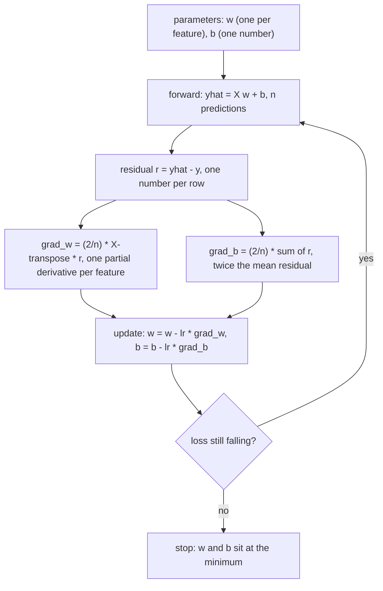
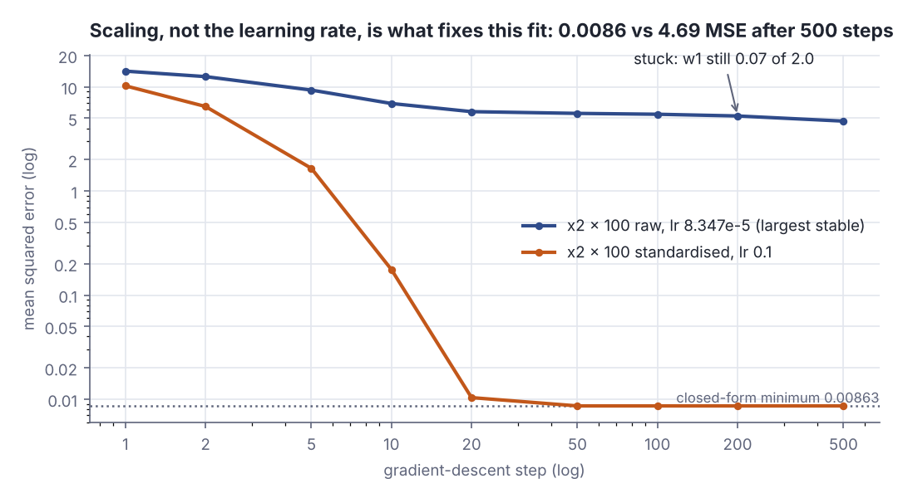
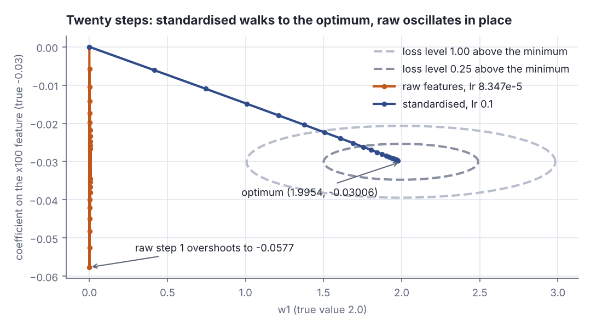
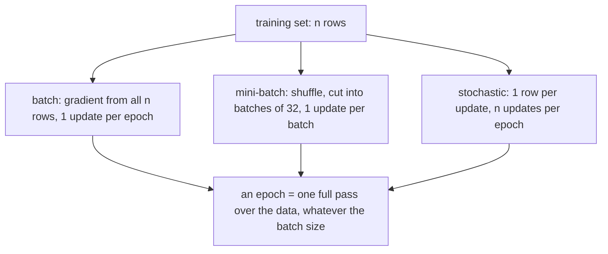

# Gradient descent in many variables: fitting linear regression

> AI / ML foundations · Beginner · ~25 min · rung 7 of 38 · needs: Vectors and matrices as data (ai-ml-04); Gradient descent in one variable (ai-ml-06)

## Why this matters

Every model in this course, from the linear fit below to the networks a few rungs ahead, is trained by one loop: predict, measure the error, work out one number per parameter saying which way that parameter should move, step, repeat.
That per-parameter number is the gradient, and for linear regression it collapses into a single matrix product you can write in four lines of Scala — so this is the one chance to see the whole training loop with nothing hidden inside a framework.
It is also where the practical failure you will keep meeting first appears: a badly scaled input makes the loop crawl, and no learning rate saves it.

## The idea

### From one derivative to a vector of them

With one parameter the question was: nudge `w` up — does the loss rise or fall, and how fast? That is the derivative `dL/dw`. With `d` parameters you ask it `d` times, once per parameter, holding the others fixed. Each answer is a **partial derivative** `∂L/∂w_j`, the slope of the loss along axis `j` alone; stacked in parameter order they are the **gradient** `∇L = (∂L/∂w_1, …, ∂L/∂w_d)`.

> "the gradient is just a vector of slopes (more commonly referred to as derivatives) for each dimension in the input space."
> — CS231n course notes, *Optimization: Stochastic Gradient Descent*, no date shown, https://cs231n.github.io/optimization-1/

Two facts make that vector worth computing. Of all directions you could step in, `∇L` is the one along which the loss grows fastest, so `−∇L` is the direction of **steepest descent**; and the relative sizes of its entries say which parameters matter most (3Blue1Brown, *Neural Networks* ch. 2, "Gradient descent, how neural networks learn", on reading the gradient as a list of nudges). The algorithm is one line of English:

> "the procedure of repeatedly evaluating the gradient and then performing a parameter update is called Gradient Descent."
> — CS231n course notes, *Optimization: Stochastic Gradient Descent*, no date shown, https://cs231n.github.io/optimization-1/

You never have to take a hand-derived formula on faith: a partial derivative is a limit, so moving one parameter by 10⁻⁶ and dividing the change in loss by 10⁻⁶ approximates it:

```scala
// file: Ex1.scala
@main def ex1(): Unit =
  val x = Vector(Vector(1.0, 2.0), Vector(2.0, 1.0), Vector(3.0, 4.0))
  val y = Vector(5.0, 1.0, 9.0)
  def loss(w: Vector[Double]) = x.zip(y).map((r,t) => math.pow(r(0)*w(0)+r(1)*w(1)-t,2)).sum/3
  val w = Vector(0.5, 0.5)
  val res = x.map(r => r(0)*w(0) + r(1)*w(1)).zip(y).map((p, t) => p - t)
  val g = Vector(0, 1).map(j => 2.0/3 * x.zip(res).map((r, e) => r(j) * e).sum)
  val fd = Vector(0, 1).map(j => (loss(w.updated(j, w(j) + 1e-6)) - loss(w)) / 1e-6)
  println(f"L(w) = ${loss(w)}%.4f   residuals ${res.mkString(", ")}")
  println(f"gradient ${g(0)}%.3f ${g(1)}%.3f | finite differences ${fd(0)}%.3f ${fd(1)}%.3f")
  println(f"step 0.02 against it: ${loss(w.zip(g).map((a,d) => a - 0.02*d))}%.4f")
```

```text
L(w) = 14.2500   residuals -3.5, 0.5, -5.5
gradient -12.667 -19.000 | finite differences -12.667 -19.000
step 0.02 against it: 6.1583
```

The analytic and brute-force gradients agree to three decimals — that check is how you debug a derivation. The first entry is `(2/3)·(1·(−3.5) + 2·0.5 + 3·(−5.5)) = (2/3)·(−19) = −12.667`: each row pushes on `w_1` by its own residual times its own `x_1`. Both entries are negative, so one step of 0.02 against the gradient takes the loss from 14.25 to 6.16.

### Linear regression: the whole gradient is one matrix product

Put the data in a matrix `X`, one row per example and one column per feature — 200×2 in the lab — and the model is `ŷ = Xw + b`, with `w` a vector of `d` weights and `b` one number added to every prediction. The loss is the **mean squared error**, `L = (1/n)·Σ(ŷ_i − y_i)²`.

Differentiate with respect to one weight `w_j`. Only `w_j·x_ij` inside each prediction depends on it, so the chain rule gives `∂L/∂w_j = (2/n)·Σ_i (ŷ_i − y_i)·x_ij` — the dot product of column `j` of `X` with the residual vector `r = ŷ − y`. Doing that for every `j` at once is exactly `Xᵀr`, so

- gradient for the weights: `∇_w L = (2/n)·Xᵀ(ŷ − y)` — shapes `(d×n)·(n) = (d)`, one number per feature;
- gradient for the bias: `∂L/∂b = (2/n)·Σ_i (ŷ_i − y_i)`, twice the mean residual, because `b` sits in every prediction with coefficient 1.

That is the whole derivation, and it is why the training loop is four lines: one matrix–vector product forward, one transpose-times-residual backward, two subtractions.



*Figure 1: one batch gradient-descent step for linear regression with mean squared error. Every arrow is a line of the lab program. Source: drawn for this lesson from the derivation above.*

### The step size, and why the data decides it

The update is `w ← w − lr·∇_w L`, with `lr` the **learning rate**. Too small and you crawl; too large and each step overshoots the valley floor, landing higher than it started, so the loss grows without bound.

> "choosing the step size (also called the learning rate) will become one of the most important"
> "(and most headache-inducing) hyperparameter settings in training a neural network."
> — CS231n course notes, *Optimization: Stochastic Gradient Descent*, no date shown, https://cs231n.github.io/optimization-1/

The part that is not obvious: the largest safe learning rate is set by the *data*. For MSE the curvature along feature `j` is `2·mean(x_j²)`, and the loop is stable only while `lr < 2/(largest curvature)`. Multiply one column by 100 and its curvature grows 10 000×, so the ceiling drops by the same factor — and that single ceiling binds *every* parameter, including those whose curvature never changed, which then move 10 000× slower than they should.



*Figure 2: same rows, same model, same 500 steps. On raw features at the largest stable learning rate the loss stalls at 4.69; standardised, `lr = 0.1` reaches the closed-form minimum 0.00863 by step 50. Generated from the Part 3 and Part 4 lab output below.*

The fix is **feature scaling**: replace each column by `(x − mean)/sd`, train, then divide each learned weight by that column's `sd` to read it back in the original units. Geometrically the loss contours are ellipses whose axes come from the curvatures; scaling turns a long thin valley into a round bowl, where the negative gradient points at the minimum instead of at the nearest wall.



*Figure 3: twenty steps on the badly scaled problem. The dashed ellipses are loss level curves (half-axes 0.989 and 0.0094 at level 1.00 — a valley 105× longer than wide). The raw run bounces across the narrow direction and has moved `w_1` by 0.0073 of the 2.0 it needs; the standardised run walks to the optimum. Adapted from CS231n, Optimization: Stochastic Gradient Descent, https://cs231n.github.io/optimization-1/ — generated from the Part 6 lab output below.*

### Batch, stochastic, mini-batch — and what an epoch is

Everything so far used **batch gradient descent**: every step reads all `n` rows. With 200 rows that is free; with the 1.2 million images CS231n trains on it is not, so you estimate the gradient from a sample. **Stochastic gradient descent** uses one row per update (StatQuest, "Stochastic Gradient Descent, Clearly Explained!!!"); **mini-batch gradient descent** uses a few dozen. One full pass over the data, however many updates that takes, is an **epoch**.

```scala
// file: Ex2.scala
@main def ex2(): Unit =
  val r = scala.util.Random(1)
  val xs = Vector.fill(200)(r.nextGaussian())
  val ys = xs.map(a => 2.0 * a + 0.5 * r.nextGaussian())
  def grad(idx: Seq[Int]) =
    2.0 / idx.size * idx.map(i => xs(i) * (0.0 * xs(i) - ys(i))).sum
  println(f"full batch, all 200 points: dL/dw = ${grad(xs.indices)}%7.4f")
  val rb = scala.util.Random(2)
  for k <- 1 to 4 do
    val batch = Vector.fill(16)(rb.nextInt(200))
    println(f"mini-batch $k%d of 16 points:   dL/dw = ${grad(batch)}%7.4f")
```

```text
full batch, all 200 points: dL/dw = -4.5289
mini-batch 1 of 16 points:   dL/dw = -3.3325
mini-batch 2 of 16 points:   dL/dw = -4.8545
mini-batch 3 of 16 points:   dL/dw = -3.9115
mini-batch 4 of 16 points:   dL/dw = -3.5091
```

Every mini-batch estimate, all taken at `w = 0`, has the same sign and roughly the same size as the full-batch gradient (−4.53): 8 % of the data buys a noisy but usable direction at 8 % of the cost, and the noise also helps the parameters escape flat spots.



*Figure 4: three ways of estimating the same gradient, differing only in how many rows go into one update. Source: drawn for this lesson, following CS231n, "Gradient Descent" (mini-batch gradient descent), https://cs231n.github.io/optimization-1/.*

On ImageNet-scale training, "a typical batch contains 256 examples from the entire training set of 1.2 million" (CS231n course notes, *Optimization: Stochastic Gradient Descent*, no date shown, https://cs231n.github.io/optimization-1/). The size is not tuned the way a learning rate is:

> "It is usually based on memory constraints (if any), or set to some value, e.g. 32, 64 or 128."
> "We use powers of 2 in practice because many vectorized operation implementations work faster"
> "when their inputs are sized in powers of 2."
> — CS231n course notes, *Optimization: Stochastic Gradient Descent*, no date shown, https://cs231n.github.io/optimization-1/

### The closed form exists — and you still use gradient descent

Linear regression with MSE is the one case where you can skip the loop. Setting the gradient to zero gives the **normal equations** `XᵀX·θ = Xᵀy`, where `θ` stacks the weights and the bias (append a column of ones to `X`). With two features that is a 3×3 system, which ten lines of Gaussian elimination solve exactly — no learning rate, no iterations, no sensitivity to scaling, as the lab shows by getting identical coefficients from the raw and the ×100 data.

So why iterate? `XᵀX` is `(d+1)×(d+1)`: forming it costs about `n·d²` and solving it `d³` — fine at `d = 2`, hopeless at `d = 10⁶`. And the formula exists only because the model is linear in its parameters and the loss is squared error. Change either — a logistic model, a hinge loss, a hidden layer — and there is nothing to solve, only a gradient to follow. Gradient descent survives the change; the normal equations are the sanity check you compare against while you still can.

## Lab

**The question:** can batch gradient descent recover the coefficients of a known linear model, what exactly breaks when one feature is multiplied by 100, and do standardisation and the closed form agree with it?

### Step 1 — know the answer before you run

The data is generated from `y = 2·x1 − 3·x2 + 1` with Gaussian noise of standard deviation 0.1, from a seeded `scala.util.Random(42)`, so the fit should land near `w = (2, −3)`, `b = 1`, and the best achievable MSE is about the noise variance, `0.1² = 0.01`. In Part 3 the second column is multiplied by 100, which does not change the model — `−3·x2` is the same as `−0.03·(100·x2)` — so the correct answer there is `w = (2, −0.03)`, `b = 1`. Anything else that happens in Part 3 is an artefact of the optimiser, not of the data.

### Step 2 — the program

Scala 3, standard library only. `transpose` and `matVec` are the only linear algebra needed; `step` is the gradient formula from Figure 1; `solve` is Gaussian elimination with partial pivoting for the 3×3 normal equations. Save as `Lab.scala` and run `scala Lab.scala`.

```scala
// file: Lab.scala
import scala.util.Random

type Mat = Vector[Vector[Double]]

def transpose(a: Mat): Mat = a.head.indices.toVector.map(j => a.map(_(j)))

def matVec(a: Mat, v: Vector[Double]): Vector[Double] =
  a.map(row => row.zip(v).map((p, q) => p * q).sum)

def predict(x: Mat, w: Vector[Double], b: Double): Vector[Double] =
  matVec(x, w).map(_ + b)

def mse(p: Vector[Double], y: Vector[Double]): Double =
  p.zip(y).map((a, t) => (a - t) * (a - t)).sum / y.size

// one batch gradient-descent step: gw = (2/n) * Xt (yhat - y), gb = 2 * mean residual
def step(x: Mat, y: Vector[Double], w: Vector[Double], b: Double, lr: Double) =
  val res = predict(x, w, b).zip(y).map((p, t) => p - t)
  val gw = matVec(transpose(x), res).map(_ * 2.0 / y.size)
  val gb = 2.0 * res.sum / y.size
  (w.zip(gw).map((a, g) => a - lr * g), b - lr * gb)

// run `steps` steps, returning the loss after each step and the parameter path
def run(x: Mat, y: Vector[Double], lr: Double, steps: Int) =
  var w = Vector.fill(x.head.size)(0.0)
  var b = 0.0
  val hist = Array.ofDim[Double](steps + 1)
  val path = Array.ofDim[(Vector[Double], Double)](steps + 1)
  hist(0) = mse(predict(x, w, b), y); path(0) = (w, b)
  for i <- 1 to steps do
    val (w2, b2) = step(x, y, w, b, lr)
    w = w2; b = b2
    hist(i) = mse(predict(x, w, b), y); path(i) = (w, b)
  (w, b, hist.toVector, path.toVector)

// 3x3 Gaussian elimination with partial pivoting: solves A θ = c
def solve(a0: Mat, c0: Vector[Double]): Vector[Double] =
  var a = a0.map(_.toArray).toArray; var c = c0.toArray
  val n = c.length
  for k <- 0 until n do
    val p = (k until n).maxBy(i => math.abs(a(i)(k)))
    val ta = a(k); a(k) = a(p); a(p) = ta
    val tc = c(k); c(k) = c(p); c(p) = tc
    for i <- k + 1 until n do
      val f = a(i)(k) / a(k)(k)
      for j <- k until n do a(i)(j) -= f * a(k)(j)
      c(i) -= f * c(k)
  val x = Array.ofDim[Double](n)
  for i <- n - 1 to 0 by -1 do
    var s = c(i)
    for j <- i + 1 until n do s -= a(i)(j) * x(j)
    x(i) = s / a(i)(i)
  x.toVector

@main def lab(): Unit =
  val r = Random(42)
  val n = 200
  val raw = Vector.fill(n)((r.nextGaussian(), r.nextGaussian()))
  val x: Mat = raw.map((a, b) => Vector(a, b))
  val y = raw.map((a, b) => 2.0 * a - 3.0 * b + 1.0 + 0.1 * r.nextGaussian())

  println("== Part 1: the data (y = 2*x1 - 3*x2 + 1 + noise, Random(42)) ==")
  println("  i |     x1 |     x2 |      y")
  for i <- 0 until 3 do
    println(f"  $i%d | ${x(i)(0)}%6.3f | ${x(i)(1)}%6.3f | ${y(i)}%6.3f")
  def sd(v: Vector[Double]) =
    val m = v.sum / v.size; math.sqrt(v.map(a => (a - m) * (a - m)).sum / v.size)
  println(f"  sd(x1) = ${sd(x.map(_(0)))}%.3f   sd(x2) = ${sd(x.map(_(1)))}%.3f")

  println("\n== Part 2: batch gradient descent, lr = 0.1, 500 steps ==")
  val marks = Vector(0, 1, 2, 5, 10, 20, 50, 100, 200, 500)
  val (w2, b2, h2, p2) = run(x, y, 0.1, 500)
  println(" step |      loss |     w1 |     w2 |      b")
  for s <- marks do
    val (w, b) = p2(s)
    println(f" $s%4d | ${h2(s)}%9.5f | ${w(0)}%6.3f | ${w(1)}%6.3f | ${b}%6.3f")
  println(f"  recovered: w = (${w2(0)}%.4f, ${w2(1)}%.4f), b = $b2%.4f   (true 2, -3, 1)")

  // ---- the same problem with x2 multiplied by 100
  val z: Mat = x.map(row => Vector(row(0), 100.0 * row(1)))
  def curv(j: Int, m: Mat) = m.map(row => row(j) * row(j)).sum / n
  val c1 = curv(0, z); val c2 = curv(1, z)
  println("\n== Part 3: the same data with x2 * 100 ==")
  println(f"  mean(x1^2) = $c1%.3f   mean(z^2) = $c2%.1f   condition number = ${c2 / c1}%.0f")
  println(f"  largest stable learning rate = 1/mean(z^2) = ${1.0 / c2}%.3e")
  val (_, _, hBad, _) = run(z, y, 0.1, 6)
  println("  lr = 0.1 on the unscaled data:")
  for s <- 0 to 6 do println(f"    step $s%d loss ${hBad(s)}%12.4e")
  val lrRaw = 0.95 / c2
  println(f"  lr = 0.95/mean(z^2) = $lrRaw%.3e, 500 steps:")
  val (wR, bR, hR, pR) = run(z, y, lrRaw, 500)
  println(" step |      loss |     w1 |      wz |      b")
  for s <- marks do
    val (w, b) = pR(s)
    println(f" $s%4d | ${hR(s)}%9.5f | ${w(0)}%6.3f | ${w(1)}%7.4f | ${b}%6.3f")
  println(f"  recovered: w1 = ${wR(0)}%.4f (true 2), wz = ${wR(1)}%.5f (true -0.03), b = $bR%.4f")

  println("\n== Part 4: standardise the columns, then the same lr = 0.1 ==")
  val mean = (0 to 1).toVector.map(j => z.map(_(j)).sum / n)
  val sds = (0 to 1).toVector.map(j => sd(z.map(_(j))))
  val zs: Mat = z.map(row => Vector((row(0) - mean(0)) / sds(0), (row(1) - mean(1)) / sds(1)))
  println(f"  column means = (${mean(0)}%.4f, ${mean(1)}%.3f)  sds = (${sds(0)}%.4f, ${sds(1)}%.3f)")
  val (wS, bS, hS, pS) = run(zs, y, 0.1, 500)
  println(" step |      loss |  w1_std |  wz_std |   b_std")
  for s <- marks do
    val (w, b) = pS(s)
    println(f" $s%4d | ${hS(s)}%9.5f | ${w(0)}%7.3f | ${w(1)}%7.3f | ${b}%7.3f")
  def back(w: Vector[Double], b: Double) =
    val wo = w.indices.toVector.map(j => w(j) / sds(j))
    (wo, b - wo.indices.map(j => wo(j) * mean(j)).sum)
  val (wB, bB) = back(wS, bS)
  println(f"  back in original units: w1 = ${wB(0)}%.4f, wz = ${wB(1)}%.5f, b = $bB%.4f")

  println("\n== Part 5: closed form, normal equations (Xt X) theta = Xt y ==")
  def closed(m: Mat): Vector[Double] =
    val d: Mat = m.map(row => row :+ 1.0)
    val dt = transpose(d)
    val ata: Mat = dt.map(ri => dt.map(rj => ri.zip(rj).map((p, q) => p * q).sum))
    solve(ata, dt.map(ri => ri.zip(y).map((p, q) => p * q).sum))
  val t1 = closed(x); val t2 = closed(z)
  println(f"  original features: w1 = ${t1(0)}%.4f, w2 = ${t1(1)}%.4f, b = ${t1(2)}%.4f")
  println(f"  x2 * 100:          w1 = ${t2(0)}%.4f, wz = ${t2(1)}%.5f, b = ${t2(2)}%.4f")
  println(f"  loss at the closed-form optimum (x2 * 100) = ${mse(predict(z, Vector(t2(0), t2(1)), t2(2)), y)}%.5f")

  println("\n== Part 6: the two paths in (w1, wz) parameter space ==")
  println(f"  contour half-axes about the optimum: level 0.25 -> w1 ${math.sqrt(0.25 / c1)}%.3f, wz ${math.sqrt(0.25 / c2)}%.4f")
  println(f"                                       level 1.00 -> w1 ${math.sqrt(1.0 / c1)}%.3f, wz ${math.sqrt(1.0 / c2)}%.4f")
  println(" step |  w1 raw |   wz raw |  w1 std |   wz std")
  for s <- 0 to 20 do
    val (wr, _) = pR(s)
    val (ws, bs) = pS(s)
    val (wo, _) = back(ws, bs)
    println(f" $s%4d | ${wr(0)}%7.4f | ${wr(1)}%8.5f | ${wo(0)}%7.4f | ${wo(1)}%8.5f")
```

### Step 3 — the output

```text
== Part 1: the data (y = 2*x1 - 3*x2 + 1 + noise, Random(42)) ==
  i |     x1 |     x2 |      y
  0 |  1.142 |  0.919 |  0.624
  1 | -0.950 | -1.107 |  2.429
  2 |  0.281 |  0.685 | -0.709
  sd(x1) = 1.001   sd(x2) = 1.067

== Part 2: batch gradient descent, lr = 0.1, 500 steps ==
 step |      loss |     w1 |     w2 |      b
    0 |  16.15896 |  0.000 |  0.000 |  0.000
    1 |   9.57640 |  0.453 | -0.691 |  0.248
    2 |   5.67750 |  0.802 | -1.223 |  0.436
    5 |   1.18886 |  1.441 | -2.192 |  0.767
   10 |   0.09535 |  1.839 | -2.786 |  0.954
   20 |   0.00912 |  1.982 | -2.990 |  1.006
   50 |   0.00863 |  1.995 | -3.006 |  1.007
  100 |   0.00863 |  1.995 | -3.006 |  1.007
  200 |   0.00863 |  1.995 | -3.006 |  1.007
  500 |   0.00863 |  1.995 | -3.006 |  1.007
  recovered: w = (1.9954, -3.0057), b = 1.0070   (true 2, -3, 1)

== Part 3: the same data with x2 * 100 ==
  mean(x1^2) = 1.022   mean(z^2) = 11381.4   condition number = 11136
  largest stable learning rate = 1/mean(z^2) = 8.786e-05
  lr = 0.1 on the unscaled data:
    step 0 loss   1.6159e+01
    step 1 loss   5.4300e+07
    step 2 loss   2.8111e+14
    step 3 loss   1.4553e+21
    step 4 loss   7.5339e+27
    step 5 loss   3.9003e+34
    step 6 loss   2.0191e+41
  lr = 0.95/mean(z^2) = 8.347e-05, 500 steps:
 step |      loss |     w1 |      wz |      b
    0 |  16.15896 |  0.000 |  0.0000 |  0.000
    1 |  14.16393 |  0.000 | -0.0577 |  0.000
    2 |  12.54755 |  0.001 | -0.0058 |  0.000
    5 |   9.31660 |  0.002 | -0.0483 |  0.001
   10 |   6.92384 |  0.004 | -0.0198 |  0.002
   20 |   5.78227 |  0.007 | -0.0267 |  0.004
   50 |   5.56380 |  0.018 | -0.0302 |  0.011
  100 |   5.45894 |  0.036 | -0.0304 |  0.021
  200 |   5.25566 |  0.072 | -0.0303 |  0.042
  500 |   4.69035 |  0.174 | -0.0303 |  0.103
  recovered: w1 = 0.1741 (true 2), wz = -0.03033 (true -0.03), b = 0.1027

== Part 4: standardise the columns, then the same lr = 0.1 ==
  column means = (0.1441, 1.760)  sds = (1.0006, 106.669)
 step |      loss |  w1_std |  wz_std |   b_std
    0 |  16.15896 |   0.000 |   0.000 |   0.000
    1 |  10.23250 |   0.416 |  -0.652 |   0.248
    2 |   6.48107 |   0.746 |  -1.171 |   0.447
    5 |   1.65127 |   1.377 |  -2.177 |   0.835
   10 |   0.17590 |   1.805 |  -2.876 |   1.108
   20 |   0.01037 |   1.978 |  -3.172 |   1.227
   50 |   0.00863 |   1.997 |  -3.206 |   1.242
  100 |   0.00863 |   1.997 |  -3.206 |   1.242
  200 |   0.00863 |   1.997 |  -3.206 |   1.242
  500 |   0.00863 |   1.997 |  -3.206 |   1.242
  back in original units: w1 = 1.9954, wz = -0.03006, b = 1.0070

== Part 5: closed form, normal equations (Xt X) theta = Xt y ==
  original features: w1 = 1.9954, w2 = -3.0057, b = 1.0070
  x2 * 100:          w1 = 1.9954, wz = -0.03006, b = 1.0070
  loss at the closed-form optimum (x2 * 100) = 0.00863

== Part 6: the two paths in (w1, wz) parameter space ==
  contour half-axes about the optimum: level 0.25 -> w1 0.495, wz 0.0047
                                       level 1.00 -> w1 0.989, wz 0.0094
 step |  w1 raw |   wz raw |  w1 std |   wz std
    0 |  0.0000 |  0.00000 |  0.0000 |  0.00000
    1 |  0.0004 | -0.05768 |  0.4162 | -0.00611
    2 |  0.0007 | -0.00577 |  0.7457 | -0.01098
    3 |  0.0011 | -0.05249 |  1.0065 | -0.01486
    4 |  0.0015 | -0.01044 |  1.2129 | -0.01795
    5 |  0.0018 | -0.04828 |  1.3763 | -0.02041
    6 |  0.0022 | -0.01422 |  1.5056 | -0.02237
    7 |  0.0026 | -0.04488 |  1.6080 | -0.02393
    8 |  0.0029 | -0.01729 |  1.6889 | -0.02518
    9 |  0.0033 | -0.04212 |  1.7530 | -0.02617
   10 |  0.0036 | -0.01977 |  1.8037 | -0.02696
   11 |  0.0040 | -0.03988 |  1.8438 | -0.02759
   12 |  0.0044 | -0.02178 |  1.8755 | -0.02809
   13 |  0.0047 | -0.03807 |  1.9006 | -0.02849
   14 |  0.0051 | -0.02341 |  1.9205 | -0.02881
   15 |  0.0055 | -0.03661 |  1.9362 | -0.02906
   16 |  0.0058 | -0.02473 |  1.9486 | -0.02926
   17 |  0.0062 | -0.03542 |  1.9584 | -0.02942
   18 |  0.0066 | -0.02580 |  1.9661 | -0.02955
   19 |  0.0069 | -0.03446 |  1.9723 | -0.02966
   20 |  0.0073 | -0.02667 |  1.9771 | -0.02974
```

### Reading the output

**Part 2 — well-scaled features.** The columns are the step number, the mean squared error after that step, and the three parameters. Lower loss is better and 0.00863 is the floor (Part 5 proves it). Both features have `sd ≈ 1`, so one learning rate suits both.

| step | loss | w1 | w2 | b |
|---|---|---|---|---|
| 0 | 16.15896 | 0.000 | 0.000 | 0.000 |
| 1 | 9.57640 | 0.453 | −0.691 | 0.248 |
| 5 | 1.18886 | 1.441 | −2.192 | 0.767 |
| 20 | 0.00912 | 1.982 | −2.990 | 1.006 |
| 500 | 0.00863 | 1.995 | −3.006 | 1.007 |

Trace step 1 by hand. At `w = (0, 0)`, `b = 0` every prediction is 0, so `r = −y` and `∇_w L = −(2/n)·Xᵀy`. The update `w_1 ← 0 − 0.1·∇_1` landed on 0.453, so `∇_1 = −4.53`, i.e. `(2/200)·Σ x1_i·y_i = 4.53` — the feature and the target move together, so the weight must rise, and it rises by `0.1 × 4.53`. Twenty steps later the loss is within 6 % of the floor.

**Verdict:** on well-scaled features, batch gradient descent recovers `2, −3, 1` to three decimals in about 20 steps, and the remaining 0.00863 is the noise, not an error of the optimiser.

**Part 3 — the same data, `x2` multiplied by 100.** Two numbers explain everything that follows: `mean(x1²) = 1.022` and `mean(z²) = 11381.4`, a condition number of 11 136. The curvature of MSE along a direction is twice the mean square of that column, so the steepest direction has curvature `2 × 11381.4 = 22762.8` and the stability ceiling is `2 / 22762.8 = 8.786e-05` — the printed value. At `lr = 0.1`, more than a thousand times the ceiling, the loss multiplies by a few million per step: 16.2, 5.43e+07, 2.81e+14 … 2.02e+41 by step 6.

Running instead at `lr = 8.347e-05` (0.95 of the ceiling) is stable but useless:

| step | loss | w1 | wz | b |
|---|---|---|---|---|
| 1 | 14.16393 | 0.000 | −0.0577 | 0.000 |
| 2 | 12.54755 | 0.001 | −0.0058 | 0.000 |
| 20 | 5.78227 | 0.007 | −0.0267 | 0.004 |
| 500 | 4.69035 | 0.174 | −0.0303 | 0.103 |

Trace the oscillation. Along `wz` each step multiplies the distance to the optimum by `1 − lr·2·mean(z²) = 1 − 8.347e-05 × 22762.8 = 1 − 1.900 = −0.900`: negative, so the sign of the error flips every step. Starting 0.03006 above the optimum (`wz = 0` against the optimum −0.03006), step 1 should sit at `−0.03006 − 0.900 × 0.03006 = −0.0571` and step 2 at `−0.03006 + 0.810 × 0.03006 = −0.0057`; the program prints −0.0577 and −0.0058. Along `w1` the same learning rate gives a multiplier of `1 − 8.347e-05 × 2 × 1.022 = 0.99983`, so after 500 steps `w1` has covered `1 − 0.99983^500 = 8 %` of its distance — 0.174 out of 2.0.

**Verdict:** the problem is not the learning rate. One badly scaled column caps the learning rate for *all* parameters, so the well-scaled ones effectively stop learning; 500 steps leave the model at MSE 4.69 instead of 0.00863.

**Part 4 — standardise and the ceiling disappears.** Subtracting the column mean and dividing by the column `sd` (0.1441 and 1.0006 for `x1`; 1.760 and 106.669 for `z`) makes both curvatures ≈ 2, so `lr = 0.1` is safe again and the loss reaches 0.00863 by step 50. The learned weights are in standardised units and have to be mapped back: `w1 = 1.997 / 1.0006 = 1.9954`, `wz = −3.206 / 106.669 = −0.03006`, and `b = 1.242 − (1.9954 × 0.1441 + (−0.03006) × 1.760) = 1.242 − 0.2346 = 1.0074`, printed as 1.0070 once the full-precision values are used.

**Verdict:** standardisation is not a trick for prettier numbers; it is what restores a usable learning rate, and the coefficients convert back exactly, so nothing about the model is lost.

**Part 5 — the closed form.** Gaussian elimination on `XᵀX·θ = Xᵀy` gives `w1 = 1.9954, w2 = −3.0057, b = 1.0070` on the original features and `w1 = 1.9954, wz = −0.03006, b = 1.0070` on the ×100 features: the same model, and identical to the three digits the standardised gradient descent reached. The loss there is 0.00863, which is the floor every other run was compared against.

**Verdict:** gradient descent did not approximate the answer, it found it; and the closed form is indifferent to scaling, which confirms that the Part 3 failure belonged to the optimiser, not to the data.

**Part 6 — the two paths.** The last table is the same twenty steps drawn in parameter space (Figure 3), with the standardised run's parameters converted back to the original units so both runs live on the same axes. The raw run's `wz` reads −0.05768, −0.00577, −0.05249, −0.01044 …: it crosses the valley floor every single step while its `w1` creeps from 0.0004 to 0.0073. The standardised run reaches `w1 = 1.9771`, `wz = −0.02974` in the same twenty steps.

**Verdict:** the zig-zag is not noise or a bug — it is a stable optimiser oscillating in the steep direction because the step size that direction allows is far too small for every other direction.

### Cause → consequence

1. **Cause:** one feature column is 100× larger than the other, so the mean square of that column is 10 000× larger.
2. **Mechanism:** the curvature of MSE along a parameter is twice the mean square of its column, and gradient descent is stable only while `lr < 2/(largest curvature)` — one ceiling, shared by all parameters.
3. **Consequence:** the ceiling drops to `8.786e-05`; the steep parameter oscillates with a decay factor of −0.900 per step while the shallow ones move 10 000× too slowly, so after 500 steps the fit is at MSE 4.69 instead of 0.00863.
4. **In practice:** standardise every numeric feature before training, store the means and standard deviations with the model (the same transform must be applied at inference), and when a model will not converge, look at the column statistics before you touch the learning rate. The same reasoning is why normalisation layers exist inside deep networks: they keep the curvature of each direction comparable so one learning rate can serve millions of parameters.

## Self-check

1. You have 50 000 rows and 300 features. Someone proposes solving the normal equations instead of running gradient descent. Is that reasonable, and what changes your answer? <details><summary>Answer</summary>Reasonable. `XᵀX` is 301×301; forming it costs about `n·d² = 4.5×10⁹` multiply-adds and solving it about `d³ = 2.7×10⁷`, both seconds of work, and the result is exact with no learning rate to tune. What changes the answer: a much larger `d` (the `d³` solve and the `d²` memory blow up), an `XᵀX` that is singular or near-singular (collinear features), data that does not fit in memory, or any change to the model or loss — a logistic link, a hinge loss, a hidden layer — because then no closed form exists and only the gradient is available.</details>
2. Your loss goes `16.2 → 5.4e+07 → 2.8e+14 → 1.5e+21`. What single quantity is wrong, and name two different fixes. <details><summary>Answer</summary>The step size is above the stability ceiling `2/(largest curvature)`, where the curvature of MSE along a parameter is twice the mean square of its feature column; each step overshoots the minimum and lands further out, so the error grows geometrically. Fix one: lower the learning rate below the ceiling — correct but it throttles every other parameter to the same crawl (the lab's Part 3: MSE 4.69 after 500 steps). Fix two: standardise the columns so all curvatures are comparable, which raises the ceiling for everyone — the lab's Part 4: MSE 0.00863 by step 50 at `lr = 0.1`.</details>
3. With 200 rows and a mini-batch of 16, how many parameter updates are there in one epoch, and why is a noisier gradient acceptable at all? <details><summary>Answer</summary>Thirteen: 200/16 = 12.5, so twelve full batches and one of 8 rows (an epoch is one full pass over the data, whatever the batch size). The noisy gradient is acceptable because each mini-batch is an unbiased sample of the same sum — in the lesson's example four mini-batches of 16 gave −3.33, −4.85, −3.91, −3.51 against a full-batch −4.53, all the same sign and size — so the updates average out to the right direction while costing 8 % as much. Thirteen cheap, roughly-right steps beat one exact step, and the noise also helps the parameters leave flat regions.</details>

## Sources

- [CS231n notes — Optimization: Stochastic Gradient Descent](https://cs231n.github.io/optimization-1/) — Stanford CS231n course notes, no date shown; sections "Computing the gradient", "Gradient Descent" and its bold run-in paragraph "Mini-batch gradient descent"; quoted for the definition of the gradient as a vector of slopes, the definition of gradient descent as repeated evaluate-and-update, the learning rate as the headache hyperparameter, and the 256-of-1.2-million batch size and the 32/64/128 power-of-two convention (accessed 2026-11-08).
- [3Blue1Brown — Neural Networks](https://www.3blue1brown.com/topics/neural-networks) — Grant Sanderson; ch. 2 "Gradient descent, how neural networks learn", the segment reading the gradient of the cost as a list of nudges whose relative sizes say which weights matter most; used for the intuition in "From one derivative to a vector of them". Video, not re-fetched this run (accessed 2026-11-08).
- [StatQuest — Stochastic Gradient Descent, Clearly Explained](https://statquest.org/video-index/) — Josh Starmer; video index entry "Stochastic Gradient Descent, Clearly Explained!!!", used for the one-row-per-update form of SGD. Video, not re-fetched this run (accessed 2026-11-08).

## Next on this track
Next on AI / ML foundations: **Probability you need for ML: distributions, Bayes, likelihood** (rung 8 of 38, Beginner).
