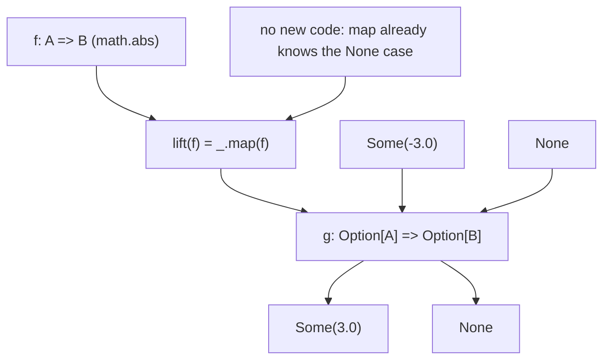
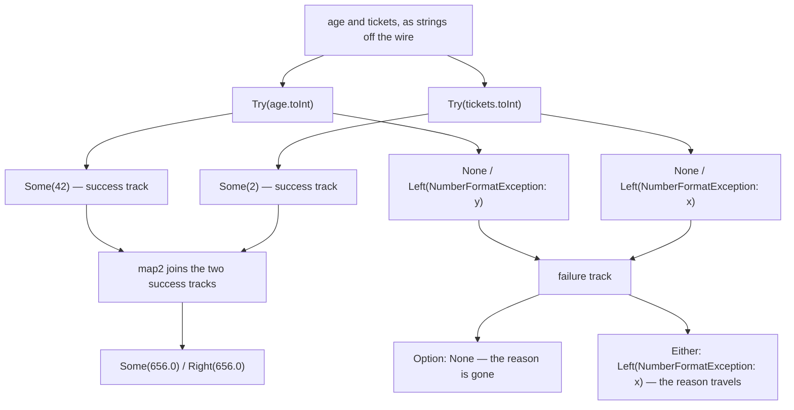
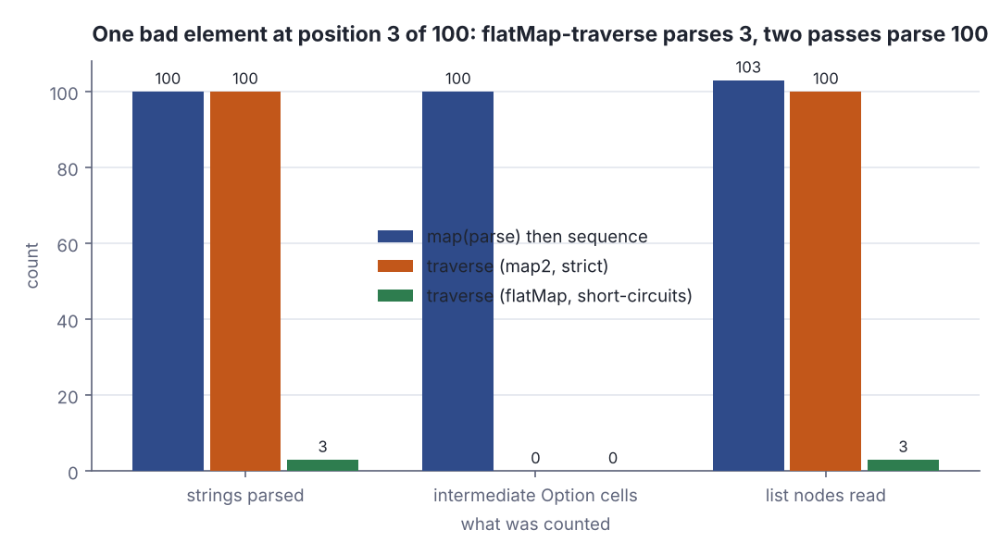
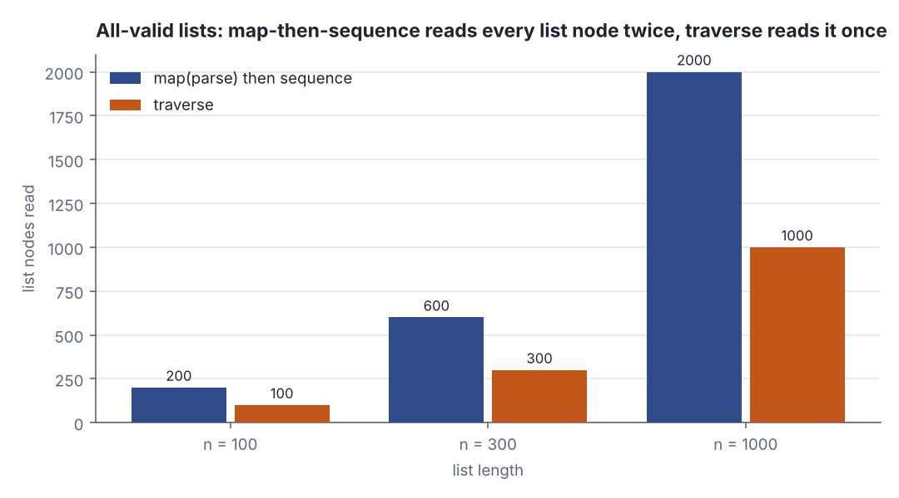

# Handling errors without exceptions: Option and Either

> Functional Programming in Scala (red book) · Beginner · ~25 min · rung 5 of 26 · needs: Functional data structures II: foldRight, foldLeft and trees (fp-scala-04)

## Why this matters
Every service boundary you own has an error channel, and in Scala the only question is whether it lives in the return type or hides in a `throw` that the signature never mentions; this chapter is where you build both answers by hand, in about fifteen lines each, which is the only way to know exactly what they do under load.
It sits at this rung because `map`, `flatMap`, `map2`, `sequence` and `traverse` — defined here for two concrete types — are the same five operations the book generalises into monads (ch. 11) and applicatives (ch. 12); every later abstraction is this chapter with the type parameter moved outwards.
One practical result falls out immediately: `traverse` versus `map(...)` followed by `sequence` is the difference between one pass over a request payload and two, plus an intermediate list you never asked for.

## The idea

> Chapter map: Functional Programming in Scala, 2nd ed., ch. 4 Handling errors without exceptions — §4.1 The good and bad aspects of exceptions, §4.2 Possible alternatives to exceptions, §4.3 The Option data type (§4.3.1 Usage patterns for Option, §4.3.2 Option composition, lifting, and wrapping exception-oriented APIs), §4.4 The Either data type.

### §4.1 The good and bad aspects of exceptions

The chapter opens by breaking an expression in two (FP in Scala ch. 4, §4.1). **Referential transparency** is the property that an expression can be replaced everywhere by the value it evaluates to without changing the program's meaning. A `throw` has no such value — its type is `Nothing`, and what it *does* depends on which `try` block encloses it:

```scala
def failingFn(i: Int): Int =
  val y: Int = throw new Exception("fail!")
  try y + 42 catch case _: Exception => 43
def failingFn2(i: Int): Int =
  try
    val x = 42 + 5
    x + ((throw new Exception("fail!")): Int)
  catch case _: Exception => 43
val a = try failingFn(12).toString catch case e: Exception => s"threw ${e.getMessage}"
println(s"failingFn(12)  = $a")
println(s"failingFn2(12) = ${failingFn2(12)}")
```

```text
failingFn(12)  = threw fail!
failingFn2(12) = 43
```

Same `throw`, two answers. In `failingFn` it is bound to `y` outside the `try`, so it escapes; inline the same expression where `y` is used and it is caught, giving 43. A referentially transparent expression means the same thing in every context, so `throw` is not one, and the substitution model stops working around it.

The second complaint is about types: `failingFn: Int => Int` promises an `Int` for every `Int` and says nothing about blowing up, so nothing forces the caller to decide. Java's checked exceptions force the decision but do not survive higher-order functions — a generic `map[A, B](f: A => B)` cannot know or declare what `f` throws (FP in Scala ch. 4, §4.1).

The book also names what exceptions get right, because it means to keep it: they **consolidate** error handling. You fail in one place and handle it in another instead of threading an error code through every caller. The chapter's goal is that consolidation, expressed in types.

### §4.2 Possible alternatives to exceptions

The running example is `mean`, a **partial function** — one that is not defined for every input of its declared type, here the empty sequence (FP in Scala ch. 4, §4.2). The book walks two tempting fixes and rejects both.

*Return a sentinel* — `Double.NaN`, `null`, `-1`. Errors propagate silently: nothing in the type system makes a caller check, and it does not generalise, because for a polymorphic result of type `A` there is no value to invent. It also forces a special calling convention, so `mean` can no longer be handed to a higher-order function expecting a plain `Seq[Double] => Double`.

*Take a default argument* — `def mean(xs: Seq[Double], onEmpty: Double): Double` is total, but it demands that the **immediate** caller know what to do and pins the answer to a `Double`. A caller that wants to propagate the undefined case upwards has nowhere to go.

What is wanted: say in the return type that the answer may be missing, and let the caller decide when it is ready to.

### §4.3 The Option data type

```scala
enum MyOption[+A]:
  case None
  case Some(get: A)
```

`mean` now has a total signature, `Seq[Double] => MyOption[Double]`, and Exercise 4.1 asks for five methods: `map`, `flatMap`, `getOrElse`, `orElse`, `filter`. The last two take their default **by name** (`=> B`), so it is evaluated only when the `Option` is `None`.

### §4.3.1 Usage patterns for Option

The pattern: transform *inside* the `Option` with `map`, `flatMap` and `filter`, and convert back only at the outermost layer with `getOrElse` or `orElse`. `flatMap` matters when the next step can *also* fail — `variance` needs the mean before it can take the mean of the squared deviations, and either step can be undefined (Exercise 4.2):

```scala
def mean(xs: Seq[Double]): MyOption[Double] =
  if xs.isEmpty then None else Some(xs.sum / xs.length)
def variance(xs: Seq[Double]): MyOption[Double] =
  mean(xs).flatMap(m => mean(xs.map(x => math.pow(x - m, 2))))
val absO = lift[Double, Double](math.abs)
println(s"mean(xs)     = ${mean(Seq(1.0, 2.0, 3.0, 4.0))}")
println(s"mean(empty)  = ${mean(Seq())}")
println(s"variance(xs) = ${variance(Seq(1.0, 2.0, 3.0, 4.0))}")
println(s"lift(abs)(Some(-3.0)) = ${absO(Some(-3.0))}")
println(s"lift(abs)(None)       = ${absO(None)}")
```

```text
mean(xs)     = Some(2.5)
mean(empty)  = None
variance(xs) = Some(1.25)
lift(abs)(Some(-3.0)) = Some(3.0)
lift(abs)(None)       = None
```

`variance` of 1, 2, 3, 4 is 1.25 and never mentions the empty case: `flatMap` propagates `None` for you. The last two lines are §4.3.2 arriving early.

### §4.3.2 Option composition, lifting, and wrapping exception-oriented APIs

The objection at this point is that `Option` infects everything. It does not: **lifting** turns an ordinary function into one that works on `Option`s, in one line (FP in Scala ch. 4, §4.3.2):

```scala
def lift[A, B](f: A => B): MyOption[A] => MyOption[B] = _.map(f)
```

`lift(math.abs)` is a function `MyOption[Double] => MyOption[Double]` that nobody had to write — that is what the `Some(3.0)` / `None` pair in the output above shows.



*Figure 1: Lifting an ordinary function so it works on a value that may be missing — no new code, because `map` already knows the `None` case. Adapted from Functional Programming in Scala, 2nd ed., ch. 4, §4.3.2, https://www.manning.com/books/functional-programming-in-scala-second-edition*

The other half of the section is **wrapping exception-oriented APIs**. You do not control `String.toInt`; it throws. One combinator converts the whole family:

```scala
def Try[A](a: => A): MyOption[A] =
  try Some(a)
  catch case _: Exception => None
```

The by-name parameter `a: => A` is what makes this work: the argument is evaluated inside the `try`, not at the call site. That gives the book's `parseInsuranceRateQuote` — two strings off the wire, each parsed with `Try`, then a rate computed from both — and with it the problem the section exists for: `insuranceRateQuote` takes two plain `Int`s and we hold two `MyOption[Int]`s. `map2` (Exercise 4.3) lifts a two-argument function the way `lift` lifted a one-argument one:

```scala
def map2[A, B, C](a: MyOption[A], b: MyOption[B])(f: (A, B) => C): MyOption[C] =
  a.flatMap(aa => b.map(bb => f(aa, bb)))
def parseInsuranceRateQuote(age: String, tickets: String): MyOption[Double] =
  val optAge = Try(age.toInt)
  val optTickets = Try(tickets.toInt)
  map2(optAge, optTickets)(insuranceRateQuote)
println(s"parseInsuranceRateQuote(42, 2) = ${parseInsuranceRateQuote("42", "2")}")
println(s"parseInsuranceRateQuote(42, x) = ${parseInsuranceRateQuote("42", "x")}")
```

```text
parseInsuranceRateQuote(42, 2) = Some(656.0)
parseInsuranceRateQuote(42, x) = None
```

Two tracks go in, one comes out: both `Some` and the rate is computed; either one `None` and the result is `None`, with no mention of which one failed.



*Figure 2: The railway for `parseInsuranceRateQuote`. Two parses run on the success track, `map2` joins them, and any failure drops to the failure track and stays there — `Option` arrives at `None` having lost the reason, `Either` arrives carrying `Left(error)`. Source: Steps 2a and 3b of the lab.*

Now scale from two values to a list. `sequence` (Exercise 4.4) turns a `List[Option[A]]` into an `Option[List[A]]`, all or nothing; `traverse` (Exercise 4.5) parses and collects in one go, and `sequence` falls out of it as `traverse(as)(identity)`:

```scala
val input = List("1", "2", "x")
println(s"map(parseInt)             = ${input.map(s => Try(s.toInt))}")
println(s"sequence(map(parseInt))   = ${sequence(input.map(s => Try(s.toInt)))}")
println(s"traverse(input)(parseInt) = ${traverse(input)(s => Try(s.toInt))}")
println(s"traverse(List(1, 2, 3))   = ${traverse(List("1", "2", "3"))(s => Try(s.toInt))}")
```

```text
map(parseInt)             = List(Some(1), Some(2), None)
sequence(map(parseInt))   = None
traverse(input)(parseInt) = None
traverse(List(1, 2, 3))   = Some(List(1, 2, 3))
```

Same answers, different cost. The two-step version materialises `List(Some(1), Some(2), None)` — a whole intermediate list of `Option` cells — then walks it again; `traverse` never builds it. With counters in the lab, 1000 valid elements cost 2000 list nodes read and 1000 intermediate cells against 1000 nodes and no cells.

**Beyond the book:** whether `traverse` also *stops early* depends on how you write it, and the book's `map2` version does not. `map2(f(h), traverse(t)(f))` evaluates both arguments before it can look at either, so a failure at element 3 of 100 still parses all 100. Rewrite the recursion with `flatMap` — `f(h).flatMap(b => traverse(t)(f).map(b :: _))` — and the first `None` ends it.



*Figure 3: One bad element at position 3 of 100. `map` then `sequence` parses 100 strings, allocates 100 intermediate `Option` cells and reads 103 list nodes; `traverse` built on the book's strict `map2` allocates nothing but still parses 100; `traverse` built on `flatMap` parses 3. Generated from Step 2c of the lab.*

### §4.4 The Either data type

`Option` throws the reason away. `Either` is the same idea with the failure case carrying a value (FP in Scala ch. 4, §4.4):

```scala
enum MyEither[+E, +A]:
  case Left(error: E)
  case Right(value: A)
```

By convention `Right` is success — the pun is deliberate — and `Left` is the error, so `map` and `flatMap` are defined over the `Right` side only; `E` is whatever you want the failure to be: a `String`, an `Exception`, your own sum type. Because `map` and `flatMap` exist, `for`-comprehensions work, and the version of `parseInsuranceRateQuote` that keeps its reason is four lines:

```scala
val quote = for
  age     <- TryE("42".toInt)
  tickets <- TryE("x".toInt)
yield insuranceRateQuote(age, tickets)
println(s"parseInsuranceRateQuote(42, x) = ${fmt(quote)}")
println(s"parseInsuranceRateQuote(y,  x) = ${fmt(quoteWorse)}")
```

```text
parseInsuranceRateQuote(42, x) = Left(NumberFormatException(For input string: "x"))
parseInsuranceRateQuote(y,  x) = Left(NumberFormatException(For input string: "y"))
```

The second line is the limit of the chapter. Both strings were bad and exactly one error came back — the first, because `flatMap` on a `Left` returns that `Left` and never runs the rest. Exercise 4.8 asks what you would change to report both, and the answer is not a better `map2`: a type whose `flatMap` short-circuits *cannot* accumulate, because the second computation may depend on the first succeeding. Reporting every error needs a type with `map2` but no `flatMap`, so the two sides stay independent — that is `Validated`, and the abstraction behind it is the **applicative** of ch. 12. Exercises 4.6 and 4.7 are the lab.

## Lab

Does rebuilding `Option` and `Either` by hand change anything measurable — and when a list of inputs fails, which error comes back and how much work was wasted getting it?

### Step 1 — Exercise 4.1 and §4.1–4.3: the primitives, and why a `val` is not its definition

The program defines `MyOption` and the five methods, prints every primitive on a `Some` and a `None`, reproduces the `failingFn` pair from §4.1, and computes `mean`, `variance` (Exercise 4.2) and `lift`.

### Step 2 — Exercises 4.3, 4.4 and 4.5: `map2`, `sequence`, `traverse`, with counters

`parses`, `cells` (intermediate `Option` cells allocated by `map`) and `nodes` (list nodes read) are plain `var`s bumped inside counting copies of `map`, `sequence` and `traverse`, so these are counts, not estimates.

```scala
// file: Lab.scala
enum MyOption[+A]:
  case None
  case Some(get: A)

  def map[B](f: A => B): MyOption[B] = this match
    case None    => None
    case Some(a) => Some(f(a))

  def getOrElse[B >: A](default: => B): B = this match
    case None    => default
    case Some(a) => a

  def flatMap[B](f: A => MyOption[B]): MyOption[B] = map(f).getOrElse(None)

  def orElse[B >: A](ob: => MyOption[B]): MyOption[B] = map(Some(_)).getOrElse(ob)

  def filter(p: A => Boolean): MyOption[A] =
    flatMap(a => if p(a) then Some(a) else None)

import MyOption.*

def Try[A](a: => A): MyOption[A] =
  try Some(a)
  catch case _: Exception => None

def lift[A, B](f: A => B): MyOption[A] => MyOption[B] = _.map(f)

def mean(xs: Seq[Double]): MyOption[Double] =
  if xs.isEmpty then None else Some(xs.sum / xs.length)

def variance(xs: Seq[Double]): MyOption[Double] =
  mean(xs).flatMap(m => mean(xs.map(x => math.pow(x - m, 2))))

def map2[A, B, C](a: MyOption[A], b: MyOption[B])(f: (A, B) => C): MyOption[C] =
  a.flatMap(aa => b.map(bb => f(aa, bb)))

def insuranceRateQuote(age: Int, tickets: Int): Double = 500.0 - age * 2.0 + tickets * 120.0

def parseInsuranceRateQuote(age: String, tickets: String): MyOption[Double] =
  val optAge: MyOption[Int]     = Try(age.toInt)
  val optTickets: MyOption[Int] = Try(tickets.toInt)
  map2(optAge, optTickets)(insuranceRateQuote)

// counters: every list node read, every intermediate cell built, every parse attempted
var parses = 0
var nodes  = 0
var cells  = 0
def reset(): Unit = { parses = 0; nodes = 0; cells = 0 }

def parseIntC(s: String): MyOption[Int] =
  parses += 1
  Try(s.toInt)

def mapC[A, B](as: List[A])(f: A => B): List[B] = as match
  case Nil    => Nil
  case h :: t => nodes += 1; cells += 1; f(h) :: mapC(t)(f)

def sequenceC[A](as: List[MyOption[A]]): MyOption[List[A]] = as match
  case Nil    => Some(Nil)
  case h :: t => nodes += 1; h.flatMap(hh => sequenceC(t).map(hh :: _))

def traverseC[A, B](as: List[A])(f: A => MyOption[B]): MyOption[List[B]] = as match
  case Nil    => Some(Nil)
  case h :: t => nodes += 1; map2(f(h), traverseC(t)(f))(_ :: _)

def traverseLazyC[A, B](as: List[A])(f: A => MyOption[B]): MyOption[List[B]] = as match
  case Nil    => Some(Nil)
  case h :: t => nodes += 1; f(h).flatMap(b => traverseLazyC(t)(f).map(b :: _))

def sequenceViaTraverse[A](as: List[MyOption[A]]): MyOption[List[A]] =
  traverseC(as)(identity)

@main def lab(): Unit =
  println("-- Step 1a: Exercise 4.1, the five primitives, case by case --")
  val s3: MyOption[Int] = Some(3)
  val n0: MyOption[Int] = None
  val rows = List(
    "Some(3).map(_ + 1)"                 -> s3.map(_ + 1).toString,
    "None.map(_ + 1)"                    -> n0.map(_ + 1).toString,
    "Some(3).getOrElse(-1)"              -> s3.getOrElse(-1).toString,
    "None.getOrElse(-1)"                 -> n0.getOrElse(-1).toString,
    "Some(3).flatMap(a => Some(a * 10))" -> s3.flatMap(a => Some(a * 10)).toString,
    "Some(3).flatMap(_ => None)"         -> s3.flatMap(_ => None: MyOption[Int]).toString,
    "Some(3).filter(_ > 5)"              -> s3.filter(_ > 5).toString,
    "Some(3).filter(_ > 1)"              -> s3.filter(_ > 1).toString,
    "None.orElse(Some(9))"               -> n0.orElse(Some(9)).toString,
    "Some(3).orElse(Some(9))"            -> s3.orElse(Some(9)).toString
  )
  println(f"${"expression"}%-38s | result")
  for (e, r) <- rows do println(f"$e%-38s | $r")

  println()
  println("-- Step 1b: section 4.1, a val is not the same thing as its definition --")
  def failingFn(i: Int): Int =
    val y: Int = throw new Exception("fail!")
    try y + 42 catch case _: Exception => 43
  def failingFn2(i: Int): Int =
    try
      val x = 42 + 5
      x + ((throw new Exception("fail!")): Int)
    catch case _: Exception => 43
  val a = try failingFn(12).toString catch case e: Exception => s"threw ${e.getMessage}"
  println(s"failingFn(12)  = $a")
  println(s"failingFn2(12) = ${failingFn2(12)}")

  println()
  println("-- Step 1c: section 4.3, mean and variance (Exercise 4.2), and lift --")
  val xs = Seq(1.0, 2.0, 3.0, 4.0)
  val absO = lift[Double, Double](math.abs)
  println(s"mean(xs)     = ${mean(xs)}")
  println(s"mean(empty)  = ${mean(Seq())}")
  println(s"variance(xs) = ${variance(xs)}")
  println(s"lift(abs)(Some(-3.0)) = ${absO(Some(-3.0))}")
  println(s"lift(abs)(None)       = ${absO(None)}")

  println()
  println("-- Step 2a: Exercise 4.3, map2 and parseInsuranceRateQuote --")
  println(s"parseInsuranceRateQuote(42, 2) = ${parseInsuranceRateQuote("42", "2")}")
  println(s"parseInsuranceRateQuote(42, x) = ${parseInsuranceRateQuote("42", "x")}")
  println(f"${"age"}%6s${"tickets"}%9s${"optAge"}%10s${"optTickets"}%13s${"map2 result"}%22s")
  for (ag, tk) <- List(("42", "2"), ("42", "x"), ("y", "2"), ("y", "x")) do
    val oa = Try(ag.toInt)
    val ot = Try(tk.toInt)
    val q  = parseInsuranceRateQuote(ag, tk)
    println(f"$ag%6s$tk%9s${oa.toString}%10s${ot.toString}%13s${q.toString}%22s")

  println()
  println("-- Step 2b: Exercises 4.4 and 4.5 on the chapter's List(1, 2, x) --")
  val three = List("1", "2", "x")
  println(s"map(parseInt)             = ${three.map(s => Try(s.toInt))}")
  println(s"sequence(map(parseInt))   = ${sequenceC(three.map(s => Try(s.toInt)))}")
  println(s"traverse(input)(parseInt) = ${traverseC(three)(s => Try(s.toInt))}")
  println(s"traverse(List(1, 2, 3))   = ${traverseC(List("1", "2", "3"))(s => Try(s.toInt))}")
  println()
  for input <- List(List("1", "2", "3"), List("1", "2", "x")) do
    reset(); val mapped = mapC(input)(parseIntC)
    println(s"input                 = $input")
    println(s"  map(parseInt)        = $mapped   (parses=$parses, cells built=$cells)")
    reset(); val sq = sequenceC(mapped)
    println(s"  sequence(that)       = $sq   (option cells read=$nodes)")
    reset(); val tv = traverseC(input)(parseIntC)
    println(s"  traverse  (map2)     = $tv   (parses=$parses, nodes=$nodes, cells built=$cells)")
    reset(); val tl = traverseLazyC(input)(parseIntC)
    println(s"  traverse  (flatMap)  = $tl   (parses=$parses, nodes=$nodes, cells built=$cells)")
    reset(); val sv = sequenceViaTraverse(mapped)
    println(s"  sequenceViaTraverse  = $sv   (nodes=$nodes)")

  println()
  println("-- Step 2c: cost at n = 100 with the only bad element at position 3 --")
  def bad(n: Int): List[String] = (1 to n).toList.map(i => if i == 3 then "x" else i.toString)
  val in100 = bad(100)
  println(f"${"strategy"}%-26s${"parses"}%8s${"cells"}%8s${"nodes"}%8s${"result"}%9s")
  reset(); val mapped100 = mapC(in100)(parseIntC)
  val (p1, c1, n1a) = (parses, cells, nodes)
  reset(); val r1 = sequenceC(mapped100); val n1b = nodes
  println(f"${"map then sequence"}%-26s$p1%8d$c1%8d${n1a + n1b}%8d${r1.toString}%9s")
  reset(); val r2 = traverseC(in100)(parseIntC)
  println(f"${"traverse (map2)"}%-26s$parses%8d$cells%8d$nodes%8d${r2.toString}%9s")
  reset(); val r3 = traverseLazyC(in100)(parseIntC)
  println(f"${"traverse (flatMap)"}%-26s$parses%8d$cells%8d$nodes%8d${r3.toString}%9s")

  println()
  println("-- Step 2d: all-valid lists, list nodes read by each strategy --")
  println(f"${"n"}%6s${"map then sequence"}%20s${"traverse"}%12s${"cells built (map)"}%20s")
  for n <- List(100, 300, 1000) do
    val good = (1 to n).toList.map(_.toString)
    reset(); val m = mapC(good)(parseIntC); val nm = nodes; val cm = cells
    reset(); sequenceC(m); val ns = nodes
    reset(); traverseC(good)(parseIntC); val nt = nodes
    println(f"$n%6d${nm + ns}%20d$nt%12d$cm%20d")
```

```text
-- Step 1a: Exercise 4.1, the five primitives, case by case --
expression                             | result
Some(3).map(_ + 1)                     | Some(4)
None.map(_ + 1)                        | None
Some(3).getOrElse(-1)                  | 3
None.getOrElse(-1)                     | -1
Some(3).flatMap(a => Some(a * 10))     | Some(30)
Some(3).flatMap(_ => None)             | None
Some(3).filter(_ > 5)                  | None
Some(3).filter(_ > 1)                  | Some(3)
None.orElse(Some(9))                   | Some(9)
Some(3).orElse(Some(9))                | Some(3)

-- Step 1b: section 4.1, a val is not the same thing as its definition --
failingFn(12)  = threw fail!
failingFn2(12) = 43

-- Step 1c: section 4.3, mean and variance (Exercise 4.2), and lift --
mean(xs)     = Some(2.5)
mean(empty)  = None
variance(xs) = Some(1.25)
lift(abs)(Some(-3.0)) = Some(3.0)
lift(abs)(None)       = None

-- Step 2a: Exercise 4.3, map2 and parseInsuranceRateQuote --
parseInsuranceRateQuote(42, 2) = Some(656.0)
parseInsuranceRateQuote(42, x) = None
   age  tickets    optAge   optTickets           map2 result
    42        2  Some(42)      Some(2)           Some(656.0)
    42        x  Some(42)         None                  None
     y        2      None      Some(2)                  None
     y        x      None         None                  None

-- Step 2b: Exercises 4.4 and 4.5 on the chapter's List(1, 2, x) --
map(parseInt)             = List(Some(1), Some(2), None)
sequence(map(parseInt))   = None
traverse(input)(parseInt) = None
traverse(List(1, 2, 3))   = Some(List(1, 2, 3))

input                 = List(1, 2, 3)
  map(parseInt)        = List(Some(1), Some(2), Some(3))   (parses=3, cells built=3)
  sequence(that)       = Some(List(1, 2, 3))   (option cells read=3)
  traverse  (map2)     = Some(List(1, 2, 3))   (parses=3, nodes=3, cells built=0)
  traverse  (flatMap)  = Some(List(1, 2, 3))   (parses=3, nodes=3, cells built=0)
  sequenceViaTraverse  = Some(List(1, 2, 3))   (nodes=3)
input                 = List(1, 2, x)
  map(parseInt)        = List(Some(1), Some(2), None)   (parses=3, cells built=3)
  sequence(that)       = None   (option cells read=3)
  traverse  (map2)     = None   (parses=3, nodes=3, cells built=0)
  traverse  (flatMap)  = None   (parses=3, nodes=3, cells built=0)
  sequenceViaTraverse  = None   (nodes=3)

-- Step 2c: cost at n = 100 with the only bad element at position 3 --
strategy                    parses   cells   nodes   result
map then sequence              100     100     103     None
traverse (map2)                100       0     100     None
traverse (flatMap)               3       0       3     None

-- Step 2d: all-valid lists, list nodes read by each strategy --
     n   map then sequence    traverse   cells built (map)
   100                 200         100                 100
   300                 600         300                 300
  1000                2000        1000                1000
```

### Step 3 — Exercises 4.6, 4.7 and 4.8: `Either`, and which error survives

The same thing with the reason attached. `traverseE` is the book's answer to 4.7; `traverseLastE` is the identical recursion with `map2`'s two arguments swapped; `traverseAllE` is the Exercise 4.8 sketch, which has to change the type to `MyEither[List[E], B]` to keep more than one error.

```scala
// file: EitherLab.scala
enum MyEither[+E, +A]:
  case Left(error: E)
  case Right(value: A)

  def map[B](f: A => B): MyEither[E, B] = this match
    case Left(e)  => Left(e)
    case Right(a) => Right(f(a))

  def flatMap[EE >: E, B](f: A => MyEither[EE, B]): MyEither[EE, B] = this match
    case Left(e)  => Left(e)
    case Right(a) => f(a)

  def orElse[EE >: E, B >: A](b: => MyEither[EE, B]): MyEither[EE, B] = this match
    case Left(_)  => b
    case Right(a) => Right(a)

  def map2[EE >: E, B, C](that: MyEither[EE, B])(f: (A, B) => C): MyEither[EE, C] =
    for a <- this; b <- that yield f(a, b)

import MyEither.*

def TryE[A](a: => A): MyEither[Exception, A] =
  try Right(a)
  catch case e: Exception => Left(e)

def safeDiv(x: Int, y: Int): MyEither[Exception, Int] =
  try Right(x / y)
  catch case e: Exception => Left(e)

def show(e: Exception): String = s"${e.getClass.getSimpleName}(${e.getMessage})"

def fmt[A](e: MyEither[Exception, A]): String = e match
  case Left(x)  => s"Left(${show(x)})"
  case Right(a) => s"Right($a)"

def p(s: String): MyEither[String, Int] =
  try Right(s.toInt) catch case _: Exception => Left(s"not a number: $s")

def insuranceRateQuote(age: Int, tickets: Int): Double = 500.0 - age * 2.0 + tickets * 120.0

// Exercise 4.7: sequence and traverse for Either
def traverseE[E, A, B](as: List[A])(f: A => MyEither[E, B]): MyEither[E, List[B]] = as match
  case Nil    => Right(Nil)
  case h :: t => f(h).map2(traverseE(t)(f))(_ :: _)

def sequenceE[E, A](as: List[MyEither[E, A]]): MyEither[E, List[A]] = traverseE(as)(identity)

// the same traverse with the two map2 arguments swapped
def traverseLastE[E, A, B](as: List[A])(f: A => MyEither[E, B]): MyEither[E, List[B]] = as match
  case Nil    => Right(Nil)
  case h :: t => traverseLastE(t)(f).map2(f(h))((bs, b) => b :: bs)

// Exercise 4.8: keeping every error needs a different type, not a different combinator
def traverseAllE[E, A, B](as: List[A])(f: A => MyEither[E, B]): MyEither[List[E], List[B]] =
  val rs = as.map(f)
  val es = rs.collect { case Left(e) => e }
  if es.isEmpty then Right(rs.collect { case Right(b) => b }) else Left(es)

// the chapter's section 4.4 validation example
case class Name(value: String)
case class Age(value: Int)
case class Person(name: Name, age: Age)

def mkName(name: String): MyEither[String, Name] =
  if name == "" || name == null then Left("Name is empty.") else Right(Name(name))

def mkAge(age: Int): MyEither[String, Age] =
  if age < 0 then Left("Age is out of range.") else Right(Age(age))

def mkPerson(name: String, age: Int): MyEither[String, Person] =
  mkName(name).map2(mkAge(age))(Person(_, _))

def mkPersonAll(name: String, age: Int): MyEither[List[String], Person] =
  (mkName(name), mkAge(age)) match
    case (Right(n), Right(a)) => Right(Person(n, a))
    case (Left(e1), Left(e2)) => Left(List(e1, e2))
    case (Left(e1), _)        => Left(List(e1))
    case (_, Left(e2))        => Left(List(e2))

@main def eitherLab(): Unit =
  println("-- Step 3a: Exercise 4.6, the primitives on Either --")
  val d0 = safeDiv(7, 0)
  val rows = List(
    "safeDiv(7, 2)"                        -> safeDiv(7, 2).toString,
    "safeDiv(7, 0)"                        -> fmt(d0),
    "safeDiv(7, 0).map(_ * 10)"            -> fmt(d0.map(_ * 10)),
    "safeDiv(7, 0).orElse(Right(0))"       -> fmt(d0.orElse(Right(0))),
    "safeDiv(7, 2).flatMap(safeDiv(_, 0))" -> fmt(safeDiv(7, 2).flatMap(safeDiv(_, 0)))
  )
  println(f"${"expression"}%-38s | result")
  for (e, r) <- rows do println(f"$e%-38s | $r")

  println()
  println("-- Step 3b: a for-comprehension over Either --")
  val quoteOk = for
    age     <- TryE("42".toInt)
    tickets <- TryE("2".toInt)
  yield insuranceRateQuote(age, tickets)
  val quoteBad = for
    age     <- TryE("42".toInt)
    tickets <- TryE("x".toInt)
  yield insuranceRateQuote(age, tickets)
  val quoteWorse = for
    age     <- TryE("y".toInt)
    tickets <- TryE("x".toInt)
  yield insuranceRateQuote(age, tickets)
  println(s"parseInsuranceRateQuote(42, 2) = ${fmt(quoteOk)}")
  println(s"parseInsuranceRateQuote(42, x) = ${fmt(quoteBad)}")
  println(s"parseInsuranceRateQuote(y,  x) = ${fmt(quoteWorse)}")

  println()
  println("-- Step 3c: section 4.4, mkPerson keeps the first error only --")
  println(f"${"name"}%-9s ${"age"}%4s  ${"mkName"}%-22s ${"mkAge"}%-26s ${"mkPerson (map2)"}%-34s")
  for (nm, ag) <- List(("Yuriy", 38), ("", 38), ("Yuriy", -1), ("", -1)) do
    val q = "'" + nm + "'"
    println(f"$q%-9s $ag%4d  ${mkName(nm).toString}%-22s ${mkAge(ag).toString}%-26s ${mkPerson(nm, ag).toString}%-34s")
  println()
  println(f"${"name"}%-9s ${"age"}%4s  ${"mkPersonAll (keeps every error)"}%-50s")
  for (nm, ag) <- List(("", -1), ("", 38), ("Yuriy", -1)) do
    val q = "'" + nm + "'"
    println(f"$q%-9s $ag%4d  ${mkPersonAll(nm, ag).toString}%-50s")

  println()
  println("-- Step 3d: Exercise 4.7, which error comes back --")
  val inputs = List("1", "x", "y", "2")
  println(s"input = $inputs")
  println(f"${"combinator"}%-34s | result")
  println(f"${"traverse: f(h) map2 rest"}%-34s | ${traverseE(inputs)(p).toString}")
  println(f"${"traverse: rest map2 f(h)"}%-34s | ${traverseLastE(inputs)(p).toString}")
  println(f"${"sequence(input.map(p))"}%-34s | ${sequenceE(inputs.map(p)).toString}")
  println(f"${"traverseAll (accumulating)"}%-34s | ${traverseAllE(inputs)(p).toString}")
  println(f"${"traverse on List(1, 2, 3)"}%-34s | ${traverseE(List("1", "2", "3"))(p).toString}")
```

```text
-- Step 3a: Exercise 4.6, the primitives on Either --
expression                             | result
safeDiv(7, 2)                          | Right(3)
safeDiv(7, 0)                          | Left(ArithmeticException(/ by zero))
safeDiv(7, 0).map(_ * 10)              | Left(ArithmeticException(/ by zero))
safeDiv(7, 0).orElse(Right(0))         | Right(0)
safeDiv(7, 2).flatMap(safeDiv(_, 0))   | Left(ArithmeticException(/ by zero))

-- Step 3b: a for-comprehension over Either --
parseInsuranceRateQuote(42, 2) = Right(656.0)
parseInsuranceRateQuote(42, x) = Left(NumberFormatException(For input string: "x"))
parseInsuranceRateQuote(y,  x) = Left(NumberFormatException(For input string: "y"))

-- Step 3c: section 4.4, mkPerson keeps the first error only --
name       age  mkName                 mkAge                      mkPerson (map2)                   
'Yuriy'     38  Right(Name(Yuriy))     Right(Age(38))             Right(Person(Name(Yuriy),Age(38)))
''          38  Left(Name is empty.)   Right(Age(38))             Left(Name is empty.)              
'Yuriy'     -1  Right(Name(Yuriy))     Left(Age is out of range.) Left(Age is out of range.)        
''          -1  Left(Name is empty.)   Left(Age is out of range.) Left(Name is empty.)              

name       age  mkPersonAll (keeps every error)                   
''          -1  Left(List(Name is empty., Age is out of range.))  
''          38  Left(List(Name is empty.))                        
'Yuriy'     -1  Left(List(Age is out of range.))                  

-- Step 3d: Exercise 4.7, which error comes back --
input = List(1, x, y, 2)
combinator                         | result
traverse: f(h) map2 rest           | Left(not a number: x)
traverse: rest map2 f(h)           | Left(not a number: y)
sequence(input.map(p))             | Left(not a number: x)
traverseAll (accumulating)         | Left(List(not a number: x, not a number: y))
traverse on List(1, 2, 3)          | Right(List(1, 2, 3))
```

### Reading the output

**Step 1.** The table is one primitive per row; the only thing to check is that `None` never runs the function it was given and that `getOrElse` and `orElse` are the only two that can hand back something outside the `Option`.

| expression | result | what it shows |
|---|---|---|
| `Some(3).map(_ + 1)` | `Some(4)` | the function ran, the shape is unchanged |
| `None.map(_ + 1)` | `None` | the function never ran |
| `Some(3).flatMap(_ => None)` | `None` | the *next* step may fail too |
| `Some(3).filter(_ > 5)` | `None` | a success can be demoted to a failure |
| `None.orElse(Some(9))` | `Some(9)` | a fallback that stays inside `Option` |
| `None.getOrElse(-1)` | `-1` | the boundary: back to a plain `Int` |

`failingFn(12)` threw and `failingFn2(12)` returned 43 — the same `throw new Exception("fail!")`, two results, decided purely by which `try` encloses it. `variance(Seq(1.0, 2.0, 3.0, 4.0))` is `Some(1.25)`: the mean is `(1+2+3+4)/4 = 2.5`, the squared deviations are `2.25, 0.25, 0.25, 2.25`, and their mean is `5.0/4 = 1.25` — two calls to `mean`, either of which could have been `None`, chained with one `flatMap`.

**Verdict:** the five methods of Exercise 4.1 are enough to express the whole chapter, and §4.1's point is not a style preference — `throw` genuinely means different things in different contexts.

**Step 2.** `parses` counts strings converted, `cells` counts intermediate `MyOption` cells allocated, `nodes` counts list cells pattern-matched. Lower is better for all three; the `result` column must stay identical across strategies or the comparison is meaningless.

| strategy | parses | cells | nodes | result |
|---|---|---|---|---|
| `map` then `sequence` | 100 | 100 | 103 | `None` |
| `traverse` (book's strict `map2`) | 100 | 0 | 100 | `None` |
| `traverse` (`flatMap`, short-circuits) | 3 | 0 | 3 | `None` |

Traced with digits on the 100-element list whose third element is `x`: `map` walks all 100 nodes and allocates 100 `Option` cells (100 parses), then `sequence` walks that intermediate list and stops at the third cell, which is `None` — `100 + 3 = 103` nodes. The strict `traverse` reads 100 nodes and allocates no intermediate list, but `map2(f(h), traverse(t)(f))` evaluates its second argument before it can inspect the first, so the recursion still reaches the end and 100 strings are parsed. The `flatMap` version reads 3 and parses 3: `f(h).flatMap(...)` on a `None` returns without touching the tail. On all-valid lists the picture is simpler — 2000 nodes against 1000 at n = 1000, exactly 2× — because there is nothing to short-circuit.



*Figure 4: With no failures, `map(parse)` then `sequence` reads every list node twice — 200, 600, 2000 — against `traverse`'s 100, 300, 1000, and allocates one throwaway `Option` cell per element. Generated from Step 2d of the lab.*

**Verdict:** `traverse` is not a tidier `map` plus `sequence`; it removes one full pass and the entire intermediate list. Whether it also stops at the first failure is a separate decision you make when you write the recursion, and the book's `map2` version does not.

**Step 3.** `result` is the whole point here: every row processed the same four inputs, `List("1", "x", "y", "2")`, and two of them are bad.

| combinator | result | which error |
|---|---|---|
| `traverse`: `f(h).map2(rest)` | `Left(not a number: x)` | the first failure, left to right |
| `traverse`: `rest.map2(f(h))` | `Left(not a number: y)` | the last failure |
| `sequence(input.map(p))` | `Left(not a number: x)` | the first, same as `traverse` |
| `traverseAll` (accumulating) | `Left(List(not a number: x, not a number: y))` | both |
| `traverse` on `List("1","2","3")` | `Right(List(1, 2, 3))` | none |

Traced with digits: `traverseE` recurses to `f("1").map2(f("x").map2(f("y").map2(f("2").map2(Right(Nil)))))`. `map2` is `for a <- this; b <- that yield ...`, which desugars to `this.flatMap(a => that.map(b => ...))`, and `flatMap` on a `Left` returns that `Left` without looking at `that`. Element 2 is the outermost `Left` on the path back out, so `not a number: x` wins and `not a number: y`, already computed, is discarded. Swap the arguments in `traverseLastE` and the other one wins — the choice of which error survives is made by argument order, not by `Either`. `mkPerson("", -1)` shows the same thing on two independent fields: both `mkName` and `mkAge` returned a `Left`, and `map2` reported `Name is empty.` only. `mkPersonAll` returns `Left(List(Name is empty., Age is out of range.))` — but note its type had to change to `MyEither[List[String], Person]`, and it cannot be written with `flatMap`, because the second check must run even when the first has already failed.

**Verdict:** `Either` carries the reason, and short-circuiting means exactly one reason per failed computation, chosen by evaluation order. Reporting every error is not a harder `map2`; it is a different type with no `flatMap` — Exercise 4.8, and the applicative of ch. 12.

### Cause → mechanism → consequence → practice

1. **Cause:** a `throw` has type `Nothing` and no value of its own, so its meaning depends on the enclosing `try`, and the function's signature records none of it.
2. **Mechanism:** moving failure into the return type — `MyOption[A]` for *it may be missing*, `MyEither[E, A]` for *it may be missing and here is why* — makes the function total and forces the caller to deal with it or propagate it; `map`, `flatMap`, `map2`, `sequence` and `traverse` are the machinery that makes propagating cheap, so the handling can still be consolidated in one place the way exceptions allowed.
3. **Consequence:** failure becomes ordinary data you can count, test and measure. In Step 2 the choice between `map(...).sequence` and the `flatMap`-based `traverse` was 100 parses and 100 throwaway cells against 3, on one bad element out of 100; in Step 3 the choice of `map2` argument order silently decided which of two errors the caller ever saw.
4. **In practice:** at an Akka or HTTP service boundary, make the error channel a type — a sealed `enum` of domain failures as the `E` of an `Either`, not a `RuntimeException` subclass caught by a top-level supervisor — because the supervisor cannot tell a malformed payload from a dead database. Validate a request body with `traverse` rather than `map` then `sequence`: one pass, no intermediate list, and on a 10 000-row bulk upload with a bad row near the front it is the difference between parsing 10 000 fields and parsing a handful. And when the client needs every validation error at once, stop reaching for `flatMap` — that is the signal to switch the field-combining layer to an accumulating type (`Validated` in Cats, or the hand-rolled `MyEither[List[E], A]` of Step 3) and keep `Either` for the sequential steps that genuinely depend on each other.

## Self-check
1. `failingFn` throws and `failingFn2` returns 43, yet both contain the same `throw new Exception("fail!")`. State precisely which property fails, and why checked exceptions do not rescue a generic `map[A, B](as: List[A])(f: A => B)`. <details><summary>Answer</summary>Referential transparency: an expression is referentially transparent when it can be replaced by the value it evaluates to, in any context, without changing the program's meaning. `throw` has type `Nothing` and no such value — in `failingFn` it is bound to a `val` outside the `try` and escapes; inlined inside the `try` in `failingFn2` it is caught and the answer is 43. The same expression, two meanings, so the substitution model does not apply (FP in Scala ch. 4, §4.1). Checked exceptions make the caller decide, but a generic `map` cannot know what `f` throws — the exceptions depend on a type parameter — so it would have to declare `throws Exception` and the type stops carrying information.</details>
2. You have `List[String]` of 10 000 request fields and a parser `String => Either[Err, Field]`. Compare `fields.map(parse)` then `sequence` against `traverse(fields)(parse)` on work done, allocation, and whether either stops at the first bad field. <details><summary>Answer</summary>`map` then `sequence` makes two passes and allocates a full intermediate `List[Either[Err, Field]]` — in the lab, 200/600/2000 list nodes read for n = 100/300/1000, with one throwaway cell per element — and `map` is strict, so every field is parsed no matter where the first failure is. `traverse` makes one pass and allocates no intermediate list: 100/300/1000 nodes for the same inputs. Short-circuiting is a separate question: written as `f(h).map2(traverse(t)(f))(_ :: _)` both arguments are evaluated, so all 10 000 are parsed (100 parses for one bad element at position 3 of 100 in Step 2c); written as `f(h).flatMap(b => traverse(t)(f).map(b :: _))` it stops at the first `Left` (3 parses for the same input).</details>
3. `mkPerson("", -1)` returns `Left("Name is empty.")` and never mentions the age. What would you have to change to get both errors, and why is a cleverer `map2` on `Either` not enough? <details><summary>Answer</summary>You have to change the type, not the combinator: something like `MyEither[List[E], A]` whose combining step inspects both sides independently and concatenates their errors — in the lab, `mkPersonAll("", -1)` returns `Left(List(Name is empty., Age is out of range.))`. A `map2` written in terms of `flatMap` cannot do it, because `flatMap` gives the second computation access to the first one's success value, so when the first is a `Left` the second has no input and genuinely cannot run. Accumulation therefore requires a type that provides `map2` *without* `flatMap`, so the two computations are independent — Exercise 4.8, answered by the applicative functor and `Validated` in ch. 12.</details>

## Sources
- [Functional Programming in Scala, 2nd ed. (Chiusano, Bjarnason, Pilquist)](https://www.manning.com/books/functional-programming-in-scala-second-edition) — Manning; ch. 4 'Handling errors without exceptions': §4.1 (the `failingFn` pair, referential transparency and type-safety objections, the consolidation benefit), §4.2 (`mean` as a partial function, the sentinel and default-argument alternatives), §4.3 with §4.3.1 (the `Option` enum, Exercises 4.1–4.2, `variance`) and §4.3.2 (`lift`, `Try`, `parseInsuranceRateQuote`, Exercises 4.3–4.5), §4.4 (`Either`, `safeDiv`, the `mkName`/`mkAge`/`mkPerson` example, Exercises 4.6–4.8) — the source of every definition, exercise number, running example and conclusion restated above. The link was not re-fetched in this run: web access was unavailable, so the chapter is cited by section rather than quoted (accessed 2026-11-08)
- [fpinscala companion repository](https://github.com/fpinscala/fpinscala) — fpinscala contributors; the `errorhandling` chapter folder (`Option.scala`, `Either.scala`) whose exercise stubs and answer shapes the lab's `MyOption` and `MyEither` follow, including `traverse` written with `map2`. The link was not re-fetched in this run: web access was unavailable (accessed 2026-11-08)
- [Scala 3 Book: Functional Error Handling](https://docs.scala-lang.org/scala3/book/fp-functional-error-handling.html) — scala-lang.org; Scala 3 Book › Functional Programming › Functional Error Handling, the standard-library counterpart to the chapter (`Option`, `Either`, `for`-comprehension usage) that the hand-written types in this lesson mirror. The link was not re-fetched in this run: web access was unavailable (accessed 2026-11-08)
- Related in your knowledge base: `01-scala-language/Option.md` — library-level usage of the standard `Option` and `Either`; this lesson builds the same types from scratch.

## Next on this track
Next on Functional Programming in Scala (red book): **Strictness and laziness: non-strict functions and LazyList** (rung 6 of 26, Beginner).
