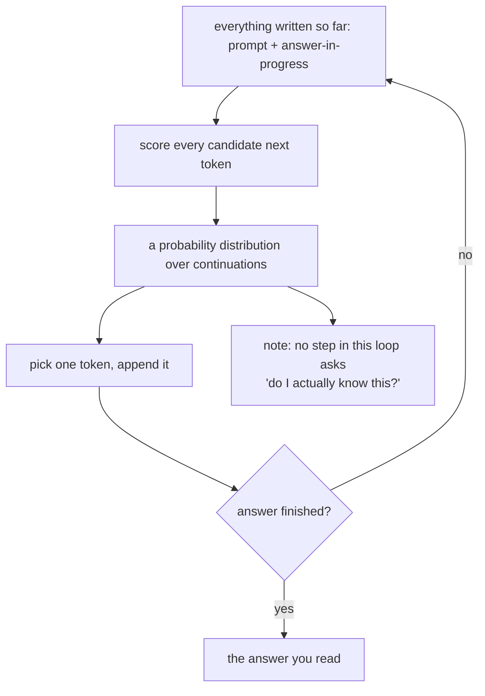
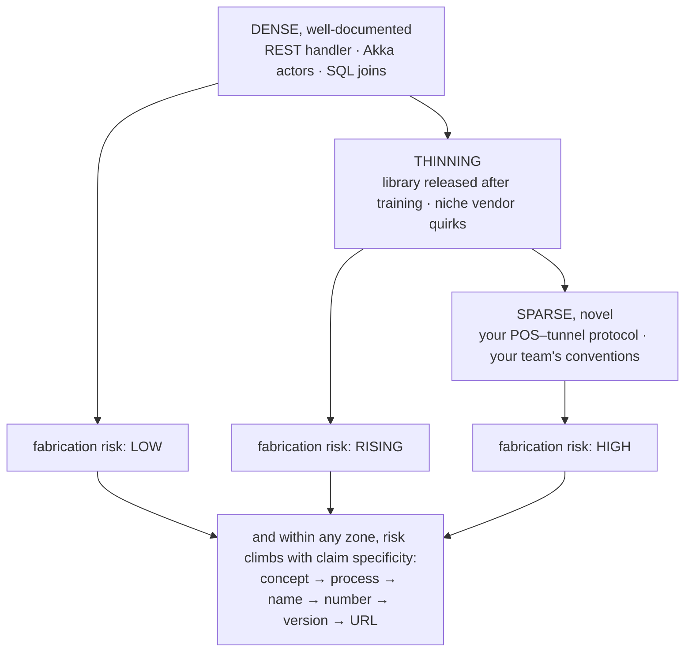
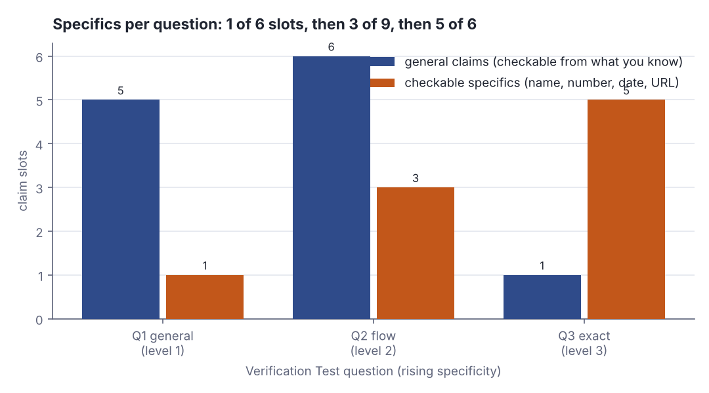

# Next-token prediction: capability zones and where fabrication lives

> Claude Academy · Beginner · ~25 min · rung 3 of 20 · needs: How AI gets its character: pretraining, fine-tuning and fingerprints (claude-academy-02)

## Why this matters

You review Claude's output all day and ship Skills other teams trust without reading them. What
predicts a correct answer rather than a fluent invention is not how good the model is but how
much text like this it read — and that varies sharply inside your own product, so the boundary
is something to measure, not guess.

## The idea

### Autocomplete at scale

A generative model is closer to a vast autocomplete than to a search engine. Nothing is looked
up. Given everything written so far — the system prompt, your message, and whatever of the
answer it has already produced — it scores every token (a word or a word fragment) that could
come next, one is picked, it is appended to the text, and the loop runs again
(Claude Academy, "AI Capabilities and Limitations", lesson 4 "Next Token Prediction",
§"Autocomplete at scale"). What you read as a paragraph was produced left to right, each piece
chosen from what tends to follow what.



*Figure 1: The generation loop. The text grows one token at a time, and the only question asked at each position is which token tends to follow. Source: drawn for this lesson from Claude Academy, "AI Capabilities and Limitations", lesson 4 "Next Token Prediction", §"Autocomplete at scale", https://academy.claude.com/courses/ai-capabilities-and-limitations/next-token-prediction*

```text
Illustrative — written for this lesson.

Prefix so far:   "A wash-club membership bills the customer"
Candidates:      "monthly"      very common continuation
                 "every"        common
                 "quarterly"    less common
                 "in"           common but leads nowhere specific
Picked:          "monthly"
Prefix now:      "A wash-club membership bills the customer monthly"   -> loop again
```

The model never decided "memberships are billed monthly". It extended a string with the piece
that most often follows, and the sentence came out true because that continuation is dense in
what it read.

The scores at each position form a probability distribution, and a knob called **temperature**
decides how it is used: at temperature 0 the top-scoring token is taken every time; raise it and
the distribution flattens, so lower-ranked tokens get chosen often enough to see. Higher variety,
and a higher chance that a token the model had weak grounds for lands in a sentence that reads
exactly as assured as a well-grounded one. The maths of that sampling step — the distribution,
the temperature scaling, top-p — is its own rung later on the AI/ML ladder. The part that
changes how you work is here: every position is a probabilistic choice, and nothing in the loop
compares the chosen token against a store of facts.

### Capability zone and limitation zone

Because every token comes from learned continuations, answer quality tracks one variable: how
well-represented the task is in what the model read. Write an Akka HTTP route handler, explain
actor supervision, name the trade-off between a cache-aside and a write-through cache — millions
of near-identical examples exist, so the continuations are sharp and the answer is usually right.
That is the **capability zone**. Your internal POS-to-tunnel-controller protocol, your team's
naming conventions, a vendor API changed last quarter — close to nothing like it was read, so the
continuations are flat and the model fills the gap with the shape of an answer. That is the
**limitation zone** (Claude Academy, "AI Capabilities and Limitations", lesson 4 "Next Token
Prediction", §"Key takeaways").

```text
Illustrative — written for this lesson.

Prompt:   In Akka, what happens to a child actor's messages while its supervisor
          is restarting it?
Response: The child's mailbox survives the restart. preRestart runs on the old
          instance, unhandled messages stay queued, and the message that caused
          the failure is dropped unless you re-send it yourself.
```

Dense territory: supervision semantics are documented and discussed everywhere, so the
continuations were learned from many consistent examples.

```text
Illustrative — written for this lesson.

Prompt:   What does our POS send to the tunnel controller when a club member
          redeems a wash?
Response: It sends a WashStart frame on TCP 9100 with fields memberId,
          programCode and tunnelId, and waits for WashAck within 500 ms.
```

Same tone, same confidence, same plausible shape — and no basis whatsoever, because your protocol
was never read. The register that writes correct answers is the register that writes this one.



*Figure 2: Two things raise fabrication risk at once — moving right along the density spectrum, and asking for a more specific claim at any point on it. Adapted from Claude Academy, "AI Capabilities and Limitations: Next Token Prediction", https://academy.claude.com/courses/ai-capabilities-and-limitations/next-token-prediction*

### Fabrication concentrates in specificity

The second axis of Figure 2 is the one worth memorising, and the course states it directly:

> "Fabrication concentrates in specificity: names, dates, statistics, citations, URLs, quotes. The more precise a claim, the more it warrants verification."
> — Anthropic, *Claude Academy — AI Capabilities and Limitations: Next Token Prediction*, §"Key takeaways", https://academy.claude.com/courses/ai-capabilities-and-limitations/next-token-prediction

The generation loop explains why. A general claim has many near-equivalent continuations — "bills
monthly", "charges a recurring fee", "renews each month" — and they are all roughly true, so a
weak, spread-out distribution still lands on something defensible. A specific slot has exactly
one correct filler and an unbounded supply of wrong ones with the right shape. Worse, the shape
itself is dense: the model read thousands of version numbers, thousands of spec URLs, thousands
of citation lines, so it is excellent at producing something that *looks* like one. Dense form,
sparse content — the slot gets filled, confidently, with a well-formed guess.

```text
Illustrative — written for this lesson.

Prompt:   How do unlimited wash clubs stay profitable?
Response: Price above the break-even wash frequency: most members wash far less
          often than the plan allows, so the heavy users are cross-subsidised.

Prompt:   What is the average monthly wash frequency for unlimited members, and
          which industry report says so?
Response: About 3.2 washes per member per month, per the ICA 2023 Benchmarking
          Report, table 4.          <- shape perfect, content unverifiable
```

Same model, same topic, two sentences apart. The first answer is a concept with many true
phrasings; the second demands a decimal, a named report, a year and a table number — four slots
with one correct filler each.

### The Verification Test

You cannot sense the boundary from the outside, because tone does not move with it. You can
measure it where you happen to be the authority: ask the model a series of questions inside your
own domain, climbing in specificity, and watch for the first claim you know to be invented. That
point is your zone boundary, measured. Everything you ask *outside* your expertise sits somewhere
on the same curve, and now you know what the curve looks like.

## Lab

**The question:** at which level of specificity does the model stop reporting and start filling
slots — measured on your own domain, where you are the authority?

The lab has two halves. The human half is the Verification Test itself: three real questions to
Claude about car-wash POS operations, checked against what you know. The Scala half is the
scoring sheet: it holds those three questions, decomposes each into the claim slots an adequate
answer must fill, tags every slot as a general claim or a checkable specific, and prints the
share of specifics per question. The script scores the *questions*, not the answers — that is
the part that is fixed before you run the test, so the test cannot be graded after the fact.

### Step 1 — ask the three questions

Open Claude and send these three, each in a **fresh** conversation so the later ones are not
steered by the earlier:

1. **General (level 1):** `How do car-wash club memberships work?`
2. **Medium (level 2):** `Walk me through a typical membership redemption at the bay, from the car arriving to the wash starting.`
3. **Exact (level 3):** `Name the industry standard for POS-to-tunnel-controller messaging in car washes, its current version number, and the URL of its specification.`

Keep the three answers open. You are the authority on 1 and 2; 3 is the one you will have to
look up, which is the point.

### Step 2 — run the scoring sheet

Save this as `Lab.scala` anywhere outside the repo. Scala 3, standard library only; it reads
nothing and calls nothing.

```scala
// file: Lab.scala
// The Verification Test scoring sheet: how much of each answer must be a checkable specific.

type Slot = (String, String)
case class Q(id: String, level: Int, ask: String, slots: Vector[Slot])
val G = "general"
val S = "specific"

val Questions = Vector(
  Q("Q1", 1, "How do car-wash club memberships work?", Vector(
    ("unlimited washes for a flat monthly fee", G),
    ("billing recurs until the member cancels", G),
    ("the member is identified at the bay before the wash starts", G),
    ("the economics turn on washes per member per month", G),
    ("churn and win-back are the operator's main levers", G),
    ("the typical monthly price point", S))),
  Q("Q2", 2, "Walk me through a typical membership redemption at the bay.", Vector(
    ("identify the vehicle or the member", G),
    ("validate that the membership is active and paid", G),
    ("check entitlement, for instance a cooldown since the last wash", G),
    ("write the redemption record", G),
    ("release the gate and start the chosen wash program", G),
    ("queue and replay the redemption when the terminal is offline", G),
    ("the name of the field that carries the package id", S),
    ("the usual cooldown window, in hours", S),
    ("the usual plate-recognition success rate", S))),
  Q("Q3", 3, "Name the POS-to-tunnel-controller messaging standard, its version, its spec URL.", Vector(
    ("whether one dominant standard exists at all", G),
    ("the standard's name", S),
    ("the body that publishes it", S),
    ("the current version number", S),
    ("the publication date", S),
    ("the URL of the specification", S))))

@main def lab(): Unit =
  println("STEP 1 - claim slots demanded by each question")
  val rows = for q <- Questions yield
    println(s"  ${q.id} (level ${q.level})  ${q.ask}")
    for (c, k) <- q.slots do println(f"     $k%-8s  $c")
    val sp = q.slots.count((_, k) => k == S)
    (q, q.slots.size, q.slots.size - sp, sp)

  println()
  println("STEP 2 - per-question table")
  println("  id  level  slots  general  specific  specific share")
  for (q, n, g, s) <- rows do
    println(f"  ${q.id}%-3s ${q.level}%5d ${n}%6d ${g}%8d ${s}%9d ${100.0 * s / n}%13.1f%%")

  println()
  println("STEP 3 - share of checkable specifics by specificity level")
  for lvl <- 1 to 3 do
    val g = rows.filter(_._1.level == lvl)
    val n = g.map(_._2).sum
    val s = g.map(_._4).sum
    println(f"  level $lvl  questions=${g.size}  slots=$n%2d  specifics=$s  share=${100.0 * s / n}%5.1f%%")

  println()
  println("STEP 4 - marking sheet: tick each specific once you have checked it")
  for (q, _, _, _) <- rows; (c, k) <- q.slots if k == S do
    println(s"  [ ] ${q.id}  $c  ->  ok / wrong / unverifiable")
```

Run it:

```bash
scala Lab.scala
```

Real output:

```text
STEP 1 - claim slots demanded by each question
  Q1 (level 1)  How do car-wash club memberships work?
     general   unlimited washes for a flat monthly fee
     general   billing recurs until the member cancels
     general   the member is identified at the bay before the wash starts
     general   the economics turn on washes per member per month
     general   churn and win-back are the operator's main levers
     specific  the typical monthly price point
  Q2 (level 2)  Walk me through a typical membership redemption at the bay.
     general   identify the vehicle or the member
     general   validate that the membership is active and paid
     general   check entitlement, for instance a cooldown since the last wash
     general   write the redemption record
     general   release the gate and start the chosen wash program
     general   queue and replay the redemption when the terminal is offline
     specific  the name of the field that carries the package id
     specific  the usual cooldown window, in hours
     specific  the usual plate-recognition success rate
  Q3 (level 3)  Name the POS-to-tunnel-controller messaging standard, its version, its spec URL.
     general   whether one dominant standard exists at all
     specific  the standard's name
     specific  the body that publishes it
     specific  the current version number
     specific  the publication date
     specific  the URL of the specification

STEP 2 - per-question table
  id  level  slots  general  specific  specific share
  Q1      1      6        5         1          16.7%
  Q2      2      9        6         3          33.3%
  Q3      3      6        1         5          83.3%

STEP 3 - share of checkable specifics by specificity level
  level 1  questions=1  slots= 6  specifics=1  share= 16.7%
  level 2  questions=1  slots= 9  specifics=3  share= 33.3%
  level 3  questions=1  slots= 6  specifics=5  share= 83.3%

STEP 4 - marking sheet: tick each specific once you have checked it
  [ ] Q1  the typical monthly price point  ->  ok / wrong / unverifiable
  [ ] Q2  the name of the field that carries the package id  ->  ok / wrong / unverifiable
  [ ] Q2  the usual cooldown window, in hours  ->  ok / wrong / unverifiable
  [ ] Q2  the usual plate-recognition success rate  ->  ok / wrong / unverifiable
  [ ] Q3  the standard's name  ->  ok / wrong / unverifiable
  [ ] Q3  the body that publishes it  ->  ok / wrong / unverifiable
  [ ] Q3  the current version number  ->  ok / wrong / unverifiable
  [ ] Q3  the publication date  ->  ok / wrong / unverifiable
  [ ] Q3  the URL of the specification  ->  ok / wrong / unverifiable
```

### Step 3 — mark the first fabricated specific

Take STEP 4's marking sheet and go through Claude's three answers in order, slot by slot. For
every specific, write one of three marks:

- **ok** — you know it is right, or you found it in a source you trust;
- **wrong** — it contradicts what you know, or the source says otherwise;
- **unverifiable** — the thing it names does not appear to exist (a standard you cannot find, a
  report with no entry anywhere, a URL that 404s). Treat "unverifiable" as **wrong** for the
  purpose of this test, because a claim you cannot check is a claim you cannot ship.

Then write down the id of the **first** slot marked wrong or unverifiable. That is your boundary.

### Reading the output

**STEP 1** is the audit trail: every claim slot, by question, with its tag, so no count is a
black box. **STEP 2** is the comparison table; **STEP 3** aggregates it by specificity level.

| column | means | which direction is better |
|---|---|---|
| `level` | the question's specificity: 1 general, 2 process, 3 exact | neither; it is the independent variable |
| `slots` | claim slots an adequate answer has to fill | neither; it is the size of the answer |
| `general` | slots you can judge from what you already know | higher means the answer is self-checkable |
| `specific` | slots that need a name, number, date or URL | **higher means more exposure**: each one is a verification task |
| `specific share` | specific ÷ slots × 100 | lower is safer to accept unchecked |

Trace Q3 with digits: 6 slots, of which 1 is general ("whether one dominant standard exists at
all") and 5 are specifics — name, publishing body, version number, publication date, URL. So the
share is 5 ÷ 6 × 100 = 83.333…, printed as 83.3%. Q1, almost the same size at 6 slots, has 1
specific: 1 ÷ 6 × 100 = 16.666…, printed as 16.7%. Q2 is the largest answer of the three at 9
slots and still only 3 specifics: 3 ÷ 9 × 100 = 33.3%.



*Figure 3: The blue bars (claims you can judge yourself) shrink and the orange bars (claims needing an external source) grow as the question gets exact — Q3 is almost entirely exposure. Generated from the lab output.*

**Verdict:** the exact question is not "harder" in the sense of needing a smarter model. It is a
different object: 83.3% of it is slots with exactly one correct filler each, versus 16.7% for the
general question of the same size. If your first wrong or unverifiable mark lands in Q3 — the
usual outcome — you have just measured that the failure is driven by what you asked for, not by
the subject, because Q1 and Q2 covered the same subject and held up.

### Cause → consequence

1. **Cause.** Text is produced token by token from learned continuations; there is no lookup and
   no step that checks a chosen token against a fact store (Claude Academy, "AI Capabilities and
   Limitations", lesson 4 "Next Token Prediction", §"Autocomplete at scale").
2. **Mechanism.** Where the territory is dense the continuations are sharp and the answer is
   usually right; where it is sparse the distribution is flat, but the *form* of a version number,
   a citation or a URL was learned from thousands of examples, so a well-formed filler is always
   available. Specific slots have one correct filler and unlimited plausible wrong ones.
3. **Consequence.** Errors do not spread evenly through an answer. They pool in the names, dates,
   statistics, citations and URLs — and they arrive in the same confident register as the correct
   general claims around them, which is why reading tone tells you nothing.
4. **What it means in practice.** Split any answer you are about to act on into general claims and
   specifics, and spend your verification budget entirely on the specifics — that is where the
   defects are. As a Product Owner, never paste a model-supplied figure, standard name or link
   into a spec or a stakeholder deck without opening the source. In the Skills and MCP servers you
   ship, carry the internal specifics — field names, protocol frames, version pins — in the Skill
   file or a tool result rather than leaving the model to supply them, because that is exactly the
   sparse-and-specific corner where it will produce something well-formed and wrong.

## Self-check

1. Claude answers two questions about your car-wash product in the same confident tone: one about how membership billing generally works, one naming the protocol frame your POS sends to the tunnel controller. Why is it wrong to read the matching tone as matching reliability? <details><summary>Answer</summary>Because the tone is produced by the same mechanism in both cases. The model writes token by token, picking continuations that tend to follow; the assistant register was learned from everything it read and is applied regardless of how much it read about the specific subject. Membership billing is dense territory — many consistent examples — so the continuations are sharp and the answer is usually right. Your internal protocol is sparse territory, so the continuations are flat, but a well-formed frame name, port and field list are still cheap to produce because their shape is dense. Nothing in the generation loop asks "do I know this?", so confidence cannot vary with grounding. Reliability has to be judged from the position of the claim on the density/specificity map, not from how it sounds.</details>
2. Two questions, same topic, same length answer. One asks how unlimited wash clubs stay profitable; the other asks for the average monthly wash frequency and the report that published it. Using the generation mechanism, explain why the second is far more likely to contain a fabrication. <details><summary>Answer</summary>A general claim has many near-equivalent continuations that are all roughly true — "price above the break-even wash frequency", "most members wash less than the plan allows" — so even a flat distribution lands on something defensible. The second question opens slots with exactly one correct filler each: a decimal, an organisation name, a year, a table number. The shape of such fillers is dense in training data (the model read thousands of statistics and citation lines), while the content for this particular question may be sparse or absent. Dense form plus sparse content means a well-formed, confident, wrong answer is the most available continuation. That is the course's point: fabrication concentrates in specificity — names, dates, statistics, citations, URLs, quotes — and the more precise a claim, the more it warrants verification.</details>
3. The lab's script scores the three questions before you send them, not the answers you get back. Why is that ordering load-bearing, and what would you lose by scoring the answers instead? <details><summary>Answer</summary>Fixing the claim slots in advance makes the test a prediction rather than a story told afterwards. The slot list says what an adequate answer must contain and which parts will need an external source — Q3 is 5 specifics out of 6 slots, 83.3%, before a single word comes back. If you scored the answers instead, the model's own framing would set the denominator: a vague answer that dodges the version number and the URL would score as low-specificity and therefore safe, when in fact it simply failed to answer. You would also be free to count slots that confirm whatever you already believed. Scoring the question first means the boundary you find — the first slot marked wrong or unverifiable — is a property of where the question sits on the density and specificity axes, which is what transfers to subjects where you are not the authority.</details>

## Sources

- [Claude Academy — AI Capabilities and Limitations: Next Token Prediction](https://academy.claude.com/courses/ai-capabilities-and-limitations/next-token-prediction) — Anthropic, lesson 4 "Next Token Prediction": §"Autocomplete at scale" gave the autocomplete-at-scale framing and the token-by-token generation loop drawn in Figure 1; §"Key takeaways" gave the capability-zone / limitation-zone split, the density spectrum replicated in Figure 2, and the single passage quoted verbatim above on fabrication concentrating in specificity; accessed 2026-11-09 (by locator; the page was not re-fetched in this run — network fetching was unavailable, so the single quoted passage is the one verified for the curriculum on 2026-10-05).
- [Claude Academy — AI Capabilities and Limitations (course page)](https://academy.claude.com/courses/ai-capabilities-and-limitations) — Anthropic, course page: gives the lesson order this rung sits in and hosts lesson 5 "Try It Out: Next Token Prediction", the interactive exercise that must be opened on the site to be done — the Lab above is the same idea run against your own domain instead; accessed 2026-11-09 (by locator; the page was not re-fetched in this run — network fetching was unavailable, so the single quoted passage is the one verified for the curriculum on 2026-10-05).
- Provenance note: no page was fetched while this lesson was written — the network was unavailable — so exactly one verbatim quote appears, the passage stored with this rung in the curriculum and verified against the source on 2026-10-05. Everything else drawn from the course is cited by locator (course, lesson, section) with no quotation marks around words that were not copied. Every prompt/response block in "The idea" is labelled illustrative and was written for this lesson; the Scala output in the Lab is a real run.

## Next on this track
Next on Claude Academy: **Knowledge: what the model read, and when it stopped reading** (rung 4 of 20, Beginner).
