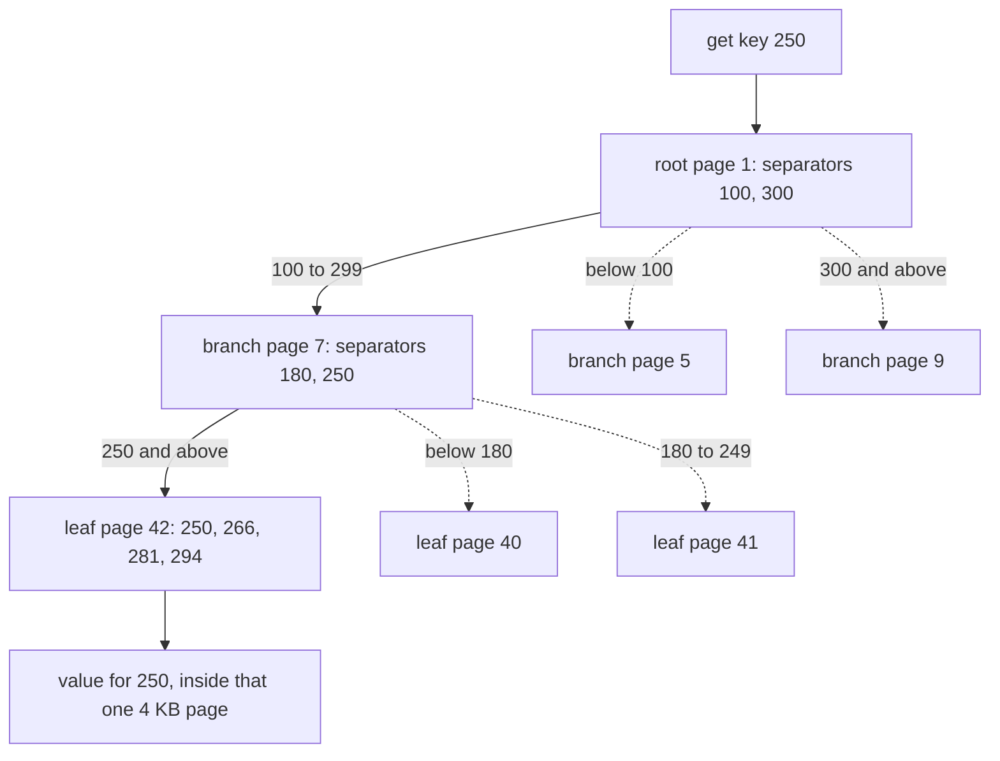
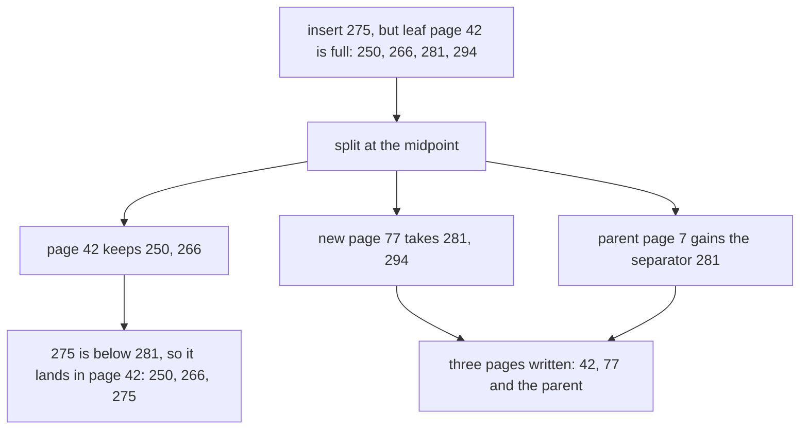
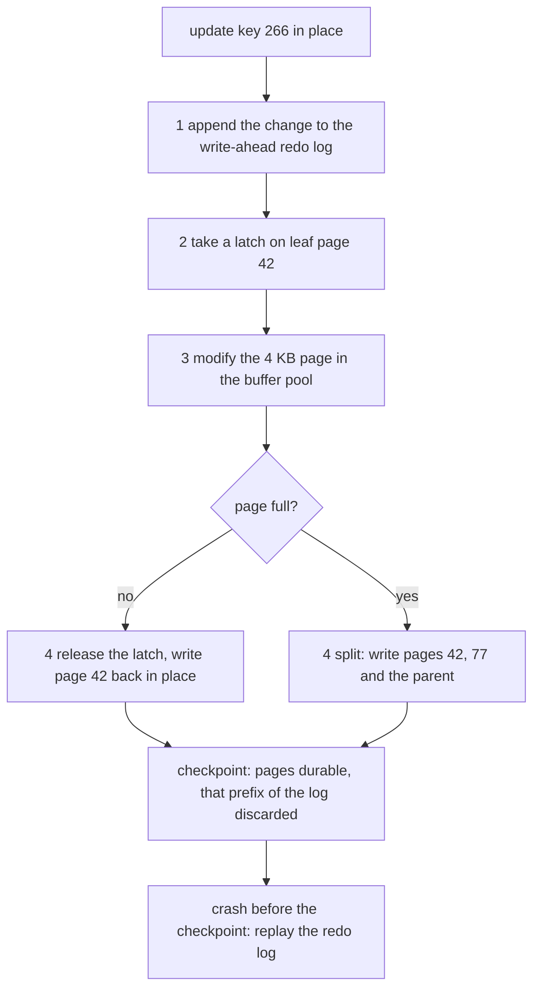
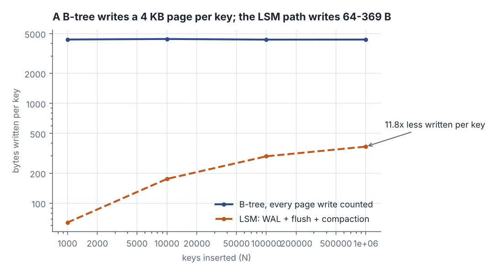
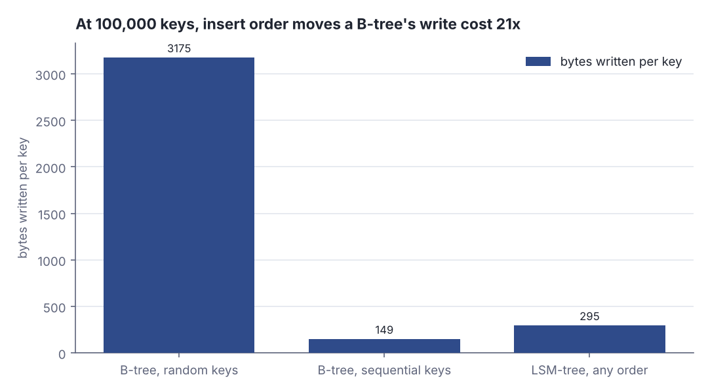

# B-trees, and how they compare with LSM-trees

> Designing Data-Intensive Applications · Intermediate · ~25 min · rung 5 of 26 · needs: Log-structured storage — hash indexes, SSTables and LSM-trees (ddia-04)

## Why this matters
Every relational database you have put behind an Akka service — Postgres, MySQL, SQL Server — answers point lookups from a B-tree, so its tail latency, its lock granularity and its write cost all follow from one decision: fixed-size pages updated in place.
You already hold the log-structured side of this chapter; this rung gives you the other family and the comparison the book keeps deliberately balanced, which is what real arguments about index choice turn on.
It sits here because the next rung leaves single-node OLTP storage for analytics and column stores, and both OLTP families have to be in your hands before that contrast means anything.

## The idea

> Chapter map: Designing Data-Intensive Applications (Kleppmann, 1st ed., 2017), ch. 3 Storage and Retrieval, second half — § B-Trees, § Making B-trees reliable, § B-tree optimizations, § Comparing B-Trees and LSM-Trees, § Other Indexing Structures (storing values within the index, multi-column indexes, keeping everything in memory). The book titles those sections but does not number them; §3.1 to §3.5 below are this lesson's numbering — match them to your copy by name. https://dataintensive.net/

### §3.1 B-Trees
B-trees are what you actually run: the standard index implementation in almost every relational database and many non-relational ones (Kleppmann, DDIA ch. 3, "B-Trees"). Like the immutable sorted files of the previous rung they keep key-value pairs sorted by key, so lookups and range queries are both efficient — but where log-structured indexes write variable-size segments sequentially, B-trees use fixed-size **pages**, traditionally 4 KB, read and written **one page at a time**, matching hardware that is also arranged in fixed-size blocks. Each page has an address, so one page refers to another like a pointer, on disk.

One page is the **root**, where every lookup starts: it holds keys and references to child pages, each child owning a continuous key range, the keys between two references marking the boundaries. Follow the reference whose range contains your key and repeat, reaching a **leaf page** holding the value or a reference to it.


*Figure 1: a lookup descending from the root through key-range references to the leaf owning key 250. Source: Kleppmann, DDIA ch. 3, "B-Trees", https://dataintensive.net/.*

The count of child references in a page is the **branching factor**, in practice several hundred. Updating a key: descend to its leaf, change the value, write the page back — references stay valid because the page did not move. Adding a key: find the page whose range contains it, and if it is out of space, **split** it into two half-full pages and update the parent.

```scala
if c.leaf then
  r.keys ++= c.keys.slice(mid, c.keys.size)   // right half becomes the new leaf
  c.keys.remove(mid, c.keys.size - mid)
  parent.keys.insert(i, r.keys.head)          // separator copied up to the parent
```

```text
  insert  depth  pages  splits  pages per level
      30      1      1       0  1
      40      2      3       1  1-2
      50      2      4       2  1-3
      70      3      8       5  1-2-5
```

Three keys fit in a page here, so the fourth insert splits the root: one page becomes three and the tree gains a level — depth grows only at the root, which keeps the tree balanced.


*Figure 2: an insert overflowing a full leaf — the split writes the old page, its new sibling and the parent. Source: Kleppmann, DDIA ch. 3, "B-Trees", https://dataintensive.net/.*

So a B-tree with n keys has depth O(log n), and most fit in three or four levels: four levels of 4 KB pages with branching factor 500 hold up to 256 TB (Kleppmann, DDIA ch. 3, "B-Trees") — 500⁴ = 62.5 billion leaf pages × 4096 bytes. *Beyond the book:* values only in leaves is usually called a B+ tree, which is what Postgres and InnoDB implement and what the Lab builds.

### §3.2 Making B-trees reliable
The basic write **overwrites a page in place**, assuming the page does not move so references survive — the hard contrast with log-structured files, which are only appended to (Kleppmann, DDIA ch. 3, "Making B-trees reliable"). A magnetic drive moves the head and rewrites the sector; an SSD must erase and rewrite fairly large blocks of a chip. And some operations overwrite **several pages at once**: a split writes both halves and the parent, so a crash in between leaves a corrupt index, typically an orphan page no parent points at. Hence a **write-ahead log**, or **redo log**: an append-only file every modification is written to *before* it touches a tree page, replayed after a crash. In-place updates also need concurrency control, or a reader observes a tree mid-split, so B-trees use **latches** — lightweight locks held for a page operation rather than a transaction. Log-structured engines need neither: merging runs in the background over immutable files, and new segments are swapped in atomically.


*Figure 3: the reliable B-tree write path — redo log first, latch, in-place page update, checkpoint. Adapted from Kleppmann, DDIA ch. 3, "Making B-trees reliable", https://dataintensive.net/.*

### §3.3 B-tree optimizations
What decades of implementation added (Kleppmann, DDIA ch. 3, "B-tree optimizations"): **copy-on-write** replaces the redo log in engines such as LMDB — a modified page is written elsewhere and new versions of its parents point at it, which also gives snapshot isolation, since an old root still describes a whole old tree. **Key abbreviation** keeps only enough of a key in interior pages to act as a boundary, raising the branching factor and lowering depth. **Sequential leaf layout** lets range scans read adjacent pages instead of seeking, but is hard to maintain as a tree grows, where an LSM engine rewrites large segments at once. **Sibling pointers** let a scan walk leaves left and right without climbing to the parent. **Fractal trees** borrow log-structured ideas to cut seeks.

### §3.4 Comparing B-Trees and LSM-Trees
B-tree implementations are more mature; LSM-trees are the interesting option for new stores. The book's rule of thumb, immediately qualified: LSM-trees are typically faster for writes, B-trees thought faster for reads, since an LSM read may consult the in-memory table plus several sorted files at different stages of compaction — but benchmarks are often inconclusive and very sensitive to workload details, so measure with *your* workload (Kleppmann, DDIA ch. 3, "Comparing B-Trees and LSM-Trees").

**For LSM-trees.**
- A B-tree writes data at least twice — redo log, then tree page — plus a whole page for a few changed bytes, plus both halves and the parent on each split; some engines write a page twice so a power failure cannot leave it half-updated.
- Compaction makes log-structured engines rewrite data repeatedly too. One write causing several disk writes over the data's lifetime is **write amplification**: it wears SSD blocks, which survive only so many overwrites, and it eats the disk bandwidth that would otherwise accept new writes.
- LSM-trees usually sustain higher write throughput anyway — partly lower amplification, depending on configuration and workload, partly sequential compact files instead of scattered page overwrites.
- They also **compress better**: a B-tree leaves space unused in every page after a split, while an LSM engine periodically rewrites its files and removes fragmentation, especially under leveled compaction.

```scala
while tiers(l) >= tier do                 // four equal runs: merge them into one
  tiers(l) = 0
  tiers(l + 1) += 1
  comps += 1
  compB += memE.toLong * math.pow(tier, l + 1).toLong * entryB
  l += 1
```

```text
        N  flushes  compactions  runs  WAL MB  flush MB  compact MB  bytes/key    amp  runs probed
  1000000      976          323     7   64.00     63.96      241.17        369    5.8x  1..7 (mean 5.33)
```

A million 64-byte keys cost 369 bytes written each — 5.8× amplification, two thirds of it compaction; the same keys down the B-tree path cost 4361 bytes each, because every insert dirties a whole 4 KB page.


*Figure 4: write amplification measured in the Lab at four sizes, log axes both ways. Generated from the Step 2 and Step 4 output of `python3 dojo/engine/run_lab.py 2026-11-09-2`.*

**Against LSM-trees.**
- Compaction **interferes with ongoing reads and writes**: a disk has finite resources, so a request can wait behind an expensive merge. Averages barely move; the **high percentiles** do, and B-trees are more predictable there.
- At high write throughput the disk's bandwidth is split between the initial write — logging and flushing the in-memory table — and background compaction, which demands more the bigger the database grows.
- If compaction falls behind, unmerged segments pile up until the disk fills and reads slow because they check more files. Engines typically do **not** throttle incoming writes when that happens, so you need explicit monitoring (same section).
- **Each key exists in exactly one place in a B-tree index**, where a log-structured engine may hold copies in several segments. That suits strong transactional semantics, since isolation is often implemented with locks on key ranges that attach directly to the tree.

B-trees are not going away; LSM-trees keep gaining ground; there is no quick rule, so test empirically.

```scala
def lookup(k: Long): (Boolean, Int) =
  var p = root
  var reads = 1
  while !p.leaf do
    p = p.kids(child(p, k))
    reads += 1
  (p.keys.contains(k), reads)
```

```text
   found 1000/1000; pages read per lookup min=4 mean=4.00 max=4; bytes read = 16384
```

A thousand point lookups over a million-key tree read exactly four pages each — not on average, every time. The LSM run at the same size probes between 1 and 7 sorted runs, depending on which holds the key.

### §3.5 Other Indexing Structures
Everything so far was a key-value index, the shape of a primary key: it identifies one row, document or vertex that other records refer to. The rest of the section widens that (Kleppmann, DDIA ch. 3, "Other Indexing Structures").

- **Secondary indexes** — several per table via `CREATE INDEX`, often what makes a join efficient — use the same structures, except that their keys are **not unique**, so each entry is either a list of matching row identifiers, like a postings list in a full-text index, or is made unique by appending a row identifier.
- **Storing values within the index.** The value beside a key is the row itself, or a reference to a row in a **heap file** that keeps rows in no particular order. The heap avoids duplicating a row across several secondary indexes but costs a hop per read, and an update that no longer fits in place moves the record, forcing every index to be updated or a forwarding pointer left behind. When that hop costs too much the row goes into the index: a **clustered index** — InnoDB always clusters the primary key and points secondary indexes at it, SQL Server allows one per table. In between is the **covering index**, which stores some of the table's columns so a query is answered from the index alone, *covering* it. Both buy reads with storage, write overhead and consistency work.
- **Multi-column indexes.** A **concatenated index** appends one column to another in a declared order, like a phone book indexing (lastname, firstname): it serves a lastname, or a lastname-plus-firstname, and is useless for a firstname alone. True multi-dimensional queries — a latitude range *and* a longitude range — defeat it, since you get one range or the other, never the intersection; flatten the dimensions with a space-filling curve, or use a spatial index, as PostGIS does with R-trees on PostgreSQL's generalised search tree. Fuzzy and full-text indexes extend the idea to *similar* rather than equal keys.
- **Keeping everything in memory.** **In-memory databases** keep everything in RAM: Memcached as a pure cache, VoltDB, MemSQL, Oracle TimesTen and RAMCloud with durability from battery-backed RAM, a change log, snapshots or replication — still in-memory, since the disk is only an append-only log and every read is served from RAM. Counterintuitively the speed is **not** mainly from avoiding disk reads, since a disk-based engine with enough memory never reads from disk either, the operating system having cached those blocks; it comes from avoiding the cost of **encoding in-memory structures into a disk format**. Memory also allows models awkward on disk — Redis's priority queues and sets — and *anti-caching* evicts cold records to disk at record granularity, finer than the operating system's pages, though indexes must still fit in memory.

## Lab
For one workload, how many pages does a B-tree touch per lookup and how many bytes does it rewrite per insert — and how does that compare with the LSM path over the same keys?

Everything below is one Scala 3 script, standard library only, built around a real B+ tree with page splits and a size-tiered compaction simulator. Run it with `python3 dojo/engine/run_lab.py 2026-11-09-2`; every output block is that run's real output, and the whole program is at the end of the Lab. Pages are 4096 bytes, entries 64 bytes, so the branching factor is 64; the memtable holds 1024 entries (64 KB) and compaction merges four equal runs into one.

### Step 1 — watch a tiny tree split
With only three keys per page, splits happen immediately and the shape is readable. `census` walks the tree level by level and returns pages and keys per level.

```scala
val tiny = new BTree(3)
(1 to 8).foreach { i =>
  tiny.insert(i.toLong * 10)
  val shape = tiny.census.map(_._2).mkString("-")
  println(f"${i * 10}%8d ${tiny.depth}%6d ${pages(tiny)}%6d ${tiny.splits}%7d  $shape%s")
}
```

```text
== Step 1: a tiny B-tree, 3 keys per page, split by split ==
  insert  depth  pages  splits  pages per level
      10      1      1       0  1
      20      1      1       0  1
      30      1      1       0  1
      40      2      3       1  1-2
      50      2      4       2  1-3
      60      2      5       3  1-4
      70      3      8       5  1-2-5
      80      3      9       6  1-2-6
```

### Step 2 — real page geometry
Now 4 KB pages with 64-byte entries, the same insert path, four dataset sizes. `writes` counts every page write — leaf writes plus three writes per split — and `bytes/key` turns that into write volume per inserted key.

```scala
sizes.foreach { n =>
  val (t, _) = build(n, 1 << 30, false)
  val perKey = t.writes.toDouble * pageB / n
  println(f"$n%9d ${t.depth}%6d ${pages(t)}%7d ${t.splits}%7d ...")
}
```

```text
== Step 2: 4096 B pages, 64 B entries, branching factor 64 ==
        N  depth   pages  splits  splits/1k  page writes  bytes/key    amp
     1000      2      24      22       22.0         1066       4366   68.2x
    10000      3     265     262       26.2        10786       4418   69.0x
   100000      4    2115    2111       21.1       106333       4355   68.1x
  1000000      4   21594   21590       21.6      1064770       4361   68.1x
```

### Step 3 — where the pages are, and what a lookup costs
The census of the million-key tree, then a thousand point lookups counting pages read on the way down.

```text
== Step 3: per-level census of the 1,000,000-key tree, then 1000 lookups ==
  level   pages      keys  keys/page  fill%
      1       1         15       15.0     24
      2      16        505       31.6     50
      3     521      20535       39.4     63
      4   21056    1000000       47.5     75
   found 1000/1000; pages read per lookup min=4 mean=4.00 max=4; bytes read = 16384
```

### Step 4 — the same keys down the LSM path
Every 1024th insert flushes the memtable as a new sorted run; four runs of equal size merge into one of four times the size, cascading. Bytes written are the write-ahead log plus the flushes plus every compaction.

```text
== Step 4: the same keys down the LSM path (64 KB memtable, size-tiered x4) ==
        N  flushes  compactions  runs  WAL MB  flush MB  compact MB  bytes/key    amp  runs probed
     1000        0            0     0    0.06      0.00        0.00         64    1.0x  0 (memtable only)
    10000        9            2     3    0.64      0.59        0.52        175    2.7x  1..3 (mean 2.33)
   100000       97           31     4    6.40      6.36       16.78        295    4.6x  1..4 (mean 3.47)
  1000000      976          323     7   64.00     63.96      241.17        369    5.8x  1..7 (mean 5.33)
```

### Step 5 — the same B-tree, with a buffer pool and two insert orders
A real B-tree does not flush a page per insert: it keeps dirty pages in a buffer pool and writes them at a checkpoint. `build` therefore also counts *distinct* dirty pages per 1000-insert window, once for random keys and once for sequential ones.

```scala
Vector(("random", false), ("sequential", true)).foreach { (name, seq) =>
  val (t, co) = build(100000, 1000, seq)
  val perKey = co.toDouble * pageB / 100000
  println(f"  $name%-12s ${t.writes}%11d $co%10d $perKey%10.0f ${perKey / entryB}%6.1fx")
}
```

```text
== Step 5: insert order decides a B-tree's write amplification ==
  100,000 inserts, buffer pool flushed to disk every 1000 inserts
  key order     page writes  coalesced  bytes/key    amp
  random            106333      77523       3175   49.6x
  sequential        109975       3626        149    2.3x
   LSM at the same N: 295 bytes/key, 4.6x
   book capacity check: 500^4 pages x 4 KB = 256 TB, four levels deep
```


*Figure 5: the Step 5 numbers — a B-tree fed sequential keys writes less per key than the LSM engine; fed random keys it writes eleven times more. Generated from the Step 4 and Step 5 output of `python3 dojo/engine/run_lab.py 2026-11-09-2`.*

### Optional, on your Mac — the same question asked of Postgres
Not runnable in this container, which has no Postgres; run locally with `psql`. `EXPLAIN (ANALYZE, BUFFERS)` reports `shared hit` and `shared read` — buffers found in the cache and buffers fetched from disk (PostgreSQL docs, "Using EXPLAIN" → "EXPLAIN ANALYZE"). Expected shape — run locally: a point lookup on a B-tree index touches a handful of buffers, close to the tree depth plus the heap fetch, while the sequential scan touches the whole table; the range scan touches the leaves it walks plus their heap pages.

```sql
CREATE TABLE t AS SELECT g AS id, md5(g::text) AS v FROM generate_series(1, 1000000) g;
CREATE INDEX t_id_idx ON t (id);
VACUUM ANALYZE t;
EXPLAIN (ANALYZE, BUFFERS) SELECT v FROM t WHERE id = 500000;
EXPLAIN (ANALYZE, BUFFERS) SELECT v FROM t WHERE id BETWEEN 500000 AND 500100;
CREATE EXTENSION IF NOT EXISTS pageinspect;
SELECT root, level FROM bt_metap('t_id_idx');
```

`bt_metap` reports the root level of the index, so you can check the depth Postgres actually built against the depth Step 2 predicts for your row count and key width (PostgreSQL docs, "Index Types" → "B-Tree").

### The whole program

```scala
// file: Lab.scala
import scala.collection.mutable

final class Page(val leaf: Boolean):
  val keys = mutable.ArrayBuffer.empty[Long]
  val kids = mutable.ArrayBuffer.empty[Page]

final class BTree(maxKeys: Int):
  var root = new Page(true)
  var depth = 1
  var splits, writes = 0L                         // writes counts every page write, unbuffered
  val dirty = mutable.HashSet.empty[Page]         // what a buffer pool would still hold
  private def put(p: Page): Unit = { writes += 1; dirty += p }
  private def full(p: Page) = p.keys.size >= maxKeys
  private def child(p: Page, k: Long): Int =
    var i = 0
    while i < p.keys.size && k >= p.keys(i) do i += 1
    i
  private def split(parent: Page, i: Int): Unit =
    val c = parent.kids(i)
    val r = new Page(c.leaf)
    val mid = c.keys.size / 2
    if c.leaf then
      r.keys ++= c.keys.slice(mid, c.keys.size)   // right half becomes the new leaf
      c.keys.remove(mid, c.keys.size - mid)
      parent.keys.insert(i, r.keys.head)          // separator copied up to the parent
    else
      val up = c.keys(mid)
      r.keys ++= c.keys.slice(mid + 1, c.keys.size)
      r.kids ++= c.kids.slice(mid + 1, c.kids.size)
      c.keys.remove(mid, c.keys.size - mid)
      c.kids.remove(mid + 1, c.kids.size - mid - 1)
      parent.keys.insert(i, up)                   // separator moved up to the parent
    parent.kids.insert(i + 1, r)
    splits += 1
    put(c); put(r); put(parent)                   // the full page, its sibling, the parent
  def insert(k: Long): Unit =
    if full(root) then
      val nr = new Page(false)
      nr.kids += root
      root = nr
      depth += 1
      split(nr, 0)
    var p = root
    while !p.leaf do
      val i = child(p, k)
      if full(p.kids(i)) then split(p, i)
      p = p.kids(child(p, k))
    var pos = 0
    while pos < p.keys.size && p.keys(pos) < k do pos += 1
    p.keys.insert(pos, k)
    put(p)
  def lookup(k: Long): (Boolean, Int) =
    var p = root
    var reads = 1
    while !p.leaf do
      p = p.kids(child(p, k))
      reads += 1
    (p.keys.contains(k), reads)
  def census: Vector[(Int, Int, Int)] =           // (level, pages, keys) top down
    var lvl = Vector(root)
    var out = Vector.empty[(Int, Int, Int)]
    while lvl.nonEmpty do
      out = out :+ ((out.size + 1, lvl.size, lvl.map(_.keys.size).sum))
      lvl = lvl.flatMap(_.kids)
    out

@main def lab(): Unit =
  val (pageB, entryB) = (4096, 64)                // page size and entry size in bytes
  val fanout = pageB / entryB                     // 64 entries, so 64 child refs per page
  val (memE, tier) = (1024, 4)                    // 64 KB memtable; compaction merges 4 runs
  val sizes = Vector(1000, 10000, 100000, 1000000)
  def key(i: Int): Long = (i.toLong * 2654435761L) & 0xffffffffL
  def pages(t: BTree) = t.census.map(_._2).sum

  def build(n: Int, window: Int, seq: Boolean): (BTree, Long) =
    val t = new BTree(fanout - 1)
    var coalesced = 0L
    var i = 0
    while i < n do
      t.insert(if seq then i.toLong else key(i))
      i += 1
      if i % window == 0 then { coalesced += t.dirty.size; t.dirty.clear() }
    (t, coalesced + t.dirty.size)

  def lsm(n: Int): (Long, Long, Int, Long, Long, Long, Double) =
    val tiers = mutable.ArrayBuffer.fill(24)(0)
    var flushes, comps, compB = 0L
    var j = 0
    while j < n do
      j += 1
      if j % memE == 0 then
        flushes += 1
        tiers(0) += 1
        var l = 0
        while tiers(l) >= tier do                 // four equal runs: merge them into one
          tiers(l) = 0
          tiers(l + 1) += 1
          comps += 1
          compB += memE.toLong * math.pow(tier, l + 1).toLong * entryB
          l += 1
    val runs = (0 until 24).flatMap(l => Vector.fill(tiers(l))(memE.toLong * math.pow(tier, l).toLong))
    val tot = math.max(1.0, runs.sum.toDouble)
    val mean = runs.zipWithIndex.map((s, r) => s / tot * (r + 1)).sum
    (flushes, comps, runs.size, n.toLong * entryB, flushes * memE.toLong * entryB, compB, mean)

  println("== Step 1: a tiny B-tree, 3 keys per page, split by split ==")
  val tiny = new BTree(3)
  println("  insert  depth  pages  splits  pages per level")
  (1 to 8).foreach { i =>
    tiny.insert(i.toLong * 10)
    val shape = tiny.census.map(_._2).mkString("-")
    println(f"${i * 10}%8d ${tiny.depth}%6d ${pages(tiny)}%6d ${tiny.splits}%7d  $shape%s")
  }
  println()
  println("== Step 2: 4096 B pages, 64 B entries, branching factor 64 ==")
  var big: BTree = null
  println("        N  depth   pages  splits  splits/1k  page writes  bytes/key    amp")
  sizes.foreach { n =>
    val (t, _) = build(n, 1 << 30, false)
    big = t
    val perKey = t.writes.toDouble * pageB / n
    println(f"$n%9d ${t.depth}%6d ${pages(t)}%7d ${t.splits}%7d ${t.splits * 1000.0 / n}%10.1f " +
      f"${t.writes}%12d $perKey%10.0f ${perKey / entryB}%6.1fx")
  }
  println()
  println("== Step 3: per-level census of the 1,000,000-key tree, then 1000 lookups ==")
  println("  level   pages      keys  keys/page  fill%")
  big.census.foreach { (d, pg, ks) =>
    val per = ks.toDouble / pg
    println(f"$d%7d $pg%7d $ks%10d $per%10.1f ${per * 100 / (fanout - 1)}%6.0f")
  }
  val probes = (0 until 1000).map(j => big.lookup(key(j * 997)))
  val reads = probes.map(_._2)
  println(f"   found ${probes.count(_._1)}%d/1000; pages read per lookup min=${reads.min}%d " +
    f"mean=${reads.sum / 1000.0}%.2f max=${reads.max}%d; bytes read = ${reads.max * pageB}%d")
  println()
  println("== Step 4: the same keys down the LSM path (64 KB memtable, size-tiered x4) ==")
  println("        N  flushes  compactions  runs  WAL MB  flush MB  compact MB  bytes/key    amp  runs probed")
  val lsmPerKey = sizes.map { n =>
    val (fl, co, runs, wal, flB, coB, mean) = lsm(n)
    val perKey = (wal + flB + coB).toDouble / n
    val probed = if runs == 0 then "0 (memtable only)" else f"1..$runs%d (mean $mean%.2f)"
    println(f"$n%9d $fl%8d $co%12d $runs%5d ${wal / 1e6}%7.2f ${flB / 1e6}%9.2f ${coB / 1e6}%11.2f " +
      f"$perKey%10.0f ${perKey / entryB}%6.1fx  $probed%s")
    perKey
  }
  println()
  println("== Step 5: insert order decides a B-tree's write amplification ==")
  println("  100,000 inserts, buffer pool flushed to disk every 1000 inserts")
  println("  key order     page writes  coalesced  bytes/key    amp")
  Vector(("random", false), ("sequential", true)).foreach { (name, seq) =>
    val (t, co) = build(100000, 1000, seq)
    val perKey = co.toDouble * pageB / 100000
    println(f"  $name%-12s ${t.writes}%11d $co%10d $perKey%10.0f ${perKey / entryB}%6.1fx")
  }
  println(f"   LSM at the same N: ${lsmPerKey(2)}%.0f bytes/key, ${lsmPerKey(2) / entryB}%.1fx")
  println(f"   book capacity check: 500^4 pages x 4 KB = ${math.pow(500, 4).toLong * 4096 / 1e12}%.0f TB, four levels deep")
```

### Reading the output
**Step 1.** `depth` is how many pages a lookup reads; `pages` is every page in the tree; `splits` counts overflowing pages that were cut in two; `pages per level` is the census, root first. Fewer pages per lookup is better, and more keys per page is better. Trace insert 40: the single root leaf already held 10, 20, 30 and is full at three keys, so it splits — the right half becomes a new leaf, the separator is copied into a brand-new root, and 1 page becomes 3 while depth goes from 1 to 2.

| insert | depth | pages | splits | pages per level |
|---|---|---|---|---|
| 30 | 1 | 1 | 0 | 1 |
| 40 | 2 | 3 | 1 | 1-2 |
| 70 | 3 | 8 | 5 | 1-2-5 |

**Verdict:** a B-tree never rebalances by rotation; it grows a level at the root, which is why depth is the same for every key in the tree.

**Step 2.** `splits/1k` is splits per thousand inserts, `page writes` every page the engine wrote, `bytes/key` those writes in bytes divided by keys inserted, `amp` the same figure divided by the 64-byte entry — write amplification. Lower is better for all four. The arithmetic at a million keys: 21,590 splits × 3 pages each = 64,770 writes, plus 1,000,000 leaf writes = 1,064,770 page writes; × 4096 bytes = 4,361,297,920 bytes; ÷ 1,000,000 keys = 4361 bytes per key; ÷ 64 bytes of payload = 68.1×.

| N | depth | pages | splits/1k | page writes | bytes/key | amp |
|---|---|---|---|---|---|---|
| 1,000 | 2 | 24 | 22.0 | 1,066 | 4366 | 68.2x |
| 10,000 | 3 | 265 | 26.2 | 10,786 | 4418 | 69.0x |
| 100,000 | 4 | 2,115 | 21.1 | 106,333 | 4355 | 68.1x |
| 1,000,000 | 4 | 21,594 | 21.6 | 1,064,770 | 4361 | 68.1x |

**Verdict:** a thousandfold more data, the same bytes written per key and one extra level — depth is logarithmic, and the per-key write cost of a page-oriented engine is a constant set by the page size, not by the data size.

**Step 3.** `keys/page` is the mean occupancy, `fill%` that as a share of the 63 keys a page can hold; higher is better, because a half-empty page wastes both disk and the bandwidth spent reading it. Leaves sit at 47.5 of 63 keys, which is the familiar ~70% occupancy of a randomly built B-tree — and the space the book means when it says a B-tree leaves disk unused through fragmentation. Check the bottom row: 1,000,000 keys ÷ 21,056 leaf pages = 47.5 keys per page, and a lookup reads 4 pages × 4096 bytes = 16,384 bytes.

| level | pages | keys | keys/page | fill% |
|---|---|---|---|---|
| 1 (root) | 1 | 15 | 15.0 | 24 |
| 2 | 16 | 505 | 31.6 | 50 |
| 3 | 521 | 20,535 | 39.4 | 63 |
| 4 (leaves) | 21,056 | 1,000,000 | 47.5 | 75 |

**Verdict:** every one of a thousand lookups read exactly four pages — min, mean and max all 4. That is the predictability the book credits to B-trees, stated as a distribution with zero spread.

**Step 4.** `flushes` is memtables written out as new sorted runs, `compactions` merges of four equal runs into one, `runs` the sorted files left on disk, and the three MB columns are what was written: the write-ahead log, the flushes, the compaction merges. `runs probed` is how many files a lookup may have to consult, worst case, with the size-weighted mean for a key that exists. Lower is better everywhere. At a million keys: 1,000,000 × 64 B = 64.00 MB of log, 976 flushes × 1024 entries × 64 B = 63.96 MB of flushes, 241.17 MB of compaction, total 369.13 MB ÷ 1,000,000 keys = 369 bytes per key = 5.8×.

| N | flushes | compactions | runs | compact MB | bytes/key | amp | runs probed |
|---|---|---|---|---|---|---|---|
| 1,000 | 0 | 0 | 0 | 0.00 | 64 | 1.0x | memtable only |
| 10,000 | 9 | 2 | 3 | 0.52 | 175 | 2.7x | 1..3 |
| 100,000 | 97 | 31 | 4 | 16.78 | 295 | 4.6x | 1..4 |
| 1,000,000 | 976 | 323 | 7 | 241.17 | 369 | 5.8x | 1..7 |

**Verdict:** both families amplify writes, as the book insists, but in opposite directions as data grows — the B-tree's 68× is flat, the LSM's climbs from 1.0× to 5.8× as compaction debt accumulates, and it is still 11.8× cheaper per key at a million keys (4361 ÷ 369).

**Step 5.** `page writes` is the unbuffered count from Step 2; `coalesced` counts *distinct* pages dirtied within each 1000-insert window, which is what a buffer pool would actually write at a checkpoint. Random keys scatter: 100,000 inserts dirtied 77,523 distinct pages, 3175 bytes per key. Sequential keys keep landing in the rightmost leaf: 3,626 distinct pages, 3,626 × 4096 ÷ 100,000 = 148.5, printed as 149 bytes per key. That is 3175 ÷ 149 = 21.3× between two runs of the same code on the same data structure.

| key order | page writes | coalesced | bytes/key | amp |
|---|---|---|---|---|
| random | 106,333 | 77,523 | 3175 | 49.6x |
| sequential | 109,975 | 3,626 | 149 | 2.3x |
| LSM, same N | — | — | 295 | 4.6x |

**Verdict:** the headline comparison is conditional on the workload. Fed a monotonic key, the B-tree writes half of what the LSM engine writes; fed random keys — a UUID primary key, a hash-partitioned id — it writes eleven times more. This is exactly why the book refuses a quick rule and says test empirically.

### Cause → consequence
1. **Cause** — a B-tree is a tree of fixed-size pages updated in place, so the unit of both reading and writing is one whole page, and a crash mid-update must be repairable.
2. **Mechanism** — a lookup follows one reference per level and reads exactly `depth` pages (4 of 4096 bytes here, every time); an insert dirties the leaf, three pages when it splits, and must hit the redo log first, under a latch. An LSM engine instead appends, flushes and merges, so its cost appears later, as compaction bytes, and spreads over 1 to 7 runs per read.
3. **Consequence** — B-tree read latency has almost no spread and its write volume is a constant per key (4361 bytes, 68×) unless writes arrive in key order (149 bytes, 2.3×); LSM write volume is far lower overall (369 bytes, 5.8×) but is paid by a background process that competes with foreground traffic and can fall behind.
4. **In practice** — when a Postgres table under an Akka service takes a UUID primary key, you are choosing the 49.6× column of Step 5; a monotonic bigint or a time-ordered id is a real write-amplification decision, not style. When you put RocksDB under a Kafka Streams or Akka Persistence store, the number to alarm on is compaction backlog and the count of sorted runs, because nothing throttles your producers when compaction falls behind — the runs column grows, reads start probing more files, and p99 read latency moves while the mean stays flat. And when a design review asks why the relational store answers point lookups so evenly, the answer is Step 3: four pages, every key, every time, with one place per key for a range lock to attach to.

## Self-check
1. A B-tree index has 4 KB pages and a branching factor of 500, and the table holds 20 billion rows. Roughly how many pages does a point lookup read, and why does that number barely move when the table doubles? <details><summary>Answer</summary>Four. Each level multiplies capacity by the branching factor: 500 references at the root, 500² = 250,000, 500³ = 125 million, 500⁴ = 62.5 billion leaf pages — the four-level tree the book prices at 256 TB (Kleppmann, DDIA ch. 3, "B-Trees"). A lookup reads one page per level, so it reads four. Doubling the data adds keys inside existing pages and splits some of them; a fifth level only appears when the whole level is exhausted, so depth is logarithmic in n. The Lab shows the same effect at small scale: 1000 to 1,000,000 keys moved depth from 2 to 4, and every one of a thousand lookups read exactly 4 pages.</details>
2. A page split has to write the two half-full pages and their parent. What stops a crash between those writes from leaving a corrupt index, and what second mechanism stops a concurrent reader from seeing the half-finished split? <details><summary>Answer</summary>The write-ahead log, also called the redo log: an append-only file that every modification is written to before it is applied to any tree page, so after a crash the log is replayed and the tree is put back into a consistent state — without it you can get an orphan page that no parent points at. Concurrency is a separate problem, solved with latches: lightweight locks held for the duration of a page operation, not a transaction, so no reader walks a tree mid-split (Kleppmann, DDIA ch. 3, "Making B-trees reliable"). The alternative design is copy-on-write, as in LMDB: write the modified page elsewhere and write new parent pages pointing at it, which needs no redo log and gives snapshot isolation.</details>
3. Your service writes 40,000 events per second into an LSM-backed store and read latency at p99 has quietly tripled over a week while the mean is unchanged. What is the most likely cause, which metric confirms it, and why does the store not simply slow your writers down? <details><summary>Answer</summary>Compaction is falling behind. The disk's write bandwidth is shared between flushing memtables and merging sorted runs; as the dataset grows compaction needs more of it, and when it cannot keep up the number of unmerged segments grows, so each read consults more files — p99 moves first because only the reads that miss the newest runs pay. Confirm with the count of sorted runs or SSTables per level and the compaction backlog, plus disk write throughput. Nothing throttles automatically: SSTable-based engines typically do not limit incoming writes even when compaction cannot keep up, so you need explicit monitoring and, eventually, more disk bandwidth, a different compaction strategy or fewer writes (Kleppmann, DDIA ch. 3, "Comparing B-Trees and LSM-Trees"). The Lab's run count is the same signal: 3 runs at 10,000 keys, 7 at a million.</details>

## Sources
- [Designing Data-Intensive Applications (Kleppmann, 1st ed.)](https://dataintensive.net/) — Martin Kleppmann, O'Reilly, 2017 — your own copy; ch. 3 "Storage and Retrieval", second half. "B-Trees" supplied the page-oriented design, the root-to-leaf descent drawn as Figure 1, branching factor, the update-in-place and split-on-overflow rules drawn as Figure 2, the O(log n) depth claim and the four-level 256 TB capacity figure checked in the Lab; "Making B-trees reliable" supplied the in-place overwrite and its hardware cost, the multi-page split hazard and orphan pages, the write-ahead (redo) log and latches, replicated as Figure 3; "B-tree optimizations" supplied copy-on-write and LMDB, key abbreviation, sequential leaf layout, sibling pointers and fractal trees; "Comparing B-Trees and LSM-Trees" supplied the write-amplification argument on both sides, the compression and fragmentation comparison, compaction interference at high percentiles, compaction falling behind without throttling, and the one-place-per-key point about range locks; "Other Indexing Structures" supplied secondary indexes and non-unique keys, heap files, clustered and covering indexes, concatenated and multi-dimensional indexes, R-trees in PostGIS, and "Keeping everything in memory" supplied in-memory databases and the encoding-overhead explanation — accessed 2026-11-09 (cited by chapter/section locator; the page was not fetched in this run — network fetching was unavailable)
- [PostgreSQL documentation — Index Types](https://www.postgresql.org/docs/current/indexes-types.html) — PostgreSQL Global Development Group — section "B-Tree": the production B-tree you can inspect on your own machine, and the basis for the optional `bt_metap` check of the real tree level against the depth the Lab predicts — accessed 2026-11-09 (cited by chapter/section locator; the page was not fetched in this run — network fetching was unavailable)
- [PostgreSQL documentation — Using EXPLAIN](https://www.postgresql.org/docs/current/using-explain.html) — PostgreSQL Global Development Group — sections "EXPLAIN Basics" and "EXPLAIN ANALYZE": the BUFFERS option and its `shared hit` / `shared read` counters, used in the optional local exercise to count the pages a point lookup and a range scan actually touch — accessed 2026-11-09 (cited by chapter/section locator; the page was not fetched in this run — network fetching was unavailable)

Related in your knowledge base: `06-databases-and-distributed-data/btree_lsm_comparison.md` and `06-databases-and-distributed-data/Indexing_Optim.md`.

## Next on this track
Next on Designing Data-Intensive Applications: **OLTP vs OLAP, data warehouses and column storage** (rung 6 of 26, Intermediate).
