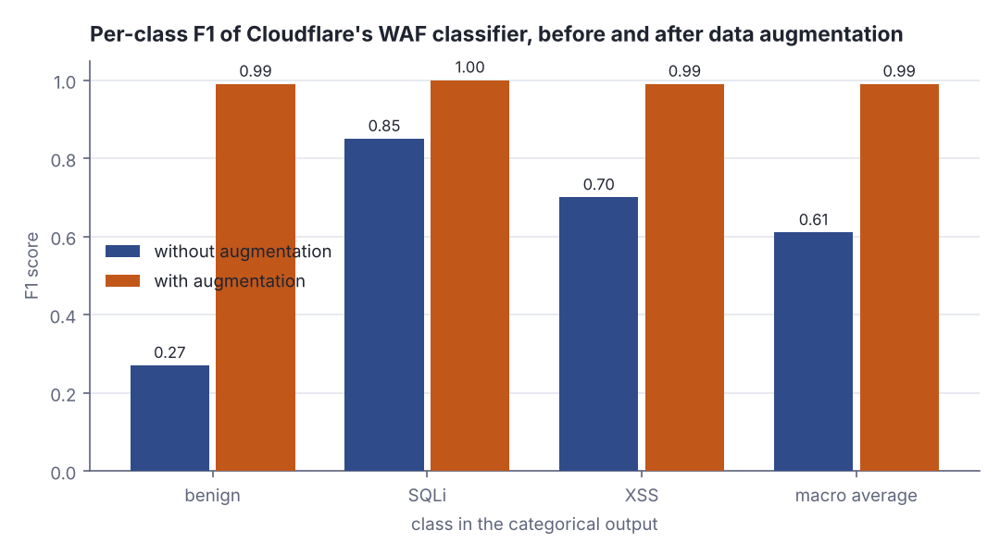
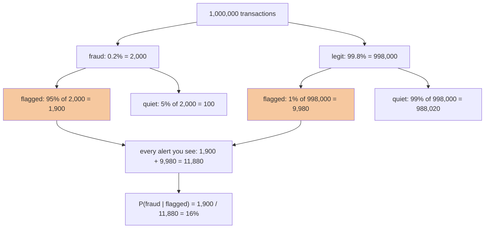
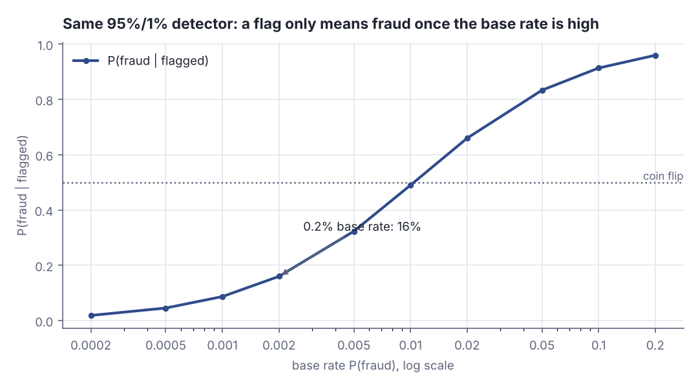
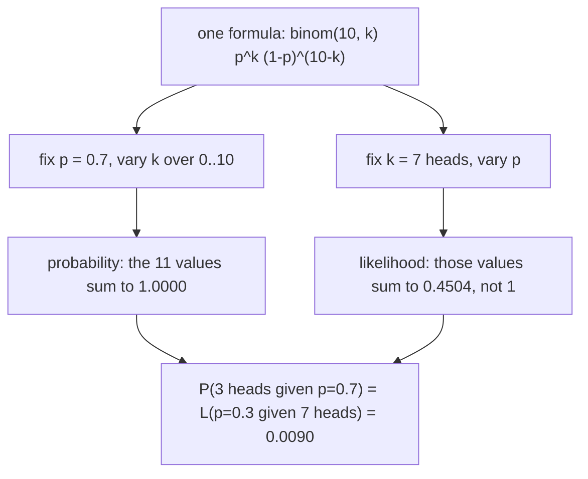
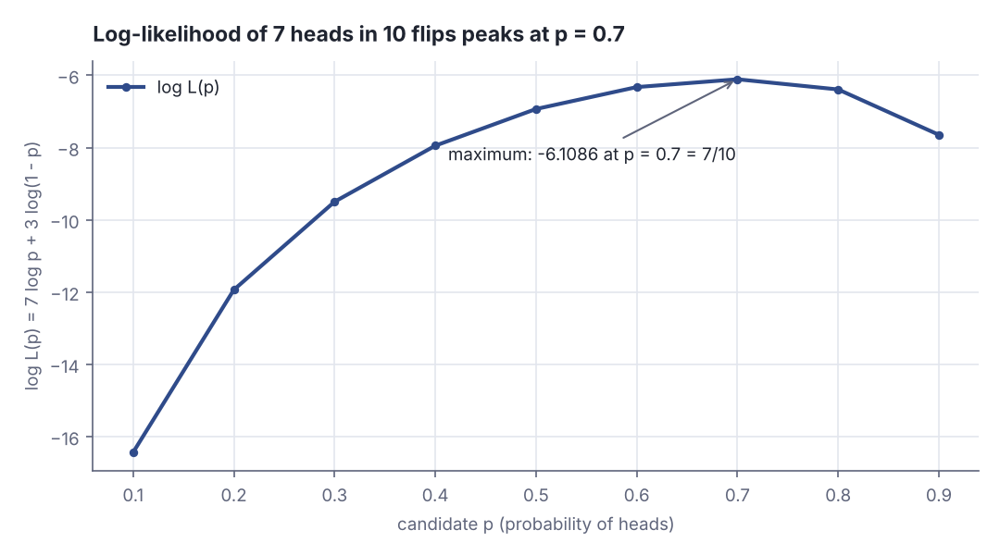

# Probability you need for ML: distributions, Bayes, likelihood

> AI / ML foundations · Beginner · ~25 min · rung 8 of 38 · needs: What machine learning actually optimises (ai-ml-01)

## Why this matters

Every classifier you will ship emits a number per class, every loss you will minimise is a negative log-likelihood under some distribution, and every metric you will argue about in a review moves with how rare the positive class is.
Without the base rate, "the detector catches 95% of fraud" says nothing about what a single alert on your dashboard means — and the arithmetic that fixes it is one line you can do in your head once you have seen it done.
This is the smallest probability kit that makes the next rungs — logistic regression, cross-entropy, calibration — readable instead of magic.

## The idea

Three objects carry the whole lesson: a **distribution** (what values a quantity takes, how often), **Bayes' theorem** (how an observation updates a belief), and the **likelihood** (how well a candidate parameter explains the data you hold).

### Random variables, and the three distributions you actually meet

A **random variable** is a quantity whose value comes out of a random process: `X = 1` if this request is flagged, `0` otherwise. Its **distribution** gives a probability to each value (discrete) or a density over values (continuous). Two summaries do most of the work: the **mean** `E[X] = Σ x · P(X = x)`, the long-run average, and the **variance** `Var[X] = E[(X − E[X])²]`, the average squared distance from that mean, whose square root is in the same units as `X`.

Three distributions cover most of practical ML (Goodfellow et al., *Deep Learning*, ch. 3 §3.9):

- **Bernoulli(p)** — one yes/no draw: `P(X = 1) = p`; mean `p`, variance `p(1 − p)`. A binary classifier's output *is* a Bernoulli parameter.
- **Categorical(p₁ … p_k)** — one draw from `k` labels with `Σ p_i = 1`. A softmax vector *is* a categorical parameter vector.
- **Normal(μ, σ²)** — a continuous measurement around `μ` with variance `σ²`: latency, noise, weight initialisation.

You never have to take the mean and variance formulas on faith; draw from the distribution and count:

```scala
// file: Ex1.scala
@main def ex1(): Unit =
  val rng = scala.util.Random(7)
  val flags = Vector.fill(100000)(if rng.nextDouble() < 0.3 then 1.0 else 0.0)
  val mean = flags.sum / flags.size
  val vari = flags.map(x => (x - mean) * (x - mean)).sum / flags.size
  println(f"Bernoulli(0.3): mean $mean%.4f vs p 0.3000")
  println(f"Bernoulli(0.3): var  $vari%.4f vs p(1-p) 0.2100")
  val lat = Vector.fill(100000)(12.0 + 3.0 * rng.nextGaussian())
  val m2 = lat.sum / lat.size
  val sd2 = math.sqrt(lat.map(x => (x - m2) * (x - m2)).sum / lat.size)
  println(f"Normal(12, 3): mean $m2%.3f  sd $sd2%.3f")
```

```text
Bernoulli(0.3): mean 0.2993 vs p 0.3000
Bernoulli(0.3): var  0.2097 vs p(1-p) 0.2100
Normal(12, 3): mean 12.017  sd 3.013
```

100 000 Bernoulli draws average 0.2993 against the predicted 0.3 and vary by 0.2097 against `p(1−p) = 0.21`; the Gaussian draws recover `μ = 12` and `σ = 3`. The parameters *are* the mean and the spread.

Engineers instantiate distributions deliberately. Cloudflare's machine-learning WAF lacked benign traffic, so it generated some:

> "This approach works by taking a collection of tokens and a probability distribution over these tokens, and independently"
> — Vikram Grover, Cloudflare, *Improving the accuracy of our machine learning WAF using data augmentation and sampling*, 2022-09-05, https://blog.cloudflare.com/data-generation-and-sampling-strategies

That same system is categorical on the output side: it sorts a request into benign, SQLi or XSS. Its results table reports per-class F1 rising from 0.27 / 0.85 / 0.70 without augmentation to 0.99 / 1.00 / 0.99 with it (Vikram Grover, Cloudflare, *Improving the accuracy of our machine learning WAF using data augmentation and sampling*, 2022-09-05, https://blog.cloudflare.com/data-generation-and-sampling-strategies):

```scala
// file: Ex2.scala
@main def ex2(): Unit =
  val classes = Vector("benign", "sqli", "xss")
  val f1NoAug = Vector(0.27, 0.85, 0.70)
  val f1Aug = Vector(0.99, 1.00, 0.99)
  val share = Vector(0.70, 0.20, 0.10)
  println(f"categorical: ${share.mkString(", ")} sums to ${share.sum}%.2f")
  for i <- classes.indices do
    println(f"  ${classes(i)}%-7s F1 ${f1NoAug(i)}%.2f -> ${f1Aug(i)}%.2f")
  println(f"  macro   F1 ${f1NoAug.sum / 3}%.2f -> ${f1Aug.sum / 3}%.2f")
```

```text
categorical: 0.7, 0.2, 0.1 sums to 1.00
  benign  F1 0.27 -> 0.99
  sqli    F1 0.85 -> 1.00
  xss     F1 0.70 -> 0.99
  macro   F1 0.61 -> 0.99
```

The three shares sum to exactly 1.00 — that constraint is what makes it a categorical distribution and not three independent numbers. The macro F1 computed here, 0.61 → 0.99, matches the post's own macro-average row.



*Figure 1: the weakest class, benign, is the one augmentation fixes (F1 0.27 → 0.99), dragging the macro average from 0.61 to 0.99. Numbers printed by the Ex2 output above. Adapted from Vikram Grover, Cloudflare, Improving the accuracy of our machine learning WAF using data augmentation and sampling, https://blog.cloudflare.com/data-generation-and-sampling-strategies*

### Conditional probability, Bayes' theorem, and the base rate

`P(A | B)` — "A given that B happened" — is defined as `P(A and B) / P(B)`: restrict the world to the cases where `B` holds, then ask what fraction of those also have `A`. Rearranging gives `P(A and B) = P(B | A) · P(A)`, and substituting that back gives **Bayes' theorem** (Goodfellow et al., *Deep Learning*, ch. 3 §3.11 "Bayes' Rule"):

`P(A | B) = P(B | A) · P(A) / P(B)`

`P(A)` is the **prior**, `P(B | A)` the **likelihood** of the evidence under `A`, `P(A | B)` the **posterior**. The denominator is the total probability of the evidence over every way it can happen: `P(B) = P(B | A)P(A) + P(B | ¬A)P(¬A)`.

Make it concrete with the lab's detector: fraud is 0.2% of transactions, the detector flags 95% of fraud and wrongly flags 1% of legitimate traffic. Count a million transactions instead of juggling fractions:



*Figure 2: the Bayes tree for a 0.2% base rate and a 95% / 1% detector. The two shaded leaves are the only ones you observe; the posterior is the left one over their sum. Source: drawn for this lesson from the lab arithmetic below.*

**Base-rate neglect** is reading "95% detection, 1% false positives" and concluding an alert is probably fraud. The tree shows why: 1% of a huge legitimate population (9,980) swamps 95% of a tiny fraudulent one (1,900), so five alerts in six are false.



*Figure 3: one detector, ten base rates. Below a 1% base rate an alert is more likely wrong than right; at 0.2% it is worth 16%. Generated from the Step 2 lab output below.*

### Probability versus likelihood

Both come out of one formula read in opposite directions. Fix the parameter and vary the data: that is a **probability**, and it sums to 1 over all possible datasets. Fix the data and vary the parameter: that is a **likelihood**, and it does *not* sum to 1 (StatQuest, "Probability is not Likelihood. Find out why!!!").



*Figure 4: probability and likelihood are one arithmetic read along two axes; the bottom node is the coincidence the next example prints. Source: drawn for this lesson from the Ex3 output below.*

```scala
// file: Ex3.scala
@main def ex3(): Unit =
  def binom(n: Int, k: Int) = (1 to k).map(i => (n - k + i).toDouble / i).product
  def pmf(k: Int, p: Double) = binom(10, k) * math.pow(p, k) * math.pow(1 - p, 10 - k)
  val probs = (0 to 10).map(k => pmf(k, 0.7))
  println(f"p fixed at 0.7, data varies: sum over k=0..10 is ${probs.sum}%.4f")
  println(f"  P(7 heads | 0.7) = ${pmf(7, 0.7)}%.4f  P(3 heads | 0.7) = ${pmf(3, 0.7)}%.4f")
  val liks = Vector(0.3, 0.5, 0.7, 0.9).map(p => (p, pmf(7, p)))
  println(f"data fixed at 7 heads, p varies: sum is ${liks.map(_._2).sum}%.4f")
  liks.foreach((p, l) => println(f"  L(p=$p%.1f ; 7 heads) = $l%.4f"))
```

```text
p fixed at 0.7, data varies: sum over k=0..10 is 1.0000
  P(7 heads | 0.7) = 0.2668  P(3 heads | 0.7) = 0.0090
data fixed at 7 heads, p varies: sum is 0.4504
  L(p=0.3 ; 7 heads) = 0.0090
  L(p=0.5 ; 7 heads) = 0.1172
  L(p=0.7 ; 7 heads) = 0.2668
  L(p=0.9 ; 7 heads) = 0.0574
```

The first block sums to exactly 1.0000 because `k = 0 … 10` is everything that can happen; the second sums to 0.4504, because four candidate parameters exhaust nothing. The 0.0090 appears twice on purpose: `P(3 heads | p = 0.7)` and `L(p = 0.3 | 7 heads)` are the same multiplication.

### Maximum likelihood, and why the log

**Maximum likelihood estimation** picks the parameter that makes the observed data most probable: `argmax_θ P(data | θ)` (Goodfellow et al., *Deep Learning*, ch. 5 §5.5 "Maximum Likelihood Estimation"). With independent observations that joint likelihood is a *product*, and a product of thousands of numbers below 1 underflows to 0.0 in a `Double`. The logarithm turns the product into a sum, is monotone (so the argmax does not move), and keeps the numbers in range. Flip the sign and you minimise: the **negative log-likelihood** is the loss your framework reports, and for a Bernoulli output it is exactly binary cross-entropy.

**Independence** is the assumption doing that work: `P(x₁, x₂ | θ) = P(x₁ | θ) · P(x₂ | θ)` holds only when observations do not inform each other. Push it onto *features* instead of rows and you get **naive Bayes**: multiply the per-feature likelihoods, apply Bayes' theorem, take the largest posterior. The assumption is usually false and the classifier usually still useful.

**The trade-off to keep.** A score is not a posterior. Cloudflare's WAF emits a number whose ends are described qualitatively:

> "The scores can have values between 1 and 99, with 1 being definitely malicious and 99 being valid traffic."
> — Daniele Molteni, Cloudflare, *Improving the WAF with Machine Learning*, 2022-03-15, https://blog.cloudflare.com/waf-ml

Their follow-up work reports a large win on the error that matters most to a WAF:

> "Estimated false positive rate reduced by approximately 80% on test data sets."
> — Vikram Grover, Cloudflare, *Improving the accuracy of our machine learning WAF using data augmentation and sampling*, 2022-09-05, https://blog.cloudflare.com/data-generation-and-sampling-strategies

Yet neither post states a base rate for attacks in live traffic, so neither lets you turn that score into `P(attack | flagged)`. Maximum likelihood gives you `P(evidence | class)`; what you page someone about is `P(class | evidence)`, and Figure 3 is the gap. Fitting a model well and making its output mean a probability are two different jobs.

## Lab

**The question:** when your detector raises one alert, what is the chance it is real — and which coin bias best explains 7 heads in 10 flips?

Five to ten minutes. Paste the program into `Lab.scala` and run `scala Lab.scala` (Scala 3.3, standard library only).

### Step 1 — turn a 95% / 1% detector into the four leaves of the tree

Multiply the prior by each conditional to get the joint probability of every leaf, then divide the fraud-and-flagged leaf by the total flagged.

### Step 2 — hold the detector fixed and sweep the base rate

Same 95% and 1%, ten priors from 0.02% to 20%, so you can see where an alert stops being a coin flip.

### Step 3 — score every candidate `p` against 7 heads in 10 flips

Print the raw likelihood `p⁷(1−p)³`, its logarithm `7·log p + 3·log(1−p)`, and the derivative `7/p − 3/(1−p)`, which is zero exactly at the maximum.

### Step 4 — scale the same question to 2000 flips and watch the product die

```scala
// file: Lab.scala
@main def lab(): Unit =
  val prior = 0.002          // P(fraud): the base rate
  val sens  = 0.95           // P(flagged | fraud): the detector catches 95% of fraud
  val fpr   = 0.01           // P(flagged | legit): it wrongly flags 1% of legit traffic

  println("Step 1 - the four leaves, as probabilities and as counts per 1,000,000")
  val leaves = Vector(
    ("fraud  & flagged", prior * sens),
    ("fraud  & quiet  ", prior * (1 - sens)),
    ("legit  & flagged", (1 - prior) * fpr),
    ("legit  & quiet  ", (1 - prior) * (1 - fpr))
  )
  leaves.foreach { (name, p) => println(f"  $name  p = $p%.6f   n = ${p * 1e6}%9.0f") }
  val flagged = leaves(0)._2 + leaves(2)._2
  val posterior = leaves(0)._2 / flagged
  println(f"  P(flagged)            = $flagged%.6f   n = ${flagged * 1e6}%9.0f")
  println(f"  P(fraud | flagged)    = $posterior%.6f  = ${posterior * 100}%.2f%%")
  println(f"  precision/recall      = ${posterior}%.4f / ${sens}%.4f")

  println()
  println("Step 2 - same detector, ten different base rates")
  println("  prior      P(flagged)  P(fraud|flagged)  lift over prior")
  val priors = Vector(0.0002, 0.0005, 0.001, 0.002, 0.005, 0.01, 0.02, 0.05, 0.1, 0.2)
  for pi <- priors do
    val f = pi * sens + (1 - pi) * fpr
    val post = pi * sens / f
    println(f"  $pi%-9.4f  $f%-10.6f  $post%-16.4f  ${post / pi}%6.1fx")

  println()
  println("Step 3 - 10 flips, 7 heads: likelihood and log-likelihood of each p")
  println("  p     L(p) = p^7 (1-p)^3     log L(p)        dlogL/dp")
  val grid = (1 to 9).map(_ / 10.0)
  val rows = grid.map { p =>
    val lik = math.pow(p, 7) * math.pow(1 - p, 3)
    val ll = 7 * math.log(p) + 3 * math.log(1 - p)
    val d = 7 / p - 3 / (1 - p)
    (p, lik, ll, d)
  }
  rows.foreach { (p, lik, ll, d) =>
    val mark = if ll == rows.map(_._3).max then "  <- maximum" else ""
    println(f"  $p%.1f   $lik%.10f            $ll%9.4f      ${d}%8.2f$mark")
  }
  val best = rows.maxBy(_._3)
  println(f"  argmax over the grid = ${best._1}%.1f ; 7/10 = ${7.0 / 10}%.1f")

  println()
  println("Step 4 - the same two p values with 2000 flips, 1400 heads")
  for p <- Vector(0.5, 0.7) do
    val prod = math.pow(p, 1400) * math.pow(1 - p, 600)
    val ll = 1400 * math.log(p) + 600 * math.log(1 - p)
    println(f"  p = $p%.1f   product = $prod%.3e   log-likelihood = $ll%10.3f")
  val gap = (1400 * math.log(0.7) + 600 * math.log(0.3)) - 2000 * math.log(0.5)
  println(f"  log-likelihood gap in favour of 0.7 = $gap%.3f  (as a ratio: e^$gap%.1f)")
```

```text
Step 1 - the four leaves, as probabilities and as counts per 1,000,000
  fraud  & flagged  p = 0.001900   n =      1900
  fraud  & quiet    p = 0.000100   n =       100
  legit  & flagged  p = 0.009980   n =      9980
  legit  & quiet    p = 0.988020   n =    988020
  P(flagged)            = 0.011880   n =     11880
  P(fraud | flagged)    = 0.159933  = 15.99%
  precision/recall      = 0.1599 / 0.9500

Step 2 - same detector, ten different base rates
  prior      P(flagged)  P(fraud|flagged)  lift over prior
  0.0002     0.010188    0.0186              93.2x
  0.0005     0.010470    0.0454              90.7x
  0.0010     0.010940    0.0868              86.8x
  0.0020     0.011880    0.1599              80.0x
  0.0050     0.014700    0.3231              64.6x
  0.0100     0.019400    0.4897              49.0x
  0.0200     0.028800    0.6597              33.0x
  0.0500     0.057000    0.8333              16.7x
  0.1000     0.104000    0.9135               9.1x
  0.2000     0.198000    0.9596               4.8x

Step 3 - 10 flips, 7 heads: likelihood and log-likelihood of each p
  p     L(p) = p^7 (1-p)^3     log L(p)        dlogL/dp
  0.1   0.0000000729             -16.4342         66.67
  0.2   0.0000065536             -11.9355         31.25
  0.3   0.0000750141              -9.4978         19.05
  0.4   0.0003538944              -7.9465         12.50
  0.5   0.0009765625              -6.9315          8.00
  0.6   0.0017915904              -6.3247          4.17
  0.7   0.0022235661              -6.1086          0.00  <- maximum
  0.8   0.0016777216              -6.3903         -6.25
  0.9   0.0004782969              -7.6453        -22.22
  argmax over the grid = 0.7 ; 7/10 = 0.7

Step 4 - the same two p values with 2000 flips, 1400 heads
  p = 0.5   product = 0.000e+00   log-likelihood =  -1386.294
  p = 0.7   product = 0.000e+00   log-likelihood =  -1221.729
  log-likelihood gap in favour of 0.7 = 164.566  (as a ratio: e^164.6)
```

### Reading the output

**Step 1 — the four leaves.** `p` is the joint probability of that leaf (prior × conditional); `n` is the same thing expressed as a count out of a million transactions, which is easier to argue about in a review. Higher is better only for the two "quiet legit" and "flagged fraud" leaves; the other two are the two kinds of mistake.

| leaf | p | n per 1,000,000 | what it is |
|---|---|---|---|
| fraud & flagged | 0.001900 | 1,900 | true positives |
| fraud & quiet | 0.000100 | 100 | missed fraud (false negatives) |
| legit & flagged | 0.009980 | 9,980 | false alarms (false positives) |
| legit & quiet | 0.988020 | 988,020 | true negatives |

Trace it: `P(fraud) × P(flagged | fraud) = 0.002 × 0.95 = 0.001900`, and `P(legit) × P(flagged | legit) = 0.998 × 0.01 = 0.009980`. Total flagged `= 0.001900 + 0.009980 = 0.011880`. Posterior `= 0.001900 / 0.011880 = 0.159933`. Note that 0.1599 is also the **precision**, while the 0.95 you were given is the **recall** — the two live on opposite sides of the same table.

**Verdict:** a 95%-detection, 1%-false-positive detector fires 11,880 times per million transactions, and only 1,900 of those alerts are fraud. Five alerts in six are wrong, and no amount of recall fixes that on its own.

**Step 2 — the base-rate sweep.** `prior` is the assumed fraud rate; `P(flagged)` is the alert volume you must staff for; `P(fraud|flagged)` is what one alert is worth; `lift` is how much the alert multiplied your belief. Higher posterior is better; higher lift means the evidence is informative even when the posterior is still low.

The lift column is the part worth internalising: at a 0.02% base rate the alert multiplies your belief 93.2×, and the result is still only 1.86%. Evidence can be strong *and* insufficient. The crossing point is between 0.0100 (0.4897) and 0.0200 (0.6597) — you need roughly a 1% base rate before an alert is more likely right than wrong. That is Figure 3 above.

**Verdict:** the detector's quality is fixed across every row; the usefulness of its output moves by a factor of 50 purely because of the prior. Quote a base rate whenever you quote a precision.

**Step 3 — the likelihood grid.** `L(p)` is the probability of seeing exactly this sequence of 7 heads and 3 tails if the coin's bias were `p`; `log L(p)` is its natural logarithm; `dlogL/dp` is the slope of that log-likelihood, and a maximum is where the slope crosses zero from positive to negative. Higher `log L` is better: it means that `p` explains the data better.

Trace `p = 0.7`: `0.7⁷ = 0.0823543`, `0.3³ = 0.027`, product `0.0022235661`; `log = 7·log(0.7) + 3·log(0.3) = 7·(−0.356675) + 3·(−1.203973) = −2.496725 − 3.611918 = −6.108643`. The derivative there is `7/0.7 − 3/0.3 = 10 − 10 = 0.00`, printed exactly. Set `7/p = 3/(1−p)` and solve: `7 − 7p = 3p`, so `p = 7/10` — the maximum-likelihood estimate of a Bernoulli parameter is just the observed frequency.



*Figure 5: the log-likelihood curve from the Step 3 table, peaking at −6.1086 when p = 0.7. The curve is steep on the left and flat near the top, which is why a gradient method converges fast at first and then crawls. Generated from the Step 3 lab output above.*

**Verdict:** the grid search and the calculus agree — `p = 0.7 = 7/10`. Maximum likelihood on a Bernoulli recovers the sample mean, which is the simplest case of the pattern every loss in this course follows.

**Step 4 — why the log is not optional.** `product` is the raw likelihood computed directly; `log-likelihood` is the same quantity in logs. With 2000 flips the raw product is `0.000e+00` for *both* candidates: `0.7¹⁴⁰⁰ · 0.3⁶⁰⁰` is about `e^(−1221.7) ≈ 10^(−530)`, far below the smallest positive `Double` (~`10^(−308)`), so it rounds to zero and the comparison is destroyed. The logs are −1221.729 and −1386.294, a gap of 164.566 — meaning `p = 0.7` explains the data `e^164.566` times better.

**Verdict:** the sum-of-logs form is not a convenience, it is the only form that survives realistic dataset sizes. That is why your loss is a *negative log*-likelihood.

### Cause → consequence

1. **Cause:** the positive class is rare (0.2%), while the negative class is 499× more numerous.
2. **Mechanism:** Bayes' theorem weighs each branch by its prior, so a 1% false-positive rate applied to 998,000 legitimate transactions (9,980) outnumbers a 95% catch rate applied to 2,000 fraudulent ones (1,900).
3. **Consequence:** precision collapses to 16% even though recall is 95% — and precision moves with the base rate while recall does not.
4. **In practice:** when someone brings you a model's accuracy or recall, ask for the prevalence in the traffic it will actually see before you agree a number is good. Then, if you need alert volume rather than alert quality, tune the false-positive rate, because that is the term multiplied by the large population.
5. **And:** when you fit the model, maximise the *sum of log* likelihoods, never the product — at realistic `n` the product is identically zero and every candidate parameter looks equally good.

## Self-check

1. A test detects a condition in 99% of people who have it and wrongly fires for 2% of people who do not. The condition affects 1 in 1,000. You test positive. Roughly what is the chance you have it? <details><summary>Answer</summary>About 4.7%. Per 100,000 people: 100 have it and 99 test positive; 99,900 do not and 1,998 test positive anyway. Posterior = 99 / (99 + 1,998) = 99 / 2,097 = 0.0472. The 2% false-positive rate applied to the huge healthy population produces twenty times more positives than the condition itself.</details>
2. You hold a fixed dataset of 7 heads in 10 flips. Is `L(0.3) = 0.0090` a probability of anything? <details><summary>Answer</summary>Yes, but not of the parameter. It is `P(7 heads in 10 flips | p = 0.3)` — a probability over datasets, evaluated at the one dataset you hold. As a function of `p` it is a likelihood, and likelihoods do not integrate to 1 over `p`: the four values in the Ex3 output sum to 0.4504. Calling `L(0.3)` "the probability that p = 0.3" needs a prior over `p` and Bayes' theorem, which is a different calculation.</details>
3. Your training loop reports a loss of 0.693 per example on a balanced binary problem at step 0. What is that number, and why 0.693? <details><summary>Answer</summary>It is the negative log-likelihood (binary cross-entropy) of a model predicting 0.5 for everything: `−log(0.5) = 0.693147`. It is the break-even loss — anything above it is worse than guessing the base rate, which makes it the first sanity check to run on a new training loop.</details>

## Sources

- [Improving the accuracy of our machine learning WAF using data augmentation and sampling](https://blog.cloudflare.com/data-generation-and-sampling-strategies) — Vikram Grover, Cloudflare, 2022-09-05 — the quoted passages on sampling tokens and sample lengths from explicit distributions, the three-class (benign / SQLi / XSS) per-class F1 table behind Figure 1, and the reported false-positive-rate reduction used in the trade-off (accessed 2026-11-10)
- [Improving the WAF with Machine Learning](https://blog.cloudflare.com/waf-ml) — Daniele Molteni, Cloudflare, 2022-03-15 — the quoted description of the 1–99 score, the evidence that a production detector emits an uncalibrated score rather than a posterior (accessed 2026-11-10)
- [StatQuest — Probability is not Likelihood](https://statquest.org/video-index/) — Josh Starmer — video index → "Probability is not Likelihood. Find out why!!!" for the fixed-parameter versus fixed-data framing, and the Bayes' Theorem video in the Statistics section for the tree-of-counts presentation (accessed 2026-11-10)
- [Goodfellow, Bengio, Courville — Deep Learning](https://www.deeplearningbook.org/) — MIT Press, 2016 — ch. 3 "Probability and Information Theory", §3.9 "Common Probability Distributions" for Bernoulli / categorical / Gaussian and §3.11 "Bayes' Rule"; ch. 5 §5.5 "Maximum Likelihood Estimation" for the argmax definition and the move to log-space (accessed 2026-11-10)

## Next on this track
Next on AI / ML foundations: **Logistic regression: from scores to probabilities** (rung 9 of 38, Beginner).
