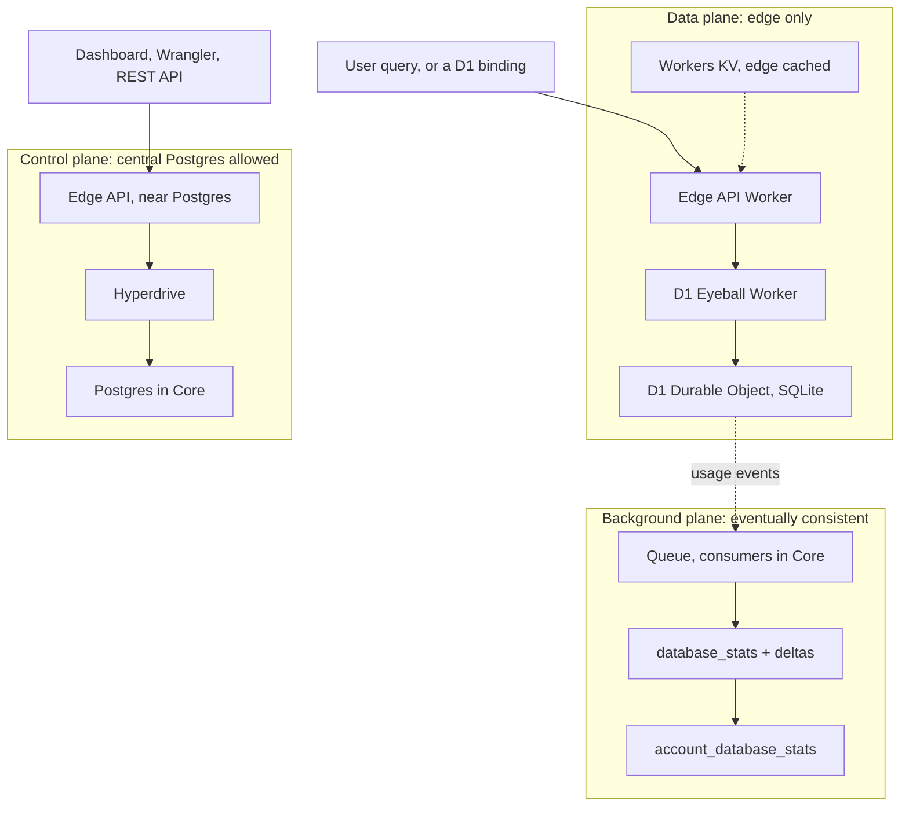
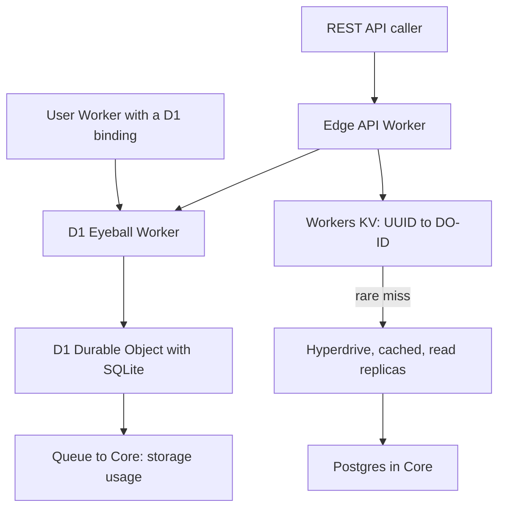
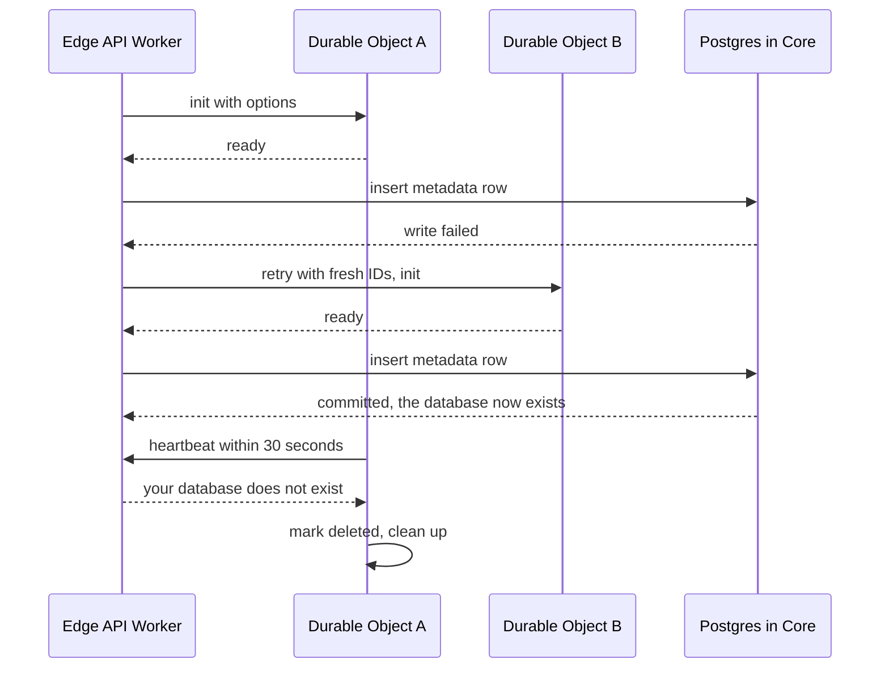
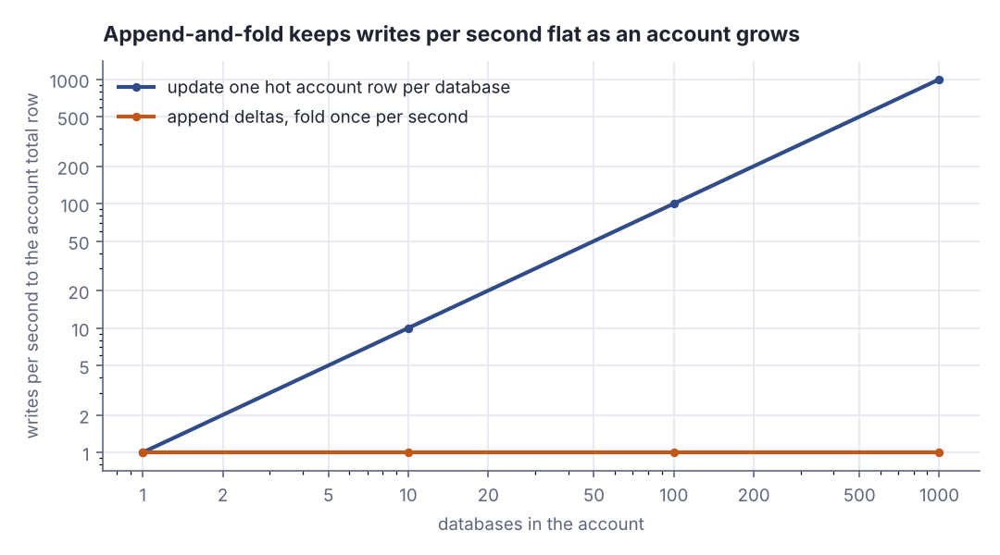
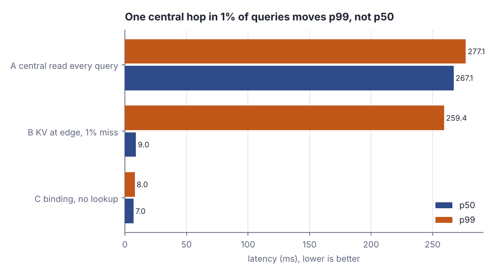

# Control plane off the hot path: how D1 scales to millions of databases

> Fresh · Software architecture & design · Intermediate · ~25 min · from today's feeds

## Why this matters
Today's item is "Under the hood, off the hot path: how D1 scales to millions of databases", published on the Cloudflare Blog on 2026-10-13 by David Laban and Lambros Petrou, the engineers who run D1's control plane.
It is worth your twenty minutes because it is not a story about a clever database — it is a story about one rule applied ruthlessly to every single operation: *this one may talk to the central Postgres, that one may not, ever*, and here is what the second rule costs you in retries, orphans and stale numbers.
That is exactly the call you now arbitrate as a Product Owner — "can we just read the metadata row on every request?" — and it sits one rung above your current architecture level, so the vocabulary is filled in first.

## Primer
**Control plane vs data plane.** Borrowed from networking. The *data plane* is the work the system exists to do, happening on every unit of traffic: for a database, executing queries. The *control plane* is the machinery that configures the data plane and runs far less often: create a database, delete it, list what an account owns, check its entitlements. The two have different volumes by orders of magnitude, so they can afford different dependencies.

**Hot path.** The sequence of steps that every request in the data plane must walk through. Anything on the hot path is paid for on every request, so its latency and its availability become the system's latency and availability. A component used once per database creation is not on the hot path; a component read once per query is.

**Durable Object (DO).** Cloudflare's unit of stateful compute: a single addressable object with its own private storage, of which only one live instance exists globally at a time, so calls to it are serialised. Modern DOs can have a SQLite database attached, and that is what a D1 database physically is:

> "First of all, each D1 database is backed by one SQLite Durable Object, which makes it very easy to create millions of them."
>
> — David Laban and Lambros Petrou, Cloudflare, *Under the hood, off the hot path: how D1 scales to millions of databases*, 2026-10-13, https://blog.cloudflare.com/d1-control-plane

**Eventual consistency, and why a cache needs an owner.** Workers KV is a key-value store replicated to every Cloudflare location and read cheaply from any of them, but a write is not visible everywhere immediately and there is no consistent read. So KV can hold *routing hints* — which Durable Object serves this database UUID — but it cannot hold the authority on whether the database still exists. Somebody must own that truth and be able to overrule a stale cache entry.

**Read replica.** A copy of a Postgres primary that accepts reads only, kept a little behind. Reads that tolerate being a few seconds stale (how many databases does this account have?) go to a replica; writes and reads that must be exact go to the primary. **Hyperdrive** is Cloudflare's pooling-and-caching layer in front of Postgres, which can be pointed at either and can add a short-lived cache on top.

## The idea
The post states its organising rule as a design principle, and everything else in the architecture is a consequence of applying it:

> "Avoid centralized single-region components in any hot path for data plane operations (in our case all query requests)."
>
> — David Laban and Lambros Petrou, Cloudflare, *Under the hood, off the hot path: how D1 scales to millions of databases*, 2026-10-13, https://blog.cloudflare.com/d1-control-plane

The scale that forces it, in the authors' own words:

> "D1 has seen a **15x growth in the number of live non-deleted databases over the past one year**, and a **65x growth over the past 2 years** (as of October 8, 2026)."
>
> — David Laban and Lambros Petrou, Cloudflare, *Under the hood, off the hot path: how D1 scales to millions of databases*, 2026-10-13, https://blog.cloudflare.com/d1-control-plane

### Three planes, one decision per operation
Every operation belongs to exactly one plane, and the plane fixes what it may depend on.



*Figure 1: the three planes. The query path never leaves the edge; only control-plane work is allowed to reach central Postgres; accounting is pushed into a background pipeline. Source: David Laban and Lambros Petrou, Cloudflare, "Under the hood, off the hot path: how D1 scales to millions of databases", 2026-10-13, https://blog.cloudflare.com/d1-control-plane*

The geography is what makes the rule non-negotiable. The authors put numbers on it while explaining why some endpoints are forwarded to a data centre near Postgres:

> "The reason is that a round-trip from afar can be hundreds of milliseconds, whereas being near Postgres can be a few milliseconds."
>
> — David Laban and Lambros Petrou, Cloudflare, *Under the hood, off the hot path: how D1 scales to millions of databases*, 2026-10-13, https://blog.cloudflare.com/d1-control-plane

Put the three possible lookups next to the work they precede. The constants below are my own stand-ins matching the post's "hundreds of milliseconds" versus "a few milliseconds"; the post publishes no per-hop measurements.

```scala
// file: Ex1.scala
@main def ex1(): Unit =
  val doMs = 6.0
  val hops = Seq(("Workers KV at the edge", 2.0), ("Postgres, near", 4.0),
                 ("Postgres, far away", 250.0))
  for (name, lookup) <- hops do
    val total = lookup + doMs
    println(f"$name%-24s lookup ${lookup}%6.1f ms   + DO ${doMs}%4.1f ms   = ${total}%6.1f ms")
```

```text
Workers KV at the edge   lookup    2.0 ms   + DO  6.0 ms   =    8.0 ms
Postgres, near           lookup    4.0 ms   + DO  6.0 ms   =   10.0 ms
Postgres, far away       lookup  250.0 ms   + DO  6.0 ms   =  256.0 ms
```

The query itself — 6 ms of SQLite — is a rounding error next to the lookup in front of it. A metadata read on the hot path makes the database roughly thirty times slower without touching the database at all, which is why that routing metadata is mirrored into Workers KV.

### How each flow lands in a plane
A query through the HTTP API reaches the Edge API Worker, which resolves the database UUID to its Durable Object ID from Workers KV, calls the D1 Eyeball Worker over a Service Binding, and that forwards to the Durable Object. On the rare KV miss it falls back through Hyperdrive to the Postgres read replicas — slow, but rare and never required. A user's own Worker holding a **D1 binding** skips the lookup entirely: that binding *is* a Service Binding to the Eyeball Worker and already carries the mapping.



*Figure 2: the components on the query path, with the central store reachable only on a cache miss. Adapted from David Laban and Lambros Petrou, Cloudflare, "Under the hood, off the hot path: how D1 scales to millions of databases", 2026-10-13, https://blog.cloudflare.com/d1-control-plane*

Creation is the opposite case, and it cannot be one neat transaction. On why they do not hold a Postgres transaction open across the Durable Object's initialisation:

> "The answer is simply that it cannot scale, since it leads to connections being held while the Durable Object is being initialized, which could be on the other side of the world."
>
> — David Laban and Lambros Petrou, Cloudflare, *Under the hood, off the hot path: how D1 scales to millions of databases*, 2026-10-13, https://blog.cloudflare.com/d1-control-plane

So create is a sequence with a checkpoint: generate a database UUID and a fresh Durable Object ID, initialise the object *first* (otherwise a query could arrive at an uninitialised object and be rejected), then write the single metadata row to the Postgres primary. That write is the moment the database exists. If it fails, the step retries **with new IDs**, never recycled ones:

> "if we reused the database UUIDs with fresh Durable Object IDs, multiple Durable Objects would think they own the same database leading to difficult-to-debug situations."
>
> — David Laban and Lambros Petrou, Cloudflare, *Under the hood, off the hot path: how D1 scales to millions of databases*, 2026-10-13, https://blog.cloudflare.com/d1-control-plane

Fresh IDs mean a failed attempt can leave an initialised Durable Object that no Postgres row points at — an orphan. The heartbeat reaps it:

> "Within 30 seconds, DO A sends its next heartbeat to the control plane and receives back a response that its database does not exist."
>
> — David Laban and Lambros Petrou, Cloudflare, *Under the hood, off the hot path: how D1 scales to millions of databases*, 2026-10-13, https://blog.cloudflare.com/d1-control-plane



*Figure 3: creation with a failed checkpoint. The orphan is not prevented, it is reaped. Source: David Laban and Lambros Petrou, Cloudflare, "Under the hood, off the hot path: how D1 scales to millions of databases", 2026-10-13, https://blog.cloudflare.com/d1-control-plane*

### The third plane: accounting that is allowed to be wrong for a moment
Storage limits are real — "At the time of writing, D1 has a 5 GB per-account storage limit on the Free plan and 1 TB on Workers Paid (can be raised on request)" (Laban and Petrou, Cloudflare, 2026-10-13, https://blog.cloudflare.com/d1-control-plane) — but enforcing them exactly would put a central write on the query path. Instead each Durable Object publishes usage to a queue, consumers write a per-database size, and every delta is appended as a row of its own:

> "A scheduled job runs every second to consume everything in `account_database_stats_changes` and update `account_database_stats` with the sum of those deltas."
>
> — David Laban and Lambros Petrou, Cloudflare, *Under the hood, off the hot path: how D1 scales to millions of databases*, 2026-10-13, https://blog.cloudflare.com/d1-control-plane

They rejected the obvious alternative — every database updating its account's single total row — because of write-lock contention: "In practice, this would end up with a lot of write lock contention on a single row for large accounts" (Laban and Petrou, Cloudflare, 2026-10-13, https://blog.cloudflare.com/d1-control-plane). Count the writes landing on that one row as an account grows:

```scala
// file: Ex2.scala
@main def ex2(): Unit =
  println(f"${"databases"}%10s ${"hot-row updates/s"}%18s ${"folded upserts/s"}%17s")
  for n <- Vector(1, 10, 100, 1000) do
    val hotRow = n
    val folded = 1
    println(f"$n%10d $hotRow%18d $folded%17d")
```

```text
 databases  hot-row updates/s  folded upserts/s
         1                  1                 1
        10                 10                 1
       100                100                 1
      1000               1000                 1
```

In-place updates make contention on one row scale with the account; appending deltas and folding them once per second makes it constant, at the price of a total that can be a second stale.



*Figure 4: the same numbers on log axes — the cost of the in-place design is linear in the number of databases, the folded design is flat. Generated from the Ex2.scala output above, produced by `python3 dojo/engine/run_lab.py 2026-11-10-2`.*

That staleness is a stated choice, not an oversight — "it is fine if a load spike is not reflected immediately and our usage information is stale" — and the same acceptance covers the routing cache: "It's eventually consistent, and the next time the Durable Object heartbeats it will ensure that the Workers KV item has been written with the correct value" (both: Laban and Petrou, Cloudflare, 2026-10-13, https://blog.cloudflare.com/d1-control-plane). The Durable Object serialises those KV writes because KV has no consistent read, and because it holds its own active/deleted state it can reject queries the stale cache still routes to it.

What makes it survivable is the post's other principle — "Design all processes with failure and idempotency in mind" (Laban and Petrou, Cloudflare, 2026-10-13, https://blog.cloudflare.com/d1-control-plane). Every step retryable, every retry safe, every inconsistency given a reaper with a deadline: the heartbeat, at 30 seconds with per-database jitter.

## Lab
**The question:** if one query in a hundred has to fall back to a central round-trip, what does that do to p50 and p99 — and how much better is the path that skips the lookup entirely?

### Step 1 — the model
Three designs over the same 2000 requests, with the same stand-in constants as above: the Durable Object executes the SQL in 6 ms, a central round-trip costs 250 ms, per-request jitter is uniform 0–2 ms and the central hop adds its own 0–20 ms.

- **A** — read the central metadata store on every query (no cache at all).
- **B** — read Workers KV at the edge, 2 ms, with a 1% miss that falls back to the central store.
- **C** — a Worker holding a D1 binding: the mapping is already in hand, no lookup.

### Step 2 — run it

```scala
// file: Lab.scala
import scala.util.Random

final case class Design(tag: String, name: String, kvMs: Double, missRate: Double)

@main def lab(): Unit =
  val n = 2000
  val doMs = 6.0
  val centralMs = 250.0

  val designs = Vector(
    Design("A", "central read on every query", 0.0, 1.00),
    Design("B", "Workers KV at the edge, 1% miss", 2.0, 0.01),
    Design("C", "Worker binding, no lookup at all", 0.0, 0.00)
  )

  def pct(sorted: Vector[Double], p: Double): Double =
    val idx = math.ceil(p / 100.0 * sorted.length).toInt - 1
    sorted(math.max(0, math.min(sorted.length - 1, idx)))

  println(s"model: DO executes SQL in $doMs ms, a central round-trip costs $centralMs ms,")
  println(s"       jitter is uniform 0..2 ms, central jitter uniform 0..20 ms, n = $n requests")
  println("")

  println("=== Step 2: first 8 requests of each design (ms) ===")
  println(f"${"design"}%7s ${"req"}%4s ${"kv"}%5s ${"central"}%8s ${"do"}%5s ${"jitter"}%7s ${"total"}%8s")
  val results = designs.map { d =>
    val rng = Random(42)
    var misses = 0
    val lat = Vector.tabulate(n) { i =>
      val jitter = rng.between(0.0, 2.0)
      val isMiss = rng.nextDouble() < d.missRate
      val central = if isMiss then { misses += 1; centralMs + rng.between(0.0, 20.0) } else 0.0
      val total = d.kvMs + central + doMs + jitter
      if i < 8 then
        println(f"${d.tag}%7s ${i}%4d ${d.kvMs}%5.1f ${central}%8.1f ${doMs}%5.1f ${jitter}%7.2f ${total}%8.2f")
      total
    }
    (d, lat, misses)
  }
  println("")

  println("=== Step 3: percentiles over all 2000 requests (ms) ===")
  println(f"${"design"}%7s ${"misses"}%7s ${"mean"}%8s ${"p50"}%8s ${"p90"}%8s ${"p99"}%8s ${"max"}%8s  description")
  for (d, lat, misses) <- results do
    val s = lat.sorted
    val mean = lat.sum / lat.length
    println(f"${d.tag}%7s ${misses}%7d ${mean}%8.2f ${pct(s, 50)}%8.2f ${pct(s, 90)}%8.2f " +
            f"${pct(s, 99)}%8.2f ${s.last}%8.2f  ${d.name}")
  println("")

  println("=== Step 4: what one central hop costs the tail ===")
  val (bD, bLat, bMiss) = results(1)
  val (cD, cLat, cMiss) = results(2)
  val bS = bLat.sorted
  val cS = cLat.sorted
  println(f"B p99 - C p99 = ${pct(bS, 99)}%.2f - ${pct(cS, 99)}%.2f = ${pct(bS, 99) - pct(cS, 99)}%.2f ms")
  println(f"B p50 - C p50 = ${pct(bS, 50)}%.2f - ${pct(cS, 50)}%.2f = ${pct(bS, 50) - pct(cS, 50)}%.2f ms")
  println(f"B share of requests that paid the central hop: ${100.0 * bMiss / n}%.2f%%")
```

Run it with `python3 dojo/engine/run_lab.py 2026-11-10-2` (or `scala Lab.scala` on the Mac). Real output:

```text
model: DO executes SQL in 6.0 ms, a central round-trip costs 250.0 ms,
       jitter is uniform 0..2 ms, central jitter uniform 0..20 ms, n = 2000 requests

=== Step 2: first 8 requests of each design (ms) ===
 design  req    kv  central    do  jitter    total
      A    0   0.0    256.2   6.0    1.46   263.63
      A    1   0.0    268.1   6.0    0.55   274.62
      A    2   0.0    259.3   6.0    0.74   266.01
      A    3   0.0    258.7   6.0    1.57   266.30
      A    4   0.0    253.5   6.0    1.50   261.05
      A    5   0.0    266.5   6.0    1.19   273.71
      A    6   0.0    265.0   6.0    0.34   271.37
      A    7   0.0    265.1   6.0    1.14   272.19
      B    0   2.0      0.0   6.0    1.46     9.46
      B    1   2.0      0.0   6.0    0.62     8.62
      B    2   2.0      0.0   6.0    1.33     9.33
      B    3   2.0      0.0   6.0    0.74     8.74
      B    4   2.0      0.0   6.0    0.93     8.93
      B    5   2.0      0.0   6.0    1.84     9.84
      B    6   2.0      0.0   6.0    1.50     9.50
      B    7   2.0      0.0   6.0    0.35     8.35
      C    0   0.0      0.0   6.0    1.46     7.46
      C    1   0.0      0.0   6.0    0.62     6.62
      C    2   0.0      0.0   6.0    1.33     7.33
      C    3   0.0      0.0   6.0    0.74     6.74
      C    4   0.0      0.0   6.0    0.93     6.93
      C    5   0.0      0.0   6.0    1.84     7.84
      C    6   0.0      0.0   6.0    1.50     7.50
      C    7   0.0      0.0   6.0    0.35     6.35

=== Step 3: percentiles over all 2000 requests (ms) ===
 design  misses     mean      p50      p90      p99      max  description
      A    2000   267.08   267.13   274.90   277.05   277.86  central read on every query
      B      22    11.87     9.04     9.83   259.39   276.54  Workers KV at the edge, 1% miss
      C       0     7.01     7.01     7.80     7.98     8.00  Worker binding, no lookup at all

=== Step 4: what one central hop costs the tail ===
B p99 - C p99 = 259.39 - 7.98 = 251.41 ms
B p50 - C p50 = 9.04 - 7.01 = 2.03 ms
B share of requests that paid the central hop: 1.10%
```

### Reading the output

**The per-request table (Step 2).** `design` is the variant; `req` is the request index; `kv` is the edge cache read (0 when the design has none); `central` is the far round-trip, 0 when it was not taken; `do` is the SQLite execution inside the Durable Object; `jitter` is per-request noise; `total` is their sum. Lower is better everywhere. Trace request A/0 with digits: `0.0 + 256.2 + 6.0 + 1.46 = 263.66`, printed as `263.63` because the central column is itself rounded to one decimal for display while the sum uses the full value. Request B/0 is `2.0 + 0.0 + 6.0 + 1.46 = 9.46` — no rounding gap, because nothing was truncated.

**Verdict:** on a per-request basis the only thing that matters is whether the central hop was taken; everything else is noise of a few milliseconds.

**The percentile table (Step 3).** `misses` counts requests that took the central hop out of 2000. `mean` is the average, `p50` the median, `p90`/`p99` the values below which 90% and 99% of requests fall, `max` the worst. p99 is the number your customers complain about; lower is better.

| design | misses | mean | p50 | p90 | p99 | max |
|---|---|---|---|---|---|---|
| A central read every query | 2000 | 267.08 | 267.13 | 274.90 | 277.05 | 277.86 |
| B KV at edge, 1% miss | 22 | 11.87 | 9.04 | 9.83 | 259.39 | 276.54 |
| C binding, no lookup | 0 | 7.01 | 7.01 | 7.80 | 7.98 | 8.00 |



*Figure 5: p50 versus p99 for the three designs. Design B looks like design C at the median and like design A at the tail. Generated from the Step 3 output above, produced by `python3 dojo/engine/run_lab.py 2026-11-10-2`.*

The arithmetic that makes design B's split personality: 22 of 2000 requests missed, which is 22 / 2000 = 1.10%. Any miss rate above 1% guarantees that the 99th-percentile request is a miss, so p99 lands on the central-hop distribution: 259.39 ms, against a median of 9.04 ms. The mean hides it completely — 11.87 ms looks healthy and is 22× smaller than p99.

**Verdict:** a dependency taken by 1% of requests does not cost you 1% of your latency budget; it costs you your entire tail. Design B's p99 is 251.41 ms worse than design C's while its p50 is only 2.03 ms worse.

### Cause → consequence

1. **Cause.** The routing metadata (database UUID → Durable Object ID) lives in one central Postgres, and that Postgres is in one region.
2. **Mechanism.** Reading it from the request's own location costs a wide-area round-trip — "a round-trip from afar can be hundreds of milliseconds" (Laban and Petrou, Cloudflare, 2026-10-13, https://blog.cloudflare.com/d1-control-plane) — and that cost is paid *before* any SQL runs.
3. **Consequence.** Putting that read on the query path multiplies query latency by roughly thirty (design A: p50 267.13 ms versus design C's 7.01 ms) and ties global query availability to one region. Mirroring it into Workers KV fixes the median but leaves the tail on the central store (design B: p50 9.04 ms, p99 259.39 ms). Handing the mapping to the caller up front — the D1 binding — removes the dependency rather than caching it.
4. **What it means in practice.** When you review a design, do not ask "is this component fast enough?" — ask "which plane is this operation in, and what fraction of hot-path requests can reach a single-region dependency?" If the answer is anything above zero, your p99 belongs to that dependency, and the fix is usually to move the lookup out of the request (bindings, pushed routing tables) rather than to make the lookup faster. Then budget explicitly for what the move costs: orphans to reap, retries that must be idempotent, and numbers that are allowed to be a second old.

## Self-check
1. D1 writes the Postgres metadata row *after* initialising the Durable Object, and retries the whole step with brand-new IDs. Why not reuse the IDs on retry, and what does the choice leave behind? <details><summary>Answer</summary>Because a reused database UUID paired with a fresh Durable Object ID would leave two objects each believing they own the same database — the post calls this "difficult-to-debug situations" (Laban and Petrou, Cloudflare, 2026-10-13, https://blog.cloudflare.com/d1-control-plane). The cost is an orphaned, initialised Durable Object that no Postgres row points at. It is cleaned up by the heartbeat: within 30 seconds the orphan asks the control plane for its state, is told its database does not exist, and marks itself deleted.</details>
2. Workers KV is eventually consistent. Why is it nevertheless safe to route queries through it, and what stops a stale entry from serving a deleted database? <details><summary>Answer</summary>KV only holds a routing hint — which Durable Object ID serves this database UUID — not the authority on existence. The Durable Object itself stores its active/deleted state, so a query routed to it by a stale KV entry is rejected at the object. The object is also the single serialisation point for KV writes (only one instance is live at a time), and its heartbeat repairs stale or missing entries, which is why the post can say the KV write is best-effort and eventually consistent.</details>
3. Your team proposes enforcing a per-account storage limit by having every database update one `account_total` row on each write. Using the lab's reasoning, what breaks, and what did D1 do instead? <details><summary>Answer</summary>Every database in the account contends for a write lock on the same row, so lock contention grows linearly with account size — exactly what the post rejects ("a lot of write lock contention on a single row for large accounts"). D1 appends each delta as its own row in `account_database_stats_changes` and runs a job every second that consumes them and folds the sum into `account_database_stats`. Writes to the total become one per second regardless of account size; the price is that the total can be up to a second stale, which the authors accept because "it is fine if a load spike is not reflected immediately" (both quotes: Laban and Petrou, Cloudflare, 2026-10-13, https://blog.cloudflare.com/d1-control-plane).</details>

## Sources
- [Under the hood, off the hot path: how D1 scales to millions of databases](https://blog.cloudflare.com/d1-control-plane) — David Laban and Lambros Petrou, Cloudflare, 2026-10-13 — the primary source for every quote and every number in this lesson: the three-plane split, the create/query flows, the heartbeat interval, the growth figures and the storage limits (accessed 2026-11-10).
- Further reading named inside that post but **not fetched in this session**, so nothing here is quoted from them: Cloudflare's D1 read replication beta announcement (https://blog.cloudflare.com/d1-read-replication-beta/) and the D1 platform limits page (https://developers.cloudflare.com/d1/platform/limits/) (accessed 2026-11-10 — links listed, not verified this run).

## Next on this track
Fresh lessons sit outside the ladder; next on Software architecture & design: **SOLID in practice II — ISP and DIP** (rung 4 of 20, Beginner).
