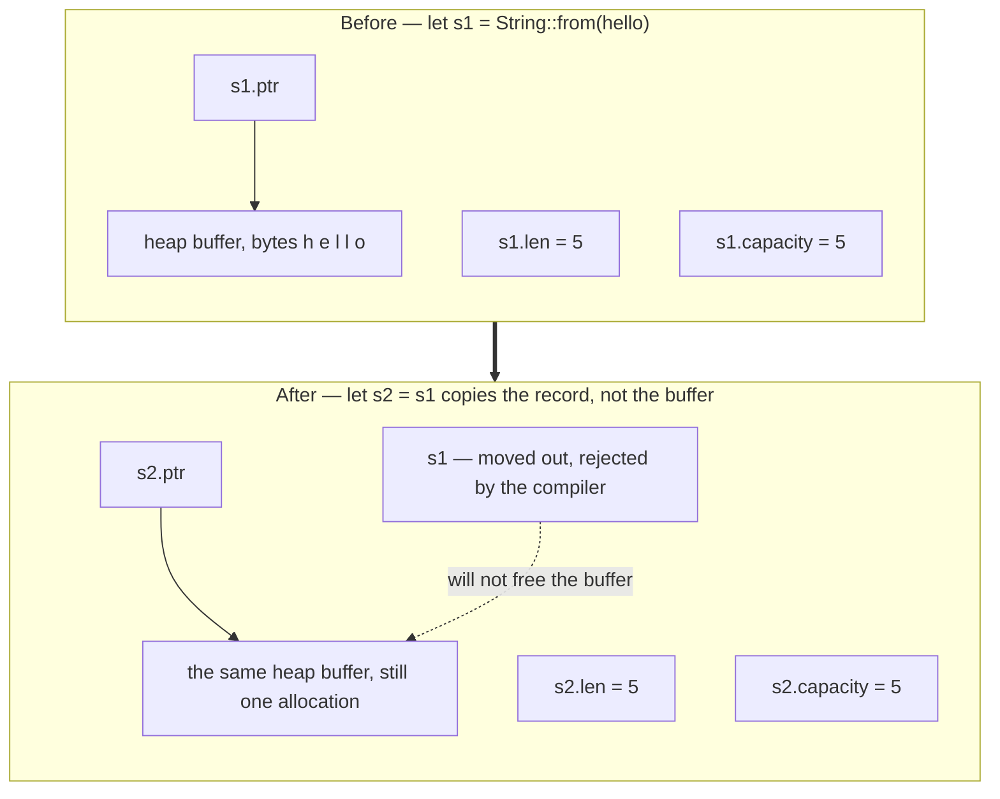
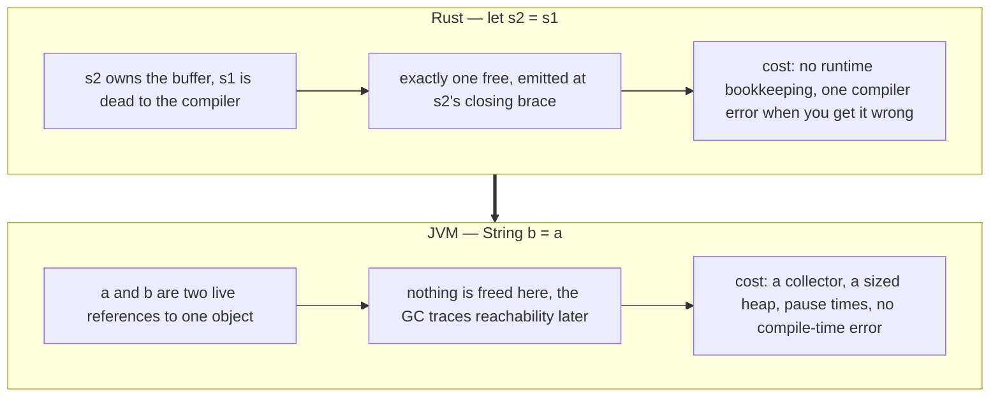
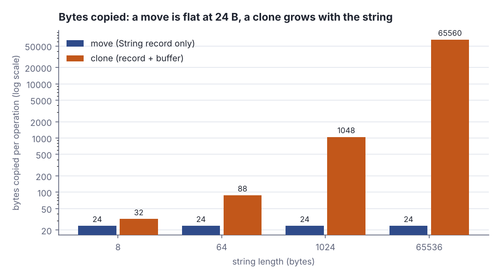

# Ownership and moves

> Rust basics · Beginner · ~20 min · rung 2 of 10 · needs: Why Rust, rustup and cargo (rust-01)

## Why this matters

You are about to give up the one service the JVM always performed for you — deciding when memory is freed — and get it back as a compile-time rule you must satisfy yourself.
Ownership is that rule, and everything later in Rust (borrowing, lifetimes, `Send`/`Sync`, `Arc`) is a refinement of it, so a shaky model here makes the next eight rungs feel arbitrary.
It is also the one Rust idea with no JVM analogue at all: your instinct that "assignment makes a second reference" is exactly the instinct that will produce today's compiler error.

## The idea

### Stack, heap, and what the JVM hides

On the JVM you have one category: objects. `new String("hello")` puts an object somewhere you neither know nor choose, and your local variable holds a reference to it. Allocation is a pointer bump in a nursery; deallocation is something a background collector decides later, by tracing which objects are still reachable from the roots. The stack/heap split is real — frames and locals on the stack, objects on the heap — but the language never makes you name it.

Rust puts the split in the type. A `String` is a three-word record: a **pointer** to a heap buffer, a **length** (bytes in use), and a **capacity** (bytes allocated). The record lives in the stack frame; the text bytes live in the buffer. Pushing and popping that record is a frame-pointer move over a size known at compile time — effectively free. The buffer is not: it costs a call into the allocator, which must find a free block, and a matching call to give it back. Rust's whole design question is who makes that second call, and when.



*Figure 1: the three-word String record and what `let s2 = s1` copies. Adapted from The Rust Programming Language ch. 4.1, figures 4-1 to 4-4, https://doc.rust-lang.org/book/ch04-01-what-is-ownership.html*

### The three rules, and drop

Rust's answer needs no runtime at all — only three rules, checked while compiling:

> "Each value in Rust has an *owner*."
> "There can only be one owner at a time."
> "When the owner goes out of scope, the value will be dropped."
> — The Rust Project, *The Rust Programming Language*, ch. 4.1 "What Is Ownership?", https://doc.rust-lang.org/book/ch04-01-what-is-ownership.html

*Drop* is Rust's word for that release. It happens at the closing brace of the owner's scope, and the compiler emits the deallocation call right there — no collector, no finalizer queue, nothing to remember. It is the discipline of Java's try-with-resources, except it is automatic and it applies to *every* value in the program, not only to the ones you wrapped in a `try` block.

```rust
// file: main.rs
struct Noisy(&'static str);
impl Drop for Noisy {
    fn drop(&mut self) { println!("drop {}", self.0); }
}
fn main() {
    let outer = Noisy("outer");
    {
        let _inner = Noisy("inner");
    }
    println!("outer still alive: {}", outer.0);
}
```

```text
drop inner
outer still alive: outer
drop outer
```

`_inner` is dropped at the inner closing brace, before the next line runs — not at some later point chosen by a collector. `outer` is dropped last, at the end of `main`: scopes unwind last-in-first-out, and the order is in the generated code, not in a runtime decision.

### A move is a transfer, not a second reference

Rule 2 is the one that bites. If `let s2 = s1` left both bindings usable, both scopes would end and both would free the same buffer — a double free. Rust does not duplicate the buffer to avoid that, and it does not refcount it. It simply transfers ownership and declares the old binding dead:

> "To ensure memory safety, after the line `let s2 = s1;`, Rust considers `s1` as no longer valid."
> — The Rust Project, *The Rust Programming Language*, ch. 4.1 "What Is Ownership?", "Variables and Data Interacting with Move", https://doc.rust-lang.org/book/ch04-01-what-is-ownership.html

```rust
// file: main.rs
fn main() {
    let s1 = String::from("hello");
    let p1 = s1.as_ptr();
    let s2 = s1;
    println!("s2 = {s2}, len = {}", s2.len());
    println!("same heap buffer: {}", p1 == s2.as_ptr());
    let c = s2.clone();
    println!("clone buffer differs: {}", c.as_ptr() != s2.as_ptr());
}
```

```text
s2 = hello, len = 5
same heap buffer: true
clone buffer differs: true
```

The heap address survives the move unchanged, so nothing was copied except twenty-four bytes of stack record: a move is cheap, not a deep copy. `clone()` is the opposite — a fresh allocation at a different address. Rust by Example states the rule for assignments and for arguments in one breath: after a move "the previous owner can no longer be used" (Rust by Example, Scoping rules › Ownership and moves).



*Figure 2: the same two lines of source, and what each language does with them. Source: drawn from The Rust Programming Language ch. 4.1 "What Is Ownership?", https://doc.rust-lang.org/book/ch04-01-what-is-ownership.html*

### `Copy` opts out; `clone()` opts in

Some values own nothing outside themselves: all the integer types, `f32`/`f64`, `bool`, `char`, shared references, and tuples or arrays built only from such types. These implement the `Copy` marker trait, and assigning one duplicates its bits and leaves the source perfectly usable — there is no second buffer to free, so there is nothing to be unsafe about. `String` is not `Copy`, because it owns a heap buffer. When you genuinely want two independent `String`s you ask for it:

> "Rust will never automatically create “deep” copies of your data."
> — The Rust Project, *The Rust Programming Language*, ch. 4.1 "What Is Ownership?", https://doc.rust-lang.org/book/ch04-01-what-is-ownership.html

That explicitness is a budgeting tool. A move always copies the 24-byte record and nothing else; `clone()` copies the record plus every byte of the buffer, and allocates. The lab below measures both.



*Figure 3: bytes copied by a move (always the 24-byte String record) and by `clone()` (the record plus the whole buffer), from Step 3 of the lab below; log scale. Source: own measurement, `python3 dojo/engine/run_lab.py 2026-11-11-1`, 2026-11-11.*

### Functions take ownership too, and that is the catch

Passing a value by value is the same transfer as an assignment, and so is returning one. A `String` argument moves into the callee and dies there unless the callee hands it back; a `Copy` argument does not.

```rust
// file: main.rs
fn consume(s: String) -> usize { s.len() }
fn double(n: i32) -> i32 { n * 2 }
fn main() {
    let s = String::from("hello");
    println!("len = {}", consume(s));
    let n = 21;
    println!("double = {}, n still = {n}", double(n));
}
```

```text
len = 5
double = 42, n still = 21
```

`s` is gone after `consume(s)` — using it on the next line would not compile — while `n` is still 21 after `double(n)` because `i32` is `Copy`. Writing real code this way means every helper that merely reads a `String` must return it, so call sites fill up with `let (s, n) = measure(s);` plumbing (The Rust Programming Language, ch. 4.1 "What Is Ownership?", "Return Values and Scope"). That tedium is the exact motivation for the next rung: borrowing lets a function look at a value without taking it.

## Lab

This lab answers one question with numbers: what does a move actually cost compared with the `clone()` the compiler suggests when you hit the move error?

Set up the project once:

```bash
cargo new ownership_lab
cd ownership_lab
```

### Step 1 — provoke the error and read it

Put the canonical broken snippet inside `fn main()` in `src/main.rs`. It carries no fix; it exists to be rejected, and the line numbers in the error below count `fn main() {` as line 1:

```rust
let s1 = String::from("hello");
let s2 = s1;
println!("{s1}");
println!("{s2}");
```

`cargo run` prints:

```text
error[E0382]: borrow of moved value: `s1`
 --> src/main.rs:4:16
  |
2 |     let s1 = String::from("hello");
  |         -- move occurs because `s1` has type `String`, which does not implement the `Copy` trait
3 |     let s2 = s1;
  |              -- value moved here
4 |     println!("{s1}");
  |                ^^ value borrowed here after move
  |
help: consider cloning the value if the performance cost is acceptable
  |
3 |     let s2 = s1.clone();
  |                ++++++++

For more information about this error, try `rustc --explain E0382`.
error: could not compile `ownership_lab` (bin "ownership_lab") due to 1 previous error
```

Read all four parts: *why* it is a move (`String` is not `Copy`), *where* ownership left (line 3), *where* you tried to use the corpse (line 4), and the suggested fix with its honest caveat, "if the performance cost is acceptable".

### Step 2 — the two fixes, side by side

```rust
// file: main.rs
use std::mem::size_of;

fn main() {
    let s1 = String::from("hello");
    let s2 = s1.clone();
    let distinct = s1.as_ptr() != s2.as_ptr();
    println!("fix 1 clone: s1 = {s1:?}  s2 = {s2:?}  distinct heap buffers = {distinct}");

    let n1: i64 = 10;
    let n2 = n1;
    println!("fix 2 Copy:  n1 = {n1}  n2 = {n2}  (i64 is Copy, n1 is still usable)");

    let t = (7_i32, 'x', true);
    let t2 = t;
    println!("Copy tuple:  t = {t:?}  t2 = {t2:?}");

    println!("size_of::<String>()            = {} B", size_of::<String>());
    println!("size_of::<i64>()               = {} B", size_of::<i64>());
    println!("size_of::<(i32, char, bool)>() = {} B", size_of::<(i32, char, bool)>());
}
```

```text
fix 1 clone: s1 = "hello"  s2 = "hello"  distinct heap buffers = true
fix 2 Copy:  n1 = 10  n2 = 10  (i64 is Copy, n1 is still usable)
Copy tuple:  t = (7, 'x', true)  t2 = (7, 'x', true)
size_of::<String>()            = 24 B
size_of::<i64>()               = 8 B
size_of::<(i32, char, bool)>() = 12 B
```

### Step 3 — price the move against the clone

`hand_back` takes a `String` by value and returns it, so each loop iteration is a move in and a move out and no allocation at all. The clone loop allocates a buffer, copies the bytes, and frees it. `black_box` stops the optimiser from deleting work it can prove is unused.

```rust
// file: main.rs
use std::hint::black_box;
use std::mem::size_of;
use std::time::Instant;

fn hand_back(s: String) -> String {
    s
}

fn main() {
    let reps: u32 = 200_000;
    let stack = size_of::<String>();
    println!("String stack record = {stack} B  (ptr 8 + len 8 + capacity 8)");
    println!("reps per measurement = {reps}");
    println!();
    println!("{:>8}  {:>8}  {:>9}  {:>9}  {:>10}", "len_B", "move_B", "clone_B", "move_ns", "clone_ns");

    for len in [8usize, 64, 1024, 65536] {
        let src = "x".repeat(len);

        let mut s = src.clone();
        let t0 = Instant::now();
        for _ in 0..reps {
            s = hand_back(black_box(s));
        }
        let move_ns = t0.elapsed().as_nanos() as f64 / reps as f64;
        black_box(&s);

        let t1 = Instant::now();
        for _ in 0..reps {
            black_box(src.clone());
        }
        let clone_ns = t1.elapsed().as_nanos() as f64 / reps as f64;

        let move_b = stack;
        let clone_b = stack + len;
        println!("{:>8}  {:>8}  {:>9}  {:>9.1}  {:>10.1}", len, move_b, clone_b, move_ns, clone_ns);
    }
}
```

Real output, from `python3 dojo/engine/run_lab.py 2026-11-11-1`:

```text
String stack record = 24 B  (ptr 8 + len 8 + capacity 8)
reps per measurement = 200000

   len_B    move_B    clone_B    move_ns    clone_ns
       8        24         32        3.8        17.5
      64        24         88        3.9        16.7
    1024        24       1048        4.0        25.7
   65536        24      65560        3.9      1523.3
```

### Reading the output

Step 2's block is a yes/no check, one line per fix.

| line | what it shows | good direction |
| --- | --- | --- |
| `fix 1 clone … distinct heap buffers = true` | `clone()` really allocated a second buffer, so `s1` and `s2` are independent | `true` is what you asked for, and what you paid for |
| `fix 2 Copy … n1 is still usable` | `i64` is `Copy`, so the assignment duplicated the bits and left the source alive | no error, no allocation |
| `Copy tuple: t = (7, 'x', true)` | a tuple of `Copy` types is itself `Copy` | same |
| `size_of::<String>() = 24 B` | the record the compiler moves: ptr 8 + len 8 + capacity 8 | smaller is cheaper to move |
| `size_of::<i64>() = 8 B` | a `Copy` scalar is cheaper than the record itself | — |
| `size_of::<(i32, char, bool)>() = 12 B` | i32 4 + char 4 + bool 1 = 9 B, padded to 12 B for 4-byte alignment | — |

**Verdict:** both fixes compile, but only one of them allocates. `clone()` buys you a second owner; `Copy` means there was never a second buffer to own.

Step 3's table is five columns, four rows — one row per string length.

| len_B | move_B | clone_B | move_ns | clone_ns | clone_B ÷ move_B |
| --- | --- | --- | --- | --- | --- |
| 8 | 24 | 32 | 3.8 | 17.5 | 1.3× |
| 64 | 24 | 88 | 3.9 | 16.7 | 3.7× |
| 1024 | 24 | 1048 | 4.0 | 25.7 | 43.7× |
| 65536 | 24 | 65560 | 3.9 | 1523.3 | 2731.7× |

`len_B` is the string length in bytes. `move_B` is what a move copies: the 24-byte record, nothing else, at every size — flat by construction. `clone_B` is what a clone copies: 24 bytes of record plus `len` bytes of buffer. `move_ns` and `clone_ns` are nanoseconds per operation, wall clock, averaged over 200 000 repetitions; lower is better in both.

Trace the arithmetic for the 1 KiB row: `clone_B` = 24 + 1024 = 1048 bytes against `move_B` = 24 bytes, a ratio of 1048 ÷ 24 = 43.7×, while the measured time ratio is only 25.7 ÷ 4.0 = 6.4×. At 64 KiB the byte ratio is 65560 ÷ 24 = 2731.7× and the time ratio is 1523.3 ÷ 3.9 = 390.6×. The time ratio lags the byte ratio because one `memcpy` moves many bytes per cycle, but both climb steeply, and only the byte columns are exact — the nanosecond columns move by a few percent from run to run.

**Verdict:** a move is O(1) in the size of the data and costs single-digit nanoseconds at every length; a clone is O(n) and crosses a microsecond by 64 KiB. The compiler's "if the performance cost is acceptable" is not a formality.

Then finish with Rustlings, which drills the same three shapes:

```bash
cargo install rustlings
rustlings init
cd rustlings
rustlings run move_semantics1
rustlings run move_semantics2
rustlings run move_semantics3
```

`move_semantics1` makes you add `mut` so a moved-in vector can be pushed to; `move_semantics2` makes you keep the caller's vector alive (clone it, or restructure); `move_semantics3` makes you declare the moved-in parameter `mut` rather than rebinding it (rust-lang/rustlings, `exercises/06_move_semantics`).

### Cause → mechanism → consequence → what it means for your work

1. **Cause.** A `String` owns a heap allocation, and Rust refuses to let two owners free it.
2. **Mechanism.** So `let s2 = s1` copies the 24-byte record and marks `s1` dead at compile time; the single `free` is emitted at the one surviving owner's closing brace.
3. **Consequence.** Moves are free regardless of payload size, while the `clone()` the compiler suggests scales with the payload — 24 B versus 65 560 B at 64 KiB in Step 3.
4. **What it means for your work.** As a product owner reading Rust diffs, `.clone()` is the thing to ask about: it is the one place in the language where a per-call allocation hides behind eight characters. As the engineer, reach for borrowing (next rung) before cloning, and treat a `clone()` on a hot path the way you would treat a `toList` inside an Akka Streams stage — correct, obvious, and quietly O(n).

## Self-check

1. `let v = vec![1, 2, 3]; let w = v;` — why does `println!("{v:?}")` now fail, while the same two lines with `let v = 3; let w = v;` compile fine? <details><summary>Answer</summary>`Vec<i32>` owns a heap buffer, so the assignment is a move: ownership transfers to `w` and `v` is invalid, because letting both scopes end would free one buffer twice. `i32` is `Copy` — it owns nothing outside its own bits — so the assignment duplicates the bits and leaves `v` usable.</details>
2. A `String` of 1 MiB is moved into a function and returned. How many bytes of the text are copied, and why? <details><summary>Answer</summary>Zero. Only the 24-byte record (pointer, length, capacity) is copied, twice — in and out. The heap buffer is never touched; its address just changes owner. That is why Step 3 shows a flat 24 B and single-digit nanoseconds for a move at every length, while `clone()` at 64 KiB copies 65 560 B.</details>
3. Rust has no garbage collector, yet nothing leaks and nothing is freed twice. Which rule does each half of that guarantee come from? <details><summary>Answer</summary>"When the owner goes out of scope, the value will be dropped" gives you no leaks: there is always exactly one deallocation, emitted at a point the compiler chooses. "There can only be one owner at a time" gives you no double free: a move kills the old binding, so only one scope can run that deallocation.</details>

## Sources

- [The Rust Programming Language, ch. 4.1 What Is Ownership?](https://doc.rust-lang.org/book/ch04-01-what-is-ownership.html) — the three ownership rules quoted verbatim, the "no longer valid" sentence from "Variables and Data Interacting with Move", the "never automatically create deep copies" sentence, the String move figures 4-1 to 4-4 replicated as Figure 1, and the "Return Values and Scope" argument for why returning ownership gets tedious; accessed 2026-11-11.
- [Rust by Example: Ownership and moves](https://doc.rust-lang.org/rust-by-example/scope/move.html) — Scoping rules › Ownership and moves: the statement that assignment and by-value argument passing are the same transfer, and that after a move the previous owner can no longer be used; accessed 2026-11-11.
- [Rustlings](https://github.com/rust-lang/rustlings) — `exercises/06_move_semantics`, exercises `move_semantics1` to `move_semantics3`, used as the drill at the end of the lab; accessed 2026-11-11.

## Next on this track
Next on Rust basics: **Borrowing, references and slices** (rung 3 of 10, Beginner).
