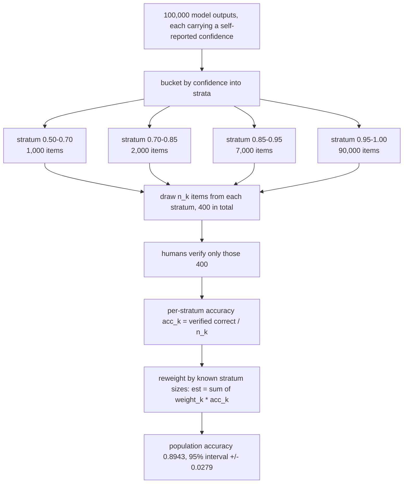
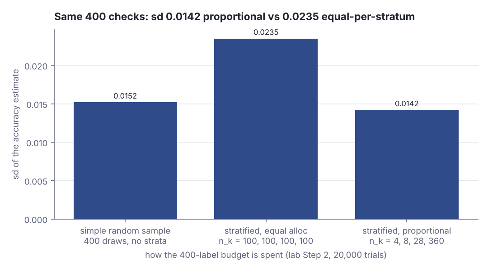
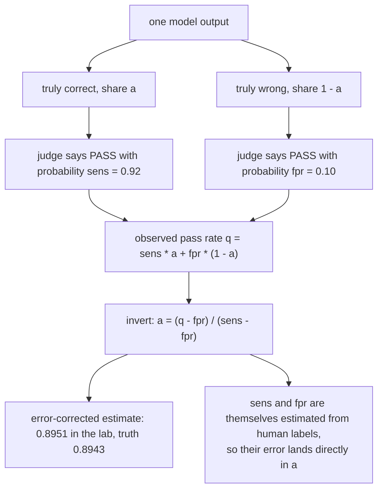
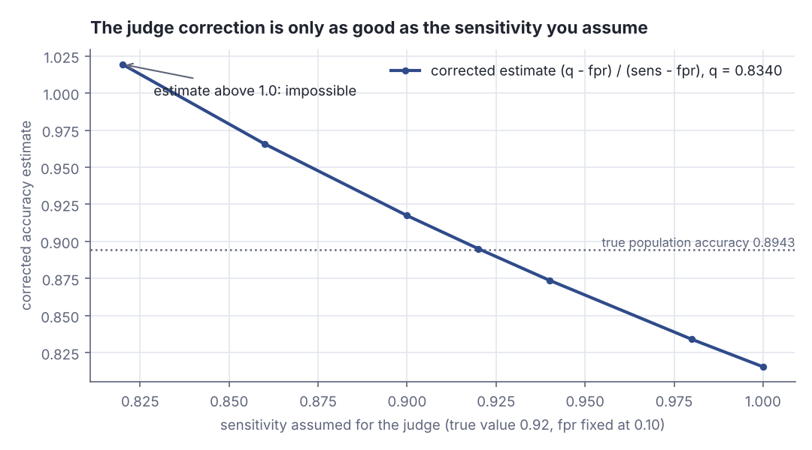

# Auditing a model whose confidence lies

> Fresh · AI / ML foundations · Intermediate · ~25 min · from today's feeds

## Why this matters
You have 100,000 agent outputs in a log and budget to human-check 400 of them, and the model's own confidence score is the only free signal you have about which ones are wrong.
A preprint posted on 26 October 2026 shows that this score does not have to be honest to be useful: you can stratify on it and still report a statistically valid accuracy number with an interval around it.
This is sample-size planning for a test suite, with the same arithmetic you used to argue about QA coverage — only the thing under test now answers in probabilities.

## Primer
Four prerequisites, building on the probability rung you finished.

**Estimating a Bernoulli rate.** Each audited output is a Bernoulli draw: correct (1) or wrong (0), with unknown success probability *p*. The sample mean `p̂ = hits / n` estimates *p*; its expectation is exactly *p* and its variance `p(1 − p) / n`, so the standard deviation shrinks as `1/√n`: four times the labels buys half the error.

**Unbiased is not the same as precise.** *Unbiased* means the estimator's expectation equals the truth: repeat the audit many times and the estimates centre on the real accuracy. It says nothing about how far any one audit lands from it — that is variance. Two unbiased estimators with sd 0.05 and sd 0.014 both "average out right"; only the second lets you put a number in a release note. Validity and precision are separate properties; the design question below is how to buy the second once you have the first.

**A stratum** is a slice of the population you fix *before* sampling, by something visible on every item for free — here, self-reported confidence. Draw `n_k` items from stratum *k* of known size `N_k`, measure `p̂_k` inside it, and recombine with weights `w_k = N_k / N`: `p̂ = Σ w_k · p̂_k`. That estimator is unbiased however you split the budget; under proportional allocation (`n_k = n · w_k`) its variance is `(1/n) Σ w_k σ_k²` (Zuev, Caltech Math 408, Lecture 20-21, slides 4-6).

**Calibrated confidence** means the reported number is a real probability: items the model marks 0.8 are correct 80% of the time. **Miscalibrated** means that mapping is broken, usually overconfident. The claim this lesson is built on: a miscalibrated score can still be a legitimate variable to stratify on (Choi et al., arXiv:2610.35698, 26 Oct 2026).

## The idea

### What the paper is

Choi, Kuai, Li, Jiang, Zhang, Fan, Tu and Zhou (Texas A&M; Marquette) posted *From Self-Confidence to Statistical Accuracy: Scaling Human-in-the-Loop Evaluation with Direct and LLM-Assisted Auditing* to arXiv on 26 October 2026 (21 pages, 8 figures). It answers a question every evaluation owner reaches — how do you report a defensible accuracy number for a model that produced more output than anyone will read? — with a sampling design, not a better model.

> "This paper develops a unified statistical framework for both evaluation routes under alternative sampling strategies."
> — Choi, Kuai, Li, Jiang, Zhang, Fan, Tu & Zhou, *From Self-Confidence to Statistical Accuracy: Scaling Human-in-the-Loop Evaluation with Direct and LLM-Assisted Auditing*, 2026-10-26, https://arxiv.org/abs/2610.35698

The two routes are **direct auditing** — humans verify a sample — and **LLM-assisted auditing** — a judge model verifies everything and humans verify enough to measure the judge. Both are run on MMLU-Pro (text) and MMMU-Pro (multimodal) multiple-choice benchmarks (Choi et al., arXiv:2610.35698, 26 Oct 2026).

### Route 1: stratify on a score you do not trust

For the first route the paper's design is confidence-stratified sampling used to recover population accuracy (Choi et al., arXiv:2610.35698, 26 Oct 2026), and the mechanism is worth drawing, since confidence enters it in exactly one place.



*Figure 1: The stratified audit pipeline. Confidence decides only which bucket an item lands in; the numbers entering the estimate are human labels and stratum sizes. Source: drawn for this lesson from Choi et al., arXiv:2610.35698, https://arxiv.org/abs/2610.35698, sizes and intervals from the lab below.*

Read it backwards and the validity argument falls out. The weights `w_k` are exact — confidence is visible on all 100,000 outputs for free, so every stratum's size is known without labelling anything — and `acc_k` is a plain Bernoulli rate measured by humans. Nothing in `Σ w_k · acc_k` reads the confidence value *as a probability*. Here is what the score being wrong looks like:

```scala
// file: Calib.scala
import scala.util.Random
@main def lab(): Unit =
  val r = Random(1)
  val claimed = 0.95
  val verdicts = Vector.fill(20000)(if r.nextDouble() < 0.80 then 1 else 0)
  val actual = verdicts.sum.toDouble / verdicts.size
  println(f"the model reports confidence $claimed%.2f on every one of these items")
  println(f"human checks say it is right $actual%.4f of the time")
  println(f"calibration gap              ${claimed - actual}%+.4f")
```

```text
the model reports confidence 0.95 on every one of these items
human checks say it is right 0.7974 of the time
calibration gap              +0.1526
```

The model is overconfident by 15 points here, and the stratified estimator does not care: it uses the measured `0.7974`, while the `0.95` only decided which bucket these items were counted in. That is the paper's first finding, reported as a clause:

> "miscalibrated self-confidence can still support statistically valid stratified auditing."
> — Choi, Kuai, Li, Jiang, Zhang, Fan, Tu & Zhou, *From Self-Confidence to Statistical Accuracy: Scaling Human-in-the-Loop Evaluation with Direct and LLM-Assisted Auditing*, 2026-10-26, https://arxiv.org/abs/2610.35698

Miscalibration moves *where* items land, not whether the estimator is right on average. The one thing confidence must do is correlate with correctness at all; if it is pure noise, every stratum is a small copy of the population and you gain nothing — but lose nothing either.

### Validity is free, precision is not

Precision is where the design work goes, and it starts with the `1/√n` law:

```scala
// file: Rate.scala
import scala.util.Random
@main def lab(): Unit =
  val r = Random(2)
  def est(n: Int) = Vector.fill(n)(if r.nextDouble() < 0.80 then 1 else 0).sum.toDouble / n
  def sd(v: Vector[Double]) =
    val m = v.sum / v.size
    math.sqrt(v.map(x => (x - m) * (x - m)).sum / (v.size - 1))
  for n <- Vector(40, 400) do
    val runs = Vector.fill(4000)(est(n))
    println(f"n = $n%3d  mean of 4000 estimates ${runs.sum / runs.size}%.4f  sd ${sd(runs)}%.4f")
```

```text
n =  40  mean of 4000 estimates 0.8019  sd 0.0628
n = 400  mean of 4000 estimates 0.8004  sd 0.0202
```

Both sample sizes are unbiased — the means sit on 0.80 — and ten times the labels bought a 3.1x narrower spread, which is `√10`. Precision bought with labels alone is expensive, so the lever is *where* the labels go. The variance of the stratified estimator is `Σ w_k² σ_k² / n_k`, and that formula punishes the obvious plan: equal allocation puts 100 labels in each of four strata, 300 of them inside strata holding 10% of the population, while the stratum carrying 90% of the weight (`w² = 0.81`) gets the remaining 100. Proportional allocation (`n_k = n · w_k`) collapses the expression to `(1/n) Σ w_k σ_k²`, never worse than a simple random sample of the same size (Zuev, Caltech Math 408, Lecture 20-21, slides 6 and 8). For highly imbalanced confidence distributions the paper reports the same thing empirically, finding that

> "proportional allocation substantially reduces estimation error relative to equal-per-stratum allocation."
> — Choi et al., *From Self-Confidence to Statistical Accuracy*, 2026-10-26, https://arxiv.org/abs/2610.35698

The lab below reproduces that result on synthetic data in Scala — it is not a re-run of the paper's experiments, which used MMLU-Pro and MMMU-Pro:



*Figure 2: Three estimators, the same 400 human labels, 20,000 trials each. All three are unbiased (biases +0.0001, +0.0001 and −0.0000 in Step 2 below); only the spread differs, and equal-per-stratum allocation is worse than not stratifying at all. Source: this lesson's lab, Step 2 output, rendered from `assets/2026-11-11-2-chart-1.json` with `dojo/engine/chart.py`.*

### Route 2: the judge as a noisy instrument

The second route replaces most human labels with a judge model, cheap enough to run on all 100,000 outputs and not right. Model it as a binary classifier with two numbers: **sensitivity**, the probability it passes an output that is genuinely correct, and the **false-positive rate (FPR)**, the probability it passes one that is wrong. Its raw pass rate is a blend of the two, and the blend can be inverted.



*Figure 3: The LLM-assisted route as a noisy binary classifier, and the algebra that backs the true accuracy out of the observed pass rate. Adapted from Choi et al., arXiv:2610.35698, https://arxiv.org/abs/2610.35698*

The raw pass rate is a biased estimate of accuracy (in the lab, 0.8340 against a truth of 0.8943), and the inversion removes that bias exactly — *if* you know sensitivity and FPR. You do not; you estimate them from a human-labelled subset, so the corrected number carries its own calibration uncertainty, amplified by the `(sens − fpr)` denominator:



*Figure 4: The same observed pass rate q = 0.8340, inverted with different assumed sensitivities. A 0.06 error in assumed sensitivity moves the estimate about 0.07; at 0.82 the correction returns 1.0194 — an accuracy above 1, the design telling you the assumed rates are wrong. Source: this lesson's lab, Step 4 output, rendered from `assets/2026-11-11-2-chart-2.json` with `dojo/engine/chart.py`.*

That is why the paper does not simply declare the judge route cheaper:

> "The two routes are then compared through human-label and total-cost efficiency boundaries."
> — Choi et al., *From Self-Confidence to Statistical Accuracy*, 2026-10-26, https://arxiv.org/abs/2610.35698

On those boundaries, only a small subset of target-model/verifier pairs met the idealised human-label-efficiency condition, and judge inference cost can eat the label savings outright (Choi et al., arXiv:2610.35698, 26 Oct 2026). Three trade-offs fall out: human labels against compute; validity against efficiency, since the stratified estimator stays unbiased under miscalibration but is inefficient unless you allocate proportionally; and the judge correction helping only as far as you can pin down sensitivity and FPR.

## Lab

**The question:** I have 100,000 model outputs and budget to human-check 400 of them — what is the model's real accuracy, and how wrong could my estimate be?

### Step 1 — the population you are auditing

The program synthesises 100,000 outputs in four hidden quality tiers, with deliberately overconfident self-reported confidence: the tier that reports 0.50-0.70 is right 20% of the time, and the tier that reports 0.95-1.00 — 90% of all outputs — is right 93% of the time. The confidence is informative (its ranking matches real accuracy) and dishonest (its level does not). The hidden labels are known to the program and to nobody auditing, so there is a true answer to check the estimates against.

### Step 2 — the program

Scala 3, standard library only, seeded so the numbers reproduce exactly. It builds the population, runs three estimators 20,000 times each on a 400-label budget, traces one single audit, and finishes with the judge-route inversion. Save it as `Lab.scala` and run:

```bash
scala Lab.scala
```

```scala
// file: Lab.scala
import scala.util.Random

final case class Stratum(band: String, lo: Double, hi: Double, size: Int, trueAcc: Double)

// Four hidden quality tiers. The model reports high confidence everywhere, and the band it
// reports is informative about its real accuracy but badly wrong about the level.
val tiers = Vector(
  Stratum("0.50-0.70", 0.50, 0.70,  1000, 0.20),
  Stratum("0.70-0.85", 0.70, 0.85,  2000, 0.40),
  Stratum("0.85-0.95", 0.85, 0.95,  7000, 0.70),
  Stratum("0.95-1.00", 0.95, 1.00, 90000, 0.93)
)

val N = tiers.map(_.size).sum
val K = tiers.size

def sd(v: Vector[Double]): Double =
  val m = v.sum / v.size
  math.sqrt(v.map(x => (x - m) * (x - m)).sum / (v.size - 1))

@main def lab(): Unit =
  // ---------- Step 1: synthesise the population ----------
  val rPop = Random(7)
  val label = Array.ofDim[Int](N)
  val conf = Array.ofDim[Double](N)
  val strata = Array.ofDim[Array[Int]](K)
  var next = 0
  for k <- 0 until K do
    val t = tiers(k)
    val idx = Array.ofDim[Int](t.size)
    for j <- 0 until t.size do
      val i = next + j
      idx(j) = i
      label(i) = if rPop.nextDouble() < t.trueAcc then 1 else 0
      conf(i) = t.lo + rPop.nextDouble() * (t.hi - t.lo)
    strata(k) = idx
    next += t.size

  val trueAcc = label.sum.toDouble / N
  val meanConf = conf.sum / N
  val weight = tiers.map(_.size.toDouble / N)

  println(f"== Step 1: population of $N%,d model outputs, seed Random(7) ==")
  println(f"  true population accuracy      = $trueAcc%.4f   (over all $N%,d hidden labels)")
  println(f"  mean self-reported confidence = $meanConf%.4f   (what the model claims)")
  println(f"  overstatement                 = ${meanConf - trueAcc}%+.4f")
  println()
  println("  stratum      |   size | weight | mean conf | true acc | conf - acc")
  for k <- 0 until K do
    val idx = strata(k)
    val a = idx.map(label).sum.toDouble / idx.length
    val c = idx.map(conf).sum / idx.length
    println(f"  ${tiers(k).band}%-12s | ${idx.length}%6d | ${weight(k)}%6.3f | $c%9.4f | $a%8.4f | ${c - a}%+10.4f")
  val strAcc = (0 until K).map(k => strata(k).map(label).sum.toDouble / strata(k).length).toVector
  println(f"  reweighted check: sum of weight_k * acc_k = ${(0 until K).map(k => weight(k) * strAcc(k)).sum}%.4f")

  // ---------- Step 2: three estimators, 400 human checks each ----------
  val budget = 400
  val trials = 20000
  val equalAlloc = Vector.fill(K)(budget / K)
  val propAlloc = weight.map(w => math.round(budget * w).toInt)

  def srs(r: Random): Double =
    var hits = 0
    for _ <- 0 until budget do hits += label(r.nextInt(N))
    hits.toDouble / budget

  def stratified(alloc: Vector[Int], r: Random): Double =
    var est = 0.0
    for k <- 0 until K do
      val idx = strata(k)
      var hits = 0
      for _ <- 0 until alloc(k) do hits += label(idx(r.nextInt(idx.length)))
      est += weight(k) * hits / alloc(k)
    est

  println()
  println(f"== Step 2: budget $budget%d human checks, $trials%d independent trials, seed Random(99) ==")
  println(s"  simple random sample      : ${budget} draws from the whole population")
  println(s"  stratified, equal         : n_k = ${equalAlloc.mkString(", ")}  (total ${equalAlloc.sum})")
  println(s"  stratified, proportional  : n_k = ${propAlloc.mkString(", ")}  (total ${propAlloc.sum})")
  val rT = Random(99)
  val runsSrs = Vector.fill(trials)(srs(rT))
  val runsEq = Vector.fill(trials)(stratified(equalAlloc, rT))
  val runsPr = Vector.fill(trials)(stratified(propAlloc, rT))
  println()
  println("  estimator                     | mean est |    bias |   sd est | 95% half-width")
  for (name, runs) <- Vector(("simple random sample", runsSrs),
                             ("stratified, equal alloc", runsEq),
                             ("stratified, proportional", runsPr)) do
    val m = runs.sum / runs.size
    val s = sd(runs)
    println(f"  $name%-29s | $m%8.4f | ${m - trueAcc}%+7.4f | $s%8.4f | ${1.96 * s}%14.4f")

  // ---------- Step 3: one proportional audit, traced ----------
  println()
  println("== Step 3: one single proportional audit, traced, seed Random(5) ==")
  val r1 = Random(5)
  var total = 0.0
  println("  stratum      | n_k | human-verified correct | acc_k  | weight_k | weight_k * acc_k")
  for k <- 0 until K do
    val idx = strata(k)
    var hits = 0
    for _ <- 0 until propAlloc(k) do hits += label(idx(r1.nextInt(idx.length)))
    val a = hits.toDouble / propAlloc(k)
    total += weight(k) * a
    println(f"  ${tiers(k).band}%-12s | ${propAlloc(k)}%3d | $hits%22d | $a%6.4f | ${weight(k)}%8.3f | ${weight(k) * a}%16.4f")
  println(f"  estimate = $total%.4f   true = $trueAcc%.4f   error = ${total - trueAcc}%+.4f")

  // ---------- Step 4: the judge route ----------
  def judgeCorrect(passRate: Double, sens: Double, fpr: Double): Double =
    (passRate - fpr) / (sens - fpr)

  val sensTrue = 0.92
  val fprTrue = 0.10
  val rJ = Random(11)
  var passes = 0
  for i <- 0 until N do
    val p = if label(i) == 1 then sensTrue else fprTrue
    if rJ.nextDouble() < p then passes += 1
  val passRate = passes.toDouble / N
  println()
  println(f"== Step 4: LLM judge, true sensitivity $sensTrue%.2f, true false-positive rate $fprTrue%.2f ==")
  println(f"  judge raw pass rate over all $N%,d outputs = $passRate%.4f  (naive estimate, error ${passRate - trueAcc}%+.4f)")
  println(f"  corrected with the true rates             = ${judgeCorrect(passRate, sensTrue, fprTrue)}%.4f")
  println()
  println("  assumed sens | assumed fpr | corrected est |   error")
  for s <- Vector(0.82, 0.86, 0.90, 0.92, 0.94, 0.98, 1.00) do
    val e = judgeCorrect(passRate, s, fprTrue)
    println(f"  $s%12.2f | $fprTrue%11.2f | $e%13.4f | ${e - trueAcc}%+7.4f")
```

### Step 3 — the real output

```text
== Step 1: population of 100,000 model outputs, seed Random(7) ==
  true population accuracy      = 0.8943   (over all 100,000 hidden labels)
  mean self-reported confidence = 0.9621   (what the model claims)
  overstatement                 = +0.0678

  stratum      |   size | weight | mean conf | true acc | conf - acc
  0.50-0.70    |   1000 |  0.010 |    0.6036 |   0.1990 |    +0.4046
  0.70-0.85    |   2000 |  0.020 |    0.7756 |   0.4060 |    +0.3696
  0.85-0.95    |   7000 |  0.070 |    0.8998 |   0.6907 |    +0.2091
  0.95-1.00    |  90000 |  0.900 |    0.9750 |   0.9287 |    +0.0464
  reweighted check: sum of weight_k * acc_k = 0.8943

== Step 2: budget 400 human checks, 20000 independent trials, seed Random(99) ==
  simple random sample      : 400 draws from the whole population
  stratified, equal         : n_k = 100, 100, 100, 100  (total 400)
  stratified, proportional  : n_k = 4, 8, 28, 360  (total 400)

  estimator                     | mean est |    bias |   sd est | 95% half-width
  simple random sample          |   0.8943 | +0.0001 |   0.0152 |         0.0298
  stratified, equal alloc       |   0.8944 | +0.0001 |   0.0235 |         0.0461
  stratified, proportional      |   0.8943 | -0.0000 |   0.0142 |         0.0279

== Step 3: one single proportional audit, traced, seed Random(5) ==
  stratum      | n_k | human-verified correct | acc_k  | weight_k | weight_k * acc_k
  0.50-0.70    |   4 |                      0 | 0.0000 |    0.010 |           0.0000
  0.70-0.85    |   8 |                      2 | 0.2500 |    0.020 |           0.0050
  0.85-0.95    |  28 |                     24 | 0.8571 |    0.070 |           0.0600
  0.95-1.00    | 360 |                    335 | 0.9306 |    0.900 |           0.8375
  estimate = 0.9025   true = 0.8943   error = +0.0082

== Step 4: LLM judge, true sensitivity 0.92, true false-positive rate 0.10 ==
  judge raw pass rate over all 100,000 outputs = 0.8340  (naive estimate, error -0.0603)
  corrected with the true rates             = 0.8951

  assumed sens | assumed fpr | corrected est |   error
          0.82 |        0.10 |        1.0194 | +0.1251
          0.86 |        0.10 |        0.9657 | +0.0715
          0.90 |        0.10 |        0.9174 | +0.0232
          0.92 |        0.10 |        0.8951 | +0.0008
          0.94 |        0.10 |        0.8738 | -0.0205
          0.98 |        0.10 |        0.8340 | -0.0602
          1.00 |        0.10 |        0.8155 | -0.0788
```

### Reading the output

**Step 1 — the population.** `true acc` is the fraction of hidden labels that are correct; `conf - acc` is the calibration gap per stratum, and lower (closer to zero) is better calibration. The model claims 0.9621 overall and delivers 0.8943 — it overstates itself by 6.8 points, and by 40 points in its least confident band. What saves the design is the `true acc` column being monotone in the band: 0.1990 → 0.4060 → 0.6907 → 0.9287. Confidence ranks correctly even though it scores wrongly.

| stratum | size | weight | mean conf | true acc | conf − acc |
|---|---|---|---|---|---|
| 0.50-0.70 | 1,000 | 0.010 | 0.6036 | 0.1990 | +0.4046 |
| 0.70-0.85 | 2,000 | 0.020 | 0.7756 | 0.4060 | +0.3696 |
| 0.85-0.95 | 7,000 | 0.070 | 0.8998 | 0.6907 | +0.2091 |
| 0.95-1.00 | 90,000 | 0.900 | 0.9750 | 0.9287 | +0.0464 |

**Verdict:** taking the model's own confidence as its accuracy would have shipped 0.9621 instead of 0.8943 — a 6.8-point lie, concentrated in the bands you look at least.

**Step 2 — the three estimators.** `mean est` is the average over 20,000 independent audits and should sit on 0.8943; `bias` is that average minus the truth, and nearer zero is better; `sd est` is the spread of a single audit's answer, and smaller is better; the 95% half-width is `1.96 × sd`, the ± you would publish.

| estimator | n_k | mean est | bias | sd est | 95% half-width |
|---|---|---|---|---|---|
| simple random sample | 400 ungrouped | 0.8943 | +0.0001 | 0.0152 | 0.0298 |
| stratified, equal alloc | 100, 100, 100, 100 | 0.8944 | +0.0001 | 0.0235 | 0.0461 |
| stratified, proportional | 4, 8, 28, 360 | 0.8943 | −0.0000 | 0.0142 | 0.0279 |

All three biases are within 0.0001 of zero: every one of them is unbiased, including both stratified designs built on a confidence score that lies. The spread is where the design shows up, and the variance formula `Σ w_k² σ_k² / n_k` explains it with one term. The top stratum has `w = 0.900` and `σ² = 0.9287 × 0.0713 = 0.06622`, so it contributes `0.81 × 0.06622 / n_4`: with `n_4 = 100` that is `5.363e-4`, and with `n_4 = 360` it is `1.490e-4`. Adding the three small strata gives totals of `5.480e-4` and `2.024e-4`, i.e. sd `0.0234` and `0.0142` — the measured `0.0235` and `0.0142`.

**Verdict:** the budget split, not the stratification, is what buys precision. Equal allocation is *worse than not stratifying at all* (0.0235 against 0.0152) because it spends 300 of 400 labels on 10% of the population; proportional allocation beats the simple random sample by 7% of its half-width for free.

**Step 3 — one audit, traced.** This is a single realistic audit, not an average: 400 people-minutes, four numbers back. The reweighting with digits shown:

```text
0.010 × 0.0000  =  0.0000     (0 of 4 sampled items in the 0.50-0.70 band were correct)
0.020 × 0.2500  =  0.0050     (2 of 8)
0.070 × 0.8571  =  0.0600     (24 of 28)
0.900 × 0.9306  =  0.8375     (335 of 360)
                   ------
estimate        =  0.9025     true 0.8943, error +0.0082
```

The small strata are measured atrociously — 0 correct out of 4 is an `acc_k` of 0.0000 against a true 0.1990 — and it costs almost nothing, because that stratum's error enters the total multiplied by 0.010. **Verdict:** a single audit landed +0.0082 from the truth, well inside the ±0.0279 interval the design promises; the honest report is "89.3% ± 2.8 points at 95%", never "90.25%".

**Step 4 — the judge.** `judge raw pass rate` is what you would report if you trusted the judge; `corrected est` is `(q − fpr) / (sens − fpr)`; `error` is against the true 0.8943, and nearer zero is better.

| assumed sensitivity | corrected estimate | error |
|---|---|---|
| 0.82 | 1.0194 | +0.1251 |
| 0.86 | 0.9657 | +0.0715 |
| 0.90 | 0.9174 | +0.0232 |
| 0.92 (true) | 0.8951 | +0.0008 |
| 0.94 | 0.8738 | −0.0205 |
| 0.98 | 0.8340 | −0.0602 |
| 1.00 | 0.8155 | −0.0788 |

With the true rates the correction is nearly exact (+0.0008 on 100,000 judged items), and the raw pass rate was off by −0.0603. But the derivative of the inversion with respect to sensitivity is `−(q − fpr) / (sens − fpr)² = −0.734 / 0.6724 = −1.09`, so every point of error in your assumed sensitivity moves the estimate by slightly more than a point — and those rates are themselves measured from a human-labelled subset with their own sampling error. **Verdict:** the judge route trades a 0.0603 bias you cannot see for an uncertainty you have to measure; at an assumed sensitivity of 0.82 it returns an accuracy of 1.0194, which is impossible and is the only free alarm in the method.

### The chain

1. **Cause:** the model's self-reported confidence overstates its accuracy by +0.0678 on average, and by +0.4046 in its lowest band, but it still *ranks* items correctly (0.1990 → 0.4060 → 0.6907 → 0.9287 across the four bands).
2. **Mechanism:** stratifying on that ranking splits one population with variance `p(1 − p) = 0.0945` into four strata whose weighted average variance is `0.0810`, and proportional allocation puts 360 of 400 labels where 90% of the population is, driving the estimator's variance to `2.024e-4` against `2.362e-4` for a simple random sample — while the weighted estimate stays unbiased because weights come from stratum sizes you know exactly and accuracies come from humans.
3. **Consequence:** the same 400 human checks buy a 95% half-width of ±0.0279 instead of ±0.0298 (ungrouped) or ±0.0461 (equal-per-stratum), and the two "free" answers — trust the confidence, trust the judge — are off by +0.0678 and −0.0603 respectively.
4. **What it means for your work:** this is the QA sample-size conversation with a model in the dock. Plan an agent-output audit the way you planned a test cycle: decide the half-width you can defend first, bucket the backlog by a signal that costs nothing (the model's own confidence, or a proxy — output length, retry count, a tool-error flag), allocate the human checks proportionally to bucket size, and report the interval, never the model's self-assessment. If you want a judge model to carry the volume, budget human labels to measure its sensitivity and false-positive rate before you believe a single pass rate — without those two numbers, a judge's "94% pass" is an unquantified bias, and with them it is an estimate with error bars you can put in front of a stakeholder.

## Self-check
1. Your model reports 0.95 on a bucket where humans find it is right 80% of the time. Does that break a confidence-stratified audit, and what does it affect? <details><summary>Answer</summary>It does not break validity. The estimate is `Σ w_k · acc_k`: the weights are stratum sizes, which you know exactly for all 100,000 outputs for free, and `acc_k` is measured by humans inside the stratum. The confidence value is never read as a probability — it only decides which bucket an item is counted in. Miscalibration changes *where* items land, so it changes stratum sizes and within-stratum variance, i.e. precision and efficiency. The only thing that would make stratification pointless is confidence carrying no information about correctness at all; then each stratum is a small copy of the population and you gain nothing — but still lose nothing.</details>
2. With four strata of weights 0.010 / 0.020 / 0.070 / 0.900 and a 400-label budget, why is 100 per stratum worse than 4 / 8 / 28 / 360? Use the biggest term. <details><summary>Answer</summary>The variance is `Σ w_k² σ_k² / n_k` and the top stratum dominates it: `w² = 0.81`, `σ² = 0.9287 × 0.0713 = 0.06622`. With `n_4 = 100` that term is `0.81 × 0.06622 / 100 = 5.363e-4`; with `n_4 = 360` it is `1.490e-4`. Totals: `5.480e-4` (sd 0.0234) versus `2.024e-4` (sd 0.0142), matching the lab's measured 0.0235 and 0.0142. Equal allocation spends 300 of its 400 labels on strata holding 10% of the population, so it is even worse than an unstratified sample of 400 (sd 0.0152).</details>
3. A judge passes 83.40% of outputs; its false-positive rate is 0.10. You assume sensitivity 0.86 when it is really 0.92. What do you report, how wrong is it, and why is the error bigger than your 0.06 mistake? <details><summary>Answer</summary>`(0.8340 − 0.10) / (0.86 − 0.10) = 0.9657`, against a truth of 0.8943 — an error of +0.0715 from a 0.06 misstatement. The inversion divides by `(sens − fpr)`, so its sensitivity to that assumption is `−(q − fpr) / (sens − fpr)² = −0.734 / 0.82² = −1.09` per unit, and the function is convex, which pushes the realised error above the linear 0.065. The same algebra produces 1.0194 at an assumed sensitivity of 0.82: an accuracy above 1 is impossible, and is the signal that your assumed judge rates are wrong.</details>

## Sources
- [From Self-Confidence to Statistical Accuracy: Scaling Human-in-the-Loop Evaluation with Direct and LLM-Assisted Auditing (arXiv:2610.35698)](https://arxiv.org/abs/2610.35698) — Choi, Kuai, Li, Jiang, Zhang, Fan, Tu & Zhou, 26 Oct 2026: the two auditing routes, the four quoted passages, the MMLU-Pro / MMMU-Pro experiments, the miscalibration and proportional-allocation findings, and the cost trade-offs; accessed 2026-11-11.
- [Caltech Math 408, Lecture 20-21 (K. Zuev), stratified sampling](https://www.its.caltech.edu/~zuev/teaching/2013Spring/Math408-Lecture-20-21.pdf) — the stratified estimator and its variance under proportional allocation (slides 4-6) and the comparison with simple random sampling (slide 8); accessed 2026-11-11.

## Next on this track
Fresh lessons sit outside the ladder; next on AI / ML foundations: **Logistic regression: from scores to probabilities** (rung 9 of 38, Beginner).
