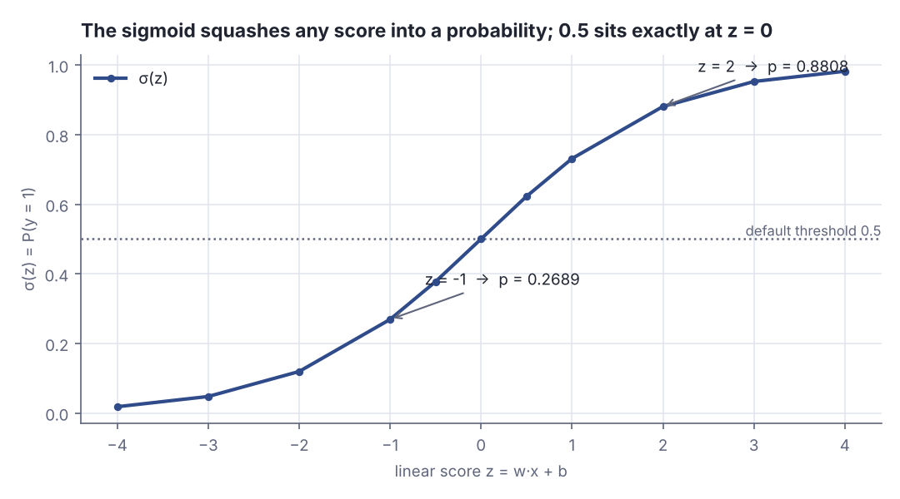
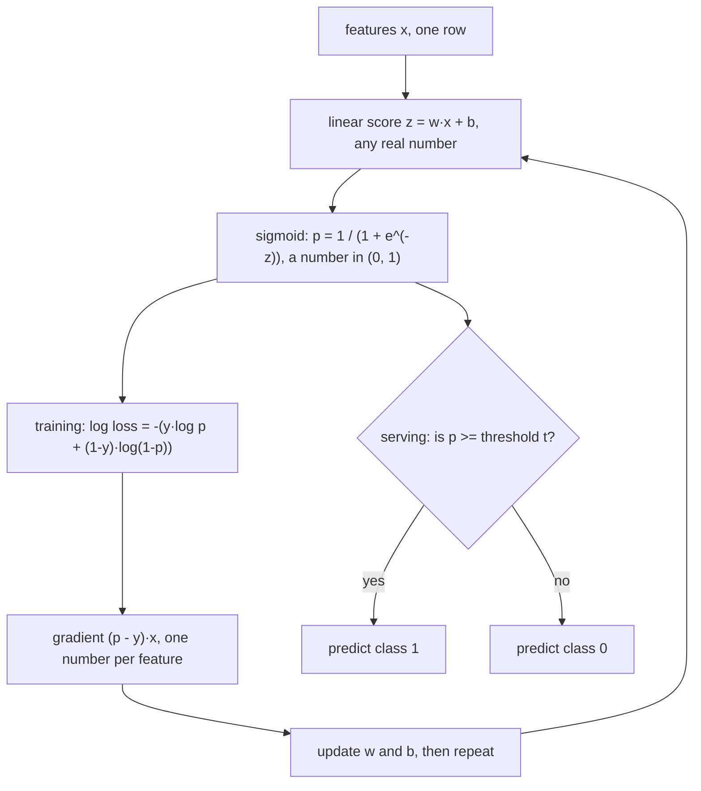
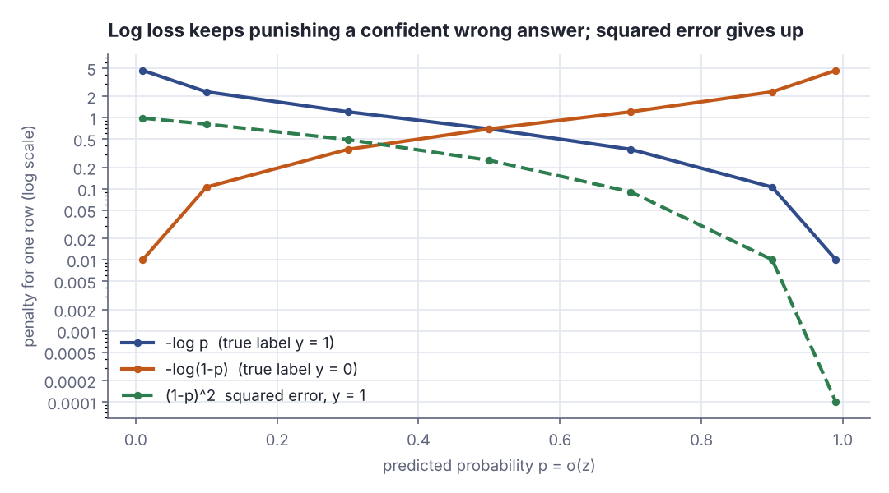
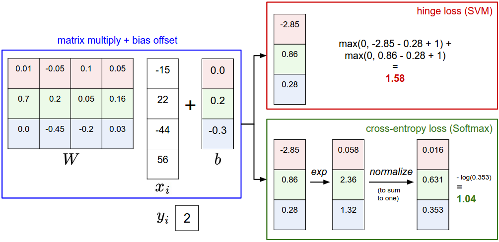
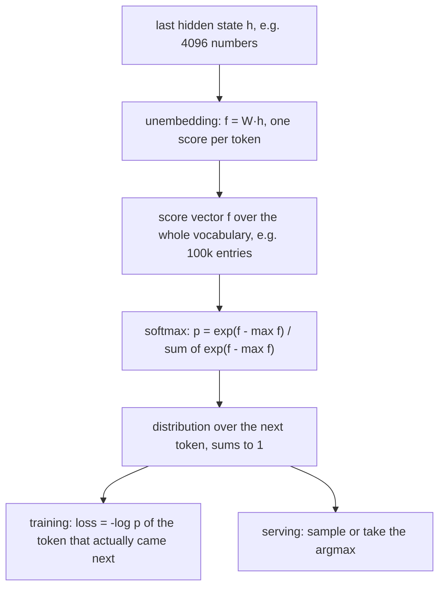
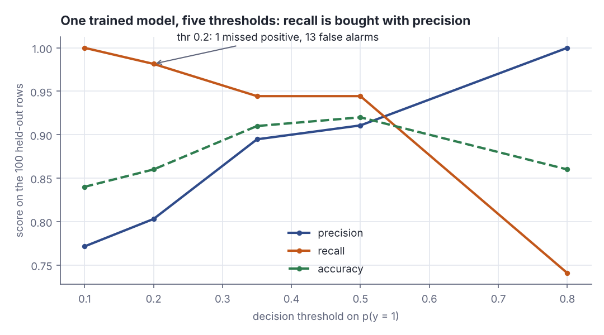

# Logistic regression: from scores to probabilities

> AI / ML foundations · Beginner · ~25 min · rung 9 of 38 · needs: Gradient descent in many variables: fitting linear regression (ai-ml-07); Probability you need for ML: distributions, Bayes, likelihood (ai-ml-08)

## Why this matters

Most production ML is classification — is this charge fraud, is this ticket a P1, does this prompt need the expensive model — and logistic regression is the smallest honest answer to all of them: a linear score, a squashing function, a probability you can threshold wherever the business says.
It costs you almost nothing new: it is rung 07's training loop with one extra line, minimising the negative log-likelihood you met in rung 08.
Its multi-class form, softmax plus cross-entropy, is literally the output layer of every neural classifier and every LLM, so the arithmetic you do by hand here is the arithmetic running over a 100 000-token vocabulary at the end of each forward pass.

## The idea

### A linear score is not a probability

Rung 07's model produced `z = w·x + b`: a dot product plus a bias, any real number. A probability must live in (0, 1), so you need a monotone map from the real line into that interval — the **sigmoid**, or logistic function:

`σ(z) = 1 / (1 + e^(−z))`

It gives `σ(0) = 0.5`. Its inverse is the **logit**, `log(p / (1 − p))` — the log of the odds — so logistic regression is a *linear model of the log-odds* (Google Machine Learning Crash Course, module "Logistic regression", page "Sigmoid function"): adding 1 to `z` multiplies the odds by `e ≈ 2.718`.

```scala
// file: Ex1.scala
@main def ex1(): Unit =
  def sigmoid(z: Double) = 1.0 / (1.0 + math.exp(-z))
  val zs = Vector(-4.0, -3.0, -2.0, -1.0, -0.5, 0.0, 0.5, 1.0, 2.0, 3.0, 4.0)
  println("     z | sigma(z) |   odds p/(1-p) | log-odds log(p/(1-p))")
  for z <- zs do
    val p = sigmoid(z)
    println(f"$z%6.1f | $p%8.4f | ${p / (1 - p)}%14.4f | ${math.log(p / (1 - p))}%21.3f")
```

```text
     z | sigma(z) |   odds p/(1-p) | log-odds log(p/(1-p))
  -4.0 |   0.0180 |         0.0183 |                -4.000
  -3.0 |   0.0474 |         0.0498 |                -3.000
  -2.0 |   0.1192 |         0.1353 |                -2.000
  -1.0 |   0.2689 |         0.3679 |                -1.000
  -0.5 |   0.3775 |         0.6065 |                -0.500
   0.0 |   0.5000 |         1.0000 |                 0.000
   0.5 |   0.6225 |         1.6487 |                 0.500
   1.0 |   0.7311 |         2.7183 |                 1.000
   2.0 |   0.8808 |         7.3891 |                 2.000
   3.0 |   0.9526 |        20.0855 |                 3.000
   4.0 |   0.9820 |        54.5982 |                 4.000
```

The last column is the check: the log-odds of `σ(z)` come back as exactly `z` on every row, so the linear part fits log-odds and nothing else. The odds column says it multiplicatively — each +1 in `z` multiplies the odds by 2.7183.



*Figure 1: the rows above, plotted. From the Ex1 output (`python3 dojo/engine/chart.py dojo/lessons/assets/2026-11-12-1-chart-1.json`).*



*Figure 2: the left branch trains and ends back at the weights; the right branch serves and never touches them. Source: drawn for this lesson.*

### Log loss is the negative log-likelihood of a coin whose bias depends on x

Treat each row as a Bernoulli trial with success probability `p_i = σ(w·x_i + b)`. The likelihood of label `y_i ∈ {0, 1}` is `p_i^y_i · (1 − p_i)^(1 − y_i)`, and the dataset likelihood is the product over rows. Logs turn that into a sum and the minus sign into a minimisation, giving the **log loss**, or **binary cross-entropy**:

`L = −(1/n) · Σ_i [ y_i·log p_i + (1 − y_i)·log(1 − p_i) ]`

Minimising it *is* maximum likelihood — rung 08's move for a Gaussian, applied to a Bernoulli (StatQuest, "Logistic Regression Details Pt 2: Maximum Likelihood"). One term is alive per row: `−log p` if the truth is 1, `−log(1 − p)` if it is 0.

Why not squared error, `(p − y)²`? It is bounded by 1: a confidently wrong answer is only four times worse than a coin flip. Worse, its gradient at the score is `2(p − y)·p(1 − p)`, and `p(1 − p)` collapses exactly where a large correction is needed:

```scala
// file: Ex2.scala
@main def ex2(): Unit =
  val ps = Vector(0.99, 0.9, 0.7, 0.5, 0.3, 0.1, 0.01)
  println("    p | -log p | -log(1-p) | (1-p)^2 | d(-log p)/dz | d(1-p)^2/dz")
  for p <- ps do
    val gLog = p - 1.0
    val gSq = 2 * (p - 1.0) * p * (1 - p)
    println(f"$p%5.2f | ${-math.log(p)}%6.3f | ${-math.log(1 - p)}%9.3f | " +
      f"${(1 - p) * (1 - p)}%7.4f | $gLog%12.3f | $gSq%12.4f")
```

```text
    p | -log p | -log(1-p) | (1-p)^2 | d(-log p)/dz | d(1-p)^2/dz
 0.99 |  0.010 |     4.605 |  0.0001 |       -0.010 |      -0.0002
 0.90 |  0.105 |     2.303 |  0.0100 |       -0.100 |      -0.0180
 0.70 |  0.357 |     1.204 |  0.0900 |       -0.300 |      -0.1260
 0.50 |  0.693 |     0.693 |  0.2500 |       -0.500 |      -0.2500
 0.30 |  1.204 |     0.357 |  0.4900 |       -0.700 |      -0.2940
 0.10 |  2.303 |     0.105 |  0.8100 |       -0.900 |      -0.1620
 0.01 |  4.605 |     0.010 |  0.9801 |       -0.990 |      -0.0196
```

Last row: the model says 0.01, the truth is 1. Log loss charges 4.605 and pushes with strength 0.990; squared error charges 0.9801 and pushes with 0.0196 — fifty times weaker, at the row that most needs learning from. Squared error through a sigmoid is also non-convex in `(w, b)`; log loss is convex.



*Figure 3: the Ex2 penalties, log y axis because they span 0.0001 to 4.605. From the Ex2 output (`python3 dojo/engine/chart.py dojo/lessons/assets/2026-11-12-1-chart-2.json`).*

### The gradient has the same shape as linear regression's

Write one row's loss in terms of the score, `L_i = −[y·log σ(z) + (1 − y)·log(1 − σ(z))]`, and differentiate with respect to `z` using `σ' = σ(1 − σ)`: the `σ(1 − σ)` cancels against the logs' `1/σ` and `1/(1 − σ)`, leaving

`∂L_i/∂z_i = σ(z_i) − y_i = p_i − y_i`

the plain prediction error. With `z_i = w·x_i + b`:

- `∂L/∂w_j = (1/n) · Σ_i (p_i − y_i)·x_ij` — the dot product of feature column `j` with the error vector;
- `∂L/∂b = (1/n) · Σ_i (p_i − y_i)` — the mean error.

That is rung 07's `(2/n)·Xᵀ(ŷ − y)` without the factor 2, so the loop is unchanged: forward pass, subtract the labels, one transpose-times-error product, two subtractions. The only new line is `map(sigmoid)`. The cancellation is not luck: the sigmoid is the Bernoulli family's link function, and the same `(prediction − target)` form reappears for softmax and at every neural network's output. Lab Part 5 checks it against finite differences: agreement to 6·10⁻¹².

### The threshold is a business decision, not a parameter

Turning a probability into a yes/no takes one more number that no loss function supplies:

> "The numerical output of the logistic regression, which is the predicted probability, can be used as a classifier by applying a threshold (by default 0.5) to it."
> — scikit-learn developers, *Linear Models — Logistic regression*, no date shown, https://scikit-learn.org/stable/modules/linear_model.html#logistic-regression

Because `σ` is monotone, "`p ≥ t`" is the same test as "`z ≥ log(t / (1 − t))`". At `t = 0.5` that is `w·x + b ≥ 0`: the **decision boundary** is the hyperplane `w·x + b = 0`, a line in 2-D and a plane in 3-D. Lowering the threshold slides it parallel rather than rotating it — `t = 0.2` makes the test `z ≥ −1.3863` — and leaves weights, probabilities and log loss untouched.

The trade-off is one you already run as a Product Owner. In the lab, dropping it from 0.5 to 0.2 flips 10 of 100 held-out predictions: recall 0.9444 → 0.9815, precision 0.9107 → 0.8030, accuracy 0.9200 → 0.8600. If a missed malignant case costs a hundred needless follow-ups, 0.2 is right and accuracy is the wrong referee; pick it on a validation set against the cost of a miss versus a false alarm.

### K classes: softmax, and why this is the LLM output layer

For K classes you compute K scores `f_1 … f_K`, one weight vector each, and normalise them with the **softmax**, `p_k = e^(f_k) / Σ_j e^(f_j)`. The loss is **categorical cross-entropy**, `−log p` of the correct class:

> "In other words, the cross-entropy objective wants the predicted distribution to have all of its mass on the correct answer."
> — Stanford CS231n course notes, *Linear classification*, §"Softmax classifier", no date shown, https://cs231n.github.io/linear-classify/

With K = 2 this reduces to the binary case. The scores are unnormalised log-probabilities: exponentiating un-logs them, dividing normalises them (CS231n, *Linear classification*, §"Softmax classifier", "Probabilistic interpretation"). And `e^789` overflows, so subtract the largest score first (CS231n's `log C = −max_j f_j`, same section).

```scala
// file: Ex3.scala
@main def ex3(): Unit =
  val f = Vector(1.0, -2.0, 0.0)
  val shifted = f.map(_ - f.max)
  val ex = shifted.map(math.exp)
  val p = ex.map(_ / ex.sum)
  println(s"scores   ${f.mkString(", ")}")
  println(p.map(q => f"$q%.4f").mkString("softmax  ", ", ", ""))
  println(f"they sum to ${p.sum}%.4f")
  for k <- 0 until 3 do println(f"  -log p($k) = ${-math.log(p(k))}%.4f   (loss if k is the label)")
```

```text
scores   1.0, -2.0, 0.0
softmax  0.7054, 0.0351, 0.2595
they sum to 1.0000
  -log p(0) = 0.3490   (loss if k is the label)
  -log p(1) = 3.3490   (loss if k is the label)
  -log p(2) = 1.3490   (loss if k is the label)
```

The scores (1, −2, 0) become (0.7054, 0.0351, 0.2595) — CS231n's own example, rounded there to [0.7, 0.04, 0.26] — still summing to 1.0000 after the max-shift. The same vector costs 0.3490 if class 0 is correct and 3.3490 if class 1 is: a gap of `log(0.7054/0.0351) = 3.0`.



*Figure 4: scores (−2.85, 0.86, 0.28) → exp (0.058, 2.36, 1.32) → normalised (0.016, 0.631, 0.353) → −log(0.353) = 1.04. Source: Stanford CS231n, Andrej Karpathy, https://cs231n.github.io/linear-classify/ (MIT).*



*Figure 5: an LLM's output layer is this rung with K = vocabulary size. Source: drawn for this lesson, following CS231n, §"Softmax classifier", https://cs231n.github.io/linear-classify/.*

## Lab

**The question:** can gradient descent on log loss separate two overlapping Gaussian clusters, do the probabilities it prints hold up when you compute their loss by hand, is the `(p − y)·x` gradient the real derivative, and what exactly does moving the threshold from 0.5 to 0.2 buy and cost?

### Step 1 — know the answer before you run

The data is 400 points from two 2-D Gaussians drawn with a seeded `scala.util.Random(7)`: 200 "benign" points around (−1.0, −0.4) and 200 "malignant" points around (1.0, 0.9), each with standard deviation 1.0 in both coordinates. The centres are 2.3 apart and the clouds are one unit wide, so the clusters *overlap* — perfect accuracy is impossible and a model that claims it is broken. 300 rows train, 100 are held out. Both columns are standardised with the training mean and standard deviation (rung 07's lesson: an unscaled column throttles the learning rate for every parameter). Expect training log loss to fall from `log 2 = 0.693` — the loss of a model that answers 0.5 to everything — towards roughly 0.27, and held-out accuracy somewhere around 0.9.

### Step 2 — the program

Scala 3, standard library only. `logLoss` and `grad` are the two formulas derived above, written out literally; `train` is rung 07's loop with `map(sigmoid)` added to the forward pass. Save as `Lab.scala` and run `scala Lab.scala`.

```scala
// file: Lab.scala
import scala.util.Random

type Mat = Vector[Vector[Double]]

def sigmoid(z: Double): Double = 1.0 / (1.0 + math.exp(-z))

def scoresOf(x: Mat, w: Vector[Double], b: Double): Vector[Double] =
  x.map(r => r.zip(w).map((a, c) => a * c).sum + b)

def probsOf(x: Mat, w: Vector[Double], b: Double): Vector[Double] =
  scoresOf(x, w, b).map(sigmoid)

// log loss = mean over rows of -(y*log p + (1-y)*log(1-p)); clamped so log never sees 0
def logLoss(x: Mat, y: Vector[Double], w: Vector[Double], b: Double): Double =
  probsOf(x, w, b).zip(y).map { (p, t) =>
    val q = math.min(math.max(p, 1e-15), 1 - 1e-15)
    -(t * math.log(q) + (1 - t) * math.log(1 - q))
  }.sum / y.size

// gradient of log loss: gw_j = mean_i (p_i - y_i) * x_ij ; gb = mean_i (p_i - y_i)
def grad(x: Mat, y: Vector[Double], w: Vector[Double], b: Double): (Vector[Double], Double) =
  val res = probsOf(x, w, b).zip(y).map((p, t) => p - t)
  val n = y.size.toDouble
  val gw = w.indices.toVector.map(j => x.zip(res).map((r, e) => r(j) * e).sum / n)
  (gw, res.sum / n)

def train(x: Mat, y: Vector[Double], lr: Double, steps: Int) =
  var w = Vector.fill(x.head.size)(0.0)
  var b = 0.0
  val hist = Array.ofDim[Double](steps + 1)
  val path = Array.ofDim[(Vector[Double], Double)](steps + 1)
  hist(0) = logLoss(x, y, w, b); path(0) = (w, b)
  for i <- 1 to steps do
    val (gw, gb) = grad(x, y, w, b)
    w = w.zip(gw).map((a, g) => a - lr * g)
    b = b - lr * gb
    hist(i) = logLoss(x, y, w, b); path(i) = (w, b)
  (w, b, hist.toVector, path.toVector)

def accuracy(p: Vector[Double], y: Vector[Double], thr: Double): Double =
  p.zip(y).count((q, t) => (if q >= thr then 1.0 else 0.0) == t).toDouble / y.size

@main def lab(): Unit =
  val r = Random(7)
  val n0 = 200
  val n1 = 200
  // benign stand-in: centre (-1.0, -0.4); malignant stand-in: centre (1.0, 0.9); sd 1.0 each
  val c0 = Vector.fill(n0)((-1.0 + r.nextGaussian(), -0.4 + r.nextGaussian()))
  val c1 = Vector.fill(n1)((1.0 + r.nextGaussian(), 0.9 + r.nextGaussian()))
  val all = r.shuffle(c0.map(p => (Vector(p._1, p._2), 0.0)) ++ c1.map(p => (Vector(p._1, p._2), 1.0)))
  val (trainRows, testRows) = all.splitAt(300)
  val xtr: Mat = trainRows.map(_._1); val ytr = trainRows.map(_._2)
  val xteRaw: Mat = testRows.map(_._1); val yte = testRows.map(_._2)

  println("== Part 1: the data, 400 points from two overlapping Gaussians, Random(7) ==")
  println(f"  class 0 (benign)    n = $n0%d   centre (-1.0, -0.4)   sd 1.0")
  println(f"  class 1 (malignant) n = $n1%d   centre ( 1.0,  0.9)   sd 1.0")
  println(f"  split: ${ytr.size}%d train rows, ${yte.size}%d held-out rows")
  println(f"  positives: train ${ytr.sum.toInt}%d/${ytr.size}%d, held out ${yte.sum.toInt}%d/${yte.size}%d")
  println("    i |     x1 |     x2 | y")
  for i <- 0 until 3 do println(f"  $i%3d | ${xtr(i)(0)}%6.3f | ${xtr(i)(1)}%6.3f | ${ytr(i).toInt}%d")

  println("\n== Part 2: standardise both columns with the TRAIN mean and sd ==")
  val mu = (0 to 1).toVector.map(j => xtr.map(_(j)).sum / xtr.size)
  val sd = (0 to 1).toVector.map { j =>
    val m = mu(j); math.sqrt(xtr.map(v => (v(j) - m) * (v(j) - m)).sum / xtr.size)
  }
  def std(m: Mat): Mat = m.map(v => Vector((v(0) - mu(0)) / sd(0), (v(1) - mu(1)) / sd(1)))
  val x = std(xtr); val xte = std(xteRaw)
  println(f"  train means = (${mu(0)}%.4f, ${mu(1)}%.4f)   train sds = (${sd(0)}%.4f, ${sd(1)}%.4f)")
  println(f"  row 0 standardised: (${x(0)(0)}%.4f, ${x(0)(1)}%.4f)")

  println("\n== Part 3: gradient descent on log loss, lr = 0.5, 600 steps ==")
  val (w, b, hist, path) = train(x, ytr, 0.5, 600)
  val marks = Vector(0, 1, 2, 5, 10, 25, 50, 100, 200, 400, 600)
  println(" step | train log loss |     w1 |     w2 |      b | train acc")
  for s <- marks do
    val (ws, bs) = path(s)
    println(f" $s%4d | ${hist(s)}%14.5f | ${ws(0)}%6.3f | ${ws(1)}%6.3f | $bs%6.3f | ${accuracy(probsOf(x, ws, bs), ytr, 0.5)}%9.4f")
  println(f"  final: w = (${w(0)}%.4f, ${w(1)}%.4f), b = $b%.4f")
  println(f"  held-out log loss = ${logLoss(xte, yte, w, b)}%.5f   held-out accuracy = ${accuracy(probsOf(xte, w, b), yte, 0.5)}%.4f")

  println("\n== Part 4: three held-out rows, probability and log-loss term by hand ==")
  val pte = probsOf(xte, w, b)
  val zte = scoresOf(xte, w, b)
  println("  row |   x1_std |   x2_std |      z |   p(y=1) | y | -log term")
  val three = Vector(0, 1, 2)
  for i <- three do
    val term = if yte(i) == 1.0 then -math.log(pte(i)) else -math.log(1 - pte(i))
    println(f"  $i%3d | ${xte(i)(0)}%8.4f | ${xte(i)(1)}%8.4f | ${zte(i)}%6.3f | ${pte(i)}%8.4f | ${yte(i).toInt}%d | ${term}%9.4f")
  val mean3 = three.map(i => if yte(i) == 1.0 then -math.log(pte(i)) else -math.log(1 - pte(i))).sum / 3
  println(f"  mean log loss over these three rows = $mean3%.4f")
  val terms = pte.indices.map(i => if yte(i) == 1.0 then -math.log(pte(i)) else -math.log(1 - pte(i)))
  val worst = terms.zipWithIndex.maxBy(_._1)._2
  println(f"  worst of all 100 held-out rows: row $worst%d, z = ${zte(worst)}%.3f, p = ${pte(worst)}%.4f, " +
    f"y = ${yte(worst).toInt}%d, -log term = ${terms(worst)}%.4f")

  println("\n== Part 5: analytical gradient against central finite differences, at w = (0.4, -0.2), b = 0.1 ==")
  val wc = Vector(0.4, -0.2); val bc = 0.1
  val (gw, gb) = grad(x, ytr, wc, bc)
  val h = 1e-5
  val fdw = wc.indices.toVector.map { j =>
    val up = logLoss(x, ytr, wc.updated(j, wc(j) + h), bc)
    val dn = logLoss(x, ytr, wc.updated(j, wc(j) - h), bc)
    (up - dn) / (2 * h)
  }
  val fdb = (logLoss(x, ytr, wc, bc + h) - logLoss(x, ytr, wc, bc - h)) / (2 * h)
  println(f"  loss at that point = ${logLoss(x, ytr, wc, bc)}%.6f")
  println("  param | analytical (mean (p-y)*x) | central differences | abs diff")
  println(f"     w1 | ${gw(0)}%25.8f | ${fdw(0)}%19.8f | ${math.abs(gw(0) - fdw(0))}%.2e")
  println(f"     w2 | ${gw(1)}%25.8f | ${fdw(1)}%19.8f | ${math.abs(gw(1) - fdw(1))}%.2e")
  println(f"      b | ${gb}%25.8f | ${fdb}%19.8f | ${math.abs(gb - fdb)}%.2e")

  println("\n== Part 6: the threshold is not the model, 100 held-out rows ==")
  def confusion(thr: Double) =
    val pred = pte.map(q => if q >= thr then 1.0 else 0.0)
    val tp = pred.zip(yte).count((p, t) => p == 1.0 && t == 1.0)
    val fp = pred.zip(yte).count((p, t) => p == 1.0 && t == 0.0)
    val fn = pred.zip(yte).count((p, t) => p == 0.0 && t == 1.0)
    val tn = pred.zip(yte).count((p, t) => p == 0.0 && t == 0.0)
    (tp, fp, fn, tn)
  println("  thr |  TP |  FP |  FN |  TN | precision | recall | accuracy | flips vs 0.5")
  val base = pte.map(q => if q >= 0.5 then 1.0 else 0.0)
  for thr <- Vector(0.8, 0.5, 0.35, 0.2, 0.1) do
    val (tp, fp, fn, tn) = confusion(thr)
    val pred = pte.map(q => if q >= thr then 1.0 else 0.0)
    val flips = pred.zip(base).count((a, c) => a != c)
    val prec = if tp + fp == 0 then 0.0 else tp.toDouble / (tp + fp)
    val rec = tp.toDouble / (tp + fn)
    println(f"  $thr%4.2f | $tp%3d | $fp%3d | $fn%3d | $tn%3d | $prec%9.4f | $rec%6.4f | ${(tp + tn) / 100.0}%8.4f | $flips%12d")
  println(f"  the boundary is the line w1*x1 + w2*x2 + b = 0, i.e. x2 = ${-w(0) / w(1)}%.4f * x1 + ${-b / w(1)}%.4f (standardised units)")
  println(f"  at threshold t the same line shifts to z = log(t/(1-t)): t=0.2 -> z = ${math.log(0.2 / 0.8)}%.4f")

  println("\n== Part 7 (optional): three clusters, softmax and categorical cross-entropy ==")
  val r3 = Random(11)
  val centres = Vector((-1.5, -1.0), (1.5, -0.8), (0.0, 1.6))
  val rows3 = centres.zipWithIndex.flatMap { case ((cx, cy), k) =>
    Vector.fill(120)((Vector(cx + 0.8 * r3.nextGaussian(), cy + 0.8 * r3.nextGaussian()), k))
  }
  val data3 = r3.shuffle(rows3)
  val x3: Mat = data3.map(_._1); val y3 = data3.map(_._2)
  var W = Vector.fill(3)(Vector(0.0, 0.0))
  var B = Vector.fill(3)(0.0)
  def softmaxRow(v: Vector[Double], W: Vector[Vector[Double]], B: Vector[Double]): Vector[Double] =
    val f = (0 until 3).toVector.map(k => v.zip(W(k)).map((a, c) => a * c).sum + B(k))
    val e = f.map(z => math.exp(z - f.max))
    e.map(_ / e.sum)
  def ce(W: Vector[Vector[Double]], B: Vector[Double]): Double =
    x3.zip(y3).map((v, k) => -math.log(softmaxRow(v, W, B)(k))).sum / y3.size
  println(f"  step 0 cross-entropy = ${ce(W, B)}%.5f   (= log 3 = ${math.log(3.0)}%.5f for a uniform guess)")
  for step <- 1 to 400 do
    val P = x3.map(v => softmaxRow(v, W, B))
    val nn = y3.size.toDouble
    val gW = (0 until 3).toVector.map { k =>
      (0 until 2).toVector.map { j =>
        x3.indices.map(i => (P(i)(k) - (if y3(i) == k then 1.0 else 0.0)) * x3(i)(j)).sum / nn
      }
    }
    val gB = (0 until 3).toVector.map(k => x3.indices.map(i => P(i)(k) - (if y3(i) == k then 1.0 else 0.0)).sum / nn)
    W = (0 until 3).toVector.map(k => W(k).zip(gW(k)).map((a, g) => a - 0.5 * g))
    B = B.zip(gB).map((a, g) => a - 0.5 * g)
    if step == 1 || step == 50 || step == 200 || step == 400 then
      println(f"  step $step%3d cross-entropy = ${ce(W, B)}%.5f")
  val probe = Vector(0.0, 0.0)
  val pp = softmaxRow(probe, W, B)
  println(f"  a point at the centre (0.0, 0.0): p = (${pp(0)}%.4f, ${pp(1)}%.4f, ${pp(2)}%.4f), sum ${pp.sum}%.4f")
  val acc3 = x3.zip(y3).count((v, k) => softmaxRow(v, W, B).zipWithIndex.maxBy(_._1)._2 == k).toDouble / y3.size
  println(f"  training accuracy (argmax of the softmax) = $acc3%.4f over ${y3.size}%d rows")
```

### Step 3 — the output

```text
== Part 1: the data, 400 points from two overlapping Gaussians, Random(7) ==
  class 0 (benign)    n = 200   centre (-1.0, -0.4)   sd 1.0
  class 1 (malignant) n = 200   centre ( 1.0,  0.9)   sd 1.0
  split: 300 train rows, 100 held-out rows
  positives: train 146/300, held out 54/100
    i |     x1 |     x2 | y
    0 |  0.467 |  1.627 | 1
    1 |  0.329 |  0.777 | 1
    2 | -0.647 |  0.716 | 0

== Part 2: standardise both columns with the TRAIN mean and sd ==
  train means = (-0.0732, 0.3034)   train sds = (1.3878, 1.1399)
  row 0 standardised: (0.3892, 1.1611)

== Part 3: gradient descent on log loss, lr = 0.5, 600 steps ==
 step | train log loss |     w1 |     w2 |      b | train acc
    0 |        0.69315 |  0.000 |  0.000 |  0.000 |    0.4867
    1 |        0.60090 |  0.176 |  0.140 | -0.007 |    0.8700
    2 |        0.53799 |  0.323 |  0.253 | -0.013 |    0.8700
    5 |        0.43614 |  0.648 |  0.489 | -0.027 |    0.8733
   10 |        0.36806 |  0.998 |  0.717 | -0.046 |    0.8767
   25 |        0.30906 |  1.574 |  1.033 | -0.083 |    0.8833
   50 |        0.28642 |  2.053 |  1.244 | -0.114 |    0.8833
  100 |        0.27691 |  2.496 |  1.409 | -0.142 |    0.8833
  200 |        0.27448 |  2.806 |  1.513 | -0.161 |    0.8833
  400 |        0.27425 |  2.929 |  1.554 | -0.169 |    0.8833
  600 |        0.27425 |  2.943 |  1.559 | -0.169 |    0.8833
  final: w = (2.9431, 1.5589), b = -0.1694
  held-out log loss = 0.20702   held-out accuracy = 0.9200

== Part 4: three held-out rows, probability and log-loss term by hand ==
  row |   x1_std |   x2_std |      z |   p(y=1) | y | -log term
    0 |   0.2945 |  -1.4504 | -1.564 |   0.1731 | 0 |    0.1901
    1 |   1.6346 |   1.1206 |  6.388 |   0.9983 | 1 |    0.0017
    2 |  -1.3956 |  -1.0274 | -5.878 |   0.0028 | 0 |    0.0028
  mean log loss over these three rows = 0.0649
  worst of all 100 held-out rows: row 9, z = -1.793, p = 0.1427, y = 1, -log term = 1.9473

== Part 5: analytical gradient against central finite differences, at w = (0.4, -0.2), b = 0.1 ==
  loss at that point = 0.626593
  param | analytical (mean (p-y)*x) | central differences | abs diff
     w1 |               -0.27690683 |         -0.27690683 | 5.89e-12
     w2 |               -0.28472712 |         -0.28472712 | 5.91e-12
      b |                0.03765998 |          0.03765998 | 1.77e-11

== Part 6: the threshold is not the model, 100 held-out rows ==
  thr |  TP |  FP |  FN |  TN | precision | recall | accuracy | flips vs 0.5
  0.80 |  40 |   0 |  14 |  46 |    1.0000 | 0.7407 |   0.8600 |           16
  0.50 |  51 |   5 |   3 |  41 |    0.9107 | 0.9444 |   0.9200 |            0
  0.35 |  51 |   6 |   3 |  40 |    0.8947 | 0.9444 |   0.9100 |            1
  0.20 |  53 |  13 |   1 |  33 |    0.8030 | 0.9815 |   0.8600 |           10
  0.10 |  54 |  16 |   0 |  30 |    0.7714 | 1.0000 |   0.8400 |           14
  the boundary is the line w1*x1 + w2*x2 + b = 0, i.e. x2 = -1.8879 * x1 + 0.1087 (standardised units)
  at threshold t the same line shifts to z = log(t/(1-t)): t=0.2 -> z = -1.3863

== Part 7 (optional): three clusters, softmax and categorical cross-entropy ==
  step 0 cross-entropy = 1.09861   (= log 3 = 1.09861 for a uniform guess)
  step   1 cross-entropy = 0.69974
  step  50 cross-entropy = 0.18650
  step 200 cross-entropy = 0.16578
  step 400 cross-entropy = 0.16329
  a point at the centre (0.0, 0.0): p = (0.1735, 0.2040, 0.6224), sum 1.0000
  training accuracy (argmax of the softmax) = 0.9361 over 360 rows
```

### Reading the output

**Part 3 — the training loop.** Columns: `step` is the gradient-descent iteration; `train log loss` is the mean of `−[y log p + (1−y) log(1−p)]` over the 300 training rows (lower is better, 0.693 is the no-information baseline, 0 is perfection); `w1`, `w2`, `b` are the parameters; `train acc` is the fraction of training rows that a 0.5 threshold gets right (higher is better).

| step | train log loss | w1 | w2 | b | train acc |
|---|---|---|---|---|---|
| 0 | 0.69315 | 0.000 | 0.000 | 0.000 | 0.4867 |
| 10 | 0.36806 | 0.998 | 0.717 | −0.046 | 0.8767 |
| 100 | 0.27691 | 2.496 | 1.409 | −0.142 | 0.8833 |
| 600 | 0.27425 | 2.943 | 1.559 | −0.169 | 0.8833 |

Step 0 is the sanity check: with `w = 0` and `b = 0` every score is 0, every probability is 0.5, and the loss is `−log 0.5 = 0.693147`, which is exactly what printed. Note how the two columns diverge after step 10: accuracy stops moving at 0.8833 while the loss keeps falling to 0.27425. Nothing is being misclassified differently; the model is becoming *more confident* about rows it already had right, which log loss rewards and accuracy cannot see. Held-out log loss, 0.20702, is lower than the training loss and held-out accuracy is higher, 0.9200 — with 100 rows that is sampling luck, not a bug, and it is the right order of magnitude for clusters this overlapped.

**Verdict:** the loop works, and the loss keeps improving long after accuracy has frozen — which is why you train on log loss and report accuracy, never the other way round.

**Part 4 — three held-out rows by hand.** Columns: the standardised features, the score `z = w·x + b`, the probability `p = σ(z)`, the true label, and that row's contribution to the loss.

| row | z | p(y=1) | y | −log term |
|---|---|---|---|---|
| 0 | −1.564 | 0.1731 | 0 | 0.1901 |
| 1 | 6.388 | 0.9983 | 1 | 0.0017 |
| 2 | −5.878 | 0.0028 | 0 | 0.0028 |

Trace row 0 digit by digit. `z = 2.9431·0.2945 + 1.5589·(−1.4504) + (−0.1694) = 0.8667 − 2.2611 − 0.1694 = −1.5638`. Then `p = 1/(1 + e^(1.5638)) = 1/(1 + 4.7779) = 0.17307`. The label is 0, so the loss term is `−log(1 − 0.17307) = −log(0.82693) = 0.19006` — the 0.1901 printed. The mean over the three rows is `(0.1901 + 0.0017 + 0.0028)/3 = 0.0649`, far below the held-out average of 0.20702, because these three happen to be easy. The worst of the 100 held-out rows, row 9, is the instructive one: `z = −1.793`, `p = 0.1427`, true label 1, loss term 1.9473 — a confident wrong answer, and it alone contributes `1.9473/100 = 0.0195` of the 0.20702 total, about 9 %.

**Verdict:** the printed probabilities are exactly `σ(w·x + b)` and the loss is exactly the mean of the per-row terms; one confident mistake costs as much as about ten correct, confident rows.

**Part 5 — is the gradient real?** Columns: the analytical gradient `mean (p − y)·x_j`, the central finite difference `(L(θ + h) − L(θ − h)) / 2h` with `h = 10⁻⁵`, and the absolute gap. Smaller is better; anything below about 10⁻⁷ means the derivation is right.

| param | analytical | central differences | abs diff |
|---|---|---|---|
| w1 | −0.27690683 | −0.27690683 | 5.89e-12 |
| w2 | −0.28472712 | −0.28472712 | 5.91e-12 |
| b | 0.03765998 | 0.03765998 | 1.77e-11 |

**Verdict:** eight matching digits. The `σ'` really does cancel, and `(p − y)·x` is the derivative of log loss, not an analogy with linear regression.

**Part 6 — the threshold.** Columns: TP/FP/FN/TN are the four confusion-matrix counts on the 100 held-out rows; precision is `TP/(TP+FP)` (what fraction of alarms were real), recall is `TP/(TP+FN)` (what fraction of real positives were caught), and `flips vs 0.5` counts rows whose predicted class differs from the 0.5 decision. Higher is better for all three rates, but you cannot have them all.

| thr | TP | FP | FN | TN | precision | recall | accuracy | flips |
|---|---|---|---|---|---|---|---|---|
| 0.80 | 40 | 0 | 14 | 46 | 1.0000 | 0.7407 | 0.8600 | 16 |
| 0.50 | 51 | 5 | 3 | 41 | 0.9107 | 0.9444 | 0.9200 | 0 |
| 0.35 | 51 | 6 | 3 | 40 | 0.8947 | 0.9444 | 0.9100 | 1 |
| 0.20 | 53 | 13 | 1 | 33 | 0.8030 | 0.9815 | 0.8600 | 10 |
| 0.10 | 54 | 16 | 0 | 30 | 0.7714 | 1.0000 | 0.8400 | 14 |

Going from 0.5 to 0.2 flips exactly 10 of 100 predictions, all in the same direction (0 → 1): two of them were missed positives (FN 3 → 1) and eight were correct negatives turned into false alarms (FP 5 → 13). At 0.8 the model never cries wolf — precision 1.0000, zero false positives — and misses 14 of 54 real positives. The same weights produced all five rows; only the comparison constant changed, from `z ≥ 0` to `z ≥ log(0.2/0.8) = −1.3863`, a parallel shift of the line `x2 = −1.8879·x1 + 0.1087`.



*Figure 6: precision and recall cross between 0.5 and 0.8; accuracy peaks at 0.5 only because this held-out set is roughly balanced (54 positives, 46 negatives) and treats both error types as equal. Generated from the Part 6 lab output above (`python3 dojo/engine/chart.py dojo/lessons/assets/2026-11-12-1-chart-3.json`).*

**Verdict:** the threshold is a dial on top of a frozen model, and it trades precision for recall along a curve the model fixed at training time.

**Part 7 — three classes.** Cross-entropy starts at 1.09861, which is `log 3` to five decimals: a uniform guess over K classes always costs `log K`, the multi-class version of the 0.693 = `log 2` baseline in Part 3. It falls to 0.16329 after 400 steps, and the argmax of the softmax gets 93.61 % of 360 training rows right. The probe point at the origin, equidistant-ish from the three cluster centres, returns (0.1735, 0.2040, 0.6224) summing to 1.0000 — a genuine distribution, not three independent scores.

**Verdict:** the K-class loop is the binary loop with a vector of scores and a normalising denominator; nothing else changed.

### Cause → consequence

1. **Cause:** the sigmoid maps the linear score onto (0, 1), and log loss is the negative log-likelihood of a Bernoulli label with that probability.
2. **Mechanism:** differentiating that loss through the sigmoid cancels `σ'`, leaving the error `p − y` at the score and `mean (p − y)·x_j` at each weight — the same matrix shape as linear regression's gradient, verified here to 6·10⁻¹².
3. **Consequence:** the entire training loop from rung 07 is reused unchanged; the only new code is `map(sigmoid)` in the forward pass, and the loss keeps improving (0.36806 → 0.27425) after accuracy has stopped moving (0.8767 → 0.8833), because it scores confidence, not just correctness.
4. **In practice:** ship the probability, not the label. Store `p` alongside every decision, keep the threshold in configuration rather than in the model artefact, and tune it against the cost of a miss versus a false alarm — in this lab that single config change moved recall from 0.9444 to 0.9815 and precision from 0.9107 to 0.8030 without retraining anything.

## Self-check

1. A fitted model gives a row the score `z = 2.0`. What probability does it report, what are the odds, and what happens to both if a feature change adds 1.0 to the score? <details><summary>Answer</summary>`σ(2.0) = 1/(1 + e^(−2)) = 0.8808`, so the odds are `0.8808/0.1192 = 7.3891 = e²`. Adding 1.0 to the score multiplies the odds by `e = 2.7183`, giving odds of 20.0855 and probability `20.0855/21.0855 = 0.9526`. The score is linear in the log-odds, never in the probability — which is why the same +1 moves p by 0.0718 here and by 0.2311 starting from z = 0.</details>
2. Your model predicts 0.02 for a row whose true label is 1. Compare the penalty and the gradient with respect to the score under log loss and under squared error, and say why it matters. <details><summary>Answer</summary>Log loss charges `−log 0.02 = 3.912` and pushes with `p − y = −0.98`. Squared error charges `(1 − 0.02)² = 0.9604` and pushes with `2(p − y)·p(1 − p) = 2(−0.98)(0.02)(0.98) = −0.0384`, about 25× weaker. The `p(1 − p)` factor from the sigmoid's derivative is near zero exactly where the model is confidently wrong, so squared error starves the rows that most need correcting; log loss has that factor cancelled out of the gradient by construction.</details>
3. The business says a missed positive costs 20× a false alarm. The model is already trained and its log loss on validation is good. What do you change, and what must stay the same? <details><summary>Answer</summary>Only the decision threshold, chosen on a validation set by minimising expected cost `20·FN + 1·FP` over candidate thresholds — not the weights, not the loss, not the training data. The threshold is a comparison constant applied after `σ`, equivalent to testing `z ≥ log(t/(1−t))`, which slides the decision hyperplane parallel to itself; the probabilities and the log loss are unchanged. Keep it in configuration so it can be re-tuned when the base rate or the cost ratio moves, and re-check it then, since the optimal threshold depends on both.</details>

## Sources

- [StatQuest — Logistic Regression](https://statquest.org/video-index/) — Josh Starmer; video index → "StatQuest: Logistic Regression" and "Logistic Regression Details Pt 2: Maximum Likelihood" — the framing of fitting logistic regression by maximum likelihood rather than least squares, which is the justification for log loss used here (listed in the curriculum for this rung; cited by its video-index locator, not opened for this lesson).
- [Google Machine Learning Crash Course](https://developers.google.com/machine-learning/crash-course) — Google; module "Logistic regression", pages on the sigmoid function, log loss and regularization — the sigmoid-as-log-odds framing and the standard form of the log-loss formula (listed in the curriculum for this rung; cited by its module locator, not opened for this lesson).
- [CS231n notes — Linear classification](https://cs231n.github.io/linear-classify/) — Stanford CS231n, Andrej Karpathy; §"Softmax classifier" (cross-entropy loss, probabilistic interpretation, numeric stability) — the quoted passage on cross-entropy against a one-hot target, the [1, −2, 0] → [0.7, 0.04, 0.26] worked example reproduced in Ex3, the max-shift stability trick, and Figure 4 (repository licence: MIT) (accessed 2026-11-12).
- [scikit-learn — Linear Models, Logistic regression](https://scikit-learn.org/stable/modules/linear_model.html#logistic-regression) — scikit-learn developers; §"Logistic regression" — the quoted statement that the probability becomes a classifier only by applying a threshold, default 0.5 (accessed 2026-11-12).

## Next on this track
Next on AI / ML foundations: **Decision trees and ensembles: what Kaggle actually wins with** (rung 10 of 38, Beginner).
