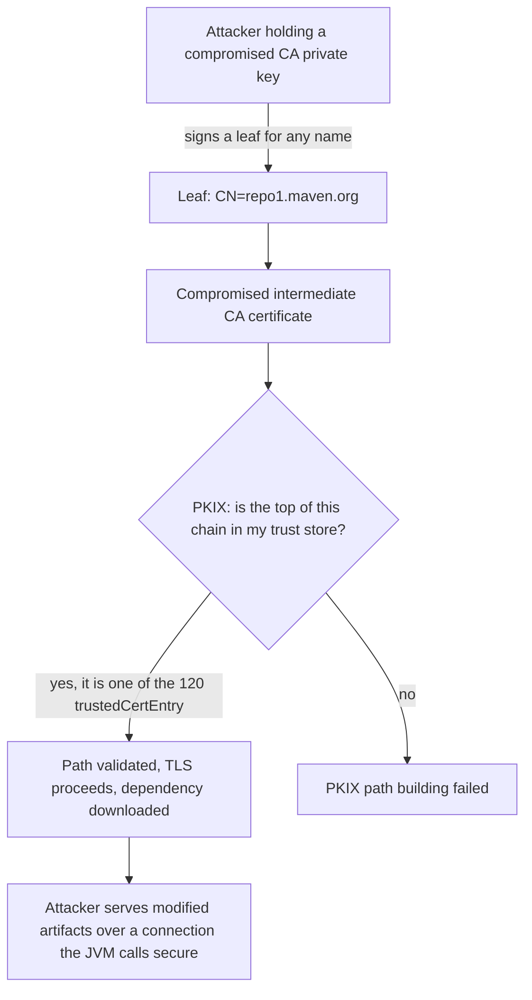
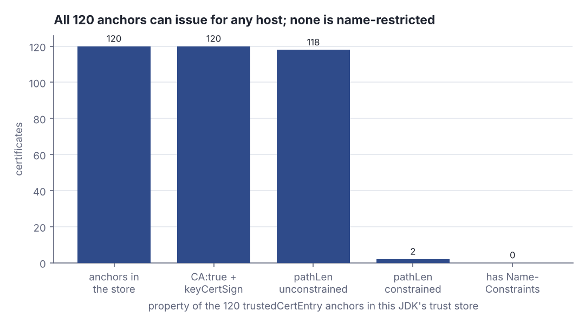
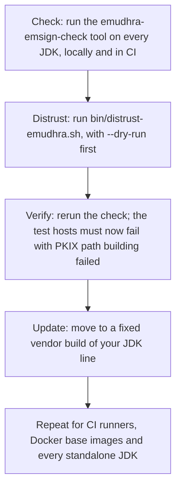

# A compromised CA in your JDK trust store (CVE-2026-91403)

> Fresh · Functional Programming in Scala (red book) · Intermediate · ~25 min · from today's feeds

## Why this matters
Today's item is "Security advisory: update your JDK (CVE-2026-91403)", posted on the Scala blog on 2026-10-22 by Piotr Chabelski (VirtusLab) and Eugene Yokota: OpenJDK shipped eight compromised intermediate CA certificates inside the JDK's own trust store, and the fix is an update to every JVM you run, not a change to any Scala code.
The part worth your twenty-five minutes is not the CVE number but the shape of the failure. A trust store is a flat list of unconditional signing authorities, so one bad entry in a list of 120 makes every TLS connection that JVM opens — to your artifact repository, your database, your identity provider — forgeable by whoever holds that key.
It sits one rung above your current Scala-ecosystem level because the mechanism is X.509 path validation and PKIX; the Primer fills those in, and the lab then opens this container's own trust store and measures the single point of failure.

## Primer
**A certificate is a signed claim.** An X.509 certificate says "this public key belongs to this subject name" and carries a signature made with the private key of its *issuer* (RFC 5280 §3.2). On its own it proves nothing; it is worth exactly as much as your willingness to believe the issuer.

**A chain, not a certificate.** A TLS server does not send one certificate, it sends a chain: its own *leaf*, then the *intermediate* CA certificate that signed the leaf, and often further intermediates. Each link is checked by verifying the child's signature with the public key in the parent (RFC 5280 §6.1).

**A trust anchor is where the chain stops.** Verification cannot recurse forever, so it ends at a certificate your side already holds and accepts without proof — a *trust anchor* (RFC 5280 §6.1.1). The JDK keeps its anchors in a keystore file, `$JAVA_HOME/lib/security/cacerts` by default, overridable with `-Djavax.net.ssl.trustStore`. Each entry is a `trustedCertEntry`: an alias and a certificate, no private key.

**PKIX is the algorithm that joins the two.** RFC 5280 §6 ("Certification Path Validation") is implemented in the JDK as `CertPathBuilder` and `CertPathValidator` with the `PKIX` algorithm. Path *building* searches for a chain from the leaf up to some anchor you hold; path *validation* then checks signatures, validity dates, basic constraints and key usage along that chain. When building cannot reach any anchor, you get the message every JVM engineer has seen: `PKIX path building failed`.

**The hostname check is separate.** Path validation only establishes "someone I trust vouched for this key". Whether the name in the leaf matches the host you dialled is a second, independent check. Nothing in path validation restricts a CA to particular names unless that CA's own certificate carries a `NameConstraints` extension (RFC 5280 §4.2.1.10) — and almost none do.

## The idea
The advisory is a supply-chain event in the trust layer rather than in any library. The Scala post reports that on 2026-10-21 OpenJDK published an advisory for CVE-2026-91403, rated CVSS 9.1, which "concerns eight compromised intermediate CA certificates shipped with the JDK", affecting the 8, 11, 17, 21, 25 and 27 lines (Chabelski and Yokota, scala-lang.org, 2026-10-22). The first thing the post does is take the blame off the language:

> "This is not a Scala issue, but it affects every application running on the JVM, including Scala ones, as well as Scala build tools that use the JDK’s certificates to download dependencies."
>
> — Piotr Chabelski and Eugene Yokota, *Security advisory: update your JDK (CVE-2026-91403)*, 2026-10-22, https://www.scala-lang.org/blog/jdk-certificate-vulnerability.html

### Why one compromised CA is total, not partial
Hold the private key of a certificate that is a trust anchor, or that chains to one, and you can mint a leaf certificate for *any* subject name: `repo1.maven.org`, your internal Nexus, your Postgres host, your OIDC issuer. Path building does not care who you *are*; it asks only whether the top of the chain you present is in its anchor list, and nothing scopes a CA to a set of domains unless its own certificate says so.



*Figure 1: why a compromised CA is a single point of total failure — path building asks only whether the chain ends at an anchor you hold, never which names it may vouch for. Source: RFC 5280 §6.1, applied to the advisory in Chabelski and Yokota, scala-lang.org, 2026-10-22, https://www.scala-lang.org/blog/jdk-certificate-vulnerability.html*

Open the list the JVM is actually using and the scale of "any one of these" becomes concrete:

```scala
val p = sys.props("javax.net.ssl.trustStore")
val ks = KeyStore.getInstance("JKS")
ks.load(java.io.FileInputStream(p), "changeit".toCharArray)
val aliases = ks.aliases.asScala.toVector
println(s"store=$p")
println(s"trust anchors=${aliases.size}, e.g. ${aliases(1)}")
```

```text
store=/etc/ssl/certs/java/cacerts
trust anchors=120, e.g. debian:accvraiz1.pem
```

One hundred and twenty organisations are currently entitled to speak for every host this JVM will ever dial, and `accvraiz1` — a Spanish regional authority — has exactly as much authority over `repo1.maven.org` as anyone else on the list.

### Every anchor is equally powerful, and nothing narrows it
Three X.509 extensions could in principle limit an anchor: `basicConstraints` (is it a CA at all, and how many intermediates may sit below it — RFC 5280 §4.2.1.9), `keyUsage` with the `keyCertSign` bit (may it sign certificates — §4.2.1.3), and `NameConstraints` (which names may appear below it — §4.2.1.10). Count them:

```scala
val certs = aliases.map(a => ks.getCertificate(a).asInstanceOf[X509Certificate])
val canIssue = certs.count(c => c.getBasicConstraints >= 0)
val nameLimited = certs.count(c => c.getExtensionValue("2.5.29.30") != null)
println(s"anchors=${certs.size} can-issue=$canIssue name-limited=$nameLimited")
```

```text
anchors=120 can-issue=120 name-limited=0
```

Every anchor may issue, and not one of them is restricted to a namespace. That is the real design: the web PKI trades containment for convenience, and the JDK inherits the trade wholesale.



*Figure 2: the authority audit of this container's trust store — 120 anchors, all able to issue, 118 with no limit on chain depth, none name-restricted. Generated from the lab output of Step 2 (`python3 dojo/engine/run_lab.py 2026-11-12-2`).*

### Why distrusting beats blocklisting
The obvious interim fix is to stop trusting the eight certificates without waiting for a new JDK, and the JDK has a mechanism for that: `$JAVA_HOME/lib/security/blocked.certs`, a file of SHA-256 fingerprints the TLS stack refuses. The advisory points out that the mechanism is weaker than it looks:

> "Sonatype Research Team has blogged that such blocking can be bypassed by reencoding with a variation of the key."
>
> — Piotr Chabelski and Eugene Yokota, *Security advisory: update your JDK (CVE-2026-91403)*, 2026-10-22, https://www.scala-lang.org/blog/jdk-certificate-vulnerability.html

The reason is structural. A fingerprint identifies one *encoding* of one certificate, but what the attacker holds is a *private key*, and the same key can be re-wrapped in a differently encoded certificate whose fingerprint is new while its signing power is unchanged. Removing the anchor from the store attacks the capability; blocklisting a fingerprint attacks one representation of it. That is why the post's remediation script distrusts the certificates in the store, and why updating the JDK — which ships a corrected `cacerts` — is the real fix.

### What the post tells you to do
The procedure in the post has four moves, in this order (its sections "Am I affected?", "Distrust the compromised certificates manually" and "Updating to the fixed JDKs"):



*Figure 3: the remediation sequence. Adapted from Chabelski and Yokota, "Security advisory: update your JDK (CVE-2026-91403)", https://www.scala-lang.org/blog/jdk-certificate-vulnerability.html*

The fixed builds the post lists, per JDK line (Chabelski and Yokota, scala-lang.org, 2026-10-22, section "Updating to the fixed JDKs"):

| JDK line | Oracle | Temurin | Zulu |
| --- | --- | --- | --- |
| 8 | 8u511 | n/a | 8u512-b08 |
| 11 | 11.0.33.0.2 | n/a | 11.0.33+9 |
| 17 | 17.0.21.0.2 | 17.0.21+9 | 17.0.21+9 |
| 21 | 21.0.13.0.2 | 21.0.13+9 | 21.0.13+9 |
| 25 | 25.0.5.0.2 | 25.0.5+8 | 25.0.5+8 |

Read that table together with the post's "Am I affected?" section and you hit a genuine ambiguity: that section names 27.0.1, 25.0.5, 21.0.13, 17.0.21, 11.0.33 and 8u512 "or earlier" as affected, while the same base numbers appear in the fixed column with vendor suffixes (`21.0.13.0.2`, `21.0.13+9`). The base version therefore does not settle it — the vendor build number does, and the check tool settles it for certain. Note also that JDK 27 is listed among the affected lines but has no row in the fixed table, so do not assume a 27 build is clean because it is newer.

Two operational details are easy to miss. First, the blast radius is every JVM on the machine, not the one you develop against:

> "Remember to update every JDK you have installed, including the ones used in CI and in Docker images."
>
> — Piotr Chabelski and Eugene Yokota, *Security advisory: update your JDK (CVE-2026-91403)*, 2026-10-22, https://www.scala-lang.org/blog/jdk-certificate-vulnerability.html

Standalone JDKs installed by Coursier, SDKMAN! or Homebrew are updated by you, not by your distribution's package manager; the post notes that Linux distribution JDKs generally only need the system CA certificates refreshed. Second, if your pipelines pin a JDK distribution, the choice is not free:

> "As of 2026-10-24, on GitHub Actions setup-java, the only distribution with the fixed JDK with the full JDK 8, 11, 17, 25 availability is `zulu`, or Azul Zulu."
>
> — Piotr Chabelski and Eugene Yokota, *Security advisory: update your JDK (CVE-2026-91403)*, 2026-10-22, https://www.scala-lang.org/blog/jdk-certificate-vulnerability.html

So a `setup-java` step pinned to `temurin` may still be building your artifacts on a vulnerable JVM, and the honest status of a service is not "we patched" but "every JDK that touches this artifact, including the one in the builder image, is on a fixed vendor build".

## Lab
**The question:** is the JDK in this container affected, and how much authority does a single entry in its trust store actually hold?

Everything below is `java.security` and `java.security.cert` from the standard library, so it runs with `scala Lab.scala` on any JDK 21. Save it and run `python3 dojo/engine/run_lab.py 2026-11-12-2`, or `scala Lab.scala` directly.

### Step 1 — find the store the JVM is really using
Not `$JAVA_HOME/lib/security/cacerts` if `-Djavax.net.ssl.trustStore` is set, which it is in many container images. Then compare the running version against the fixed 21 line from the post's table.

### Step 2 — audit every anchor's authority
For each `trustedCertEntry`: is it self-signed, may it sign certificates, how deep may chains below it go, and is it restricted to a namespace.

### Step 3 — look at one named family
The Comodo/AAA family appears in the advisory's examples; print issuer, subject, key algorithm and expiry for the two Comodo anchors in this store.

### Step 4 — make PKIX succeed and fail on purpose
Ask `CertPathBuilder` to build a path to the COMODO RSA certificate against four different anchor sets: the full store, the store with that one anchor removed, that one anchor alone, and nothing.

```scala
// file: Lab.scala
import java.security.KeyStore
import java.security.cert.*
import scala.jdk.CollectionConverters.*

def storePath: String =
  sys.props.getOrElse("javax.net.ssl.trustStore",
    sys.props("java.home") + "/lib/security/cacerts")

def anchors(): Vector[(String, X509Certificate)] =
  val ks = KeyStore.getInstance(sys.props.getOrElse("javax.net.ssl.trustStoreType", "JKS"))
  ks.load(java.io.FileInputStream(storePath), "changeit".toCharArray)
  ks.aliases.asScala.toVector.flatMap: a =>
    Option(ks.getCertificate(a)).collect { case c: X509Certificate => a -> c }

def canIssue(c: X509Certificate): Boolean =
  c.getBasicConstraints >= 0 && Option(c.getKeyUsage).forall(k => k(5))

def nameLimited(c: X509Certificate): Boolean =
  c.getExtensionValue("2.5.29.30") != null

def cn(p: javax.security.auth.x500.X500Principal): String = p.getName.split(",").head

@main def lab(): Unit =
  println("--- Step 1: which store does this JVM actually trust? ---")
  val fixed21 = Runtime.Version.parse("21.0.13")
  println(s"runtime version   = ${Runtime.version()}")
  println(s"trustStore        = $storePath")
  println(s"trustStoreType    = ${sys.props.getOrElse("javax.net.ssl.trustStoreType", "JKS")}")
  val as = anchors()
  println(s"trustedCertEntry  = ${as.size}")
  println(s"below 21.0.13     = ${Runtime.version().compareTo(fixed21) < 0}")

  println("\n--- Step 2: what is every anchor allowed to do? ---")
  val selfSigned  = as.count((_, c) => c.getSubjectX500Principal == c.getIssuerX500Principal)
  val issuers     = as.count((_, c) => canIssue(c))
  val unlimited   = as.count((_, c) => c.getBasicConstraints == Int.MaxValue)
  val limited     = as.filter((_, c) => c.getBasicConstraints >= 0 && c.getBasicConstraints != Int.MaxValue)
  val constrained = as.count((_, c) => nameLimited(c))
  println(f"self-signed roots        ${selfSigned}%4d / ${as.size}")
  println(f"CA:true and keyCertSign  ${issuers}%4d / ${as.size}")
  println(f"pathLen unconstrained    ${unlimited}%4d / ${as.size}")
  println(f"pathLen constrained      ${limited.size}%4d / ${as.size}")
  println(f"has NameConstraints      ${constrained}%4d / ${as.size}")
  limited.foreach((_, c) => println(s"  pathLen=${c.getBasicConstraints}  ${cn(c.getSubjectX500Principal)}"))

  println("\n--- Step 3: the Comodo pair, one family named in the advisory ---")
  as.filter((a, _) => a.toLowerCase.contains("comodo")).foreach: (a, c) =>
    println(s"alias      $a")
    println(s"  subject  ${cn(c.getSubjectX500Principal)}")
    println(s"  issuer   ${cn(c.getIssuerX500Principal)}")
    println(s"  key      ${c.getPublicKey.getAlgorithm}, notAfter ${c.getNotAfter}")
    println(s"  canIssue ${canIssue(c)}, nameLimited ${nameLimited(c)}")

  println("\n--- Step 4: PKIX path building against four anchor sets ---")
  val certs  = as.map(_._2)
  val target = certs.find(c => cn(c.getSubjectX500Principal).contains("COMODO RSA")).get
  val pool   = CertStore.getInstance("Collection", CollectionCertStoreParameters(certs.asJavaCollection))
  def attempt(label: String, set: Set[X509Certificate]): Unit =
    val sel = X509CertSelector()
    sel.setCertificate(target)
    try
      val p = PKIXBuilderParameters(set.map(c => TrustAnchor(c, null)).asJava, sel)
      p.setRevocationEnabled(false)
      p.addCertStore(pool)
      val r = CertPathBuilder.getInstance("PKIX").build(p).asInstanceOf[PKIXCertPathBuilderResult]
      println(f"$label%-24s anchors=${set.size}%3d  OK, anchor=${cn(r.getTrustAnchor.getTrustedCert.getSubjectX500Principal)}")
    catch
      case e: Throwable =>
        println(f"$label%-24s anchors=${set.size}%3d  ${e.getClass.getSimpleName}: ${e.getMessage}")
  attempt("full store", certs.toSet)
  attempt("minus COMODO RSA", certs.toSet - target)
  attempt("only COMODO RSA", Set(target))
  attempt("empty store", Set.empty)
```

Real output from this container:

```text
--- Step 1: which store does this JVM actually trust? ---
runtime version   = 21.0.12.1+1-1-24.04.4-Ubuntu
trustStore        = /etc/ssl/certs/java/cacerts
trustStoreType    = JKS
trustedCertEntry  = 120
below 21.0.13     = true

--- Step 2: what is every anchor allowed to do? ---
self-signed roots         120 / 120
CA:true and keyCertSign   120 / 120
pathLen unconstrained     118 / 120
pathLen constrained         2 / 120
has NameConstraints         0 / 120
  pathLen=4  CN=NetLock Arany (Class Gold) Főtanúsítvány
  pathLen=1  CN=Autoridad de Certificacion Firmaprofesional CIF A62634068

--- Step 3: the Comodo pair, one family named in the advisory ---
alias      debian:comodo_rsa_certification_authority.pem
  subject  CN=COMODO RSA Certification Authority
  issuer   CN=COMODO RSA Certification Authority
  key      RSA, notAfter Mon Jan 18 23:59:59 UTC 2038
  canIssue true, nameLimited false
alias      debian:comodo_ecc_certification_authority.pem
  subject  CN=COMODO ECC Certification Authority
  issuer   CN=COMODO ECC Certification Authority
  key      EC, notAfter Mon Jan 18 23:59:59 UTC 2038
  canIssue true, nameLimited false

--- Step 4: PKIX path building against four anchor sets ---
full store               anchors=120  OK, anchor=CN=COMODO RSA Certification Authority
minus COMODO RSA         anchors=119  SunCertPathBuilderException: unable to find valid certification path to requested target
only COMODO RSA          anchors=  1  OK, anchor=CN=COMODO RSA Certification Authority
empty store              anchors=  0  InvalidAlgorithmParameterException: the trustAnchors parameter must be non-empty
```

### Reading the output

**Step 1.** `runtime version` is what `Runtime.version()` reports: `21.0.12.1+1-1-24.04.4-Ubuntu`, i.e. feature 21, interim 0, update 12, patch 1, build `+1-1-24.04.4-Ubuntu`. `trustStore` is the file the JVM will consult — here *not* the JDK's own `cacerts` but Debian's shared store, because `-Djavax.net.ssl.trustStore` is set in the environment. `trustedCertEntry` is the number of anchors in it. `below 21.0.13` is `Runtime.version().compareTo(Runtime.Version.parse("21.0.13")) < 0`: comparison runs field by field, `21 = 21`, `0 = 0`, then `12 < 13`, so the result is `true` before the patch field is even reached. Lower is worse here: the post's fixed 21 builds are `21.0.13.0.2` (Oracle) and `21.0.13+9` (Zulu), and 21.0.12.1 is below the 21.0.13 base of both.

| field | value | meaning |
| --- | --- | --- |
| runtime version | 21.0.12.1+1-1-24.04.4-Ubuntu | the JVM running the lab |
| trustStore | /etc/ssl/certs/java/cacerts | overridden away from `$JAVA_HOME` |
| trustedCertEntry | 120 | anchors trusted unconditionally |
| below 21.0.13 | true | older than the fixed 21 line |

**Verdict: this container's JDK is on an affected 21 build.** It is also a worked example of the post's warning about images: nobody chose this JDK, it came with the base image.

**Step 2.** Each row is a count out of 120; for the first three, *higher means more unchecked authority*, for the last two *higher means more containment*. All 120 are self-signed, so the whole store is roots, each one its own issuer. All 120 have `basicConstraints` CA:true and the `keyCertSign` bit (bit 5 of the `keyUsage` bit string), so all 120 may sign further certificates. 118 carry no `pathLenConstraint`, meaning an unlimited number of intermediates may sit beneath them; the arithmetic is 120 − 2 = 118, the two exceptions being NetLock Arany at pathLen 4 and Firmaprofesional at pathLen 1. The last row is the important one: 0 of 120 carry a `NameConstraints` extension (OID 2.5.29.30).

| property | count | what it would take to be safe |
| --- | --- | --- |
| self-signed roots | 120 / 120 | — |
| CA:true + keyCertSign | 120 / 120 | fewer anchors able to issue |
| pathLen unconstrained | 118 / 120 | shallow limits on delegation |
| pathLen constrained | 2 / 120 | more of these |
| has NameConstraints | 0 / 120 | anchors scoped to namespaces |

**Verdict: the store grants 120 unscoped, unlimited signing authorities, so compromising any one of them is equivalent to compromising all of them for the purposes of a single connection.**

**Step 3.** `subject` equals `issuer` for both Comodo entries, confirming they are self-signed roots rather than intermediates; `notAfter Mon Jan 18 23:59:59 UTC 2038` is when they stop being accepted on date grounds alone — eleven years of standing authority. `canIssue true` means CA:true and `keyCertSign` are both set; `nameLimited false` means neither is restricted to any namespace. **Verdict: an attacker in possession of either private key could mint a leaf for any host and this JVM would build a valid path to it, with no name check standing in the way.**

**Step 4.** Four runs of `CertPathBuilder`, same target certificate, different anchor sets. `anchors=120` succeeds and reports which anchor terminated the path. Removing that one certificate and leaving the other 119 in place fails with `SunCertPathBuilderException: unable to find valid certification path to requested target` — the exception behind the `PKIX path building failed` message, and the same failure the advisory's verification step expects after you distrust the compromised certificates. `anchors=1` succeeds: the single COMODO RSA anchor is sufficient on its own. `anchors=0` does not even run the algorithm; `PKIXBuilderParameters` rejects an empty anchor set up front.

| anchor set | size | result |
| --- | --- | --- |
| full store | 120 | OK, anchor = COMODO RSA |
| minus COMODO RSA | 119 | `SunCertPathBuilderException` |
| only COMODO RSA | 1 | OK, anchor = COMODO RSA |
| empty store | 0 | `InvalidAlgorithmParameterException` |

**Verdict: anchors neither cooperate nor compensate — one is sufficient (row 3) and 119 others cannot substitute for a missing one (row 2). Trust is a disjunction over the store, which is exactly why a single compromised entry is fatal and why removal, not blocklisting, is the control that works.**

### Cause → consequence
1. **Cause:** the JDK ships a trust store of anchors — 120 in this container — and eight of the certificates shipped in the JDK's store are compromised per the advisory of 2026-10-21 (Chabelski and Yokota, scala-lang.org, 2026-10-22).
2. **Mechanism:** PKIX accepts a chain if it terminates at *any* anchor, and none of these anchors carries a `NameConstraints` extension (0 of 120 in Step 2), so holding one CA key lets you issue a valid certificate for any hostname.
3. **Consequence:** every TLS connection made by an affected JVM — including the dependency downloads sbt and Coursier perform during a build — can be intercepted and served forged content by whoever holds one of those keys, with no error on the client.
4. **In practice:** the unit of remediation is the JDK installation, not the service. Inventory every JVM that touches your artifacts — developer machines, CI runners, the `setup-java` distribution your workflows pin, every Docker base image, every Coursier- or SDKMAN!-managed JDK — run the advisory's check against each, distrust the certificates as an interim measure, and treat "patched" as true only once each one reports a fixed vendor build.

## Self-check
1. Your service's JDK trust store has 120 anchors and one of them is compromised. Why does the presence of 119 honest anchors provide no protection at all? <details><summary>Answer</summary>Because PKIX path validation is a disjunction, not a consensus: a chain is accepted if it terminates at *any* one anchor in the store. Step 4 shows both halves of this — a single COMODO RSA anchor is enough to validate a path (`anchors=1 OK`), and the other 119 cannot substitute when it is missing (`anchors=119 SunCertPathBuilderException`). The honest anchors are never consulted about a chain that already terminates successfully elsewhere.</details>
2. The advisory says the `blocked.certs` fingerprint mechanism can be bypassed. What is the structural reason, and what control does work? <details><summary>Answer</summary>A fingerprint is the SHA-256 of one DER encoding of one certificate, but the attacker's capability lives in the private key, not in that encoding. The same key can be placed in a re-encoded certificate with a different fingerprint and unchanged signing power — the post reports, citing the Sonatype Research Team, that "such blocking can be bypassed by reencoding with a variation of the key" (scala-lang.org, 2026-10-22). Removing the certificate from the trust store removes its status as an anchor, which is a property of the key's position in the store rather than of one encoding; updating to a fixed JDK, which ships a corrected `cacerts`, is the durable fix.</details>
3. Your CI workflow uses `actions/setup-java` with `distribution: temurin` and `java-version: 17`, and your developers install JDKs through Coursier. Having read the post, what is still unresolved after you update your own laptop? <details><summary>Answer</summary>Everything except the laptop. The post says to update every JDK installed, "including the ones used in CI and in Docker images", and notes that as of 2026-10-24 on GitHub Actions `setup-java`, `zulu` was the only distribution with full fixed availability across 8, 11, 17 and 25, with Temurin only partial (scala-lang.org, 2026-10-22). So the CI runner may still build on a vulnerable JVM; each Coursier-managed JDK on each developer machine is updated by the developer, not by a package manager; and any Docker base image pinned to an older JDK tag carries its own affected `cacerts` into every build.</details>

## Sources
- [Security advisory: update your JDK (CVE-2026-91403)](https://www.scala-lang.org/blog/jdk-certificate-vulnerability.html) — Piotr Chabelski (VirtusLab) and Eugene Yokota, Scala blog, 2026-10-22 (page updated 2026-10-24) — the primary source for this lesson: the CVE identifier and CVSS 9.1 rating, the eight compromised intermediate CA certificates, the affected and fixed JDK builds per vendor, the check-and-distrust procedure, and the GitHub Actions note; all four quoted passages come from it (accessed 2026-11-12).
- [OpenJDK vulnerability advisory, 2026-10-21](https://openjdk.org/groups/vulnerability/advisories/2026-10-21) — OpenJDK Vulnerability Group — the upstream advisory the Scala post reports on, and the origin of the CVE and its 2026-10-21 date. Every statement this lesson makes about it is taken from the Scala post's description, not from the advisory text itself, which was not opened for this lesson.
- [emudhra-emsign-check](https://github.com/eed3si9n/emudhra-emsign-check) — Eugene Yokota — the check tool and the `bin/distrust-emudhra.sh` remediation script the post tells readers to run; described here from the post's instructions, not from the repository, which was not opened for this lesson.
- [The limits of fingerprint blocklists: a reproducible Java certificate bypass](https://www.sonatype.com/blog/the-limits-of-fingerprint-blocklists-a-reproducible-java-certificate-bypass) — Sonatype Research Team — the source the advisory names for the `blocked.certs` bypass. The claim in this lesson is quoted from the Scala post's report of it; this page was not opened for the lesson, so read it directly before relying on the detail of the bypass.
- [Azul Zulu October 2026 respin release notes](https://docs.azul.com/core/release/october-2026-respin/release-notes.html) — Azul — the vendor release notes the post links for the fixed Zulu builds; listed as the post links it, not opened for this lesson.
- [adoptium/temurin issue 317](https://github.com/adoptium/temurin/issues/317) — Adoptium — the tracking issue the post links for partial Temurin availability of the fixed builds; listed as the post links it, not opened for this lesson.
- RFC 5280, *Internet X.509 Public Key Infrastructure Certificate and CRL Profile* — §3.2 (certification paths and trust), §4.2.1.3 (key usage), §4.2.1.9 (basic constraints), §4.2.1.10 (name constraints), §6.1 (path validation) — the definitions of trust anchor, path validation and the three extensions the lab counts.

## Next on this track
Fresh lessons sit outside the ladder; next on Functional Programming in Scala (red book): **Strictness and laziness: non-strict functions and LazyList** (rung 6 of 26, Beginner).
