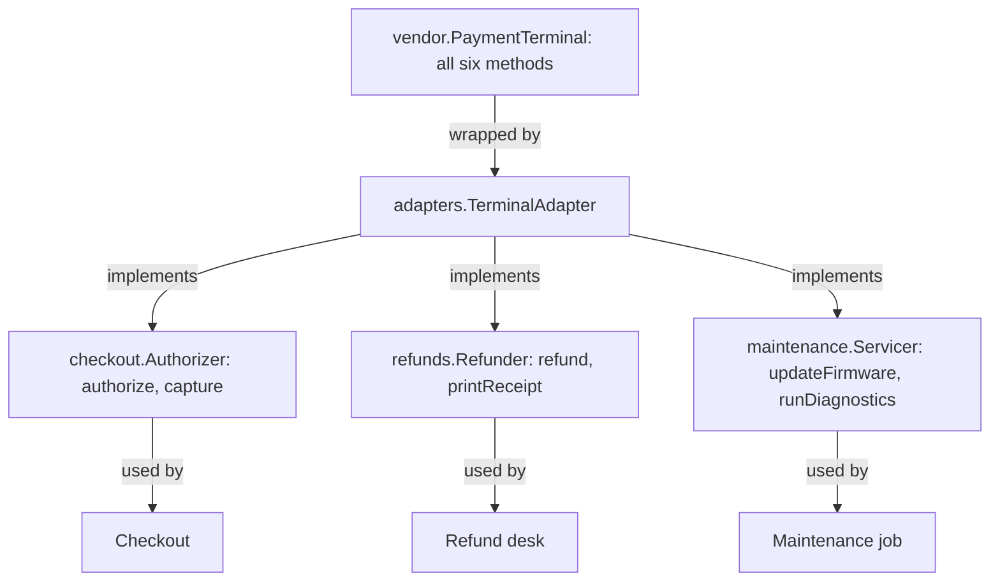
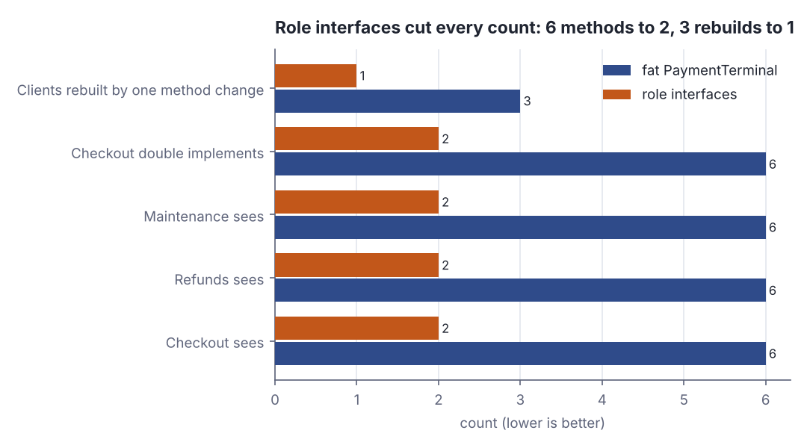
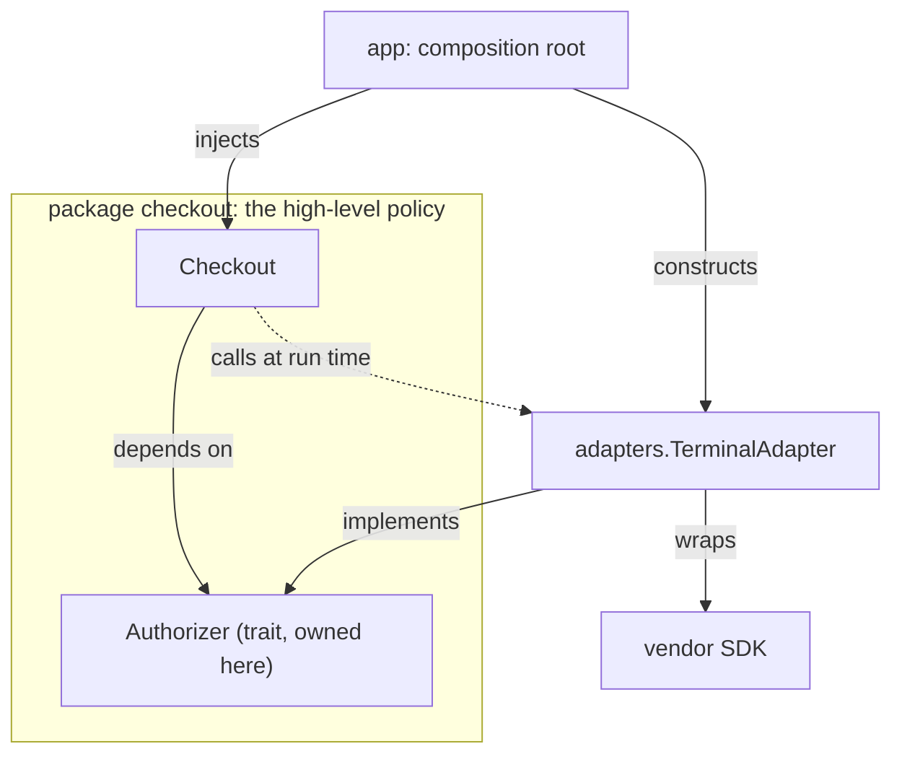

# SOLID in practice II — ISP and DIP

> Software architecture & design · Beginner · ~20 min · rung 4 of 20 · needs: SOLID in practice I — SRP, OCP, LSP (architecture-03)

## Why this matters
Every Scala service you have shipped has at least one trait that grew to twenty methods because it mirrors a vendor SDK, and every test for it carries a doubled class full of `???` for methods the test never calls.
ISP and DIP are the two SOLID letters that turn that pain into a rule you can apply mechanically: shape the interface around the caller, and let the caller own it.
They sit here because they are the mechanics underneath ports and adapters — the next rungs assume you can already invert one arrow on demand.

## The idea

### ISP — the interface belongs to the client, not the supplier

The interface segregation principle says a client should not be forced to depend on methods it does not use. The practical form is Fowler's distinction between a *header interface*, which mirrors a class's whole public surface, and a *role interface*, which is carved out of one interaction:

> "A role interface is defined by looking at a specific interaction between suppliers and consumers."
>
> — Martin Fowler, *RoleInterface*, 2006-01-11, https://martinfowler.com/bliki/RoleInterface.html

The header style is the one you reach for by reflex, and Fowler is blunt about why:

> "With a header interface all you have to do is duplicate the public methods, no thought needed."
>
> — Martin Fowler, *RoleInterface*, 2006-01-11, https://martinfowler.com/bliki/RoleInterface.html

One supplier can wear many such interfaces at once — "A supplier component will usually implement several role interfaces, one for each of these patterns of interaction." (Fowler, *RoleInterface*, 2006-01-11) — which is exactly how a single vendor terminal can serve three unrelated callers without any of them seeing the other two's methods.

Take a card terminal SDK with six methods: `authorize`, `capture`, `refund`, `printReceipt`, `updateFirmware`, `runDiagnostics`. Three parts of the system use it, and no two of them overlap.


*Figure 1: the fat header interface split into three role interfaces, one per interaction, all implemented by one adapter over the vendor SDK. Source: the lab in this lesson.*

The cost of skipping the split shows up first in tests. If `Checkout` takes the six-method trait, its test double must define six methods, and four of them are fiction:

```scala
final class FatFakeTerminal extends vendor.PaymentTerminal:
  def authorize(cents: Long, pan: String): String = s"FAKE-$cents"
  def capture(authId: String): Boolean = true
  def refund(authId: String, cents: Long): Boolean = sys.error("not used by Checkout")
  def printReceipt(text: String): Unit = sys.error("not used by Checkout")
  def updateFirmware(version: String): Unit = sys.error("not used by Checkout")
  def runDiagnostics(): Map[String, String] = sys.error("not used by Checkout")
```

```text
  Checkout only ever calls authorize and capture, but the double must define all 6:
    fatFake.authorize(1990, '4111111111111234') = FAKE-1990
    fatFake.capture('FAKE-1990')               = true
    fatFake.runDiagnostics()                   = throws: not used by Checkout
```

Two of the six methods carry the test; the other four exist only to satisfy the compiler, and `runDiagnostics` throws because nobody ever meant it to be callable. That is the ISP smell in its purest form: the number of methods you are forced to write is set by the supplier, not by what you are testing.



*Figure 2: every count the lab measures, fat interface versus role interfaces. Generated from the lab's Part D output with `python3 dojo/engine/chart.py dojo/lessons/assets/2026-11-13-1-chart-1.json`.*

### DIP — the abstraction belongs to the high-level side

Dependency inversion says both high-level and low-level modules depend on abstractions, and — the half people drop — the abstraction is owned by the high-level module. `Authorizer` is not a tidier name for the SDK; it is checkout's own vocabulary, declared in checkout's package, and the vendor adapter is what has to conform.


*Figure 3: the inverted arrangement — the policy owns the trait, the detail implements it, and one root wires them. Adapted from Martin Fowler, "Inversion of Control Containers and the Dependency Injection pattern", https://martinfowler.com/articles/injection.html*

In code the inversion is three lines at the composition root, and nothing else in `checkout` ever learns the vendor's name:

```scala
val sdk = vendor.VendorSdkTerminal()
val terminal = adapters.TerminalAdapter(sdk)      // one detail, three role traits
val co = checkout.Checkout(terminal)              // sees Authorizer (2 methods)
val paid = co.pay(1990, "4111111111111234")
println(s"    checkout result = $paid")
```

```text
    [checkout] pay(cents=1990) -> Authorizer.authorize
      [sdk] POST /authorize cents=1990 pan=****1234 -> AUTH-1234-1990
      [sdk] POST /capture AUTH-1234-1990
    checkout result = Right(AUTH-1234-1990)
```

Control flows outward from `checkout` into the SDK on lines 2 and 3 of that trace, but the compile-time arrow runs the other way: `adapters` imports `checkout.Authorizer`, and `checkout` imports nothing from `adapters` or `vendor`.

### Principle, technique, tool

Three things get called "DI" and they are not the same thing. **DIP** is the design principle above — who owns the abstraction. **Dependency injection** is one technique for satisfying it: hand the dependency in from outside rather than letting the object fetch it. Fowler coined that narrower name precisely because the older one said nothing:

> "Inversion of Control is too generic a term, and thus people find it confusing. As a result with a lot of discussion with various IoC advocates we settled on the name Dependency Injection."
>
> — Martin Fowler, *Inversion of Control Containers and the Dependency Injection pattern*, 2004-01-23, https://martinfowler.com/articles/injection.html

**An IoC container** (Spring, Guice, PicoContainer, Macwire) is merely a tool that automates the wiring — "PicoContainer uses a constructor to decide how to inject a finder implementation into the lister class." (Fowler, *Inversion of Control Containers and the Dependency Injection pattern*, 2004-01-23, §"Using a Service Locator"). You can satisfy DIP with no container at all, and you can use a container while violating DIP, by letting it inject vendor classes straight into your policy. The alternative technique is a service locator, where the class asks a registry for its collaborator; Fowler reduces the choice to one sentence:

> "The important difference between the two patterns is about how that implementation is provided to the application class."
>
> — Martin Fowler, *Inversion of Control Containers and the Dependency Injection pattern*, 2004-01-23, https://martinfowler.com/articles/injection.html

### Scala idioms

Scala 3 needs none of that machinery. A role interface is a trait with two methods; injection is a constructor parameter (`class Checkout(terminal: Authorizer)`); the composition root is your `@main`, your Akka guardian behaviour, or a `ZLayer`/`Resource` assembly. When threading the same dependency through many call sites gets noisy, `given`/`using` does the wiring at the type level:

```scala
def payWith(cents: Long, pan: String)(using a: checkout.Authorizer) =
  checkout.Checkout(a).pay(cents, pan)

given checkout.Authorizer = fake
println(s"    given-wired      = ${payWith(3000, "4111111111110000")}")
```

```text
    [checkout] pay(cents=3000) -> Authorizer.authorize
    given-wired      = Right(FAKE-3000)
```

The `given` resolves to the two-method fake at compile time, so the same policy ran against a real terminal and a test double with no reflection, no container and no configuration file — just a trait the caller owns.

## Lab

**The question:** does splitting a six-method terminal interface into role interfaces change anything you can count, or is it only aesthetics?

About 8 minutes, Scala 3.3 and the standard library only.

### Step 1 — save the program

One file, six packages: `vendor` (the SDK's fat trait and the device), `checkout`, `refunds` and `maintenance` (the three clients, each owning its own role trait), `adapters` (one class implementing all three), and `app` (the composition root, the test doubles, and a small tool that counts dependencies). Save it as `Lab.scala`.

```scala
// file: Lab.scala

// ISP and DIP in practice (architecture-04).
// Scala 3.3, standard library only. One file, six packages:
//   vendor      = the SDK's fat header interface and the device behind it
//   checkout / refunds / maintenance = the three clients, each owning its own role trait
//   adapters    = one class that implements all three role traits over the vendor SDK
//   app         = composition root, the test doubles, and the tool that counts dependencies

package vendor:

  // A HEADER interface: one trait carrying every public method of the device.
  trait PaymentTerminal:
    def authorize(cents: Long, pan: String): String
    def capture(authId: String): Boolean
    def refund(authId: String, cents: Long): Boolean
    def printReceipt(text: String): Unit
    def updateFirmware(version: String): Unit
    def runDiagnostics(): Map[String, String]

  final class VendorSdkTerminal extends PaymentTerminal:
    private var auths = Map.empty[String, Long]
    def authorize(cents: Long, pan: String): String =
      val id = s"AUTH-${pan.takeRight(4)}-$cents"
      auths += (id -> cents)
      println(s"      [sdk] POST /authorize cents=$cents pan=****${pan.takeRight(4)} -> $id")
      id
    def capture(authId: String): Boolean =
      println(s"      [sdk] POST /capture $authId")
      auths.contains(authId)
    def refund(authId: String, cents: Long): Boolean =
      println(s"      [sdk] POST /refund $authId cents=$cents")
      auths.get(authId).exists(_ >= cents)
    def printReceipt(text: String): Unit =
      println(s"      [sdk] ESC/POS print: $text")
    def updateFirmware(version: String): Unit =
      println(s"      [sdk] flashing firmware $version")
    def runDiagnostics(): Map[String, String] =
      println("      [sdk] GET /diagnostics")
      Map("paper" -> "ok", "nfc" -> "ok")

package checkout:

  // DIP: the abstraction lives with the POLICY that needs it, named in the policy's words.
  trait Authorizer:
    def authorize(cents: Long, pan: String): String
    def capture(authId: String): Boolean

  final class Checkout(terminal: Authorizer):
    def pay(cents: Long, pan: String): Either[String, String] =
      println(s"    [checkout] pay(cents=$cents) -> Authorizer.authorize")
      val id = terminal.authorize(cents, pan)
      if terminal.capture(id) then Right(id) else Left(s"capture failed for $id")

package refunds:

  trait Refunder:
    def refund(authId: String, cents: Long): Boolean
    def printReceipt(text: String): Unit

  final class RefundDesk(terminal: Refunder):
    def giveBack(authId: String, cents: Long): Boolean =
      println(s"    [refunds] giveBack($authId, cents=$cents) -> Refunder.refund")
      val ok = terminal.refund(authId, cents)
      terminal.printReceipt(f"REFUND $authId ${cents / 100.0}%.2f EUR")
      ok

package maintenance:

  trait Servicer:
    def updateFirmware(version: String): Unit
    def runDiagnostics(): Map[String, String]

  final class Maintenance(terminal: Servicer):
    def nightly(version: String): Map[String, String] =
      println(s"    [maintenance] nightly($version) -> Servicer.updateFirmware")
      terminal.updateFirmware(version)
      terminal.runDiagnostics()

package adapters:

  // The detail implements the abstractions the clients own: three role traits, one SDK.
  final class TerminalAdapter(sdk: vendor.PaymentTerminal)
      extends checkout.Authorizer, refunds.Refunder, maintenance.Servicer:
    def authorize(cents: Long, pan: String): String = sdk.authorize(cents, pan)
    def capture(authId: String): Boolean = sdk.capture(authId)
    def refund(authId: String, cents: Long): Boolean = sdk.refund(authId, cents)
    def printReceipt(text: String): Unit = sdk.printReceipt(text)
    def updateFirmware(version: String): Unit = sdk.updateFirmware(version)
    def runDiagnostics(): Map[String, String] = sdk.runDiagnostics()

package app:

  // BEFORE segregation: Checkout took the fat trait, so its double needs all six methods
  // and four of them are lies that exist only to make the compiler stop complaining.
  final class FatFakeTerminal extends vendor.PaymentTerminal:
    def authorize(cents: Long, pan: String): String = s"FAKE-$cents"
    def capture(authId: String): Boolean = true
    def refund(authId: String, cents: Long): Boolean = sys.error("not used by Checkout")
    def printReceipt(text: String): Unit = sys.error("not used by Checkout")
    def updateFirmware(version: String): Unit = sys.error("not used by Checkout")
    def runDiagnostics(): Map[String, String] = sys.error("not used by Checkout")

  // AFTER segregation: two methods, no device, no lies.
  final class FakeAuthorizer extends checkout.Authorizer:
    var captured: List[String] = Nil
    def authorize(cents: Long, pan: String): String = s"FAKE-$cents"
    def capture(authId: String): Boolean =
      captured = authId :: captured
      true

  // ---- the interfaces and their clients, as data, so we can count ----

  val fat: List[String] =
    List("authorize", "capture", "refund", "printReceipt", "updateFirmware", "runDiagnostics")

  val clients: List[String] = List("Checkout", "Refunds", "Maintenance")

  val roleOf: Map[String, String] =
    Map("Checkout" -> "checkout.Authorizer", "Refunds" -> "refunds.Refunder",
        "Maintenance" -> "maintenance.Servicer")

  val uses: Map[String, Set[String]] = Map(
    "Checkout" -> Set("authorize", "capture"),
    "Refunds" -> Set("refund", "printReceipt"),
    "Maintenance" -> Set("updateFirmware", "runDiagnostics"))

  // Scala 3 wiring with no container at all: the role trait arrives as a given instance.
  def payWith(cents: Long, pan: String)(using a: checkout.Authorizer): Either[String, String] =
    checkout.Checkout(a).pay(cents, pan)

  def surfaceTable(): Unit =
    println(f"    ${"client"}%-12s ${"role interface"}%-22s ${"before"}%6s ${"after"}%5s ${"used"}%4s ${"unused"}%6s")
    for c <- clients do
      val used = uses(c).size
      println(f"    $c%-12s ${roleOf(c)}%-22s ${fat.size}%6d $used%5d $used%4d ${fat.size - used}%6d")

  def blastTable(): Unit =
    println(f"    ${"method changed"}%-16s ${"clients rebuilt before"}%22s ${"after"}%6s")
    for m <- fat do
      val after = clients.count(c => uses(c).contains(m))
      println(f"    $m%-16s ${clients.size}%22d $after%6d")

  @main def lab(): Unit =
    println("Part A - the fat interface: one test double, six methods, four of them lies")
    val fatFake = FatFakeTerminal()
    println(s"  Checkout only ever calls authorize and capture, but the double must define all ${fat.size}:")
    println(s"    fatFake.authorize(1990, '4111111111111234') = ${fatFake.authorize(1990, "4111111111111234")}")
    println(s"    fatFake.capture('FAKE-1990')               = ${fatFake.capture("FAKE-1990")}")
    val boom = scala.util.Try(fatFake.runDiagnostics()).failed.map(_.getMessage).getOrElse("no error")
    println(s"    fatFake.runDiagnostics()                   = throws: $boom")

    println()
    println("Part B - role interfaces: each client sees only what it calls")
    val sdk = vendor.VendorSdkTerminal()
    val terminal = adapters.TerminalAdapter(sdk)      // one detail, three role traits
    val co = checkout.Checkout(terminal)              // sees Authorizer (2 methods)
    val rd = refunds.RefundDesk(terminal)             // sees Refunder (2 methods)
    val mt = maintenance.Maintenance(terminal)        // sees Servicer (2 methods)
    val paid = co.pay(1990, "4111111111111234")
    println(s"    checkout result = $paid")
    paid.foreach(id => println(s"    refund ok = ${rd.giveBack(id, 500)}"))
    println(s"    diagnostics = ${mt.nightly("1.8.3")}")

    println()
    println("Part C - the same Checkout against a two-method double")
    val fake = FakeAuthorizer()
    val co2 = checkout.Checkout(fake)
    println(s"    checkout result = ${co2.pay(2500, "4111111111119999")}")
    println(s"    fake.captured   = ${fake.captured}")
    given checkout.Authorizer = fake
    println(s"    given-wired      = ${payWith(3000, "4111111111110000")}")

    println()
    println("Part D - count the dependency surface")
    surfaceTable()
    println()
    blastTable()
    println()
    val stubsBefore = fat.size
    val stubsAfter = uses("Checkout").size
    println(f"    Checkout test double: $stubsBefore%d methods before, $stubsAfter%d after " +
            f"(${100.0 * (stubsBefore - stubsAfter) / stubsBefore}%.0f%% fewer)")
```

### Step 2 — run it

```bash
scala Lab.scala
```

```text
Part A - the fat interface: one test double, six methods, four of them lies
  Checkout only ever calls authorize and capture, but the double must define all 6:
    fatFake.authorize(1990, '4111111111111234') = FAKE-1990
    fatFake.capture('FAKE-1990')               = true
    fatFake.runDiagnostics()                   = throws: not used by Checkout

Part B - role interfaces: each client sees only what it calls
    [checkout] pay(cents=1990) -> Authorizer.authorize
      [sdk] POST /authorize cents=1990 pan=****1234 -> AUTH-1234-1990
      [sdk] POST /capture AUTH-1234-1990
    checkout result = Right(AUTH-1234-1990)
    [refunds] giveBack(AUTH-1234-1990, cents=500) -> Refunder.refund
      [sdk] POST /refund AUTH-1234-1990 cents=500
      [sdk] ESC/POS print: REFUND AUTH-1234-1990 5.00 EUR
    refund ok = true
    [maintenance] nightly(1.8.3) -> Servicer.updateFirmware
      [sdk] flashing firmware 1.8.3
      [sdk] GET /diagnostics
    diagnostics = Map(paper -> ok, nfc -> ok)

Part C - the same Checkout against a two-method double
    [checkout] pay(cents=2500) -> Authorizer.authorize
    checkout result = Right(FAKE-2500)
    fake.captured   = List(FAKE-2500)
    [checkout] pay(cents=3000) -> Authorizer.authorize
    given-wired      = Right(FAKE-3000)

Part D - count the dependency surface
    client       role interface         before after used unused
    Checkout     checkout.Authorizer         6     2    2      4
    Refunds      refunds.Refunder            6     2    2      4
    Maintenance  maintenance.Servicer        6     2    2      4

    method changed   clients rebuilt before  after
    authorize                             3      1
    capture                               3      1
    refund                                3      1
    printReceipt                          3      1
    updateFirmware                        3      1
    runDiagnostics                        3      1

    Checkout test double: 6 methods before, 2 after (67% fewer)
```

### Reading the output

**Part B is the DIP check.** `[checkout]` always calls `Authorizer`, never `vendor.PaymentTerminal`; the `[sdk]` lines underneath show the call continuing outward into the device. Two different graphs: control flows `checkout → adapters → vendor`, while the compile-time import runs `adapters → checkout`. `checkout` compiles with the vendor SDK deleted from the build.

**Verdict:** the runtime call and the source dependency point in opposite directions, which is the whole point of the inversion.

**Part D columns.** `before` is how many methods the client was exposed to through the fat `vendor.PaymentTerminal`; `after` is how many its role interface declares; `used` is how many it actually calls; `unused` is `before − used`, the methods it was forced to depend on for nothing. Lower is better everywhere. The second table asks, for each method, how many clients a signature change forces a rebuild of.

| measure | fat PaymentTerminal | role interfaces |
|---|---|---|
| methods Checkout sees | 6 | **2** |
| methods Refunds sees | 6 | **2** |
| methods Maintenance sees | 6 | **2** |
| methods the Checkout double implements | 6 | **2** |
| clients rebuilt by one method change | 3 | **1** |
| Checkout's unused dependencies | 4 | **0** |

**The arithmetic, traced.** `Checkout` calls `authorize` and `capture`: `used = 2`. Through the fat trait, `before = 6`, so `unused = 6 − 2 = 4` — two thirds of its declared dependency is dead weight. The double shrinks the same way: `6 → 2` methods is `(6 − 2) / 6 = 4 / 6 = 0.666… = 67% fewer`, the figure the last line prints. Blast radius: a change to `updateFirmware` touched `3` clients before (everyone shared the one trait) and `1` after, because `updateFirmware` appears in `maintenance.Servicer` only — a 3× reduction in forced rebuilds and re-tests.

**Verdict:** not aesthetics. Four counts drop by a factor of three, one drops to zero, and the two-method double in Part C proves the shrunken interface still carries a complete test of the payment path (`fake.captured = List(FAKE-2500)` shows the capture really happened).

### Step 3 — run the same count on your own code

Pick the fattest trait you own — usually the one wrapping a vendor SDK or a database — and for each of its callers list the methods that caller actually invokes:

```bash
grep -rn "terminal\.\|client\.\|repo\." src/main/scala/com/yourorg/checkout | \
  sed -E 's/.*(terminal|client|repo)\.([a-zA-Z]+).*/\2/' | sort -u
```

If that list is shorter than the trait, you have found a role interface and its name is the interaction, not the device: `Authorizer`, `PriceLookup`, `EventPublisher`. Declare it in the caller's package, make the existing class `extends` it, and change one constructor parameter's type. Nothing else moves, and the test double for that caller collapses to the size of the list.

### Cause → consequence

1. **Cause.** An interface is created by copying a supplier's public methods (a header interface), so its shape is set by the device, not by any caller.
2. **Mechanism.** Every client now compiles against all six methods. The compiler ties them together: a signature change anywhere in the trait rebuilds and re-tests all three clients, and every test double must implement all six, four of them as stubs that lie.
3. **Consequence.** Measured in the lab: 4 unused dependencies per client, 3 clients rebuilt by any single method change, 6 methods per double instead of 2.
4. **In practice.** Name the interaction, not the thing: declare a two-method trait in the package that uses it, let the vendor adapter extend all the role traits at once, and wire it in one composition root (`@main`, an Akka guardian, a `ZLayer`). You get the DIP arrow for free — the policy package stops importing the vendor at all — and the test double shrinks to exactly the methods under test.

## Self-check
1. A colleague says "we already have dependency injection — Spring wires everything — so we satisfy DIP." Why does that not follow? <details><summary>Answer</summary>They are a tool, a technique and a principle. An IoC container automates wiring; dependency injection is the technique of handing a collaborator in from outside; DIP is the design rule that the *abstraction belongs to the high-level module*. A container happily injects `VendorSdkTerminal` straight into `Checkout`, which is textbook DI and a textbook DIP violation, because the policy package still names the detail. Conversely the lab satisfies DIP with a constructor parameter and no container. Fowler named the narrow technique for exactly this reason: "Inversion of Control is too generic a term, and thus people find it confusing. As a result with a lot of discussion with various IoC advocates we settled on the name Dependency Injection." (*Inversion of Control Containers and the Dependency Injection pattern*, 2004-01-23, https://martinfowler.com/articles/injection.html)</details>
2. In which package does the `Authorizer` trait belong — `checkout`, `adapters` or `vendor` — and what measurable thing changes if you move it into `adapters`? <details><summary>Answer</summary>In `checkout`, with the policy that uses it. If it moves to `adapters`, `checkout` must import `adapters` to name its own parameter type, so the source arrow flips: the policy now depends on the detail, `checkout` no longer compiles without the adapter and the SDK, and because `adapters` already imports checkout's domain types the two packages form a cycle. The method counts in Part D stay the same — segregation and inversion are independent — which is why ISP alone is not enough.</details>
3. The vendor adds a seventh method, `printQrReceipt`, to `PaymentTerminal`. With role interfaces in place, which of the lab's numbers move, and which deliberately do not? <details><summary>Answer</summary>Nothing in `checkout`, `refunds` or `maintenance` moves: their role traits are unchanged, so `after` stays 2 for each, the Checkout double stays at 2 methods, and the rebuild count for the new method is 0 clients until someone asks for it. Only `adapters.TerminalAdapter` must implement it, and only if you still extend the vendor's trait. The "before" column would have gone 6 → 7 for all three clients — that is the forced rebuild ISP is designed to prevent.</details>

## Sources
- [RoleInterface (Martin Fowler, bliki)](https://martinfowler.com/bliki/RoleInterface.html) — Martin Fowler, 2006-01-11 — the whole entry: the definition of a role interface as one specific supplier/consumer interaction, the contrast with a header interface that duplicates a class's public methods "no thought needed", and the point that one supplier usually implements several role interfaces at once. Accessed 2026-11-13.
- [Inversion of Control Containers and the Dependency Injection pattern (Martin Fowler)](https://martinfowler.com/articles/injection.html) — Martin Fowler, 2004-01-23 — §"Inversion of Control" for why the generic term was replaced by "Dependency Injection", §"Constructor Injection with PicoContainer" for the container deciding injection from a constructor, and §"Service Locator vs Dependency Injection" for the one-sentence difference between the two techniques; its injector/assembler figure is replicated as Figure 3 rather than reproduced. Accessed 2026-11-13.
- [The Principles of OOD (Robert C. Martin)](http://butunclebob.com/ArticleS.UncleBob.PrinciplesOfOod) — the canonical one-line statements of ISP and DIP; the link did not resolve on 2026-11-13, so nothing is quoted from it and every claim above is carried by the two Fowler sources and the lab's own measurements. Accessed (attempted) 2026-11-13.

## Next on this track
Next on Software architecture & design: the next architecture rung continues from SOLID into the dependency rule applied to real module boundaries.
