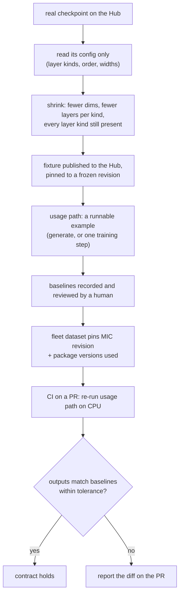
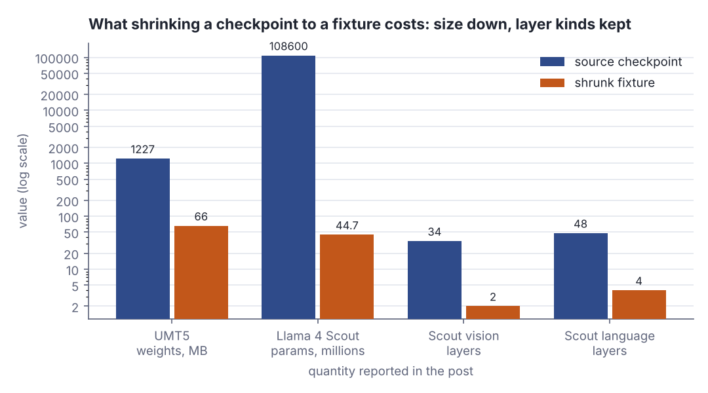
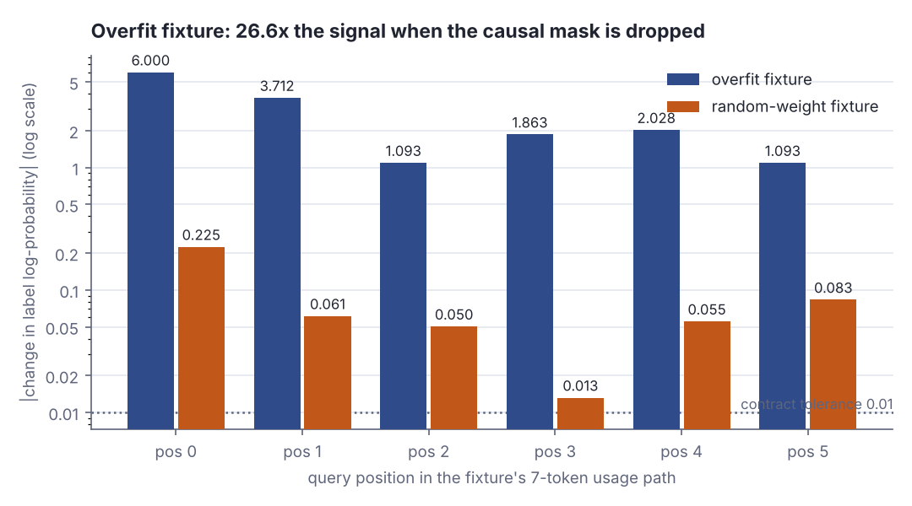

# Model integration contracts: catching an ML regression before it merges

> Fresh · AI / ML foundations · Intermediate · ~25 min · from today's feeds

## Why this matters
A model-serving framework shipped a silent correctness bug that sat in `main` for almost two months because the only tests that could see it were too expensive to run per-PR.
Tarek Ziadé's post on the Hugging Face blog (3 November 2026) proposes a fix that is pure QA engineering applied to models: shrink the checkpoint into a fixture, pin it, record human-reviewed baselines, and gate PRs on the diff.
You already run approval tests against pinned fixtures in CI; this lesson is that discipline carried into a codebase where "it ran without crashing" is not evidence of anything.

## Primer
Six terms you have not met yet, each needed below. None of them requires transformer theory beyond what is here.

**A checkpoint** is a model's learned numbers on disk — every weight matrix, plus a small JSON *config* saying how many layers there are, how wide each one is, which layer kinds are stacked in what order. Loading a checkpoint means reading the config, building the layer objects it describes, then filling them with the stored weights. Config and weights are separable: you can build a model from a real checkpoint's config while supplying different (smaller, or freshly random) weights. That separation is the whole trick this lesson turns on.

**An encoder–decoder model** such as T5 (and its multilingual sibling UMT5) is two stacks. The *encoder* reads the whole input at once — every input token may look at every other, in both directions, because the input is already known. The *decoder* produces the output one token at a time, and during training it is shown the correct output sequence so it can learn to predict position *i+1* from positions *0…i*. That training shortcut is called teacher forcing, and it is only sound if position *i* genuinely cannot read position *i+1*.

**Attention** is how a token "looks at" other tokens. Each token carries three vectors derived from it: a *query* (what am I looking for), a *key* (what do I offer), and a *value* (what I contribute if chosen). For query position *i*, you compute a score against every key *j*, turn the scores into weights that sum to 1 with a softmax, and the output at *i* is the weighted sum of the values. A token with a high score gets most of the weight; its value dominates the output.

**Scaled dot-product attention (SDPA)** is the standard way to compute those scores, and you already know the maths: the score is the **dot product** of query *i* with key *j*, divided by √d where d is the vector width. The dot product is the same similarity measure you used for cosine similarity — big and positive when two vectors point the same way. The √d division only keeps the numbers in a range where softmax does not saturate. "Enabling SDPA" for a model means swapping a hand-written loop for a fused, much faster kernel that computes the same quantity. Same maths, different code path — and a different place for the mask to be applied.

**Causal masking** is what stops the decoder cheating. Before the softmax, every score for a future key (*j > i*) is set to −∞, so `exp(−∞) = 0` and that key receives exactly zero weight. Drop the mask and position *i* can attend to position *i+1* — which, under teacher forcing, is the answer it is being asked to predict. Nothing crashes. The loss just gets suspiciously good.

**A log-probability of a label** is the output quantity you compare. The model's final layer produces one raw score (a *logit*) per candidate label; a softmax turns the logits into probabilities, and you take the natural log of the probability assigned to the correct label. Logs because probabilities multiply over a sequence and underflow, and because the training loss is literally the negative mean of these numbers. A log-probability of −0.005 means "essentially certain and right"; −1.0986 is `ln(1/3)`, a three-way coin flip.

## The idea

### The incident

> "On July 30, 2026, Transformers enabled PyTorch's scaled dot-product attention (SDPA) for T5."
> — Tarek Ziadé, *Transformers Model Integration Contracts*, Hugging Face blog, 3 November 2026, https://huggingface.co/blog/transformers-mic

The swap was a performance change. As a side effect UMT5's decoder could attend to future tokens, so during training it could peek at the answer it was supposed to predict (Ziadé, *Transformers Model Integration Contracts*, 3 November 2026). No exception, no failing assertion:

> "Nothing crashed, and the bug stayed in main for almost two months."
> — Tarek Ziadé, *Transformers Model Integration Contracts*, Hugging Face blog, 3 November 2026, https://huggingface.co/blog/transformers-mic

It was introduced on 30 July 2026 and fixed on 28 September 2026 (Ziadé, *Transformers Model Integration Contracts*, 3 November 2026). The whole mechanism, in attention weights — a query pointing hard at the next key, masked and unmasked:

```scala
// file: Mask.scala
@main def maskDemo(): Unit =
  val scores = Vector(0.0, 0.0, 0.0, 6.047, 0.0, 0.0, 0.0)
  def soft(s: Vector[Double]) =
    val e = s.map(x => math.exp(x - s.max))
    e.map(_ / e.sum)
  val masked = scores.zipWithIndex.map((x, j) => if j > 2 then Double.NegativeInfinity else x)
  println("key index       :  " + (0 until 7).mkString("     "))
  println("causal weights  : " + soft(masked).map(w => f"$w%.3f").mkString(" "))
  println("no-mask weights : " + soft(scores).map(w => f"$w%.3f").mkString(" "))
```

```text
key index       :  0     1     2     3     4     5     6
causal weights  : 0.333 0.333 0.333 0.000 0.000 0.000 0.000
no-mask weights : 0.002 0.002 0.002 0.986 0.002 0.002 0.002
```

With the mask, query position 2 spreads its attention evenly over keys 0–2 and gives key 3 exactly zero. Without it, 98.6% of the weight lands on key 3 — the token it is supposed to predict. The forward pass completes either way; only the numbers differ.

### Why the existing tests missed it

Transformers does have integration tests on real checkpoints, but they are GPU-bound and enormous:

> "88,000+ CPU tests on main, plus 200,000+ GPU tests in a daily run."
> — Tarek Ziadé, *Transformers Model Integration Contracts*, Hugging Face blog, 3 November 2026, https://huggingface.co/blog/transformers-mic

Those cover over 750 supported model types (Ziadé, *Transformers Model Integration Contracts*, 3 November 2026), and the economics follow:

> "Running all of that on every PR would mean keeping a lot of GPUs busy all day long, which isn't practical."
> — Tarek Ziadé, *Transformers Model Integration Contracts*, Hugging Face blog, 3 November 2026, https://huggingface.co/blog/transformers-mic

So they run on a schedule, which puts the detector downstream of the merge button:

> "By the time a scheduled run finds a regression, it may already be in main."
> — Tarek Ziadé, *Transformers Model Integration Contracts*, Hugging Face blog, 3 November 2026, https://huggingface.co/blog/transformers-mic

### The contract

`transformers-mic` is the proposal: small, CPU-runnable, pinned integration tests published on the Hub, run from framework CI on PRs and auto-selected by which files the PR touched (Ziadé, *Transformers Model Integration Contracts*, 3 November 2026).

A MIC has three parts.

1. **Fixture** — a shrunk model built from the real checkpoint's *config*, published once to the Hub and pinned to a frozen revision. It cuts hidden dimensions and layer *counts* but keeps **every layer kind** present, so the same code paths execute, and keeps the original tokenizer and processor files.
2. **Usage path** — a runnable Markdown example of something people actually do: generate text, run a training step. Not a bare forward pass.
3. **Baselines** — the outputs of that example, reviewed by a human before they become the reference.

> "The contract holds if running the usage path on the fixture still produces the baselines."
> — Tarek Ziadé, *Transformers Model Integration Contracts*, Hugging Face blog, 3 November 2026, https://huggingface.co/blog/transformers-mic



*Figure 1: The MIC loop. Only the config crosses into the fixture; the weights are replaced. Source: drawn for this lesson from Ziadé, Transformers Model Integration Contracts, 3 November 2026, https://huggingface.co/blog/transformers-mic*

The shrink is dramatic. The experimental UMT5 fixture used 66 MB of weights against a 1,227 MB checkpoint, ~18× smaller; the Llama 4 Scout shrink took 108.6 billion parameters to 44.7 million, vision stack 34 layers to 2, language stack 48 to 4 (Ziadé, *Transformers Model Integration Contracts*, 3 November 2026). Layer *counts* collapse; layer *kinds* do not.



*Figure 2: The four shrink numbers quoted above, on a log scale. Adapted from Ziadé, Transformers Model Integration Contracts, 3 November 2026, https://huggingface.co/blog/transformers-mic; rendered from `assets/2026-11-13-2-chart-2.json` with `dojo/engine/chart.py`.*

### What the baseline compares

A baseline is numbers, and the sensitive ones are label log-probabilities. Replaying the buggy UMT5 commits, label log-probabilities differed from the reviewed baseline by 1.22 and training loss by about 0.20 (Ziadé, *Transformers Model Integration Contracts*, 3 November 2026). A 1.22 drift in log space sounds small until you exponentiate it:

```scala
// file: LogProb.scala
@main def logProbDemo(): Unit =
  def logSoftmax(s: Vector[Double]) =
    val m = s.max
    val z = math.log(s.map(x => math.exp(x - m)).sum)
    s.map(x => x - m - z)
  val logits = Vector(0.0, 6.0, 0.0)
  val base = logSoftmax(logits)(1)
  val drifted = base - 1.22
  println(f"baseline  log P(label 1) = $base%.4f   P = ${math.exp(base)}%.4f")
  println(f"after a drift of 1.22    = $drifted%.4f   P = ${math.exp(drifted)}%.4f")
  println(f"probability ratio        = ${math.exp(1.22)}%.2f x")
```

```text
baseline  log P(label 1) = -0.0049   P = 0.9951
after a drift of 1.22    = -1.2249   P = 0.2938
probability ratio        = 3.39 x
```

The model goes from assigning 99.5% to the right label to 29.4% — a 3.39× change, loud, and invisible unless someone records the number and diffs it.

### Pinning

An approval test is worthless if the reference moves on its own. A "fleet" dataset pins each MIC to a frozen revision along with the package versions used to record its baselines (Ziadé, *Transformers Model Integration Contracts*, 3 November 2026), and every CI run records the fleet revision it used, so a failure is reproducible and attributable. For new models an LLM drafts the usage code and manifest, but any changed expectation still needs a human reviewer (Ziadé, *Transformers Model Integration Contracts*, 3 November 2026) — the rule you already apply to golden-file updates.

### The trade-offs the post admits

Fixtures are a filter, not a replacement:

> "Fixtures won't replace full integration tests, but on PRs they give us a chance to catch bugs before they reach main."
> — Tarek Ziadé, *Transformers Model Integration Contracts*, Hugging Face blog, 3 November 2026, https://huggingface.co/blog/transformers-mic

Three sharp limits. First, **the fixture must hit the same code path**: running only the eager attention variant would have missed the UMT5 bug, which lived in the SDPA path. Second, **weight choice is a real trade-off**. Random-weight fixtures barely respond to input changes; overfitting the fixture on a tiny training step fixes that but adds a step that can fail to converge and must be maintained. In the Whisper fault-injection study random fixtures caught 18 of 24 injected faults and overfit fixtures caught all 24 (Ziadé, *Transformers Model Integration Contracts*, 3 November 2026) — which the post does not treat as settling it, since both variants missed a real assisted-decoding bug that only the actual Whisper checkpoint exposed (Ziadé, *Transformers Model Integration Contracts*, 3 November 2026). Third, **the payoff is unmeasured**: real-bug catch rate on PRs, false-alarm rate and baseline-review cost are all unknown. A selected T5 contract's runner step took 13.4 seconds on CPU excluding setup (Ziadé, *Transformers Model Integration Contracts*, 3 November 2026) — cheap, but cheapness is not value. Hence the soft rollout:

> "As of November 1, 2026, the MIC job in Transformers CI reports failures without blocking PRs."
> — Tarek Ziadé, *Transformers Model Integration Contracts*, Hugging Face blog, 3 November 2026, https://huggingface.co/blog/transformers-mic

> "Coverage is still partial, across model families and the APIs people use."
> — Tarek Ziadé, *Transformers Model Integration Contracts*, Hugging Face blog, 3 November 2026, https://huggingface.co/blog/transformers-mic

Non-blocking is the right call for a gate whose false-alarm rate nobody has measured — the reasoning you would use before making a new flaky suite a required check.

## Lab

**The question this lab answers:** if I build a miniature model integration contract — fixture, usage path, recorded baselines — does it actually catch the UMT5 bug class, and does it matter whether the fixture's weights are random or overfit?

Everything below is Scala 3, standard library only, no network and no downloads. The source material is Python; the mechanism is arithmetic, so we rebuild it here rather than importing it.

### Step 1 — the miniature model

The fixture is a 7-token usage path over a 3-slot label vocabulary. The forward pass is scaled dot-product attention written out by hand:

- each position *i* has a query vector `q(i)`, each position *j* a key vector `k(j)` and a value vector `v(j)`;
- `score(i, j) = dot(q(i), k(j)) / sqrt(dk)`, plus a mask bias;
- `softmax` over *j* gives attention weights; the output at *i* is the weighted sum of the values;
- the output is read directly as 3 logits, and the recorded number is `log P(label)` where the label at position *i* is the identity of token *i+1* — next-token prediction, with teacher forcing.

Two fixture variants, both with the same 119 weights:

- **overfit** — `q(i)` points at key `i+1` with weight 16.0, keys are one-hot over positions, and `v(j)` is a 6.0-scaled one-hot of token *j*'s identity. This is what an informative, trained-on-its-own-example fixture looks like: the answer for position *i* is literally sitting in `v(i+1)`.
- **random-weight** — every entry drawn uniformly from ±1/√d, the scale a freshly initialised model gets.

The "regression" is one line: drop the causal mask, exactly as enabling an SDPA kernel with the wrong mask handling did to UMT5.

### Step 2 — the program

```scala
// file: Lab.scala
import scala.util.Random

type Vec = Vector[Double]
type Mat = Vector[Vec]

val n = 7                                        // tokens in the fixture's usage path
val vocab = 3                                    // label slots the readout scores
val ids = Vector(0, 1, 2, 1, 0, 2, 1)            // token identities
val targets = (0 until n - 1).map(i => ids(i + 1)).toVector   // next-token label per position
val dk = n
val tol = 0.01                                   // the contract's declared tolerance, log-prob units

def dot(a: Vec, b: Vec): Double = a.lazyZip(b).map(_ * _).sum

def softmax(s: Vec): Vec =
  val m = s.max
  val e = s.map(x => math.exp(x - m))
  e.map(_ / e.sum)

def logSoftmax(s: Vec): Vec =
  val m = s.max
  val z = math.log(s.map(x => math.exp(x - m)).sum)
  s.map(x => x - m - z)

final case class Fixture(name: String, q: Mat, k: Mat, v: Mat):
  def params: Int = q.map(_.size).sum + k.map(_.size).sum + v.map(_.size).sum

def overfitFixture(qs: Double, vs: Double): Fixture =
  val q = Vector.tabulate(n)(i => Vector.tabulate(dk)(c => if c == i + 1 then qs else 0.0))
  val k = Vector.tabulate(n)(j => Vector.tabulate(dk)(c => if c == j then 1.0 else 0.0))
  val v = Vector.tabulate(n)(j => Vector.tabulate(vocab)(c => if c == ids(j) then vs else 0.0))
  Fixture("overfit", q, k, v)

def randomFixture(seed: Int): Fixture =
  val r = Random(seed)
  def u(scale: Double) = (2 * r.nextDouble() - 1) * scale
  val q = Vector.fill(n)(Vector.fill(dk)(u(1.0 / math.sqrt(dk))))
  val k = Vector.fill(n)(Vector.fill(dk)(u(1.0 / math.sqrt(dk))))
  val v = Vector.fill(n)(Vector.fill(vocab)(u(1.0 / math.sqrt(vocab))))
  Fixture("random-weight", q, k, v)

type Bias = (Int, Int) => Double
val causal: Bias = (i, j) => if j > i then Double.NegativeInfinity else 0.0
val noMask: Bias = (_, _) => 0.0

def leak(row: Int, kind: Int): Bias = (i, j) =>
  if j <= i then 0.0
  else if i != row then Double.NegativeInfinity
  else kind match
    case 0 => if j == i + 1 then 0.0 else Double.NegativeInfinity
    case 1 => 0.0
    case 2 => -1.0
    case _ => -3.0

def forward(f: Fixture, bias: Bias): (Vector[Vec], Vector[Vec], Vec) =
  val attn = Vector.tabulate(n) { i =>
    softmax(Vector.tabulate(n)(j => dot(f.q(i), f.k(j)) / math.sqrt(dk) + bias(i, j)))
  }
  val logits = Vector.tabulate(n) { i =>
    Vector.tabulate(vocab)(c => (0 until n).map(j => attn(i)(j) * f.v(j)(c)).sum)
  }
  val lp = Vector.tabulate(n - 1)(i => logSoftmax(logits(i))(targets(i)))
  (attn, logits, lp)

def loss(lp: Vec): Double = -lp.sum / lp.size

@main def lab(): Unit =
  val over = overfitFixture(16.0, 6.0)
  val rand = randomFixture(11)

  println("== Step 1: the fixture ==")
  println(s"  tokens n = $n, label slots = $vocab, key width dk = $dk")
  println(s"  token identities : ${ids.mkString(" ")}")
  println(s"  next-token labels: ${targets.mkString(" ")}   (position i must predict ids(i+1))")
  for f <- Vector(over, rand) do
    println(f"  fixture ${f.name}%-13s: ${f.params} weights = ${f.params * 8} bytes as float64")
  println("  overfit query rows (each points at the NEXT key):")
  for i <- 0 until n do println(s"    q($i) = ${over.q(i).map(_.toInt).mkString(" ")}")
  println()

  println("== Step 2: usage path on the overfit fixture, causal mask ON -> baselines ==")
  val (aM, lgM, lpM) = forward(over, causal)
  println("  pos | attention weights over keys 0..6                      | logits            | log P(label)")
  for i <- 0 until n - 1 do
    val a = aM(i).map(w => f"$w%.3f").mkString(" ")
    val g = lgM(i).map(x => f"$x%6.3f").mkString(" ")
    println(f"   $i  | $a | $g | ${lpM(i)}%+8.4f")
  println(f"  baseline training loss = ${loss(lpM)}%.4f")
  println()

  println("== Step 3: the regression - SDPA path drops the causal mask ==")
  val (aU, lgU, lpU) = forward(over, noMask)
  println("  pos | attention weights over keys 0..6                      | log P(label) | delta")
  for i <- 0 until n - 1 do
    val a = aU(i).map(w => f"$w%.3f").mkString(" ")
    println(f"   $i  | $a | ${lpU(i)}%+8.4f     | ${lpU(i) - lpM(i)}%+8.4f")
  println(f"  training loss after  = ${loss(lpU)}%.4f   (baseline ${loss(lpM)}%.4f, drift ${loss(lpU) - loss(lpM)}%+.4f)")
  val maxD = (0 until n - 1).map(i => math.abs(lpU(i) - lpM(i))).max
  val meanD = (0 until n - 1).map(i => math.abs(lpU(i) - lpM(i))).sum / (n - 1)
  println(f"  max |delta| = $maxD%.4f   mean |delta| = $meanD%.4f   tolerance = $tol%.4f")
  println(s"  CONTRACT: ${if maxD > tol then "FAILED" else "held"}")
  println()

  println("== Step 4: same regression on a random-weight fixture ==")
  val (_, _, rM) = forward(rand, causal)
  val (_, _, rU) = forward(rand, noMask)
  println("  pos | random baseline | random after | delta   | overfit delta")
  for i <- 0 until n - 1 do
    println(f"   $i  | ${rM(i)}%+13.4f | ${rU(i)}%+12.4f | ${rU(i) - rM(i)}%+7.4f | ${lpU(i) - lpM(i)}%+13.4f")
  val rMax = (0 until n - 1).map(i => math.abs(rU(i) - rM(i))).max
  println(f"  random  max |delta| = $rMax%.4f  loss drift ${loss(rU) - loss(rM)}%+.4f  CONTRACT: ${if rMax > tol then "FAILED" else "held"}")
  println(f"  overfit max |delta| = $maxD%.4f  loss drift ${loss(lpU) - loss(lpM)}%+.4f")
  println(f"  signal ratio overfit/random = ${maxD / rMax}%.1f x")
  println()

  println("== Step 5: 24 injected mask faults, 6 query rows x 4 leak kinds ==")
  val kinds = Vector("next-key only", "all future", "future penalty 1.0", "future penalty 3.0")
  for f <- Vector(over, rand) do
    val (_, _, base) = forward(f, causal)
    var caught = 0
    println(s"  fixture ${f.name}: max |delta| per fault")
    println("    row | " + kinds.map(k => f"$k%18s").mkString(" | "))
    for row <- 0 until n - 1 do
      val cells = kinds.indices.map { kind =>
        val (_, _, lp) = forward(f, leak(row, kind))
        val d = base.indices.map(i => math.abs(lp(i) - base(i))).max
        if d > tol then caught += 1
        d
      }
      println(f"     $row  | " + cells.map(d => f"$d%18.4f").mkString(" | "))
    println(s"    caught $caught of 24 faults at tolerance $tol")
  println()
```

### Step 3 — run it

```bash
scala Lab.scala
```

### Reading the output

Every number below is the program's real output.

#### Step 1 — what the fixture is

```text
== Step 1: the fixture ==
  tokens n = 7, label slots = 3, key width dk = 7
  token identities : 0 1 2 1 0 2 1
  next-token labels: 1 2 1 0 2 1   (position i must predict ids(i+1))
  fixture overfit      : 119 weights = 952 bytes as float64
  fixture random-weight: 119 weights = 952 bytes as float64
  overfit query rows (each points at the NEXT key):
    q(0) = 0 16 0 0 0 0 0
    q(1) = 0 0 16 0 0 0 0
    q(2) = 0 0 0 16 0 0 0
    q(3) = 0 0 0 0 16 0 0
    q(4) = 0 0 0 0 0 16 0
    q(5) = 0 0 0 0 0 0 16
    q(6) = 0 0 0 0 0 0 0
```

`token identities` are the seven input tokens, each one of three symbols. `next-token labels` are the six targets: position 0 must predict `ids(1) = 1`, position 1 must predict `ids(2) = 2`, and so on. `119 weights = 952 bytes` is this fixture's entire checkpoint — the Llama 4 Scout fixture in the post is 44.7 million parameters against the real checkpoint's 108.6 billion (Ziadé, *Transformers Model Integration Contracts*, 3 November 2026); ours is the same idea taken to the absurd. The query rows say the model wants to look one step ahead: `q(0)` puts all its weight on key 1, `q(1)` on key 2. That is a perfectly reasonable thing for a trained decoder to want — the causal mask is what makes it legal.

**Verdict:** a complete model in 952 bytes, with the usage path (7 tokens, 6 labels) fully specified. Nothing here needs a GPU.

#### Step 2 — recording the baselines

```text
== Step 2: usage path on the overfit fixture, causal mask ON -> baselines ==
  pos | attention weights over keys 0..6                      | logits            | log P(label)
   0  | 1.000 0.000 0.000 0.000 0.000 0.000 0.000 |  6.000  0.000  0.000 |  -6.0049
   1  | 0.500 0.500 0.000 0.000 0.000 0.000 0.000 |  3.000  3.000  0.000 |  -3.7177
   2  | 0.333 0.333 0.333 0.000 0.000 0.000 0.000 |  2.000  2.000  2.000 |  -1.0986
   3  | 0.250 0.250 0.250 0.250 0.000 0.000 0.000 |  1.500  3.000  1.500 |  -1.8690
   4  | 0.200 0.200 0.200 0.200 0.200 0.000 0.000 |  2.400  2.400  1.200 |  -2.0334
   5  | 0.167 0.167 0.167 0.167 0.167 0.167 0.000 |  2.000  2.000  2.000 |  -1.0986
  baseline training loss = 2.6371
```

| column | meaning | which direction is "correct" |
|---|---|---|
| `pos` | query position; it must predict the identity of token `pos + 1` | — |
| attention weights | how much of each key's value enters the output at `pos` | every weight at index `> pos` must be exactly 0.000 |
| logits | the three raw label scores after the weighted sum of values | — |
| `log P(label)` | log-probability the model assigns to the correct label | this is the **recorded baseline**; its *value* does not matter, its *stability* does |

The zeros to the right of the diagonal are the causal mask doing its job. The weights to the left are uniform because, with key `pos + 1` forbidden, every permitted key scores 0 and softmax of equal scores is uniform.

Trace position 0 with digits. Only key 0 is permitted, so the output is `v(0) = (6, 0, 0)` — token 0 has identity 0. The target is `ids(1) = 1`, so the relevant logit is the middle one, 0.000. Then `log P = 0 − ln(e⁶ + e⁰ + e⁰) = 0 − ln(403.4288 + 1 + 1) = −ln(405.4288) = −6.0049`, which is the printed value. The model is confidently *wrong*, because a masked position 0 genuinely has no evidence about token 1.

Position 2 is the clean sanity check: the logits are `2.000 2.000 2.000`, so `log P = ln(1/3) = −1.0986` exactly — a three-way coin flip.

**Verdict:** six numbers, human-reviewable, recorded as the contract's baselines. `−6.0049` looks terrible and is correct: the baseline records what the model *does*, not what we wish it did.

#### Step 3 — the regression

```text
== Step 3: the regression - SDPA path drops the causal mask ==
  pos | attention weights over keys 0..6                      | log P(label) | delta
   0  | 0.002 0.986 0.002 0.002 0.002 0.002 0.002 |  -0.0054     |  +5.9996
   1  | 0.002 0.002 0.986 0.002 0.002 0.002 0.002 |  -0.0055     |  +3.7122
   2  | 0.002 0.002 0.002 0.986 0.002 0.002 0.002 |  -0.0054     |  +1.0932
   3  | 0.002 0.002 0.002 0.002 0.986 0.002 0.002 |  -0.0055     |  +1.8635
   4  | 0.002 0.002 0.002 0.002 0.002 0.986 0.002 |  -0.0055     |  +2.0279
   5  | 0.002 0.002 0.002 0.002 0.002 0.002 0.986 |  -0.0054     |  +1.0932
  training loss after  = 0.0054   (baseline 2.6371, drift -2.6316)
  max |delta| = 5.9996   mean |delta| = 2.6316   tolerance = 0.0100
  CONTRACT: FAILED
```

| number | meaning | which direction is better |
|---|---|---|
| attention weight at index `pos + 1` | how much of the *answer* leaked in | 0.000 is correct; 0.986 is the bug |
| `log P(label)` | same quantity as the baseline | nearer 0 means more confident |
| `delta` | `after − baseline` for that position | any non-zero delta is a contract violation |
| `training loss` | `−mean(log P)` over the six positions | **lower is not better here** — it fell because the model is cheating |

Every position now puts 98.6% of its attention on the token it is being asked to predict. Position 0's log-probability moves from `−6.0049` to `−0.0054`, a delta of `+5.9996`: it went from 0.25% confidence in the right label to 99.5%. The training loss *improved* from 2.6371 to 0.0054 — a drift of `−2.6316` — which is the signature that makes this bug class so dangerous. Loss going down is what everyone is watching for. The post's replay showed the same shape at realistic scale, with label log-probabilities off by 1.22 and training loss off by about 0.20 (Ziadé, *Transformers Model Integration Contracts*, 3 November 2026).

**Verdict:** the contract fails, `max |delta| = 5.9996` against a tolerance of 0.0100 — 600× over. No exception was thrown, no output was malformed, and every assertion of the form "it loads and a forward pass runs" would have passed.

#### Step 4 — does the weight choice matter?

```text
== Step 4: same regression on a random-weight fixture ==
  pos | random baseline | random after | delta   | overfit delta
   0  |       -1.1956 |      -0.9704 | +0.2252 |       +5.9996
   1  |       -1.0639 |      -1.1253 | -0.0613 |       +3.7122
   2  |       -1.0225 |      -0.9720 | +0.0504 |       +1.0932
   3  |       -1.2091 |      -1.2222 | -0.0132 |       +1.8635
   4  |       -1.1848 |      -1.1294 | +0.0554 |       +2.0279
   5  |       -0.8836 |      -0.9669 | -0.0833 |       +1.0932
  random  max |delta| = 0.2252  loss drift -0.0289  CONTRACT: FAILED
  overfit max |delta| = 5.9996  loss drift -2.6316
  signal ratio overfit/random = 26.6 x
```



*Figure 3: The same mask regression seen by two fixtures with identical structure and different weights. The overfit fixture's deltas sit between 1.09 and 6.00; the random fixture's between 0.013 and 0.225, with position 3 only just clearing the 0.01 tolerance. Source: this lesson's lab, Step 4 output, rendered from `assets/2026-11-13-2-chart-1.json` with `dojo/engine/chart.py`.*

The random fixture's baselines all sit near `ln(1/3) = −1.0986`, because averaging random value vectors gives three near-equal logits — it has no opinion to be wrong about. Its deltas are 0.013 to 0.225 where the overfit fixture's are 1.09 to 6.00, a 26.6× gap on the maximum, and its loss drift is `−0.0289` against `−2.6316`. Both still fail the contract, because dropping the mask on *every* row is a large change.

**Verdict:** both fixtures catch the full regression, but the random fixture catches it with 26.6× less margin. That margin is the headroom you have left for subtler faults — which Step 5 goes looking for.

#### Step 5 — fault injection

```text
== Step 5: 24 injected mask faults, 6 query rows x 4 leak kinds ==
  fixture overfit: max |delta| per fault
    row |      next-key only |         all future | future penalty 1.0 | future penalty 3.0
     0  |             5.9999 |             5.9996 |             5.9994 |             5.9970
     1  |             3.7126 |             3.7122 |             3.7118 |             3.7064
     2  |             1.0935 |             1.0932 |             1.0928 |             1.0879
     3  |             1.8637 |             1.8635 |             1.8629 |             1.8540
     4  |             2.0281 |             2.0279 |             2.0271 |             2.0136
     5  |             1.0932 |             1.0932 |             1.0924 |             1.0800
    caught 24 of 24 faults at tolerance 0.01
  fixture random-weight: max |delta| per fault
    row |      next-key only |         all future | future penalty 1.0 | future penalty 3.0
     0  |             0.0298 |             0.2252 |             0.1830 |             0.0631
     1  |             0.0460 |             0.0613 |             0.0393 |             0.0084
     2  |             0.0246 |             0.0504 |             0.0291 |             0.0055
     3  |             0.0362 |             0.0132 |             0.0065 |             0.0011
     4  |             0.0367 |             0.0554 |             0.0251 |             0.0038
     5  |             0.0833 |             0.0833 |             0.0330 |             0.0046
    caught 18 of 24 faults at tolerance 0.01
```

Each fault leaks the mask on exactly **one** query row — a much narrower slip than Step 3's wholesale drop, and closer to what a kernel swap actually does. The four kinds are: make only key `i+1` visible; make all future keys visible; give future keys a finite penalty of 1.0 instead of −∞; the same with a penalty of 3.0. A fixture "catches" a fault when the largest per-position change exceeds the declared tolerance of 0.01.

Trace one cell. Random fixture, row 3, `future penalty 3.0`: `0.0011`. The leaked keys enter the softmax at `exp(−3) = 0.0498` of their unmasked weight, and the value vectors they bring are random vectors of magnitude about 0.577, so the three logits move by a few thousandths and the log-probability barely stirs. The overfit fixture's same cell is `1.8540`, because the leaked key carries a 6.0-scaled one-hot pointing straight at the right label.

| fixture | smallest fault signal | largest | caught at tol 0.01 |
|---|---|---|---|
| overfit | 1.0800 | 5.9999 | 24 of 24 |
| random-weight | 0.0011 | 0.2252 | 18 of 24 |

Six of the random fixture's 24 cells — `0.0084`, `0.0055`, `0.0065`, `0.0011`, `0.0038`, `0.0046` — fall under the tolerance and go unnoticed. The overfit fixture's weakest signal is 1.0800, a hundredfold clear of the line.

That 18-of-24 against 24-of-24 is the same split the post reports for Whisper, where random fixtures caught 18 of 24 injected faults and overfit fixtures caught all 24 (Ziadé, *Transformers Model Integration Contracts*, 3 November 2026). The exact match of counts here is a coincidence of the tolerance I chose; what is not a coincidence is the mechanism — random weights have no opinion, so perturbing what they read barely moves the output.

**Verdict:** the overfit fixture catches all 24 narrow faults with two orders of magnitude of margin; the random fixture misses six. Tightening the tolerance would recover some of them and start admitting floating-point noise as failures, which is the trade the post declines to settle.

### Cause → mechanism → consequence → what it means for your work

1. **Cause.** A performance change swapped T5's attention onto PyTorch's SDPA kernel on 30 July 2026 (Ziadé, *Transformers Model Integration Contracts*, 3 November 2026), and the causal mask was not carried through that path correctly for UMT5.
2. **Mechanism.** Scores for future keys stopped being −∞, so softmax gave them real weight; the decoder's position *i* read the value vector of position *i+1*, which under teacher forcing is the label it must predict. In the lab the same slip moves one attention weight from 0.000 to 0.986 and one label log-probability from −6.0049 to −0.0054.
3. **Consequence.** The observable effect is *loss going down*. Nothing crashes, no shape mismatch, no NaN; the only visible trace is a quantity nobody records by default. It survived in `main` for almost two months (Ziadé, *Transformers Model Integration Contracts*, 3 November 2026).
4. **What it means for your work.** The gate that catches this is an approval test, not an assertion: record a numeric baseline from a pinned fixture, diff it on every PR, and require a human to approve any change to the expectation. Three things decide whether it works. The fixture must execute the same code path as production (an eager-attention-only fixture would have seen nothing here). The fixture must have an opinion — a random-weight one is 26.6× less sensitive in this lab, and misses six of 24 narrow faults. And the baseline and its environment must be pinned together: a MIC is pinned to a frozen revision plus the package versions its baselines were recorded under (Ziadé, *Transformers Model Integration Contracts*, 3 November 2026), without which a failure is unattributable. Run it non-blocking first, the way Transformers CI does, until you have measured the false-alarm rate.

## Self-check
1. The lab's baseline for position 0 is `log P(label) = −6.0049`, which is a model that is confidently wrong. Why is that an acceptable baseline to record, and what would be wrong with "fixing" it before recording? <details><summary>Answer</summary>A baseline records behaviour, not quality. Position 0 under a causal mask can see only token 0, so it has no evidence about token 1 — being wrong is the correct behaviour for this fixture, and `−6.0049` is a stable, reproducible number to diff against. "Fixing" it would mean either training the fixture until it is right (which it cannot be, without seeing the future) or loosening the mask, which is precisely the regression. The contract's question is "did the number move", not "is the number good".</details>
2. A colleague proposes building all fixtures with random weights, arguing that it removes a training step that can fail to converge and still exercises every code path. Using the lab's Step 5 numbers, what do you give up? <details><summary>Answer</summary>Sensitivity. Random weights make the three logits near-equal, so baselines sit at `ln(1/3) = −1.0986` and perturbing what the model reads barely moves them. In Step 5 the random fixture's fault signals range from 0.0011 to 0.2252 and six of 24 injected faults fall under the 0.01 tolerance; the overfit fixture's weakest signal is 1.0800 and it catches all 24. The post reports the same split for Whisper — 18 of 24 for random fixtures, 24 of 24 for overfit ones — and notes both variants still missed a real assisted-decoding bug, so the honest answer is that random weights are cheaper and blunter, and neither variant replaces a test on the real checkpoint.</details>
3. The fixture is built from the real checkpoint's config with the layer *counts* reduced but every layer *kind* kept. Why does that distinction matter for catching the UMT5 bug specifically? <details><summary>Answer</summary>Because the bug lived in one attention implementation, not in the model's size. A fixture that drops a layer kind — or that only ever runs the eager attention variant instead of the SDPA one — never executes the code that was broken, so it reproduces its baselines perfectly while production is wrong. Shrinking widths and counts keeps the test cheap; keeping every kind present is what keeps the same code paths running, which is the only reason a 66 MB stand-in can speak for a 1,227 MB checkpoint.</details>

## Sources
- [Transformers Model Integration Contracts](https://huggingface.co/blog/transformers-mic) — Tarek Ziadé, Hugging Face blog, 3 November 2026 — the whole lesson: the UMT5/SDPA incident and its dates, the three parts of a MIC, fleet pinning, the shrink and fault-injection numbers, and the non-blocking CI rollout; every quoted passage above is from this page; accessed 2026-11-13.
- [huggingface/transformers-mic](https://github.com/huggingface/transformers-mic) — Hugging Face, Apache-2.0 — the implementation the post describes ("Executable model integration contracts published on the Hub, run from framework CI"), holding the `tmic` CLI, the fixture builder and the runner; confirms the proposal is real code rather than a sketch; accessed 2026-11-13.
