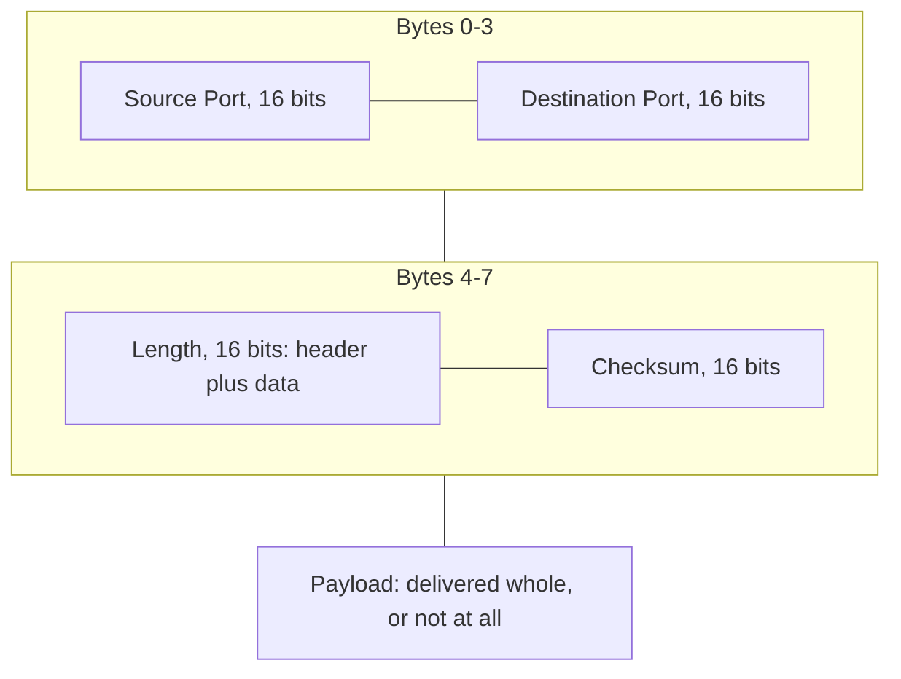
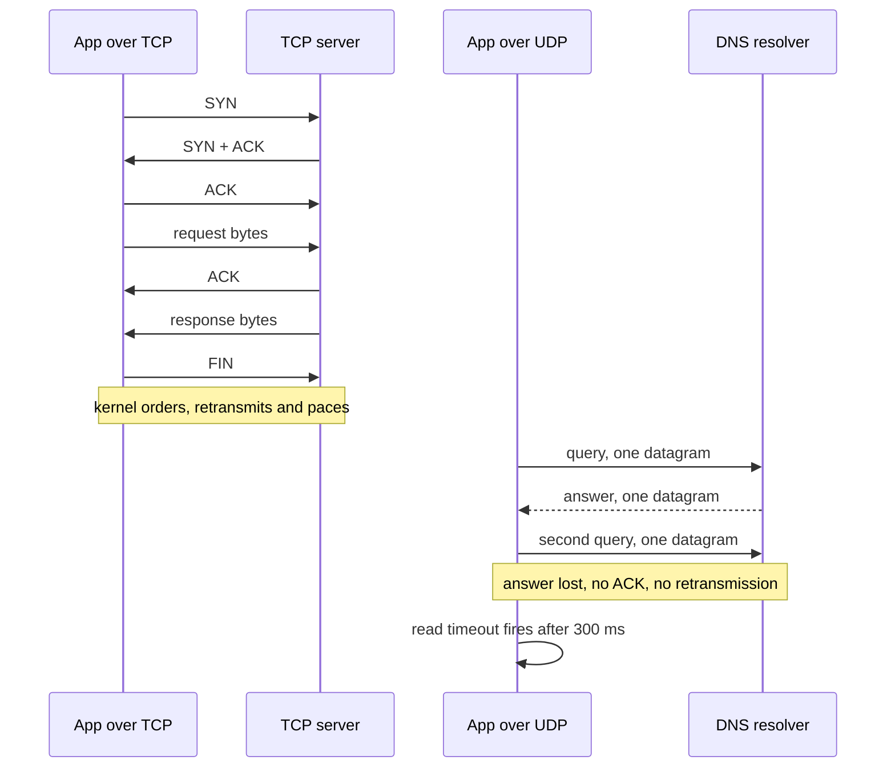
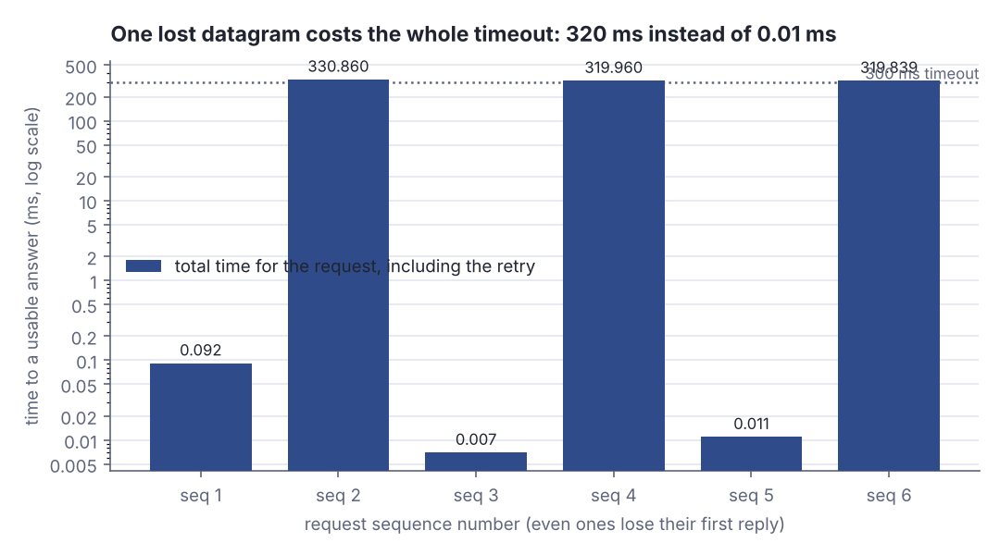
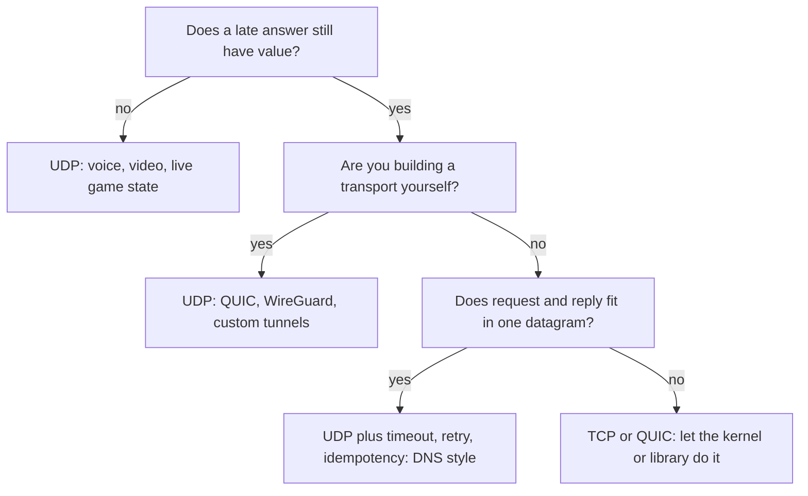

# UDP and when to choose it

> Networking, modern · Beginner · ~20 min · rung 4 of 16 · needs: What really happens in a TCP handshake and teardown (networking-01); Congestion control intuition: slow start, CUBIC vs BBR (networking-03)

## Why this matters

Every transport you will meet in the next few years — QUIC under HTTP/3, WireGuard under your VPN, the DNS resolution in front of every outbound call your service makes — sits on UDP, which means the retry policy, the congestion control and the keepalive live in *application* code, not in the kernel.
When you pick UDP you are not picking "a faster TCP"; you are signing up to write the parts of TCP you still need, and to be judged on the ones you skipped.
This rung gives you the exact list of what you take on, with real measurements, so the HTTP/3, DNS and WireGuard rungs are about design choices rather than surprises.

## The idea

A **datagram** is a self-contained message: it carries everything needed to deliver it, and the network makes no promise about it. UDP — the User Datagram Protocol, specified by Jon Postel in RFC 768 in 1980 — is the thinnest possible way to turn IP packets into application messages. It "provides a procedure for application programs to send messages to other programs with a minimum of protocol mechanism" (RFC 768, "Introduction"), and it states plainly that "delivery and duplicate protection are not guaranteed" (RFC 768, "Introduction").

The whole header is 8 bytes, four 16-bit fields (RFC 768, "Format"). High Performance Browser Networking puts it this way: UDP takes IP's host-to-host delivery and "adds only four additional fields: source port, destination port, length of packet, and checksum" (Grigorik, HPBN ch. 3, "Null Protocol Services"). The two port fields are the entire added value: they multiplex application endpoints onto one host address. Length covers header plus data; the checksum is optional on IPv4, mandatory on IPv6.



*Figure 1: the entire UDP header — 8 bytes, four 16-bit fields, then your bytes. Adapted from RFC 768, "Format", https://www.rfc-editor.org/rfc/rfc768.*

### What you get: message boundaries

The one real service UDP gives you is that a datagram arrives whole or not at all. Three sends are three receives, each with the byte count you sent; a TCP stream has no such notion and will hand you whatever has arrived. From the lab program below:

```rust
let payloads = [vec![b'a'; 5], vec![b'b'; 1], vec![b'c'; 1200]];
for p in &payloads {
    tx.send_to(p, rx_addr).unwrap();
}
let mut buf = [0u8; 4096];
for i in 1..=3 {
    let (n, from) = rx.recv_from(&mut buf).unwrap();
    println!("udp  recv #{}: {:>4} B from {}", i, n, from);
}
```

```text
udp  recv #1:    5 B from 127.0.0.1:48811
udp  recv #2:    1 B from 127.0.0.1:48811
udp  recv #3: 1200 B from 127.0.0.1:48811
tcp  read #1: 1206 B
```

Three UDP receives return 5, 1 and 1200 bytes — exactly the three messages. The same three writes on a TCP socket came back as **one** read of 1206 bytes: over TCP you must frame your messages yourself, over UDP the framing is free.

### What you give up: null protocol services

Everything else TCP does is absent. HPBN calls the list "null protocol services": no acknowledgments, retransmissions or timeouts; no connection establishment or teardown state machines; no ordering or sequence numbers; no congestion control (HPBN ch. 3, "Null Protocol Services"). There is no connection, so there is also no error channel. A `send` that goes nowhere still succeeds:

```rust
let s = UdpSocket::bind("127.0.0.1:0").unwrap();
s.connect(dead).unwrap();            // dead = a port nothing listens on
for i in 1..=4 {
    match s.send(b"ping") {
        Ok(n)  => println!("send #{} -> Ok({})", i, n),
        Err(e) => println!("send #{} -> Err({:?})", i, e.kind()),
    }
    thread::sleep(Duration::from_millis(100));
}
```

```text
send #1 -> Ok(4)
send #2 -> Err(ConnectionRefused)
send #3 -> Ok(4)
send #4 -> Err(ConnectionRefused)
unconnected send_to -> Ok(4)
```

`Ok(4)` means "the kernel put 4 bytes on the wire", nothing more. The `ConnectionRefused` on send #2 is not a connection failing — it is the ICMP port-unreachable message triggered by send #1, delivered late to the *next* call, and only because the socket was `connect`ed. The unconnected `send_to` never sees it at all. Across the public internet, where ICMP is routinely filtered, you should assume you get nothing.



*Figure 2: a TCP exchange (three-way handshake, data, ACKs, teardown) beside a UDP request/response. The lost UDP answer produces no error anywhere — only the application's own read timeout notices. Source: drawn from RFC 768 and HPBN ch. 3, "Null Protocol Services".*

### What you must add yourself

RFC 8085, *UDP Usage Guidelines*, is the checklist. It is blunt about reliability:

> "Applications that do require reliable message delivery MUST implement an appropriate mechanism themselves."
> — L. Eggert, G. Fairhurst, G. Shepherd, *RFC 8085: UDP Usage Guidelines*, March 2017, §3.3, https://www.rfc-editor.org/rfc/rfc8085.html

Four things move into your code. **Timeouts and retries**: RFC 8085 §3.1.1 says a UDP application "SHOULD similarly use an initial latency estimate of 1 second" and that expiry of the retransmission timer "MUST be interpreted as an indication of congestion in the network" — so retries back off exponentially, they do not hammer. **Idempotency**: a retry may be a duplicate of a request that actually arrived, so the receiver needs a request ID and the operation must tolerate being applied twice. **Ordering**: add your own sequence numbers if order matters. **Congestion control and pacing**: §3.3 states that "Any application that uses retransmission is responsible for congestion control of its retransmissions", and §3.1.1 tells you to reuse an existing algorithm rather than invent one.

The only thing that notices a missing reply is a read deadline you set:

```rust
c.set_read_timeout(Some(Duration::from_millis(300))).unwrap();
c.send(b"2").unwrap();
let t0 = Instant::now();
match c.recv(&mut buf) {
    Ok(n)  => println!("reply {}B after {:.3} ms", n, ms(t0)),
    Err(_) => println!("TIMEOUT after {:.3} ms", ms(t0)),
}
```

```text
  2        1     1B  TIMEOUT (no reply)   330.710    330.711
  2        2     1B  reply 1B               0.113    330.860
```

A reply that arrives costs 0.113 ms on loopback; a reply that is lost costs the full 330 ms of the deadline before the retry even starts. Your timeout value *is* your tail latency.



*Figure 3: time to a usable answer for six requests, where every even one loses its first reply. Generated from the lab output below (`run_lab.py 2026-11-14-1`), spec in `assets/2026-11-14-1-chart-1.json`.*

### NAT and firewall state expire fast

A NAT (Network Address Translator) rewrites your source address and port and must remember the mapping to route the reply back. For TCP it can watch SYN and FIN to know when to forget. For UDP there is nothing to watch:

> "Thus, translators have to keep state about each UDP flow, which itself is stateless." … "To address this, UDP routing records are expired on a timer."
> — Ilya Grigorik, *High Performance Browser Networking*, ch. 3, "UDP and Network Address Translators", O'Reilly 2013, https://hpbn.co/building-blocks-of-udp/

The timer is short and not standardised: RFC 8085 §3.5 notes that "NATs require a state timeout of 2 minutes or longer [RFC4787]" while "No common timeout has been specified for per-flow UDP state for arbitrary middleboxes", and firewalls are often far more aggressive (tens of seconds). So a long-lived UDP flow — a VPN tunnel, a QUIC connection, a game session — must send keepalives, and RFC 8085 §3.5 caps their rate: applications "SHOULD NOT transmit them more frequently than once every 15 seconds". If the binding lapses, inbound packets are dropped by a box neither end controls, and the only cure is a fresh outbound packet.

### Size: one datagram, one MTU

A datagram that exceeds the path MTU (Maximum Transmission Unit, typically 1500 bytes on Ethernet) is fragmented by IP, and a single lost fragment destroys the whole datagram. RFC 8085 §3.2 is direct — "IP fragmentation lowers the efficiency and reliability of Internet communication" — and for IPv6 it fixes the safe floor: "For IPv6, EMTU_S is 1280 bytes [RFC2460]". This is why classic DNS messages were limited to 512 octets over UDP (RFC 6891 §4.3), why EDNS(0) lets a resolver advertise a larger "requestor's UDP payload size" in an OPT record (RFC 6891 §6.2.3), and why an answer too large for that budget comes back with the truncation bit set and the client repeats the query over TCP. That fallback is the honest admission that UDP request/response only works while the answer fits in one datagram.

### When to choose it



*Figure 4: the three cases where UDP pays, and the default when none of them hold. Source: criteria from RFC 8085 §3 and HPBN ch. 3, "Optimizing for UDP".*

Cloudflare's summary is the short version: UDP skips the handshake and starts sending immediately, which is why it carries "voice and video traffic" and DNS (Cloudflare Learning Center, "What is UDP?"). Everything else is TCP or QUIC — and QUIC is how you get UDP's freedoms without writing the four missing pieces yourself.

## Lab

**The question:** what does the kernel actually do for a UDP application, and what does the application have to notice for itself?

Run it with `python3 dojo/engine/run_lab.py 2026-11-14-1`, or copy `main.rs` into a fresh `cargo new` project and `cargo run`. Standard library only, everything on loopback — about 5 minutes.

### Step 1 — message boundaries, UDP vs TCP

Send three payloads of 5, 1 and 1200 bytes over a UDP socket pair, then write the same three over a TCP connection and read once.

### Step 2 — send into the void

Bind a UDP socket, note its address, drop it, then send to that dead address four times, 100 ms apart, on a `connect`ed socket. Then do one unconnected `send_to` to the same address.

### Step 3 — what detects a lost reply

An echo server that silently drops the *first* delivery of every even sequence number. The client sets a 300 ms read timeout and retries up to three times per request, printing the time for each attempt and the total per request.

```rust
// file: main.rs
use std::collections::HashSet;
use std::io::{Read, Write};
use std::net::{SocketAddr, TcpListener, TcpStream, UdpSocket};
use std::thread;
use std::time::{Duration, Instant};

fn closed_port() -> SocketAddr {
    let s = UdpSocket::bind("127.0.0.1:0").unwrap();
    let a = s.local_addr().unwrap();
    drop(s); // nothing is listening on `a` any more
    a
}

fn step1_boundaries() {
    println!("== Step 1: are message boundaries preserved? ==");
    let rx = UdpSocket::bind("127.0.0.1:0").unwrap();
    let rx_addr = rx.local_addr().unwrap();
    let tx = UdpSocket::bind("127.0.0.1:0").unwrap();
    let payloads: Vec<Vec<u8>> = vec![vec![b'a'; 5], vec![b'b'; 1], vec![b'c'; 1200]];

    for (i, p) in payloads.iter().enumerate() {
        let n = tx.send_to(p, rx_addr).unwrap();
        println!("udp  send #{}: payload {:>4} B -> Ok({})", i + 1, p.len(), n);
    }
    let mut buf = [0u8; 4096];
    let mut recvs = 0;
    let mut total = 0;
    for _ in 0..3 {
        let (n, from) = rx.recv_from(&mut buf).unwrap();
        recvs += 1;
        total += n;
        println!("udp  recv #{}: {:>4} B from {}", recvs, n, from);
    }
    println!("udp  : 3 sends -> {} recvs, {} B total", recvs, total);

    // The same three writes over a TCP stream on loopback.
    let l = TcpListener::bind("127.0.0.1:0").unwrap();
    let addr = l.local_addr().unwrap();
    let writer = thread::spawn(move || {
        let mut s = TcpStream::connect(addr).unwrap();
        for p in [vec![b'a'; 5], vec![b'b'; 1], vec![b'c'; 1200]] {
            s.write_all(&p).unwrap();
            s.flush().unwrap();
            println!("tcp  write  : {:>4} B", p.len());
        }
        thread::sleep(Duration::from_millis(400));
    });
    let (mut srv, _) = l.accept().unwrap();
    srv.set_read_timeout(Some(Duration::from_millis(250))).unwrap();
    thread::sleep(Duration::from_millis(150)); // let all three writes arrive
    let mut reads = 0;
    let mut tcp_total = 0;
    while tcp_total < 1206 {
        match srv.read(&mut buf) {
            Ok(0) => break,
            Ok(n) => {
                reads += 1;
                tcp_total += n;
                println!("tcp  read #{}: {:>4} B", reads, n);
            }
            Err(_) => break,
        }
    }
    println!("tcp  : 3 writes -> {} read(s), {} B total", reads, tcp_total);
    writer.join().unwrap();
}

fn step2_no_listener() {
    println!();
    println!("== Step 2: does the sender learn that nobody is listening? ==");
    let dead = closed_port();
    let s = UdpSocket::bind("127.0.0.1:0").unwrap();
    s.connect(dead).unwrap(); // connected UDP socket: ICMP errors are reported to us
    println!("target {} (bound, then released: no listener)", dead);
    for i in 1..=4 {
        match s.send(b"ping") {
            Ok(n) => println!("send #{} -> Ok({})", i, n),
            Err(e) => println!("send #{} -> Err({:?})", i, e.kind()),
        }
        thread::sleep(Duration::from_millis(100));
    }
    let u = UdpSocket::bind("127.0.0.1:0").unwrap();
    match u.send_to(b"ping", dead) {
        Ok(n) => println!("unconnected send_to -> Ok({})", n),
        Err(e) => println!("unconnected send_to -> Err({:?})", e.kind()),
    }
}

fn step3_timeout() {
    println!();
    println!("== Step 3: what detects a lost reply, and what does it cost? ==");
    let srv = UdpSocket::bind("127.0.0.1:0").unwrap();
    let srv_addr = srv.local_addr().unwrap();
    thread::spawn(move || {
        let mut seen: HashSet<u32> = HashSet::new();
        let mut b = [0u8; 64];
        loop {
            let (n, from) = srv.recv_from(&mut b).unwrap();
            let seq: u32 = String::from_utf8_lossy(&b[..n]).trim().parse().unwrap_or(0);
            let first_time = seen.insert(seq);
            // Lose the first delivery of every even sequence number, answer everything else.
            if seq % 2 == 0 && first_time {
                continue;
            }
            srv.send_to(&b[..n], from).unwrap();
        }
    });

    let c = UdpSocket::bind("127.0.0.1:0").unwrap();
    c.connect(srv_addr).unwrap();
    c.set_read_timeout(Some(Duration::from_millis(300))).unwrap();
    let mut buf = [0u8; 64];
    let mut sent = 0;
    let mut timeouts = 0;
    let mut totals: Vec<f64> = Vec::new();

    println!("seq  attempt  sent  outcome            attempt_ms   total_ms");
    for seq in 1..=6u32 {
        let msg = seq.to_string();
        let t_req = Instant::now();
        for attempt in 1..=3 {
            let t0 = Instant::now();
            c.send(msg.as_bytes()).unwrap();
            sent += 1;
            let r = c.recv(&mut buf);
            let dt = t0.elapsed().as_secs_f64() * 1000.0;
            let tot = t_req.elapsed().as_secs_f64() * 1000.0;
            match r {
                Ok(n) => {
                    println!(
                        "{:>3}  {:>7}  {:>4}B  reply {}B            {:>8.3}   {:>8.3}",
                        seq, attempt, msg.len(), n, dt, tot
                    );
                    totals.push(tot);
                    break;
                }
                Err(_) => {
                    timeouts += 1;
                    println!(
                        "{:>3}  {:>7}  {:>4}B  TIMEOUT (no reply)  {:>8.3}   {:>8.3}",
                        seq, attempt, msg.len(), dt, tot
                    );
                }
            }
        }
    }
    let worst = totals.iter().cloned().fold(0.0f64, f64::max);
    let best = totals.iter().cloned().fold(f64::MAX, f64::min);
    println!();
    println!("requests 6, datagrams sent {}, timeouts {}", sent, timeouts);
    println!("fastest request {:.3} ms, slowest request {:.3} ms, ratio {:.0}x",
             best, worst, worst / best);
    println!("per-request total_ms: {}",
             totals.iter().map(|v| format!("{:.3}", v)).collect::<Vec<_>>().join(" "));
}

fn main() {
    step1_boundaries();
    step2_no_listener();
    step3_timeout();
}
```

Real output:

```text
== Step 1: are message boundaries preserved? ==
udp  send #1: payload    5 B -> Ok(5)
udp  send #2: payload    1 B -> Ok(1)
udp  send #3: payload 1200 B -> Ok(1200)
udp  recv #1:    5 B from 127.0.0.1:48811
udp  recv #2:    1 B from 127.0.0.1:48811
udp  recv #3: 1200 B from 127.0.0.1:48811
udp  : 3 sends -> 3 recvs, 1206 B total
tcp  write  :    5 B
tcp  write  :    1 B
tcp  write  : 1200 B
tcp  read #1: 1206 B
tcp  : 3 writes -> 1 read(s), 1206 B total

== Step 2: does the sender learn that nobody is listening? ==
target 127.0.0.1:54496 (bound, then released: no listener)
send #1 -> Ok(4)
send #2 -> Err(ConnectionRefused)
send #3 -> Ok(4)
send #4 -> Err(ConnectionRefused)
unconnected send_to -> Ok(4)

== Step 3: what detects a lost reply, and what does it cost? ==
seq  attempt  sent  outcome            attempt_ms   total_ms
  1        1     1B  reply 1B               0.091      0.092
  2        1     1B  TIMEOUT (no reply)   330.710    330.711
  2        2     1B  reply 1B               0.113    330.860
  3        1     1B  reply 1B               0.007      0.007
  4        1     1B  TIMEOUT (no reply)   319.809    319.810
  4        2     1B  reply 1B               0.110    319.960
  5        1     1B  reply 1B               0.010      0.011
  6        1     1B  TIMEOUT (no reply)   319.736    319.736
  6        2     1B  reply 1B               0.071    319.839

requests 6, datagrams sent 9, timeouts 3
fastest request 0.007 ms, slowest request 330.860 ms, ratio 49903x
per-request total_ms: 0.092 330.860 0.007 319.960 0.011 319.839
```

### Reading the output

**Step 1.** `payload … B -> Ok(n)` is what you handed the kernel and what it accepted; `recv #k: n B` is one call to `recv_from` returning one whole datagram. More receives for the same bytes is *not* worse — it means the boundaries survived.

| transport | calls to write/send | bytes written | calls to read/recv | bytes per call |
|---|---|---|---|---|
| UDP | 3 | 1206 | 3 | 5, 1, 1200 |
| TCP | 3 | 1206 | 1 | 1206 |

The arithmetic: 5 + 1 + 1200 = 1206 bytes. UDP returned them as 5 + 1 + 1200 across three calls; TCP returned 1206 in a single call, because a stream has no record of where one `write_all` ended and the next began.

**Verdict:** message framing is the one service UDP gives you for free, and the one service TCP cannot give you at all.

**Step 2.** `Ok(4)` means four bytes left the host; it says nothing about arrival. Lower latency to an error would be better here, and UDP has none to offer.

| call | result | why |
|---|---|---|
| send #1 | `Ok(4)` | datagram sent; the ICMP port-unreachable has not come back yet |
| send #2 | `Err(ConnectionRefused)` | the ICMP error from send #1, queued on the socket, surfaces on the next call |
| send #3 | `Ok(4)` | error already consumed; the cycle repeats |
| send #4 | `Err(ConnectionRefused)` | ICMP error from send #3 |
| unconnected `send_to` | `Ok(4)` | an unconnected socket is never told about ICMP at all |

**Verdict:** on loopback you learn about the dead peer one call late and only on a `connect`ed socket. Over the internet, where ICMP is commonly rate-limited or filtered, assume you learn nothing — your timeout is the only detector.

**Step 3.** `attempt_ms` is one send-and-wait; `total_ms` is the whole request including retries. Lower is better, and the spread is the point.

| seq | attempts | datagrams | total_ms |
|---|---|---|---|
| 1 | 1 | 1 | 0.092 |
| 2 | 2 | 2 | 330.860 |
| 3 | 1 | 1 | 0.007 |
| 4 | 2 | 2 | 319.960 |
| 5 | 1 | 1 | 0.011 |
| 6 | 2 | 2 | 319.839 |

Trace seq 2 with digits: attempt 1 sends 1 byte, the server drops it, `recv` blocks until the 300 ms deadline and actually returns at 330.710 ms (the extra 30.710 ms is scheduler and timer slack). Attempt 2 sends the same byte, the server now answers, and that attempt costs 0.113 ms. Total = 330.710 + 0.113 + bookkeeping = 330.860 ms. Against the fastest successful request, 0.007 ms, that is 330.860 / 0.007 ≈ 49903×, exactly the ratio the program prints. Nine datagrams were sent for six requests: the three duplicates are why the server must be idempotent.

**Verdict:** the timeout value sets the tail. A 300 ms deadline on a path whose replies take 0.1 ms means a single lost datagram costs 3000× the normal response time, and nothing cheaper can detect the loss.

### Optional, on your Mac: see it on the wire

`dig` shows the same thing against a real resolver. Run locally (this container has no `dig` and no outbound DNS):

```bash
dig example.com @1.1.1.1          # one datagram out, one back
dig +tcp example.com @1.1.1.1     # handshake first, then the same query
```

Expected output — run locally: both print a `;; Query time: N msec` line and a `;; SERVER: 1.1.1.1#53(1.1.1.1)` line; the `+tcp` run is slower by roughly one round trip because of the handshake, and `sudo tcpdump -i en0 -nn 'port 53'` alongside shows two packets for the first command and a SYN/SYN-ACK/ACK preamble for the second.

### Cause → consequence

1. **Cause:** UDP's header is 8 bytes and carries no sequence number, no acknowledgment and no connection identifier (RFC 768, "Format").
2. **Mechanism:** the kernel therefore has nothing to retransmit, nothing to reorder and nothing to pace; a datagram that is dropped leaves no trace on either end, and even ICMP errors reach you only on a `connect`ed socket, one call late (Step 2).
3. **Consequence:** the only loss detector is an application timeout, so the loss penalty equals the timeout — 330 ms against a 0.007 ms healthy path in Step 3 — and every retry is a duplicate the receiver must absorb (9 datagrams for 6 requests).
4. **In practice:** when you choose UDP for a service, you are committing to write four things and to defend them in review — a bounded retry with exponential backoff starting near 1 second (RFC 8085 §3.1.1), request IDs that make handlers idempotent, your own ordering if you need it, and congestion control plus keepalives under 15 seconds apart for NAT bindings (RFC 8085 §3.3, §3.5). If you are not building a transport and your reply does not fit in one datagram, the honest choice is TCP or QUIC.

## Self-check

1. You send three UDP datagrams of 5, 1 and 1200 bytes and the peer calls `recv_from` three times. What sizes does it see, and what would the same three writes look like to a TCP reader? <details><summary>Answer</summary>UDP: three receives of exactly 5, 1 and 1200 bytes — datagram boundaries are preserved. TCP: a stream with no boundaries, so the reader may get all 1206 bytes in one `read` (as in the lab) or any other split; the application must frame messages itself, for example with a length prefix.</details>
2. Your UDP client gets `Ok(n)` from every `send`, yet the peer process is dead. Why, and what is the only reliable way to find out? <details><summary>Answer</summary>`Ok(n)` only means the kernel queued n bytes for transmission; UDP has no connection and no acknowledgment, so there is nothing to fail. An ICMP port-unreachable may surface as `ConnectionRefused` on a later call, but only on a `connect`ed socket and only if ICMP is not filtered on the path. The reliable detector is an application read timeout plus a bounded retry — RFC 8085 §3.3 puts reliable delivery squarely on the application.</details>
3. A VPN tunnel over UDP goes silent for a few minutes and then stops receiving inbound packets until the client sends something. What happened, and what is the fix within the RFC's guidance? <details><summary>Answer</summary>The NAT or firewall on the path expired its UDP state record, because UDP has no FIN or SYN for a middlebox to watch, so bindings are dropped on a timer (HPBN ch. 3, "UDP and Network Address Translators"); RFC 8085 §3.5 notes NATs keep state for 2 minutes or longer but no common timeout exists for other middleboxes. The fix is application keepalives that refresh the binding, sent no more often than once every 15 seconds (RFC 8085 §3.5).</details>

## Sources

- [High Performance Browser Networking, ch. 3 "Building Blocks of UDP"](https://hpbn.co/building-blocks-of-udp/) — Ilya Grigorik, O'Reilly 2013 — the "null protocol services" framing, the four header fields, and the quoted passage on NAT state and timer-based expiry of UDP routing records ("UDP and Network Address Translators"); accessed 2026-11-14.
- [RFC 8085: UDP Usage Guidelines](https://www.rfc-editor.org/rfc/rfc8085.html) — L. Eggert, G. Fairhurst, G. Shepherd, IETF, March 2017 — §3.1.1 (1-second initial latency estimate, timer expiry as a congestion signal), §3.2 (fragmentation, IPv6 EMTU_S of 1280 bytes), §3.3 (reliability and congestion control are the application's job — the quoted sentence), §3.5 (NAT state timeouts and the 15-second keepalive floor); accessed 2026-11-14.
- [RFC 768: User Datagram Protocol](https://www.rfc-editor.org/rfc/rfc768) — J. Postel, August 1980 — the 8-byte header format replicated in Figure 1, and the statements that UDP is a minimum-mechanism procedure and that "delivery and duplicate protection are not guaranteed"; accessed 2026-11-14.
- [RFC 6891: Extension Mechanisms for DNS (EDNS(0))](https://rfc-editor.org/rfc/rfc6891.html) — J. Damas, M. Graff, P. Vixie, IETF, April 2013 — §4.3 on the traditional 512-octet DNS limit over UDP and §6.2.3 on the requestor's UDP payload size; accessed 2026-11-14.
- [What is UDP? (Cloudflare Learning Center)](https://www.cloudflare.com/learning/protocols/udp/) — Cloudflare — the plain summary that UDP skips the handshake and is therefore used for voice, video, gaming and DNS; accessed 2026-11-14. (The DDoS-glossary variant of this page listed in the front matter could not be fetched from this run; this is the same article on Cloudflare's protocols index.)

## Next on this track
Next on Networking, modern: **TLS 1.3 handshake and certificates in practice** (rung 5 of 16, Intermediate).
